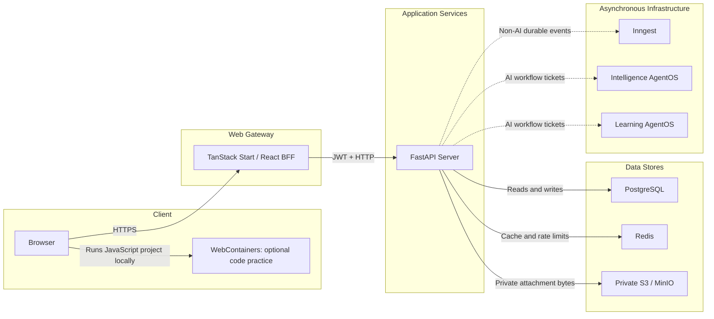

# Shifu Architecture and Technology Stack

This document describes Shifu's architecture and technology decisions. Package
manifests and lockfiles remain the source of truth for exact dependency versions.

## System overview

```text
Browser
   ↓
Web — TanStack Start / React
   ├── UI and routing
   ├── authentication and BFF
   ├── server-state cache
   ├── skill graph
   └── Mentor streaming over SSE
   │
   │ HTTPS + JWT
   ↓
Server — FastAPI
   ├── Identity
   ├── Communication
   ├── Curriculum
   ├── Learning
   ├── Intelligence
   │   ├── private attachments and agentic workflows with Agno AgentOS
   │   ├── typed Jev decisions through the OpenRouter Decisions API
   │   └── classical NLP
   ├── Gamification
   └── Shared
       ├── PostgreSQL
       ├── Redis
       ├── private S3-compatible attachment storage
       └── Inngest
```

The browser communicates with the TanStack Start application. The TanStack Start server
will act as a backend for frontend (BFF) for authentication and operations that should
not expose API details to the browser. The BFF will call FastAPI with a JWT verifiable
through JWKS. FastAPI will enforce authorization and domain rules inside the modules
that own them.

### System architecture diagram



Solid edges represent synchronous request, persistence, and practice paths.
Dotted edges represent asynchronous boundaries. Diagnostic and learning code
practice runs optionally in the browser; official rubric evaluation remains
server-owned and does not execute submitted code.

## Repository organization

```text
shifu/
├── apps/
│   ├── web/
│   │   ├── package.json
│   │   ├── pnpm-lock.yaml
│   │   └── src/
│   └── server/
│       ├── pyproject.toml
│       ├── uv.lock
│       └── src/
│           ├── main.py
│           └── shifu/
│               ├── shared/
│               │   └── database/
│               │       ├── seed.py
│               │       └── seed_data.py
│               ├── identity/
│               ├── communication/
│               ├── curriculum/
│               ├── learning/
│               ├── intelligence/
│               └── gamification/
├── packages/
└── documentation/
    ├── architecture.md
    ├── modules.md
    └── rules/
```

Each application owns its environment and dependency management:

- `apps/web` uses Node.js, pnpm, `package.json`, and `pnpm-lock.yaml`;
- `apps/server` uses Python, uv, `pyproject.toml`, `uv.lock`, and a local `.venv`;
- installed dependencies, virtual environments, caches, and build artifacts are not
  versioned;
- lockfiles are versioned to make installations reproducible;
- `packages` is reserved for independently reusable packages with explicit public APIs.

## Web application

### Current stack

| Area | Technology |
|---|---|
| Language | TypeScript 6 |
| UI | React 19 |
| Framework | TanStack Start |
| Routing | TanStack Router |
| Runtime | Node.js 24 |
| Package manager | pnpm |
| Styling | Tailwind CSS 4 |
| Validation | Zod 4 |
| HTTP client | Axios |
| Icons | Lucide React |
| Linting and formatting | Biome |
| Type checking | `tsc --noEmit` |

### Application capabilities

| Area | Technology or decision |
|---|---|
| UI primitives | shadcn/ui |
| Server state and cache | TanStack Query |
| Forms | TanStack Form |
| Authentication | Better Auth in TanStack Start |
| Skill graph | React Flow |
| Automatic graph layout | ELK.js |
| Code editor | Monaco Editor through `@monaco-editor/react` |
| Learning code practice | WebContainers in supported browsers; edit and submit remain available without execution |
| Mentor streaming | Server-Sent Events (SSE) |
| Unit tests | Vitest |
| Component tests | React Testing Library |
| End-to-end tests | Playwright |
| Quality analysis | SonarQube project `Shifu Web` |

### Responsibilities

The web application owns presentation, accessibility, navigation, and interaction
state. It consumes remote data through explicit contracts. Business rules and official
learning decisions do not belong in routes, components, pages, or browser-side hooks.

The BFF owns the authentication session, protects credentials, and translates the
authenticated identity into the token accepted by FastAPI. It does not replace API
authorization and does not take ownership of business-module rules.

### Web application composition

The application is composed from the outside in:

```text
src/router.tsx
   ↓ registers
generated route tree
   ↓ selects
src/routes/__root.tsx
   ↓ renders
RootLayout
   ├── document head and scripts
   └── RestContextProvider
       └── AppLayout
           └── active route page
```

- `src/router.tsx` creates the TanStack Router from generated route metadata and owns
  router-wide behavior such as scroll restoration and preload defaults.
- `src/routes/__root.tsx` owns document metadata, global styles, and selection of the
  root shell. It must not contain feature behavior.
- `RootLayout` owns document-level composition and provider ordering.
- `RestContextProvider` creates stable REST dependencies at the application boundary.
- `AppLayout` owns the shared application shell and renders the active route content.
- Feature routes select pages and translate route state into page props.

Providers are composed at the narrowest common boundary that needs them. A provider
must expose application semantics through a typed context instead of leaking a
third-party client throughout the component tree.

### Web layers and dependency direction

```text
Routes
  ↓
Feature UI
  ↓
Shared application hooks and contexts
  ↓
REST services and mappers
  ↓
REST client
  ↓
FastAPI

Core contracts ← implemented by adapters and consumed by upper layers
```

#### Routes — `src/routes`

Routes are thin application adapters. They may:

- declare TanStack Router paths and route metadata;
- validate path and search parameters;
- apply authentication or authorization middleware;
- read route state and pass it to a page;
- translate page callbacks into navigation.

Routes must not own reusable UI, business rules, remote-data orchestration, or complex
interaction state. Canonical internal paths belong in `src/constants/routes.ts`.
Generated route metadata is not edited manually.

#### Feature UI — `src/ui/<module>`

Feature-owned UI is grouped by the business module that owns the experience:

```text
src/ui/<module>/
├── hooks/
└── widgets/
    ├── components/
    ├── layouts/
    └── pages/
```

Pages compose a feature experience. Components render focused pieces of that
experience. Layouts own reusable composition within the feature. Stateful widgets
keep their interaction behavior in a colocated `use-<widget>.ts` hook so rendering and
behavior remain separately understandable and testable.

Feature UI may depend on its own module contracts and `ui/shared`. It must not import
another module's internal widget, adapter, or implementation detail. Cross-module
interaction happens through explicit shared contracts, identifiers, or application
composition.

#### Shared UI and application composition — `src/ui/shared`

Shared UI contains application-wide elements rather than business behavior:

- `contexts` composes dependencies and exposes typed application services;
- `hooks` provides stable access to contexts and reusable application semantics;
- `styles` owns global styles and theme integration;
- `widgets/components` contains reusable application components;
- `widgets/layouts` contains application shells and shared layouts.

Shared UI must not become a home for module-specific rules. A component is shared only
when it has a stable, module-neutral responsibility.

#### Core contracts — `src/core`

Core contracts describe stable interfaces and response structures used by the web
application. They remain independent of React, TanStack Router, Axios, and visual
components. Infrastructure adapters implement these contracts; UI code consumes the
contracts without depending on adapter details.

As reusable business contracts grow, they may move into dedicated packages under
`packages`, provided that the package has a clear owner and public API.

#### REST adapters — `src/rest`

The REST layer converts application operations into HTTP calls:

```text
src/rest/
├── axios/       shared transport implementation
├── errors/      normalized transport failures
├── mappers/     API JSON to application structures
└── services/    module-oriented API operations
```

`AxiosRestClient` is the transport adapter. Module services receive a REST client as a
dependency and expose operations in application language. Mappers keep wire formats
from leaking into UI state. HTTP status handling and transport-error normalization stay
inside this boundary.

The UI must not instantiate Axios clients directly. Composition creates adapters and
services once, then exposes them through typed contexts.

#### Constants and environment boundaries — `src/constants`

Route paths, browser-safe environment values, and other stable application constants
live under `src/constants`. Environment values are validated when they enter the
application. Secrets and server-only configuration must never be exposed through
browser environment variables.

### Expected feature flow

```text
Route
  → Page widget
  → Colocated widget hook
  → Query or action hook
  → Module service from context
  → REST client
  → FastAPI endpoint
```

Read hooks return remote state through TanStack Query. Action hooks execute mutations
and invalidate the smallest stable query-key prefix affected by the change. Widgets
handle presentation and user feedback; adapters handle transport; FastAPI and the
owning domain module make authoritative business decisions.

## Server application

### Current stack

| Area | Technology |
|---|---|
| Language | Python 3.13 |
| HTTP framework | FastAPI |
| Project management | uv |
| HTTP validation and schemas | Pydantic v2 |
| API contract | OpenAPI generated by FastAPI |

### Application capabilities

| Area | Technology or decision |
|---|---|
| Database | PostgreSQL |
| ORM | SQLAlchemy 2 |
| Migrations | Alembic |
| PostgreSQL driver | psycopg 3 |
| Cache and rate limiting | Redis |
| BFF-to-API authentication | JWT validated through JWKS |
| Authorization | FastAPI and domain rules |
| Asynchronous processing | Inngest |
| Agentic workflows | Agno AgentOS, scoped to Intelligence and Learning |
| Private object storage | S3-compatible provider (MinIO for local development) |
| Classical NLP | NLTK |
| Text representation and search | TF-IDF with scikit-learn |
| Text similarity | Cosine similarity |
| Intent classification | Logistic Regression or SVM |
| Activity execution | Optional browser WebContainers for automatic code practice in learning and diagnosis; official code assessment uses Curriculum rubrics through the server-owned AI provider |
| Tests | pytest |
| Route tests | FastAPI `TestClient` |
| Infrastructure tests | Testcontainers |
| Coverage | pytest-cov |
| Linting and formatting | Ruff |
| Type checking | Pyright |
| Quality analysis | SonarQube project `Shifu API` |

### Server composition and layers

`src/main.py` exposes the application created by `shifu.app.FastAPIApp`. The class
owns top-level registration, lifespan resources, global error handlers, module
routers, and the single Inngest endpoint. Each module may evolve through the following
layers:

```text
<module>/
├── core/
│   ├── domain/
│   │   ├── entities/
│   │   ├── structures/
│   │   ├── enums/
│   │   ├── errors/
│   │   └── events/
│   ├── interfaces/
│   └── use_cases/
├── rest/
│   ├── controllers/
│   ├── schemas/
│   └── router.py
├── database/
│   └── sqlalchemy/
│       ├── models/
│       ├── mappers/
│       └── repositories/
├── messaging/
│   ├── brokers/
│   └── jobs/
└── providers/
```

The module core does not depend on FastAPI, SQLAlchemy, Inngest, or other adapters.
Controllers translate HTTP transport into use-case calls. Repositories, brokers, and
providers implement interfaces defined by the core or by explicit shared contracts.

Module use cases obtain their module-owned repository group from a database transaction
context manager. That context manager is the sole transaction owner for its execution
path; request middleware must not also manage the same transaction. Concrete adapters
later prove commit, rollback, and close behavior through integration tests.

The explicit local seed command is implemented by
`shared/database/seed.py` and uses `shared/database/seed_data.py` to coordinate
module-owned seeders. Its narrow Tach exclusion is intentional because this command
is an operational composition boundary rather than a general dependency from shared
infrastructure into business modules.

### Agentic workflow composition

Agno is the orchestration framework for generative AI workflows. Each active AI
module owns a separate native AgentOS runtime and registry: Intelligence owns Mentor
and attachment workflows; Learning owns code evaluation. Shared infrastructure
provides transport, sanitized observability, and the destination-aware durable outbox
adapter, but it does not collect module registrations or decide which module owns an
operation. Bounded Jev rubric decisions remain an Intelligence provider capability.
The provider implements a Shared core assessor port over one immutable,
normalized input assembled from saved Curriculum snapshots and submitted files,
wraps OpenRouter's Decisions API with
server-owned HTTP and Pydantic transport validation, and does not import
Learning or Curriculum entities. Learning owns the grade and effects.
Code question kinds share this decision implementation; their prompt, project
files and saved criteria vary, while kind is context rather than provider dispatch.
This one-step assessment does not construct an Agno Agent, Team, or Workflow.

Agno's `Agent`, `Team`, `Workflow`, and AgentOS primitives are infrastructure details
behind typed core protocols. Each module registry builds only its own workflows and
resources; FastAPI composition manages the two module lifespans without importing
individual workflow classes. The following path applies to Agno-orchestrated
capabilities:

```text
FastAPI controller or owning module AgentOS queue
  ↓
Intelligence use case
  ↓ workflow protocol
Agno workflow adapter
  ├── Agent — model, instructions, and bounded tools
  ├── Team — coordinated specialist agents when collaboration is required
  └── Workflow — explicit, repeatable sequencing and branching
  ↓ validated output
Intelligence use case
  ↓
Owning module validates and applies any state change
```

For Jev rubric decisions, Learning consumes the Shared assessor port and
application composition injects the Intelligence implementation into the
Learning HTTP and Inngest paths. The provider calls OpenRouter's
`POST /api/alpha/decisions` and validates each returned fixed choice.
Neither business module imports the other, and `shifu.composition` needs
no additional dependency.

New Agno implementations live under
`apps/server/src/shifu/intelligence/ai/agno`; existing implementations under the
legacy `ai/generative/agno` layout remain until a scoped refactor migrates them.
NLP technology adapters belong to Intelligence providers; persistent semantic
indexes use Core repository ports and module-owned database adapters.
The Mentor contextual-response implementation uses local Portuguese spaCy and
multilingual E5 embeddings with versioned pgvector indexes, BM25/RRF retrieval,
bounded Agno generation and a separate cumulative Mentor review capability.
The default runtime composes GPT-6 Luna, the technical DeepSeek fallback and JEV
when an OpenRouter key and the account logging-disabled attestation are configured.
Requests require ZDR and deny provider data collection; SDK and provider automatic
fallbacks are disabled. The application lifespan closes the owned inference clients.
The application command `uv run python -m shifu.mentor_indexes` prepares the
non-personal indexes offline. Registered Inngest processing publishes approved
blocks through persisted SSE events; disconnect closes transport only.
Identity authorizes Mentor reads and inference operations against the real active
account and current access revision. Monthly quota and coordinated cross-module
account closure are deferred by Mentor Context revision6; their absence does not
block this delivery. Account guards remain distinct from the transactional
session/attempt/deletion fences; separate account checks do not establish atomic
account revocation across modules. Intelligence retains private idempotent inference
receipts without commercial quota accounting. Langfuse is optional and receives
allowlisted metadata only.
Agents receive only the
minimum authorized context and tools required for the workflow. Tools expose typed
application operations; they do not provide direct access to SQLAlchemy, credentials,
another module's private repository, or unrestricted code execution.

Agno may orchestrate prompting, tool use, specialist agents, review loops, and
structured output. It does not own authorization, business transitions, persistence
policy, official Learning results, Curriculum content, or Gamification state. Every
machine-consumed result is validated through Pydantic or a domain DTO before it crosses
the workflow boundary.

FastAPI owns request and SSE transport. Request-bound AI operations call the registered
workflow through the owning module's internal AgentOS client and pass private input
through a trusted, single-use in-memory handoff; native run records contain only the
opaque reference and safe status. The owning module's AgentOS queue admits durable AI
workflows, and Inngest handles durable non-AI work such as email delivery and scheduled
operations. The transactional outbox records the destination; a broker acknowledges
only its own destination's durable admission. Model providers, credentials, quotas,
timeouts, retry limits, and token limits remain provider configuration rather than
agent-selected values.

Shared attachment storage is a technical byte-and-key capability. `FileStorageProvider`
and its S3-compatible adapter have no Intelligence policies or account rules.
Intelligence owns attachment authorization, validation, retention, and deletion; private
objects are read through authenticated API boundaries and never through public URLs.

## Module boundaries

Modules are business boundaries, not only directories. Each module owns its rules,
use cases, persistence, endpoints, and user experience.

- **Identity**: account, access, session, basic profile, status, and time zone.
- **Curriculum**: official content, skills, competencies, materials, activities, and
  evaluation rules.
- **Learning**: objectives, diagnostics, attempts, evaluations, progress, mastery,
  recommendations, and individual history.
- **Gamification**: XP, level, streak, calendar, achievements, and rewards.
- **Intelligence**: Mentor and Goal Planner, without authority to change official
  Learning or Gamification state.
- **Shared**: reusable technical infrastructure without business rules.

Business modules do not import one another. They exchange identifiers, stable Shared
contracts, and business events through application composition and adapters. Shared
contains `AuthenticationProvider` and immutable `AuthenticatedUser`; Identity supplies
the implementation while protected modules depend only on that Shared contract.

### Business dependencies

```text
Identity ───────→ Learning
    ├───────────→ Intelligence
    └───────────→ Gamification

Curriculum ─────→ Learning
    └───────────→ Intelligence

Learning ───────→ Intelligence
    └───────────→ Gamification

Gamification ───→ Intelligence
Intelligence ───→ Learning
```

The arrows represent identity, content, context, proposals, or confirmed facts. They
do not transfer authority between modules. `documentation/modules.md` defines the
complete ownership and dependency model.

## Synchronous and asynchronous processing

Operations that require an immediate response remain in FastAPI's HTTP flow. The
owning module's native AgentOS queue handles durable AI workflows. Inngest handles
non-AI work that can happen after the response, including:

- sending email;
- scheduled tasks;
- secondary or long-running processing;
- asynchronous effects between modules.

Both async paths receive stable ID-only events or tickets and must be idempotent when
execution can be retried. The transactional outbox records an explicit destination;
each broker reserves and acknowledges only its own destination. AgentOS registries,
queues, storage schemas, and lifecycles belong to their owning AI module. Shared owns
transport and sanitized observability, not a cross-module workflow catalog. NLP
reindexing runs through its owning preparation path.

## Code execution

Learning code questions use a fixed Curriculum project with designated initial files
editable by the learner. The initial types are JavaScript function, JavaScript
standard-input program, HTML/CSS/JavaScript page, React component or application,
Fastify REST API, and one integrated React + Fastify project question. For React and
React + Fastify questions, Curriculum may authorize additional files and define
their allowed directories, extensions, and maximum count per question. Learners
cannot create files outside those limits, change project configuration, or install
packages.

In a supported browser, WebContainers provide optional practice execution. Every
code question starts its practice environment automatically and refreshes output
when files change, without an Execute button. JavaScript standard-input programs
run with empty stdin on load and after edits until the learner supplies input,
so output independent of input appears immediately; the terminal still invites
input. Subsequent edits rerun with the most recent practice input. An interactive xterm.js terminal
connects to the practice environment, accepts only commands permitted by the
question model, and occupies the Terminal tab of the practice panel, including
questions without a preview or HTTP panel. Pages and React projects have a visual preview;
Fastify projects have a local HTTP request/response panel; the integrated project
has both. HTTP requests remain learner initiated. Practice output, preview, and HTTP
responses do not affect the official grade. Editing and final submission remain
available when WebContainers cannot run.

Learning sends only the designated initial files, authorized files created by the
learner, and the Curriculum rubric for official assessment through the server-owned
provider boundary. Diagnostic and learning code both use the rubric, without test
cases; diagnostic responses and individual evaluations stay hidden from the learner.
Jev 1.13 selects fixed rubric level IDs through
an Intelligence-owned provider using OpenRouter's Decisions API. The provider
asks closed-set Choice questions over immutable Shared snapshots and returns
typed decisions; it does not require Agno or generate new feedback text. Learning
validates those decisions, maps each level to its saved comment or observation
ID, calculates the weighted grade and
remains the authority for attempts, evidence, progress, and completion. A submitted
Activity creates one immutable official attempt; provisional question feedback and local drafts
do not create one.

Official assessment of diagnostic and learning code reads the submitted source and
Curriculum rubric through the server-owned provider boundary. It does not run hidden
test cases. FastAPI never executes user-submitted code inside the API process.

```text
Code practice: Browser → WebContainers → terminal / preview / local HTTP panel
Code submit: Browser → FastAPI → rubric assessment → Learning evaluation
```

The application distinguishes these flows with different effects:

```text
Practice run
├── starts and refreshes automatically in a supported browser
├── returns practice output and preview or HTTP response
└── does not change official progress

Code submit
├── assesses editable source against Curriculum rubric without test cases
├── produces an official evaluation
├── updates Learning state once
└── may emit confirmed facts for Gamification

Diagnostic code submit
└── exposes only consolidated results, keeping individual responses and assessments hidden
```

Browser practice must keep the learner project isolated from Shifu authentication
and application state. Shifu bounds each practice run by time and output and
bounds the editable project by size; the browser manages CPU and memory because
the WebContainers API exposes no configurable CPU or memory quota. If the
browser exhausts resources or practice becomes unavailable, editing and final
submission remain available, and practice failure never determines the grade.

## Quality

```text
Web
├── Biome
├── TypeScript / tsc
├── Vitest
├── React Testing Library
├── Playwright
└── SonarQube / Shifu Web

Server
├── Ruff
├── Pyright
├── pytest
├── FastAPI TestClient
├── Testcontainers
├── scoped coverage runners
└── SonarQube / Shifu API
```

A single SonarQube instance may host `Shifu Web` and `Shifu API` while keeping their
analysis and quality gates independent.

## Pending decisions

- validate the browser-practice time/output/project-size limits, supported environments, and WebContainers deployment configuration on the target host;
- define JWT/JWKS issuance, audience, expiration, and key rotation;
- define operational limits for SSE, AI usage, and code execution.
