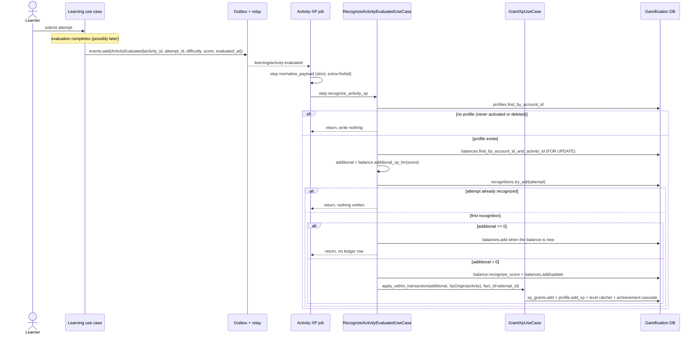
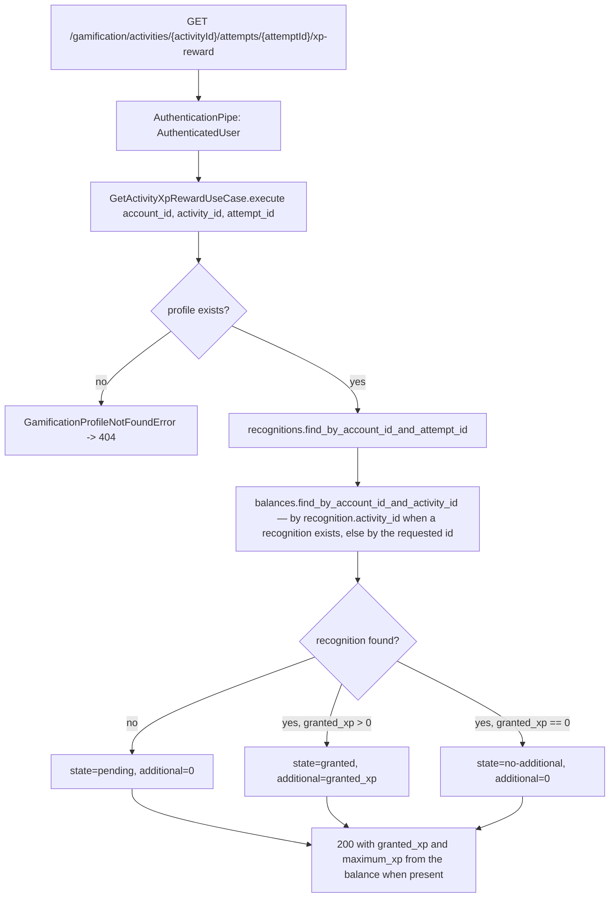

# Objective

Grant XP proportional to an evaluated learning Activity's score, capped globally
per account and Activity, and show the confirmed additional XP in a reward band
on the Activity result, separated from the score and from Learning's pedagogical
progress.

Current behavior: Gamification already recognizes every *other* confirmed
Learning fact. `GrantXpUseCase` is the single cascade orchestrator for XP, the
level ratchet and achievements (`grant_xp_use_case.py`); milestone XP for
diagnostics, first mastery and first completion ships in
[`../achievements/spec.md`](../achievements/spec.md); practice days and the
streak ship in [`../practice-calendar/spec.md`](../practice-calendar/spec.md),
already consuming `learning/activity-evaluated` through its own job; the
`Histórico de XP` tab ships in [`../xp-history/spec.md`](../xp-history/spec.md)
and already maps `XpSource.ACTIVITY` to the `Atividade` descriptor
(`get_xp_history_use_case.py:11`). What is missing is the **producer**: nothing
in the system ever writes an `XpSource.ACTIVITY` grant, so RP-02 is unrealized
and `ActivityXpBalance` — the entity that already implements RP-02's exact
formula (`activity_xp_balance.py`, added unused by commit `37f2395`,
`maximum_xp ∈ {10, 20, 30}`, `additional_xp_for`, `recognize_score`) — has no
repository, no table, no caller. The Activity result page
(`choice-result-page/index.tsx`) shows score, progress and question details with
no reward feedback of any kind. This Spec delivers that producer and that band.

Mode: **complete**. The slice adds two persisted tables, one of them a *mutable
accumulator* whose double-counting failure is silent and permanent; it adds a
third consumer to an event that two jobs already consume under `extra='forbid'`;
and it crosses an asynchronous boundary into a synchronous page that must never
block on it.

# Scope

| Area / actor | Included | Excluded or deferred |
| --- | --- | --- |
| Activity XP grant (Sistema) | A learning Activity whose evaluation completed grants `floor(max × nota / 100) − XP já concedido naquela Atividade`, bounded below at 0, with `max` fixed by difficulty; persisted as one `XpGrant` through the existing cascade | Any change to XP amounts, difficulty values or the level curve; any XP for diagnostic attempts, which are not Atividades and reach Gamification through `learning/diagnostic-completed` |
| Global cap (Sistema) | One accumulator per account and `activity_id`, independent of Objetivo and Habilidade, never reset by removing its pedagogical origin, still eligible after the Habilidade is completed | Per-Objetivo or per-experience caps, explicitly rejected by the PRD's discarded-decisions table |
| Per-fact consistency (Sistema) | One recognition record per evaluated attempt, including the zero-XP outcome; redelivery, concurrent delivery and retry after failure never grant twice | A general event-id dedup table; idempotency stays keyed on the Learning fact, as every sibling consumer already does |
| Reward band (Usuário) | A band on the Activity result showing this submission's confirmed additional XP, its pending state, its no-additional state and its unavailable state, in pt-BR, keyboard-safe and responsive | The grouped celebration modal, the level-up transition, achievement announcements and the seen/unseen control — RP-09, excluded by Jira and owned by `SHIFU-115`; `RewardFeedback` stays unused by this slice |
| XP history integration (Usuário) | Activity grants appear in the existing `Histórico de XP` tab with the Activity's own title as their readable origin | Any change to `GetXpHistoryUseCase`, the history surface, its ordering or its total |
| Account lifecycle (Sistema) | Both new tables purged with the rest of the Gamification state; no new grant for an account without a profile | The 24-hour purge orchestration itself, already owned by the existing deletion job |
| Milestones, streak, levels, achievements | **Unchanged and asserted as non-regressed.** Activity XP enters the existing cascade by calling the existing orchestrator | Re-implementing any of them, explicitly out of scope per Jira |

Selected product outcomes for this bounded slice:

| RP | Classification | Rationale |
| --- | --- | --- |
| RP-01 | partial | Every read and write is private to the owning account; the profile itself already exists |
| RP-02 | full | Eligibility, the difficulty maxima, the floor formula, incremental improvement, the global per-Activity cap, zero-score, no-improvement, post-completion eligibility and both experience rules are all delivered |
| RP-03 | full, pre-existing | Delivered by [`../achievements/spec.md`](../achievements/spec.md); this slice adds nothing and asserts no regression (`CA-10`) |
| RP-04 | partial | Activity XP feeds the existing stored level ratchet; the level curve and the level surfaces are untouched |
| RP-05 | full, pre-existing | Practice-day recognition from this same event is already delivered by [`../practice-calendar/spec.md`](../practice-calendar/spec.md); this slice adds a sibling consumer and asserts no regression (`CA-11`) |
| RP-07 | partial | Activity XP enters the existing achievement cascade and can unlock through it; the catalogue, criteria and cascade logic are untouched |
| RP-08 | partial | Activity grants gain a producer and therefore a readable origin and both dates in the already-delivered ledger; the per-Activity maximum the PRD requires preserving becomes real |
| RP-09 | partial | Only the inline band for an XP-only return ("faixa em linha, no resultado correspondente, sem abrir modal"); every modal rule is deferred to `SHIFU-115` |
| RP-11 | full | Activity XP never blocks Learning, is recovered on retry without learner action, and cannot duplicate |
| RP-12 | partial | Balances and recognitions are purged and blocked for a deleted account, inside the existing deletion path |
| RP-13 | partial | Responsive, pt-BR, keyboard-safe and non-colour-only for the new band |

**Accepted visual assumption, stated explicitly.** Jira names component
`p9k7IZ` and states `oPNtH` / `Qxidv`. `oPNtH` and `Qxidv` are the *existing*
Activity-result frames already saved and inspected under
[`../../learning/js-code-question/design/`](../../learning/js-code-question/design/handoff.md)
— the collapsed and all-open states of the very page this band is inserted into,
which is why the band must sit outside the question disclosures and stay visible
in both. No reference for `p9k7IZ` is saved anywhere in this repository and no
Pencil session was available while authoring. The band's visual contract is
therefore taken from textual design authority, which is unambiguous for every
state this slice renders: `documentation/design.md` §6.4 T27 ("o retorno de
Gamification aparece em um bloco separado, nunca dentro do resultado
pedagógico"), §6.5 T35 (grouped, textual, accessible, visually separated from
Learning's result), and §3 tokens (`--latao-solid` for XP numerals, JetBrains
Mono for numerals, state cues never by colour alone). This is a recorded
assumption, not a missing-and-required reference; no feature-local `design/`
folder is created for images that do not exist.

# Behavior Contract

| ID | RP/JN/source coverage | Observable required behavior |
| --- | --- | --- |
| RF-01 | RP-02, RP-11; JN-02; Jira CA-01 | Only a learning Activity whose evaluation completed grants Activity XP. A pending evaluation and a failed evaluation grant nothing, and neither produces a recognition record. |
| RF-02 | RP-02; Jira CA-02 | The maximum per Activity is 10 XP for `easy`, 20 for `medium` and 30 for `hard`. The corresponding XP is the integer part of `maximum × nota / 100`. One attempt grants `max(0, corresponding − already granted for that Activity)`, so gradual improvements total exactly what the best score would have granted at once. |
| RF-03 | RP-02; JN-12; Jira CA-03 | The cap is per account and `activity_id`, independent of Objetivo and Habilidade. A worse score removes no XP, a repetition without improvement grants 0, score 0 grants 0, an Activity answered after its Habilidade was completed stays eligible for the XP not yet earned on it, and removing the Objetivo or Habilidade never resets the cap. |
| RF-04 | RP-04, RP-07; JN-02, JN-07; Jira CA-07 | Granted Activity XP enters the account's total, the stored level ratchet and the achievement cascade through the single existing orchestrator, and the cascade reaches a stable state in the same transaction, including achievement XP that causes further levels or achievements. |
| RF-05 | RP-08, RP-11; JN-09, JN-11; Jira CA-08 | Every granted amount is recorded once, with the Activity's own title as its readable origin, the evaluation's date as the fact date and the concession date beside it. Redelivery, concurrent delivery and recovery after a Gamification failure never grant twice and never double-count the accumulator; the preserved per-Activity maximum stays consistent with the recorded grants. |
| RF-06 | RP-02, RP-09; JN-02; Jira CA-09 | The Activity result shows this submission's confirmed additional XP in a band separated from the score and from pedagogical progress — an `easy` Activity scored 67 with nothing previously granted on it shows `+6 XP` — and the band stays visible with the question details collapsed or open. |
| RF-07 | RP-02, RP-11; JN-11; Jira CA-10 | When a submission earned no additional XP, the band states that plainly and never suggests a loss or a gain that does not exist. While Gamification has not yet confirmed, and when its read fails or never resolves, the band says so, and Learning's evaluation, score, progress and result stay fully available and unaltered. |
| RF-08 | RP-01, RP-12; JN-13; Jira CA-11 | The band read returns only the authenticated account's own data. An account with no Gamification profile receives 404 and an unauthenticated request 401. A deleted account has its balances and recognitions purged with the rest of its state, and a later Activity fact for it produces no effect. |
| RF-09 | RP-13; Jira CA-12 | The band works on desktop and at a narrow viewport, in pt-BR, identifies each of its states textually rather than by colour or icon alone, announces the resolution of its pending state to assistive technology, and introduces no keyboard trap or focus steal into the result page. |

| ID | RF coverage | Given | When | Then | Checks |
| --- | --- | --- | --- | --- | --- |
| CA-01 | RF-01 | An account with a Gamification profile and an `easy` Activity never answered before | `learning/activity-evaluated` with score `67` is delivered | `total_xp` increases by exactly 6, one `XpGrant` with `source=activity` and `fact_id` equal to the attempt exists, and the balance reads `granted_xp=6`, `maximum_xp=10` | CI-01, CI-05 |
| CA-02 | RF-01 | An attempt whose evaluation is pending, and one whose evaluation failed | The reward for either is read | No grant, balance or recognition exists for them and the read answers `pending`. Learning publishes `learning/activity-evaluated` only for a completed evaluation — a pre-existing emission rule this slice neither changes nor re-proves; its evidence is Learning's own suite | CI-03, CI-04 |
| CA-03 | RF-02 | An unanswered Activity of each difficulty | Scores `100`, `67`, `50`, `1` and `0` are recognized on separate Activities | The granted amounts are the integer part of `maximum × nota / 100` for `maximum` 10, 20 and 30 respectively, never rounded up and never negative | CI-01 |
| CA-04 | RF-02 | A `medium` Activity already granted 10 XP at score 50 | A later attempt scores 80 | That attempt grants exactly 6 more, and the balance reads 16 | CI-01 |
| CA-05 | RF-02 | A `medium` Activity answered at 50 then 80 | Compared against the same Activity answered once at 80 | Both paths total 16 XP for the account | CI-01 |
| CA-06 | RF-02, RF-03 | An Activity already granted its full maximum | A further attempt scores 100 again, and another scores 40 | Both grant 0, no `XpGrant` row is written for them, and `granted_xp` stays at the maximum | CI-01 |
| CA-07 | RF-03 | An Activity already rewarded for this account under one Objetivo | The same `activity_id` is evaluated under a different Objetivo and Habilidade experience | The cap continues from the existing balance; no second accumulator is created for the same account and Activity | CI-01, CI-06 |
| CA-08 | RF-03 | An account whose Objetivo or Habilidade carrying a rewarded Activity was removed in Learning | A new experience of the same Habilidade evaluates that same Activity | No XP beyond the unclaimed remainder is granted, and no stored grant or balance is removed or reset | CI-01 |
| CA-09 | RF-03 | A Habilidade already completed, with one of its Activities only partly rewarded | That Activity is answered again with a better score | The remaining XP is granted normally | CI-01 |
| CA-10 | RF-04 | The pre-existing milestone, cascade and level behavior | An Activity grant crosses a level threshold that satisfies an achievement criterion | The level rises, the achievement is earned with its own XP, the cascade stabilizes, and every pre-existing milestone and cascade assertion still passes unchanged | CI-01, CI-11 |
| CA-11 | RF-01, RF-05 | The pre-existing practice-day consumer of `learning/activity-evaluated`, which validates with `extra='forbid'` | The same event is delivered with the new Activity-XP consumer also registered | Both functions run independently, the practice day is still recognized exactly once and the Activity XP is granted exactly once; neither failure blocks the other | CI-05, CI-06 |
| CA-12 | RF-04, RF-05 | An evaluated Activity granting XP | The recognition commits | The `XpGrant`, the accumulator update, the recognition record, the profile total, the level and every cascade effect are committed as one unit; no partial state is observable | CI-01, CI-06 |
| CA-13 | RF-05 | An already-recognized attempt | Its event is delivered a second time | The recognition insert is refused, nothing else is written, `total_xp` and `granted_xp` are unchanged, and the job completes without error | CI-01, CI-05 |
| CA-14 | RF-05 | Two deliveries for two different attempts on the same Activity racing concurrently, once with no balance row yet and once with one already present | Both jobs run, including any retry they need | Each attempt grants only its own increment, the accumulator never exceeds the Activity maximum, and the sum of the written grants equals the final `granted_xp` — whether the race is resolved by the row lock or by one transaction aborting whole and being retried | CI-06 |
| CA-15 | RF-06 | An `easy` Activity scored 67 with no previous grant, already recognized by Gamification | The learner opens that attempt's result | The band shows `+6 XP`, outside the question disclosures, separated from the score and the progress block, and stays visible with details collapsed and open | CI-03, CI-04, CI-07, CI-09, VM-01 |
| CA-16 | RF-06, RF-08 | Two accounts each with their own attempt on the same Activity | Account A reads the band endpoint for B's attempt | Only A's own recognition can be read; B's amount is never returned | CI-04 |
| CA-17 | RF-07 | Gamification has not yet processed the evaluation; then a submission that earned no additional XP; then an unavailable Gamification read | The result page renders in each case | A pending state, then a plain no-additional statement, then an unavailable statement — never a loss, never an invented amount — while the score, progress, question details and recommendation render unaffected in all three | CI-03, CI-07, CI-08, CI-09, VM-01 |
| CA-18 | RF-08 | An authenticated account with no Gamification profile, and an unauthenticated request | The band endpoint is called | 404 and 401 respectively, and the result page still renders its Learning content | CI-04, CI-07 |
| CA-19 | RF-08 | An account with balances and recognitions whose profile is deleted | The existing deletion path runs | Both new tables have no row for that account, and a later Activity fact for it writes nothing | CI-02, CI-06 |
| CA-20 | RF-09 | The result page carrying the band | It is opened at a narrow viewport and operated by keyboard, and the pending state resolves | The band reflows without horizontal overflow, every state is identified textually, the resolution is announced politely, and tab order through the page is unchanged with no focus steal | CI-07, VM-01, VM-02 |

# Technical Contract

## Architecture Mapping

Owner: **Gamification**, end to end on the server. The only Learning-side change
is one optional render slot on an existing web page; the band itself and all its
data belong to Gamification, composed at the route boundary. Rules:
[python-conventions](../../../rules/python-conventions-rules.md),
[core-layer](../../../rules/core-layer-rules.md),
[database-layer](../../../rules/database-layer-rules.md),
[messaging-layer](../../../rules/messaging-layer-rules.md),
[rest-layer](../../../rules/rest-layer-rules.md),
[server-app-layer](../../../rules/server-app-layer-rules.md),
[use-case-testing](../../../rules/use-case-testing-rules.md),
[controllers-testing](../../../rules/controllers-testing-rules.md),
[jobs-testing](../../../rules/jobs-testing-rules.md),
[typescript-conventions](../../../rules/typescript-conventions-rules.md),
[ui-layer](../../../rules/ui-layer-rules.md),
[web-app-routing](../../../rules/web-app-routing-rules.md),
[widget-testing](../../../rules/widget-testing-rules.md).

`apps/server/tach.toml` declares `shifu.gamification → ["shifu.shared"]` only, so
no Learning symbol may be imported: the new job re-declares its wire contract in
a private Pydantic `_Payload`, and the difficulty-to-maximum mapping is a local
Gamification constant over the wire's string values, never Learning's
`ActivityDifficulty`.

### The two-record decision

RP-02's cap is an **accumulator** (how much of this Activity's maximum the
account has already taken), while RP-11's at-least-once delivery needs a
**per-fact** gate. One record cannot serve both, because the zero-XP outcome is
real and must be distinguishable from "not processed yet": a 0 amount writes no
`XpGrant` at all (`xp_grant.py` requires `amount ≥ 1`), and the accumulator
alone cannot say which attempt it last saw — attempts on one Activity interleave,
and every attempt's result page stays permanently addressable.

**Selected approach: the accumulator plus one append-only recognition per
attempt.** `ActivityXpBalance` keeps the cap; a new `ActivityXpRecognition`
records every processed evaluation, including the zero ones, under a unique
`(account_id, attempt_id)` constraint inserted through `try_add` — the exact
pattern `SqlalchemyRewardedMilestonesRepository.try_add` and
`SqlalchemyPracticeDaysRepository.try_add` already use. It is simultaneously the
idempotency gate (`CA-13`, `CA-14`), the band's read source (`CA-15`, `CA-17`)
and the audit of a zero-XP attempt that the ledger deliberately does not carry.

Two alternatives were rejected against this repository's own constraints:

- **Accumulator only, inferring pending-vs-zero from elapsed time.** Relies on
  the band showing "nenhum XP adicional" for a grant that is merely slow, then
  correcting itself — a transient false statement about a reward, against RF-07.
- **A zero-amount `XpGrant` row.** `XpGrant.__post_init__` forbids
  `amount < 1`, and RP-08's ledger is "o XP total deve ser explicável pelo
  conjunto desses registros"; padding it with empty rows weakens exactly the
  guarantee [`../xp-history/spec.md`](../xp-history/spec.md) asserts.

### Gamification — core

| Action | Boundary | Element / Path | Required change |
| --- | --- | --- | --- |
| Create | Core / entity | `ActivityXpRecognition` — `apps/server/src/shifu/gamification/core/domain/entities/activity_xp_recognition.py` | New `frozen_entity`; re-exported from the package `__init__.py` |
| Create | Core / enum | `ActivityXpRewardState` — `.../core/domain/enums/activity_xp_reward_state.py` | `pending`, `granted`, `no-additional`; re-exported from `enums/__init__.py` |
| Create | Core / structure | `ActivityXpReward` — `.../core/domain/structures/activity_xp_reward.py` | The band's read result; re-exported from `structures/__init__.py` |
| Create | Core / interface | `ActivityXpBalancesRepository` — `.../core/interfaces/activity_xp_balances_repository.py` | New `Protocol`; re-exported from `interfaces/__init__.py` |
| Create | Core / interface | `ActivityXpRecognitionsRepository` — `.../core/interfaces/activity_xp_recognitions_repository.py` | New `Protocol`; re-exported from `interfaces/__init__.py` |
| Modify | Core / interface | `GamificationDatabaseRepositories` — `.../core/interfaces/gamification_database.py` | Add `activity_xp_balances` and `activity_xp_recognitions` so the recognition, the accumulator and the whole XP cascade share one transaction |
| Create | Core / use case | `RecognizeActivityEvaluatedUseCase` — `.../core/use_cases/recognize_activity_evaluated_use_case.py` | Grant the incremental Activity XP for one evaluated attempt; re-exported from `use_cases/__init__.py` |
| Create | Core / use case | `GetActivityXpRewardUseCase` — `.../core/use_cases/get_activity_xp_reward_use_case.py` | Resolve one attempt's reward state for the band; re-exported from `use_cases/__init__.py` |
| Modify | Core / use case | `DeleteGamificationProfileUseCase` — `.../core/use_cases/delete_gamification_profile_use_case.py` | Add `activity_xp_balances.remove_many_by_account_id` and `activity_xp_recognitions.remove_many_by_account_id` to the purge |
| Unchanged | Core / entity | `ActivityXpBalance` — `.../core/domain/entities/activity_xp_balance.py` | Consumed exactly as written by `37f2395`. It already enforces `maximum_xp ∈ {10, 20, 30}`, `granted_xp ≤ maximum_xp`, the floor formula in `additional_xp_for` and the monotonic `updated_at` in `recognize_score`. No field, validation or method is added |
| Unchanged | Core / use case | `GrantXpUseCase` — `.../core/use_cases/grant_xp_use_case.py` | Called through its existing `apply_within_transaction`; the level ratchet and the achievement cascade are reused with no edit |
| Unchanged | Core / use case | `GetXpHistoryUseCase` — `.../core/use_cases/get_xp_history_use_case.py` | Already maps `XpSource.ACTIVITY` to `'Atividade'`; Activity rows render with the Activity's own title above that descriptor with **no read-path change** |
| Unchanged | Core / entity | `RewardFeedback` — `.../core/domain/entities/reward_feedback.py` | Stays unused. It is RP-09 scaffolding owned by `SHIFU-115`, which Jira excludes here; this slice must not create its table or write to it |

```python
@frozen_entity
class ActivityXpRecognition:
    id: str
    account_id: str
    activity_id: str
    attempt_id: str
    granted_xp: int            # 0 when the attempt earned no additional XP
    xp_grant_id: str | None    # None exactly when granted_xp == 0
    occurred_at: datetime      # the evaluation's own date
    recognized_at: datetime

    @classmethod
    def create(
        cls,
        *,
        id: str,
        account_id: str,
        activity_id: str,
        attempt_id: str,
        granted_xp: int,
        xp_grant_id: str | None,
        occurred_at: datetime,
        recognized_at: datetime,
    ) -> 'ActivityXpRecognition': ...


class ActivityXpRewardState(StrEnum):
    PENDING = 'pending'
    GRANTED = 'granted'
    NO_ADDITIONAL = 'no-additional'


@structure
class ActivityXpReward:
    activity_id: str
    attempt_id: str
    state: ActivityXpRewardState
    additional_xp: int          # this attempt's own grant; 0 unless GRANTED
    granted_xp: int             # cumulative for the Activity; 0 with no balance
    maximum_xp: int | None      # None until the Activity has a balance


class ActivityXpBalancesRepository(Protocol):
    def find_by_account_id_and_activity_id(
        self, account_id: str, activity_id: str
    ) -> ActivityXpBalance | None:
        """The account's accumulator for one Activity, locked for the open transaction."""
        ...

    def add(self, balance: ActivityXpBalance) -> None: ...

    def update(self, balance: ActivityXpBalance) -> None: ...

    def remove_many_by_account_id(self, account_id: str) -> None: ...


class ActivityXpRecognitionsRepository(Protocol):
    def try_add(self, recognition: ActivityXpRecognition) -> bool:
        """Insert one recognition; return False when that attempt was already processed."""
        ...

    def find_by_account_id_and_attempt_id(
        self, account_id: str, attempt_id: str
    ) -> ActivityXpRecognition | None: ...

    def remove_many_by_account_id(self, account_id: str) -> None: ...


class RecognizeActivityEvaluatedUseCase:
    def __init__(
        self,
        database: GamificationDatabase,
        curriculum_content_provider: CurriculumContentProvider,
        identifier_provider: IdentifierProvider,
        grant_xp_use_case: GrantXpUseCase,
    ) -> None: ...

    def execute(
        self,
        account_id: str,
        activity_id: str,
        attempt_id: str,
        goal_id: str,
        skill_experience_id: str,
        *,
        difficulty: str,
        score: Decimal,
        occurred_at: datetime,
        now: datetime,
    ) -> None: ...


class GetActivityXpRewardUseCase:
    def __init__(self, database: GamificationDatabase) -> None: ...

    def execute(
        self, account_id: str, activity_id: str, attempt_id: str
    ) -> ActivityXpReward: ...
```

`RecognizeActivityEvaluatedUseCase` holds the private maximum mapping
`{'easy': 10, 'medium': 20, 'hard': 30}` and raises `InvalidGamificationError`
for any other value; the job rejects an unmapped difficulty non-retriably before
reaching it, so the core guard is defensive rather than a runtime path. Inside
one `GamificationDatabase.transaction()` it:

1. returns without writing when `profiles.find_by_account_id` is `None` — the
   account was never activated or was already purged, matching the no-profile
   convention every sibling recognition use case already follows;
2. loads the locked balance for `(account_id, activity_id)`, or builds a new one
   through `ActivityXpBalance.create(maximum_xp=…, created_at=now)` without
   persisting it yet;
3. computes `additional = balance.additional_xp_for(score)` — pure, no mutation;
4. attempts `recognitions.try_add(ActivityXpRecognition.create(…, granted_xp=additional,
   xp_grant_id=grant_id if additional else None, occurred_at=occurred_at,
   recognized_at=now))` and **returns immediately on `False`**, which is the
   single idempotency gate for redelivery and concurrent delivery;
5. when `additional == 0`, persists only a newly built balance — so the band can
   still report `maximum_xp` — and returns without touching the ledger, because
   a zero-amount `XpGrant` is invalid and RF-07 forbids claiming a gain;
6. otherwise calls `balance.recognize_score(score, recognized_at=now)`, persists
   the balance through `add` or `update`, resolves the origin label, and calls
   `grant_xp_use_case.apply_within_transaction(repositories, account_id,
   grant_id, additional, origin, attempt_id, occurred_at=occurred_at, now=now)`.

The origin is
`XpOrigin(source=XpSource.ACTIVITY, reference_id=activity_id,
label=<the Activity's own title>, goal_id=goal_id,
skill_experience_id=skill_experience_id)`. The label is resolved **after** the
idempotency gate through the existing shared
`CurriculumContentProvider.get_choice_activity(activity_id).title`, falling back
to `'Atividade avaliada'` when the content cannot be resolved — never allowed to
decide whether XP is granted, exactly as
`RecognizeCompetencyMasteredUseCase._competency_name` already behaves. The
optional `goal_id` and `skill_experience_id` fields already on `XpOrigin` are
populated for the first time here; nothing in this slice reads them back, and
the history descriptor stays the fixed `'Atividade'` already shipped, so
[`../xp-history/spec.md`](../xp-history/spec.md) needs no amendment.

`fact_id` on the resulting `XpGrant` is the **attempt** id, not the evaluation
id. The attempt is the submission the learner is looking at, it is the only one
of the two that the web application already holds (`ChoiceAttemptDetail.attemptId`,
and the result route's own `$attemptId` param), and it is 1:1 with the
evaluation of a submitted Activity. Keying on it is what lets the band read the
grant without Learning exposing a new identifier.

`GetActivityXpRewardUseCase` resolves the recognition by `attempt_id` and then
reads the balance by **`recognition.activity_id`**, not by the `activity_id` in
the request path; the path value is used only for the `pending` answer it echoes
back when no recognition exists yet. Trusting the path for the balance would let
a mismatched pair — a real attempt id requested under another Activity's id —
return one attempt's `additional_xp` beside a different Activity's `granted_xp`
and `maximum_xp`. Both reads stay filtered by the session's account id, so this
is a coherence guarantee, not an isolation one.

**New concept — Activity XP balance.** The account's claim on one Activity's
fixed XP budget: `maximum_xp` from the Activity's difficulty, `granted_xp`
already taken. It is *global by `activity_id`*, so the same Activity practised
under another Objetivo or in a re-created Habilidade experience continues from
the same number (`RF-03`), and removing a pedagogical origin never deletes or
resets it. Lifecycle: created on the first evaluated attempt, updated only
upward, deleted only by the account purge. Because `additional_xp_for`
telescopes (`corresponding − already granted`), gradual improvement and a single
best score converge on the same total (`CA-05`) and a worse score yields a
negative difference that `max(0, …)` absorbs (`CA-06`).

**New concept — Activity XP recognition.** One immutable row per evaluated
attempt stating that Gamification *has processed it* and how much it granted,
zero included. Source of truth for the three states the server can report, and
the only place a zero-XP outcome is recorded. Uniqueness is `(account_id, attempt_id)`: the first
delivery wins, every later delivery is absorbed, and a concurrent duplicate
loses the insert and returns before mutating the accumulator. It is deliberately
not a `RewardedMilestone`: that entity requires a non-empty `xp_grant_id` and
models a once-per-subject milestone, while this one must admit the zero case and
repeat per attempt on the same subject.

Its `__post_init__` enforces the invariant that ties the two records together:
`xp_grant_id` is `None` **exactly** when `granted_xp == 0`, and non-empty
whenever `granted_xp > 0`. A row claiming a grant it cannot name, or naming a
grant it did not make, is rejected at construction — which is what keeps the
recognition set and the ledger reconcilable for `RF-05`.

### Gamification — database

| Action | Boundary | Element / Path | Required change |
| --- | --- | --- | --- |
| Create | Database / model | `ActivityXpBalanceModel` — `apps/server/src/shifu/gamification/database/sqlalchemy/models/activity_xp_balance_model.py` | `__tablename__ = 'gamification_activity_xp_balances'`; `id` `String(26)` PK; `account_id` `String(26)` not null; `activity_id` `String(26)` not null; `maximum_xp`/`granted_xp` `Integer` not null; `updated_at` `DateTime(timezone=True)` not null; `UniqueConstraint('account_id', 'activity_id', name='uq_gamification_activity_xp_balance_account_activity')`; `Index('ix_gamification_activity_xp_balance_account_id', 'account_id')` |
| Create | Database / model | `ActivityXpRecognitionModel` — `.../models/activity_xp_recognition_model.py` | `__tablename__ = 'gamification_activity_xp_recognitions'`; `id` `String(26)` PK; `account_id`/`activity_id`/`attempt_id` `String(26)` not null; `granted_xp` `Integer` not null; `xp_grant_id` `String(26)` nullable; `occurred_at`/`recognized_at` `DateTime(timezone=True)` not null; `UniqueConstraint('account_id', 'attempt_id', name='uq_gamification_activity_xp_recognition_account_attempt')`; `Index('ix_gamification_activity_xp_recognition_account_id', 'account_id')` |
| Create | Database / mapper | `ActivityXpBalanceMapper`, `ActivityXpRecognitionMapper` — `.../mappers/activity_xp_balance_mapper.py`, `.../mappers/activity_xp_recognition_mapper.py` | `to_domain` / `to_model`, one file per entity, mirroring `GamificationProfileMapper`; no ORM model crosses the adapter boundary |
| Create | Database / repository | `SqlalchemyActivityXpBalancesRepository` — `.../repositories/activity_xp_balances_repository.py` | `find_by_account_id_and_activity_id` selects `.with_for_update()` so two concurrent deliveries on one Activity serialize instead of interleaving read-modify-write; `add`/`update`/`remove_many_by_account_id` follow the existing repositories |
| Create | Database / repository | `SqlalchemyActivityXpRecognitionsRepository` — `.../repositories/activity_xp_recognitions_repository.py` | `try_add` via `session.begin_nested()` + `flush()` catching `IntegrityError` and returning `False`, exactly as `SqlalchemyRewardedMilestonesRepository.try_add`; plus `find_by_account_id_and_attempt_id` and `remove_many_by_account_id` |
| Modify | Database / composition | `SqlalchemyGamificationDatabase` — `.../gamification_database.py` | Construct both repositories and expose them in `GamificationDatabaseRepositories` |
| Create | Database / migration | `apps/server/migrations/versions/<generated>_create_activity_xp_tables.py` | Create both tables with the columns, PKs, unique constraints and indexes above. `down_revision = '23653c3a7833'` — verified single current head. Generate from `apps/server` with `uv run poe db:migrate "create activity xp tables"` — the task declares `message` as a positional argument (`pyproject.toml:57-59`), so the `--message` form does not apply — then hand-verify; the revision id is Alembic-generated and is **not** fixed by this Spec. Additive only: two new tables, no backfill, no existing column touched |

**Which mechanism covers which race, stated precisely.** Three distinct
mechanisms are required, and the row lock is the narrowest of them:

- **The same attempt delivered twice** is rejected by the unique
  `(account_id, attempt_id)` constraint through `try_add`, which returns `False`
  and ends the execution before anything else is written (`CA-13`).
- **Two different attempts on an Activity that already has a balance row** are
  serialized by `with_for_update()`: the second delivery blocks until the first
  commits, then reads the updated `granted_xp` and grants only its own
  remainder (`CA-14`).
- **Two different attempts racing on an Activity with no balance row yet** are
  *not* covered by the lock — `with_for_update()` locks nothing when no row
  exists, so both deliveries read nothing, both pass `try_add` on their distinct
  `attempt_id`, and both compute the full increment. The duplicate
  `(account_id, activity_id)` then raises at `session.commit()` inside
  `SqlalchemyGamificationDatabase.transaction()`, aborting one delivery's
  **entire** unit — its grant, its accumulator write and its own recognition
  row together. Inngest retries that function, and because its recognition row
  rolled back with everything else, the retry is not blocked by its own earlier
  attempt: it now finds the committed balance, takes the lock, and grants only
  the remainder. Correctness here comes from the unique constraint plus the
  single-transaction rollback and retry, not from the lock.

The same rollback-and-retry path also absorbs the one ordering hazard in this
flow. `ActivityXpBalance.recognize_score` enforces
`recognized_at >= updated_at`, so a delivery whose `now` was read before a
concurrent delivery committed a later `updated_at` raises
`InvalidGamificationError` — a *retriable* failure that writes nothing. The job
reads the clock inside its durable step, exactly as
`RecognizePracticeDayOnActivityEvaluatedJob._recognize` already does, so the
retry carries a fresh `now` and settles. The pre-existing entity is therefore
consumed unchanged, with no clamping and no new validation.

### Gamification — messaging

| Action | Boundary | Element / Path | Required change |
| --- | --- | --- | --- |
| Create | Messaging / job | `RecognizeActivityXpOnActivityEvaluatedJob` — `apps/server/src/shifu/gamification/messaging/inngest/jobs/recognize_activity_xp_on_activity_evaluated_job.py` | `FUNCTION_ID = 'gamification-recognize-activity-xp-on-activity-evaluated'`, `_EVENT_NAME = 'learning/activity-evaluated'`, `retries=3`; private strict `_Payload` (`extra='forbid'`, `frozen`, `strict`) declaring **every** field the published payload carries, since a missing field would make validation fail; `normalize_payload` then `recognize_activity_xp` durable steps; `asyncio.to_thread` around the synchronous use case. `difficulty` is validated against `{'easy', 'medium', 'hard'}` and `score` against a finite `Decimal` in `0…100`; both raise `NonRetriableError` on violation, because a malformed reward input must not be retried into a dead letter. `score` crosses the step boundary as its original string and is converted to `Decimal` inside the second step, mirroring the existing `_parse_utc_iso` handling; re-exported from `jobs/__init__.py` |
| Modify | Messaging / composition | `GamificationInngestMessaging.register_jobs` — `.../gamification_inngest_messaging.py` | Build `RecognizeActivityEvaluatedUseCase` from the already-injected `gamification_database`, `curriculum_content_provider`, `id_provider` and `grant_xp_use_case`, and register the new function alongside the existing seven |
| Unchanged | Messaging / job | `RecognizePracticeDayOnActivityEvaluatedJob` — `.../jobs/recognize_practice_day_on_activity_evaluated_job.py` | Untouched. No event name, payload or trigger changes anywhere in this slice, so the `extra='forbid'` compatibility audit that `SHIFU-80` had to perform does not recur |

**Recorded precedent deviation.** `_EVENT_NAME` is a private class literal on the
job, matching `RecognizePracticeDayOnActivityEvaluatedJob` and every other
Gamification job. [messaging-layer rules](../../../rules/messaging-layer-rules.md)
would have a cross-module event name injected at the job or registrar boundary
instead. The new job follows the module's existing shape rather than introducing
a second convention for the same event; converting all Gamification jobs together
is a separate maintenance task.

`learning/activity-evaluated` now has two registered consumers. Inngest fans one
event out to every trigger, so practice-day recognition (RP-05) and Activity XP
(RP-02) stay independently retriable and independently idempotent. Folding XP
into the practice-day job would couple two unrelated product outcomes and make
either one's failure suppress the other, against RP-11 (`CA-11`).

No Learning or Identity file changes: the published payload already carries
`account_id`, `goal_id`, `skill_experience_id`, `skill_id`, `competency_id`,
`activity_id`, `attempt_id`, `evaluation_id`, `kind`, `difficulty`, `score`,
`evaluated_at`, `submitted_at` and `time_zone`
(`learning/core/domain/events/activity_evaluated_event.py`). `occurred_at` is
taken from `evaluated_at`, the date of the fact that produced the reward
(RP-08), while `now` comes from `ClockProvider`.

### Gamification — REST

| Action | Boundary | Element / Path | Required change |
| --- | --- | --- | --- |
| Create | REST / controller | `GetActivityXpRewardController` — `apps/server/src/shifu/gamification/rest/controllers/get_activity_xp_reward_controller.py` | `GET /gamification/activities/{activity_id}/attempts/{attempt_id}/xp-reward`; `AuthenticatedUser` + `GamificationPipe.get_database` dependencies; module-level `Response` model; no `try`/`except`; re-exported from `controllers/__init__.py` |
| Modify | REST / router | `GamificationRouter.register` — `.../rest/router.py` | Register the new controller beside the existing three |
| Modify | REST / examples | `apps/server/rest-client/gamification/gamification.rest` | Add one non-secret labelled example for the new route |
| Unchanged | Server app | `apps/server/src/shifu/app.py` | No change. `gamification_database`, `app.state.gamification_database` and the job registrar's `curriculum_content_provider`, `clock_provider` and `id_provider` arguments already exist |

```python
class Response(BaseModel):
    activity_id: str = Field(serialization_alias='activityId')
    attempt_id: str = Field(serialization_alias='attemptId')
    state: str
    additional_xp: int = Field(serialization_alias='additionalXp')
    granted_xp: int = Field(serialization_alias='grantedXp')
    maximum_xp: int | None = Field(serialization_alias='maximumXp')
```

Errors flow to the global `AppErrorHandler`: a missing profile raises
`GamificationProfileNotFoundError` (a `NotFoundError`) → 404; an unauthenticated
request is rejected by `AuthenticationPipe` → 401. The account id always comes
from the verified session and never from a path parameter, so account isolation
is structural (`CA-16`). An attempt the account never made, or one Gamification
has not processed, is **not** an error: it answers 200 with
`state='pending'`, which is what lets the band poll without treating absence as
a failure.

### Web

| Action | Boundary | Element / Path | Required change |
| --- | --- | --- | --- |
| Create | Core / contract | `apps/web/src/core/gamification/activity-xp-reward.ts` | `ActivityXpReward` and `ActivityXpRewardState` plain TS types |
| Modify | REST / service | `apps/web/src/rest/services/gamification-service.ts` | Add `getActivityXpReward(accessToken, activityId, attemptId)` against the new route |
| Create | UI / widget | `apps/web/src/ui/gamification/widgets/components/activity-xp-reward-band/index.tsx` | The band: a `section` separated from Learning's result, rendering the granted, pending, no-additional and unavailable states; XP numeral in the Latão token and JetBrains Mono per `design.md` §3; every state carries its own text, never colour or icon alone; the pending→resolved transition is announced through a polite live region |
| Create | UI / hook | `.../activity-xp-reward-band/use-activity-xp-reward-band.ts` | Owns the band's derived state machine and the bounded polling decision; the sole consumer of the query hook |
| Create | UI / query hook | `.../activity-xp-reward-band/use-activity-xp-reward-query.ts` | `queryKey: ['gamification', 'activity-xp-reward', activityId, attemptId]`, `retry: false`, `refetchInterval` active only while the answer is `pending` and only until the attempt budget is spent, then `false`; mirrors the `createServerFn` composition of `use-xp-history-query.ts` |
| Modify | UI / page | `apps/web/src/ui/learning/widgets/pages/choice-result-page/index.tsx` | Render an optional `rewardBand` slot inside the `result` branch, between the header and the progress section — outside the per-question disclosures, so it holds in both the `oPNtH` and `Qxidv` states. No other branch renders it: a pending, failed, loading, error or private-absence result has no confirmed reward to show |
| Modify | UI / hook | `.../choice-result-page/use-choice-result-page.ts` | Add `rewardBand?: ReactNode` to **both** members of the `ChoiceResultPageProps` union, through one shared `ChoiceResultSlots` type that `ChoiceResultRouteProps` and every `ChoiceResultRenderProps` variant include. Declaring it on the route variant alone would leave it unreachable from the render-props mode that the existing component test uses exclusively (`tests/choice-result-page.test.tsx` mocks `useChoiceResultPage` and renders `state='result'` directly), so `CI-07`'s slot case could not be written. The hook's state machine, queries and returned values stay **unchanged**; the slot is read straight from `props` and never enters `renderProps` |
| Modify | Routing | `apps/web/src/routes/learning/goals/$goalId/skills/$skillId/competencies/$competencyId/activities/$activityId/attempts/$attemptId/index.tsx` | Pass `rewardBand={<ActivityXpRewardBand activityId={ids.activityId} attemptId={ids.attemptId} />}` into the page |

```ts
export type ActivityXpRewardState = 'pending' | 'granted' | 'no-additional'

export type ActivityXpReward = {
  activityId: string
  attemptId: string
  state: ActivityXpRewardState
  additionalXp: number
  grantedXp: number
  maximumXp: number | null
}
```

The band's own state is **four**-valued, because `unavailable` is a client
condition the server never reports — a rejected read, or a `pending` answer that
never resolved within the polling budget. It is declared on the hook, not on the
transport contract:

```ts
// use-activity-xp-reward-band.ts
export type ActivityXpRewardBandState =
  | { status: 'pending' }
  | { status: 'granted'; additionalXp: number; grantedXp: number; maximumXp: number }
  | { status: 'no-additional'; grantedXp: number; maximumXp: number | null }
  | { status: 'unavailable' }
```

**Why the route composes the band.** `documentation/architecture.md` forbids a
feature's UI from importing another module's internal widget, so
`choice-result-page` must not import from `ui/gamification`. Cross-module
interaction belongs to application composition, and the route is already the
thin adapter that holds every id the band needs. The page therefore gains a
module-neutral `ReactNode` slot and no Gamification dependency, the band keeps
sole ownership of its own query, state and vocabulary, and Learning's result
keeps rendering unchanged when the band is absent — which is also what makes
`RF-07`'s "a Gamification failure never degrades the Learning result"
structural rather than conditional.

**What actually enforces that boundary.** `apps/web/dependency-cruiser.config.cjs`
forbids only `no-circular`, `core → routes|ui` and `rest → ui`; nothing in it
blocks `ui/learning → ui/gamification`. So `check:architecture` does **not** gate
this guarantee, and claiming it would be false comfort. The enforcement is the
assertion in `CI-07` that `choice-result-page.test.tsx` imports nothing from
`ui/gamification` and renders the slot as an opaque node. Adding a
dependency-cruiser rule for cross-module UI imports would be a real improvement
but is a repository-wide change affecting every module pair, outside this slice.

**Bounded polling, not an open loop.** The band resolves from a single
authoritative read; while the server answers `pending` it refetches on a fixed
interval for a bounded number of attempts and then stops in an explicit
unavailable state. It never blocks, never suspends the page, and a non-resolving
pipeline costs the learner nothing but an honest sentence. This mirrors the
pattern the same page already runs for a pending evaluation
(`use-choice-result-page.ts:153-155`), so no new interaction model is
introduced. The exact interval and attempt budget are implementation choices
inside this contract; the observable requirement is `CA-17`.

**Composition, and why it is not a deviation.** `use-xp-history-query.ts`,
`use-practice-calendar-query.ts` and `use-achievements-query.ts` compose
`AxiosRestClient` + `GamificationService` inside a `createServerFn` rather than
consuming `useRestContext()`, and `gamificationService` is deliberately absent
from `RestContextValue`. [ui-layer rules](../../../rules/ui-layer-rules.md) scope
context composition to *browser* REST services; a service called only from the
server function is the documented exception, which is exactly this case. The new
query hook follows that same shape, so it is consistent with both the rule and
the module's three existing hooks.

### Expected file tree

```text
apps/server/
├── migrations/versions/
│   └── <generated>_create_activity_xp_tables.py                               [N]
├── rest-client/gamification/gamification.rest                                  [M]
├── src/shifu/
│   ├── fakers/gamification/entities/
│   │   ├── activity_xp_recognition_faker.py                                    [N]
│   │   ├── activity_xp_balance_faker.py                                        (unchanged)
│   │   └── __init__.py                                                         [M]
│   └── gamification/
│       ├── core/
│       │   ├── domain/
│       │   │   ├── entities/
│       │   │   │   ├── activity_xp_recognition.py                              [N]
│       │   │   │   ├── activity_xp_balance.py                                  (unchanged)
│       │   │   │   └── __init__.py                                             [M]
│       │   │   ├── enums/
│       │   │   │   ├── activity_xp_reward_state.py                             [N]
│       │   │   │   └── __init__.py                                             [M]
│       │   │   └── structures/
│       │   │       ├── activity_xp_reward.py                                   [N]
│       │   │       └── __init__.py                                             [M]
│       │   ├── interfaces/
│       │   │   ├── activity_xp_balances_repository.py                          [N]
│       │   │   ├── activity_xp_recognitions_repository.py                      [N]
│       │   │   ├── gamification_database.py                                    [M]
│       │   │   └── __init__.py                                                 [M]
│       │   └── use_cases/
│       │       ├── recognize_activity_evaluated_use_case.py                    [N]
│       │       ├── get_activity_xp_reward_use_case.py                          [N]
│       │       ├── delete_gamification_profile_use_case.py                     [M]
│       │       ├── grant_xp_use_case.py                                        (unchanged)
│       │       ├── get_xp_history_use_case.py                                  (unchanged)
│       │       └── __init__.py                                                 [M]
│       ├── database/sqlalchemy/
│       │   ├── models/
│       │   │   ├── activity_xp_balance_model.py                                [N]
│       │   │   ├── activity_xp_recognition_model.py                            [N]
│       │   │   └── __init__.py                                                 [M]
│       │   ├── mappers/
│       │   │   ├── activity_xp_balance_mapper.py                               [N]
│       │   │   ├── activity_xp_recognition_mapper.py                           [N]
│       │   │   └── __init__.py                                                 [M]
│       │   ├── repositories/
│       │   │   ├── activity_xp_balances_repository.py                          [N]
│       │   │   ├── activity_xp_recognitions_repository.py                      [N]
│       │   │   └── __init__.py                                                 [M]
│       │   └── gamification_database.py                                        [M]
│       ├── messaging/inngest/
│       │   ├── jobs/
│       │   │   ├── recognize_activity_xp_on_activity_evaluated_job.py          [N]
│       │   │   ├── recognize_practice_day_on_activity_evaluated_job.py         (unchanged)
│       │   │   └── __init__.py                                                 [M]
│       │   └── gamification_inngest_messaging.py                               [M]
│       └── rest/
│           ├── controllers/
│           │   ├── get_activity_xp_reward_controller.py                        [N]
│           │   └── __init__.py                                                 [M]
│           └── router.py                                                       [M]
└── tests/
    ├── gamification/
    │   ├── core/use_cases/
    │   │   ├── test_recognize_activity_evaluated_use_case.py                   [N]
    │   │   ├── test_get_activity_xp_reward_use_case.py                         [N]
    │   │   └── test_delete_gamification_profile_use_case.py                    [M]
    │   └── server/controllers/
    │       └── test_get_activity_xp_reward_controller.py                       [N]
    └── messaging/inngest/jobs/gamification/
        ├── test_recognize_activity_xp_on_activity_evaluated_job.py             [N]
        ├── test_purge_profile_on_account_deleted_job.py                        [M]
        └── test_recognize_practice_day_on_activity_evaluated_job.py            (unchanged)

apps/web/
├── src/
│   ├── core/gamification/activity-xp-reward.ts                                 [N]
│   ├── rest/services/gamification-service.ts                                   [M]
│   ├── routes/learning/goals/$goalId/skills/$skillId/competencies/
│   │   └── $competencyId/activities/$activityId/attempts/$attemptId/index.tsx  [M]
│   └── ui/
│       ├── gamification/widgets/components/
│       │   └── activity-xp-reward-band/
│       │       ├── index.tsx                                                   [N]
│       │       ├── use-activity-xp-reward-band.ts                              [N]
│       │       ├── use-activity-xp-reward-query.ts                             [N]
│       │       └── tests/
│       │           ├── activity-xp-reward-band.test.tsx                        [N]
│       │           └── use-activity-xp-reward-band.test.ts                     [N]
│       └── learning/widgets/pages/choice-result-page/
│           ├── index.tsx                                                       [M]
│           ├── use-choice-result-page.ts                                       [M]
│           ├── choice-result-detail/                                           (unchanged)
│           └── tests/
│               ├── choice-result-page.test.tsx                                 [M]
│               ├── use-choice-result-page.test.ts                              (unchanged)
│               └── use-choice-result-page-routing.test.ts                      (unchanged)
└── tests/learning/choice-result-page.test.ts                                   [M]
```

Test-boundary notes, per
[core-layer](../../../rules/core-layer-rules.md),
[database-layer](../../../rules/database-layer-rules.md) and
[widget-testing](../../../rules/widget-testing-rules.md) rules: there are
deliberately **no** test files for `ActivityXpRecognition`, `ActivityXpReward`,
`ActivityXpRewardState`, the two models, the two mappers, the two SQLAlchemy
repositories, the migration, `use-activity-xp-reward-query.ts` or
`gamification-service.ts`. Each of those would be a blocking contract defect.
`ActivityXpBalance` keeps no test of its own either — it is pre-existing
unchanged code, proven here through the use case that drives it. Persistence,
the row lock and the unique constraints are proven through the controller and job
tests against real PostgreSQL.

The band itself **does** take a component test
(`activity-xp-reward-band.test.tsx`): it is the owning widget of its subtree, and
[widget-testing rules](../../../rules/widget-testing-rules.md) require a
component test that replaces the owning hook with a typed mock and renders the
real composition. It has no presentational children to forbid tests for.

`use-activity-xp-reward-band.ts` **does** take a dedicated hook test: widget-testing
rules require the component test to replace the owning hook with a typed mock, so
without it the hook's four-way state derivation and polling-stop decision would be
asserted nowhere below Playwright. This mirrors `use-xp-history-tab-panel.test.ts`
and `use-calendar-tab-panel.test.ts` for the sibling hooks.

State ownership: `use-activity-xp-reward-band.ts` owns the band's derived state and
is the only consumer of its query hook; the band renders props and owns no other
state. `use-choice-result-page.ts` keeps owning the result page's state and gains
no awareness of rewards. No state is duplicated across the boundary, and the
route owns only the ids it already has.

## Runtime Flow

Recognition — asynchronous, never on Learning's request path:



Learning's own transaction commits the attempt, the evaluation and the outbox
event together; Gamification's work happens afterwards in its own transaction,
so a Gamification failure cannot roll back or block submission, evaluation,
progress, mastery or completion (`RF-07`). Inngest retries the function up to
three times; because the whole recognition runs inside one
`GamificationDatabase.transaction()` and is gated by the unique
`(account_id, attempt_id)` constraint, a retry after a partial failure either
redoes nothing or completes the whole unit — never half of the cascade
(`CA-12`, `CA-13`). A malformed payload, an unknown difficulty or an
out-of-range score raises `NonRetriableError` before any write.

Read — synchronous:



The profile lookup, the recognition read and the balance read share one
transaction, so the state and the cumulative numbers come from one consistent
snapshot even while a cascade commits concurrently. The read performs no write,
takes no lock a grant would wait on, and is safe to repeat — which is what makes
the band's polling harmless.

# Verification Contract

## Shared setup

- **Server unit** (`CI-01`, `CI-02`, `CI-03`): run from `apps/server`. No app, HTTP, session, Docker or Inngest. Every port is mocked with `create_autospec(Protocol, instance=True)` in an `autouse=True` fixture; `IdentifierProvider` returns deterministic ids and every time is passed in explicitly as `now` / `occurred_at` — core never reads the clock. Scores are passed as `Decimal` literals. Cases are methods on a `Test<UseCase>` class named `test_should_*`. Entities come from `shifu.fakers.gamification`, extended with the new `ActivityXpRecognitionFaker`.
- **Server controller** (`CI-04`): `TestClient` against `FastAPIApp.register(database_engine=…)` with real Alembic migrations and real repositories. Follow the sibling suite `tests/gamification/server/controllers/test_get_xp_history_controller.py`, which builds a local `application` fixture with a test authentication provider over the Testcontainers PostgreSQL fixture registered through `pytest_plugins` in `tests/conftest.py`. Two distinct seeded accounts are required for the isolation case; each test owns and cleans its own rows. Never point at the Compose development database.
- **Server jobs** (`CI-05`, `CI-06`): `apps/server/tests/fixtures/inngest_fixture.py` with disposable Inngest + PostgreSQL containers; the event is sent by name with a payload serialized from the Learning event class, and effects are asserted from a fresh inspection session with bounded monotonic polling. Requires `SHIFU_RUN_REAL_INNGEST_TESTS=1`; a skip is not proof. If Docker is unavailable the check is Blocked, not passed.
- **Web component** (`CI-07`, `CI-09`): Vitest + jsdom from the repository root; `@testing-library/react` with `userEvent`. The band test mocks `../use-activity-xp-reward-band` (typed `vi.mocked`, fresh return value per `beforeEach`) and renders the real band. The result-page test passes a stub node through the `rewardBand` slot — it must never import the real band, which is the assertion that the page carries no Gamification dependency. Mock application wrappers (`Icon`, the domain hook), never Lucide or `useQuery`.
- **Web hook** (`CI-08`): `renderHook` with `./use-activity-xp-reward-query` mocked; the query hook itself is never tested directly, per widget-testing rules.
- **Web route** (`CI-09`): extend `apps/web/tests/learning/choice-result-page.test.ts`; mocked transport intercepting `**/_serverFn/**` and identifying the call through the existing `serverFnExport` helper. The upstream HTTP call happens inside the SSR process and is not observable from Playwright; the server-function export name and the rendered state are the observables. Existing Learning interceptions must stay in place.
- **Manual/visual** (`VM-01`, `VM-02`): Playwright CLI from `apps/web` per [AGENTS.md](../../../../AGENTS.md). Confirm `docker compose ps` and web/API/Inngest health first; reuse `.playwright-cli/states/shifu-auth-state.json` or sign in through the visible form. The account must answer a real `easy` Activity scoring between 61 and 70 so the expected band is `+6 XP`, then answer it again without improving for the no-additional state — produce this through real Learning submissions or a disposable fixture; do **not** reset or reseed shared data. Artifacts stay under `apps/web/.playwright-cli/{logs,screenshots,snapshots,states}/`; paths and results go in Evaluation.

## Automated

### CI-01 — Activity XP formula, cap, idempotency and cascade hand-off

**Criteria:** CA-01, CA-03, CA-04, CA-05, CA-06, CA-07, CA-08, CA-09, CA-10, CA-12, CA-13

**Expected result:** Each evaluated attempt grants exactly `max(0, floor(maximum × score / 100) − granted_xp)`; a recognition row is written for every processed attempt including the zero ones; a second delivery of the same attempt writes nothing at all; a zero outcome writes no `XpGrant`; a positive outcome delegates to `GrantXpUseCase.apply_within_transaction` with the computed amount, an `XpSource.ACTIVITY` origin carrying the Activity's title, `goal_id`, `skill_experience_id`, and `fact_id` equal to the attempt id; no profile writes nothing.

**Setup / inputs:** Mocked `GamificationDatabase`, `CurriculumContentProvider` and `GrantXpUseCase`. Difficulty classes `easy`/`medium`/`hard` with their maxima; score equivalence classes and boundaries `Decimal('0')`, `Decimal('1')`, `Decimal('50')`, `Decimal('67')`, `Decimal('99.99')`, `Decimal('100')`; balance states absent, partially granted, fully granted; `try_add` returning `True` and `False`; `get_choice_activity` returning a titled snapshot and `None`; an unmapped difficulty string.

**Proof:** `apps/server/tests/gamification/core/use_cases/test_recognize_activity_evaluated_use_case.py` (planned)

```bash
cd apps/server && uv run pytest tests/gamification/core/use_cases/test_recognize_activity_evaluated_use_case.py
```

**Passing condition:** The exact granted amount per class, including the floor never rounding up and the negative difference clamping to 0; `recognitions.try_add` called exactly once per execution and the whole execution abandoned when it returns `False`; `xp_grants`/`apply_within_transaction` never called for a zero outcome; the asserted `XpOrigin` fields and `fact_id`; the fallback label when content is unresolvable, with the grant still applied; `InvalidGamificationError` for the unmapped difficulty; and no repository call at all when the profile is absent. Mocked ports prove orchestration and arithmetic, not persistence — `CI-04` and `CI-06` own those.

### CI-02 — Account deletion purges both Activity XP tables

**Criteria:** CA-19

**Expected result:** `DeleteGamificationProfileUseCase` removes Activity XP balances and recognitions along with the profile, grants, earned achievements, milestones and practice days; the registered deletion job does the same against real PostgreSQL; and no pre-existing purge assertion changes.

**Setup / inputs:** The existing mocked-repository cases, extended with the two new repositories, for the use-case boundary. For the job boundary, the existing disposable Inngest + PostgreSQL deletion case, seeded additionally with one balance and one recognition for the account.

**Proof:** `apps/server/tests/gamification/core/use_cases/test_delete_gamification_profile_use_case.py` (existing file, extended) and `apps/server/tests/messaging/inngest/jobs/gamification/test_purge_profile_on_account_deleted_job.py` (existing file, extended). The job-level assertion lives in the module that mirrors `PurgeProfileOnAccountDeletedJob`, per [jobs-testing rules](../../../rules/jobs-testing-rules.md), and not in the Activity-XP job's module.

```bash
cd apps/server && uv run pytest tests/gamification/core/use_cases/test_delete_gamification_profile_use_case.py
cd apps/server && SHIFU_RUN_REAL_INNGEST_TESTS=1 uv run pytest \
  tests/messaging/inngest/jobs/gamification/test_purge_profile_on_account_deleted_job.py
```

**Passing condition:** `activity_xp_balances.remove_many_by_account_id` and `activity_xp_recognitions.remove_many_by_account_id` each called once with the account id; every pre-existing purge call still asserted; no call at all when there is no profile; and both new tables empty for the account after the real job runs. A skipped job run is Blocked, not passing.

### CI-03 — Reward state resolution for one attempt

**Criteria:** CA-02, CA-15, CA-17

**Expected result:** A recognition with `granted_xp > 0` yields `state='granted'` with that `additional_xp`; a recognition with `granted_xp == 0` yields `state='no-additional'`; no recognition yields `state='pending'`; `granted_xp` and `maximum_xp` reflect the balance, with `maximum_xp=None` and `granted_xp=0` when no balance exists; a missing profile raises `GamificationProfileNotFoundError`.

**Setup / inputs:** Mocked `GamificationDatabase` across those five shapes.

**Proof:** `apps/server/tests/gamification/core/use_cases/test_get_activity_xp_reward_use_case.py` (planned)

```bash
cd apps/server && uv run pytest tests/gamification/core/use_cases/test_get_activity_xp_reward_use_case.py
```

**Passing condition:** The exact state, `additional_xp`, `granted_xp` and `maximum_xp` per shape; the raised error type for a missing profile; and no `add`, `update`, `try_add` or `remove` call on any repository, which is how the read's side-effect freedom is asserted.

### CI-04 — Reward endpoint contract, isolation and absence

**Criteria:** CA-02, CA-15, CA-16, CA-18

**Expected result:** 200 with the serialized state and amounts for the owning account's attempt, read back from persisted rows; 200 with `state='pending'` for an attempt Gamification has not processed; 404 with no profile; 401 unauthenticated. Account A never receives account B's amount for the same Activity.

**Setup / inputs:** Two seeded accounts with their own balances and recognitions on one shared `activity_id`, persisted through real repositories and migrations — one granted, one zero-XP, one unrecognized attempt.

**Proof:** `apps/server/tests/gamification/server/controllers/test_get_activity_xp_reward_controller.py` (planned)

```bash
cd apps/server && uv run pytest tests/gamification/server/controllers/test_get_activity_xp_reward_controller.py
```

**Passing condition:** Exact status codes and camelCase response bodies; the unrecognized attempt answering `pending` rather than 404; no cross-account leakage; and the `(account_id, attempt_id)` and `(account_id, activity_id)` uniqueness honored by the real schema. This check also proves the two repositories' reads, which have no test of their own by rule.

### CI-05 — Registered job grants Activity XP exactly once

**Criteria:** CA-01, CA-11, CA-13

**Expected result:** A real `learning/activity-evaluated` delivery to the registered function persists one `XpGrant` with `source=activity` and `fact_id` equal to the attempt, one recognition row and one balance row with the expected numbers; a duplicate delivery adds nothing; a malformed payload, an unknown difficulty and an out-of-range score each fail non-retriably with nothing written.

**Setup / inputs:** Disposable Inngest + PostgreSQL containers; payloads serialized from `ActivityEvaluatedEvent`, including the full field set and the invalid variants.

**Proof:** `apps/server/tests/messaging/inngest/jobs/gamification/test_recognize_activity_xp_on_activity_evaluated_job.py` (planned)

```bash
cd apps/server && SHIFU_RUN_REAL_INNGEST_TESTS=1 uv run pytest \
  tests/messaging/inngest/jobs/gamification/test_recognize_activity_xp_on_activity_evaluated_job.py
```

**Passing condition:** Row counts and stored values asserted from a fresh session after bounded polling; the duplicate delivery leaving every count unchanged; the invalid variants writing nothing and surfacing a non-retriable failure. A skipped run is Blocked, not passing.

### CI-06 — Fan-out, concurrency and no regression on the sibling consumer

**Criteria:** CA-07, CA-11, CA-12, CA-14

**Expected result:** One `learning/activity-evaluated` delivery drives both registered functions: the practice day is recognized exactly once and the Activity XP exactly once, independently. Two deliveries for two different attempts on one Activity, dispatched concurrently, leave `granted_xp` at the correct cumulative value with the written grants summing to it and never exceeding the Activity maximum — in both the no-balance-yet case, where one transaction aborts on the `(account_id, activity_id)` constraint and settles on its Inngest retry, and the balance-exists case, where the row lock serializes them. The same `activity_id` evaluated under a second Objetivo continues from the existing balance.

**Setup / inputs:** Disposable Inngest + PostgreSQL containers with the full job set registered; two concurrent pairs of deliveries, one against an Activity with no balance row and one against an Activity that already has one; a second Objetivo reusing one `activity_id`.

**Proof:** `apps/server/tests/messaging/inngest/jobs/gamification/test_recognize_activity_xp_on_activity_evaluated_job.py` (planned, fan-out and concurrency cases) and `test_recognize_practice_day_on_activity_evaluated_job.py` (existing file, expected to need no edit)

```bash
cd apps/server && SHIFU_RUN_REAL_INNGEST_TESTS=1 uv run pytest \
  tests/messaging/inngest/jobs/gamification/test_recognize_activity_xp_on_activity_evaluated_job.py \
  tests/messaging/inngest/jobs/gamification/test_recognize_practice_day_on_activity_evaluated_job.py
```

**Passing condition:** Exactly one practice day and exactly one Activity grant per delivery; each concurrent pair producing a cumulative `granted_xp` equal to the sum of its grants and `≤ maximum_xp`, with exactly one recognition row per attempt and exactly one balance row per Activity after both settle; one balance row for the reused `activity_id` across both Objetivos. `test_recognize_practice_day_on_activity_evaluated_job.py` must pass **unedited** — a required edit there means this slice changed a delivered contract and must be reconciled before `ready`.

### CI-07 — Band states render and the result page stays intact

**Criteria:** CA-15, CA-17, CA-18, CA-20

**Expected result:** The band renders `+6 XP` for a granted reward, a pending statement while unresolved, a plain no-additional statement with no loss language, and an unavailable statement after the polling budget or on error — each identified by text. The result page renders the slot once inside the `result` branch, between the header and the progress block and outside the question disclosures, and renders every Learning element unchanged when the slot is absent, on the loading, pending, failed, error and private-absence branches.

**Setup / inputs:** `use-activity-xp-reward-band` mocked across its four states for the band test; a stub node passed through `rewardBand` for the page test, plus one render per page branch.

**Proof:** `apps/web/src/ui/gamification/widgets/components/activity-xp-reward-band/tests/activity-xp-reward-band.test.tsx` (planned) and `apps/web/src/ui/learning/widgets/pages/choice-result-page/tests/choice-result-page.test.tsx` (existing file, extended)

```bash
pnpm --filter web exec vitest run \
  src/ui/gamification/widgets/components/activity-xp-reward-band/tests/activity-xp-reward-band.test.tsx \
  src/ui/learning/widgets/pages/choice-result-page/tests/choice-result-page.test.tsx
```

**Passing condition:** Role-first and accessible-name queries; the pt-BR text of each state asserted, with no state distinguished only by an icon or a class; a polite live region present for the pending state; the slot absent from every non-`result` branch; every previously passing score, progress, question-detail and recommendation assertion still passing; and the page test importing nothing from `ui/gamification`. No snapshots and no class-name assertions.

### CI-08 — Band hook state machine and bounded polling

**Criteria:** CA-17

**Expected result:** The hook reports pending while the query is unresolved or answers `pending`, granted with the returned amount, no-additional for a zero recognition, and unavailable when the query rejects or the polling budget is exhausted; polling is requested only while the answer is `pending` and stops once it resolves or the budget ends.

**Setup / inputs:** `renderHook` with `use-activity-xp-reward-query` mocked across those shapes, including successive `pending` answers up to the budget.

**Proof:** `apps/web/src/ui/gamification/widgets/components/activity-xp-reward-band/tests/use-activity-xp-reward-band.test.ts` (planned)

```bash
pnpm --filter web exec vitest run \
  src/ui/gamification/widgets/components/activity-xp-reward-band/tests/use-activity-xp-reward-band.test.ts
```

**Passing condition:** Each state and the returned amount asserted on the hook's public return contract, plus the stop condition — the hook stops asking after resolution and after the budget. This check exists because `CI-07` mocks this hook by rule, so its logic has no other coverage below Playwright.

### CI-09 — Result route integration

**Criteria:** CA-15, CA-17

**Expected result:** Opening an attempt's result route invokes the `getActivityXpReward` server function and renders the returned band state beside the unchanged Learning result.

**Setup / inputs:** Mocked transport in the existing Learning result suite, answering a granted reward in one case and a `pending` reward in another, with the existing Learning server-function interceptions preserved.

**Proof:** `apps/web/tests/learning/choice-result-page.test.ts` (existing file, extended)

```bash
pnpm --filter web exec playwright test tests/learning/choice-result-page.test.ts
```

**Passing condition:** The `getActivityXpReward` server-function export observed for the attempt, the rendered band state asserted, the score/progress/question details still asserted as before, and the final URL unchanged. Mocked transport proves neither the upstream HTTP contract nor real persistence — `CI-04` owns the former and `VM-01` the latter.

### CI-10 — Applicable baseline checks

**Scope:** `apps/server` (gamification only, plus the shared test fakers), `apps/web`, and the directly affected consumers listed in the Architecture Mapping.

**Checks, with separate dispositions per
[scoped static-check guidance](../../../tooling.md#scoped-type-lint-and-complexity-checks):**

- **Types** — `cd apps/server && uv run poe check:types`; `pnpm --filter web check:types` from the repository root. Required; both configured projects are affected. Type checks use the project configuration rather than a file list, to preserve consumer context.
- **Lint / format** — `cd apps/server && uv run ruff check --no-fix <exact changed paths>` and `uv run ruff format --check <exact changed paths>`; `pnpm exec biome check <exact changed paths>` from the repository root. Web lints with **Biome**, not ESLint. Required, and must not rewrite source.
- **Architecture** — `cd apps/server && uv run poe check:architecture`; `pnpm --filter web check:architecture` from the repository root. Required on both sides. On the server it is load-bearing: Tach must confirm Gamification still imports only `shifu.shared` despite consuming a Learning event. On the web it confirms only the three rules it actually declares (`no-circular`, `core → routes|ui`, `rest → ui`) still hold for the new `core/gamification` contract and widget subtree — it does **not** cover the cross-module UI import, which `CI-07` asserts instead.
- **Complexity** — no dedicated metrics command, threshold or baseline is configured in this repository, so none is invented. The obligation is discharged by the configured complexity lint rules inside the scoped checks above: Ruff `C90` on the server side and Biome's configured complexity rules on the web side. Record the diagnostics and their severity; no quantitative score is claimed.

**Passing condition:** Every required gate passes, each static disposition has an actual command result, and the selected tests are confirmed to have executed with non-zero collected counts.

### CI-11 — Affected integration selection

**Scope:** After all scopes are integrated, run the affected server controller, job and web suites selected from the changed behavior and its direct consumers, per
[Tooling's selection policy](../../../tooling.md#selecting-unit-and-integration-tests): the Gamification use-case suite — including `test_grant_xp_use_case.py`, `test_recognize_diagnostic_completed_use_case.py`, `test_recognize_competency_mastered_use_case.py`, `test_recognize_skill_completed_use_case.py` and `test_list_achievements_use_case.py`, which must pass **unedited** as `CA-10`'s milestone-and-cascade non-regression evidence — the Gamification controller suite, the Gamification job suite (both Activity-evaluated consumers and the deletion job), the Gamification page suite (unchanged consumers of the shared database contract), and the Learning result page component and route suites.

**Expected result:** Every selected suite passes against the integrated candidate.

**Passing condition:** Each selection justified by an actual dependency — the shared `GamificationDatabaseRepositories` structure (every Gamification use case), the shared event (`learning/activity-evaluated`), and the modified result page/route. No full local suite is run merely because two applications were touched; broaden only for a demonstrated dependency impact or a concrete gap, recording why.

## Manual

### VM-01 — Activity result reward band, desktop, granted then no-additional

**Type:** Manual

**Criteria:** CA-15, CA-17, CA-20

**Tool / setup:** Playwright CLI from `apps/web`; shared manual setup above; viewport 1440 × 900.

**Procedure:** Answer a real `easy` Activity scoring in the 61–70 range and submit; wait on the result route for the evaluation to complete; observe the band resolve from its pending statement to `+6 XP`; reload the route and confirm the same amount; expand and collapse two question details and confirm the band stays visible and unmoved; answer the same Activity again without improving and confirm the new attempt's band states that no additional XP was earned; open `/gamification` and confirm the `Histórico de XP` tab lists the Activity grant with the Activity's title and the `Atividade` descriptor, and that the total matches.

**Passing condition:** `+6 XP` for the 67-score attempt, with the grant, the balance and the recognition persisted for the account; the repeat attempt showing no additional XP and adding no ledger row; the band visually separated from the score and the progress block in both disclosure states; keyboard tab order through the page unchanged with no focus steal and no console or failed-request errors; cleanup limited to the task's own account data.

### VM-02 — Reward band at a narrow viewport

**Type:** Visual

**Criteria:** CA-20

**Reference / setup:** The accepted visual assumption recorded in Scope — `design.md` §6.4 T27, §6.5 T35 and §3 tokens — with the saved `oPNtH` and `Qxidv` captures under [`../../learning/js-code-question/design/`](../../learning/js-code-question/design/handoff.md) as the page-level context for where the band sits. Viewport 390 × 844, captured during `VM-01`.

**Capture / comparison:** Reuse the `VM-01` journey's captures; inspect the images rather than merely saving them.

**Passing condition:** The band reflows without horizontal overflow or clipped text, keeps the Latão XP numeral and monospaced figure, stays outside and above the question disclosures, and remains a visually distinct block from Learning's score and progress. Deviations from the textual design authority are recorded in Evaluation with their reason.

# Documentation Alignment

| Document / authority | Governs | Required update or confirmation | Disposition / dependency |
| --- | --- | --- | --- |
| [Shifu — PRD — Gamification](https://joaogoliveiragarcia.atlassian.net/wiki/spaces/Shifu/pages/82903042/Shifu+PRD+Gamification), content ID `82903042`, last modified 2026-10-04, retrieved complete 2026-10-22 | RP-01, RP-02, RP-03, RP-04, RP-05, RP-07, RP-08, RP-09, RP-11, RP-12, RP-13; JN-02, JN-03, JN-04, JN-05, JN-07, JN-09, JN-11, JN-12, JN-13 | Aligned; no product intent changes and no `Implemented` checkbox is touched | Jira records PRD "versão 2"; the page's own current content was read in full for this Spec. Reconfirm identity and content at conclusion |
| [SHIFU-84](https://joaogoliveiragarcia.atlassian.net/browse/SHIFU-84) (Dev Task, Epic `SHIFU-30`, blocks `SHIFU-48`) | Delivery scope, acceptance criteria and exclusions | Confirmed. Its CA-04, CA-05, CA-06 and CA-07 are already delivered by sibling Specs; this Spec records them as pre-existing and asserts non-regression rather than re-implementing them | No Jira write is performed; any status transition requires an explicit request |
| [`../achievements/spec.md`](../achievements/spec.md) | Profile, XP ledger, level ratchet, achievement catalogue and cascade | Confirmed unchanged. Its reserved `ACTIVITY` XP origin gains its first producer here, exactly as it anticipated | Recheck `CI-01`/`CI-06` cascade assertions before conclusion |
| [`../practice-calendar/spec.md`](../practice-calendar/spec.md) | Practice days and the streak, including the existing `learning/activity-evaluated` consumer | Confirmed unchanged. This slice adds a sibling consumer of the same event and must not alter its payload or behavior | `CI-06` is the regression gate |
| [`../xp-history/spec.md`](../xp-history/spec.md) | The XP ledger read, ordering, total and readable origin | Confirmed unchanged. Its deferred-`Atividade` note is resolved by supplying the producer; the read-side descriptor stays as shipped, so its contract needs no amendment | Its deviation note may be annotated at conclusion; no behavior change |
| [`documentation/design.md`](../../../design.md) §6.4 T27, §6.5 T35, §3 | Reward feedback placement, textual accessibility and Gamification tokens | Confirmed as the accepted textual design authority for the band, in the absence of a saved `p9k7IZ` reference | Accepted visual assumption recorded in Scope; superseding it with a real reference is optional, not blocking |
| [`documentation/modules.md`](../../../modules.md), [`documentation/architecture.md`](../../../architecture.md) | Module ownership, the Learning → Gamification direction and the web layer/import rules | Confirmed. Gamification only reacts to confirmed facts and never writes Learning state; the band is composed at the route boundary so no cross-module UI import exists | Tach gates the server boundary via `check:architecture`; the web side's cross-module UI import is **not** expressible in the current `dependency-cruiser.config.cjs`, so `CI-07`'s import assertion is its gate |
| Rule Pack listed in Architecture Mapping | Python, core, database, messaging, REST, server app, TypeScript, UI, routing and the four testing boundaries | Confirmed; test boundaries and forbidden dedicated tests are enumerated in the file tree notes | Independent Spec Reviewer audits the selected Rules before `ready` |
| [`documentation/tooling.md`](../../../tooling.md) | Available commands, fixtures and static-check scoping | Confirmed; every command in the Verification Contract is an existing configured command | No complexity metrics command exists; `CI-10` records that disposition |

# Revision History

| Revision | Date | Contract change | Reason / source |
| --- | --- | --- | --- |
| 1 | 2026-10-22 | Initial contract: Activity-score XP production into the existing cascade, a per-Activity accumulator plus a per-attempt recognition, an attempt-keyed reward read, and the Activity result reward band composed at the route boundary | SHIFU-84 against PRD `82903042`. Consequential decisions: the band reads a Gamification endpoint keyed by `attempt_id` with bounded polling, rather than coupling Learning's response to Gamification (RP-11); the stored readable origin is the Activity's own title with the shipped `Atividade` descriptor left untouched, so no sibling Spec is reopened; the accumulator is paired with an append-only per-attempt recognition because a zero-XP outcome writes no ledger row and must stay distinguishable from unprocessed |

Follow [SDD](../../../sdd.md) and [Create Spec](../../../prompts/create-spec-prompt.md).
