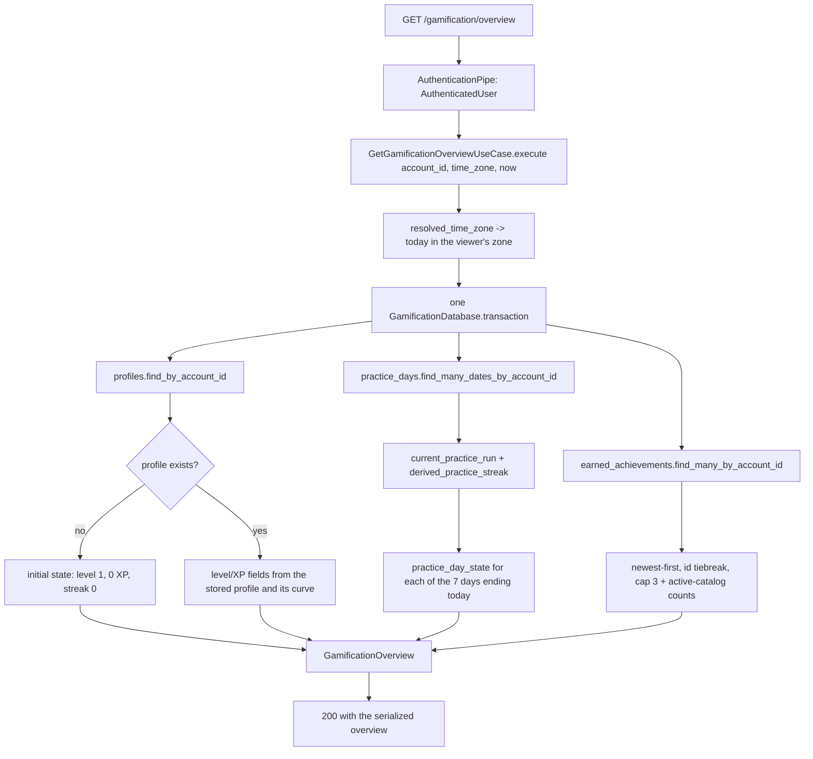

# Objective

Give the learner a single **Visão geral** tab that answers "where am I?" in one
read: current level with accumulated XP and progress to the next level, current
and record streak with the last seven days and today's situation, and the most
recent achievements with the obtained total and a shortcut into the Conquistas
tab.

Current behavior: the `/gamification` area already ships three tabs —
`Calendário` (`SHIFU-80`), `Conquistas` (`SHIFU-79`) and `Histórico de XP`
(`SHIFU-81`) — and defaults to `Calendário`
(`use-gamification-page.ts:33`). The `Visão geral` tab present in the design
reference is the one surface no delivered ticket owns, recorded as excluded in
[`../practice-calendar/spec.md`](../practice-calendar/spec.md) (line 42) and
[`../xp-history/spec.md`](../xp-history/spec.md) (line 51). Level mechanics are
**already delivered**: `GamificationProfile.minimum_xp_for_level`,
`level_for_xp` and the `max(self.level, level)` ratchet in `add_xp`
(`gamification_profile.py:60-80`) implement RP-04's curve and preservation
exactly, and `ListAchievementsUseCase` already derives `xp_for_next_level`
(`list_achievements_use_case.py:66-68`). What is missing is the aggregated read
that the overview needs — progress **within** the current level, the trailing
seven practice days, and an achievements summary — plus the tab itself.

Mode: **compact**. One cohesive read-only outcome inside a single module, with
no migration, no new producer, no new write path and no cross-module change. The
material risks are numeric correctness of the derived progress and keeping the
streak numbers identical to the ones the Calendário tab already reports.

# Scope

| Area / actor | Included | Excluded or deferred |
| --- | --- | --- |
| Level progress (Usuário) | Authenticated read of level, accumulated XP, the current and next level thresholds, remaining XP and the percentage completed inside the current level | Any change to the XP curve, the ratchet or XP concession itself — delivered and owned by `SHIFU-79`/`SHIFU-84` |
| Constância summary (Usuário) | Current streak, record streak, the trailing seven days with their calendar states, and today's practice situation, all resolved in the account's time zone | Practice-day recognition, streak persistence and the monthly calendar — delivered by `SHIFU-80`; no new recognition rule here |
| Achievements summary (Usuário) | The three most recently obtained achievements with name, criterion, XP reward and date, the obtained total against the active catalog, and a shortcut that opens the Conquistas tab | The achievement catalog, unlock processing and the Conquistas tab itself — delivered by `SHIFU-79` |
| Gamification area shell (Usuário) | `Visão geral` added as the first of four tabs and as the area's default tab | The `Calendário`, `Conquistas` and `Histórico de XP` panels, which stay untouched |
| Experience (Usuário) | Loading, zero/initial, unavailable and recovery states for the new tab, responsive on desktop and mobile, pt-BR, keyboard-operable, no color-only state | Reward celebration modals and inline XP feedback (RP-09 — `SHIFU-115`) |
| Access (Sistema) | The read returns only the authenticated account's own state; an account with no profile row yet receives the documented initial state rather than an error | Account-deletion orchestration, already owned by the existing deletion job |

Selected product outcomes for this bounded slice:

| RP | Classification | Rationale |
| --- | --- | --- |
| RP-01 | full | The global private profile now has the area-level summary RP-01's experience rules require: level, total XP and current streak in one place, opening the complete area. Initial state (0 XP, level 1, streak 0, no achievement) is observable |
| RP-04 | full | Curve, no maximum level, multi-level jumps and preservation are already implemented and are re-proven here; this slice adds the visible accumulated XP, remaining XP and intra-level progress RP-04's experience rules require, and the text that separates gamification from knowledge |
| RP-05 | partial | Only the presentation of current and record streak plus today's encouragement; recognition and persistence stay with `SHIFU-80` |
| RP-06 | partial | Only the trailing-seven-day strip, reusing the calendar's five day states; the monthly calendar stays with `SHIFU-80` |
| RP-07 | partial | Only the recent-achievement summary and the obtained total; catalog, criteria and unlock processing stay with `SHIFU-79` |
| RP-08 | partial | Only the guarantee that the summarized total XP and achievements survive the removal of an Objetivo or Habilidade; the history surface stays with `SHIFU-81` |
| RP-12 | partial | The read is private to the owning account and becomes inaccessible with it, inside the existing deletion path |
| RP-13 | partial | Responsive, pt-BR, keyboard-operable and non-color-only for the Visão geral tab |

Design handoff for affected UI states and viewports:
[`design/handoff.md`](design/handoff.md). It records the accepted visual
assumption: no Pencil session was available while authoring this Spec, so
`design/shifu.pen` node `buFAf` was not exported, and
[`documentation/design.md`](../../../design.md) §6.5 **T30/T31** plus the
already-shipped sibling widgets are the offline design authority.

# Behavior Contract

| ID | RP/JN/source coverage | Observable required behavior |
| --- | --- | --- |
| RF-01 | RP-01; JN-01 | The overview belongs to the authenticated account and covers its rewards globally, across every Objetivo and Habilidade. An account that has never been rewarded reads level 1, 0 XP, current and record streak 0, no obtained achievement and no practiced day. |
| RF-02 | RP-04 | The reported level is the one the account's profile holds, which is the largest `L ≥ 1` satisfying `50 × L × (L − 1) ≤ total_xp`, with no maximum. A single concession may cross several levels at once. |
| RF-03 | RP-04 | A level already reached is never reported lower than the stored level, even when the stored level sits above what the current curve would compute for the same total XP. In that state the reported thresholds are the stored level's own thresholds, the remaining XP stays positive, and the progress reads 0% — never a negative percentage and never a fabricated "about to level up". |
| RF-04 | RP-04; nó `buFAf` | The overview reports the accumulated XP, the minimum XP of the current level, the minimum XP of the next level, the XP still missing for the next level, and the integer percentage completed inside that interval. With 1,240 XP it reports level 5, 1,000, 1,500, 260 and 48. |
| RF-05 | RP-05, RP-06; JN-04, JN-06 | The overview reports the current streak, the record streak, and the seven days ending today, each carrying one of the five calendar day states. The reported current and record streak are the same values the Calendário tab reports for the same account and instant. |
| RF-06 | RP-05; JN-04 | Today's situation distinguishes "already practiced today" from "still pending today", resolved at the account's current local date; an absent, empty or unresolvable time zone resolves in UTC and never fails the read. |
| RF-07 | RP-07; nó `buFAf` | The overview reports the most recently obtained achievements, newest first and capped at three, each with its name, its criterion, its XP reward and the date the criterion was reached, taken from the account's own obtained record rather than the current catalog. It also reports how many achievements the account obtained against the size of the active catalog. |
| RF-08 | RP-07, RP-13 | The learner can reach the complete Conquistas tab from the achievements summary, by pointer and by keyboard. |
| RF-09 | RP-04, RP-08; JN-12 | The reported accumulated XP equals the sum of the account's preserved XP records. Removing an Objetivo or Habilidade in Learning changes no reported value. |
| RF-10 | RP-04, RP-13; nó `buFAf` | The tab states in text that XP and level recognize practice and are not a measure of knowledge or Competência mastery. |
| RF-11 | RP-01, RP-12; JN-13 | The read returns only the authenticated account's own state. An unauthenticated request is rejected. An authenticated account whose profile row does not exist yet receives the RF-01 initial state instead of an error. A deleted account's state is already purged and inaccessible. |
| RF-12 | RP-13 | The tab works on desktop and mobile, in pt-BR, is keyboard-operable, identifies every day state and achievement without relying on color or icon alone, and clearly communicates its loading, initial, unavailable and recovery states. |
| RF-13 | RP-01, RP-13 | The Gamification area presents `Visão geral` as its first tab and opens on it, while `Calendário`, `Conquistas` and `Histórico de XP` keep their current content and behavior. |

| ID | RF coverage | Given | When | Then | Checks |
| --- | --- | --- | --- | --- | --- |
| CA-01 | RF-01, RF-11 | An authenticated account with a profile, no XP, no practice day and no achievement | The overview is read | Level 1, 0 XP, current-level threshold 0, next-level threshold 100, 100 remaining and 0% progress, current and record streak 0, seven neutral-or-today-pending days, no recent achievement and an obtained count of 0 | CI-01, CI-03 |
| CA-02 | RF-02, RF-04 | An account whose profile holds 1,240 XP at level 5 | The overview is read | Level 5, accumulated 1,240, current-level threshold 1,000, next-level threshold 1,500, 260 remaining and 48% progress | CI-01, CI-03 |
| CA-03 | RF-02 | An account whose single concession took it from 0 XP past several thresholds | The overview is read | The reported level is the stored level the ratchet produced, with no maximum applied | CI-01 |
| CA-04 | RF-03 | An account whose stored level is higher than the level the current curve computes for its total XP — for example stored level 7 with 1,240 XP, whose curve-computed level is 5 | The overview is read | Level 7 is reported with its own thresholds 2,100 and 2,800, 1,560 remaining and 0% progress; no negative percentage is ever reported | CI-01 |
| CA-05 | RF-04 | An account at exactly its current level's minimum XP, and another one XP below the next threshold | The overview is read | The first reports 0% with the full interval remaining; the second reports a percentage below 100 with 1 XP remaining | CI-01 |
| CA-06 | RF-05, RF-06 | An account with practice days forming a run ending yesterday, and no practice today | The overview is read | The current streak is the run's length, the record is at least that length, today's day carries the today-pending state and today's situation reports practice as still pending | CI-01, CI-03 |
| CA-07 | RF-05 | An account whose practice run ended two days ago, after having reached a longer record | The overview is read | The current streak reads 0 and the record keeps the longest value the recorded days prove | CI-01 |
| CA-08 | RF-05 | An account with practice days inside and outside the trailing seven-day window, including days in the previous month | The overview is read | Exactly seven days are reported, ending today and starting six days earlier, each with the calendar state its own date deserves regardless of month boundaries | CI-01 |
| CA-09 | RF-05 | The same account and the same instant | The overview and the Calendário read run | Both report the same current and record streak values | CI-01, CI-03 |
| CA-10 | RF-06 | An account whose stored time zone is absent, empty or a syntactically valid but unresolvable identifier | The overview is read | The local date resolves in UTC, the read succeeds and today's situation is still reported | CI-01 |
| CA-11 | RF-06 | An account that already practiced today | The overview is read | Today's day carries the current-streak state and today's situation reports practice as already done | CI-01 |
| CA-12 | RF-07 | An account holding five obtained achievements with distinct dates | The overview is read | Exactly three are reported, newest obtained date first, each with its stored name, criterion phrasing, XP reward and achieved date | CI-01, CI-03 |
| CA-13 | RF-07 | An account holding two achievements obtained at the same instant | The overview is read | Both keep a deterministic order across repeated reads, and no check asserts their creation order | CI-01 |
| CA-14 | RF-07 | An account holding an achievement whose catalog entry was retired, plus active ones | The overview is read | The recent list still renders the retired achievement's own stored name and criterion when it is recent, and the obtained count compares only active-catalog holdings against the active catalog size | CI-01 |
| CA-15 | RF-09 | An account with XP and achievements earned in an experience that was later removed | An Objetivo or Habilidade is removed in Learning and the overview is read | Every reported value is unchanged | CI-01 |
| CA-16 | RF-11 | Two accounts each with their own profile, practice days and achievements | Account A reads the overview | Only A's values are returned | CI-03 |
| CA-17 | RF-11 | An unauthenticated request, and an authenticated account with no profile row | The overview endpoint is called | The first is rejected with 401; the second answers 200 with the CA-01 initial state | CI-03 |
| CA-18 | RF-04, RF-05, RF-07, RF-12 | An authenticated learner with XP, practice days and achievements | They open `/gamification` | The Visão geral tab is active and renders the level block, the progress to the next level, the streak block with the seven-day strip and today's line, and the recent achievements with the obtained total, from real data in pt-BR with no console errors | CI-04, CI-07, VM-01, VM-02 |
| CA-19 | RF-08 | The rendered achievements summary | The learner activates the Conquistas shortcut by pointer and by keyboard | The Conquistas tab becomes the active tab and renders its existing content | CI-04, CI-06, CI-07, VM-01 |
| CA-20 | RF-10 | The rendered Visão geral tab | It is inspected | A visible text states that XP and level recognize practice and do not represent knowledge or mastery | CI-04, VM-02 |
| CA-21 | RF-12 | The Visão geral tab | The overview read is loading, then fails | A loading state and then an error state with a working retry are announced, and the page shell and the other three tabs stay intact | CI-04, CI-05 |
| CA-22 | RF-01, RF-12 | An account with a profile and no reward at all | The tab is rendered | An initial state explains that practice will fill the area, with no fabricated value and no error | CI-04, CI-05 |
| CA-23 | RF-12 | The Gamification area at a narrow viewport, operated by keyboard | It is opened and its tabs are traversed | All four tabs are reachable and operable, the seven-day strip keeps its seven items without horizontal overflow, and every day state and achievement is identifiable by text or shape and not by color alone | CI-04, VM-01, VM-03 |
| CA-24 | RF-13 | The Gamification area | It is opened | `Visão geral`, `Calendário`, `Conquistas` and `Histórico de XP` render in that order, `Visão geral` is active by default, and each other panel still renders its previously delivered content | CI-06, CI-07, VM-01 |

# Technical Contract

## Architecture Mapping

Owner: **Gamification**, end to end. No other business module is touched, no
event contract changes, no persistence change and **no migration is produced**.
Rules: [python-conventions](../../../rules/python-conventions-rules.md),
[core-layer](../../../rules/core-layer-rules.md),
[rest-layer](../../../rules/rest-layer-rules.md),
[use-case-testing](../../../rules/use-case-testing-rules.md),
[controllers-testing](../../../rules/controllers-testing-rules.md),
[typescript-conventions](../../../rules/typescript-conventions-rules.md),
[ui-layer](../../../rules/ui-layer-rules.md),
[widget-testing](../../../rules/widget-testing-rules.md).
`apps/server/tach.toml` declares `shifu.gamification → ["shifu.shared"]` only;
nothing in this slice imports another business module.
[web-app-routing](../../../rules/web-app-routing-rules.md) is **not** selected:
the tab lives inside the existing `/gamification` route, so
`apps/web/src/routes/gamification/index.tsx`, `constants/routes.ts` and the
generated `routeTree.gen.ts` are untouched and `generate-routes` is not run.
[database-layer](../../../rules/database-layer-rules.md) and
[messaging-layer](../../../rules/messaging-layer-rules.md) are not selected:
no model, mapper, repository, migration, event or job changes.
[server-app-layer](../../../rules/server-app-layer-rules.md) and
[provision-layer](../../../rules/provision-layer-rules.md) are also not
selected, although two behavior signals point at them: route registration stays
inside `GamificationRouter.register`, which
[rest-layer](../../../rules/rest-layer-rules.md) owns ("Routers own module
prefixes"), and `apps/server/src/shifu/app.py` already composes that router, so
no `src/main.py`, `app.py` or `composition/**` path changes; and the new
controller only *consumes* the existing `SharedPipe.get_clock_provider` and
`GamificationPipe.get_database`, so no `**/pipes/**` or `**/providers/**` path
changes either.

### The shared-derivation decision

**Selected approach: promote the four practice-day derivations that
`GetPracticeCalendarUseCase` currently keeps private, and have both reads call
them.** `get_practice_calendar_use_case.py` owns `_resolve_time_zone` (line 21),
`_current_run` (line 31), `_longest_run` (line 44), `_state_for` (line 121) and
`_streak_for` (line 140). CA-09 requires the overview and the calendar to report
the *same* streak numbers, and CA-08 requires the same five day states over a
different window, so both reads must share one implementation of those rules.

Two alternatives were rejected:

- **Duplicate the logic in the new use case.** Cheapest to write, but it creates
  two copies of a timezone-sensitive streak rule that CA-09 requires to agree
  forever; any later correction would have to be applied twice.
- **Have the overview call `GetPracticeCalendarUseCase`.** The calendar returns
  one calendar month; the overview needs a seven-day window that crosses month
  boundaries (CA-08), so the month shape would have to be re-derived from a
  result that already discarded the days outside it.

The promotion follows the precedent set by `SHIFU-81`, which promoted
`achievement_criterion_label` out of `ListAchievementsUseCase` for exactly this
"two read paths, one vocabulary" reason. Each promoted module holds one public
function named after its module in `snake_case`, keeping its own private helpers
(`_FALLBACK_TIME_ZONE`, `_longest_run`) beside it. The authority for that
*function-module* form is in-repo precedent — `achievement_criterion_label.py`
and `learning/core/domain/adaptive_learning_policy.py` — since
[python-conventions](../../../rules/python-conventions-rules.md) states the
one-primary-public-**class**-per-module rule, the `snake_case` naming and the
private-helper allowance, but does not itself address function modules. The move is
behavior-preserving, and `tests/gamification/core/use_cases/test_get_practice_calendar_use_case.py`
must keep passing **unedited** as its regression guard (`CI-02`).

### Gamification — core

| Action | Boundary | Element / Path | Required change |
| --- | --- | --- | --- |
| Create | Core / domain | `resolved_time_zone` — `apps/server/src/shifu/gamification/core/domain/resolved_time_zone.py` | The IANA-identifier resolution with its UTC fallback, promoted verbatim from `get_practice_calendar_use_case.py:18-28`, keeping the private `_FALLBACK_TIME_ZONE` constant beside it |
| Create | Core / domain | `current_practice_run` — `.../core/domain/current_practice_run.py` | The consecutive run ending today or yesterday, promoted from `_current_run` (line 31) |
| Create | Core / domain | `derived_practice_streak` — `.../core/domain/derived_practice_streak.py` | The stored-versus-recorded streak reconciliation, promoted from `_streak_for` (line 140), with `_longest_run` (line 44) kept private inside it. This single function is what makes CA-09 structural |
| Create | Core / domain | `practice_day_state` — `.../core/domain/practice_day_state.py` | The five-state classification of one day, promoted from `_state_for` (line 121) |
| Modify | Core / use case | `GetPracticeCalendarUseCase` — `.../core/use_cases/get_practice_calendar_use_case.py` | Delete the five private helpers and call the promoted functions. No signature, return value or behavior change; `test_get_practice_calendar_use_case.py` must pass unedited |
| Create | Core / structure | `RecentAchievement` — `.../core/domain/structures/recent_achievement.py` | One obtained achievement as the summary presents it; re-exported from the package `__init__.py` |
| Create | Core / structure | `AchievementsSummary` — `.../core/domain/structures/achievements_summary.py` | The recent list plus the obtained/catalog counts |
| Create | Core / structure | `StreakOverview` — `.../core/domain/structures/streak_overview.py` | The streak block: streak values, the trailing seven `CalendarDay` items, today's date and whether today is still pending |
| Create | Core / structure | `GamificationOverview` — `.../core/domain/structures/gamification_overview.py` | The read result: flat level/XP fields plus the two nested blocks |
| Create | Core / use case | `GetGamificationOverviewUseCase` — `.../core/use_cases/get_gamification_overview_use_case.py` | Aggregate the account's profile, practice days and obtained achievements into one `GamificationOverview` inside a single transaction; re-exported from the package `__init__.py` |
| Unchanged | Core / entity | `GamificationProfile` | Consumed as-is. `minimum_xp_for_level` and `level_for_xp` (`gamification_profile.py:60-68`) already implement RP-04's curve, and `add_xp`'s `max(self.level, level)` already implements the ratchet, so RF-02/RF-03 require **no entity change**; the intra-level percentage is a derived read value and belongs to the use case |
| Unchanged | Core / interface | `GamificationProfilesRepository`, `PracticeDaysRepository`, `EarnedAchievementsRepository`, `GamificationDatabase` | `find_by_account_id`, `find_many_dates_by_account_id` and `find_many_by_account_id` already provide every read this slice performs; no port changes |
| Unchanged | Core / domain | `ACHIEVEMENT_CATALOG`, `achievement_criterion_label`, `CalendarDay`, `CalendarDayState`, `PracticeStreak` | Reused as-is. The seven-day strip deliberately reuses the calendar's existing five-state vocabulary instead of introducing a parallel one |

```python
def resolved_time_zone(time_zone: str | None) -> str:
    """The account's IANA zone, or UTC when it is absent or unresolvable."""


def current_practice_run(
    ordered_dates: tuple[date, ...], *, today: date
) -> tuple[date, ...]:
    """The consecutive run ending today or yesterday, empty when broken."""


def derived_practice_streak(
    stored: PracticeStreak,
    *,
    ordered_dates: tuple[date, ...],
    current_run: tuple[date, ...],
) -> PracticeStreak:
    """The streak a viewer sees now: current decays with time, longest ratchets."""


def practice_day_state(
    day: date,
    *,
    today: date,
    earliest: date | None,
    practiced: frozenset[date],
    current_run: frozenset[date],
) -> CalendarDayState:
    """Which of the five states one day carries for this viewer's today."""


@structure
class RecentAchievement:
    achievement_id: str
    name: str
    criterion_label: str
    xp_reward: int
    achieved_at: datetime


@structure
class AchievementsSummary:
    recent: tuple[RecentAchievement, ...]   # newest achieved_at first, at most 3
    obtained_count: int
    catalog_count: int


@structure
class StreakOverview:
    streak: PracticeStreak
    last_seven_days: tuple[CalendarDay, ...]   # exactly 7, oldest first, ending today
    today: date
    is_today_pending: bool


@structure
class GamificationOverview:
    level: int
    total_xp: int
    current_level_xp: int      # 50 × L × (L − 1)
    next_level_xp: int         # 50 × (L + 1) × L
    xp_for_next_level: int     # next_level_xp − total_xp, always ≥ 1
    level_percentage: int      # 0..99, floor of the position inside the interval
    streak: StreakOverview
    achievements: AchievementsSummary


class GetGamificationOverviewUseCase:
    def __init__(self, database: GamificationDatabase) -> None: ...

    def execute(
        self, account_id: str, *, time_zone: str | None, now: datetime
    ) -> GamificationOverview: ...
```

**New concept — the gamification overview projection.** `GamificationOverview`
is a read-only value assembled per request from rows that already exist; it owns
no state, is never persisted and has no identity. Its sources of truth are the
account's `GamificationProfile` (level, total XP, stored streak), its
`PracticeDay` dates and its `EarnedAchievement` rows, plus the code-owned
`ACHIEVEMENT_CATALOG` for the catalog size. It introduces no product rule of its
own: every number is either stored or derived by the four promoted domain
functions and the level formulas the entity already owns. `StreakOverview` and
`AchievementsSummary` exist as nested structures because the tab renders three
independent blocks and the two of them carry their own collections; the level
fields stay flat, matching the existing `AchievementsOverview`
(`achievements_overview.py:8-14`), which already exposes `level`, `total_xp` and
`xp_for_next_level` with the same meaning and the same field name.

**Level progress, fixed here because the UI and the checks depend on it.**

| Reported field | Derivation | Boundary behavior |
| --- | --- | --- |
| `level` | `profile.level` — the stored ratchet, never recomputed on read | A profile-less account reads 1 |
| `total_xp` | `profile.total_xp` | A profile-less account reads 0 |
| `current_level_xp` | `GamificationProfile.minimum_xp_for_level(level)` | Level 1 reads 0 |
| `next_level_xp` | `GamificationProfile.minimum_xp_for_level(level + 1)` | No maximum level exists, so this is always defined |
| `xp_for_next_level` | `next_level_xp - total_xp` | Always positive, with no clamp needed: see the invariant below. Level 1 at 0 XP reads 100 |
| `level_percentage` | `max(0, ((total_xp - current_level_xp) * 100) // (next_level_xp - current_level_xp))` | Integer floor; `next_level_xp > current_level_xp` for every `L ≥ 1`, so the divisor is never 0. 1,240 XP at level 5 reads 48. The `max(0, …)` is the one live clamp and exists for exactly one *representable* state — the preserved level of RF-03/CA-04, where `current_level_xp > total_xp` makes the raw ratio negative |

**The invariant that bounds those two fields, stated because it decides which
guards are and are not written.** `GamificationProfile.__post_init__` rejects any
profile whose stored `level` is below `level_for_xp(total_xp)`
(`gamification_profile.py:36-38`), and `minimum_xp_for_level` is strictly
increasing, so **every valid profile satisfies
`total_xp < minimum_xp_for_level(level + 1)`**. Two consequences are contracted
here so no implementer adds dead defensive code:

- `xp_for_next_level` is therefore always `≥ 1`; a `max(0, …)` clamp on it could
  never fire and must not be written.
- `level_percentage` can therefore never reach 100 for a valid profile; its
  ceiling is 99, so a `min(100, …)` clamp could never fire and must not be
  written either. 100% is not a reachable reported value, by design: a learner
  who crosses the threshold has already been ratcheted to the next level.

The preserved-level state of RF-03 is the mirror image: there `total_xp` sits
*below* the stored level's own minimum, the raw ratio is negative, and the
`max(0, …)` clamp reports 0%. That state is **representable** as a valid profile,
but it is **not produced by any current write path**: `add_xp` sets
`level = max(self.level, level_for_xp(total))` (`gamification_profile.py:79`), so
every write leaves `level == level_for_xp(total_xp)` while the curve stays a code
constant. It becomes producible only if a future curve change raises the
thresholds, which is precisely the case RP-04 requires the product to survive
without lowering a reached level. The percentage clamp is therefore required and
the other two guards are not — a distinction worth keeping straight, because
`GamificationProfileMapper.to_domain` reconstructs through the real
`GamificationProfile` constructor and `entity` is a plain dataclass, so
`__post_init__` runs on every loaded row: a corrupt row raises
`InvalidGamificationError` at mapping time rather than reaching this derivation
as a negative number.

**Recent achievements.** Ordered by `achieved_at` descending, then by the earned
row's `id` descending, and capped at three. The tiebreak is required, not
decorative: the cascade can unlock several achievements sharing one instant
(`grant_xp_use_case.py:166-182`), so the date alone does not totally order them.
Ids are ULIDs whose trailing characters are random, so within one instant the
secondary key is **deterministic but arbitrary** — it fixes a stable order across
repeated reads, which is all CA-13 requires. Each item's name, criterion and XP
reward come from the account's own `EarnedAchievement` snapshot, never from the
catalog, so a retired achievement keeps the text it was obtained under (RP-07),
exactly as `GetXpHistoryUseCase` already does
(`get_xp_history_use_case.py:76-85`).

**Obtained count.** `obtained_count` counts the account's earned rows whose
`achievement_id` is still in the active `ACHIEVEMENT_CATALOG`, and
`catalog_count` is the number of active catalog entries, so the pair always
reads as a coherent "X de Y". A retired holding is therefore excluded from the
ratio while remaining visible in the recent list and, as historical, on the
Conquistas tab — which is where RP-07 places retired achievements. This is a
deliberate reading of "total obtido em relação ao catálogo" and is recorded as a
decision, not an inference.

**Absent profile.** The use case returns the RF-01 initial state instead of
raising, matching `ListAchievementsUseCase` (`list_achievements_use_case.py:48-51`)
and **deliberately diverging** from `GetPracticeCalendarUseCase` and
`GetXpHistoryUseCase`, which answer 404. The reason is that this tab is now the
area's landing surface: profiles are created by an Inngest job on
`identity/account.activated`, so a learner who opens `/gamification` in the
window before that job commits would otherwise land on an error state for a
product state that JN-01 describes as normal. The two 404 reads kept their
contracts in this slice; both were later amended to the same initial-state
reading (calendar and XP history Specs, revision 2).

### Gamification — REST

| Action | Boundary | Element / Path | Required change |
| --- | --- | --- | --- |
| Create | REST / controller | `GetGamificationOverviewController` — `apps/server/src/shifu/gamification/rest/controllers/get_gamification_overview_controller.py` | `GET /gamification/overview`; `AuthenticatedUser`, `GamificationPipe.get_database` and `SharedPipe.get_clock_provider` dependencies; module-level `Response` plus nested controller-local models; no `try`/`except`; re-exported from `controllers/__init__.py` |
| Modify | REST / router | `GamificationRouter.register` — `.../rest/router.py` | Register the new controller beside the existing three |
| Modify | REST / examples | `apps/server/rest-client/gamification/gamification.rest` | Add one non-secret labeled `GET {{baseUrl}}/gamification/overview` example with the `Authorization: Bearer {{accessToken}}` header, matching the file's existing format |

```python
class RecentAchievementResponse(BaseModel):
    achievement_id: str = Field(serialization_alias='achievementId')
    name: str
    criterion_label: str = Field(serialization_alias='criterionLabel')
    xp_reward: int = Field(serialization_alias='xpReward')
    achieved_at: datetime = Field(serialization_alias='achievedAt')


class AchievementsSummaryResponse(BaseModel):
    recent: tuple[RecentAchievementResponse, ...]
    obtained_count: int = Field(serialization_alias='obtainedCount')
    catalog_count: int = Field(serialization_alias='catalogCount')


class CalendarDayResponse(BaseModel):
    day: date
    state: CalendarDayState


class StreakResponse(BaseModel):
    current: int
    longest: int


class StreakOverviewResponse(BaseModel):
    streak: StreakResponse
    last_seven_days: tuple[CalendarDayResponse, ...] = Field(
        serialization_alias='lastSevenDays'
    )
    today: date
    is_today_pending: bool = Field(serialization_alias='isTodayPending')


class Response(BaseModel):
    level: int
    total_xp: int = Field(serialization_alias='totalXp')
    current_level_xp: int = Field(serialization_alias='currentLevelXp')
    next_level_xp: int = Field(serialization_alias='nextLevelXp')
    xp_for_next_level: int = Field(serialization_alias='xpForNextLevel')
    level_percentage: int = Field(serialization_alias='levelPercentage')
    streak: StreakOverviewResponse
    achievements: AchievementsSummaryResponse


_RESPONSE_ADAPTER = TypeAdapter[Response](Response)
```

The handler returns
`_RESPONSE_ADAPTER.validate_python(overview, from_attributes=True)`.
[rest-layer rules](../../../rules/rest-layer-rules.md) require the module-level
`TypeAdapter` form — not field-by-field reconstruction — precisely for nested
structures and enum values, which this response has both of; `CalendarDayState`
is a `StrEnum`, so it serializes to its value without a manual `.value` call.
**Recorded discrepancy:** the two sibling reads
(`get_practice_calendar_controller.py:65-78`, `get_xp_history_controller.py:46-59`)
build their responses field by field, which that rule no longer permits for
their shapes. They are out of this slice's scope and stay unchanged; the
divergence is reported here rather than copied forward.

The route takes no path or query parameter: the account comes from the verified
session and the viewer's local date from the injected `ClockProvider` plus
`AuthenticatedUser.time_zone`, exactly as the calendar read already does
(`get_practice_calendar_controller.py:51-63`). Errors flow to the global
`AppErrorHandler`; an unauthenticated request is rejected by
`AuthenticationPipe` → 401 (CA-17). There is no 404 branch, by the absent-profile
decision above.

### Web

| Action | Boundary | Element / Path | Required change |
| --- | --- | --- | --- |
| Create | Core / contract | `apps/web/src/core/gamification/overview.ts` | `GamificationOverview`, `StreakOverview`, `AchievementsSummary` and `RecentAchievement` plain TS types, reusing `CalendarDay` and `PracticeStreak` from `./practice-calendar` |
| Modify | REST / service | `apps/web/src/rest/services/gamification-service.ts` | Add `getOverview(accessToken)` against `/gamification/overview`, mirroring the three existing methods |
| Modify | UI / widget | `GamificationTabs` — `.../gamification-page/gamification-tabs/index.tsx` | Add `visao-geral` / `Visão geral` as the **first** entry of the `GamificationTab` union and the `TABS` array; trigger styling unchanged |
| Modify | UI / page | `GamificationPage` — `.../gamification-page/index.tsx` | Render the new first `TabsContent` with `OverviewTabPanel`, passing the Conquistas shortcut callback; the other three `TabsContent` blocks are unchanged |
| Modify | UI / page hook | `useGamificationPage` — `.../gamification-page/use-gamification-page.ts` | Default the active tab to `'visao-geral'` (line 33) and add `handleViewAchievements`, which selects the `conquistas` tab. Its achievements query, derived groups and `profileSummary` stay unchanged |
| Create | UI / widget | `.../gamification-page/overview-tab-panel/{index.tsx,use-overview-tab-panel.ts}` | Owns the tab's `loading | success | empty | error` state machine and renders the three blocks plus the gamification-is-not-knowledge note |
| Create | UI / query hook | `.../overview-tab-panel/use-overview-query.ts` | `queryKey: ['gamification', 'overview']`, `retry: false`; mirrors the `createServerFn` composition of `use-xp-history-query.ts` |
| Create | UI / widget | `.../overview-tab-panel/level-progress-card/index.tsx` | Pure renderer: level, accumulated XP, the two thresholds, remaining XP, the progress indicator and its accessible value |
| Create | UI / widget | `.../overview-tab-panel/streak-summary-card/index.tsx` | Pure renderer: current streak, record streak, today's line and the week strip |
| Create | UI / widget | `.../overview-tab-panel/streak-summary-card/practice-week-strip/index.tsx` | Pure renderer: the seven days with their state marks and per-day accessible names |
| Create | UI / widget | `.../overview-tab-panel/achievements-summary-card/index.tsx` | Pure renderer: the obtained-versus-catalog total, the recent list and the Conquistas shortcut button |
| Create | UI / widget | `.../overview-tab-panel/achievements-summary-card/recent-achievement-row/index.tsx` | Pure renderer: one achievement's name, criterion, reward and date |
| Unchanged | UI / widget | `ProfileSummaryCard`, `AchievementsTabPanel`, `CalendarTabPanel`, `XpHistoryTabPanel`, `StreakPanel` | Not modified. `ProfileSummaryCard` keeps serving the Conquistas tab with its simpler level/XP block; the overview's richer block is a new widget rather than a change to a shipped one, so no delivered panel is put at risk |

```ts
export type RecentAchievement = {
  achievementId: string
  name: string
  criterionLabel: string
  xpReward: number
  achievedAt: string
}

export type AchievementsSummary = {
  recent: RecentAchievement[]
  obtainedCount: number
  catalogCount: number
}

export type StreakOverview = {
  streak: PracticeStreak
  lastSevenDays: CalendarDay[]
  today: string
  isTodayPending: boolean
}

export type GamificationOverview = {
  level: number
  totalXp: number
  currentLevelXp: number
  nextLevelXp: number
  xpForNextLevel: number
  levelPercentage: number
  streak: StreakOverview
  achievements: AchievementsSummary
}
```

State ownership: `use-gamification-page.ts` keeps owning the selected tab and
gains only the default value and the shortcut handler; the overview's own data
lifecycle lives entirely in `use-overview-tab-panel.ts`, the sole consumer of
`use-overview-query.ts`. This mirrors `CalendarTabPanel` and `XpHistoryTabPanel`,
each of which owns its query inside the panel, rather than the older page-level
wiring the Conquistas tab still uses. The four card widgets are pure prop
renderers with no state of their own; the shortcut is a prop callback that the
panel forwards from the page hook, so the tab selection stays owned in exactly
one place. The new widgets reuse the shared `Icon` wrapper and `Button` primitive
and the existing `useFormatDate` hooks; no new icon is expected, and any that is
needed is added to both the Lucide map and the `IconName` union in
`apps/web/src/ui/shared/widgets/components/icon/index.tsx`.

**Accepted deviation, stated explicitly.** `use-gamification-page.ts` runs
`useAchievementsQuery()` for every tab, so landing on `Visão geral` issues both
the overview request and the pre-existing achievements request. That query
already ran on every tab before this change, so this is not a new regression;
rewiring it into the Conquistas panel is `SHIFU-79` legacy wiring and is out of
scope here.

### Expected file tree

```text
apps/server/
├── rest-client/gamification/gamification.rest                                 [M]
├── src/shifu/gamification/
│   ├── core/
│   │   ├── domain/
│   │   │   ├── current_practice_run.py                                        [N]
│   │   │   ├── derived_practice_streak.py                                     [N]
│   │   │   ├── practice_day_state.py                                          [N]
│   │   │   ├── resolved_time_zone.py                                          [N]
│   │   │   └── structures/
│   │   │       ├── achievements_summary.py                                    [N]
│   │   │       ├── gamification_overview.py                                   [N]
│   │   │       ├── recent_achievement.py                                      [N]
│   │   │       ├── streak_overview.py                                         [N]
│   │   │       └── __init__.py                                                [M]
│   │   └── use_cases/
│   │       ├── get_gamification_overview_use_case.py                          [N]
│   │       ├── get_practice_calendar_use_case.py                              [M]
│   │       └── __init__.py                                                    [M]
│   └── rest/
│       ├── controllers/
│       │   ├── get_gamification_overview_controller.py                        [N]
│       │   └── __init__.py                                                    [M]
│       └── router.py                                                          [M]
└── tests/gamification/
    ├── core/use_cases/
    │   ├── test_get_gamification_overview_use_case.py                         [N]
    │   └── test_get_practice_calendar_use_case.py                             (unchanged)
    └── server/controllers/
        └── test_get_gamification_overview_controller.py                       [N]

apps/web/
├── src/
│   ├── core/gamification/overview.ts                                          [N]
│   ├── rest/services/gamification-service.ts                                  [M]
│   └── ui/gamification/widgets/pages/gamification-page/
│       ├── index.tsx                                                          [M]
│       ├── use-gamification-page.ts                                           [M]
│       ├── gamification-tabs/index.tsx                                        [M]
│       ├── calendar-tab-panel/                                                (unchanged)
│       ├── achievements-tab-panel/                                            (unchanged)
│       ├── xp-history-tab-panel/                                              (unchanged)
│       ├── profile-summary-card/                                              (unchanged)
│       ├── overview-tab-panel/
│       │   ├── index.tsx                                                      [N]
│       │   ├── use-overview-tab-panel.ts                                      [N]
│       │   ├── use-overview-query.ts                                          [N]
│       │   ├── level-progress-card/index.tsx                                  [N]
│       │   ├── streak-summary-card/
│       │   │   ├── index.tsx                                                  [N]
│       │   │   └── practice-week-strip/index.tsx                              [N]
│       │   ├── achievements-summary-card/
│       │   │   ├── index.tsx                                                  [N]
│       │   │   └── recent-achievement-row/index.tsx                           [N]
│       │   └── tests/
│       │       ├── overview-tab-panel.test.tsx                                [N]
│       │       └── use-overview-tab-panel.test.ts                             [N]
│       └── tests/
│           ├── gamification-page.test.tsx                                     [M]
│           └── use-gamification-page.test.ts                                  [M]
└── tests/gamification/gamification-page.test.ts                               [M]
```

Test-boundary notes, per
[core-layer](../../../rules/core-layer-rules.md),
[ui-layer](../../../rules/ui-layer-rules.md) and
[widget-testing](../../../rules/widget-testing-rules.md): there are deliberately
**no** test files for the four promoted domain functions, the four new
structures, `use-overview-query.ts`, `gamification-service.ts`, or the five pure
card widgets — but for two different reasons, which must not be conflated. A
direct test for the four structures, the query hook, the service or the pure
card widgets would be a **blocking contract defect**, each one forbidden by the
rule cited beside it below. The four promoted functions are the weaker case:
[use-case-testing](../../../rules/use-case-testing-rules.md) does permit focused
domain conformance tests under `tests/<module>/core/domain/**` when no use case
owns the behavior, so a test there would be **unnecessary rather than
forbidden** — and it is unnecessary because two use cases own every promoted
function and prove it (`CI-01`, `CI-02`). The promoted functions
are proven by both use-case suites; the structures by typing and the suites that
construct them; the query hook and the service by the panel and route suites;
the card widgets by the real composition rendered in
`overview-tab-panel.test.tsx`. `use-overview-tab-panel.ts` **does** take a
dedicated hook test, because widget-testing rules require the component test to
replace the owning hook with a typed mock, which would otherwise leave its
four-way state derivation and retry path asserted nowhere below Playwright —
mirroring the existing `use-calendar-tab-panel.test.ts` and
`use-xp-history-tab-panel.test.ts`.

## Runtime Flow



Every query is filtered by the `account_id` taken from the verified session,
never from a request parameter, so account isolation is structural (RF-11). The
three reads share one `GamificationDatabase.transaction()`, so the level, the
streak and the achievement summary are read from one consistent snapshot even
while an XP cascade commits concurrently — which is what makes RF-09's "the
reported XP equals the preserved records" observable rather than racy. The read
performs no write, acquires no lock a concession would wait on, and is therefore
safe to repeat; `current` streak is derived against the viewer's today rather
than read from the stored snapshot, because a streak decays with the passage of
time and no stored column stays correct without a write — the same reasoning
`GetPracticeCalendarUseCase` already documents, now shared through
`derived_practice_streak` so both reads cannot drift (CA-09).

On the Web side, the route and the page shell are unchanged; `Visão geral`
becomes the default `TabsContent`, its panel hook consumes its own query, and a
failure surfaces as the panel's error state with a retry that refetches only
that query. An authentication rejection is translated by the query hook into the
`AuthError` the page already redirects on, exactly as the sibling panels do. The
Conquistas shortcut performs no navigation and no request: it sets the page
hook's active tab, so the already-loaded achievements query serves the
destination.

# Verification Contract

## Shared setup

- **Server unit** (`CI-01`, `CI-02`): run from `apps/server`. No app, HTTP,
  session, Docker or Inngest. Every port is mocked with
  `create_autospec(Protocol, instance=True)` in an `autouse=True` fixture; all
  times are passed in explicitly as `now` — core never reads the clock. Cases are
  methods on a `Test<UseCase>` class named `test_should_*`. Domain fakers under
  `apps/server/src/shifu/fakers/gamification` build the profile and earned
  achievements; override only the scenario's fields.
- **Server controller** (`CI-03`): `TestClient` against
  `FastAPIApp.register(database_engine=...)` with real Alembic migrations and
  real repositories. Follow the sibling suite
  `tests/gamification/server/controllers/test_get_practice_calendar_controller.py:23-57`,
  which builds a local `application` fixture with a test authentication provider
  rather than reusing the shared client; the Testcontainers PostgreSQL fixture
  lives in `apps/server/tests/fixtures/postgres_fixture.py` and is registered
  through `pytest_plugins` in `tests/conftest.py:25-29`. **A Redis container is
  also required**, even though this read uses no cache: that same `application`
  fixture takes `redis_fixture`
  (`apps/server/tests/fixtures/redis_fixture.py`), and the `autouse`
  `_reset_rate_limit_state` fixture in `tests/conftest.py:32-49` opens a Redis
  connection for every REST test. Two distinct seeded accounts
  are required for the isolation case, and one seeded account needs a profile
  with practice days and obtained achievements; each test owns and cleans its own
  rows. Never point at the Compose development database. If Docker is
  unavailable the check is Blocked, not passed.
- **Web component** (`CI-04`, `CI-06`): Vitest + jsdom from the repository root;
  `@testing-library/react` with `userEvent`. The panel test mocks
  `../use-overview-tab-panel` (typed `vi.mocked`, fresh return value per
  `beforeEach`) and renders the real internal child composition. Mock application
  wrappers (`Icon`, the domain hook), never Lucide or `useQuery`.
- **Web hook** (`CI-05`): `renderHook` with `../use-overview-query` mocked — the
  relative specifier resolves from the `tests/` directory the hook test lives in,
  matching `use-xp-history-tab-panel.test.ts:10` and
  `use-calendar-tab-panel.test.ts:9`; the
  domain query hook itself is never tested directly, per widget-testing rules.
- **Web route** (`CI-07`): extend
  `apps/web/tests/gamification/gamification-page.test.ts`; mocked transport
  intercepting `**/_serverFn/**` and identifying each call through the existing
  `serverFnExport` helper. The upstream `GET /gamification/overview` is issued
  inside the SSR process and is **not** observable from Playwright, so the
  server-function export name is the only observable; the existing
  `getAchievements_*` interception must stay in place, since the page hook still
  runs that query on every tab. Mocked transport proves neither the upstream HTTP
  contract nor real persistence.
- **Manual/visual** (`VM-01`–`VM-03`): Playwright CLI from `apps/web` per
  [AGENTS.md](../../../../AGENTS.md). Confirm `docker compose ps` and web/API
  health first; reuse `.playwright-cli/states/shifu-auth-state.json` or sign in
  through the visible form. The account must already hold XP, at least one
  obtained achievement and at least one practice day — produce them through real
  Learning facts or a disposable fixture; do **not** reset or reseed shared data.
  Artifacts stay under
  `apps/web/.playwright-cli/{logs,screenshots,snapshots,states}/`; paths and
  results go in Evaluation.

## Automated

### CI-01 — Overview aggregation, level progress, streak window and achievement summary

**Criteria:** CA-01, CA-02, CA-03, CA-04, CA-05, CA-06, CA-07, CA-08, CA-09, CA-10, CA-11, CA-12, CA-13, CA-14, CA-15

**Expected result:** The use case returns the stored level and total XP with the
two thresholds, the clamped remaining XP and the floored intra-level percentage;
exactly seven days ending today with their correct calendar states across month
boundaries; the current and record streak produced by the shared derivation; the
three newest obtained achievements with their stored text and a deterministic
tiebreak; the active-catalog ratio; and the documented initial state for an
account with no profile. An absent or unresolvable time zone resolves in UTC
without failing.

**Setup / inputs:** Mocked `GamificationDatabase`. Equivalence classes and
boundaries over each axis — XP at exactly a level minimum, one XP below the next
minimum, the 1,240/level-5 reference case, and a stored level above the curve's
computed level; practice-day sets that are empty, a run ending today, a run
ending yesterday, a run broken two days ago, and a run crossing the previous
month; time zones that are valid, `None`, empty and syntactically valid but
unresolvable; earned sets of zero, three, five and two sharing one
`achieved_at`, including one whose `achievement_id` is absent from
`ACHIEVEMENT_CATALOG`. CA-09 is asserted by deriving the streak for the same
inputs through the promoted `derived_practice_streak` the calendar also uses, and
CA-15 as the absence of any mutation on the read path: no `add`, `update` or
`remove` call on any mocked repository.

**Proof:** `apps/server/tests/gamification/core/use_cases/test_get_gamification_overview_use_case.py` (planned)

```bash
uv run pytest tests/gamification/core/use_cases/test_get_gamification_overview_use_case.py
```

**Passing condition:** Exact values for all six level fields in every boundary
class, exactly seven ordered days with their expected states, the expected
streak pair, the expected recent list with its cap and order, the expected
counts, the initial state for a profile-less account, and no write call on any
mocked repository. Mocked ports prove aggregation, not persistence or SQL
ordering — `CI-03` owns those.

### CI-02 — Calendar read is unchanged by the promotion

**Criteria:** CA-09

**Expected result:** `GetPracticeCalendarUseCase` behaves identically after its
five private helpers are replaced by the four promoted domain functions: same
day states, same derived current streak, same ratcheted longest, same timezone
fallback and same rejections.

**Setup / inputs:** The existing suite's cases, unchanged.

**Proof:** `apps/server/tests/gamification/core/use_cases/test_get_practice_calendar_use_case.py` (existing file, expected to need **no** edit)

```bash
uv run pytest tests/gamification/core/use_cases/test_get_practice_calendar_use_case.py
```

**Passing condition:** Every pre-existing case passes **unedited**. A required
edit here means the promotion changed behavior and must be reconciled before
`ready`; this file is the regression guard for the shared-derivation decision.

### CI-03 — Overview endpoint contract, isolation and absent profile

**Criteria:** CA-01, CA-02, CA-06, CA-09, CA-12, CA-16, CA-17

**Expected result:** 200 with the serialized level fields, streak block and
achievements block read back from persisted state for the owning account; 200
with the initial state for an authenticated account that has no profile row; 401
unauthenticated. Account A never sees account B's values, and the streak values
match the ones `GET /gamification/calendar` reports for the same account.

**Setup / inputs:** Two seeded accounts persisted through real repositories and
migrations; one carries a profile with a known total XP and level, practice days
including one inside and one outside the trailing seven-day window, and at least
three obtained achievements with distinct dates.

**Proof:** `apps/server/tests/gamification/server/controllers/test_get_gamification_overview_controller.py` (planned)

```bash
uv run pytest tests/gamification/server/controllers/test_get_gamification_overview_controller.py
```

**Passing condition:** Exact status codes and response bodies, including the
camelCase field names and the day-state string values; exactly seven days; the
recent list's order and cap; `obtainedCount`/`catalogCount` consistent with the
seeded rows and the active catalog; no cross-account leakage. This check also
proves the `TypeAdapter` response validation and the repository reads, which have
no tests of their own by rule.

### CI-04 — Visão geral tab renders every block and state

**Criteria:** CA-18, CA-19, CA-20, CA-21, CA-22, CA-23

**Expected result:** The level block renders the level, accumulated XP, both
thresholds, remaining XP and the progress indicator with an accessible value;
the streak block renders current, record, today's line and seven day items with
per-day accessible names; the achievements block renders the obtained total, the
recent rows with name, criterion, reward and date, and a working Conquistas
shortcut; the gamification-is-not-knowledge note is visible; loading, initial and
error-with-retry states render; every day state and achievement is identifiable
by accessible text, not color alone.

**Setup / inputs:** `use-overview-tab-panel` mocked with loading, success, empty
and error return values; the success value includes a mid-level progress case,
seven days covering all five states, and three recent achievements.

**Proof:** `apps/web/src/ui/gamification/widgets/pages/gamification-page/overview-tab-panel/tests/overview-tab-panel.test.tsx` (planned)

```bash
pnpm --filter web exec vitest run src/ui/gamification/widgets/pages/gamification-page/overview-tab-panel/tests/overview-tab-panel.test.tsx
```

**Passing condition:** Role-first queries; pt-BR visible and accessible labels
asserted; the progress indicator's accessible value asserted rather than its
class; the shortcut asserted through its accessible name and its callback **plus**
the resulting state where observable; seven day items asserted by accessible
name. No snapshots and no class-name assertions.

### CI-05 — Overview panel hook state and retry

**Criteria:** CA-21, CA-22

**Expected result:** The hook reports `loading` while the query is pending,
`error` when it rejects or returns nothing, `empty` for a successful response
with no reward at all, and `success` otherwise; it exposes the overview values it
derives, `isRetrying` is true only while refetching an already-loaded query, and
`handleRetry` refetches.

**Setup / inputs:** `renderHook` with `use-overview-query` mocked across those
four return shapes.

**Proof:** `apps/web/src/ui/gamification/widgets/pages/gamification-page/overview-tab-panel/tests/use-overview-tab-panel.test.ts` (planned)

```bash
pnpm --filter web exec vitest run src/ui/gamification/widgets/pages/gamification-page/overview-tab-panel/tests/use-overview-tab-panel.test.ts
```

**Passing condition:** Each state, every returned value and handler, `isRetrying`
and the refetch call asserted on the hook's returned values — the complete public
return contract, per [widget-testing rules](../../../rules/widget-testing-rules.md).
This check exists because `CI-04` mocks this hook by rule, so its logic has no
other coverage below Playwright.

### CI-06 — Four-tab shell, new default and the Conquistas shortcut

**Criteria:** CA-19, CA-24

**Expected result:** The page renders Visão geral, Calendário, Conquistas and
Histórico de XP in that order, defaults to Visão geral, switches to each, and the
three existing panels still render their loading, error and populated states
unchanged. `handleViewAchievements` selects the Conquistas tab.

**Setup / inputs:** `use-gamification-page` mocked; the existing cases in
`gamification-page.test.tsx` and `use-gamification-page.test.ts` extended for the
fourth tab, the new default and the new handler.

**Proof:** `apps/web/src/ui/gamification/widgets/pages/gamification-page/tests/{gamification-page.test.tsx,use-gamification-page.test.ts}` (existing files, extended)

```bash
pnpm --filter web exec vitest run src/ui/gamification/widgets/pages/gamification-page/tests
```

**Passing condition:** Tab roles and `aria-selected` asserted for all four tabs,
with Visão geral active by default; `handleViewAchievements` asserted through the
hook's resulting `activeTab`; every previously passing calendar, achievements and
history assertion still passes, with the pre-existing default-tab assertions
updated to the new contract and no other change. No class-name or snapshot
assertions.

### CI-07 — Overview route integration

**Criteria:** CA-18, CA-19, CA-24

**Expected result:** Opening `/gamification` lands on the Visão geral tab,
invokes the `getOverview` server function, renders the returned level, streak and
achievement values, and the Conquistas shortcut switches to the achievements
panel without leaving the route.

**Setup / inputs:** Mocked transport in the existing route suite, intercepting
both `getOverview_*` and the pre-existing `getAchievements_*` server functions.

**Proof:** `apps/web/tests/gamification/gamification-page.test.ts` (existing file, extended)

```bash
pnpm --filter web exec playwright test tests/gamification/gamification-page.test.ts
```

**Passing condition:** The `getOverview` server-function export is observed
exactly once on load; the final URL, the active tab and the visible rendered
values are asserted; the shortcut's keyboard activation is exercised and the
resulting active panel asserted. Mocked transport proves neither the upstream
HTTP contract nor real persistence — `CI-03` owns the former and `VM-01` the
latter.

### CI-08 — Applicable baseline checks

**Scope:** `apps/server` (gamification only), `apps/web`, and the directly
affected consumers listed in the Architecture Mapping.

**Checks, with separate dispositions per
[scoped static-check guidance](../../../tooling.md#scoped-type-lint-and-complexity-checks):**

- **Types** — `cd apps/server && uv run poe check:types`;
  `pnpm --filter web check:types` from the repository root. Required; both
  configured projects are affected. Type checks use the project configuration
  rather than a file list, to preserve tsconfig and consumer context.
- **Lint / format** — `cd apps/server && uv run ruff check --no-fix <exact changed paths>`
  and `uv run ruff format --check <exact changed paths>`;
  `pnpm exec biome check <exact changed paths>` from the repository root. Web
  lints with **Biome**, not ESLint. Required, and must not rewrite source.
- **Architecture** — `cd apps/server && uv run poe check:architecture`;
  `pnpm --filter web check:architecture` from the repository root. Required on
  both sides: Gamification gains a new read path and Tach must confirm it still
  imports only `shifu.shared`, while the Web panel adds a new widget subtree and
  a `core/gamification` contract that dependency-cruiser must confirm respects
  the layer direction.
- **Complexity** — no dedicated metrics command, threshold or baseline is
  configured in this repository, so none is invented. The obligation is
  discharged by the configured complexity lint inside the scoped checks above:
  Ruff `C90` on the Server side and Biome's configured complexity rules on the
  Web side. Record the diagnostics and their severity; no quantitative score is
  claimed.

**Passing condition:** Every required gate passes, each static disposition has an
actual command result, and the selected tests are confirmed to have executed with
non-zero collected counts.

**Mutation testing — required, narrowly.** The concrete risk is that the
overview's derived numbers are silently wrong in a way no caller rejects: an
off-by-one trailing window (`days=6` versus `days=7`), a wrong recent-list cap or
sort direction, an integer-division or clamp error in `level_percentage` or
`xp_for_next_level`, or a comparison flip in the active-catalog count. Every one
of those produces a plausible-looking number that a learner would read as fact,
and all of them live in one new pure use case that mutation can cover cheaply
without containers.

- **Target:** exactly the production file this Spec creates —
  `src/shifu/gamification/core/use_cases/get_gamification_overview_use_case.py`.
- **Tests:** only
  `tests/gamification/core/use_cases/test_get_gamification_overview_use_case.py`.
- **Runner and command**, from `apps/server`, per
  [Tooling's mutation policy](../../../tooling.md#mutation-testing):

```bash
uv run poe test:mutation --core --files src/shifu/gamification/core/use_cases/get_gamification_overview_use_case.py
```

- **Pass condition:** at least the fixed **70%** new-code gate on scored mutants
  in that file, with every survivor either killed by an added assertion or
  recorded as a justified equivalent mutant naming the reason. A run that scores
  no mutants fails the gate; a successful exit code alone is not proof.
- **Evidence limits, stated honestly:** `--core` restricts eligible targets to
  `core/use_cases/**`, so the four promoted `core/domain/**` functions are **not**
  mutated by this check. Their behavior is guarded instead by `CI-01` and by
  `CI-02`'s unedited-pass requirement. `GetPracticeCalendarUseCase` is modified by
  this Spec and is therefore also eligible; it is deliberately **not** selected,
  because this slice changes only where its helpers live, and CI's own
  `--all --core --shard N/12` run covers every eligible use case independently of
  this diff. That exemption is a local selection choice, not a CI exemption:
  because this Spec marks `get_practice_calendar_use_case.py` as `Modify`, CI's
  fixed **70%** new-code gate on changed `core/use_cases/**` files
  ([Tooling](../../../tooling.md#mutation-testing)) will apply to it on this
  branch. The expected disposition is that it passes unchanged — the slice only
  relocates helpers out of that file and adds no branch to it, and its existing
  suite must pass unedited (`CI-02`) — and Evaluation records the shard's actual
  result for it rather than claiming the exemption covers it.
- **Web mutation testing: Not applicable.** Web has no mutation runner; the Web
  correctness risk is addressed by `CI-04`–`CI-07` and the static checks above.

## Manual

### VM-01 — Visão geral tab, desktop, real authenticated data

**Type:** Manual

**Criteria:** CA-18, CA-19, CA-23, CA-24

**Tool / setup:** Playwright CLI from `apps/web` with the shared setup above;
viewport `1440 × 900`; an account that already holds XP, at least one obtained
achievement and at least one practice day.

**Procedure:**

1. Sign in and open `/gamification`.
2. Confirm the active tab is `Visão geral` and the four tab triggers render in
   the contracted order.
3. Confirm the level block shows the level, the accumulated XP, the remaining XP
   and a progress indicator consistent with those numbers.
4. Confirm the streak block shows the current streak, the record streak, today's
   line and seven day items.
5. Confirm the achievements block shows the obtained total against the catalog
   and up to three recent achievements with name, criterion, reward and date.
6. Activate the Conquistas shortcut with the keyboard and confirm the Conquistas
   tab becomes active and renders its catalog.
7. Return to `Visão geral`, tab through the whole panel and confirm a visible
   focus order with no trap.
8. Inspect the network and console: one `GET /gamification/overview` upstream
   call, `200`, no console errors.

**Passing condition:** The final URL stays `/gamification`, every block above
renders real values consistent with the account's persisted state, the shortcut
changes the active tab, the keyboard path is complete and the console is clean.
Cleanup: none (read-only).

## Visual

### VM-02 — Visão geral tab against the design authority, desktop

**Type:** Visual

**Criteria:** CA-18, CA-20

**Reference / setup:** [`design/handoff.md`](design/handoff.md) desktop row —
`documentation/design.md` §6.5 T30/T31 as the offline authority, since node
`buFAf` was not exported (accepted visual assumption). Viewport `1440 × 900`,
captured during `VM-01`.

**Capture / comparison:** Reuse the `VM-01` capture and inspect it. Compare the
three-block hierarchy and reading order, the level treatment and its progress
indicator, the streak block's strip, the achievements rows with their shortcut,
the latão treatment for every gamification numeral, the serif numeric display,
the `mx-auto w-full max-w-7xl` shell, and the presence of the
gamification-is-not-knowledge text.

**Passing condition:** Hierarchy, composition and token usage match the handoff's
mapping, with only the deviations the handoff accepts. Saving a screenshot is not
a pass; the image must be inspected.

### VM-03 — Visão geral tab, narrow viewport

**Type:** Visual

**Criteria:** CA-23

**Reference / setup:** Same account and handoff; viewport `375 × 812`, captured
in the same session as `VM-01`.

**Capture / comparison:** Capture and inspect the tab at the narrow viewport.

**Passing condition:** The three blocks stack in the same reading order, the
seven-day strip keeps its seven items without clipped text or horizontal scroll,
the tab bar remains operable, and the page shell keeps `max-w-7xl` with its
responsive gutters.

# Documentation Alignment

| Document / authority | Governs | Required update or confirmation | Disposition / dependency |
| --- | --- | --- | --- |
| [Shifu — PRD — Gamification](https://joaogoliveiragarcia.atlassian.net/wiki/spaces/Shifu/pages/82903042/Shifu+PRD+Gamification), content ID `82903042`, page last modified 2026-10-04, retrieved complete 2026-10-19 via Atlassian Shifu MCP | RP-01, RP-04, RP-05, RP-06, RP-07, RP-08, RP-12, RP-13; JN-01, JN-04, JN-06, JN-12, JN-13 | No PRD change required; this slice implements existing experience rules | **Version note:** the MCP page read exposes no numeric version field. `SHIFU-82`'s Jira description cites version 2, while the sibling [`../achievements/spec.md`](../achievements/spec.md) recorded version 3 on 2026-10-05; the page's last-modified date (2026-10-04) has not moved since, so the content read here is the same content those Specs read. **Reconfirmed at conclusion (2026-10-21):** content ID `82903042` re-read via the Atlassian MCP; `lastModified` still "out. 04, 2026" and every RP/JN this Spec cites (RP-01, RP-04, RP-05, RP-06, RP-07, RP-08, RP-12, RP-13; JN-01, JN-04, JN-06, JN-12, JN-13) reads unchanged. No reconciliation required |
| [Jira SHIFU-82](https://joaogoliveiragarcia.atlassian.net/browse/SHIFU-82) (Dev Task under Epic `SHIFU-30`, blocks Story `SHIFU-51`) | Delivery scope, acceptance intent and the `buFAf` design reference | Confirmed: Jira lists level calculation in scope, which `SHIFU-79` already delivered; this Spec re-proves RP-04 and adds the missing visible progress rather than reimplementing the curve | No Jira write is requested or performed by this Spec |
| [`documentation/design.md`](../../../design.md) §6.5 T30/T31 and §3 tokens | Visual authority for the overview surface | Confirmed as the offline authority; no update required | Accepted visual assumption recorded in [`design/handoff.md`](design/handoff.md); node `buFAf` was not exported because no Pencil session was available |
| [`documentation/rules/rest-layer-rules.md`](../../../rules/rest-layer-rules.md) | Response construction at the HTTP boundary | Confirmed: the new controller uses the required module-level `TypeAdapter` | Recorded discrepancy: the two sibling gamification reads build responses field by field for shapes the rule now covers. Out of scope here; a separate maintenance task |
| [`documentation/modules.md`](../../../modules.md), [`documentation/architecture.md`](../../../architecture.md) | Gamification ownership and web layer direction | Confirmed: read-only, motivational, no Learning or Curriculum effect, no cross-module import | `check:architecture` on both apps (`CI-08`) |
| [`../achievements/spec.md`](../achievements/spec.md), [`../practice-calendar/spec.md`](../practice-calendar/spec.md), [`../xp-history/spec.md`](../xp-history/spec.md) | Prior slices' RP dispositions | `RP-01` and `RP-04` move from partial to full with this delivery; those Specs' own records stay historical and are not rewritten | Record the transition in this feature's Evaluation at conclusion |

# Revision History

| Revision | Date | Contract change | Reason / source |
| --- | --- | --- | --- |
| 1 | 2026-10-19 | Initial contract | `SHIFU-82`. Consequential decisions: level mechanics are reused from `SHIFU-79` rather than reimplemented, with only the intra-level progress derived here; the four practice-day derivations are promoted out of `GetPracticeCalendarUseCase` so both reads report identical streaks; a dedicated `GET /gamification/overview` follows the module's one-endpoint-per-tab convention; `Visão geral` becomes the area's first and default tab; an absent profile answers the documented initial state rather than 404 because this tab is now the landing surface; the obtained/catalog ratio counts only active-catalog holdings; mutation testing is required narrowly on the new use case. The preserved-level reading (RF-03/CA-04) was settled during the pre-`ready` compatibility review: the stored level is reported with its own thresholds, a positive remaining XP and 0% progress, because `GamificationProfile`'s invariant makes the alternative "0 remaining / 100%" reading unreachable and makes both a `max(0, …)` on the remaining XP and a `min(100, …)` on the percentage dead code |
