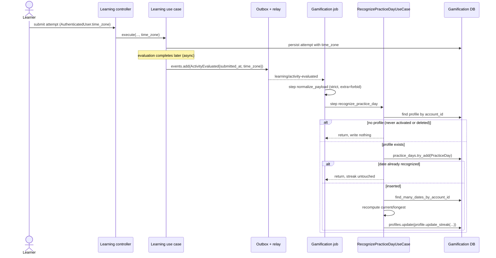
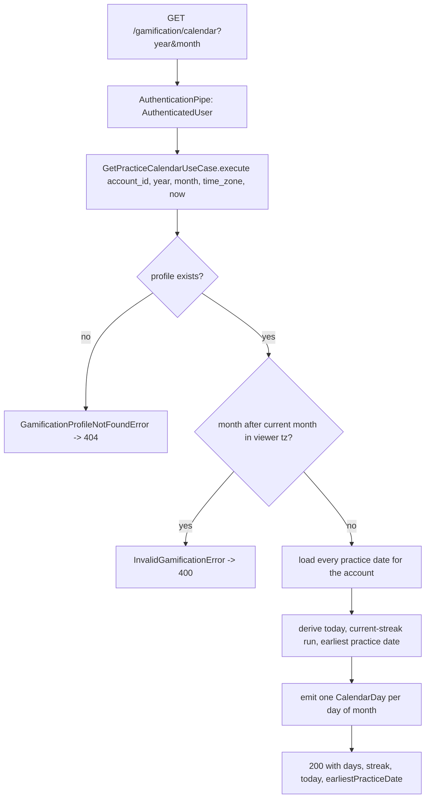

# Objective

Recognize and persist **practice days** from Learning's confirmed facts at the
learner's own local date, derive the **current and longest streak** from them,
and expose both through an authenticated monthly **Calendário** tab in the
Gamification area.

Current behavior: `SHIFU-82` shipped the Gamification profile, XP grants,
achievements and the `/gamification` page, and left the practice/streak
vocabulary in place but **entirely unconsumed** — `PracticeDay`, `PracticeStreak`,
`CalendarDay`, `CalendarDayState` and `PracticeKind` exist in
`gamification/core/domain/**`, and `gamification_profiles.streak_current`,
`streak_longest` and `streak_latest_practice_date` exist in the schema, but no
producer writes them, no table stores practice days, and no surface reads them.
`RP-05` and `RP-06` are therefore recorded as deferred in
[`../achievements/spec.md`](../achievements/spec.md). This Spec delivers them.

Mode: **complete**. The slice carries migration, persistence, concurrency and
idempotency, cross-module event-contract and asynchronous-integration risk, plus
a timezone-correctness rule whose failure silently mis-dates a learner's history.

# Scope

| Area / actor | Included | Excluded or deferred |
| --- | --- | --- |
| Practice-day recognition (Sistema) | A fully completed diagnostic and a learning Activity with a completed evaluation each recognize one practice day, at the local date of the attempt submission, collapsed to one day per date | Any other Learning fact; competency-mastery and skill-completion events are XP-only and recognize no practice day of their own |
| Streak calculation (Sistema) | Current and longest streak recomputed from the full practice-day set on every newly recognized day, including corrections from late evaluations | Streak-driven XP (RP-05 grants none) and streak achievements (see below) |
| Practice calendar (Usuário) | Authenticated monthly read, five day states, previous-month navigation, blocked future months, selected-day date confirmation, current/longest streak and today's guidance | Per-day XP or Activity counts (forbidden by RP-06) |
| Gamification area shell (Usuário) | A two-tab shell (`Calendário`, `Conquistas`) replacing the current single-purpose page body, and the redesigned page header | The `Visão geral` and `Histórico de XP` tabs present in design node `J5y1Au` — owned by `SHIFU-81`/`SHIFU-84` |
| Learning fact enrichment (Sistema) | `submitted_at` + `time_zone` added to `learning/activity-evaluated` and `learning/diagnostic-completed`; a nullable `time_zone` persisted on `learning_activity_attempts` | Any change to Learning's pedagogical rules, evaluation, progress, mastery or completion semantics |
| Account lifecycle (Sistema) | Practice days purged with the rest of the Gamification state on account deletion; no new practice day for a deleted account | The 24-hour purge orchestration itself, already owned by the existing deletion job |

Selected product outcomes for this bounded slice:

| RP | Classification | Rationale |
| --- | --- | --- |
| RP-01 | partial | The calendar read is private to the owning account; the profile itself already exists from `SHIFU-82` |
| RP-05 | full | Recognition, single-day collapse, timezone rule, late-evaluation correction, break and restart all delivered |
| RP-06 | full | Monthly calendar, five states, navigation bounds and date-only selection all delivered |
| RP-08 | partial | Practice days are preserved as part of the minimum history; the XP history surface is `SHIFU-81`/`SHIFU-84` |
| RP-11 | partial | Non-blocking recognition, retry and no-duplication delivered for practice days; activity XP recovery is `SHIFU-84` |
| RP-12 | partial | Practice days are purged and blocked for deleted accounts, inside the existing deletion path |
| RP-13 | partial | Responsive, pt-BR, keyboard-operable and non-color-only for the Calendário tab |

**Deferred consequence, stated explicitly.** This Spec populates
`gamification_profiles.streak_longest`, which is the input to the `Sequência`
achievement family (`Consistência I/II/III`). It does **not** make those
achievements reachable: `GrantXpUseCase` is the sole cascade orchestrator that
settles achievements (`grant_xp_use_case.py:30`, `_settle_achievements`), and a
streak update grants no XP (RP-05: "Manter a sequência não concede XP
diretamente"), so the cascade is never entered by practice recognition alone.
`SHIFU-80` excludes "processamento e apresentação de conquistas", so wiring
streak milestones into the cascade is left to a follow-up. Until then the
`Sequência` family stays catalogued and unreachable, exactly as
[`../achievements/spec.md`](../achievements/spec.md) records.

Design handoff for affected UI states and viewports:
[`design/handoff.md`](design/handoff.md).

# Behavior Contract

| ID | RP/JN/source coverage | Observable required behavior |
| --- | --- | --- |
| RF-01 | RP-05, RP-11; JN-02, JN-03 | A fully completed diagnostic, and a learning Activity whose evaluation completed, each recognize a practice day. An individual diagnostic attempt before the diagnostic completes, a pending evaluation and a failed evaluation recognize nothing. |
| RF-02 | RP-05 | Practice is recognized independently of reward: score 0, 0 XP granted, a repetition without improvement, and an Activity done after the Skill was completed all count. Several practices on one local date collapse into exactly one practice day. |
| RF-03 | RP-05 | The practice date is the local date of the attempt submission under the time zone in effect at that submission — the attempt's own submission for an Activity, and the last attempt required for completion for a diagnostic. A later change to the account's time zone never alters an already-recognized day. |
| RF-04 | RP-05; JN-05 | An evaluation completing after the fact recognizes the original submission date and recomputes both current and longest streak from the full practice-day set. |
| RF-05 | RP-05; JN-04 | A streak held through yesterday stays active during today. A whole day ending without practice sets current to 0; the next practice starts a new streak at 1. Longest never decreases. |
| RF-06 | RP-06; JN-06 | The calendar opens on the current month in the viewer's time zone, allows navigating to earlier months down to the first practice, and refuses future months at both the UI and the API. |
| RF-07 | RP-06, RP-13 | Each day renders exactly one of five states — neutral, practiced, current-streak, missed, today-pending — distinguished by shape and icon, never by color alone. Days before the first practice and days after today are neutral. |
| RF-08 | RP-05, RP-06 | Selecting a practice day confirms only its date, with no XP and no Activity count. The tab shows current streak, longest streak and coherent guidance for today. |
| RF-09 | RP-08, RP-11; JN-11, JN-12 | Redelivery, concurrent delivery and failure recovery never create a duplicate practice day and never block Learning. Removing a Goal or Skill preserves recognized days. |
| RF-10 | RP-01, RP-12; JN-13 | The calendar read returns only the authenticated account's own data. An account without a Gamification profile receives 404; a deleted account receives no new practice day and has its existing ones purged. |
| RF-11 | RP-13 | The tab works on desktop and mobile, in pt-BR, with keyboard-operable month navigation and day selection, accessible day identification, and clearly communicated loading, unavailable and recovery states. |
| RF-12 | RP-11 | A Gamification failure never blocks attempt submission, evaluation, progress, mastery or completion in Learning; the practice day is recognized on a later retry without the learner repeating anything. |

| ID | RF coverage | Given | When | Then | Checks |
| --- | --- | --- | --- | --- | --- |
| CA-01 | RF-01 | An account with a Gamification profile and no practice day on the submission date | `learning/activity-evaluated` is delivered | One practice day exists for the submission's local date | CI-01, CI-08 |
| CA-02 | RF-01 | An account with a Gamification profile | `learning/diagnostic-completed` is delivered | One practice day exists for the local date of the last attempt required to complete the diagnostic | CI-02, CI-09 |
| CA-03 | RF-01, RF-02 | An evaluated Activity with score 0 that granted no XP | The evaluation event is delivered | The practice day is still recognized | CI-01 |
| CA-04 | RF-02 | An account that already has a practice day for date D | A second fact with a submission whose local date is also D is delivered | The practice-day count for D stays 1 and the streak is unchanged | CI-03, CI-08 |
| CA-05 | RF-03 | An attempt submitted at `2026-03-01T02:30:00Z` with `time_zone` `America/Sao_Paulo` | The evaluation event is delivered | The practice day is `2026-02-28`, not `2026-03-01` | CI-04 |
| CA-06 | RF-03 | A recognized practice day stored with its submission time zone | The account's time zone is later changed | The stored `practice_date` is unchanged | CI-04 |
| CA-07 | RF-03, RF-12 | An event whose `time_zone` is absent, null, empty, or a syntactically valid but unresolvable IANA identifier | The event is delivered | The day is resolved in UTC and still recognized — never dropped, never raised, never retried | CI-04, CI-08 |
| CA-08 | RF-04 | Practice days on D-2 and D, with current streak 1 at D | A late evaluation recognizes D-1 | Current streak becomes 3 and longest is at least 3 | CI-05 |
| CA-09 | RF-05 | Practice days forming a 5-day run ending yesterday | The calendar is read today, with no practice today | Derived current streak still reads 5 and today is `today-pending` | CI-06 |
| CA-10 | RF-05 | A 5-day run that ended two days ago | The calendar is read today | Derived current streak reads 0 and longest still reads 5 | CI-06 |
| CA-11 | RF-05 | A streak broken after reaching longest 5 | A new practice is recognized | Current streak becomes 1 and longest stays 5 | CI-05 |
| CA-12 | RF-06, RF-07 | An account with practice days in the current and previous month | The current month is read | Days carry the five states correctly; days after today and days before the first practice are neutral | CI-06 |
| CA-13 | RF-06 | An authenticated account | A month after the current month is requested | The API rejects it with 400 and no calendar body | CI-07 |
| CA-14 | RF-10 | Two accounts each with their own practice days | Account A reads the calendar | Only A's days are returned | CI-07 |
| CA-15 | RF-10 | An authenticated account with no Gamification profile | The calendar is read | The API responds 404 | CI-07 |
| CA-16 | RF-10, RF-09 | An account whose Gamification profile is deleted | The deletion path runs | Its practice-day rows are removed with the rest of its state | CI-10 |
| CA-17 | RF-09, RF-12 | A delivered practice fact for an account with no Gamification profile | The job runs | Nothing is written and the job does not fail | CI-01, CI-08 |
| CA-18 | RF-09 | A practice fact already processed | The same event is delivered again | No duplicate row is created and the job completes | CI-08, CI-09 |
| CA-19 | RF-09, RF-12 | A malformed or extra-field event payload | The event is delivered | The job raises a non-retriable error and writes nothing | CI-08 |
| CA-20 | RF-06, RF-07, RF-08, RF-11 | An authenticated learner with practice days in the current month | They open `/gamification` and select the Calendário tab | The month grid, five states, streak values and today's guidance render from real data in pt-BR with no console errors | CI-11, CI-13, VM-01, VM-02 |
| CA-21 | RF-06, RF-11 | The Calendário tab on the current month | The learner activates previous-month navigation by keyboard | The grid moves to the previous month and the next-month control is disabled while the current month is shown | CI-11, CI-13, CI-15, VM-01 |
| CA-22 | RF-08 | The Calendário tab showing a month with practice days | The learner selects a practice day | A confirmation line shows that date only, with no XP and no Activity count | CI-11, VM-01 |
| CA-23 | RF-11 | The Calendário tab | The calendar query is loading, then fails | A loading state and then an error state with a working retry are announced, and the page shell stays intact | CI-11, CI-12 |
| CA-24 | RF-11 | The Gamification area | It is opened at a narrow viewport | The calendar keeps 7 columns with a reduced cell and remains operable | VM-02 |
| CA-25 | RF-09 | An account with recognized practice days | A Goal or Skill is removed in Learning | The practice days and streak are unchanged | CI-06 |
| CA-26 | RF-01, RF-09 | The pre-existing diagnostic XP consumer, which validates with `extra='forbid'` | The **enriched** `learning/diagnostic-completed` event is delivered | The existing job still accepts the payload and still grants diagnostic XP exactly once — no regression from the added fields | CI-09 |
| CA-27 | RF-11 | An authenticated learner in the Gamification area | The page renders and they switch tabs | Both tabs render with correct roles, Calendário is active by default, Conquistas shows the achievements composition unchanged, and the `mx-auto w-full max-w-7xl` shell holds on the loading, error and ready branches | CI-12 |
| CA-28 | RF-06 | The Calendário tab on the earliest month that has practice days | The learner attempts to navigate further back | Previous-month navigation is unavailable below the first practice month, and the viewed month never leaves the allowed range | CI-15 |

# Technical Contract

## Architecture Mapping

Owner: **Gamification**, with an authorized, minimal producer-side change in
**Learning**. Rules:
[python-conventions](../../../rules/python-conventions-rules.md),
[core-layer](../../../rules/core-layer-rules.md),
[database-layer](../../../rules/database-layer-rules.md),
[messaging-layer](../../../rules/messaging-layer-rules.md),
[rest-layer](../../../rules/rest-layer-rules.md),
[use-case-testing](../../../rules/use-case-testing-rules.md),
[controllers-testing](../../../rules/controllers-testing-rules.md),
[jobs-testing](../../../rules/jobs-testing-rules.md),
[typescript-conventions](../../../rules/typescript-conventions-rules.md),
[ui-layer](../../../rules/ui-layer-rules.md),
[web-app-routing](../../../rules/web-app-routing-rules.md),
[widget-testing](../../../rules/widget-testing-rules.md).

`apps/server/tach.toml` declares `shifu.gamification` → `["shifu.shared"]` only.
Gamification therefore **must not** import any Learning symbol; both new jobs
re-declare their wire contract locally with a private Pydantic `_Payload`,
exactly as `recognize_diagnostic_completed_job.py` already does.

### Learning — producer enrichment

| Action | Boundary | Element / Path | Required change |
| --- | --- | --- | --- |
| Modify | Core / entity | `ActivityAttempt` — `apps/server/src/shifu/learning/core/domain/entities/activity_attempt.py` | Add `time_zone: str | None = None` field and `create` keyword, defaulted so existing construction sites stay valid |
| Modify | Core / event | `ActivityEvaluatedPayload` — `apps/server/src/shifu/learning/core/domain/events/activity_evaluated_event.py` | Add `submitted_at: str` (UTC ISO-8601 `Z`) and `time_zone: str | None`; event name unchanged |
| Modify | Core / event | `DiagnosticCompletedPayload` — `apps/server/src/shifu/learning/core/domain/events/diagnostic_completed_event.py` | Add `submitted_at: str` (UTC ISO-8601 `Z`) and `time_zone: str | None`; `completed_at` retained unchanged for the existing XP consumer |
| Modify | Core / use case | `SubmitChoiceActivityUseCase` — `apps/server/src/shifu/learning/core/use_cases/submit_choice_activity_use_case.py` | Accept `time_zone: str | None` and pass it to `ActivityAttempt.create` (line 198) |
| Modify | Core / use case | `SubmitDiagnosticBatchUseCase` — `apps/server/src/shifu/learning/core/use_cases/submit_diagnostic_batch_use_case.py` | Accept `time_zone: str | None` and pass it to `ActivityAttempt.create` (line 184) |
| Modify | Core / use case | `EvaluateChoiceActivityUseCase` — `apps/server/src/shifu/learning/core/use_cases/evaluate_choice_activity_use_case.py` | Populate `submitted_at` from `attempt.submitted_at` and `time_zone` from `attempt.time_zone` when emitting `ActivityEvaluatedEvent` (line 441) |
| Modify | Core / use case | `CompleteDiagnosticUseCase` — `apps/server/src/shifu/learning/core/use_cases/complete_diagnostic_use_case.py` | Derive `submitted_at`/`time_zone` from the latest-submitted attempt among the already-loaded `attempt_by_activity` values (lines 91–112) and emit them on `DiagnosticCompletedEvent` (line 314) |
| Modify | REST / controller | `submit_choice_activity_controller.py`, `submit_diagnostic_batch_controller.py` — `apps/server/src/shifu/learning/rest/controllers/` | Pass `user.time_zone` from the already-injected `AuthenticatedUser` into the use case |
| Modify | Database / model | `ActivityAttemptModel` — `apps/server/src/shifu/learning/database/sqlalchemy/models/activity_attempt_model.py` | Add `time_zone: Mapped[str | None] = mapped_column(String(64), nullable=True)` |
| Modify | Database / mapper | `apps/server/src/shifu/learning/database/sqlalchemy/mappers/activity_attempt_mapper.py` | Map `time_zone` both directions |

`AuthenticatedUser.time_zone` is already populated from the Identity account on
every authenticated request
(`identity/providers/auth/jwt/jwks/jwks_jwt_authentication_provider.py:82`), so
no new provider or cross-module read is introduced. The column is nullable
because `Account.time_zone` is itself nullable and historical attempts have no
value; `CA-07` fixes the consumer-side behavior for that case.

Resulting payload declarations:

```python
@structure
class ActivityEvaluatedPayload:
    account_id: str
    goal_id: str
    skill_experience_id: str
    skill_id: str
    competency_id: str
    activity_id: str
    attempt_id: str
    evaluation_id: str
    kind: ActivityAttemptKind
    difficulty: ActivityDifficulty
    score: str
    evaluated_at: str
    submitted_at: str
    time_zone: str | None


@structure
class DiagnosticCompletedPayload:
    account_id: str
    goal_id: str
    skill_experience_id: str
    skill_id: str
    initial_progress: str
    completed_at: str
    submitted_at: str
    time_zone: str | None
```

### Gamification — core

| Action | Boundary | Element / Path | Required change |
| --- | --- | --- | --- |
| Create | Core / interface | `PracticeDaysRepository` — `apps/server/src/shifu/gamification/core/interfaces/practice_days_repository.py` | New `Protocol` port; re-exported from the package `__init__.py` |
| Modify | Core / interface | `GamificationDatabaseRepositories` — `apps/server/src/shifu/gamification/core/interfaces/gamification_database.py` | Add `practice_days: PracticeDaysRepository` so composed use cases share the single transaction |
| Create | Core / structure | `PracticeCalendar` — `apps/server/src/shifu/gamification/core/domain/structures/practice_calendar.py` | New read structure returned by the calendar use case |
| Create | Core / error | `GamificationProfileNotFoundError` — `apps/server/src/shifu/gamification/core/domain/errors/gamification_profile_not_found_error.py` | Subclass of shared `NotFoundError`, mapped to 404 by the existing family-based `AppErrorHandler` |
| Create | Core / use case | `RecognizePracticeDayUseCase` — `apps/server/src/shifu/gamification/core/use_cases/recognize_practice_day_use_case.py` | Recognize one practice day and recompute the streak |
| Create | Core / use case | `GetPracticeCalendarUseCase` — `apps/server/src/shifu/gamification/core/use_cases/get_practice_calendar_use_case.py` | Build one month of `CalendarDay` plus streak context |
| Modify | Core / use case | `DeleteGamificationProfileUseCase` — `apps/server/src/shifu/gamification/core/use_cases/delete_gamification_profile_use_case.py` | Add `repositories.practice_days.remove_many_by_account_id(account_id)` to the purge |
| Unchanged | Core / domain | `PracticeDay`, `PracticeStreak`, `CalendarDay`, `CalendarDayState` | Consumed as-is; `PracticeDay` already derives and freezes `practice_date` from `practiced_at` + `time_zone`, and `GamificationProfile.update_streak` already enforces non-regressing `longest` and `latest_practice_date` |
| Unchanged | Core / enum | `PracticeKind` — `.../enums/practice_kind.py` | Remains unconsumed; RP-06 forbids surfacing what produced a day, and no contract in this slice needs it. Left in place rather than deleted, since it is pre-existing scaffolding outside this Spec's mandate |

```python
class PracticeDaysRepository(Protocol):
    def try_add(self, practice_day: PracticeDay) -> bool:
        """Insert one practice day; return False when the account already has that date."""
        ...

    def find_many_dates_by_account_id(self, account_id: str) -> tuple[date, ...]:
        """Every recognized local date for the account, ascending."""
        ...

    def remove_many_by_account_id(self, account_id: str) -> None:
        """Delete every practice-day row for one account (account-deletion purge)."""
        ...


@structure
class PracticeCalendar:
    year: int
    month: int
    today: date                      # the viewer's today, in the viewer's zone
    days: tuple[CalendarDay, ...]
    streak: PracticeStreak           # `current` derived here; `longest` from the profile
    earliest_practice_date: date | None


class RecognizePracticeDayUseCase:
    def __init__(
        self,
        database: GamificationDatabase,
        identifier_provider: IdentifierProvider,
    ) -> None: ...

    def execute(
        self,
        account_id: str,
        *,
        practiced_at: datetime,
        time_zone: str | None,
        now: datetime,
    ) -> None: ...


class GetPracticeCalendarUseCase:
    def __init__(self, database: GamificationDatabase) -> None: ...

    def execute(
        self,
        account_id: str,
        year: int,
        month: int,
        *,
        time_zone: str | None,
        now: datetime,
    ) -> PracticeCalendar: ...
```

Streak recomputation is cross-aggregate coordination over the practice-day set
and the profile, so it lives in `RecognizePracticeDayUseCase` as a private
helper rather than on `PracticeStreak`, per
[core-layer rules](../../../rules/core-layer-rules.md). This also places it
inside the `core/use_cases/**` boundary that the required mutation check
targets.

**New concept — practice day.** A practice day is the Gamification-owned record
that *some* qualifying practice happened on one local calendar date for one
account. Its source of truth is Learning's confirmed facts; Gamification never
asks Learning anything, it only reacts. It deliberately stores no reference to
the originating fact: uniqueness is `(account_id, practice_date)`, which makes
"several practices in one day count once" (RF-02) and "a redelivered fact must
not duplicate" (RF-09) the *same* database guarantee rather than two mechanisms.
The first fact to land for a date wins and freezes that date's `practiced_at`
and `time_zone`; later facts for the same date are silently absorbed. Lifecycle:
created on recognition, never updated, deleted only by the account purge.

**New concept — streak recomputation.** Rather than incrementing a counter, the
use case recomputes `current` and `longest` from the complete ascending date
list every time a new day is inserted. This is what makes RF-04 work without a
special late-evaluation path: inserting an older date simply changes the runs
the recomputation sees. `current` is the length of the run ending at today or at
yesterday — the "held through yesterday stays active today" rule of RF-05 — and
is 0 otherwise; `longest` is the longest run overall. Because the set only ever
grows, `longest` is monotonic and `latest_practice_date` never regresses, which
is precisely what `GamificationProfile.update_streak` already asserts.

**Which streak value is authoritative.** These are deliberately split, because
"current" is the only one that decays with the passage of time and therefore
cannot be correct in a stored column:

- `longest` and `latest_practice_date` are **facts**. They change only when a
  day is recognized, are viewer-independent, and the persisted columns are
  authoritative. `RF-05`'s "longest never decreases" is asserted on the column.
- `current` is **derived at read time**. `GetPracticeCalendarUseCase` recomputes
  it from the practice-day set against the viewer's today, and that derived
  value is what `RF-05`, `CA-09`, `CA-10` and the UI assert. The
  `gamification_profiles.streak_current` column is a **snapshot** written at
  recognition for cheap non-calendar consumers (RP-10's Mentor context); it is
  expected to go stale once a day passes without practice, and nothing in this
  Spec reads it back for display.

**One definition of "today".** "Today" always means the current date **in the
time zone of whoever is asking**, never in a stored zone. At read time that is
`AuthenticatedUser.time_zone` (UTC when null). At recognition time there is no
viewer, so the snapshot uses the zone of the day being recognized — and because
that value is only a snapshot, the two can never contradict each other on a
surface the learner sees. A submission zone is used for exactly one purpose:
**dating** the practice day it belongs to. It never decides currency.

### Gamification — database

| Action | Boundary | Element / Path | Required change |
| --- | --- | --- | --- |
| Create | Database / model | `PracticeDayModel` — `apps/server/src/shifu/gamification/database/sqlalchemy/models/practice_day_model.py` | `__tablename__ = 'practice_days'`; `id` `String(26)` PK; `account_id` `String(26)` not null; `practice_date` `Date` not null; `time_zone` `String(64)` not null; `practiced_at` / `recognized_at` `DateTime(timezone=True)` not null; unique index `ix_practice_day_account_date` on `(account_id, practice_date)` |
| Create | Database / mapper | `PracticeDayMapper` — `.../mappers/practice_day_mapper.py` | `to_domain` / `to_model`, mirroring `GamificationProfileMapper` |
| Create | Database / repository | `SqlalchemyPracticeDaysRepository` — `.../repositories/practice_days_repository.py` | `try_add` via `session.begin_nested()` + `flush()` catching `IntegrityError`, exactly as `SqlalchemyRewardedMilestonesRepository.try_add`; `find_many_dates_by_account_id` ordered ascending; `remove_many_by_account_id` |
| Modify | Database / composition | `SqlalchemyGamificationDatabase` — `.../gamification_database.py` | Construct and expose the new repository in `GamificationDatabaseRepositories` |
| Create | Database / migration | `apps/server/migrations/versions/<generated>_create_practice_days.py` | Create `practice_days` with the columns, PK and unique index above; add the nullable `learning_activity_attempts.time_zone` column in the same revision. `down_revision = '341cb645e630'` — verified single current head. Generate with `uv run poe db:migrate --message "create practice days"`, then hand-verify; the revision id is Alembic-generated and is **not** fixed by this Spec. Additive only: no backfill, the new Learning column is nullable, and existing rows keep working |

The unique index is the idempotency guarantee for `CA-04`, `CA-18` and
concurrent delivery: two jobs racing on the same date both attempt the insert,
one wins, the loser's `try_add` returns `False` and it returns without touching
the streak.

### Gamification — messaging

| Action | Boundary | Element / Path | Required change |
| --- | --- | --- | --- |
| Create | Messaging / job | `RecognizePracticeDayOnActivityEvaluatedJob` — `apps/server/src/shifu/gamification/messaging/inngest/jobs/recognize_practice_day_on_activity_evaluated_job.py` | `FUNCTION_ID = 'gamification-recognize-practice-day-on-activity-evaluated'`, `_EVENT_NAME = 'learning/activity-evaluated'`, `retries=3`; private strict `_Payload` (`extra='forbid'`, UTC ISO validation) reading `account_id`, `submitted_at`, `time_zone`; `normalize_payload` then `recognize_practice_day` durable steps; `asyncio.to_thread` around the sync use case. **`time_zone: str \| None` must carry no `min_length`** — unlike the identifier fields, which keep `Field(min_length=1)` — so that an empty or null zone reaches the use case's UTC normalization instead of being rejected non-retriably, which `CA-07` requires |
| Create | Messaging / job | `RecognizePracticeDayOnDiagnosticCompletedJob` — `.../jobs/recognize_practice_day_on_diagnostic_completed_job.py` | Same shape against `learning/diagnostic-completed`, `FUNCTION_ID = 'gamification-recognize-practice-day-on-diagnostic-completed'`, including the same no-`min_length` rule for `time_zone` |
| Modify | Messaging / job | `RecognizeDiagnosticCompletedJob._Payload` — `.../jobs/recognize_diagnostic_completed_job.py` | **Required regression fix.** This existing consumer validates with `extra='forbid'` (line 19). Enriching `DiagnosticCompletedPayload` would make every delivery fail `_Payload.model_validate` and raise `NonRetriableError`, silently stopping diagnostic XP. Add `submitted_at: str` and `time_zone: str | None` to its `_Payload` so the strict validator keeps accepting the event; the job's behavior and `_normalize_payload` output are otherwise unchanged |
| Modify | Messaging / composition | `GamificationInngestMessaging.register_jobs` — `.../gamification_inngest_messaging.py` | Build `RecognizePracticeDayUseCase` once and register both new functions alongside the existing five |

**Event-compatibility constraint.** Every Gamification job validates its wire
contract with `extra='forbid'`. Adding a field to a published event is
therefore a **breaking change for existing consumers of that event**, not an
additive one. `learning/diagnostic-completed` has exactly one current consumer
(`RecognizeDiagnosticCompletedJob`), which must be widened in the same delivery
— see the Modify row above. `learning/activity-evaluated` has **no** consumer
in `apps/server/src` today, so enriching it breaks nothing. No other module
consumes either event. Any future event enrichment must repeat this audit.

Two separate functions consume `learning/diagnostic-completed` after this
change: the existing `RecognizeDiagnosticCompletedJob` (XP, RP-03) and the new
practice-day job (RP-05). Inngest fans one event out to every registered
trigger, and the two concerns stay independently retriable and independently
idempotent. Entangling practice recognition into the XP use case would couple
RP-03 and RP-05 and would leave practice unrecognized whenever the milestone was
already rewarded, since that path returns early on `try_add` failure.

### Gamification — REST

| Action | Boundary | Element / Path | Required change |
| --- | --- | --- | --- |
| Create | REST / controller | `GetPracticeCalendarController` — `apps/server/src/shifu/gamification/rest/controllers/get_practice_calendar_controller.py` | `GET /gamification/calendar`, query params `year: int`, `month: int`; `AuthenticatedUser` + `GamificationPipe.get_database` dependencies; module-level `Response` model; no `try`/`except` |
| Modify | REST / router | `GamificationRouter.register` — `.../rest/router.py` | Register the new controller |
| Modify | REST / examples | `apps/server/rest-client/gamification/gamification.rest` | Add a non-secret example for the new route |

```python
class CalendarDayResponse(BaseModel):
    day: date
    state: str


class StreakResponse(BaseModel):
    current: int
    longest: int


class Response(BaseModel):
    year: int
    month: int
    today: date
    days: tuple[CalendarDayResponse, ...]
    streak: StreakResponse
    earliest_practice_date: date | None = Field(
        serialization_alias='earliestPracticeDate'
    )
```

Errors flow to the global `AppErrorHandler`: a future month or an out-of-range
month raises `InvalidGamificationError` (a `ValidationError`) → 400; a missing
profile raises `GamificationProfileNotFoundError` (a `NotFoundError`) → 404;
an unauthenticated request is rejected by `AuthenticationPipe` → 401.

### Web

| Action | Boundary | Element / Path | Required change |
| --- | --- | --- | --- |
| Modify | UI / page | `GamificationPage` — `apps/web/src/ui/gamification/widgets/pages/gamification-page/index.tsx` | Render the redesigned header (plain `h1` "Gamificação" + description, replacing `ModulePageHeader`) and the two-tab shell; keep `mx-auto w-full max-w-7xl` on every branch |
| Modify | UI / hook | `use-gamification-page.ts` | Own the selected tab in local `useState`, defaulting to `calendario`; keep the existing achievements wiring |
| Create | UI / widget | `gamification-tabs/index.tsx` | Pure renderer over `apps/web/src/ui/shadcn/tabs.tsx`; props carry the active tab and the change handler |
| Create | UI / widget | `calendar-tab-panel/{index.tsx,use-calendar-tab-panel.ts}` | Owns the viewed month and the selected day; consumes the calendar query |
| Create | UI / widget | `calendar-tab-panel/month-navigator/index.tsx` | Month label + previous/next controls; next disabled on the current month |
| Create | UI / widget | `calendar-tab-panel/practice-calendar-grid/index.tsx` | Monday-first 7-column grid with weekday header |
| Create | UI / widget | `calendar-tab-panel/practice-calendar-grid/calendar-day-cell/index.tsx` | One day cell; maps state to icon/shape |
| Create | UI / widget | `calendar-tab-panel/selected-day-confirmation/index.tsx` | Date-only confirmation line |
| Create | UI / widget | `calendar-tab-panel/streak-panel/index.tsx` | Current streak, longest streak, today card, guidance copy |
| Create | UI / widget | `calendar-tab-panel/calendar-legend/index.tsx` | The five-state legend |
| Create | UI / query hook | `calendar-tab-panel/use-practice-calendar-query.ts` | `queryKey: ['gamification', 'practice-calendar', year, month]`, `retry: false`, disabled until a month is selected; mirrors the `createServerFn` composition of `use-achievements-query.ts` |
| Create | UI / widget | `achievements-tab-panel/index.tsx` | Wraps the existing `ProfileSummaryCard`, `AchievementFamilySection` and `HistoricalAchievementsSection` composition, moved unchanged out of the page entrypoint |
| Modify | UI / shared | `apps/web/src/ui/shared/widgets/components/icon/index.tsx` | Add `calendar`, `chevron-left`, `check`, `clock-3` to both the Lucide map and the `IconName` union; `circle-check`, `minus` and `trophy` already exist |
| Create | UI / shared hook | `apps/web/src/ui/shared/hooks/use-format-date.ts` | pt-BR `Intl` month and long-date formatting, shared by the navigator, the confirmation line and the streak panel |
| Create | Core / contract | `apps/web/src/core/gamification/practice-calendar.ts` | `PracticeCalendar`, `CalendarDay`, `CalendarDayState`, `PracticeStreak` plain TS types |
| Modify | REST / service | `apps/web/src/rest/services/gamification-service.ts` | Add `getPracticeCalendar(accessToken, year, month)` against `/gamification/calendar` |

No route file changes: the tab lives inside the existing `/gamification` page, so
`apps/web/src/routes/gamification/index.tsx`, `constants/routes.ts` and the
generated `routeTree.gen.ts` are untouched and `generate-routes` is not required.

**Accepted deviations, recorded in the handoff.** Design node `J5y1Au` shows a
four-tab bar; this slice ships two, because `Visão geral` and `Histórico de XP`
have no content in any delivered ticket and a disabled tab is a dead control
that assistive technology still announces, against RP-13. Adding each later is
one entry in the tab array.

**Known precedent deviation.** `use-achievements-query.ts` composes
`AxiosRestClient` + `GamificationService` inside a `createServerFn` instead of
consuming `useRestContext()`, and `gamificationService` is not registered in
`RestContextValue`. The new calendar query hook mirrors that existing pattern
for consistency within the module rather than introducing a second composition
style in the same page; correcting both together is a separate maintenance task.

### Expected file tree

```text
apps/server/
├── migrations/versions/
│   └── <generated>_create_practice_days.py                                    [N]
├── rest-client/gamification/gamification.rest                                 [M]
├── src/shifu/
│   ├── gamification/
│   │   ├── core/
│   │   │   ├── domain/
│   │   │   │   ├── errors/gamification_profile_not_found_error.py             [N]
│   │   │   │   ├── errors/__init__.py                                         [M]
│   │   │   │   ├── structures/practice_calendar.py                            [N]
│   │   │   │   └── structures/__init__.py                                     [M]
│   │   │   ├── interfaces/
│   │   │   │   ├── practice_days_repository.py                                [N]
│   │   │   │   ├── gamification_database.py                                   [M]
│   │   │   │   └── __init__.py                                                [M]
│   │   │   └── use_cases/
│   │   │       ├── recognize_practice_day_use_case.py                         [N]
│   │   │       ├── get_practice_calendar_use_case.py                          [N]
│   │   │       ├── delete_gamification_profile_use_case.py                    [M]
│   │   │       └── __init__.py                                                [M]
│   │   ├── database/sqlalchemy/
│   │   │   ├── models/practice_day_model.py                                   [N]
│   │   │   ├── models/__init__.py                                             [M]
│   │   │   ├── mappers/practice_day_mapper.py                                 [N]
│   │   │   ├── mappers/__init__.py                                            [M]
│   │   │   ├── repositories/practice_days_repository.py                       [N]
│   │   │   ├── repositories/__init__.py                                       [M]
│   │   │   └── gamification_database.py                                       [M]
│   │   ├── messaging/inngest/
│   │   │   ├── jobs/recognize_practice_day_on_activity_evaluated_job.py       [N]
│   │   │   ├── jobs/recognize_practice_day_on_diagnostic_completed_job.py     [N]
│   │   │   ├── jobs/recognize_diagnostic_completed_job.py                     [M]
│   │   │   ├── jobs/__init__.py                                               [M]
│   │   │   └── gamification_inngest_messaging.py                              [M]
│   │   └── rest/
│   │       ├── controllers/get_practice_calendar_controller.py                [N]
│   │       ├── controllers/__init__.py                                        [M]
│   │       └── router.py                                                      [M]
│   └── learning/
│       ├── core/
│       │   ├── domain/
│       │   │   ├── entities/activity_attempt.py                               [M]
│       │   │   └── events/{activity_evaluated,diagnostic_completed}_event.py  [M]
│       │   └── use_cases/
│       │       ├── submit_choice_activity_use_case.py                         [M]
│       │       ├── submit_diagnostic_batch_use_case.py                        [M]
│       │       ├── evaluate_choice_activity_use_case.py                       [M]
│       │       └── complete_diagnostic_use_case.py                            [M]
│       ├── database/sqlalchemy/
│       │   ├── models/activity_attempt_model.py                               [M]
│       │   └── mappers/activity_attempt_mapper.py                             [M]
│       └── rest/controllers/
│           ├── submit_choice_activity_controller.py                           [M]
│           └── submit_diagnostic_batch_controller.py                          [M]
└── tests/
    ├── gamification/
    │   ├── core/use_cases/
    │   │   ├── test_recognize_practice_day_use_case.py                        [N]
    │   │   ├── test_get_practice_calendar_use_case.py                         [N]
    │   │   └── test_delete_gamification_profile_use_case.py                   [M]
    │   └── server/controllers/test_get_practice_calendar_controller.py        [N]
    ├── learning/core/use_cases/
    │   ├── test_complete_diagnostic_use_case.py                               [M]
    │   └── test_evaluate_choice_activity_use_case.py                          [M]
    └── messaging/inngest/jobs/gamification/
        ├── test_recognize_practice_day_on_activity_evaluated_job.py           [N]
        ├── test_recognize_practice_day_on_diagnostic_completed_job.py         [N]
        └── test_recognize_diagnostic_completed_job.py                         [M]

apps/web/
├── src/
│   ├── core/gamification/practice-calendar.ts                                 [N]
│   ├── rest/services/gamification-service.ts                                  [M]
│   └── ui/
│       ├── shared/
│       │   ├── hooks/use-format-date.ts                                       [N]
│       │   └── widgets/components/icon/index.tsx                              [M]
│       └── gamification/widgets/pages/gamification-page/
│           ├── index.tsx                                                      [M]
│           ├── use-gamification-page.ts                                       [M]
│           ├── use-achievements-query.ts                                      (unchanged)
│           ├── gamification-tabs/index.tsx                                    [N]
│           ├── achievements-tab-panel/index.tsx                               [N]
│           ├── calendar-tab-panel/
│           │   ├── index.tsx                                                  [N]
│           │   ├── use-calendar-tab-panel.ts                                  [N]
│           │   ├── use-practice-calendar-query.ts                             [N]
│           │   ├── month-navigator/index.tsx                                  [N]
│           │   ├── practice-calendar-grid/
│           │   │   ├── index.tsx                                              [N]
│           │   │   └── calendar-day-cell/index.tsx                            [N]
│           │   ├── selected-day-confirmation/index.tsx                        [N]
│           │   ├── streak-panel/index.tsx                                     [N]
│           │   ├── calendar-legend/index.tsx                                  [N]
│           │   └── tests/
│           │       ├── calendar-tab-panel.test.tsx                            [N]
│           │       └── use-calendar-tab-panel.test.ts                         [N]
│           ├── profile-summary-card/                                          (unchanged)
│           ├── achievement-family-section/                                    (unchanged)
│           ├── historical-achievements-section/                               (unchanged)
│           ├── achievement-card/                                              (unchanged)
│           └── tests/
│               ├── gamification-page.test.tsx                                 [M]
│               └── use-gamification-page.test.ts                              [M]
└── tests/gamification/gamification-page.test.ts                               [M]
```

Test-boundary notes, per
[widget-testing](../../../rules/widget-testing-rules.md),
[core-layer](../../../rules/core-layer-rules.md) and
[database-layer](../../../rules/database-layer-rules.md) rules: there are
deliberately **no** test files for `PracticeDay`, `PracticeStreak`,
`PracticeCalendar`, the model, the mapper, the SQLAlchemy repository, the
migration, `use-practice-calendar-query.ts`, `gamification-service.ts`, or the
presentational calendar children. Each of those would be a blocking contract
defect. Persistence is proven through the controller and job tests; the child
widgets are proven through the real composition rendered by
`calendar-tab-panel.test.tsx`.

`use-calendar-tab-panel.ts` **does** take a dedicated hook test. Its state is
substantial — viewed-month transitions, the earliest-practice floor, the
future-month block and selection reset — and
[widget-testing rules](../../../rules/widget-testing-rules.md) require a
dedicated hook test in that case, while also requiring the component test to
replace that hook with a typed mock. Without it, the hook's real logic would be
asserted nowhere below Playwright. This mirrors the existing
`use-gamification-page.test.ts` for the sibling hook.

State ownership: `use-gamification-page.ts` owns the selected tab;
`use-calendar-tab-panel.ts` owns the viewed month and the selected day and is
the sole consumer of `use-practice-calendar-query.ts`. Children receive props
and raise callbacks; no state is duplicated and no child reaches into parent
state.

## Runtime Flow

Recognition — asynchronous, never on Learning's request path:



Learning's transaction commits the attempt, the evaluation and the outbox event
together; Gamification's work happens afterwards in its own transaction, so a
Gamification failure cannot roll back or block Learning (RF-12). Inngest retries
the function up to three times; because the whole recognition is wrapped in one
`GamificationDatabase.transaction()` and guarded by the unique index, a retry is
a no-op once the day exists (RF-09). A malformed payload raises
`NonRetriableError` before any write (CA-19).

Read — synchronous:



Per-day state derivation, in order: a day after `today` or before
`earliest_practice_date` is `neutral`; a practice day inside the current-streak
run is `current-streak`; any other practice day is `practiced`; `today` without
practice is `today-pending`; anything else is `missed`. Account isolation is
structural — every query is filtered by the `account_id` taken from the verified
session, never from a request parameter (RF-10).

# Verification Contract

## Shared setup

- **Server unit** (`CI-01`–`CI-07`, `CI-10`): run from `apps/server`. No app, HTTP, session, Docker or Inngest. Every port is mocked with `create_autospec(Protocol, instance=True)` in an `autouse=True` fixture; `IdentifierProvider` returns deterministic ids and all times are passed in explicitly as `now` / `practiced_at` — core never reads the clock. Cases are methods on a `Test<UseCase>` class named `test_should_*`.
- **Server controller** (`CI-07`): `TestClient` against `FastAPIApp.register(database_engine=...)` using the shared Testcontainers PostgreSQL fixture in `apps/server/tests/conftest.py`, with real Alembic migrations and real repositories. Two distinct seeded accounts are required for the isolation case; each test owns and cleans its own rows. Never point at the Compose development database.
- **Server jobs** (`CI-08`, `CI-09`): `apps/server/tests/fixtures/inngest_fixture.py` with disposable Inngest + PostgreSQL containers; the event is sent by name with a payload serialized from the domain event class, and effects are asserted from a fresh inspection session with bounded monotonic polling. Requires `SHIFU_RUN_REAL_INNGEST_TESTS=1`; a skip is not proof. If Docker is unavailable the check is Blocked, not passed.
- **Web component** (`CI-11`, `CI-12`): Vitest + jsdom from the repository root; `@testing-library/react` with `userEvent`. The widget test mocks `../use-calendar-tab-panel` (typed `vi.mocked`, fresh return value per `beforeEach`) and renders the real internal child composition. Mock application wrappers (`Icon`, the domain hook), never Lucide or `useQuery`.
- **Web route** (`CI-13`): extend the existing `apps/web/tests/gamification/gamification-page.test.ts`; mocked transport asserting method, path and query string, final URL and visible state. Mocked transport does not prove real persistence.
- **Manual/visual** (`VM-01`, `VM-02`): Playwright CLI from `apps/web` per [AGENTS.md](../../../../AGENTS.md). Confirm `docker compose ps` and web/API health first; reuse `.playwright-cli/states/shifu-auth-state.json` or sign in through the visible form. The account must have enough recognized practice days to show a current streak, a non-streak practice day and a missed day in one month — seed them through real Learning submissions, or through a disposable fixture; do **not** reset or reseed shared data. Artifacts stay under `apps/web/.playwright-cli/{logs,screenshots,snapshots,states}/`; paths and results go in Evaluation.

## Automated

### CI-01 — Activity evaluation recognizes exactly one practice day

**Criteria:** CA-01, CA-03, CA-17

**Expected result:** A `PracticeDay` is added for the submission's local date and the profile streak is updated. With no profile for the account, nothing is written and no error is raised.

**Setup / inputs:** Mocked `GamificationDatabase`; profile present / absent; evaluated Activity with score 0 and no XP granted.

**Proof:** `apps/server/tests/gamification/core/use_cases/test_recognize_practice_day_use_case.py` (planned)

```bash
uv run pytest tests/gamification/core/use_cases/test_recognize_practice_day_use_case.py
```

**Passing condition:** `practice_days.try_add` called once with the expected date; `profiles.update` called with the recomputed streak; in the no-profile case neither is called. Mocked ports prove orchestration, not persistence.

### CI-02 — Diagnostic completion dates practice from the last required attempt

**Criteria:** CA-02

**Expected result:** `DiagnosticCompletedEvent` carries `submitted_at` equal to the latest `submitted_at` among the attempts required for completion, and that attempt's `time_zone`.

**Setup / inputs:** Diagnostic run whose required attempts were submitted on different days.

**Proof:** `apps/server/tests/learning/core/use_cases/test_complete_diagnostic_use_case.py` (existing file, extended)

```bash
uv run pytest tests/learning/core/use_cases/test_complete_diagnostic_use_case.py
```

**Passing condition:** The emitted payload's `submitted_at`/`time_zone` match the latest required attempt, and `completed_at` is unchanged for the existing XP consumer.

### CI-03 — Several practices on one date collapse to one day

**Criteria:** CA-04

**Expected result:** When `try_add` reports the date already exists, the use case returns without recomputing or updating the streak.

**Setup / inputs:** `try_add` stubbed to return `False`.

**Proof:** `test_recognize_practice_day_use_case.py` (planned)

```bash
uv run pytest tests/gamification/core/use_cases/test_recognize_practice_day_use_case.py
```

**Passing condition:** `find_many_dates_by_account_id` and `profiles.update` are not called. The whole file is run rather than a name filter, since no verified test name exists at authoring time and `CI-01`/`CI-04`/`CI-05` already select the same file.

### CI-04 — Local date resolution and time-zone freezing

**Criteria:** CA-05, CA-06, CA-07

**Expected result:** `2026-03-01T02:30:00Z` with `America/Sao_Paulo` yields `2026-02-28`; a stored day keeps its date when the account time zone later changes; a null, empty or unresolvable time zone resolves in UTC and is still recognized.

**Setup / inputs:** Equivalence classes — zone behind UTC crossing midnight backwards, zone ahead of UTC crossing forwards, UTC exactly, null, empty string, and an unresolvable identifier such as `Mars/Olympus`. Boundary values at `00:00` and `23:59` local.

**Proof:** `test_recognize_practice_day_use_case.py` (planned)

```bash
uv run pytest tests/gamification/core/use_cases/test_recognize_practice_day_use_case.py
```

**Passing condition:** Each class produces the asserted `practice_date`, and every one of them calls `try_add` — no input class is allowed to drop the practice day or raise.

**Resolution rule this depends on:** `RecognizePracticeDayUseCase` normalizes the zone **before** constructing the entity, falling back to UTC for an absent, empty or unresolvable identifier, so `PracticeDay.create` always receives a resolvable zone. This is required, not incidental: `PracticeDay._local_date` raises `InvalidGamificationError` on `ZoneInfoNotFoundError` (`practice_day.py:9-13`), while the job's `_Payload` deliberately applies no `min_length` and no IANA check to `time_zone` — it cannot resolve zones without importing zone data into the wire contract. An un-normalized bad zone would therefore pass validation and then surface as a **retriable** error inside the use case, exhaust all three retries and dead-letter the event — losing a practice day that RP-11 requires to be recognized. Normalization in the use case is the single place that can prevent this. `CA-19`'s non-retriable path covers malformed payloads only; a well-formed payload carrying a bad zone must succeed.

### CI-05 — Streak recomputation, break, restart and late correction

**Criteria:** CA-08, CA-11

**Expected result:** Inserting a gap-filling older date raises the recomputed run to its full length; a practice after a break yields `current` 1 with `longest` preserved. Decay of `current` over elapsed days is a read-time behavior and is proven by `CI-06`, not here.

**Setup / inputs:** Date sets covering: empty, single day, contiguous run ending today, contiguous run ending yesterday, run ending two days ago, two runs separated by one missing day, and a late insert joining two runs.

**Proof:** `test_recognize_practice_day_use_case.py` (planned)

```bash
uv run pytest tests/gamification/core/use_cases/test_recognize_practice_day_use_case.py
```

**Passing condition:** `current`, `longest` and `latest_practice_date` match the expected triple for every set, and `longest` never decreases across successive calls.

### CI-06 — Monthly calendar day-state derivation

**Criteria:** CA-09, CA-10, CA-12, CA-25

**Expected result:** Every day of the requested month carries the correct state; days after today and before the first practice are neutral; a run ending yesterday still reports `current` and renders today as `today-pending`; a run that ended before yesterday reports `current` 0 while `longest` is preserved. This check owns the derived-`current` behavior, including its decay as days pass, by varying the injected `now` against a fixed date set.

**Setup / inputs:** A month containing current-streak days, an older practice day, a missed day, today, future days, and days before the first practice. Removing a Goal or Skill changes no Gamification row, so `CA-25` is asserted as the absence of any practice-day mutation on that path.

**Proof:** `apps/server/tests/gamification/core/use_cases/test_get_practice_calendar_use_case.py` (planned)

```bash
uv run pytest tests/gamification/core/use_cases/test_get_practice_calendar_use_case.py
```

**Passing condition:** The emitted `CalendarDay` tuple has one entry per day of the month in order, each with the expected `CalendarDayState`, plus the expected `streak` and `earliest_practice_date`.

### CI-07 — Calendar endpoint contract, isolation and rejection

**Criteria:** CA-13, CA-14, CA-15

**Expected result:** 200 with the serialized month for the owning account; 400 for a future or out-of-range month; 404 with no profile; 401 unauthenticated. Account A never sees account B's days.

**Setup / inputs:** Two seeded accounts with distinct practice days, persisted through real repositories and migrations.

**Proof:** `apps/server/tests/gamification/server/controllers/test_get_practice_calendar_controller.py` (planned)

```bash
uv run pytest tests/gamification/server/controllers/test_get_practice_calendar_controller.py
```

**Passing condition:** Exact status codes and response bodies, persisted state read back, and no cross-account leakage. This check also proves the new table, model, mapper, repository and migration, which have no tests of their own by rule.

### CI-08 — Activity-evaluated job end to end

**Criteria:** CA-01, CA-04, CA-17, CA-18, CA-19

**Expected result:** A real event delivered to the registered function persists one practice day; a duplicate delivery adds none; a malformed/extra-field payload writes nothing and fails non-retriably.

**Setup / inputs:** Disposable Inngest + PostgreSQL containers; payload serialized from `ActivityEvaluatedEvent`.

**Proof:** `apps/server/tests/messaging/inngest/jobs/gamification/test_recognize_practice_day_on_activity_evaluated_job.py` (planned)

```bash
SHIFU_RUN_REAL_INNGEST_TESTS=1 uv run pytest tests/messaging/inngest/jobs/gamification/test_recognize_practice_day_on_activity_evaluated_job.py
```

**Passing condition:** Row count asserted from a fresh session after bounded polling; duplicate delivery leaves the count at 1; the malformed case asserts no row. A skipped run is Blocked, not passing.

### CI-09 — Diagnostic-completed job end to end

**Criteria:** CA-02, CA-18, CA-26

**Expected result:** The event persists one practice day at the last required attempt's local date, and both consumers of this event — the existing XP job and the new practice job — run without interfering. The existing XP job must keep accepting the **enriched** payload.

**Setup / inputs:** As `CI-08`, with `DiagnosticCompletedEvent` carrying the new `submitted_at` and `time_zone` fields.

**Proof:** `apps/server/tests/messaging/inngest/jobs/gamification/test_recognize_practice_day_on_diagnostic_completed_job.py` (planned) and `.../test_recognize_diagnostic_completed_job.py` (existing file, extended — its fixture payload must gain the new fields)

```bash
SHIFU_RUN_REAL_INNGEST_TESTS=1 uv run pytest \
  tests/messaging/inngest/jobs/gamification/test_recognize_practice_day_on_diagnostic_completed_job.py \
  tests/messaging/inngest/jobs/gamification/test_recognize_diagnostic_completed_job.py
```

**Passing condition:** One practice day at the expected date; the pre-existing XP milestone effect is unchanged and still granted exactly once from the enriched payload; duplicate delivery adds nothing. A `NonRetriableError` from the existing job on the enriched payload is a failure, not an accepted outcome.

### CI-10 — Account deletion purges practice days

**Criteria:** CA-16

**Expected result:** `DeleteGamificationProfileUseCase` removes practice-day rows along with the profile, grants, achievements and milestones.

**Setup / inputs:** Mocked repositories with a profile present and absent.

**Proof:** `apps/server/tests/gamification/core/use_cases/test_delete_gamification_profile_use_case.py` (existing file, extended)

```bash
uv run pytest tests/gamification/core/use_cases/test_delete_gamification_profile_use_case.py
```

**Passing condition:** `practice_days.remove_many_by_account_id` called once with the account id; no call when there is no profile.

### CI-11 — Calendário tab renders states, navigation and selection

**Criteria:** CA-20, CA-21, CA-22, CA-23

**Expected result:** The grid renders Monday-first with the five day states by accessible name; previous-month navigation moves the month; the next-month control is disabled on the current month; selecting a practice day shows a date-only confirmation; loading and error states render with a working retry.

**Setup / inputs:** `use-calendar-tab-panel` mocked with loading, success, error and empty return values.

**Proof:** `apps/web/src/ui/gamification/widgets/pages/gamification-page/calendar-tab-panel/tests/calendar-tab-panel.test.tsx` (planned)

```bash
pnpm --filter web exec vitest run src/ui/gamification/widgets/pages/gamification-page/calendar-tab-panel/tests/calendar-tab-panel.test.tsx
```

**Passing condition:** Role-first queries; `aria-disabled`/`disabled` asserted on the next-month control; pt-BR visible and accessible labels asserted; the confirmation line contains no XP or Activity count. No snapshots or class-name assertions.

### CI-12 — Tab shell preserves the achievements surface

**Criteria:** CA-23, CA-27

**Expected result:** The page renders both tabs, defaults to Calendário, switches to Conquistas, and the existing achievements composition still renders its loading, error and populated states inside the new panel.

**Setup / inputs:** `use-gamification-page` mocked; existing cases in `gamification-page.test.tsx` adapted to the tab shell.

**Proof:** `apps/web/src/ui/gamification/widgets/pages/gamification-page/tests/{gamification-page.test.tsx,use-gamification-page.test.ts}` (existing files, extended)

```bash
pnpm --filter web exec vitest run src/ui/gamification/widgets/pages/gamification-page/tests
```

**Passing condition:** Tab roles and `aria-selected` asserted; every previously passing achievements assertion still passes; `mx-auto w-full max-w-7xl` survives on loading, error and ready branches.

### CI-13 — Calendar route integration

**Criteria:** CA-20, CA-21

**Expected result:** Opening `/gamification` requests `GET /gamification/calendar` with the correct `year`/`month` query string and renders the returned month; month navigation issues a new request with the new parameters.

**Setup / inputs:** Mocked transport in the existing route suite.

**Proof:** `apps/web/tests/gamification/gamification-page.test.ts` (existing file, extended)

```bash
pnpm --filter web exec playwright test tests/gamification/gamification-page.test.ts
```

**Passing condition:** Method, path and query string asserted; final URL and visible state asserted; keyboard navigation exercised. Mocked transport does not prove real authenticated persistence — `VM-01` covers that.

### CI-15 — Calendar tab hook state transitions

**Criteria:** CA-21, CA-28

**Expected result:** The hook starts on the current month, moves to the previous month on request, refuses to advance past the current month, refuses to go below the earliest practice month, and clears the selected day when the viewed month changes.

**Setup / inputs:** `renderHook` with `use-practice-calendar-query` mocked; months exercised at the boundaries — current month, earliest practice month, and a month with no practice days.

**Proof:** `apps/web/src/ui/gamification/widgets/pages/gamification-page/calendar-tab-panel/tests/use-calendar-tab-panel.test.ts` (planned)

```bash
pnpm --filter web exec vitest run src/ui/gamification/widgets/pages/gamification-page/calendar-tab-panel/tests/use-calendar-tab-panel.test.ts
```

**Passing condition:** Each transition asserted on the hook's returned values. This check exists because `CI-11` mocks this hook by rule, so the hook's own logic has no other coverage below Playwright.

### CI-14 — Applicable baseline checks

**Scope:** `apps/server` (gamification + learning), `apps/web`, and the directly affected consumers listed above.

**Checks, with separate dispositions per
[scoped static-check guidance](../../../tooling.md#scoped-type-lint-and-complexity-checks):**

- **Types** — `cd apps/server && uv run poe check:types`; `pnpm --filter web check:types` from the repository root. Required; both configured projects are affected. Type checks use the project configuration rather than a file list, to preserve tsconfig and consumer context.
- **Lint / format** — `cd apps/server && uv run ruff check --no-fix <exact changed paths>` and `uv run ruff format --check <exact changed paths>`; `pnpm exec biome check <exact changed paths>` from the repository root. Web lints with **Biome**, not ESLint (`apps/web/package.json:11`); no ESLint is installed. Required, and must not rewrite source.
- **Architecture** — `cd apps/server && uv run poe check:architecture`. Required: this Spec adds cross-module event coupling, and Tach must confirm Gamification still imports only `shifu.shared`.
- **Complexity** — no dedicated metrics command, threshold or baseline is configured in this repository, so none is invented. The obligation is discharged by the configured complexity lint rules inside the scoped checks above: Ruff `C90` on the Server side (selected in the root `pyproject.toml`, already relied on at `complete_diagnostic_use_case.py:54`) and Biome's configured complexity rules on the Web side. Record the diagnostics and their severity; no quantitative score is claimed.

**Passing condition:** Every required gate passes, each static disposition has an actual command result, and the selected tests are confirmed to have executed with non-zero collected counts.

**Mutation testing — required.** The concrete risk is that streak arithmetic and
day-state derivation are off-by-one-prone boundary logic whose failures are
silent and user-visible only as a wrong history: a `>=` written as `>` in the
"ended yesterday" rule (RF-05) or in the future-day comparison (RF-07) would
pass a naive equality test while corrupting every learner's streak. Ordinary
coverage cannot demonstrate that those boundaries are actually asserted.

- **Targets:** `src/shifu/gamification/core/use_cases/recognize_practice_day_use_case.py`, `src/shifu/gamification/core/use_cases/get_practice_calendar_use_case.py` — the production `core/use_cases/**` files this Spec creates. `delete_gamification_profile_use_case.py` is also modified but its change is a single delegated purge call already proven by `CI-10`; it is included only if the runner selects it from the diff.
- **Runner:** mutmut 3.8 via the Server Poe script, verified in [Tooling](../../../tooling.md#mutation-testing). Core runs need no Docker.

```bash
cd apps/server && uv run poe test:mutation --core \
  --files src/shifu/gamification/core/use_cases/recognize_practice_day_use_case.py \
          src/shifu/gamification/core/use_cases/get_practice_calendar_use_case.py
```

`--files` is declared `nargs='+'` (`apps/server/scripts/test_mutation.py:441`),
so both paths must follow a **single** flag. Repeating `--files` would keep only
the last path and silently drop `recognize_practice_day_use_case.py` — the file
whose boundary logic motivates this check. Evaluation must confirm both targets
appear in the runner's reported scope.

- **Selected tests:** only `tests/gamification/core/use_cases/test_recognize_practice_day_use_case.py` and `test_get_practice_calendar_use_case.py`. Controller, job and Web tests are excluded.
- **Pass condition:** no surviving mutant in the streak-run, date-boundary or day-state branches. Runner success alone is not proof — Evaluation must record exact targets, the command, elapsed time and mutant outcomes.
- **Survivor disposition:** each survivor is either killed by a new assertion in the owning use-case test, or recorded as a justified equivalent mutant with its reason. Deferral requires an explicit note; an unavailable runner leaves this Blocked rather than passed.
- **Web:** Not applicable — no mutation runner exists for Web or packages. Web correctness is covered by `CI-11`–`CI-13` and the static gates.

## Manual

### VM-01 — Real authenticated calendar journey

**Type:** Manual

**Criteria:** CA-20, CA-21, CA-22

**Tool / setup:** Playwright CLI from `apps/web` with the shared manual setup above, against real services and a real authenticated session.

**Procedure:** Open `/gamification`; confirm the Calendário tab is active and shows the current month; read the current and longest streak and today's guidance; activate the previous-month control **by keyboard** and confirm the grid changes; confirm the next-month control is disabled on the current month; select a practice day by keyboard and read the confirmation line; switch to Conquistas and back.

**Passing condition:** Final URL stays `/gamification`; the `GET /gamification/calendar` requests carry the expected `year`/`month` and return 200 from the real API; the displayed **longest** streak matches `gamification_profiles.streak_longest` and the displayed **current** streak matches the value derived from the persisted practice days against the viewer's today — not necessarily the `streak_current` snapshot column, which is expected to lag once a day passes without practice; the confirmation line shows a date only, with no XP and no Activity count; visible focus is present at every step; no console errors beyond known unrelated noise. Close only the processes started for the check.

## Visual

### VM-02 — Calendário tab against design node `J5y1Au`

**Type:** Visual

**Criteria:** CA-20, CA-24

**Reference / setup:** [`design/handoff.md`](design/handoff.md) and
[`design/J5y1Au.png`](design/J5y1Au.png) (1440×1100, exported at scale 1 from
`design/shifu.pen` and visually inspected 2026-10-14). Captured during `VM-01`
at 1440×900 and at 390×844.

**Capture / comparison:** Compare tab bar with Calendário active, month header
and navigation, the Monday-first 7-column grid, all five day states, the
selected-day confirmation line, the streak panel and the legend. At the narrow
viewport confirm the grid keeps 7 columns with a reduced cell, per
`documentation/design.md` §9.

**Passing condition:** Hierarchy, state vocabulary and token usage match the
reference; each day state remains distinguishable without color; no clipping or
horizontal overflow at either viewport. Accepted deviations: the two-tab bar
instead of the reference's four tabs; the mobile layout has no reference frame
and follows `design.md` §9; the `neutral` day state does not occur in the
reference month and is verified against the legend entry instead. Inspecting the
saved images is required — saving a screenshot is not a pass.

# Documentation Alignment

| Document / authority | Governs | Required update or confirmation | Disposition / dependency |
| --- | --- | --- | --- |
| [PRD — Gamification](https://joaogoliveiragarcia.atlassian.net/wiki/spaces/Shifu/pages/82903042/Shifu+PRD+Gamification), content ID `82903042`, **version 3**, last edited 2026-10-04, retrieved **2026-10-14 (complete page)** | RP-01, RP-05, RP-06, RP-08, RP-11, RP-12, RP-13; JN-04, JN-05, JN-06, JN-11, JN-12, JN-13 | confirmed | No PRD change required or authorized. **Reported conflict:** SHIFU-80's traceability section cites "versão 2"; the canonical page is at version 3, which [`../achievements/spec.md`](../achievements/spec.md) also recorded on 2026-10-05. The Jira citation is stale; this Spec follows the canonical page and does not edit Jira |
| [SHIFU-80](https://joaogoliveiragarcia.atlassian.net/browse/SHIFU-80) | Delivery scope, acceptance criteria, exclusions | confirmed | Objective, scope and exclusions consumed as written; no Jira write performed or requested |
| `design/shifu.pen` node `J5y1Au` ("14.1 Gamificação · Calendário · Redesign") | Calendário tab visual authority | confirmed | Inspected read-only through the Pencil CLI and exported to `design/J5y1Au.png` on 2026-10-14; recorded in [`design/handoff.md`](design/handoff.md) with accepted deviations |
| [`documentation/design.md`](../../../design.md) §6.5 T31–T32, §3 tokens, §9 responsive | Streak area, calendar states, mobile adaptation, token vocabulary | confirmed | Governs the mobile layout, which has no Pencil reference frame |
| [`documentation/modules.md`](../../../modules.md), [`architecture.md`](../../../architecture.md), `apps/server/tach.toml` | Module ownership and import boundaries | confirmed | Gamification still imports only `shifu.shared`; both jobs re-declare their wire contract locally. Re-verified by `check:architecture` in `CI-14` |
| Rule Pack listed in Architecture Mapping | Layer placement, test boundaries, conventions | confirmed | Test-boundary exclusions enumerated under the file tree; recheck affected rules before conclusion |
| [`documentation/tooling.md`](../../../tooling.md) | Commands, test selection, mutation policy, scoped static checks | confirmed | Commands taken from the current catalogue; migration head `341cb645e630` verified against `apps/server/migrations/versions/` |
| [`../achievements/spec.md`](../achievements/spec.md) | Prior Gamification delivery; records RP-05/RP-06 as deferred | update at conclusion | Its deferral notes for RP-05/RP-06 become satisfied by this Spec, while its `Sequência`-unreachable note remains accurate — reconcile both at conclusion, not during authoring |

# Revision History

| Revision | Date | Contract change | Reason / source |
| --- | --- | --- | --- |
| 1 | 2026-10-14 | Initial contract | SHIFU-80 against PRD — Gamification version 3. Consequential decisions: Learning enriches `learning/activity-evaluated` and `learning/diagnostic-completed` with `submitted_at` + `time_zone` and persists a nullable `time_zone` on `learning_activity_attempts`, rather than Gamification reading a current time zone through a new Identity port, so the practice date reflects the zone in effect at submission; practice-day uniqueness is `(account_id, practice_date)`, making single-day collapse and redelivery idempotency one guarantee; the streak is recomputed from the full date set so late evaluations need no special path; the Gamification area gains a two-tab shell rather than the reference design's four, since the other two tabs have no content in any delivered ticket; and because every Gamification job validates with `extra='forbid'`, enriching `learning/diagnostic-completed` is a breaking change for its one existing consumer, so `RecognizeDiagnosticCompletedJob._Payload` is widened in the same delivery and `CA-26` guards that regression |
