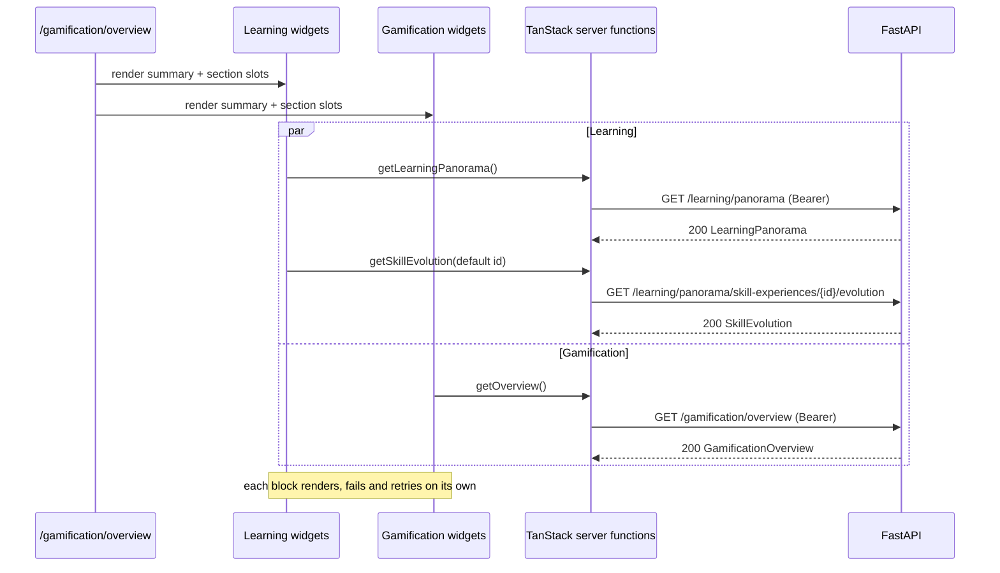

# Objective

Turn the **Visão geral** tab of the global area into a panel named **Progresso**
that shows, in two separate sections, the learner's learning panorama across
every Objetivo (Learning RP-35) and their engagement summary (Gamification
RP-15), without creating any aggregated grade, progress or completion and
without mixing learning with gamification.

Current behavior: the area lives at `/gamification/*`, its heading reads
"Gamificação", and the Visão geral tab (SHIFU-82,
[`../overview/spec.md`](../overview/spec.md)) shows only Gamification data:
level card, a seven-day streak strip and recent achievements, served by
`GET /gamification/overview`. Learning exposes no account-wide read: every
existing endpoint is scoped to one Objetivo or one experience. The web app has
no chart widget and no chart dependency.

Mode: **complete**. The slice crosses two business modules, adds two Learning
endpoints and new account-scoped repository reads, changes a public
Gamification response, derives a historical series from persisted evaluation
data, and recomposes a routed page across module UI boundaries. There is no
migration, no event, no job and no write path.

# Scope

| Area / actor | Included | Excluded or deferred |
| --- | --- | --- |
| Area shell (Usuário) | Heading "Progresso" and the board subtitle; the four tabs keep their order, paths and content | Renaming `/gamification/*` paths or route keys (Q14); a level/XP/streak summary in the top navigation (Gamification RP-01 "pode") |
| Learning panorama (Usuário) | Unique counts, stage distribution, Continue de onde parou, Atividades avaliadas por semana, Evolução de uma Habilidade, Habilidades concluídas, Domínios recentes and their empty states | Study time, materials read, diagnostic grades, period filters, export, tooltips beyond PRD labels, any administrative metrics |
| Engagement panel (Usuário) | Level, XP and XP missing for the next level, current and record streak, current month of the calendar, three recent achievements, next achievement and XP por semana | Rankings, XP goals, comparison with other users; changes to the Calendário, Conquistas and Histórico de XP tabs |
| Composition (Sistema) | Learning and Gamification load, fail and recover independently; neither module imports the other | A combined endpoint |
| Charts (Usuário) | Recharts bar and line charts behind shared wrappers (Q15 = Recharts): title, text alternative, table view, keyboard navigation between data points, no color-only meaning, desktop and mobile | Tooltips with data beyond the PRD labels; zoom, brush and period filters |
| Access (Sistema) | Every read is private to the authenticated account; removed experiences stop appearing; XP and achievements persist | Account-deletion orchestration, already owned by the existing deletion flows |

Selected product outcomes for this bounded slice:

| Module | RP / JN | Classification | Rationale |
| --- | --- | --- | --- |
| Learning | RP-35, JN-27 | full | Every business and experience rule of the panorama is delivered. |
| Learning | RP-15 | partial | Only the read-side use of the persisted Habilidade result and its partial identification in the evolution series; calculation is unchanged. |
| Learning | RP-16 | partial | Only the reading of mastery and open verification for counts and Domínios recentes. |
| Learning | RP-17 | partial | Only the guarantee that Continue de onde parou is not a recommendation; recommendation logic is unchanged. |
| Learning | RP-19 | partial | Only the access from Habilidades concluídas to the existing final summary on the skill page and the preserved final result. |
| Learning | RP-20 | partial | Only the exclusion of review evaluations from the evolution series and their inclusion in the weekly count. |
| Learning | RP-21, RP-22 | partial | Only the guarantee that removed experiences leave every panorama value; removal itself is unchanged. |
| Learning | RP-25 | partial | Responsive, pt-BR, keyboard-operable and non-color-only for the Aprendizagem section and its charts. |
| Gamification | RP-01 | partial | The area is titled Progresso and its Visão geral combines RP-15 and Learning RP-35 in separate sections; the optional navigation summary is deferred. |
| Gamification | RP-15, JN-16 | full | Every business and experience rule of the engagement panel is delivered. |
| Gamification | RP-04, RP-05, RP-06, RP-07 | partial | Only their presentation in the panel; mechanics, calendar tab and achievements tab are unchanged. |
| Gamification | RP-08 | partial | Only XP aggregation by fact date and the preservation of XP after Learning removals. |
| Gamification | RP-11 | partial | Only the guarantee that Gamification unavailability does not hide the Learning panorama. |
| Gamification | RP-13 | partial | Responsive, pt-BR, keyboard-operable and non-color-only for the Engajamento section and its charts. |

# Behavior Contract

| ID | RP/JN/source coverage | Observable required behavior |
| --- | --- | --- |
| RF-01 | Gamification RP-01, RP-15; Learning RP-35 | The area's heading is "Progresso" with the subtitle "Sua aprendizagem e sua constância em um só lugar.". Its tabs remain Visão geral, Calendário, Conquistas and Histórico de XP in that order, and Visão geral remains the default. Visão geral shows four summary cards — two labelled Aprendizagem and two labelled Engajamento — followed by an "Aprendizagem" section and an "Engajamento" section. Learning indicators use the jade family and never the latão family, icons or vocabulary of XP, level and streak; engagement indicators use the latão family. |
| RF-02 | Learning RP-35, RP-21, RP-22 | The panorama considers only the active experiences of the authenticated account, across all its Objetivos. It never reports an average, grade, progress or completion of an Objetivo, of the set of Objetivos or of the user: every value belongs to one experience or is a count. A removed Objetivo or experience stops contributing to every value. |
| RF-03 | Learning RP-35, RP-19, RP-16 | "Habilidades concluídas" counts distinct catalog Habilidades with at least one completed experience; "Competências dominadas" counts distinct catalog Competências currently mastered in at least one experience, including mastered Competências with an open verification (Q5). The same Habilidade completed in two Objetivos counts once. |
| RF-04 | Learning RP-35, RP-05 | Habilidades por etapa reports the number of experiences not started, in diagnosis, in learning and completed, plus the number of Objetivos that contain at least one experience. |
| RF-05 | Learning RP-35, RP-17, RP-05, RP-06 | Continue de onde parou lists at most three experiences in diagnosis or in learning. Experiences with a submitted attempt come first, newest submission first; experiences without any submitted attempt follow, newest start first (Q6). Each item shows the Habilidade, the Objetivo, the stage and, for the learning stage only, the focus Competência — the first Competência in curricular order that is not mastered or has an open verification. Items show no next Activity and are never presented as a recommendation (Q2). Activating an item opens that experience's skill page. |
| RF-06 | Learning RP-35, RP-20, RP-32 | Atividades avaliadas por semana reports exactly eight local weeks, Monday to Sunday, ending with the current week, each counting the learning and review attempts whose official evaluation is completed, grouped by the submission date in the account's current time zone. Diagnostic attempts and pending or failed evaluations never count. A Preparação Prática closed without grade cannot count because its evaluation is `closed_without_grade`, not completed (the format reached `main` after this Spec was written; the contract is unchanged). The chart states that the value is a count and not performance. |
| RF-07 | Learning RP-35, RP-15, RP-20, RP-07 | Evolução de uma Habilidade shows the series of one experience chosen by the learner, never combining experiences. Its first point is the diagnostic base, present only when at least one Concept had a numeric baseline after the diagnostic; without it there is no starting point. Each further point is the Habilidade result after an official learning evaluation that changed it, dated at the evaluation's completion. Review evaluations never create points, so a completed experience's series ends at completion. Every point carries whether the estimate was partial at that moment. The initial selection is the experience with the most recent submitted attempt. |
| RF-08 | Learning RP-35, RP-19 | Habilidades concluídas lists every completed experience, newest completion first, with its Habilidade, Objetivo, preserved final result and local completion date. Activating a row opens the experience's skill page, where the final summary of RP-19 is shown. |
| RF-09 | Learning RP-35, RP-16 | Domínios recentes lists at most five Competência experiences that are mastered and stable — mastered without an open verification — newest mastery date first, each with Competência, Habilidade, Objetivo and local date. A Competência that lost mastery or has an open verification does not appear (Q5). |
| RF-10 | Learning RP-35 | Without any Objetivo, the Aprendizagem section explains that the panorama starts with an Objetivo and offers "Criar objetivo". With Objetivos but no completed learning evaluation, the weekly chart and the evolution chart explain that they will appear after the first evaluations, instead of rendering empty axes. The evolution chart also shows that explanation while the selected series holds fewer than two points, for example only the diagnostic base point, because one point is not an evolution (Q23). |
| RF-11 | Gamification RP-15, RP-04, RP-05 | The engagement panel shows the current level, total XP and XP missing for the next level, and the current and record streak, with the same values the existing tabs report. |
| RF-12 | Gamification RP-15, RP-06 | The panel shows the current local month with the five calendar day states of RP-06, distinguishable without color, no XP or Activity count per day, and a link to the Calendário tab. The panel's month is display-only: its days are not buttons and take no focus; day selection stays in the Calendário tab (Q17). It uses a compact variant of the Calendário grid and legend, with 40 px cells, Monday-first weeks like the Calendário tab, and the day states told apart by fill, border and dash (Q19). |
| RF-13 | Gamification RP-15, RP-07 | The panel shows the three most recently obtained achievements and the next achievement: the locked active achievement with the highest share of its criterion already met, ties broken by catalog order, with its current value and target. When nothing is locked, no next achievement is shown. A link opens the Conquistas tab. |
| RF-14 | Gamification RP-15, RP-08 | XP por semana reports exactly twelve local weeks, Monday to Sunday, ending with the current week, each summing the XP of every grant whose fact date falls in that week in the account's current time zone; a late evaluation adds to the week of the original practice. It states in text that XP measures engagement, not knowledge, and links to Histórico de XP. |
| RF-15 | Gamification RP-11, RP-15; Learning RP-35 | Learning and Gamification data load independently. When one read is loading, fails or recovers, the other section and its summary cards keep their own state; the failed block shows an unavailable message with a working retry and never invents values. |
| RF-16 | Learning RP-35, RP-25; Gamification RP-15, RP-13 | Every chart has a title, a text summary and a "Gráfico / Tabela" switch that replaces the chart with an accessible table of the same values (Q3). Each chart is one keyboard tab stop; the arrow keys move between data points and the tooltip, a live region, announces only the PRD label and value of the point (plus "Parcial" for partial evolution points). Partial evolution points are drawn hollow and identified in text; the latest evolution value is labelled on the chart. No value or state depends on color alone. |
| RF-17 | Learning RP-35; Gamification RP-01, RP-12 | Both reads return only the authenticated account's data. Unauthenticated requests are rejected. Requesting the evolution of an experience that does not exist or belongs to another account answers not found without disclosing it. |
| RF-18 | Learning RP-21, RP-22; Gamification RP-08, JN-12 | After an Objetivo or experience is removed, it disappears from every Learning value while the total XP, XP por semana and achievements are unchanged. |
| RF-19 | Learning RP-25; Gamification RP-13 | The panel works on desktop and mobile, in pt-BR, is fully keyboard-operable, and communicates loading, empty, unavailable and recovery states. |

| ID | RF coverage | Given | When | Then | Checks |
| --- | --- | --- | --- | --- | --- |
| CA-01 | RF-01 | An authenticated learner | They open `/gamification` | The URL becomes `/gamification/overview`, the h1 reads "Progresso" with the board subtitle, the tab navigation lists Visão geral, Calendário, Conquistas, Histórico de XP with Visão geral active, and the summary cards and both sections render in board order | CI-09, CI-10, VM-01 |
| CA-02 | RF-02, RF-03 | An account with the same Habilidade completed in two Objetivos, a second Habilidade completed once, and the same Competência mastered in three experiences | The panorama is read | Completed count is 2 and mastered count counts that Competência once | CI-01, CI-03 |
| CA-03 | RF-03, RF-09 | An account with a mastered Competência that has an open verification | The panorama is read | It is counted in "Competências dominadas" and absent from Domínios recentes | CI-01 |
| CA-04 | RF-02 | An account with experiences in several Objetivos | The panorama is read | No field of the response carries an average or result for an Objetivo, the set of Objetivos or the user | CI-01, CI-03 |
| CA-05 | RF-04 | Experiences in each of the four stages spread across three Objetivos, plus an Objetivo without experiences | The panorama is read | Each stage count matches, the containing-Objetivo count is 3, and the account is reported as having Objetivos | CI-01, CI-03 |
| CA-06 | RF-05 | Five experiences in diagnosis or learning with distinct latest submissions, one completed experience with the newest submission, and one experience in diagnosis without any attempt | The panorama is read | Exactly three items are returned, newest submission first, the completed experience is never listed, and the attempt-less experience is listed only when fewer than three experiences have submissions | CI-01 |
| CA-07 | RF-05 | A learning-stage experience whose first Competência is mastered and second is not, and a diagnosis-stage experience | The panorama is read | The learning item's focus is the second Competência's name; the diagnosis item has no focus | CI-01 |
| CA-08 | RF-05 | A rendered Continue item | The learner activates its "Continuar" link by pointer or keyboard | The skill page of that experience opens; no item text names a next Activity or a recommendation | CI-07, VM-01 |
| CA-09 | RF-06 | Learning and review attempts with completed evaluations, a diagnostic attempt, a pending and a failed evaluation, all inside the window | The panorama is read | Only the completed learning and review attempts are counted | CI-01, CI-03 |
| CA-10 | RF-06 | Attempts submitted on a Sunday 23:30 and a Monday 00:30 local time in `America/Sao_Paulo`, one attempt older than eight weeks, and a now inside a week | The panorama is read | Eight weeks are returned, each starting on a Monday, the current week last; the two attempts fall in consecutive weeks by local date; the old attempt is not counted | CI-01 |
| CA-11 | RF-06, RF-14 | An absent, empty or unresolvable account time zone | Either read runs | Weeks and dates resolve in UTC and the read succeeds | CI-01, CI-04 |
| CA-12 | RF-07 | An experience with diagnostic observations giving numeric baselines, then three completed learning evaluations where the second leaves the result unchanged | The evolution is read | The series has the base point followed by two points dated at the first and third completions, in chronological order | CI-02, CI-03 |
| CA-13 | RF-07 | An experience whose diagnostic produced no numeric baseline | The evolution is read | No base point is returned; learning points, if any, still follow | CI-02 |
| CA-14 | RF-07 | An experience where some Concept lacks observations in all three difficulties until the last evaluation | The evolution is read | Every point before coverage completes is partial and the last point is not | CI-02 |
| CA-15 | RF-07 | A completed experience with later review evaluations | The evolution is read | The last point is the completing evaluation; review evaluations add no point | CI-02 |
| CA-16 | RF-07, RF-17 | An experience of another account, a removed experience and an unknown identifier | The evolution endpoint is called | Each answers 404 with the same safe body | CI-03 |
| CA-17 | RF-07 | Several started experiences with different latest submissions | The panorama is read | The selectable experiences include every started experience and the default selection is the one with the most recent submission | CI-01 |
| CA-18 | RF-07, RF-16 | The evolution card with partial and complete points | The learner selects another Habilidade and switches to the table | The series reloads for the chosen experience only, partial points are labelled "Parcial" in the chart and in the table, and the latest value is highlighted | CI-07 |
| CA-19 | RF-08 | Two completed experiences of the same Habilidade in different Objetivos | The panorama is read and rendered | Both rows appear, newest completion first, each with its Objetivo, final result and local completion date; activating a row opens its skill page | CI-01, CI-07 |
| CA-20 | RF-09 | Seven mastered and stable Competência experiences with distinct mastery dates and one that lost mastery | The panorama is read | Exactly five are returned, newest first; the lost one never appears | CI-01 |
| CA-21 | RF-10 | An account without Objetivos | The Aprendizagem section renders | It explains the empty panorama and offers "Criar objetivo" linking to the new-Objetivo route; no chart renders | CI-07 |
| CA-22 | RF-10 | An account with Objetivos and no completed learning evaluation, and a Habilidade whose series holds only the diagnostic base point | The Aprendizagem section renders | Both charts show the "aparecerão depois das primeiras avaliações" explanation instead of axes; the evolution card shows it for a series of fewer than two points and draws the chart from two points on | CI-07 |
| CA-23 | RF-11 | An account with 850 XP at level 4 and streaks 7 and 12 | The overview is read and rendered | Level 4, 850 XP, 150 XP missing for level 5, current streak 7 and record 12 are shown | CI-04, CI-05, CI-08 |
| CA-24 | RF-12 | Practice days inside and outside the current month and today without practice | The overview is read | Exactly the current local month's days are returned with the RP-06 states, today carries `today-pending`, the month card legend identifies each state in text, and the month card renders no day button but exposes each day's date and state as text, while the Calendário tab still selects days | CI-04, CI-08 |
| CA-25 | RF-13 | Locked achievements with proportions 12/30, 5/10 and 1/5, plus a tie at the highest proportion | The overview is read | The next achievement is the highest proportion, and the tie resolves to the earlier catalog entry; values are clamped so current never exceeds target | CI-04 |
| CA-26 | RF-13 | An account holding every active achievement | The overview is read | No next achievement is returned and the card shows only recent achievements | CI-04, CI-08 |
| CA-37 | RF-13 | A new account at level 1 with no milestone and no achievement | The overview is read | The next achievement is Ascendente I with current 1 and target 5 — the highest initial proportion under the Conquistas tab's level semantics (Q18) | CI-04 |
| CA-27 | RF-13 | The achievements list and the overview for the same account | Both reads run | Each locked achievement's current/target values in the list equal the values used to pick the next achievement | CI-04 |
| CA-28 | RF-14 | Grants whose fact date and grant date fall in different weeks, grants older than twelve weeks, and grants across a Sunday/Monday local boundary | The overview is read | Twelve Monday weeks are returned, the current week last; each sums grants by fact-date local week; old grants are excluded | CI-04, CI-05 |
| CA-29 | RF-14 | The rendered XP por semana card | It is inspected | The text "XP mede engajamento, não conhecimento" is visible and a link opens Histórico de XP | CI-08, VM-01 |
| CA-30 | RF-15 | The Learning read fails while Gamification succeeds, and then the reverse | The panel renders and the learner retries | The failed section and its two summary cards show an unavailable state with "Tentar novamente"; the other section and cards render their data; retry recovers the failed block alone | CI-06, CI-07, CI-08, CI-09 |
| CA-31 | RF-16 | Each of the three chart cards | The learner tabs to the chart, presses the right and left arrow keys, then activates "Tabela" | The chart receives focus with its title as accessible name, each arrow press shows a tooltip with only that point's label and value, the table shows the same rows with a caption, and switching back restores the chart | CI-06, CI-09, VM-01 |
| CA-32 | RF-17 | Two accounts with their own Objetivos, attempts and grants | Account A reads both endpoints | Only A's data is returned | CI-03, CI-05 |
| CA-33 | RF-17 | An unauthenticated request | Each new or changed endpoint is called | It is rejected with 401 | CI-03, CI-05 |
| CA-34 | RF-18 | An account with XP earned in an experience that is then removed | The panorama and the overview are read | The removed experience is absent from every Learning value while total XP, weekly XP and achievements are unchanged | CI-01, CI-03, CI-05 |
| CA-35 | RF-19 | The panel at 390 px width, operated by keyboard | It is opened and traversed | Every block stacks in board order without horizontal page overflow, the tabs remain reachable, every link, switch and select is operable, and each chart takes focus and moves between points with the arrow keys | CI-09, VM-01, VM-03 |
| CA-36 | RF-01, RF-15 | The four summary cards | Both reads are loading, then succeed | Each card shows a loading placeholder, then its own module's values; Aprendizagem cards show the jade marker and Engajamento cards the latão marker | CI-06, CI-07, CI-08 |

## Design Contract

The design source is the Shifu Penpot file, read and exported only through the
Penpot MCP. Before `ready`, the happy-path boards receive the visual-only
corrections accepted in Q1–Q4, applied on 2026-11-22: the evolution caption
becomes per-evaluation and names hollow points as partial estimates; the
"Próxima" line of Continue items becomes the stage ("Em aprendizado"); the three
chart cards gain a 44 px "Gráfico / Tabela" switch — in the card header on
desktop (with the evolution Habilidade select moved to its own row) and on its
own row under the title on mobile; and the weekly evaluated-activities card gains
the footnote "O valor é uma contagem de atividades avaliadas e não representa
desempenho." required by RF-06. Revision 2 reconciles the implemented panel with
the boards: the month card is the compact variant (Q19, Monday-first instead of
the board's Sunday-first), cards use `bg-surface-alt` as the boards draw them
(Q20), the XP link sits in the card header and the footnote stays visible in the
table view (Q21), and the small differences listed in the allowed deviations are
accepted as recorded (Q22). Empty, no-evaluation, unavailable and loading states
have no boards and reuse the existing in-repo patterns as an accepted visual
assumption (Q4); automated checks own those states.

| Surface / route | State / viewport | Penpot page / board / components | CA / Visual check | Allowed deviations |
| --- | --- | --- | --- | --- |
| `/gamification/overview` | Filled happy path, desktop 1440 px | 🖥️ Desktop / "Progresso / Painel" / "Progresso / Painel — Visão geral / Desktop": App header, Page header, Section navigation, KPI row, Section / Aprendizagem, Learning row A, Learning charts row, Learning row B, Section / Engajamento, Engagement row, Chart / XP por semana | CA-01, CA-08, CA-19, CA-23, CA-24, CA-29, CA-31, CA-36 / VM-02 | Data values, item counts and dates follow the learner's real data; chart geometry follows the real values; evolution x positions follow evaluation dates; month grid opens on Monday where the board opens on Sunday (Q19); Domínios line includes the Objetivo required by RF-09; achievement dates carry the year and each family its icon; peak labels read "8 atividades" and "150 XP"; mobile KPI captions reuse the desktop text; the page title is 36 px (`text-4xl`) and small spacing and select-chevron differences remain (Q22); the visual review of revision 2 also records as accepted: the month link reads "Abrir calendário" and weekday headings are three letters on mobile, the next-achievement line keeps the RF-13 literal text and its footnote, the XP link keeps its full wording in the title row on mobile, KPI cards are a few pixels taller, practice days carry a thin latão border so they stay distinguishable in the light theme, and chart tick selection follows the data |
| `/gamification/overview` | Filled happy path, mobile 390 px | 📱 Mobile / "Progresso / Painel" / "Progresso / Painel — Visão geral / Mobile" | CA-35 / VM-03 | Same as desktop; horizontally scrollable tab navigation as in the board |

Token and primitive mapping, verified in `apps/web/src/ui/shared/styles/global.css`
and `apps/web/src/ui/shadcn`:

- Surfaces: `bg-surface-alt` with `border-border`, radius `rounded-[14px]`, as
  the boards draw the cards and as the streak panel and Conquistas already do
  (Q20); page background `bg-background`.
- Text: `text-foreground`, secondary text `text-muted-foreground`; page title
  `font-serif text-4xl`; KPI values `font-mono`.
- Learning accents: `jade-solid`, `jade-fill`, `jade-tint`, `jade-text`
  (bars, line, stage segments, section marker, mastery check icon).
- Engagement accents: `latao-solid`, `latao-fill`, `latao-tint`, `latao-text`
  (level bar, streak, calendar states, achievement icons, XP bars).
- Controls: `Button` variants already used for "Continuar" and "Tentar
  novamente"; `Select` for the evolution Habilidade picker; `Tabs` primitive
  for the "Gráfico / Tabela" switch; `Anchor` for internal links; `Icon` for
  application icons; `Skeleton` for loading placeholders.
- Charts: Recharts `BarChart`/`LineChart` rendered only through the shared
  wrappers; bars, line, area and dots take their colors from the same jade or
  latão CSS variables, axis text from `--muted-foreground`, gridlines from
  `--border`.
- Focus: the shared focus ring of the primitives; the focused chart surface
  receives the same ring through the wrapper's styling.

Preserved UI: the App header and mobile bottom navigation, the tab navigation
widget and the Calendário, Conquistas and Histórico de XP pages keep their
current appearance and behavior; only the calendar grid and legend move to a
reusable location without visual change.

# Technical Contract

## Architecture Mapping

Owners: **Learning** for the panorama and evolution reads and the Aprendizagem
widgets; **Gamification** for the overview read and the Engajamento widgets;
**Shared** only for module-neutral helpers (`local_week_start`, chart widgets,
`ProgressPanelLayout`). `apps/server/tach.toml` keeps
`shifu.learning → [shifu.shared]` and `shifu.gamification → [shifu.shared]`;
no business module imports another.

Rules: [python-conventions](../../../rules/python-conventions-rules.md),
[core-layer](../../../rules/core-layer-rules.md),
[rest-layer](../../../rules/rest-layer-rules.md),
[database-layer](../../../rules/database-layer-rules.md),
[use-case-testing](../../../rules/use-case-testing-rules.md),
[controllers-testing](../../../rules/controllers-testing-rules.md),
[typescript-conventions](../../../rules/typescript-conventions-rules.md),
[ui-layer](../../../rules/ui-layer-rules.md),
[web-app-routing](../../../rules/web-app-routing-rules.md),
[widget-testing](../../../rules/widget-testing-rules.md),
[provision-layer](../../../rules/provision-layer-rules.md) as a consumer only
(the new use cases consume `ClockProvider` and `CurriculumContentProvider`
without changing a provider), and [`design.md`](../../../design.md) for the UI.
Not selected: messaging, jobs-testing, server-app-layer and AI rules — no
event, job, composition or AI path changes. Routers are
already composed in `apps/server/src/shifu/app.py`; new controllers register
inside the existing `LearningRouter.register`. Controllers consume the
existing `LearningPipe.get_database`, `LearningPipe.get_curriculum_content_provider`,
`LearningPipe.get_clock_provider`, `GamificationPipe.get_database` and
`SharedPipe.get_clock_provider` without changing any pipe. Web Routing is
selected because the overview route file changes its composition; no route path,
route constant or generated route metadata changes, so `generate-routes` is not
required.

### Selected approaches

- **Evolution series derived at read time (Q7).** Persisted inputs already
  determine every point: diagnostic `ConceptObservation` rows give the base,
  `ActivityEvaluation.progress_after` gives the Habilidade result after each
  official learning evaluation, and observations with `completed_at` up to a
  point give its coverage. Rejected: a snapshot table with a backfill
  migration (new write path and migration risk for data already present), and
  full policy replay (mastery memory is not reproducible and the cost is high).
- **Two Learning endpoints (Q8).** The panorama returns every block plus the
  selectable experiences; the evolution endpoint returns one series so changing
  the selection reloads only the chart.
- **Extended Gamification overview (Q9).** One engagement read keeps one
  Gamification failure boundary. Its only consumer, the old overview page, is
  replaced in this slice.
- **Shared criterion progress (Q10).** `ListAchievementsUseCase._progress` is
  promoted to the domain function `achievement_criterion_progress`, following
  the SHIFU-81/82 precedent, so the achievements tab and the next-achievement
  choice can never disagree. `test_list_achievements_use_case.py` must keep
  passing unedited.
- **Account-scoped repository reads (Q11, Q12).** New methods on the existing
  aggregate repositories; weekly grouping happens in use cases.
- **Module-neutral layout with slots (Q13).** The route composes
  `ProgressPanelLayout` with Learning and Gamification widgets, so each module's
  UI imports only its own code and Shared.
- **Recharts behind shared wrappers (Q15, revised by the user to Recharts).**
  Recharts 3 (React 19 compatible) provides scales, axes, responsive sizing and
  an accessibility layer enabled by default: the chart is one tab stop with
  `role='application'`, arrow keys move between points and the default tooltip
  is a live region. Following the UI rule that shared wrappers own third-party
  UI boundaries, only `apps/web/src/ui/shared/widgets/components/bar-chart` and
  `line-chart` import `recharts`; feature widgets pass `ChartDatum` rows. The
  table view stays in `ChartFrame`, because Recharts provides no table.
  Rejected: custom SVG charts (the user prefers the library).

### Shared — core

| Action | Boundary | Element / Path | Required change |
| --- | --- | --- | --- |
| Create | Shared core / domain | `local_week_start` — `apps/server/src/shifu/shared/core/domain/local_week_start.py` | Returns the Monday that starts the week containing a local date. Used by both modules' weekly windows |
| Unchanged | Shared core / domain | `resolved_time_zone` — `apps/server/src/shifu/shared/core/domain/resolved_time_zone.py` | Reused for the UTC fallback |
| Unchanged | Shared core / interface | `CurriculumContentProvider` — `apps/server/src/shifu/shared/core/interfaces/curriculum_content_provider.py` | `get_skill_overviews` supplies Habilidade names; `get_skill_content` supplies Competência names, curricular positions and Concept identifiers |

```python
def local_week_start(day: date) -> date:
    """Monday of the Monday-to-Sunday week that contains ``day``."""
```

### Learning — core

| Action | Boundary | Element / Path | Required change |
| --- | --- | --- | --- |
| Create | Core / structures | `LearningPanorama`, `StageDistribution`, `ResumeItem`, `WeeklyCount`, `EvolutionOption`, `CompletedSkill`, `RecentMastery` — `apps/server/src/shifu/learning/core/domain/structures/<snake_case>.py` | One structure per module, re-exported from the package barrel |
| Create | Core / structures | `SkillEvolution`, `SkillEvolutionPoint` — same directory | The evolution read model |
| Modify | Core / interface | `SkillExperiencesRepository` — `.../core/interfaces/skill_experiences_repository.py` | Add `find_many_by_account_id` |
| Modify | Core / interface | `CompetencyProgressesRepository` — `.../core/interfaces/competency_progresses_repository.py` | Add `find_many_by_skill_experience_ids` |
| Modify | Core / interface | `ActivityAttemptsRepository` — `.../core/interfaces/activity_attempts_repository.py` | Add `find_many_latest_submitted_at_by_skill_experience_ids` and `find_many_evaluated_submitted_at_by_skill_experience_ids` |
| Create | Core / use case | `GetLearningPanoramaUseCase` — `.../core/use_cases/get_learning_panorama_use_case.py` | Builds `LearningPanorama` in one read transaction; re-exported from the barrel |
| Create | Core / use case | `GetSkillEvolutionUseCase` — `.../core/use_cases/get_skill_evolution_use_case.py` | Builds `SkillEvolution` after verifying ownership; re-exported from the barrel |
| Unchanged | Core | `SkillExperience`, `Goal`, `CompetencyProgress`, `ActivityAttempt`, `ActivityEvaluation`, `ConceptObservation`, `demonstrated_progress`, `SkillExperienceNotFoundError` | Consumed as-is. Existing repository methods `goals.find_many_by_account_id`, `goals.find_by_id`, `skill_experiences.find_by_id`, `activity_attempts.find_many_by_skill_experience_id`, `activity_evaluations.find_many_by_attempt_ids` and `concept_observations.find_many_by_skill_experience_id` cover the evolution read |

```python
@structure
class StageDistribution:
    not_started: int
    diagnosing: int
    learning: int
    completed: int
    goal_count: int  # Objetivos containing at least one experience


@structure
class ResumeItem:
    skill_experience_id: str
    goal_id: str
    goal_title: str
    skill_id: str
    skill_name: str
    status: SkillExperienceStatus  # DIAGNOSING or LEARNING only
    focus_competency_name: str | None  # LEARNING only
    last_submitted_at: datetime | None


@structure
class WeeklyCount:
    week_start: date  # local Monday
    count: int


@structure
class EvolutionOption:
    skill_experience_id: str
    goal_title: str
    skill_name: str
    status: SkillExperienceStatus  # DIAGNOSING, LEARNING or COMPLETED


@structure
class CompletedSkill:
    skill_experience_id: str
    goal_id: str
    goal_title: str
    skill_id: str
    skill_name: str
    final_result: Decimal | None  # SkillCompletionSummary.final_progress
    completed_on: date  # local date


@structure
class RecentMastery:
    skill_experience_id: str
    goal_id: str
    goal_title: str
    skill_id: str
    skill_name: str
    competency_id: str
    competency_name: str
    mastered_on: date  # local date of CompetencyProgress.mastered_at


@structure
class LearningPanorama:
    has_goals: bool
    completed_skill_count: int
    mastered_competency_count: int
    stage_distribution: StageDistribution
    resume_items: tuple[ResumeItem, ...]  # at most 3
    weekly_evaluated_activities: tuple[WeeklyCount, ...]  # exactly 8, oldest first
    evolution_options: tuple[EvolutionOption, ...]
    default_evolution_skill_experience_id: str | None
    completed_skills: tuple[CompletedSkill, ...]  # newest completion first
    recent_masteries: tuple[RecentMastery, ...]  # at most 5, newest first


@structure
class SkillEvolutionPoint:
    occurred_at: datetime
    result: Decimal  # Habilidade result, 0..100
    is_partial: bool
    is_baseline: bool


@structure
class SkillEvolution:
    skill_experience_id: str
    points: tuple[SkillEvolutionPoint, ...]  # chronological


class SkillExperiencesRepository(Protocol):  # excerpt: new member only
    def find_many_by_account_id(self, account_id: str) -> list[SkillExperience]:
        """Every experience inside the account's Goals."""
        ...


class CompetencyProgressesRepository(Protocol):  # excerpt: new member only
    def find_many_by_skill_experience_ids(
        self, skill_experience_ids: list[str]
    ) -> list[CompetencyProgress]: ...


class ActivityAttemptsRepository(Protocol):  # excerpt: new members only
    def find_many_latest_submitted_at_by_skill_experience_ids(
        self, skill_experience_ids: list[str]
    ) -> dict[str, datetime]:
        """Latest submission of any kind per experience; absent keys have none."""
        ...

    def find_many_evaluated_submitted_at_by_skill_experience_ids(
        self, skill_experience_ids: list[str], *, since: datetime
    ) -> list[datetime]:
        """Submission instants of LEARNING and REVIEW attempts at or after
        ``since`` whose evaluation status is COMPLETED."""
        ...


class GetLearningPanoramaUseCase:
    def __init__(
        self,
        database: LearningDatabase,
        curriculum_content_provider: CurriculumContentProvider,
        clock: ClockProvider,
    ) -> None: ...

    def execute(self, account_id: str, *, time_zone: str | None) -> LearningPanorama:
        """Reads the current instant from the injected clock, as Learning's
        other read use cases do."""
        ...


class GetSkillEvolutionUseCase:
    def __init__(
        self,
        database: LearningDatabase,
        curriculum_content_provider: CurriculumContentProvider,
    ) -> None: ...

    def execute(self, account_id: str, skill_experience_id: str) -> SkillEvolution:
        """Raises SkillExperienceNotFoundError when the experience does not
        exist or its Goal belongs to another account."""
        ...
```

New concepts:

- **Learning panorama.** A read-only projection owned by Learning that answers
  "how are all my experiences doing?" for one account. Its inputs are the
  account's Goals, experiences, competency progress, attempt submission times
  and evaluation statuses, plus Curriculum names. Its source of truth stays in
  those aggregates; the projection is never persisted, cached on the server or
  used by any decision. Example: three Objetivos with nine experiences yield
  stage counts 2/1/3/3 and `goal_count` 3, with no per-Objetivo value.
- **Focus Competência in a Continue item.** The first Competência by
  Curriculum `position` whose `CompetencyProgress` is not `MASTERED` or has a
  `verification_cause`. It mirrors the RP-16 focus rule from saved state and is
  computed only for learning-stage experiences. It is context, not a
  recommendation, and no Activity is chosen.
- **Habilidade evolution series.** The chronological Habilidade results of one
  experience. Base point: `demonstrated_progress` over every Concept of the
  Habilidade using each Concept's diagnostic baseline, computed from the
  diagnostic `ConceptObservation` rows with the same per-difficulty averaging
  as `AdaptiveLearningPolicy` and dated at the latest diagnostic
  `completed_at`; absent when no Concept has a numeric baseline. Learning
  points: for each LEARNING attempt whose evaluation is `COMPLETED` with a
  non-null `progress_after`, ordered by `completed_at`, a point is emitted when
  `progress_after` differs from the previous point's result. Partial flag: a
  point is partial when some Concept of the Habilidade lacks a valid current
  observation in each of the three difficulties, considering only observations
  with `completed_at` at or before the point — the same coverage rule the policy
  uses for `coverage_complete`. Example: base 42 (partial), evaluations giving
  48, 48, 55 produce points 42, 48, 55.
- **Local week.** A Monday-to-Sunday window in the account's current time zone,
  resolved with `resolved_time_zone`. The window start instant is the local
  Monday 00:00 of the oldest week, converted to UTC for the repository query.

### Learning — database and REST

| Action | Boundary | Element / Path | Required change |
| --- | --- | --- | --- |
| Modify | Database / repository | `.../learning/database/sqlalchemy/repositories/skill_experiences_repository.py` | `find_many_by_account_id` joins `learning_goals` on `account_id`; no schema change |
| Modify | Database / repository | `.../learning/database/sqlalchemy/repositories/competency_progresses_repository.py` | `find_many_by_skill_experience_ids` with `IN`; empty input returns empty |
| Modify | Database / repository | `.../learning/database/sqlalchemy/repositories/activity_attempts_repository.py` | The two new reads: `MAX(submitted_at)` grouped by experience, and submission instants joined to `learning_activity_evaluations` filtered by kind, status and `since` |
| Create | REST / controller | `GetLearningPanoramaController` — `.../learning/rest/controllers/get_learning_panorama_controller.py` | `GET /learning/panorama`, 200, controller-local `Response` with camelCase aliases validated through `TypeAdapter` |
| Create | REST / controller | `GetSkillEvolutionController` — `.../learning/rest/controllers/get_skill_evolution_controller.py` | `GET /learning/panorama/skill-experiences/{skill_experience_id}/evolution`, 200; `SkillExperienceNotFoundError` maps to 404 through the existing `AppErrorHandler` |
| Modify | REST / router | `.../learning/rest/router.py` and `.../learning/rest/controllers/__init__.py` | Export and register both controllers |
| Create | REST example | `apps/server/rest-client/learning/panorama.rest` | Non-secret examples for both requests |

Response contract (`GET /learning/panorama`, 200):

```json
{
  "hasGoals": true,
  "completedSkillCount": 3,
  "masteredCompetencyCount": 14,
  "stageDistribution": { "notStarted": 2, "diagnosing": 1, "learning": 3, "completed": 3, "goalCount": 3 },
  "resumeItems": [
    { "skillExperienceId": "…", "goalId": "…", "goalTitle": "Carreira em dados", "skillId": "…",
      "skillName": "Python para análise de dados", "status": "learning",
      "focusCompetencyName": "Limpeza de tabelas", "lastSubmittedAt": "2026-11-21T14:02:00Z" }
  ],
  "weeklyEvaluatedActivities": [ { "weekStart": "2026-09-28", "count": 3 } ],
  "evolutionOptions": [ { "skillExperienceId": "…", "goalTitle": "…", "skillName": "…", "status": "learning" } ],
  "defaultEvolutionSkillExperienceId": "…",
  "completedSkills": [
    { "skillExperienceId": "…", "goalId": "…", "goalTitle": "Aprender a programar", "skillId": "…",
      "skillName": "Lógica de programação", "finalResult": 91.0, "completedOn": "2026-09-13" }
  ],
  "recentMasteries": [
    { "skillExperienceId": "…", "goalId": "…", "goalTitle": "…", "skillId": "…", "skillName": "…",
      "competencyId": "…", "competencyName": "Funções", "masteredOn": "2026-09-13" }
  ]
}
```

Evolution contract (200):
`{ "skillExperienceId": "…", "points": [ { "occurredAt": "…Z", "result": 42.0, "isPartial": true, "isBaseline": true } ] }`.
Decimals serialize as JSON numbers; instants as UTC ISO 8601; local dates as
`YYYY-MM-DD`. Errors: 401 unauthenticated, 404 for an unknown or foreign
experience, both in pt-BR through the shared handler.

### Gamification — core, database and REST

| Action | Boundary | Element / Path | Required change |
| --- | --- | --- | --- |
| Create | Core / domain | `achievement_criterion_progress` — `apps/server/src/shifu/gamification/core/domain/achievement_criterion_progress.py` | Promoted verbatim from `ListAchievementsUseCase._progress` and `_CRITERION_TO_MILESTONE` |
| Modify | Core / use case | `ListAchievementsUseCase` — `.../core/use_cases/list_achievements_use_case.py` | Calls the promoted function; no result or behavior change |
| Create | Core / structure | `NextAchievement` — `.../core/domain/structures/next_achievement.py` | The chosen locked achievement |
| Create | Core / structure | `WeeklyXp` — `.../core/domain/structures/weekly_xp.py` | One local week of XP |
| Modify | Core / structure | `StreakOverview` — `.../core/domain/structures/streak_overview.py` | Replace `last_seven_days` and `is_today_pending` with `current_month` |
| Modify | Core / structure | `AchievementsSummary` — `.../core/domain/structures/achievements_summary.py` | Add `next_achievement` |
| Modify | Core / structure | `GamificationOverview` — `.../core/domain/structures/gamification_overview.py` | Add `weekly_xp` |
| Modify | Core / interface | `XpGrantsRepository` — `.../core/interfaces/xp_grants_repository.py` | Add `find_many_by_account_id_occurred_since` |
| Modify | Core / use case | `GetGamificationOverviewUseCase` — `.../core/use_cases/get_gamification_overview_use_case.py` | Builds the month days, next achievement and twelve weeks; reads milestone counts through `rewarded_milestones.count_by_account_id_and_kind` |
| Modify | Database / repository | `.../gamification/database/sqlalchemy/repositories/xp_grants_repository.py` | Filter `occurred_at >= since` on the existing account index |
| Modify | REST / controller | `.../gamification/rest/controllers/get_gamification_overview_controller.py` | Response models follow the changed structures |
| Modify | REST example | `apps/server/rest-client/gamification/gamification.rest` | Overview example comment reflects the new fields |
| Unchanged | Core | `ACHIEVEMENT_CATALOG`, `achievement_criterion_label`, `current_practice_run`, `derived_practice_streak`, `practice_day_state`, `CalendarDay`, `CalendarDayState`, `PracticeStreak`, `GamificationProfile` | Reused as-is |

```python
def achievement_criterion_progress(
    criterion: AchievementCriterion,
    *,
    level: int,
    longest_streak: int,
    milestone_counts: Mapping[MilestoneKind, int],
) -> tuple[int, int]:
    """(current, target) for one criterion; current is not clamped."""


@structure
class NextAchievement:
    achievement_id: str
    name: str
    criterion_label: str
    criterion_kind: AchievementCriterionKind
    xp_reward: int
    progress_current: int  # min(current, target)
    progress_target: int


@structure
class WeeklyXp:
    week_start: date  # local Monday
    xp: int


@structure
class StreakOverview:  # result
    streak: PracticeStreak
    current_month: tuple[CalendarDay, ...]  # every day of the current local month
    today: date


@structure
class AchievementsSummary:  # result
    recent: tuple[RecentAchievement, ...]
    obtained_count: int
    catalog_count: int
    next_achievement: NextAchievement | None


@structure
class GamificationOverview:  # result; unchanged members kept
    level: int
    total_xp: int
    current_level_xp: int
    next_level_xp: int
    xp_for_next_level: int
    level_percentage: int
    streak: StreakOverview
    achievements: AchievementsSummary
    weekly_xp: tuple[WeeklyXp, ...]  # exactly 12, oldest first


class XpGrantsRepository(Protocol):  # excerpt: new member only
    def find_many_by_account_id_occurred_since(
        self, account_id: str, since: datetime
    ) -> tuple[XpGrant, ...]: ...
```

`GetGamificationOverviewUseCase.execute(account_id, *, time_zone, now)` keeps its
signature. Next-achievement rule: among active catalog entries not obtained,
rank by `min(current, target) / target` descending, then catalog order; return
`None` when none remains. A new account therefore receives the highest initial
proportion, which is the level criterion (`1/5`) under the existing current-value
semantics of the Conquistas tab; this literal reading was accepted in Q18 and
keeps both screens on the same numbers.

Overview response (200), changed members only:

```json
{
  "streak": {
    "streak": { "current": 7, "longest": 12 },
    "currentMonth": [ { "day": "2026-11-01", "state": "missed" } ],
    "today": "2026-11-22"
  },
  "achievements": {
    "recent": [ "…unchanged…" ], "obtainedCount": 5, "catalogCount": 12,
    "nextAchievement": { "achievementId": "consistencia-iii", "name": "Consistência III",
      "criterionLabel": "30 dias consecutivos", "criterionKind": "longest_streak",
      "xpReward": 150, "progressCurrent": 12, "progressTarget": 30 }
  },
  "weeklyXp": [ { "weekStart": "2026-08-31", "xp": 20 } ]
}
```

`lastSevenDays` and `isTodayPending` are removed. The only consumer, the old
overview page and its query, is replaced in this slice; no other client reads
them (verified: `useOverviewQuery` is used only by `GamificationOverviewPage`).

### Web

| Action | Boundary | Element / Path | Required change |
| --- | --- | --- | --- |
| Modify | Route | `apps/web/src/routes/gamification/overview/index.tsx` | Renders `ProgressPanelLayout` with the four module widgets as slots |
| Create | Core contract | `apps/web/src/core/learning/learning-panorama.ts`, `skill-evolution.ts` | Types mirroring the Learning responses |
| Modify | Core contract | `apps/web/src/core/gamification/overview.ts` | `StreakOverview`, `AchievementsSummary`, `NextAchievement`, `WeeklyXp`, `GamificationOverview` follow the new response |
| Modify | REST service | `apps/web/src/rest/services/learning-service.ts` | `getLearningPanorama(accessToken)` and `getSkillEvolution(accessToken, skillExperienceId)` |
| Modify | REST service | `apps/web/src/rest/services/gamification-service.ts` | `getOverview` return type follows the contract |
| Create | Shared layout | `ProgressPanelLayout` — `apps/web/src/ui/shared/widgets/layouts/progress-panel-layout/index.tsx` | Pure slot layout: `learningSummary`, `engagementSummary`, `learningSection`, `engagementSection`; four-column summary grid on desktop, two on mobile; no business vocabulary |
| Modify | Web manifest | `apps/web/package.json`, `pnpm-lock.yaml` | Add `recharts` (`^3.10.1`, the latest 3.x at implementation time, React 19 peer range) and its `react-is` peer matching the installed React 19 major, through `pnpm --filter web add`; no other package changes |
| Modify | Web architecture check | `apps/web/dependency-cruiser.config.cjs` | Forbid `recharts` imports outside the two wrappers: `from.pathNot: '^src/ui/shared/widgets/components/(bar\|line)-chart/'`, `to.path: 'node_modules/recharts'`. CI-13 confirms a deliberate violation is reported before removing it |
| Create | Shared components | `ChartFrame` (+ `use-chart-frame.ts`), `BarChart`, `LineChart` — `apps/web/src/ui/shared/widgets/components/<name>/` | Module-neutral accessible charts; `BarChart` and `LineChart` are the only importers of `recharts`; see props below |
| Create | Learning hook | `use-learning-panorama-query.ts` — `apps/web/src/ui/learning/hooks/` | Server-function query hook following `use-overview-query.ts`; key `['learning','panorama']`; `retry: false`; consumed by the summary and the section |
| Create | Learning hook | `use-skill-evolution-query.ts` — `apps/web/src/ui/learning/widgets/components/learning-panorama-section/skill-evolution-card/` | Colocated with its only consumer (UI Layer: exclusive hooks stay with their widget); key `['learning','panorama','skill-evolution', skillExperienceId]`; `retry: false` |
| Create | Learning widgets | `LearningPanoramaSummary`, `LearningPanoramaSection` and children — `apps/web/src/ui/learning/widgets/components/` | See tree |
| Create | Gamification hook | `use-gamification-overview-query.ts` — `apps/web/src/ui/gamification/hooks/` | Moved from the deleted page; key `['gamification','overview']` unchanged |
| Create | Gamification widgets | `EngagementSummary`, `EngagementPanelSection` and children — `apps/web/src/ui/gamification/widgets/components/` | See tree |
| Create (move) | Gamification widgets | `PracticeCalendarGrid`, `CalendarLegend` — from `gamification-calendar-page/` to `apps/web/src/ui/gamification/widgets/components/` | Reused by the calendar page and the month card (Q17). Both gain an optional `compact` prop (Q19): the grid draws 40 px cells with the day number only, told apart by fill (`bg-latao-fill` current streak, `bg-latao-tint` practice), dashed border (today pending) and plain border (missed), Monday-first as in the Calendário tab; the legend lists the four marked states as inline swatches with their descriptions as visually hidden text. Without `compact`, both render exactly as before. `PracticeCalendarGrid` props change only by making `selectedDay` and `onSelectDay` optional: when `onSelectDay` is absent, each day cell renders as a non-interactive element with the same visuals and exposes its date and state as visually hidden text inside the cell (not an `aria-label` on a role-less element); when present, the current button behavior is unchanged. The calendar page passes both props as today, so its appearance, behavior and tests are unchanged |
| Modify | Gamification page | `apps/web/src/ui/gamification/widgets/pages/gamification-calendar-page/index.tsx` | Imports the moved widgets |
| Modify | Gamification layout | `apps/web/src/ui/gamification/widgets/layouts/gamification-layout/index.tsx` | Heading "Progresso" and subtitle "Sua aprendizagem e sua constância em um só lugar."; navigation `aria-label` "Seções do progresso" |
| Delete | Gamification page | `apps/web/src/ui/gamification/widgets/pages/gamification-overview-page/` with its children and `tests/` | Replaced by the panel; its behaviors move to the new widgets and tests. `tests/gamification-server-functions.test.ts` is deleted whole; its XP-history coverage already exists in the XP-history page tests (see widget ownership) |

```ts
export type ChartDatum = {
  key: string
  label: string // axis label, e.g. '16 nov'
  value: number
  valueLabel: string // accessible value, e.g. '8 atividades'
  note?: string // e.g. 'Parcial'
}

export type ChartFrameProps = {
  title: string
  description: string // visible text summary
  emptyMessage?: string // shown instead of the switch and chart when present
  action?: ReactNode // own row under the header, e.g. the Habilidade select
  headerAction?: ReactNode // in the header beside the switch, e.g. the XP link (Q21)
  footnote?: string // visible in both views, hidden in the empty state (Q21)
  columns: [string, string, ...string[]] // table headers
  rows: ChartDatum[]
  children: ReactNode // the chart
}

export type BarChartProps = {
  data: ChartDatum[]
  tone: 'jade' | 'latao'
  title: string // accessible name of the chart surface
  highlightLast?: boolean // labels the last bar's value, as in the boards
}

export type LineChartProps = {
  data: ChartDatum[]
  tone: 'jade'
  title: string
  baselineLabel?: string // e.g. 'Ponto de partida · 42%'
}
```

`ChartFrame` owns only the view state (`chart` or `table`) in
`use-chart-frame.ts`, rendered with the `Tabs` primitive labelled "Gráfico" and
"Tabela". The table is a native `<table>` with `<caption>` equal to `title`; no
shadcn Table primitive exists, so the native element is deliberate.

`BarChart` and `LineChart` wrap Recharts 3 (`ResponsiveContainer` with a fixed
height, `BarChart`/`LineChart`, `XAxis`, `YAxis`, `CartesianGrid`, `Bar`/`Line`,
`Tooltip`, `LabelList` or a custom `dot`). They keep Recharts' default
`accessibilityLayer`: the chart surface is one tab stop with
`role='application'`, an accessible name from `title`, and left/right arrow
navigation that moves the tooltip. The tooltip is a custom content component
that is a live region (`role='status'`, `aria-live='assertive'`) and renders only
`label`, `valueLabel` and `note`. `LineChart` draws partial points with a hollow
custom `dot` and the tooltip note "Parcial", draws the base line labelled with
`baselineLabel`, and labels the last point's value. Animations are disabled
when `useReducedMotionPreference` reports reduced motion. Feature widgets never
import `recharts`.

```text
apps/server/src/shifu/
├── shared/core/domain/local_week_start.py                                   [N]
├── learning/
│   ├── core/domain/structures/
│   │   ├── __init__.py                                                      [M]
│   │   ├── learning_panorama.py                                             [N]
│   │   ├── stage_distribution.py                                            [N]
│   │   ├── resume_item.py                                                   [N]
│   │   ├── weekly_count.py                                                  [N]
│   │   ├── evolution_option.py                                              [N]
│   │   ├── completed_skill.py                                               [N]
│   │   ├── recent_mastery.py                                                [N]
│   │   ├── skill_evolution.py                                               [N]
│   │   └── skill_evolution_point.py                                         [N]
│   ├── core/interfaces/
│   │   ├── skill_experiences_repository.py                                  [M]
│   │   ├── competency_progresses_repository.py                              [M]
│   │   └── activity_attempts_repository.py                                  [M]
│   ├── core/use_cases/
│   │   ├── __init__.py                                                      [M]
│   │   ├── get_learning_panorama_use_case.py                                [N]
│   │   └── get_skill_evolution_use_case.py                                  [N]
│   ├── database/sqlalchemy/repositories/
│   │   ├── skill_experiences_repository.py                                  [M]
│   │   ├── competency_progresses_repository.py                              [M]
│   │   └── activity_attempts_repository.py                                  [M]
│   └── rest/
│       ├── router.py                                                        [M]
│       └── controllers/
│           ├── __init__.py                                                  [M]
│           ├── get_learning_panorama_controller.py                          [N]
│           └── get_skill_evolution_controller.py                            [N]
└── gamification/
    ├── core/domain/achievement_criterion_progress.py                        [N]
    ├── core/domain/structures/
    │   ├── __init__.py                                                      [M]
    │   ├── next_achievement.py                                              [N]
    │   ├── weekly_xp.py                                                     [N]
    │   ├── achievements_summary.py                                          [M]
    │   ├── streak_overview.py                                               [M]
    │   └── gamification_overview.py                                         [M]
    ├── core/interfaces/xp_grants_repository.py                              [M]
    ├── core/use_cases/
    │   ├── get_gamification_overview_use_case.py                            [M]
    │   └── list_achievements_use_case.py                                    [M]
    ├── database/sqlalchemy/repositories/xp_grants_repository.py             [M]
    └── rest/controllers/get_gamification_overview_controller.py             [M]

apps/server/rest-client/
├── learning/panorama.rest                                                   [N]
└── gamification/gamification.rest                                           [M]

apps/server/tests/
├── learning/core/use_cases/
│   ├── test_get_learning_panorama_use_case.py                               [N]
│   └── test_get_skill_evolution_use_case.py                                 [N]
├── learning/server/controllers/
│   ├── test_get_learning_panorama_controller.py                             [N]
│   └── test_get_skill_evolution_controller.py                               [N]
└── gamification/
    ├── core/use_cases/test_get_gamification_overview_use_case.py            [M]
    └── server/controllers/test_get_gamification_overview_controller.py      [M]

apps/web/package.json                                                        [M]
apps/web/dependency-cruiser.config.cjs                                       [M]
pnpm-lock.yaml                                                               [M, generated by pnpm]

apps/web/src/
├── routes/gamification/overview/index.tsx                                   [M]
├── core/
│   ├── learning/learning-panorama.ts                                        [N]
│   ├── learning/skill-evolution.ts                                          [N]
│   └── gamification/overview.ts                                             [M]
├── rest/services/
│   ├── learning-service.ts                                                  [M]
│   └── gamification-service.ts                                              [M]
├── ui/shared/widgets/
│   ├── layouts/progress-panel-layout/
│   │   ├── index.tsx                                                        [N]
│   │   └── tests/progress-panel-layout.test.tsx                             [N]
│   └── components/
│       ├── chart-frame/
│       │   ├── index.tsx                                                    [N]
│       │   ├── use-chart-frame.ts                                           [N]
│       │   └── tests/
│       │       ├── chart-frame.test.tsx                                     [N]
│       │       └── use-chart-frame.test.ts                                  [N]
│       ├── bar-chart/
│       │   ├── index.tsx                                                    [N]
│       │   └── tests/bar-chart.test.tsx                                     [N]
│       └── line-chart/
│           ├── index.tsx                                                    [N]
│           └── tests/line-chart.test.tsx                                    [N]
├── ui/learning/
│   ├── hooks/use-learning-panorama-query.ts                                 [N]
│   └── widgets/components/
│       ├── learning-panorama-summary/
│       │   ├── index.tsx                                                    [N]
│       │   ├── use-learning-panorama-summary.ts                             [N]
│       │   └── tests/
│       │       ├── learning-panorama-summary.test.tsx                       [N]
│       │       └── use-learning-panorama-summary.test.ts                    [N]
│       └── learning-panorama-section/
│           ├── index.tsx                                                    [N]
│           ├── use-learning-panorama-section.ts                             [N]
│           ├── tests/
│           │   ├── learning-panorama-section.test.tsx                       [N]
│           │   ├── use-learning-panorama-section.test.ts                    [N]
│           │   └── use-learning-panorama-section-transport.test.ts          [N]
│           ├── resume-list/index.tsx                                        [N]
│           ├── stage-distribution-card/index.tsx                            [N]
│           ├── weekly-evaluations-card/index.tsx                            [N]
│           ├── completed-skills-card/index.tsx                              [N]
│           ├── recent-masteries-card/index.tsx                              [N]
│           └── skill-evolution-card/
│               ├── index.tsx                                                [N]
│               ├── use-skill-evolution-card.ts                              [N]
│               ├── use-skill-evolution-query.ts                             [N]
│               └── tests/
│                   ├── skill-evolution-card.test.tsx                        [N]
│                   ├── use-skill-evolution-card.test.ts                     [N]
│                   └── use-skill-evolution-card-transport.test.ts           [N]
└── ui/gamification/
    ├── hooks/use-gamification-overview-query.ts                             [N]
    └── widgets/
        ├── layouts/gamification-layout/
        │   ├── index.tsx                                                    [M]
        │   ├── gamification-navigation/index.tsx                            [M]
        │   └── tests/gamification-layout.test.tsx                           [M]
        ├── pages/gamification-calendar-page/index.tsx                       [M]
        └── components/
            ├── practice-calendar-grid/  (moved from the calendar page)      [N]
            ├── calendar-legend/         (moved from the calendar page)      [N]
            ├── engagement-summary/
            │   ├── index.tsx                                                [N]
            │   ├── use-engagement-summary.ts                                [N]
            │   └── tests/
            │       ├── engagement-summary.test.tsx                          [N]
            │       └── use-engagement-summary.test.ts                       [N]
            └── engagement-panel-section/
                ├── index.tsx                                                [N]
                ├── use-engagement-panel-section.ts                          [N]
                ├── tests/
                │   ├── engagement-panel-section.test.tsx                    [N]
                │   ├── use-engagement-panel-section.test.ts                 [N]
                │   └── use-engagement-panel-section-transport.test.ts       [N]
                ├── month-calendar-card/index.tsx                            [N]
                ├── recent-achievements-card/index.tsx                       [N]
                └── weekly-xp-card/index.tsx                                 [N]

apps/web/tests/
├── shared/progress-panel-layout.test.ts                                     [N]
└── gamification/gamification-layout.test.ts                                 [M]
```

Widget ownership and state:

- `ProgressPanelLayout` is a pure renderer; it owns no data and no state.
- `useLearningPanoramaQuery` is the single owner of the panorama request; the
  summary and the section each consume it, and TanStack Query deduplicates the
  request under one key. `use-learning-panorama-summary.ts` and
  `use-learning-panorama-section.ts` derive `loading | error | empty | success`
  and expose `handleRetry`, which refetches the panorama.
- `SkillEvolutionCard` owns the selected experience in
  `use-skill-evolution-card.ts`, initialised from
  `defaultEvolutionSkillExperienceId`, and calls `useSkillEvolutionQuery` for
  the selection only; its own error state and retry do not affect the section.
- `useGamificationOverviewQuery` is the single owner of the overview request;
  `use-engagement-summary.ts` and `use-engagement-panel-section.ts` derive their
  states and retry in the same way.
- Section children (`resume-list`, `stage-distribution-card`,
  `weekly-evaluations-card`, `completed-skills-card`, `recent-masteries-card`,
  `month-calendar-card`, `recent-achievements-card`, `weekly-xp-card`) are pure
  renderers of props and are covered through their owning section's tests.
- Cache: default TanStack Query staleness, so the panel refetches when the tab
  mounts. No action invalidates these keys; no new cache rule is introduced.
- Motion (UI Layer, "Pages use the shared entrance and number animations"):
  `ProgressPanelLayout` owns no data, so each slot widget wraps its ready branch
  in its own `MotionEntrance`, the rule for content that loads after the page.
  Summary figures (counts, level, XP, streak) use `AnimatedNumber` with the pt-BR
  format. Component suites mock `useReducedMotionPreference` to reduced motion.
- Transport coverage: as the existing pages do, each consuming widget folder
  holds a `*-transport.test.ts` that exercises its query hook's server function
  and `queryFn` (success, 401/403 and unavailable mapping) without a dedicated
  query-hook test.
- The deleted page's `gamification-server-functions.test.ts` is deleted whole.
  Its overview half is replaced by `use-engagement-panel-section-transport.test.ts`.
  Its XP-history half needs no replacement: the existing
  `gamification-xp-history-page/tests/use-xp-history-query.test.ts` and
  `use-gamification-xp-history-page-transport.test.ts` already cover
  `getXpHistory` and the query's error mapping, and the browser scenario at
  `apps/web/tests/gamification/gamification-layout.test.ts:543` covers it end to end.
- Charts inside consumer suites: `learning-panorama-section.test.tsx`,
  `skill-evolution-card.test.tsx` and `engagement-panel-section.test.tsx` mock
  the shared `BarChart` and `LineChart` wrappers with their exported prop types
  (allowed: the wrappers have their own public contract proven by CI-06) and
  assert the `ChartFrame` title, text summary, table rows and empty message.
  Only the wrapper suites render real Recharts with the jsdom size stubs.
- Wrapper boundary enforcement: `apps/web/dependency-cruiser.config.cjs` gains a
  forbidden rule for `recharts` imports outside
  `src/ui/shared/widgets/components/(bar|line)-chart/`, so CI-13 proves it.

## Runtime Flow



Server, panorama:

1. The controller obtains `AuthenticatedUser` through
   `SharedPipe.get_authenticated_user`; `account_id` and `time_zone` are trusted
   from it, never from the request. The controller injects the clock from
   `LearningPipe.get_clock_provider` into the use case.
2. The use case resolves the zone with `resolved_time_zone`, computes today and
   the eight-week window start, and opens one `LearningDatabase.transaction()`.
3. It reads the account's Goals, experiences, their competency progress, the
   latest submission per experience and the evaluated submission instants
   since the window start. It closes the transaction before calling
   `CurriculumContentProvider` for names, positions and Concepts of the distinct
   Habilidades involved.
4. It derives the counts, distribution, Continue items, weeks, options, default
   selection, completed list and masteries as defined in RF-03…RF-09, and
   returns the structure. Nothing is written; no event is published.
5. A Habilidade missing from Curriculum keeps its experience in counts but is
   skipped from name-bearing lists; it never fails the read.

Server, evolution:

1. Same trusted context. The use case loads the experience and its Goal and
   raises `SkillExperienceNotFoundError` when either is missing or the Goal's
   `account_id` differs.
2. It loads attempts, their evaluations and the experience's observations in
   one transaction, then the Habilidade's Concept identifiers from Curriculum.
3. It builds the base point and the learning points as defined in "Habilidade
   evolution series"; REVIEW and DIAGNOSTIC attempts never yield learning points.

Server, overview: unchanged trusted context and transaction; additionally reads
the three milestone counts and the grants since the twelve-week window start,
then derives the month days with the existing `practice_day_state`, the next
achievement with `achievement_criterion_progress`, and the weekly sums by
`local_week_start` of each grant's local `occurred_at` date.

Concurrency and consistency: each read runs in a single transaction, so its
values are mutually consistent. The two modules' reads are independent and may
observe different instants; the panel never combines their values. A removal
committed before a read is fully reflected; a removal committed during a read is
reflected on the next mount or retry.

Failure handling on the web: each server function maps 401/403 to the session
error and any other failure to "Serviço temporariamente indisponível." as the
existing overview query does. A failed query renders its owner's unavailable
state with "Tentar novamente"; the other module's widgets are unaffected because
they share no query, provider or error boundary.

# Verification Contract

## Shared setup

- **Server use cases:** pytest with mocked `LearningDatabase`/`GamificationDatabase`
  repositories and a mocked `CurriculumContentProvider`, built with the existing
  fakers under `apps/server/src/shifu/fakers/<module>`. No infrastructure.
- **Server controllers:** real `FastAPIApp.register()` with the shared
  `TestClient` fixture in `apps/server/tests/conftest.py` and the disposable
  PostgreSQL Testcontainer of `apps/server/tests/fixtures/postgres_fixture.py`;
  Learning data through `apps/server/tests/fixtures/learning_fixture.py`
  helpers, extended only inside the new test files when a relationship is
  missing. Each test creates its own accounts with unique identifiers; the
  container is discarded after the run. Run controller selections sequentially.
- **Web component tests:** Vitest + Testing Library in jsdom, mocking the
  widget's own behavior hook as the permitted seam (Widget Testing Rules), and
  mocking query hooks only inside behavior-hook tests.
- **Web browser tests:** Playwright through the repository configuration, with
  real Better Auth and Identity and the controlled upstream of
  `apps/web/tests/support/mentor-stream-upstream.mjs`, configured through
  `apps/web/tests/fixtures/gamification-transport-fixture.ts`, which already
  serves `/learning/*` and `/gamification/*` paths for the registered account.
  Requires `SHIFU_MENTOR_STREAM_TEST_PROXY_PORT` as the existing gamification
  suite does; each test disposes its scenario.
- **Manual and visual checks:** Docker Compose services healthy, the API and web
  running per Tooling, the local seeded account `student.seed@shifu.com`
  (credentials resolved from `documentation/tooling.md`), and the saved state
  `apps/web/.playwright-cli/states/shifu-auth-state.json`. Do not reseed or
  reset shared data. If the seeded account lacks a completed experience, XP or
  evaluations, record which blocks rendered their empty states and rely on the
  browser suite for filled data. Captures go to
  `apps/web/.playwright-cli/screenshots/`.

## Automated

### CI-01 — Learning panorama read model

**Criteria:** CA-02, CA-03, CA-04, CA-05, CA-06, CA-07, CA-09, CA-10, CA-11, CA-17, CA-19, CA-20, CA-34

**Expected result:** counts, distribution, Continue order and focus, eight local
weeks, options and default, completed list and masteries follow RF-02…RF-09.

**Setup / inputs:** Use-case setup. Equivalence classes: each of the four
stages; mastered stable / mastered with open verification / lost mastery;
attempt kinds DIAGNOSTIC, LEARNING, REVIEW × evaluation PENDING, FAILED,
COMPLETED; week boundaries Sunday 23:30 and Monday 00:30 in `America/Sao_Paulo`,
attempts exactly at and just before the window start; time zone absent, empty
and unresolvable; zero, one, three and four Continue candidates; five and seven
masteries; a removed experience absent from repository results.

**Proof:** `apps/server/tests/learning/core/use_cases/test_get_learning_panorama_use_case.py` (planned)

```bash
cd apps/server
uv run pytest tests/learning/core/use_cases/test_get_learning_panorama_use_case.py
```

**Passing condition:** every class above has an asserting test and all pass with
a non-empty selection.

### CI-02 — Skill evolution series

**Criteria:** CA-12, CA-13, CA-14, CA-15

**Expected result:** base point present only with a numeric baseline; one point
per changed result; partial flags by coverage at each point; no review points.

**Setup / inputs:** Use-case setup with observation and evaluation fakers:
baseline numeric / none; unchanged result; coverage completing at the last
evaluation; completed experience with review evaluations; pending and failed
learning evaluations ignored.

**Proof:** `apps/server/tests/learning/core/use_cases/test_get_skill_evolution_use_case.py` (planned)

```bash
cd apps/server
uv run pytest tests/learning/core/use_cases/test_get_skill_evolution_use_case.py
```

**Passing condition:** all listed cases assert the full point sequence and pass.

### CI-03 — Learning panorama and evolution HTTP contracts

**Criteria:** CA-02, CA-04, CA-05, CA-09, CA-12, CA-16, CA-32, CA-33, CA-34

**Expected result:** 200 bodies with the documented camelCase shape and values
from real persistence; 401 unauthenticated; 404 for foreign, removed and unknown
experiences; account isolation.

**Setup / inputs:** Controller setup with two accounts, three Objetivos, the same
Habilidade in two Objetivos, attempts of each kind with evaluations, and one
experience removed through the real repository before reading.

**Proof:** `apps/server/tests/learning/server/controllers/test_get_learning_panorama_controller.py`
and `apps/server/tests/learning/server/controllers/test_get_skill_evolution_controller.py` (planned)

```bash
cd apps/server
uv run pytest tests/learning/server/controllers/test_get_learning_panorama_controller.py tests/learning/server/controllers/test_get_skill_evolution_controller.py
```

**Passing condition:** all tests pass against the Testcontainer; queries are
exercised through the real SQLAlchemy repositories.

### CI-04 — Gamification overview read model and shared criterion progress

**Criteria:** CA-11, CA-23, CA-24, CA-25, CA-26, CA-27, CA-28, CA-37

**Expected result:** month days with RP-06 states; next achievement by
proportion and catalog order, clamped, or none; twelve local weeks by fact date;
the achievements list unchanged.

**Setup / inputs:** Use-case setup. Classes: month starting on each weekday
boundary and today pending/practiced; proportions with a tie; a new account (Ascendente I at 1/5); all achievements
obtained; grants with fact and grant dates in different weeks, older than the
window, and across a Sunday/Monday boundary; time zone absent/invalid.

**Proof:** `apps/server/tests/gamification/core/use_cases/test_get_gamification_overview_use_case.py` (modified),
`apps/server/tests/gamification/core/use_cases/test_list_achievements_use_case.py` and
`apps/server/tests/gamification/core/use_cases/test_get_practice_calendar_use_case.py` (unchanged regression guards)

```bash
cd apps/server
uv run pytest tests/gamification/core/use_cases/test_get_gamification_overview_use_case.py tests/gamification/core/use_cases/test_list_achievements_use_case.py tests/gamification/core/use_cases/test_get_practice_calendar_use_case.py
```

**Passing condition:** all pass; the two regression files show no diff.

### CI-05 — Gamification overview HTTP contract

**Criteria:** CA-23, CA-28, CA-32, CA-33, CA-34

**Expected result:** 200 with `streak.currentMonth`, `achievements.nextAchievement` and
`weeklyXp`; no `lastSevenDays` or `isTodayPending`; 401 unauthenticated; isolation.

**Proof:** `apps/server/tests/gamification/server/controllers/test_get_gamification_overview_controller.py` (modified)

```bash
cd apps/server
uv run pytest tests/gamification/server/controllers/test_get_gamification_overview_controller.py
```

**Passing condition:** all tests pass against the Testcontainer.

### CI-06 — Shared layout and chart widgets

**Criteria:** CA-30, CA-31, CA-36

**Expected result:** the layout renders its four slots in board order; the frame
hook switches between chart and table, and the frame renders the switch, the
table with caption and its empty message; the chart wrappers render a focusable
`role='application'` surface named by `title`, the custom tooltip content renders
only label, value and "Parcial", partial points are hollow and the last value is
labelled.

**Setup / inputs:** Recharts needs element sizes in jsdom: each chart-wrapper test
file stubs `ResizeObserver` and mocks `getBoundingClientRect` for its container
in the test file itself (Recharts test guidance); the global
`apps/web/tests/setup.ts` changes only if more than one file needs the same stub.
Recharts itself is not mocked (Widget Testing: mock application wrappers, not
third-party libraries).

**Proof:** `apps/web/src/ui/shared/widgets/layouts/progress-panel-layout/tests/progress-panel-layout.test.tsx`,
`apps/web/src/ui/shared/widgets/components/chart-frame/tests/chart-frame.test.tsx`,
`apps/web/src/ui/shared/widgets/components/chart-frame/tests/use-chart-frame.test.ts`,
`apps/web/src/ui/shared/widgets/components/bar-chart/tests/bar-chart.test.tsx`,
`apps/web/src/ui/shared/widgets/components/line-chart/tests/line-chart.test.tsx` (planned)

```bash
pnpm --filter web exec vitest run src/ui/shared/widgets/layouts/progress-panel-layout/tests/progress-panel-layout.test.tsx src/ui/shared/widgets/components/chart-frame/tests src/ui/shared/widgets/components/bar-chart/tests/bar-chart.test.tsx src/ui/shared/widgets/components/line-chart/tests/line-chart.test.tsx
```

**Passing condition:** all pass with a non-empty selection and zero console
warnings (no zero-size `ResponsiveContainer` warning). Arrow-key navigation
across real data points is proven in the browser by CI-09, not in jsdom.

### CI-07 — Learning widgets

**Criteria:** CA-08, CA-18, CA-19, CA-21, CA-22, CA-30, CA-36

**Expected result:** summary and section render loading, error with working
retry, no-Objetivo empty state, no-evaluation chart messages and the filled
blocks; Continue and completed rows link to the skill page; the evolution card
changes selection, keeps its own error and shows partial points; the transport
tests prove the panorama and evolution server functions and their error mapping.

**Proof:** tests under `apps/web/src/ui/learning/widgets/components/learning-panorama-summary/tests/`,
`.../learning-panorama-section/tests/` and
`.../learning-panorama-section/skill-evolution-card/tests/` (planned, file names in the tree)

```bash
pnpm --filter web exec vitest run src/ui/learning/widgets/components/learning-panorama-summary/tests src/ui/learning/widgets/components/learning-panorama-section/tests src/ui/learning/widgets/components/learning-panorama-section/skill-evolution-card/tests
```

**Passing condition:** every returned value and handler of the three behavior
hooks is asserted, and all pass with zero console warnings.

### CI-08 — Gamification widgets

**Criteria:** CA-23, CA-24, CA-26, CA-29, CA-30, CA-36

**Expected result:** summary and section render loading, error with retry and
filled states; month legend in text and no day button in the month card; next achievement or none; XP chart text and
Histórico de XP link; heading "Progresso"; the calendar page unchanged after the
move; the overview transport test passes; the existing XP-history tests keep
covering `getXpHistory` after the old file's deletion.

**Proof:** `apps/web/src/ui/gamification/widgets/components/engagement-summary/tests/`,
`.../engagement-panel-section/tests/` (planned),
`apps/web/src/ui/gamification/widgets/layouts/gamification-layout/tests/gamification-layout.test.tsx` (modified)
and the existing `apps/web/src/ui/gamification/widgets/pages/gamification-calendar-page/tests/` (regression)

```bash
pnpm --filter web exec vitest run src/ui/gamification/widgets/components/engagement-summary/tests src/ui/gamification/widgets/components/engagement-panel-section/tests src/ui/gamification/widgets/layouts/gamification-layout/tests src/ui/gamification/widgets/pages/gamification-calendar-page/tests src/ui/gamification/widgets/pages/gamification-xp-history-page/tests
```

**Passing condition:** all pass with zero console warnings; the calendar-page and
XP-history-page tests that already exist pass unedited.

### CI-09 — Routed panel in the browser

**Criteria:** CA-01, CA-30, CA-31, CA-35

**Expected result:** the overview route renders the panel from controlled Learning
and Gamification responses; Learning failure keeps Engajamento and vice versa,
each recovering by retry; on one chart, Tab focuses the chart surface, each right
or left arrow press shows a tooltip with exactly one point's label and value and
the shown point changes between presses, and "Tabela" shows
the same values before "Gráfico" restores the chart; the Bearer token reaches
both upstream paths; 390 px layout has no horizontal page overflow.

**Proof:** `apps/web/tests/shared/progress-panel-layout.test.ts` (planned)

```bash
pnpm --filter web exec playwright test tests/shared/progress-panel-layout.test.ts
```

**Passing condition:** all scenarios pass with real authentication and observed
upstream requests.

### CI-10 — Gamification area regression in the browser

**Criteria:** CA-01

**Expected result:** existing scenarios pass with the heading "Progresso" and
navigation label "Seções do progresso"; the replaced overview scenario stays at
GamificationLayout's own boundary — heading, tabs, default redirect and a smoke
check that both panel sections are present — while panel behavior belongs to
CI-09; the other tabs are unchanged.

**Proof:** `apps/web/tests/gamification/gamification-layout.test.ts` (modified)

```bash
pnpm --filter web exec playwright test tests/gamification/gamification-layout.test.ts
```

**Passing condition:** all scenarios pass.

### CI-11 — Types

**Scope:** Server and Web projects, because public Python and TypeScript
contracts and their consumers change.

```bash
cd apps/server && uv run poe check:types
pnpm --filter web check:types
```

**Passing condition:** zero errors and zero warnings.

### CI-12 — Lint, format and complexity lint

**Scope:** exact changed and created paths of the file tree.

```bash
cd apps/server
uv run ruff check --no-fix <changed-python-paths...>
uv run ruff format --check <changed-python-paths...>
cd ../..
pnpm exec biome check <changed-web-paths...>
```

**Passing condition:** zero diagnostics. Ruff's selected `C90` and Biome's
configured complexity rules are the complexity gate; record their results
separately. No dedicated complexity-metrics tool or baseline exists in the
manifests; this Spec requires none, so that measurement is Not applicable rather
than Blocked.

### CI-13 — Architecture, test integrity and build

```bash
cd apps/server && uv run poe check:architecture && uv run poe build
pnpm --filter web check:architecture
pnpm check:test-integrity
pnpm --filter web build
```

**Passing condition:** Tach shows no new cross-module dependency; Dependency
Cruiser passes; every new test file is accepted by test integrity; both builds
succeed.

Selection rationale: the server selections cover every changed use case,
repository and controller and the two unchanged consumers of the promoted logic
(achievements list, calendar). Web selections cover every new or moved widget,
the changed layout and the calendar page that imports moved widgets. No other
Server or Web suite consumes the changed contracts, so no broader run is needed.

## Manual

### VM-01 — Panel happy path with real services

**Type:** Manual

**Criteria:** CA-01, CA-08, CA-29, CA-31, CA-35

**Tool / setup:** Playwright CLI from `apps/web`, session `shifu`, Manual setup above.

**Procedure:**

1. Open `http://127.0.0.1:7000/gamification` with the saved state.
2. Confirm the final URL `/gamification/overview`, the h1 "Progresso", the four
   tabs and both sections.
3. Confirm `GET /learning/panorama`, the evolution request and
   `GET /gamification/overview` returned 200, and no console errors.
4. Using only the keyboard, focus a chart and move between points with the arrow keys, activate "Tabela" on one chart and
   return to "Gráfico", then activate a "Continuar" link and return.
5. Resize to 390 × 844 and confirm stacking and no horizontal page scroll.
6. Capture desktop (1440 × 900, full page) and mobile (390 × 844, full page)
   screenshots for VM-02 and VM-03, then close the session.

**Passing condition:** every observation holds; captures exist under
`apps/web/.playwright-cli/screenshots/`.

## Visual

### VM-02 — Panel, desktop

**Type:** Visual

**Criteria:** CA-01, CA-19, CA-23, CA-24, CA-29, CA-36

**Reference / setup:** 🖥️ Desktop / "Progresso / Painel — Visão geral / Desktop",
1440 px, capture from VM-01.

**Capture / comparison:** fresh Penpot MCP export of the board compared with the
VM-01 desktop capture: block order, grid columns, card structure, headings and
captions, section markers, jade/latão families, typography roles, spacing rhythm,
calendar legend, achievement rows and the "Gráfico / Tabela" switch placement.

**Passing condition:** no structural, copy or token deviation beyond the Design
Contract's allowed data-driven differences.

### VM-03 — Panel, mobile

**Type:** Visual

**Criteria:** CA-35

**Reference / setup:** 📱 Mobile / "Progresso / Painel — Visão geral / Mobile",
390 px, capture from VM-01.

**Capture / comparison:** fresh export compared with the VM-01 mobile capture:
two-column summary cards, stacked cards, full-width "Continuar" buttons, the
evolution select above the chart, compact links and the bottom navigation.

**Passing condition:** as VM-02 for the mobile board.

# Documentation Alignment

| Document / authority | Governs | Required update or confirmation | Disposition / dependency |
| --- | --- | --- | --- |
| [Shifu — PRD — Learning](https://joaogoliveiragarcia.atlassian.net/wiki/spaces/Shifu/pages/83066881), content 83066881, version 36 (2026-11-22T16:56Z, "Painel de Progresso: panorama da aprendizagem"), retrieved 2026-11-22 | RP-35, JN-27, RP-15, RP-16, RP-17, RP-19, RP-20, RP-21, RP-22, RP-25 | Read in this session: summary, concepts, RP-05, RP-15…RP-22, RP-25, RP-32, RP-35, JN-27 and out-of-scope. Version 36 confirmed at conclusion | No Confluence write |
| [Shifu — PRD — Gamification](https://joaogoliveiragarcia.atlassian.net/wiki/spaces/Shifu/pages/82903042), content 82903042, version 5 (2026-11-22T17:44Z, "Painel de Progresso: área Progresso e painel de engajamento"), retrieved 2026-11-22 | RP-01, RP-04…RP-08, RP-11, RP-13, RP-15, JN-12, JN-16 | Read in full. Version 5 confirmed at conclusion | No Confluence write |
| Jira [SHIFU-133](https://joaogoliveiragarcia.atlassian.net/browse/SHIFU-133), epic SHIFU-12 | Delivery scope | Ticket's Validação maps to CI-01…CI-10 and VM-01…VM-03 | No Jira write |
| Penpot Shifu file, boards "Progresso / Painel" (Desktop, Mobile) | Visual intent | Visual-only corrections Q1–Q4 applied before `ready`; boards re-exported fresh for the final visual review of revision 2 | Design edit in this Spec cycle; no board changed at validation |
| [`../overview/spec.md`](../overview/spec.md) | Superseded Visão geral contract (SHIFU-82) | Historical; its seven-day strip and old cards are replaced here | Unchanged historical record |
| `documentation/modules.md`, `documentation/architecture.md` | Ownership and boundaries | Confirmed unchanged: Learning owns the panorama, Gamification the engagement read, Shared only technical helpers | None |
| Rule Pack listed in Architecture Mapping | Affected layers | Confirmed applicable | Rechecked at conclusion; no rule conflict found |

# Revision History

| Revision | Date | Contract change | Reason / source |
| --- | --- | --- | --- |
| 1 | 2026-11-22 | Initial contract | SHIFU-133; decisions Q1–Q14 and Q16–Q18 accepted with their recommendations (Q17 display-only panel month, Q18 literal next-achievement rule); Q15 set by the user to Recharts behind shared wrappers; Spec-review corrections applied before first presentation (colocated evolution query, injected clock, motion ownership, transport and frame-hook tests, XP-history test disposition, Recharts consumer-suite and boundary rules, method and field naming, Rule Pack) |
| 2 | 2026-11-22 | Reconciled with the boards after the first visual review: compact Monday-first month card and legend (Q19 = B), `bg-surface-alt` card surface (Q20 = A), optional `headerAction` and `footnote` on `ChartFrameProps` (Q21 = A), minor differences accepted as recorded deviations (Q22 = A), evolution chart explains itself below two points (Q23 = A) | Visual review VM-02/VM-03 and implementation review ACH-08, ACH-10; decisions answered "go with the recommendations" |
