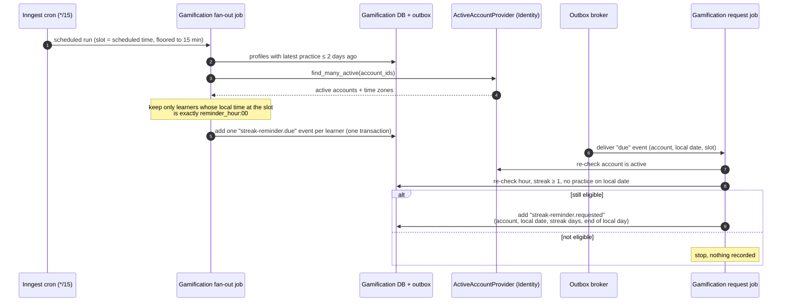
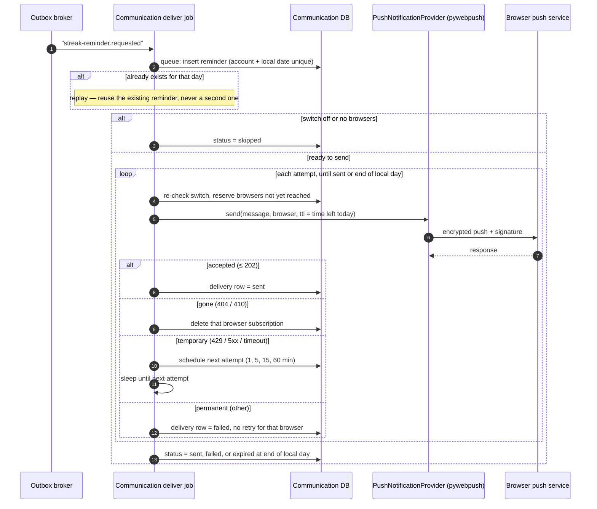
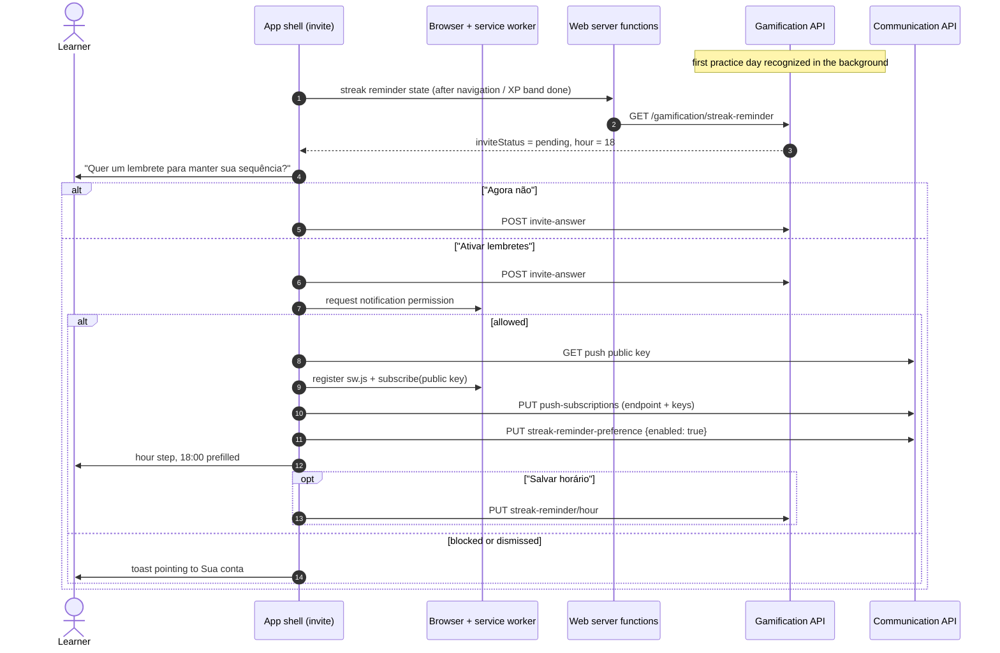
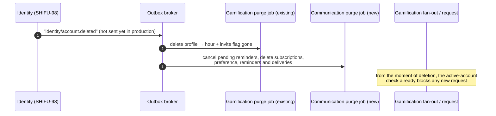

# Objective

Deliver SHIFU-132. A learner with an active streak who has not practiced yet on
the current local date receives one browser push notification at the whole hour
they chose, in their current time zone. The reminder is optional. The learner
enables it through a one-time invite shown right after their first recognized
practice day, and later manages the switch and the hour in Sua conta.

Today Shifu has no proactive reminder. Communication delivers only
Identity's transactional email. Gamification has no reminder hour, no invite
state and no scheduled work. The web has no service worker and no reminders
card.

Owning modules: **Gamification** owns the hour, the invite and eligibility.
**Communication** owns push subscriptions, the account-wide on/off preference,
composition and delivery. **Identity** only supplies a new shared active-account
lookup. Mode: **complete**, because the delivery crosses three modules, adds
persistence, a scheduled job, an external push service and account-deletion
guarantees.

# Scope

| Area / actor | Included | Excluded or deferred |
| --- | --- | --- |
| Gamification (System, Learner) | Reminder hour 06–22, default 18; invite status; exact-slot due detection every 15 minutes; eligibility re-check; reminder request event; REST to read settings, change hour and answer the invite | Any other reminder trigger; XP, achievements or AI linked to the reminder |
| Communication (System, Learner) | Push subscriptions per browser; account-wide preference, default off; streak-reminder record with per-browser deliveries; delivery with retries until the end of the local day; removal of expired/revoked browsers; REST for public key, subscription and preference; push settings | Email, SMS, in-app reminders; push for other messages; per-browser unsubscribe; changes to the existing email flow |
| Identity (System) | `IdentityActiveAccountProvider` implementing the new Shared contract | Identity UI or behavior changes; emitting `identity/account.deleted` (SHIFU-98) |
| Account deletion (System) | Communication and Gamification consumers of the existing `identity/account.deleted` event; immediate block through the active-account check | Identity's user-requested deletion flow (SHIFU-98) |
| Web (Learner) | Service worker; invite in the app shell; reminders card in Sua conta; Switch primitive | Appearance field drawn on the account boards; reusable Penpot components |
| Local demo (Developer) | `uv run poe reminders:send-now <email>`, refused outside `local` | Any HTTP trigger or deployed trigger |

Selected product outcomes, classified for this delivery slice:

- Gamification RP-14 — full. JN-14 and JN-15 — full.
- Communication RP-08 — full. JN-07 and JN-08 — full.
- Gamification RP-12 — partial: reminder hour, invite flag and request blocking only.
- Gamification RP-13 — partial: accessibility and responsiveness of the reminder screens only.
- Communication RP-02 — partial: the streak-reminder catalog entry only.
- Communication RP-05 — partial: idempotency of streak reminders only.
- Communication RP-07 and JN-06 — partial: subscriptions, preference and reminder records only.
- Identity RP-06 — partial: the reminders card in Sua conta only.

Penpot boards: Desktop and Mobile pages of the Shifu file, groups
"Sua conta / Perfil" (states "Lembretes ativados", "Notificações bloqueadas")
and "Lembretes / Convite" (states "Convite", "Escolher horário"). See the Design
Contract.

# Behavior Contract

| ID | RP/JN/source coverage | Observable required behavior |
| --- | --- | --- |
| RF-01 | Gamification RP-14; JN-15 | Each learner has a reminder hour owned by Gamification: a whole hour from 06 to 22, initially 18. The learner reads and changes it; values outside 06–22 are rejected without change. A change applies the same day when the new hour's slot has not started yet. |
| RF-02 | Gamification RP-14; JN-14 | Due detection runs every 15 minutes. An account is due only in the run whose scheduled 15-minute slot starts exactly at `reminder_hour:00` in the account's current time zone. Changing the time zone keeps the same hour in the new zone. A failed slot run retried by Inngest evaluates the same slot. A lost slot sends nothing that day. |
| RF-03 | Gamification RP-14; JN-14 | A reminder is requested only when, at that slot: the account is active; the current streak as of the local date is at least 1; no practice day is recognized on that local date; and the hour still matches. A pending evaluation does not block the reminder. Practice already recognized before the hour prevents it. No AI participates. |
| RF-04 | Gamification RP-14, RP-12; Communication RP-08 | The request carries the account, local date, streak length and the UTC instant that ends that local date. It grants no XP and changes no streak, calendar, achievement, reward feedback or Learning state. |
| RF-05 | Communication RP-08 | A push subscription is created only after the browser grants permission and is linked to the authenticated account. Registering an endpoint already linked to another account re-links it to the caller. One account cannot read or change another account's subscriptions or preference. |
| RF-06 | Communication RP-08; JN-07; Identity RP-06 | The reminder preference belongs to the account and applies to every browser. It is off until the learner turns it on. While it is off, no reminder is sent to any browser. |
| RF-07 | Communication RP-05, RP-08; JN-07, JN-08 | Communication accepts at most one streak reminder per account and local date, including replays and repeated requests. It sends the reminder to every active subscription, at most once per browser. A browser answered as expired or revoked is removed without retry, and the other browsers stay valid. Temporary failures are retried only until the end of the learner's local day; then the reminder is dropped without late delivery. Other permanent failures are not retried for that browser. |
| RF-08 | Communication RP-02, RP-08; Gamification RP-14 | The notification is in pt-BR, identifies Shifu and states the streak length, for example "Sua sequência de 7 dias termina hoje — pratique para mantê-la" ("1 dia" in the singular). It contains no learning data, credentials, tokens or Identity action links. Opening it focuses or opens Shifu at `/`; without a valid session the normal Identity entry flow applies. |
| RF-09 | Gamification RP-14; JN-15 | The invite opens right after the first recognized practice day, never on first access and never in browsers that cannot receive push. It explains the benefit before the browser permission request. Answering it ("Agora não", "Ativar lembretes", then allowed, blocked or dismissed) is recorded once per account and it does not reopen. Declining blocks nothing. After permission is granted, the browser is enrolled, the preference turns on and the hour step opens prefilled with the current hour (18 by default). |
| RF-10 | Identity RP-06; Gamification RP-13, RP-14; JN-15 | Sua conta shows a reminders card: the switch (all browsers), the hour select that saves on selection, a text notice when notifications are blocked in this browser, and a text notice when this browser cannot receive push. Every control works by keyboard and no state depends only on color, on desktop and mobile. |
| RF-11 | Gamification RP-12; Communication RP-07; JN-06; Gamification JN-13 | From account closure, the active-account check blocks every new request. On `identity/account.deleted`, Communication cancels pending reminders and deletes subscriptions, preference, reminders and deliveries; Gamification deletes the profile including hour and invite flag. Both consumers are idempotent. |
| RF-12 | Gamification RP-14 (demonstration of the reminder); Jira SHIFU-132 validation | A local-only command sends the reminder immediately for an account by email, skipping only the hour check and keeping every other rule and the normal delivery path. Before requesting, it clears the account's reminder for the current local day, whatever its status, so every run can deliver again (revisions 3 and 4). Only this command does it: the scheduled flow never clears a reminder. Outside `local` it refuses without effect. |
| RF-13 | Communication RP-08 | The server exposes the push public key to authenticated learners. Staging and production refuse to start without the push key pair and contact subject. Any environment that sets the key pair refuses to start when the private key does not produce the configured public key (revision 5). Push keys, endpoints and payloads never appear in logs. |

| ID | RF coverage | Given | When | Then | Checks |
| --- | --- | --- | --- | --- | --- |
| CA-01 | RF-01 | An authenticated learner with a profile | They read the reminder settings, then set hour 6, 22, 5 and 23 | The default is 18; 6 and 22 persist; 5 and 23 return 422 and keep the stored hour | CI-01, CI-06 |
| CA-02 | RF-02 | Accounts in UTC−03:00, UTC+05:30 and UTC+05:45 with hours 18, 6 and 22 | The fan-out evaluates each 15-minute slot of a day | Each account is due only in the slot that starts at its `hour:00` local; a retry of the same run yields the same set | CI-01, CI-08 |
| CA-03 | RF-02, RF-03 | A due learner whose time zone changed after the hour was chosen | The fan-out runs | The same hour is used in the new zone | CI-01, CI-08 |
| CA-04 | RF-01, RF-02 | A learner changes the hour from 20 to 19 at 18:50 and another from 18 to 19 at 19:10 | The 19:00 slot runs | The first is due; the second receives nothing that day | CI-01 |
| CA-05 | RF-03 | Learners with streak 0, streak through yesterday, practice today, and an evaluation still pending today | The request step runs | Only the learner with streak through yesterday and no recognized practice today is requested; the pending evaluation does not block | CI-01, CI-09 |
| CA-06 | RF-03, RF-11 | A due learner whose account is no longer active | The fan-out or request step runs | No request event is recorded | CI-01, CI-08, CI-09 |
| CA-07 | RF-04 | An eligible learner | The request is recorded | The event carries account, local date, streak days and the end of the local day in UTC; XP, streak, calendar and achievements are unchanged | CI-01, CI-09 |
| CA-08 | RF-05 | An authenticated learner and a second account | They register a subscription, re-register the same endpoint from the second account, and call without a session | The subscription belongs to the latest caller; no-session calls return 401; nothing leaks across accounts | CI-02, CI-07 |
| CA-09 | RF-06 | A new account | It reads and changes the preference | It is off by default; changes persist for the caller only | CI-02, CI-07 |
| CA-10 | RF-06, RF-07 | A requested reminder for an account with the preference off, or without subscriptions | Delivery runs | The reminder is recorded as skipped and nothing is sent | CI-02, CI-10 |
| CA-11 | RF-07 | Two requests and one replay for the same account and local date | Delivery runs | Exactly one reminder exists; each browser receives at most one push | CI-02, CI-10 |
| CA-12 | RF-07 | Three browsers answering accepted, gone and temporary failure | Delivery runs until the temporary one is accepted | The gone browser is removed without retry; the others receive exactly one push; retries follow the backoff | CI-02, CI-10 |
| CA-13 | RF-07 | A browser that keeps failing temporarily | The end of the learner's local day passes | The reminder is expired and nothing is sent afterwards | CI-02, CI-10 |
| CA-14 | RF-06, RF-07 | A reminder waiting for a retry | The learner turns the preference off | The next attempt sends nothing and the reminder ends skipped | CI-02 |
| CA-15 | RF-08 | Streak lengths 1 and 7 | The message is composed and the notification is clicked | Body reads "Sua sequência de 1 dia termina hoje — pratique para mantê-la" / "… de 7 dias …"; title "Shifu"; URL `/`; no learning data or tokens; click focuses or opens Shifu | CI-02, VM-03 |
| CA-16 | RF-09 | A learner without any practice day, then after the first recognized practice day | The app shell refreshes the invite state | The invite stays closed before; it opens after, over the current protected page, explaining the benefit before any permission request | CI-01, CI-11, CI-13, VM-01 |
| CA-17 | RF-09 | The invite is open | The learner chooses "Agora não", or "Ativar lembretes" then allows, blocks or dismisses | The invite is answered once and never reopens; on allow, subscription and preference are saved and the hour step shows 18:00; on block or dismiss a toast points to Sua conta | CI-01, CI-11, CI-13, VM-01 |
| CA-18 | RF-09 | A browser without push support | The invite state is pending | The invite does not open and remains unanswered | CI-11, CI-13 |
| CA-19 | RF-10 | Sua conta with the preference on | The learner toggles the switch, changes the hour, and opens the page with notifications blocked or unsupported | Switch and hour persist with feedback and revert on error; blocked and unsupported states are explained in text; everything is keyboard-operable on desktop and mobile | CI-12, CI-13, VM-02 |
| CA-20 | RF-11 | Data for two accounts with pending reminders | `identity/account.deleted` arrives for one account, twice | That account's pending reminders are cancelled and its subscriptions, preference, reminders, deliveries, hour and invite flag are gone; the other account is intact; the replay is a no-op | CI-09, CI-10 |
| CA-21 | RF-12 | A subscribed, eligible local account | The developer runs the demo command, again the same day, and with `SHIFU_SERVER_APP_MODE` not `local` | Each local run delivers one notification, because it clears the day's earlier reminder first (revision 4; revision 1 had the second run send nothing); the non-local run refuses without effect | CI-01, VM-03 |
| CA-23 | RF-12 | A local account with a reminder for the current local day in any status (skipped, failed, sent, pending, expired or cancelled), and reminders of other days | The demo command clears the current reminders and requests again | Every reminder whose local day has not ended is removed with its deliveries; reminders of ended days stay; subscriptions, preference and events are untouched; an account with nothing to clear is a no-op | CI-02, VM-03 |
| CA-22 | RF-13 | Authenticated and anonymous callers; production-like settings without push keys; a private key that does not produce the configured public key | They request the public key; the server starts; the push provider is built | Authenticated callers get the configured public key; anonymous get 401; startup fails with a safe message that echoes no key; a mismatched pair is refused before any push is sent, and a matching pair is accepted with or without base64 padding | CI-02, CI-07, CI-05 |

Isolation, persistence, failure, recovery and concurrency are covered by CA-08,
CA-11 to CA-14 and CA-20. Accessibility is covered by CA-16 to CA-19.

## Design Contract

Penpot file: "Shifu (copiar)", confirmed by the user as the design authority for
this delivery. Inspect and export boards only through the Penpot Shifu MCP.

| Surface / route | State / viewport | Penpot page / board / components | CA / Visual check | Allowed deviations |
| --- | --- | --- | --- | --- |
| `/account/profile` reminders card | Preference on, permission granted — 1440×900 | 🖥️ Desktop / "Sua conta / Perfil — Lembretes ativados / Desktop" / "Reminders card", "Field / Horário do lembrete" | CA-19 / VM-04 | No "Aparência" field; existing profile form preserved |
| `/account/profile` reminders card | Same — 390×844 | 📱 Mobile / "Sua conta / Perfil — Lembretes ativados / Mobile" | CA-19 / VM-05 | Same as above |
| `/account/profile` reminders card | Preference on, notifications blocked — 1440×900 | 🖥️ Desktop / "Sua conta / Perfil — Notificações bloqueadas / Desktop" | CA-19 / VM-06 | Same as above |
| `/account/profile` reminders card | Same — 390×844 | 📱 Mobile / "Sua conta / Perfil — Notificações bloqueadas / Mobile" | CA-19 / VM-07 | Same as above |
| Invite over a protected page | "Convite" — 1440×900 | 🖥️ Desktop / "Lembretes / Convite — Convite / Desktop" / "Button / Ativar lembretes" | CA-16, CA-17 / VM-08 | Dialog header icon tile (the existing `flame` icon, since the Icon map has no bell), separator and close button required by the UI dialog rule; page under the dialog may differ from Objectivos |
| Invite over a protected page | "Convite" — 390×844 | 📱 Mobile / "Lembretes / Convite — Convite / Mobile" | CA-16, CA-17 / VM-09 | Same as above. Revision 2: the board's "Ativar lembretes" button is only 73 px wide and clips its label; the implementation keeps the board's single right-aligned row but sizes the button to its full label |
| Invite over a protected page | "Escolher horário" — 1440×900 | 🖥️ Desktop / "Lembretes / Convite — Escolher horário / Desktop" / "Reminder time dialog", "Button / Salvar horário" | CA-17 / VM-10 | Same as above |
| Invite over a protected page | "Escolher horário" — 390×844 | 📱 Mobile / "Lembretes / Convite — Escolher horário / Mobile" | CA-17 / VM-11 | Same as above. Same as above |

The unsupported-browser notice has no board. It reuses the blocked notice's
surface, border and text styles with its own pt-BR copy, and is an accepted
addition.

Token and primitive mapping:

- Card: the existing card surface used by `privacy-card`
  (`rounded-lg border border-border bg-card p-6`), heading and body typography as
  in the privacy card, `aria-labelledby` on the section.
- Switch: new `src/ui/shadcn/switch.tsx` primitive with a visible label
  ("Ativados" / "Desativados"), `role='switch'` semantics, theme focus ring and a
  checked track using the success/accent token drawn on the board. The state is
  also stated in text.
- Hour select: existing `src/ui/shadcn/select.tsx` with explicit pt-BR labels
  `06:00` … `22:00` and helper text from the board.
- Notices: a text block with a warning-tinted surface using existing warning
  tokens, title plus description, `role='status'`; never color alone.
- Dialog: existing `src/ui/shadcn/dialog.tsx` with the shared header hierarchy
  (icon tile, title, description, separator, close action), footer buttons with
  `Button` variants `outline` ("Agora não", "Pular") and `default`
  ("Ativar lembretes", "Salvar horário").
- Pending and error states: buttons disabled with pending text while saving;
  failures shown with a Sonner toast, as required by the UI catch-block rule.

Preserved UI: the account layout tabs, profile form and privacy card; the app
shell header, navigation and Mentor button; the XP band presentation.

# Technical Contract

## Architecture Mapping

Owners: Gamification and Communication; Identity supplies one provider. Rules:
[Python conventions](../../../rules/python-conventions-rules.md),
[Core](../../../rules/core-layer-rules.md),
[Database](../../../rules/database-layer-rules.md),
[Provider](../../../rules/provision-layer-rules.md),
[Messaging](../../../rules/messaging-layer-rules.md),
[REST](../../../rules/rest-layer-rules.md),
[Server application](../../../rules/server-app-layer-rules.md),
[Use-case testing](../../../rules/use-case-testing-rules.md),
[Controller testing](../../../rules/controllers-testing-rules.md),
[Job testing](../../../rules/jobs-testing-rules.md),
[TypeScript conventions](../../../rules/typescript-conventions-rules.md),
[UI](../../../rules/ui-layer-rules.md),
[Web routing](../../../rules/web-app-routing-rules.md),
[Widget testing](../../../rules/widget-testing-rules.md),
[Commit](../../../rules/commit-rules.md).

| Action | Boundary | Element / Path | Required change |
| --- | --- | --- | --- |
| Create | Shared core | `ActiveAccount`, `ActiveAccountProvider` in `apps/server/src/shifu/shared/core/{domain/structures,interfaces}` | Batch lookup of active accounts with their current time zone; exported from the Shared barrels |
| Modify | Identity core/database | `AccountsRepository.find_many_active_by_ids` in `identity/core/interfaces/accounts_repository.py` and `identity/database/sqlalchemy/repositories/accounts_repository.py` | Returns only `active` accounts among the given IDs, one query |
| Create | Identity provider | `IdentityActiveAccountProvider` in `identity/providers/identity_active_account_provider.py` | Implements the Shared port through `IdentityDatabase` |
| Modify | Gamification core | `GamificationProfile` | Adds `reminder_hour` and `reminder_invite_answered_at`, `change_reminder_hour`, `answer_reminder_invite` |
| Create | Gamification core | Structures `StreakReminderSettings`, enum `StreakReminderInviteStatus`, error `InvalidStreakReminderHourError`, events `StreakReminderDueEvent`, `StreakReminderRequestedEvent` | Declarations below |
| Create | Gamification core | Use cases `GetStreakReminderSettingsUseCase`, `ChangeStreakReminderHourUseCase`, `AnswerStreakReminderInviteUseCase`, `FanOutDueStreakRemindersUseCase`, `RequestStreakReminderUseCase` | Declarations below |
| Modify | Gamification core/database | `GamificationProfilesRepository.find_many_reminder_candidates`; model, mapper and repository | New columns with check constraint; candidate query by latest practice date |
| Create | Gamification messaging | `FanOutDueStreakRemindersJob`, `RequestStreakReminderJob`; registration in `GamificationInngestMessaging.register_jobs` | Cron `*/15 * * * *`; due-event consumer |
| Create | Gamification REST | `GetStreakReminderController`, `ChangeStreakReminderHourController`, `AnswerStreakReminderInviteController`; router registration | Endpoints below |
| Create | Communication core | Entities `PushSubscription`, `StreakReminderPreference`, `StreakReminder`, `PushDelivery`; structures `StreakReminderRequest`, `StreakReminderMessage`, `PushDeliveryOutcome`; enums `StreakReminderStatus`, `PushDeliveryStatus`, `PushDeliveryOutcomeKind`; errors `PushUnavailableError`, `InvalidPushSubscriptionError` | Declarations below; existing email entities untouched |
| Modify | Communication core | `CommunicationDatabaseRepositories` | Adds `push_subscriptions`, `streak_reminder_preferences`, `streak_reminders`, `push_deliveries` |
| Create | Communication core | Ports `PushSubscriptionsRepository`, `StreakReminderPreferencesRepository`, `StreakRemindersRepository`, `PushDeliveriesRepository`, `PushNotificationProvider` | Declarations below |
| Create | Communication core | Use cases `GetPushPublicKeyUseCase`, `RegisterPushSubscriptionUseCase`, `GetStreakReminderPreferenceUseCase`, `ChangeStreakReminderPreferenceUseCase`, `QueueStreakReminderUseCase`, `DeliverStreakReminderUseCase`, `DeleteAccountPushDataUseCase` | Declarations below |
| Create | Communication database | Models, mappers and repositories for the four new tables; `SqlalchemyCommunicationDatabase` wiring | Constraints below |
| Create | Communication provider | `PywebpushPushNotificationProvider` in `communication/providers/push/pywebpush/` | pywebpush 2.5.0 adapter with status mapping |
| Create | Communication messaging | `DeliverStreakReminderJob`, `PurgePushDataOnAccountDeletedJob`; registration in `CommunicationInngestMessaging.register_jobs` | Event names injected by composition |
| Create | Communication REST/pipes | `CommunicationRouter`, `CommunicationPipe`, four controllers | Endpoints below |
| Modify | Shared settings | `EnvironmentSettings` in `shared/constants/environment.py` | `web_push_vapid_private_key`, `web_push_vapid_public_key`, `web_push_subject`, `web_push_timeout_seconds`; required in staging/production |
| Modify | Shared telemetry | `TelemetryJob` in `shared/core/interfaces/telemetry_provider.py`; `_JOB_BY_FUNCTION_ID` in `shared/messaging/inngest/job_lifecycle_telemetry.py` | Four new job identifiers |
| Modify | Composition | `apps/server/src/shifu/app.py` | `FastAPIApp.register` gains an optional keyword `push_notification_provider: PushNotificationProvider \| None = None`, like the existing provider parameters; when omitted it builds `PywebpushPushNotificationProvider` from `ENVIRONMENT`, or `None` when push is unconfigured in `local`. It also builds the Identity provider and the Communication router, and passes `StreakReminderRequestedEvent.EVENT_NAME` and `AccountDeletedEvent.EVENT_NAME` to Communication jobs |
| Create | Composition | `apps/server/src/shifu/composition/send_streak_reminder_now.py`; Poe task `reminders:send-now` | Local-only demo command |
| Modify | Architecture boundaries | `apps/server/tach.toml` | Adds `shifu.gamification` to `shifu.composition.depends_on`, so the demo command may call `RequestStreakReminderUseCase`; no other boundary changes |
| Modify | Staging provisioning | `scripts/populate-staging-secrets.mjs` | Generates and provisions `SHIFU_WEB_PUSH_VAPID_PRIVATE_KEY`, `SHIFU_WEB_PUSH_VAPID_PUBLIC_KEY` and `SHIFU_WEB_PUSH_SUBJECT`, so staging keeps starting once the keys are required |
| Modify | Staging infrastructure (revision 2) | `iac/staging/locals.tf` (`server_required_secret_keys`), `iac/README.md` | The ECS task only receives the secret keys listed there, so the three `SHIFU_WEB_PUSH_*` keys must be listed or staging refuses to start. An already populated staging secret needs the three keys added before deploy |
| Modify | Migrations | New Alembic revision generated with `uv run poe db:migrate "add streak reminders"` | Generated filename recorded in Evaluation; reviewed before use |
| Modify | Dependencies | `apps/server/pyproject.toml`, `apps/server/uv.lock` | `pywebpush==2.5.0`; Poe task `reminders:send-now` passes `${email}` |
| Create/Modify | REST examples | `apps/server/rest-client/communication/communication.rest` [N]; `apps/server/rest-client/gamification/gamification.rest` [M] | Non-secret examples of every new endpoint |
| Create | Web | Service worker, core types, push provision adapter, Communication service, hooks, invite, card, Switch | Tree below |
| Modify | Web | `gamification-service.ts`, account profile page and route, `AppLayout`, XP band hook | Slot, mount and invalidation below |
| Create/Modify | Web toasts (revision 2) | `sonner` dependency (`apps/web/package.json`, `pnpm-lock.yaml`), `src/ui/shadcn/sonner.tsx`, `src/ui/shared/notifications/index.ts`, `RootLayout` | The UI catch-block rule requires Sonner toasts, which did not exist. Adds the dependency, the shared wrapper (`showErrorToast`, `showWarningToast`, `showInfoToast`) and one `Toaster` mount in the root layout |
| Modify | Communication (revision 2) | `PushDeliveriesRepository.remove`, `communication/rest/communication_error_handler.py` | Implementation additions: removing a temporary-failure reservation needs `remove`; a Communication error handler gives HTTP 503 its specific message |
| Create/Modify | Communication (revisions 3, 4) | `ClearCurrentStreakRemindersUseCase` in `communication/core/use_cases/clear_current_streak_reminders_use_case.py`; `StreakRemindersRepository.find_many_open_by_account_id` and `remove` (port and SQLAlchemy adapter) | Declarations in "Revision 3 declarations" below |
| Modify | Communication provider (revision 5) | `PywebpushPushNotificationProvider.__init__` | Derives the public key from the private key and raises `ValueError('The web push VAPID private key does not match the public key')` when it differs from the configured public key (padding ignored). The message echoes no key. `app.py` builds the provider at registration, so the process fails at startup instead of failing every send with HTTP 403 |
| Modify | Composition (revisions 3, 4) | `composition/send_streak_reminder_now.py` | Calls the new use case before `RequestStreakReminderUseCase`, through `SqlalchemyCommunicationDatabase` and `SystemClockProvider`; no new Tach dependency (composition already depends on Communication) |
| Modify | Documentation (revision 3) | `documentation/tooling.md` | Describes the clearing behavior of the demo command |

### Expected file tree

```text
scripts/populate-staging-secrets.mjs                                   [M]

apps/server/
├── pyproject.toml                                                     [M]
├── tach.toml                                                          [M]
├── uv.lock                                                            [M]
├── .env.example                                                       [M]
├── migrations/versions/<generated>_add_streak_reminders.py            [N] generated
├── rest-client/
│   ├── communication/communication.rest                               [N]
│   └── gamification/gamification.rest                                [M]
├── src/shifu/
│   ├── app.py                                                         [M]
│   ├── composition/send_streak_reminder_now.py                        [N]
│   ├── shared/
│   │   ├── constants/environment.py                                   [M]
│   │   ├── core/domain/structures/active_account.py                   [N]
│   │   ├── core/interfaces/active_account_provider.py                 [N]
│   │   ├── core/interfaces/telemetry_provider.py                      [M]
│   │   └── messaging/inngest/job_lifecycle_telemetry.py               [M]
│   ├── identity/
│   │   ├── core/interfaces/accounts_repository.py                     [M]
│   │   ├── database/sqlalchemy/repositories/accounts_repository.py    [M]
│   │   └── providers/identity_active_account_provider.py              [N]
│   ├── gamification/
│   │   ├── core/domain/entities/gamification_profile.py               [M]
│   │   ├── core/domain/enums/streak_reminder_invite_status.py         [N]
│   │   ├── core/domain/errors/invalid_streak_reminder_hour_error.py   [N]
│   │   ├── core/domain/events/streak_reminder_due_event.py            [N]
│   │   ├── core/domain/events/streak_reminder_requested_event.py      [N]
│   │   ├── core/domain/structures/streak_reminder_settings.py         [N]
│   │   ├── core/interfaces/gamification_profiles_repository.py        [M]
│   │   ├── core/use_cases/get_streak_reminder_settings_use_case.py    [N]
│   │   ├── core/use_cases/change_streak_reminder_hour_use_case.py     [N]
│   │   ├── core/use_cases/answer_streak_reminder_invite_use_case.py   [N]
│   │   ├── core/use_cases/fan_out_due_streak_reminders_use_case.py    [N]
│   │   ├── core/use_cases/request_streak_reminder_use_case.py         [N]
│   │   ├── database/sqlalchemy/models/gamification_profile_model.py   [M]
│   │   ├── database/sqlalchemy/mappers/gamification_profile_mapper.py [M]
│   │   ├── database/sqlalchemy/repositories/gamification_profiles_repository.py [M]
│   │   ├── messaging/inngest/gamification_inngest_messaging.py        [M]
│   │   ├── messaging/inngest/jobs/fan_out_due_streak_reminders_job.py [N]
│   │   ├── messaging/inngest/jobs/request_streak_reminder_job.py      [N]
│   │   ├── rest/router.py                                             [M]
│   │   ├── rest/controllers/get_streak_reminder_controller.py         [N]
│   │   ├── rest/controllers/change_streak_reminder_hour_controller.py [N]
│   │   └── rest/controllers/answer_streak_reminder_invite_controller.py [N]
│   ├── communication/
│   │   ├── core/domain/entities/{push_subscription,streak_reminder_preference,streak_reminder,push_delivery}.py [N]
│   │   ├── core/domain/structures/{streak_reminder_request,streak_reminder_message,push_delivery_outcome}.py      [N]
│   │   ├── core/domain/enums/{streak_reminder_status,push_delivery_status,push_delivery_outcome_kind}.py          [N]
│   │   ├── core/domain/errors/{push_unavailable_error,invalid_push_subscription_error}.py                          [N]
│   │   ├── core/interfaces/communication_database.py                                                               [M]
│   │   ├── core/interfaces/{push_subscriptions,streak_reminder_preferences,streak_reminders,push_deliveries}_repository.py [N]
│   │   ├── core/interfaces/push_notification_provider.py                                                               [N]
│   │   ├── core/use_cases/{get_push_public_key,register_push_subscription,get_streak_reminder_preference,change_streak_reminder_preference,queue_streak_reminder,deliver_streak_reminder,delete_account_push_data}_use_case.py [N]
│   │   ├── database/sqlalchemy/communication_database.py                                                           [M]
│   │   ├── database/sqlalchemy/models/{push_subscription,streak_reminder_preference,streak_reminder,push_delivery}_model.py [N]
│   │   ├── database/sqlalchemy/mappers/{push_subscription,streak_reminder_preference,streak_reminder,push_delivery}_mapper.py [N]
│   │   ├── database/sqlalchemy/repositories/{push_subscriptions,streak_reminder_preferences,streak_reminders,push_deliveries}_repository.py [N]
│   │   ├── messaging/inngest/communication_inngest_messaging.py                                                    [M]
│   │   ├── messaging/inngest/jobs/deliver_streak_reminder_job.py                                                   [N]
│   │   ├── messaging/inngest/jobs/purge_push_data_on_account_deleted_job.py                                        [N]
│   │   ├── pipes/communication_pipe.py                                                                             [N]
│   │   ├── providers/push/pywebpush/pywebpush_push_notification_provider.py                                            [N]
│   │   ├── rest/router.py                                                                                          [N]
│   │   └── rest/controllers/{get_push_public_key,register_push_subscription,get_streak_reminder_preference,change_streak_reminder_preference}_controller.py [N]
│   └── fakers/
│       ├── gamification/entities/gamification_profile_faker.py        [M]
│       └── communication/entities/{push_subscription,streak_reminder,push_delivery}_faker.py [N]
└── tests/
    ├── gamification/core/use_cases/test_{get_streak_reminder_settings,change_streak_reminder_hour,answer_streak_reminder_invite,fan_out_due_streak_reminders,request_streak_reminder}_use_case.py [N]
    ├── gamification/server/controllers/test_{get_streak_reminder,change_streak_reminder_hour,answer_streak_reminder_invite}_controller.py [N]
    ├── communication/core/use_cases/test_{get_push_public_key,register_push_subscription,get_streak_reminder_preference,change_streak_reminder_preference,queue_streak_reminder,deliver_streak_reminder,delete_account_push_data}_use_case.py [N]
    ├── communication/server/controllers/test_{get_push_public_key,register_push_subscription,get_streak_reminder_preference,change_streak_reminder_preference}_controller.py [N]
    ├── conftest.py                                                    [M] registers the push stub fixture in pytest_plugins
    ├── fixtures/push_service_stub_fixture.py                          [N]
    └── messaging/inngest/jobs/
        ├── gamification/test_fan_out_due_streak_reminders_job.py      [N]
        ├── gamification/test_request_streak_reminder_job.py           [N]
        ├── gamification/test_purge_profile_on_account_deleted_job.py  [M]
        ├── communication/test_deliver_streak_reminder_job.py          [N]
        └── communication/test_purge_push_data_on_account_deleted_job.py [N]

apps/web/
├── public/sw.js                                                       [N] push → notification; click → focus/open "/"
├── src/core/gamification/streak-reminder.ts                           [N] { hour, inviteStatus }
├── src/core/communication/streak-reminder-preference.ts               [N]
├── src/core/communication/browser-push-notification.ts                             [N] permission + subscription contracts
├── src/provision/push/browser-push-notification-provider.ts                        [N] wraps serviceWorker, Notification, pushManager
├── src/rest/services/communication-service.ts                         [N] public key, subscription, preference
├── src/rest/services/gamification-service.ts                          [M] streak reminder get / hour / invite answer
├── package.json, ../../pnpm-lock.yaml                                 [M] sonner ^2.0.8 (revision 2)
├── src/ui/shadcn/sonner.tsx                                           [N] themed Toaster (revision 2)
├── src/ui/shared/notifications/index.ts                               [N] Sonner wrapper (revision 2)
├── src/ui/shared/widgets/layouts/root-layout/                         [M] mounts the single <Toaster/> (revision 2)
├── src/ui/shadcn/switch.tsx                                           [N] rule-required primitive
├── src/ui/gamification/hooks/                                         shared by invite and card
│   ├── use-streak-reminder-query.ts                                   [N] ['gamification','streak-reminder']
│   ├── use-change-streak-reminder-hour-action.ts                      [N]
│   ├── use-change-streak-reminder-preference-action.ts                [N]
│   └── use-browser-push-notification-enrollment.ts                                 [N] permission → public key → subscribe → register
├── src/ui/gamification/widgets/components/
│   ├── streak-reminder-invite/                                        [N] mounted in AppLayout
│   │   ├── index.tsx, use-streak-reminder-invite.ts
│   │   ├── use-answer-streak-reminder-invite-action.ts                only consumer: the invite
│   │   ├── invite-step/index.tsx                                      "Convite"
│   │   ├── hour-step/index.tsx                                        "Escolher horário"
│   │   └── tests/{streak-reminder-invite.test.tsx,use-streak-reminder-invite.test.ts}
│   ├── streak-reminder-card/                                          [N] passed as a slot to the account page
│   │   ├── index.tsx, use-streak-reminder-card.ts
│   │   ├── use-streak-reminder-preference-query.ts                    only consumer: the card; ['communication','streak-reminder-preference']
│   │   ├── blocked-notice/index.tsx                                   blocked + unsupported text
│   │   └── tests/{streak-reminder-card.test.tsx,use-streak-reminder-card.test.ts}
│   └── activity-xp-reward-band/
│       ├── use-activity-xp-reward-band.ts                             [M] refreshes the invite state when polling ends
│       └── tests/use-activity-xp-reward-band.test.ts                  [M]
├── src/ui/identity/widgets/pages/account-profile-page/
│   ├── index.tsx                                                      [M] new remindersCard slot
│   └── tests/account-profile-page.test.tsx                            [M]
├── src/routes/account/profile/index.tsx                               [M] passes <StreakReminderCard/>
├── src/ui/shared/widgets/layouts/app-layout/
│   ├── index.tsx                                                      [M] mounts <StreakReminderInvite/>
│   └── tests/app-layout.test.tsx                                      [M]
└── tests/
    ├── identity/account-profile-page.test.ts                          [M] reminders card scenarios
    └── shared/app-layout.test.ts                                      [M] invite scenarios
```

Accepted boundary deviation (Q14): Gamification web code imports
`communication-service.ts` and `src/core/communication/*` to reach
Communication's REST contract. This follows the existing precedent of
Intelligence UI importing the Learning service. No Gamification widget is
imported by Communication or Identity code; the account page receives the card
only through its route slot, and `AppLayout` mounts the invite as it already
mounts the Mentor button.

### Shared contract

```python
# shared/core/domain/structures/active_account.py
@structure
class ActiveAccount:
    account_id: str
    time_zone: str | None

# shared/core/interfaces/active_account_provider.py
class ActiveAccountProvider(Protocol):
    def find_many_active(self, account_ids: Sequence[str]) -> tuple[ActiveAccount, ...]: ...
```

`ActiveAccountProvider` is the only way Gamification learns whether an account
may still receive effects. It returns nothing for pending, expired or deleted
accounts. Identity is the source of truth; Gamification never stores the time
zone. An empty input returns an empty tuple without querying.

### Gamification declarations

```python
# GamificationProfile (scoped excerpt; existing members unchanged)
REMINDER_HOUR_MIN: ClassVar[int] = 6
REMINDER_HOUR_MAX: ClassVar[int] = 22
DEFAULT_REMINDER_HOUR: ClassVar[int] = 18

reminder_hour: int = DEFAULT_REMINDER_HOUR
reminder_invite_answered_at: datetime | None = None

def change_reminder_hour(self, hour: int, *, updated_at: datetime) -> None: ...
    # raises InvalidStreakReminderHourError outside 6..22
def answer_reminder_invite(self, *, answered_at: datetime) -> None: ...
    # keeps the first answer; later calls do nothing

class StreakReminderInviteStatus(StrEnum):
    NOT_ELIGIBLE = 'not-eligible'   # no recognized practice day yet (streak.longest == 0)
    PENDING = 'pending'
    ANSWERED = 'answered'

@structure
class StreakReminderSettings:
    hour: int
    invite_status: StreakReminderInviteStatus

class InvalidStreakReminderHourError(InvalidGamificationError):  # REST 422
    message: str = 'Escolha uma hora cheia entre 06:00 e 22:00.'

class GamificationProfilesRepository(Protocol):  # added member
    def find_many_reminder_candidates(
        self, *, practiced_since: date, after_account_id: str | None, limit: int
    ) -> tuple[GamificationProfile, ...]: ...  # ordered by account_id, strictly after the cursor

@structure
class StreakReminderDuePayload:
    account_id: str
    local_date: str        # YYYY-MM-DD
    slot_start: str        # ISO 8601 UTC, Z suffix

@structure
class StreakReminderDueEvent(Event[StreakReminderDuePayload]):
    EVENT_NAME: ClassVar[str] = 'gamification/streak-reminder.due'
    name: str = field(default=EVENT_NAME, init=False)

@structure
class StreakReminderRequestedPayload:
    account_id: str
    local_date: str        # YYYY-MM-DD
    streak_days: int       # >= 1
    expires_at: str        # ISO 8601 UTC instant that ends local_date

@structure
class StreakReminderRequestedEvent(Event[StreakReminderRequestedPayload]):
    EVENT_NAME: ClassVar[str] = 'gamification/streak-reminder.requested'
    name: str = field(default=EVENT_NAME, init=False)

class GetStreakReminderSettingsUseCase:
    def __init__(self, database: GamificationDatabase) -> None: ...
    def execute(self, account_id: str) -> StreakReminderSettings: ...

class ChangeStreakReminderHourUseCase:
    def __init__(self, database: GamificationDatabase) -> None: ...
    def execute(self, account_id: str, hour: int, *, now: datetime) -> StreakReminderSettings: ...

class AnswerStreakReminderInviteUseCase:
    def __init__(self, database: GamificationDatabase) -> None: ...
    def execute(self, account_id: str, *, now: datetime) -> StreakReminderSettings: ...

@structure
class StreakReminderFanOutPage:
    due_count: int
    next_cursor: str | None   # None when no candidate remains

class FanOutDueStreakRemindersUseCase:
    SLOT_MINUTES: ClassVar[int] = 15
    CANDIDATE_LOOKBACK_DAYS: ClassVar[int] = 2
    PAGE_SIZE: ClassVar[int] = 200
    def __init__(self, database: GamificationDatabase, active_account_provider: ActiveAccountProvider) -> None: ...
    def execute(self, slot_start: datetime, *, after_account_id: str | None = None) -> StreakReminderFanOutPage: ...

class RequestStreakReminderUseCase:
    def __init__(self, database: GamificationDatabase, active_account_provider: ActiveAccountProvider) -> None: ...
    def execute(self, account_id: str, *, slot_start: datetime, ignore_hour: bool = False) -> bool: ...
        # True when a StreakReminderRequestedEvent was recorded
```

Concepts:

- **Reminder slot.** A 15-minute window starting at `:00`, `:15`, `:30` or
  `:45` UTC. Every IANA offset is a multiple of 15 minutes, so each local
  `hour:00` starts exactly one slot. The slot comes from the cron run's
  scheduled timestamp floored to 15 minutes, never from the execution clock, so
  a retry evaluates the same slot. `slot_start` must be timezone-aware and
  aligned; otherwise `InvalidGamificationError`.
- **Candidates.** Profiles with `streak_latest_practice_date` on or after
  `slot_start.date() − 2 days` (UTC). Anyone older cannot have a streak through
  the local yesterday. Each `execute` call handles one bounded page of at most
  `PAGE_SIZE` candidates ordered by `account_id` after the cursor. It calls
  `find_many_active` once for that page, resolves each time zone with
  `resolved_time_zone`, and records one `StreakReminderDueEvent` for every
  active account whose local time at `slot_start` is exactly
  `reminder_hour:00`. Each page's events are recorded in their own Gamification
  transaction. The job runs one durable step per page until `next_cursor` is
  `None`, so a retried step repeats only its own page and siblings already
  committed are preserved. A replayed page may record a duplicate due event;
  the request job and Communication's daily uniqueness make that harmless.
- **Eligibility.** `RequestStreakReminderUseCase` loads the profile and the
  account's active entry. It recomputes the local date and hour at `slot_start`
  in the current time zone, skips the hour check only when `ignore_hour`, loads
  `practice_days.find_many_dates_by_account_id`, and requires
  `local_date not in dates` and `len(current_practice_run(dates, today=local_date)) >= 1`.
  It then records `StreakReminderRequestedEvent` with
  `streak_days = len(run)` and `expires_at` = the start of the next local date
  converted to UTC. It changes no Gamification state.
- **Invite status.** `NOT_ELIGIBLE` while `streak.longest == 0`; `ANSWERED`
  once `reminder_invite_answered_at` is set; otherwise `PENDING`.

### Communication declarations

```python
@entity
class PushSubscription:
    id: str
    account_id: str
    endpoint: str          # absolute http(s) URL, unique, max 2048; REST requires https
    p256dh_key: str
    auth_secret: str
    created_at: datetime
    updated_at: datetime
    @classmethod
    def create(cls, *, id: str, account_id: str, endpoint: str, p256dh_key: str, auth_secret: str, now: datetime) -> 'PushSubscription': ...
    def relink(self, *, account_id: str, p256dh_key: str, auth_secret: str, now: datetime) -> None: ...

@entity
class StreakReminderPreference:
    id: str                # equals account_id
    enabled: bool
    updated_at: datetime

class StreakReminderStatus(StrEnum):
    PENDING = 'pending'
    SENT = 'sent'
    SKIPPED = 'skipped'
    EXPIRED = 'expired'
    CANCELLED = 'cancelled'
    FAILED = 'failed'

@entity
class StreakReminder:
    id: str
    account_id: str
    local_date: date
    streak_days: int
    status: StreakReminderStatus
    expires_at: datetime
    attempt_count: int
    next_attempt_at: datetime | None
    created_at: datetime
    updated_at: datetime
    completed_at: datetime | None
    # transitions: skip, schedule_retry, mark_sent, mark_failed, expire, cancel

class PushDeliveryStatus(StrEnum):
    SENDING = 'sending'
    SENT = 'sent'
    FAILED = 'failed'

@entity
class PushDelivery:
    id: str
    reminder_id: str
    subscription_id: str
    status: PushDeliveryStatus
    attempted_at: datetime
    completed_at: datetime | None
    failure_code: str | None

@structure
class StreakReminderRequest:
    account_id: str
    local_date: date
    streak_days: int       # >= 1
    expires_at: datetime   # aware UTC

@structure
class StreakReminderMessage:
    title: str             # 'Shifu'
    body: str
    url: str               # '/'
    tag: str               # 'shifu-streak-reminder'
    @classmethod
    def for_streak(cls, streak_days: int) -> 'StreakReminderMessage': ...

class PushDeliveryOutcomeKind(StrEnum):
    ACCEPTED = 'accepted'
    GONE = 'gone'
    TEMPORARY_FAILURE = 'temporary-failure'
    PERMANENT_FAILURE = 'permanent-failure'

@structure
class PushDeliveryOutcome:
    kind: PushDeliveryOutcomeKind
    code: str | None = None

class PushNotificationProvider(Protocol):
    @property
    def public_key(self) -> str: ...
    def send(self, message: StreakReminderMessage, subscription: PushSubscription, *, ttl_seconds: int) -> PushDeliveryOutcome: ...

class PushSubscriptionsRepository(Protocol):
    def find_by_endpoint(self, endpoint: str) -> PushSubscription | None: ...
    def find_many_by_account_id(self, account_id: str) -> tuple[PushSubscription, ...]: ...
    def add(self, subscription: PushSubscription) -> None: ...
    def update(self, subscription: PushSubscription) -> None: ...
    def remove(self, subscription: PushSubscription) -> None: ...
    def remove_many_by_account_id(self, account_id: str) -> None: ...

class StreakReminderPreferencesRepository(Protocol):
    def find_by_account_id(self, account_id: str) -> StreakReminderPreference | None: ...
    def add(self, preference: StreakReminderPreference) -> None: ...
    def update(self, preference: StreakReminderPreference) -> None: ...
    def remove_by_account_id(self, account_id: str) -> None: ...

class StreakRemindersRepository(Protocol):
    def find_by_id_for_update(self, reminder_id: str) -> StreakReminder | None: ...
    def find_by_account_id_and_local_date(self, account_id: str, local_date: date) -> StreakReminder | None: ...
    def try_add(self, reminder: StreakReminder) -> bool: ...  # False on (account_id, local_date) conflict
    def update(self, reminder: StreakReminder) -> None: ...
    def find_many_pending_by_account_id(self, account_id: str) -> tuple[StreakReminder, ...]: ...
    def remove_many_by_account_id(self, account_id: str) -> None: ...

class PushDeliveriesRepository(Protocol):
    def find_many_by_reminder_id(self, reminder_id: str) -> tuple[PushDelivery, ...]: ...
    def try_add(self, delivery: PushDelivery) -> bool: ...  # False on (reminder_id, subscription_id) conflict
    def update(self, delivery: PushDelivery) -> None: ...

class PushUnavailableError(ServiceUnavailableError):      # REST 503
    message: str = 'Os lembretes por notificação estão indisponíveis no momento.'

class InvalidPushSubscriptionError(ValidationError):      # REST 422
    message: str = 'Não foi possível registrar este navegador para lembretes.'

class GetPushPublicKeyUseCase:
    def __init__(self, push_notification_provider: PushNotificationProvider | None) -> None: ...
    def execute(self) -> str: ...  # PushUnavailableError when push is not configured

class RegisterPushSubscriptionUseCase:
    def __init__(self, database: CommunicationDatabase, id_provider: IdentifierProvider) -> None: ...
    def execute(self, account_id: str, *, endpoint: str, p256dh_key: str, auth_secret: str, now: datetime) -> None: ...

class GetStreakReminderPreferenceUseCase:
    def __init__(self, database: CommunicationDatabase) -> None: ...
    def execute(self, account_id: str) -> bool: ...  # False when absent

class ChangeStreakReminderPreferenceUseCase:
    def __init__(self, database: CommunicationDatabase) -> None: ...
    def execute(self, account_id: str, *, enabled: bool, now: datetime) -> bool: ...

class QueueStreakReminderUseCase:
    def __init__(self, database: CommunicationDatabase, id_provider: IdentifierProvider, clock_provider: ClockProvider) -> None: ...
    def execute(self, request: StreakReminderRequest) -> StreakReminder: ...  # existing row on replay

class DeliverStreakReminderUseCase:
    RETRY_DELAYS: ClassVar[tuple[timedelta, ...]] = (timedelta(minutes=1), timedelta(minutes=5), timedelta(minutes=15), timedelta(minutes=60))
    def __init__(self, database: CommunicationDatabase, id_provider: IdentifierProvider, clock_provider: ClockProvider, push_notification_provider: PushNotificationProvider | None) -> None: ...
    def execute(self, reminder_id: str) -> StreakReminder | None: ...

class DeleteAccountPushDataUseCase:
    def __init__(self, database: CommunicationDatabase, clock_provider: ClockProvider) -> None: ...
    def execute(self, account_id: str) -> None: ...
```

Concepts:

- **Push subscription.** The browser's Push API endpoint plus its two
  encryption keys (`p256dh`, `auth`). It is created only from the authenticated
  REST call after permission is granted. The endpoint is unique: registering an
  existing endpoint re-links it to the caller and refreshes the keys. Stored as
  plain columns (Q11) and never logged. The entity accepts any absolute
  `http` or `https` URL up to 2048 characters with non-empty keys, otherwise
  `InvalidPushSubscriptionError`. The REST request schema additionally requires
  `https`, so learners can register only real push services, while job tests
  can seed subscriptions pointing at the local plain-HTTP push stub.
- **Streak reminder preference.** One row per account, created on the first
  change. Absent means off.
- **Streak reminder.** The single daily reminder record per account and local
  date, guarded by a unique constraint. `QueueStreakReminderUseCase` inserts it
  as `PENDING`, or returns the existing row. It records `SKIPPED` immediately
  when the preference is off or the account has no subscription.
- **Push delivery.** One row per reminder and browser, reserved as `SENDING`
  before the provider call. The unique pair makes concurrent or replayed
  attempts skip a browser already reserved. A row left `SENDING` by a crash is
  never resent: at most once wins over at least once.
- **Delivery attempt.** In its own transaction, `DeliverStreakReminderUseCase`
  locks the reminder, stops if it is terminal, expires it when
  `now >= expires_at`, and ends it `SKIPPED` when the preference is now off.
  It reserves deliveries for subscriptions not yet attempted or still
  temporarily failing, then calls the provider outside the transaction with
  `ttl_seconds = seconds until expires_at`. A final transaction applies the
  outcomes:
  - `ACCEPTED` sets the delivery to `SENT`.
  - `GONE` removes the subscription.
  - `PERMANENT_FAILURE` sets the delivery to `FAILED`.
  - `TEMPORARY_FAILURE` removes the reservation so the next attempt retries that
    browser.

  If temporary failures remain, it schedules `next_attempt_at` from
  `RETRY_DELAYS` and then hourly, never at or after `expires_at`. Otherwise it
  marks `SENT` when at least one browser accepted, or `FAILED`. When no retry
  fits before `expires_at`, the reminder is `EXPIRED`.
- **Message.** `StreakReminderMessage.for_streak(n)` builds the title `Shifu`
  and the body `Sua sequência de {n} {dia|dias} termina hoje — pratique para mantê-la`,
  with URL `/` and tag `shifu-streak-reminder`. The provider serializes it as
  JSON `{title, body, url, tag}`.
- **Push provider.** `PywebpushPushNotificationProvider(vapid_private_key,
  vapid_public_key, subject, timeout_seconds)` calls
  `pywebpush.webpush(subscription_info, data, vapid_private_key, vapid_claims={'sub': subject}, ttl, timeout)`
  in the job's worker thread. It maps the outcome as follows:
  - Status 202 or lower: `ACCEPTED`.
  - `WebPushException` with status 404 or 410: `GONE`.
  - Status 429, any 5xx, `requests` timeouts or connection errors: `TEMPORARY_FAILURE`.
  - Any other status: `PERMANENT_FAILURE`.

  Codes are short slugs such as `http_413`; no endpoint, key or body is ever
  returned or logged. When push settings are absent in `local`, composition
  passes `None`; the public-key use case raises `PushUnavailableError` (HTTP 503)
  and delivery records `FAILED` with code `push_unconfigured`.

### Revision 3 and 4 declarations

```python
class StreakRemindersRepository(Protocol):  # added members
    def find_many_open_by_account_id(
        self, account_id: str, *, now: datetime
    ) -> tuple[StreakReminder, ...]: ...  # any status, expires_at > now, ordered by local_date, row-locked
    def remove(self, reminder: StreakReminder) -> None: ...  # deliveries leave through the FK cascade

class ClearCurrentStreakRemindersUseCase:
    def __init__(self, database: CommunicationDatabase, clock_provider: ClockProvider) -> None: ...
    def execute(self, account_id: str) -> int: ...  # number of reminders removed
```

A reminder whose `expires_at` is still ahead of `now` belongs to the learner's
current local day, so the use case needs no time-zone logic. It removes every such
reminder whatever its status. Revision 3 kept `sent` and `pending` reminders;
revision 4 removed that filter because the developer needs every run to deliver.
A retry job that finds its reminder gone returns `None` and stops. The use case
runs in one Communication transaction and never touches subscriptions, the
preference or events. Only the local demo command calls it. The scheduled flow
keeps the one-reminder-per-day rule without exception.

### Persistence

One reviewed Alembic revision:

- `gamification_profiles`:
  - `reminder_hour SMALLINT NOT NULL DEFAULT 18` with check
    `ck_gamification_profiles_reminder_hour` (`reminder_hour BETWEEN 6 AND 22`).
  - `reminder_invite_answered_at TIMESTAMPTZ NULL`.
  - Existing rows receive 18 and NULL.
  - Index `ix_gamification_profiles_streak_latest_practice_date` serves the
    candidate query.
- `communication_push_subscriptions`:
  - `id VARCHAR(26) PK`, `account_id VARCHAR(26) NOT NULL`,
    `endpoint VARCHAR(2048) NOT NULL`, `p256dh_key VARCHAR(255) NOT NULL`,
    `auth_secret VARCHAR(255) NOT NULL`, `created_at` and `updated_at`
    (`TIMESTAMPTZ NOT NULL`).
  - Unique `uq_communication_push_subscriptions_endpoint`.
  - Index `ix_communication_push_subscriptions_account_id`.
- `communication_streak_reminder_preferences`:
  - `account_id VARCHAR(26) PK`, `enabled BOOLEAN NOT NULL`,
    `updated_at TIMESTAMPTZ NOT NULL`.
- `communication_streak_reminders`:
  - `id VARCHAR(26) PK`, `account_id`, `local_date DATE`,
    `streak_days INTEGER CHECK (streak_days >= 1)`, `status VARCHAR(16)`,
    `expires_at`, `attempt_count`, `next_attempt_at NULL`, `created_at`,
    `updated_at`, `completed_at NULL`.
  - Unique `uq_communication_streak_reminders_account_local_date`.
  - Index `ix_communication_streak_reminders_account_status`.
- `communication_push_deliveries`:
  - `id VARCHAR(26) PK`.
  - `reminder_id` foreign key to `communication_streak_reminders.id` with
    `ON DELETE CASCADE`.
  - `subscription_id VARCHAR(26) NOT NULL`, with no foreign key so that
    removing a gone browser keeps history until account purge.
  - `status`, `attempted_at`, `completed_at NULL`, `failure_code NULL`.
  - Unique `uq_communication_push_deliveries_reminder_subscription`.

Downgrade drops the four tables, the index, the check and the two columns. No
existing data is transformed. Reminder records are kept while the account is
active and deleted with the account (Q13).

### Jobs

| Function ID | Trigger | Steps | Retries | Notes |
| --- | --- | --- | --- | --- |
| `gamification-fan-out-due-streak-reminders` | `TriggerCron(cron='*/15 * * * *')` | `resolve_slot`, then `fan_out_page_{n}` per bounded page | 3 | Slot = the run's scheduled event timestamp floored to 15 minutes; an explicit `slot_start` in invocation data (Dev Server `invoke`, used by job tests) takes precedence and is validated as an aligned UTC instant |
| `gamification-request-streak-reminder` | `gamification/streak-reminder.due` | `normalize_payload`, `request_streak_reminder` | 3 | Strict payload; invalid payload is non-retriable |
| `communication-deliver-streak-reminder` | Injected `gamification/streak-reminder.requested` | `normalize_payload`, `queue_streak_reminder`, `deliver_attempt_{n}` with `step.sleep_until(next_attempt_at)` between attempts | 3 | Stops at terminal status |
| `communication-purge-push-data-on-account-deleted` | Injected `identity/account.deleted` | `normalize_payload`, `delete_account_push_data` | 3 | Idempotent delete |

The `slot_start` override is reachable in production only through an
authenticated Inngest invocation signed with the Inngest signing key. It cannot
bypass eligibility, because the request step re-checks every rule and
Communication still allows one reminder per account and local date.

Each job uses `job_lifecycle_telemetry(max_attempts=4)`. The new telemetry
identifiers are:

- `gamification.fan_out_due_streak_reminders`
- `gamification.request_streak_reminder`
- `communication.deliver_streak_reminder`
- `communication.purge_push_data_on_account_deleted`

Synchronous use cases run through `asyncio.to_thread`, and each database step
commits its own transaction. Communication never imports Gamification or
Identity event classes: `app.py` passes `StreakReminderRequestedEvent.EVENT_NAME`
and `AccountDeletedEvent.EVENT_NAME` as keyword arguments. The `EVENT_NAME`
class constant is required because `structure` builds slotted classes, where
the class attribute `name` is a slot descriptor rather than the string. The job payload models
use `extra='forbid'`, non-empty identifiers, an ISO date for `local_date`,
`streak_days >= 1`, and UTC ISO-8601 for `slot_start` and `expires_at`.

`DeleteAccountPushDataUseCase` runs in one transaction. It marks pending
reminders `CANCELLED`, then removes deliveries, reminders, subscriptions and the
preference for the account. Gamification's existing
`DeleteGamificationProfileUseCase` already removes the profile row and with it
the hour and invite flag. `test_purge_profile_on_account_deleted_job.py` gains
assertions for those columns.

### REST contracts

All endpoints require `AuthenticationPipe.get_authenticated_user` and act only on
`user.account_id`. Responses use camelCase aliases.

| Method / path | Request | Success | Errors |
| --- | --- | --- | --- |
| `GET /gamification/streak-reminder` | — | 200 `{"hour": 18, "inviteStatus": "pending"}` | 401; 404 when the profile does not exist (`GamificationProfileNotFoundError`) |
| `PUT /gamification/streak-reminder/hour` | `{"hour": 19}` (int) | 200 settings body | 401, 404, 422 for non-integer or 6..22 violation |
| `POST /gamification/streak-reminder/invite-answer` | — | 200 settings body (`inviteStatus: "answered"`) | 401, 404 |
| `GET /communication/push-subscriptions/public-key` | — | 200 `{"publicKey": "<base64url>"}` | 401; 503 when push is not configured |
| `PUT /communication/push-subscriptions` | `{"endpoint": "https://…", "keys": {"p256dh": "…", "auth": "…"}}` | 204 | 401; 422 for a non-https endpoint, length over limit or empty keys |
| `GET /communication/streak-reminder-preference` | — | 200 `{"enabled": false}` | 401 |
| `PUT /communication/streak-reminder-preference` | `{"enabled": true}` | 200 `{"enabled": true}` | 401, 422 |

`apps/server/rest-client/communication/communication.rest` and the updated
`gamification.rest` contain one non-secret example per endpoint, including the
422 hour case.

### Settings

`EnvironmentSettings` gains the following fields:

- `web_push_vapid_private_key: str | None` (`SHIFU_WEB_PUSH_VAPID_PRIVATE_KEY`).
- `web_push_vapid_public_key: str | None` (`SHIFU_WEB_PUSH_VAPID_PUBLIC_KEY`).
- `web_push_subject: str | None` (`SHIFU_WEB_PUSH_SUBJECT`, a `mailto:` or `https:` URI).
- `web_push_timeout_seconds: float = 10.0` (`SHIFU_WEB_PUSH_TIMEOUT_SECONDS`).

The model validator requires the three values in `staging` and `production`,
and requires both keys or neither. `apps/server/.env.example` documents empty
placeholders and the key-generation command shipped with pywebpush's `vapid`
dependency. No key has a committed default.

### Local demo command

`apps/server/src/shifu/composition/send_streak_reminder_now.py` is run by the
Poe task `reminders:send-now` with a positional `email`, through
`uv run --env-file .env.local python -m shifu.composition.send_streak_reminder_now`.

1. It reads `EnvironmentSettings` and exits non-zero with a safe message unless
   `server_app_mode == 'local'`.
2. It resolves the non-deleted account by email through the Identity database.
3. It calls `ClearCurrentStreakRemindersUseCase` for that account (revisions 3, 4).
4. It calls `RequestStreakReminderUseCase(..., slot_start=<now floored to 15 minutes>, ignore_hour=True)`.
5. It prints whether a reminder was cleared and whether a request was recorded.

Delivery then follows the normal broker, Inngest and Communication path; the
API and Inngest must be running. Every same-day run clears the earlier reminder
first, so the daily uniqueness never blocks the demonstration.

### Web contracts

```ts
// src/core/gamification/streak-reminder.ts
export type StreakReminderInviteStatus = 'not-eligible' | 'pending' | 'answered'
export type StreakReminder = { hour: number; inviteStatus: StreakReminderInviteStatus }

// src/core/communication/streak-reminder-preference.ts
export type StreakReminderPreference = { enabled: boolean }

// src/core/communication/browser-push-notification.ts
export type BrowserPushNotificationPermission = 'unsupported' | 'default' | 'granted' | 'denied'
export type BrowserPushNotificationSubscription = { endpoint: string; keys: { p256dh: string; auth: string } }
export interface BrowserPushNotificationProvider {
  getPermission(): BrowserPushNotificationPermission
  requestPermission(): Promise<BrowserPushNotificationPermission>
  subscribe(publicKey: string): Promise<BrowserPushNotificationSubscription>   // registers /sw.js, reuses an existing subscription
  getSubscription(): Promise<BrowserPushNotificationSubscription | null>
}
```

- **Server-function input schemas.** Each `createServerFn` validates its input
  with a strict local Zod schema, following `use-edit-learner-memory-action.ts`:

  ```ts
  const ACCOUNT_EMAIL = z.string().email()
  const CHANGE_STREAK_REMINDER_HOUR_INPUT = z.object({ accountEmail: ACCOUNT_EMAIL, hour: z.number().int().min(6).max(22) }).strict()
  const ANSWER_STREAK_REMINDER_INVITE_INPUT = z.object({ accountEmail: ACCOUNT_EMAIL }).strict()
  const CHANGE_STREAK_REMINDER_PREFERENCE_INPUT = z.object({ accountEmail: ACCOUNT_EMAIL, enabled: z.boolean() }).strict()
  const REGISTER_PUSH_SUBSCRIPTION_INPUT = z.object({
    accountEmail: ACCOUNT_EMAIL,
    endpoint: z.string().url().startsWith('https://').max(2048),
    keys: z.object({ p256dh: z.string().min(1).max(255), auth: z.string().min(1).max(255) }).strict(),
  }).strict()
  ```

  Results use discriminated unions (`{ kind: 'ok', … } | { kind: 'unauthorized' | 'invalid' | 'unavailable' }`),
  mapping 401, 422 and 503 from `RestError` with `HTTP_STATUS_CODE` constants.
- **Services.** `CommunicationService(restClient)` exposes
  `getPushPublicKey(token)`, `registerPushSubscription(token, subscription)`,
  `getStreakReminderPreference(token)` and
  `changeStreakReminderPreference(token, enabled)`. `GamificationService` adds
  `getStreakReminder(token)`, `changeStreakReminderHour(token, hour)` and
  `answerStreakReminderInvite(token)`. They are called only inside the hooks'
  `createServerFn` handlers with `createServerRequestClient` and the Better Auth
  access token, following the existing gamification query pattern.
- **Queries and cache.**
  - `useStreakReminderQuery` uses key `['gamification','streak-reminder']` and
    `staleTime: 0`. The invite refetches it on pathname change, and the XP band
    invalidates it when the reward leaves `pending`.
  - `useStreakReminderPreferenceQuery` uses key
    `['communication','streak-reminder-preference']`.
  - Each action updates its own key with the response through `setQueryData`.
    The invite-answer and hour actions update the streak-reminder key.
- **`useBrowserPushNotificationEnrollment`.** It owns the order permission → public key →
  `subscribe` → register. It returns `permission`, `enrollThisBrowser()`
  (resolving `'enrolled' | 'blocked' | 'dismissed' | 'unsupported' | 'failed'`)
  and `refreshThisBrowser()`. It uses `BrowserPushNotificationProvider` from
  `src/provision/push/browser-push-notification-provider.ts`, the only module touching
  `navigator.serviceWorker`, `Notification` and `PushManager`.
- **`StreakReminderInvite`.** Props: `{ accountEmail: string }`. It is mounted
  in `AppLayout` beside `MentorFab` only when `account.email` exists.
  `useStreakReminderInvite` owns the open state, the current step
  (`'invite' | 'hour'`), the selected hour and the pending flags.
  - It opens only when `inviteStatus === 'pending'` and `permission !== 'unsupported'`.
  - "Agora não" answers the invite and closes it.
  - "Ativar lembretes" answers first, then enrolls. On `'enrolled'` it turns the
    preference on and shows the hour step with `hour` from the query.
    "Salvar horário" changes the hour; "Pular" closes.
  - On `'blocked'` or `'dismissed'` it closes with a toast pointing to Sua conta.
  - On `'failed'` it shows an error toast.
- **`StreakReminderCard`.** It takes no props and receives its data through its
  hooks. `useStreakReminderCard` owns the switch and hour pending states and the
  notice selection:
  - `'blocked'` when permission is `denied`;
  - `'unsupported'` when permission is `unsupported`;
  - otherwise none.

  Turning the switch on enrolls this browser when permission is not `denied` or
  `unsupported`, then turns the preference on even when enrollment is blocked,
  as on the "Notificações bloqueadas" board. Turning it off only changes the
  preference. Selecting an hour saves at once and reverts on error. When the
  preference is on and permission is `granted`, it calls `refreshThisBrowser()`
  once on mount.
- **Account page.** `AccountProfilePage` gains
  `remindersCard?: ReactNode`, rendered between `ProfileForm` and
  `PrivacyCard`. The route `src/routes/account/profile/index.tsx` passes
  `<StreakReminderCard />`.
- **Service worker.** `public/sw.js` is plain JavaScript served at `/sw.js`
  with scope `/`.
  - On `push`, it parses `{title, body, url, tag}` and calls
    `showNotification(title, { body, tag, icon: '/favicon.svg', data: { url } })`.
  - On `notificationclick`, it closes the notification and focuses a
    same-origin client, navigating it to `url`, or calls `clients.openWindow(url)`.
  - It contains no auth logic. Routing decides between the protected area and
    the entry flow.

  The existing COEP and COOP headers apply to a same-origin script.

## Runtime Flow

**Flow 1 — Finding due learners and requesting the reminder**



The slot comes from the cron run's scheduled time, so a retried run evaluates the
same slot and delivery stays exact. The request job re-checks every rule, so a
learner who practiced or changed the hour between the two jobs gets nothing. The
demo command calls the same request step with only the hour check skipped.

**Flow 2 — Delivering the reminder in Communication**



"At most one per day" holds twice: the database refuses a second reminder for the
same account and local date, and each browser gets at most one delivery row per
reminder. A reminder that has not gone out by the end of the learner's local day
is expired and never sent late. If the learner turns the switch off mid-retry,
the next attempt stops.

**Flow 3 — Enabling reminders through the invite**



The invite is answered before the permission prompt, so it never reopens even if
the learner closes the tab mid-prompt. If registration fails after permission was
granted, a toast explains it and the card in Sua conta can retry.

**Flow 4 — Account deletion**



Both purge jobs are idempotent. In this delivery they are proven by publishing
the event in job tests.

**Failure summary**

- Malformed job payloads raise `NonRetriableError`. Database, network and
  provider failures inside a step are retried by Inngest up to 3 times. Push
  temporary failures follow the reminder's own retry schedule.
- A delivery reservation is committed before the provider call. A crash after
  the call leaves the browser `SENDING`, and it is never resent.
- Missing push configuration in staging or production stops startup. In `local`
  it yields 503 for the public key and `FAILED` (`push_unconfigured`) deliveries.
- Hours outside 06–22 return 422 and change nothing. Subscription and
  preference endpoints act only on the caller.
- No endpoint, key, payload or token is written to logs or telemetry
  attributes.

# Verification Contract

## Shared setup

- **Server use cases.** No services. The ports are autospecced mocks, and
  fakers come from `apps/server/src/shifu/fakers/{gamification,communication}`.
- **Server controllers.** Use the shared FastAPI `TestClient` fixture in
  `apps/server/tests/conftest.py`. It provides a disposable PostgreSQL
  Testcontainer at Alembic head and a table clean-up around each test.
  Authenticated users come from the existing controller fixtures for
  Gamification, such as `test_get_gamification_overview_controller.py`. Two
  accounts are created per isolation scenario. Communication controller tests
  build the app with `FastAPIApp.register(engine, push_notification_provider=...)`.
  They pass a `PywebpushPushNotificationProvider` built from a per-session test key
  pair, or `None` to assert the 503.
- **Real jobs.** Use `apps/server/tests/fixtures/inngest_fixture.py`, which
  provides disposable PostgreSQL and the Inngest Dev Server, with
  `SHIFU_RUN_REAL_INNGEST_TESTS=1`. Skips or empty selections do not pass.
  - **Identity data:** Gamification job tests create active, pending and deleted
    Identity accounts with explicit time zones through the application
    repositories, and profiles and practice days through Gamification fakers.
  - **Cron:** fan-out tests call `InngestFixture.invoke_function` with
    `{"slot_start": "<aligned UTC instant>"}`, which the job's `resolve_slot`
    honors before the scheduled timestamp. Seeded accounts are chosen so that
    only the controlled slot can match them; for example, a 22:00 hour in a zone
    whose 22:00 falls in another quarter-hour than the real clock. Assertions
    filter outbox rows by the controlled `slot_start`, so a real cron firing
    during the test cannot produce false passes or failures.
  - **Push service stub:** the new `tests/fixtures/push_service_stub_fixture.py`
    serves a local HTTP endpoint whose per-path responses are programmable
    (201, 410, 404, 429, 500, 400). It records received requests, so
    subscriptions point at it and pywebpush posts real encrypted payloads. The
    VAPID key pair is generated per test session.
  - **Clean-up:** `clear_application_tables` after each test.
- **Web unit.** Use Vitest with jsdom. The widget tests mock
  `src/provision/push/browser-push-notification-provider.ts`, the server functions and the
  transport. They follow the existing patterns in
  `src/ui/gamification/tests/transport-test-support.ts`.
- **Web browser.** Playwright route scenarios use the existing
  `authenticatedPage` fixture and transport fixtures in `apps/web/tests`. A
  `page.addInitScript` stub replaces `Notification`, `PushManager` and
  `navigator.serviceWorker`, and the REST transport is mocked. These scenarios
  prove browser behavior only, not real persistence.
- **Manual.** Run Docker Compose with PostgreSQL, Inngest and Mailpit, plus the
  API and web started with the commands in `documentation/tooling.md`. Check
  health first.
  - Local push keys come from `apps/server/.env.local` and are never printed.
  - Use a newly registered and confirmed test account, created through the
    sign-up flow, without touching shared seed data.
  - Use headed Chromium through Playwright CLI, session `shifu`, with storage
    under `apps/web/.playwright-cli/`.
  - Stop the processes started for the check afterwards.

## Automated

### CI-01 — Gamification reminder use cases

**Criteria:** CA-01, CA-02, CA-03, CA-04, CA-05, CA-06, CA-07, CA-16, CA-17, CA-21

**Expected result:**
- Default 18.
- Hours 6 and 22 accepted; 5 and 23 rejected with no update.
- Exact-slot matching for offsets −03:00, +05:30 and +05:45, at the slot
  boundaries 06:00 and 22:00, and not 15 minutes earlier or later.
- The same slot gives the same result.
- Stale and inactive accounts excluded; a missing time zone falls back to UTC.
- Eligibility: streak 0 is not requested; a streak through yesterday with no
  practice today is requested; practice today is not requested; a pending
  evaluation (no practice day) is requested.
- The demo's `ignore_hour` skips only the hour.
- The requested payload carries the correct `expires_at` across a DST boundary.
- No XP, streak or profile change on request.
- Invite statuses: not eligible, pending, answered; the first answer wins.

**Setup / inputs:** Shared setup, use-case tests. Time zones `America/Sao_Paulo`,
`Asia/Kolkata`, `Asia/Kathmandu`, `America/New_York` (DST), `UTC` and invalid/None.

**Proof:** planned
- `apps/server/tests/gamification/core/use_cases/test_get_streak_reminder_settings_use_case.py`
- `apps/server/tests/gamification/core/use_cases/test_change_streak_reminder_hour_use_case.py`
- `apps/server/tests/gamification/core/use_cases/test_answer_streak_reminder_invite_use_case.py`
- `apps/server/tests/gamification/core/use_cases/test_fan_out_due_streak_reminders_use_case.py`
- `apps/server/tests/gamification/core/use_cases/test_request_streak_reminder_use_case.py`

```bash
cd apps/server
uv run pytest tests/gamification/core/use_cases/test_get_streak_reminder_settings_use_case.py tests/gamification/core/use_cases/test_change_streak_reminder_hour_use_case.py tests/gamification/core/use_cases/test_answer_streak_reminder_invite_use_case.py tests/gamification/core/use_cases/test_fan_out_due_streak_reminders_use_case.py tests/gamification/core/use_cases/test_request_streak_reminder_use_case.py
```

**Passing condition:** All listed files run with a non-zero test count and pass.
Each enumerated input above has an explicit assertion, including the
absence of events for rejected cases.

### CI-02 — Communication reminder use cases

**Criteria:** CA-08, CA-09, CA-10, CA-11, CA-12, CA-13, CA-14, CA-15, CA-22, CA-23

**Expected result:**
- Clearing (CA-23): every open reminder is removed whatever its status; an
  account with nothing open is a no-op; subscriptions, preference and events are
  never touched.
- Registration creates a subscription and re-links an existing endpoint; invalid
  input is rejected.
- The preference defaults to off and changes persist.
- Queueing records one reminder per account and local date; a replay returns
  the existing row; the reminder is skipped when the preference is off or there
  is no subscription.
- Delivery:
  - all browsers are attempted;
  - a gone browser is removed and the others continue;
  - a temporary failure schedules the next attempt with 1, 5, 15 and 60 minutes,
    then hourly, never at or after `expires_at`;
  - the reminder expires at the end of the local day;
  - turning the preference off mid-retry ends it skipped;
  - a permanent failure is not retried;
  - a browser already reserved or sent is not resent;
  - push not configured gives `FAILED`.
- The message reads `1 dia` and `7 dias`, with title `Shifu`, URL `/`, and no
  other data.
- Deletion cancels and removes the account's data only.
- The public key is returned, or `PushUnavailableError`.

**Setup / inputs:** Shared setup, use-case tests with a mocked
`PushNotificationProvider` that returns each `PushDeliveryOutcomeKind`.

**Proof:** planned `apps/server/tests/communication/core/use_cases/test_{get_push_public_key,register_push_subscription,get_streak_reminder_preference,change_streak_reminder_preference,queue_streak_reminder,deliver_streak_reminder,delete_account_push_data,clear_current_streak_reminders}_use_case.py`

```bash
cd apps/server
uv run pytest tests/communication/core/use_cases/test_get_push_public_key_use_case.py tests/communication/core/use_cases/test_register_push_subscription_use_case.py tests/communication/core/use_cases/test_get_streak_reminder_preference_use_case.py tests/communication/core/use_cases/test_change_streak_reminder_preference_use_case.py tests/communication/core/use_cases/test_queue_streak_reminder_use_case.py tests/communication/core/use_cases/test_deliver_streak_reminder_use_case.py tests/communication/core/use_cases/test_delete_account_push_data_use_case.py tests/communication/core/use_cases/test_clear_current_streak_reminders_use_case.py
```

**Passing condition:** All files run and pass. Every outcome kind, status
transition and retry boundary has an explicit assertion. Existing email
use-case tests remain untouched.

### CI-03 — Server types

**Scope:** `apps/server` (all new and modified Python, including the composition
and Identity provider).

```bash
cd apps/server
uv run poe check:types
```

**Passing condition:** Zero errors and zero warnings.

### CI-04 — Server lint, format and complexity lint

**Scope:** Every changed Python source and test path listed in the expected
file tree.

```bash
cd apps/server
uv run ruff check --no-fix <changed-python-paths...>
uv run ruff format --check <changed-python-paths...>
```

**Passing condition:** No diagnostics. The configured `C90` McCabe rule is part
of the lint result and is recorded separately as the server complexity
disposition. Dedicated complexity metrics are **Blocked**: no metrics tool is
configured, per [Tooling](../../../tooling.md#scoped-type-lint-and-complexity-checks).

### CI-05 — Server architecture, build and migration evidence

**Scope:** Tach boundaries. Communication and Gamification must import only
Shared; composition may import Shared, Identity, Communication, Curriculum,
Intelligence and, after the `tach.toml` change, Gamification. Also covers the build, the Alembic
revision and settings validation.

```bash
cd apps/server
uv run poe check:architecture
uv run poe build
```

Migration evidence is recorded in Evaluation against a disposable PostgreSQL:
`alembic upgrade head`, the presence of constraints and indexes, existing
profiles defaulted to 18, `alembic downgrade -1` and upgrade again. Startup
validation (CA-22) is proven by CI-07's labelled case in
`test_get_push_public_key_controller.py`.

**Passing condition:** Tach and build pass. The migration evidence shows upgrade,
downgrade and re-upgrade on the generated revision with the named constraints.

### CI-06 — Gamification reminder controllers

**Criteria:** CA-01, CA-16, CA-17

**Expected result:**
- GET returns `{hour: 18, inviteStatus}` for a new profile.
- PUT hour persists 6 and 22, and returns 422 for 5, 23 and `"18"`.
- POST invite-answer returns `answered` and stays stable on repeat.
- 401 without a session; 404 without a profile.
- One account cannot see another's values.

**Proof:** planned `apps/server/tests/gamification/server/controllers/test_{get_streak_reminder,change_streak_reminder_hour,answer_streak_reminder_invite}_controller.py`

```bash
cd apps/server
uv run pytest tests/gamification/server/controllers/test_get_streak_reminder_controller.py tests/gamification/server/controllers/test_change_streak_reminder_hour_controller.py tests/gamification/server/controllers/test_answer_streak_reminder_invite_controller.py
```

**Passing condition:** All pass against the PostgreSQL Testcontainer.
Persistence is verified through a fresh request or session.

### CI-07 — Communication reminder controllers

**Criteria:** CA-08, CA-09, CA-22

**Expected result:**
- The public key is returned when configured; 503 when not.
- Subscription PUT returns 204, upserts the row and re-links the endpoint
  between two accounts; 422 for a non-https endpoint or empty keys.
- The preference GET defaults to false, and PUT persists.
- 401 without a session on all four endpoints.
- Two further cases in the same file (revision 5): a private key that does not produce the configured public key makes `PywebpushPushNotificationProvider` raise with a message that echoes neither key, and the matching pair is accepted with or without padding.
- A labelled configuration case in `test_get_push_public_key_controller.py`
  calls `EnvironmentSettings.from_environment(<mapping>)` with `staging` mode.
  The mapping provides every other value staging requires, including the
  release version and email settings, so the only missing values are the push
  keys and subject. It asserts a validation error whose message names the
  missing setting without echoing any key. It is labelled as configuration
  proof, not HTTP proof. The process fails at import because `ENVIRONMENT` is
  built when `shared/constants/environment.py` loads, before the app serves.
- Push keys never appear in response bodies other than the public key.

**Proof:** planned `apps/server/tests/communication/server/controllers/test_{get_push_public_key,register_push_subscription,get_streak_reminder_preference,change_streak_reminder_preference}_controller.py`

```bash
cd apps/server
uv run pytest tests/communication/server/controllers/test_get_push_public_key_controller.py tests/communication/server/controllers/test_register_push_subscription_controller.py tests/communication/server/controllers/test_get_streak_reminder_preference_controller.py tests/communication/server/controllers/test_change_streak_reminder_preference_controller.py
```

**Passing condition:** All pass, and the router is registered in the real app.

### CI-08 — Gamification fan-out job

**Criteria:** CA-02, CA-03, CA-06

**Expected result:**
- The registered cron function, invoked with controlled scheduled timestamps,
  records due events only for active accounts whose local hour matches,
  resolving time zones through the real `IdentityActiveAccountProvider`.
- Pending, deleted and stale accounts produce none.
- Re-invoking the same slot produces the same set.

**Proof:** planned `apps/server/tests/messaging/inngest/jobs/gamification/test_fan_out_due_streak_reminders_job.py`

```bash
cd apps/server
SHIFU_RUN_REAL_INNGEST_TESTS=1 uv run pytest tests/messaging/inngest/jobs/gamification/test_fan_out_due_streak_reminders_job.py
```

**Passing condition:** It runs (no skip) and passes. Outbox rows are asserted
by event name and payload.

### CI-09 — Gamification request and purge jobs

**Criteria:** CA-05, CA-06, CA-07, CA-20

**Expected result:**
- A due event for an eligible account records one requested event with the
  correct payload. An ineligible or inactive account records none. An invalid
  payload is non-retriable.
- The existing purge test additionally proves that the hour and invite flag are
  gone and that a replay is a no-op.

**Proof:** planned `apps/server/tests/messaging/inngest/jobs/gamification/test_request_streak_reminder_job.py`; modified `apps/server/tests/messaging/inngest/jobs/gamification/test_purge_profile_on_account_deleted_job.py`

```bash
cd apps/server
SHIFU_RUN_REAL_INNGEST_TESTS=1 uv run pytest tests/messaging/inngest/jobs/gamification/test_request_streak_reminder_job.py tests/messaging/inngest/jobs/gamification/test_purge_profile_on_account_deleted_job.py
```

**Passing condition:** Both run and pass.

### CI-10 — Communication delivery and purge jobs

**Criteria:** CA-10, CA-11, CA-12, CA-13, CA-20

**Expected result:**
- With the push stub:
  - one requested event delivers exactly one encrypted push per subscription;
  - a duplicate event and a replay add nothing;
  - 410 and 404 remove that subscription while the others receive;
  - 500 then 201 retries once after the scheduled delay;
  - persistent 429 past `expires_at` ends expired without later requests;
  - a disabled preference or no subscription ends skipped with no request;
  - the 429 scenario asserts `expired` and no stub request after `expires_at`.
- Purge cancels pending reminders and deletes the account's subscriptions,
  preference, reminders and deliveries. Another account stays intact, and a
  replay is a no-op.

**Setup / inputs:** Shared setup with the push service stub fixture and the
production composition. The retry scenario accepts the real one-minute first
delay. The expiry scenario uses a requested event whose `expires_at` is a few
seconds ahead, so the first temporary failure leaves no retry before the
deadline. Production retry constants are not changed.

**Proof:** planned `apps/server/tests/messaging/inngest/jobs/communication/test_deliver_streak_reminder_job.py`, `apps/server/tests/messaging/inngest/jobs/communication/test_purge_push_data_on_account_deleted_job.py`, and fixture `apps/server/tests/fixtures/push_service_stub_fixture.py`

```bash
cd apps/server
SHIFU_RUN_REAL_INNGEST_TESTS=1 uv run pytest tests/messaging/inngest/jobs/communication/test_deliver_streak_reminder_job.py tests/messaging/inngest/jobs/communication/test_purge_push_data_on_account_deleted_job.py
```

**Passing condition:** Both run (no skip) and pass. Stub request counts and
database rows are asserted for every scenario. The existing
`test_deliver_communication_job.py` is not required unless shared Communication
composition changes break it, in which case it is added and the reason is
recorded.

### CI-11 — Invite widget

**Criteria:** CA-16, CA-17, CA-18

**Expected result:**
- The invite is closed for `not-eligible` and `answered`, and for an
  unsupported browser.
- It opens for `pending`, showing the copy from the board and the benefit text
  before any permission call.
- "Agora não" answers and closes.
- "Ativar lembretes" answers before requesting permission; then:
  - `'enrolled'` turns the preference on and shows the hour step with 18:00;
  - "Salvar horário" sends the selected hour; "Pular" closes without saving;
  - blocked or dismissed closes with a toast;
  - failed shows an error toast.
- Focus moves into the dialog and returns on close; Esc and the close button
  work; pt-BR accessible names are present.
- A pathname change refetches the state.

**Proof:** planned `apps/web/src/ui/gamification/widgets/components/streak-reminder-invite/tests/streak-reminder-invite.test.tsx`, `.../tests/use-streak-reminder-invite.test.ts`

```bash
pnpm --filter web exec vitest run src/ui/gamification/widgets/components/streak-reminder-invite/tests/streak-reminder-invite.test.tsx src/ui/gamification/widgets/components/streak-reminder-invite/tests/use-streak-reminder-invite.test.ts
```

**Passing condition:** Both files run with tests and pass.

### CI-12 — Reminders card, account page slot and XP band refresh

**Criteria:** CA-16, CA-19

**Expected result:**
- The card shows the loading skeleton, the error state, and the ready state with
  the switch label "Ativados"/"Desativados" and the hour select labels
  `06:00`–`22:00`.
- Toggling on enrolls and enables; toggling off disables only; the preference
  stays on when the browser is blocked.
- Selecting an hour saves immediately and reverts with a toast on error.
- The blocked and unsupported notices render as text with `role='status'`.
- The silent refresh runs once when enabled and granted.
- The switch and select are reachable and operable by keyboard.
- The account page renders the slot between the form and the privacy card.
- The XP band invalidates `['gamification','streak-reminder']` when its state
  leaves `pending`.

**Proof:**
- planned `apps/web/src/ui/gamification/widgets/components/streak-reminder-card/tests/streak-reminder-card.test.tsx`
- planned `.../tests/use-streak-reminder-card.test.ts`
- modified `apps/web/src/ui/identity/widgets/pages/account-profile-page/tests/account-profile-page.test.tsx`
- modified `apps/web/src/ui/gamification/widgets/components/activity-xp-reward-band/tests/use-activity-xp-reward-band.test.ts`
- modified `apps/web/src/ui/shared/widgets/layouts/app-layout/tests/app-layout.test.tsx`, which proves the invite is mounted only when `account.email` exists

```bash
pnpm --filter web exec vitest run src/ui/gamification/widgets/components/streak-reminder-card/tests/streak-reminder-card.test.tsx src/ui/gamification/widgets/components/streak-reminder-card/tests/use-streak-reminder-card.test.ts src/ui/identity/widgets/pages/account-profile-page/tests/account-profile-page.test.tsx src/ui/gamification/widgets/components/activity-xp-reward-band/tests/use-activity-xp-reward-band.test.ts src/ui/shared/widgets/layouts/app-layout/tests/app-layout.test.tsx
```

**Passing condition:** All run and pass.

### CI-13 — Browser route scenarios

**Criteria:** CA-16, CA-17, CA-18, CA-19

**Expected result:**
- On an authenticated protected page with a `pending` state, the invite opens;
  allow, then save the hour, and the expected requests are sent in order
  (answer, public key, subscription, preference, hour).
- With unsupported push, no invite appears.
- `/account/profile` shows the card with the switch and hour working, and the
  blocked notice when `Notification.permission` is `denied`.
- Keyboard path through the dialog and the card works at 1440×900 and 390×844.
- No console errors.
- The app layout mounts the invite only for authenticated learners.

**Proof:** modified `apps/web/tests/shared/app-layout.test.ts` for the invite
scenarios, because `AppLayout` mounts the invite. Modified
`apps/web/tests/identity/account-profile-page.test.ts` for the card scenarios,
because the card renders on that page's route. Both names satisfy the
test-integrity rule for routed layouts and pages.

```bash
pnpm --filter web exec playwright test tests/shared/app-layout.test.ts tests/identity/account-profile-page.test.ts
```

**Passing condition:** All scenarios run and pass. Results and traces are kept
under `apps/web/.playwright-cli/logs/`.

### CI-14 — Web types, lint, complexity lint, architecture, build and test integrity

**Scope:** `apps/web` plus `public/sw.js`, and the repository test-integrity
gate.

```bash
pnpm --filter web check:types
pnpm exec biome check <changed-web-paths...>
pnpm --filter web check:architecture
pnpm --filter web build
pnpm check:test-integrity
```

**Passing condition:** Zero errors and warnings. Biome's configured complexity
rules are recorded as the web complexity disposition. Dedicated metrics are
**Blocked** for the same reason as CI-04. Test integrity accepts every new test
file. If Biome's configuration does not include `public/`, the Spec's lint
obligation for `sw.js` is satisfied by passing its path explicitly. If Biome
still ignores it, the gap is recorded as a finding instead of being skipped
silently.

## Manual

### VM-01 — Invite after the first practice day

**Type:** Manual

**Criteria:** CA-16, CA-17

**Tool / setup:** Playwright CLI headed Chromium, real stack and a fresh test
account (Shared setup).

**Procedure:**
1. Sign in and confirm no invite appears.
2. Open an Objective and complete one learning Activity.
3. Wait for the XP band to settle.
4. Confirm the invite opens with the board copy.
5. Choose "Ativar lembretes" and allow notifications in the browser.
6. Choose 19:00 and save.
7. Reload and navigate; the invite must not reappear.
8. Read `GET /gamification/streak-reminder` and
   `GET /communication/streak-reminder-preference` through the app's
   authenticated session requests.

**Passing condition:**
- The invite appears only after practice.
- Requests return 2xx and the hour persists as 19.
- The preference is `true`, and one subscription row exists for the account.
- The console has no errors.
- The keyboard alone completes the flow.
- The flow is repeated at 390×844 on another fresh account.

### VM-02 — Reminders card in Sua conta

**Type:** Manual

**Criteria:** CA-19

**Tool / setup:** Same session as VM-01.

**Procedure:**
1. Open `/account/profile` and toggle the switch off, then on.
2. Change the hour to 20:00 and reload.
3. Deny notifications for the origin in the browser settings, reload, and check
   the blocked notice.
4. Restore permission.

**Passing condition:** The switch and hour persist after reload. The blocked
notice text matches the board, and every control is reachable by keyboard. The
check is repeated at 390×844.

### VM-03 — Local demo command and notification click

**Type:** Manual

**Criteria:** CA-15, CA-21, CA-23

**Tool / setup:** Terminal in `apps/server`, plus the VM-01 browser with push
allowed. The account has practiced on a previous local date only, so its streak
runs through yesterday with no practice today.

**Procedure:**
1. Run `uv run poe reminders:send-now <test-email>` and wait for the
   notification.
2. Click the notification.
3. Run the command again; it must clear the sent reminder and deliver a new
   notification (revision 4).
4. Run it with `SHIFU_SERVER_APP_MODE=staging` in the command environment.
5. (Revision 3) With a reminder for the current day already `skipped` (for
   example, run the command for an account that has no subscription), enroll the
   browser and run the command again; it must clear the skipped reminder and
   deliver.

**Passing condition:**
- The command clears the current day's reminder whatever its status and the next
  delivery goes out each time (CA-23).
- The notification shows title "Shifu" and the pt-BR body with the correct
  streak length.
- The click focuses or opens Shifu.
- The second run clears the first reminder and delivers again; one reminder row exists afterwards.
- The staging run exits non-zero with a safe message and no new event.
- If the headed browser cannot reach its push service in this environment,
  VM-03 is recorded **Blocked** with that diagnosis, never Passed. CI-10 still
  proves encrypted delivery against the stub.

## Visual

Captures come from VM-01 and VM-02 journeys where possible. They are compared
with fresh Penpot Shifu MCP exports of the same boards in "Shifu (copiar)".
Images stay under `apps/web/.playwright-cli/screenshots/`.

### VM-04 — Reminders card, enabled, desktop

**Type:** Visual

**Criteria:** CA-19

**Reference / setup:** 🖥️ Desktop / "Sua conta / Perfil — Lembretes ativados /
Desktop"; 1440×900; captured during VM-02.

**Capture / comparison:** Card placement between the form and privacy, title,
description, switch with label, hour field and helper text, spacing, surface,
border and typography.

**Passing condition:** It matches the board, apart from the accepted
differences in the Design Contract.

### VM-05 — Reminders card, enabled, mobile

**Type:** Visual

**Criteria:** CA-19

**Reference / setup:** 📱 Mobile / "Sua conta / Perfil — Lembretes ativados /
Mobile"; 390×844.

**Capture / comparison / passing condition:** As VM-04 at mobile width, with
no horizontal overflow.

### VM-06 — Reminders card, blocked, desktop

**Type:** Visual

**Criteria:** CA-19

**Reference / setup:** 🖥️ Desktop / "Sua conta / Perfil — Notificações
bloqueadas / Desktop"; 1440×900; VM-02 step 3.

**Capture / comparison / passing condition:** Notice position, title,
description, warning surface and text contrast match the board.

### VM-07 — Reminders card, blocked, mobile

**Type:** Visual

**Criteria:** CA-19

**Reference / setup:** 📱 Mobile / "Sua conta / Perfil — Notificações
bloqueadas / Mobile"; 390×844.

**Capture / comparison / passing condition:** As VM-06 at mobile width.

### VM-08 — Invite, desktop

**Type:** Visual

**Criteria:** CA-16, CA-17

**Reference / setup:** 🖥️ Desktop / "Lembretes / Convite — Convite / Desktop";
1440×900; VM-01 step 4.

**Capture / comparison / passing condition:** Dialog width, title, body,
secondary note and button order and variants match. Accepted differences: the
icon tile, separator, close action and the underlying page.

### VM-09 — Invite, mobile

**Type:** Visual

**Criteria:** CA-16, CA-17

**Reference / setup:** 📱 Mobile / "Lembretes / Convite — Convite / Mobile";
390×844.

**Capture / comparison / passing condition:** As VM-08 at mobile width.

### VM-10 — Hour step, desktop

**Type:** Visual

**Criteria:** CA-17

**Reference / setup:** 🖥️ Desktop / "Lembretes / Convite — Escolher horário /
Desktop"; 1440×900; VM-01 step 6.

**Capture / comparison / passing condition:** Title "Lembretes ativados",
description, field with 18:00 prefilled, helper text and the "Pular" and
"Salvar horário" buttons match, with the same accepted differences as VM-08.

### VM-11 — Hour step, mobile

**Type:** Visual

**Criteria:** CA-17

**Reference / setup:** 📱 Mobile / "Lembretes / Convite — Escolher horário /
Mobile"; 390×844.

**Capture / comparison / passing condition:** As VM-10 at mobile width.

Integration selections run after all scopes are integrated. They cover CI-06 to
CI-10 and CI-13, chosen because they exercise the changed boundaries and their
direct consumers: Identity account repository through the fan-out job, app
composition through the controllers, and the account page and app layout
through the route scenarios. Broaden only for demonstrated dependency impact,
following [Tooling](../../../tooling.md#selecting-unit-and-integration-tests).
Fix failures, rerun affected checks, and reuse unaffected current proof.

# Documentation Alignment

| Document / authority | Governs | Required update or confirmation | Disposition / dependency |
| --- | --- | --- | --- |
| [Shifu — PRD — Gamification](https://joaogoliveiragarcia.atlassian.net/wiki/spaces/Shifu/pages/82903042/Shifu+PRD+Gamification), content ID `82903042`, version 4 (2026-11-11T23:25:13Z, message "Adicionar lembrete de sequência por push…"), retrieved 2026-11-18 | RP-12, RP-13, RP-14; JN-13, JN-14, JN-15 | Confirm the version is unchanged at conclusion | No Confluence write |
| [Shifu — PRD — Communication](https://joaogoliveiragarcia.atlassian.net/wiki/spaces/Shifu/pages/86114306/Shifu+PRD+Communication), content ID `86114306`, version 4 (2026-11-11T23:24:00Z), retrieved 2026-11-18 | RP-02, RP-05, RP-07, RP-08; JN-06, JN-07, JN-08 | Confirm the version is unchanged at conclusion | No Confluence write |
| [Shifu — PRD — Identity](https://joaogoliveiragarcia.atlassian.net/wiki/spaces/Shifu/pages/83001345), content ID `83001345`, version 5 (2026-11-11T23:25:35Z), retrieved 2026-11-18 | RP-06 (reminders in Minha conta) | Confirm the version is unchanged at conclusion | No Confluence write |
| Jira [SHIFU-132](https://joaogoliveiragarcia.atlassian.net/browse/SHIFU-132), parent SHIFU-30, sprint "SHIFU Sprint 3" | Delivery scope and validation | Link in Evaluation and PR | No Jira write without request |
| Penpot "Shifu (copiar)", Desktop and Mobile pages | Visual intent | Boards confirmed present on 2026-11-18 | Re-export at validation |
| [`documentation/modules.md`](../../../modules.md) | Ownership | Already states the reminder ownership; confirm no change | — |
| [`documentation/architecture.md`](../../../architecture.md) and `apps/server/tach.toml` | Async processing, module boundaries | Add browser push to Communication's integrations, the shared `ActiveAccountProvider` contract beside `AuthenticationProvider`, and Composition's new dependency on Gamification | Update during implementation |
| `scripts/populate-staging-secrets.mjs` | Staging configuration | Provision the three `SHIFU_WEB_PUSH_*` values | Update during implementation; staging start depends on it |
| [`documentation/rules.md`](../../../rules.md) | Rule routing | Its `validation-package-rules.md` row names `packages/validation`, which does not exist in this repository; not applicable here | Report as a stale router entry; no change in this delivery |
| [`documentation/tooling.md`](../../../tooling.md) and `apps/server/.env.example` | Environment variables and commands | Document `SHIFU_WEB_PUSH_*`, key generation and `uv run poe reminders:send-now` | Update during implementation |
| [`documentation/telemetry.md`](../../../telemetry.md) | Job catalog | Add the four job identifiers and update the registered-job count | Update during implementation |
| Rule Pack listed in Architecture Mapping | Conventions | Recheck before conclusion | — |
| SHIFU-98 (Identity account deletion) | Emitting `identity/account.deleted` | Not delivered here; RF-11 consumers are proven by job tests | External dependency recorded in Evaluation |

# Revision History

| Revision | Date | Contract change | Reason / source |
| --- | --- | --- | --- |
| 1 | 2026-11-18 | Initial contract | SHIFU-132. Decisions: Q1 event between modules; Q2 separate push reminder record, email untouched; Q3 shared active-account contract; Q4 exact slot every 15 minutes; Q5 invite flag in the Gamification profile; Q6 pywebpush 2.5.0; Q7 local Poe command; Q8 consumers of `identity/account.deleted`, emitter in SHIFU-98; Q9 Penpot "Shifu (copiar)"; Q10 invite in the app shell; Q11 plain subscription columns; Q12 public key from the server; Q13 records kept while active; Q14 Gamification owns the reminder web UI; Q15 dialog rule header; Q16 unsupported browsers skip the invite |
| 2 | 2026-11-18 | Adds Sonner as the toast layer (dependency, shared wrapper, one root `Toaster`), approved by the user. Adds the staging IaC secret keys (review finding) and fixes the Poe task argument. Records implementation facts: `PushDeliveriesRepository.remove`, a Communication error handler for the 503 message, REST 422 for the reminder hour comes from the request model (generic body) because the shared handler maps domain validation errors to 400, `Switch` built on `@base-ui/react/switch` (already a dependency), `select.tsx` gains an optional `portalContainer` prop, header icon uses `flame`; the clipped 73 px primary button on the mobile "Convite" board is rendered at its full label width in the board's single row. | Implementation of revision 1. Web builder and Orchestrator findings ACH-01 and deviations |
| 3 | 2026-11-19 | RF-12 and CA-21 refined, CA-23 added: the local demo command clears the current day's `skipped` or `failed` reminder before requesting, so a missing subscription does not use up the day. `sent`, `pending`, `expired` and `cancelled` reminders are never cleared and the scheduled flow keeps one reminder per account and day. Adds `ClearUnsentStreakRemindersUseCase` and two `StreakRemindersRepository` methods. | User request after a local demo run ended `skipped` for an account with no browser subscription (Evaluation ACH-13). Not a Confluence change: the PRD rule of one reminder per day is unchanged for every real flow. |
| 4 | 2026-11-19 | CA-21 and CA-23 reversed in part: the demo command clears the current day's reminder in every status, including `sent` and `pending`, and a repeat the same day delivers again. Revision 3's `sent` and `pending` exemption and the `CLEARABLE_STATUSES` filter are removed. The use case is renamed `ClearCurrentStreakRemindersUseCase`. | User decision: the command must always be able to resend. Local demo command only; the scheduled flow and the PRD rule are unchanged. |
| 5 | 2026-11-19 | RF-13 and CA-22 extended: the push provider refuses a private key that does not produce the configured public key, so a mismatched pair stops startup. Scope: `PywebpushPushNotificationProvider` constructor and the CI-07 configuration proof. | Found while explaining key use: a mismatched pair starts normally and then every send fails with HTTP 403, classified as a permanent failure, with no warning (Evaluation ACH-14). User approved the check. |
