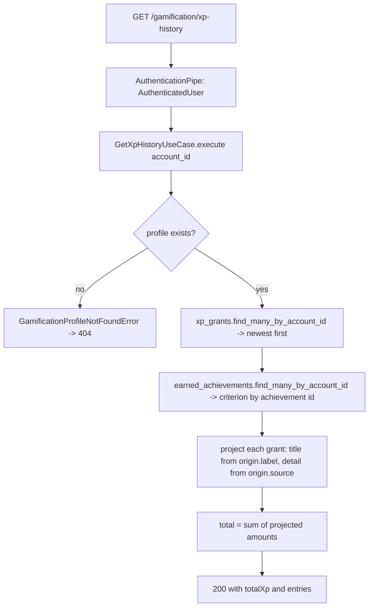
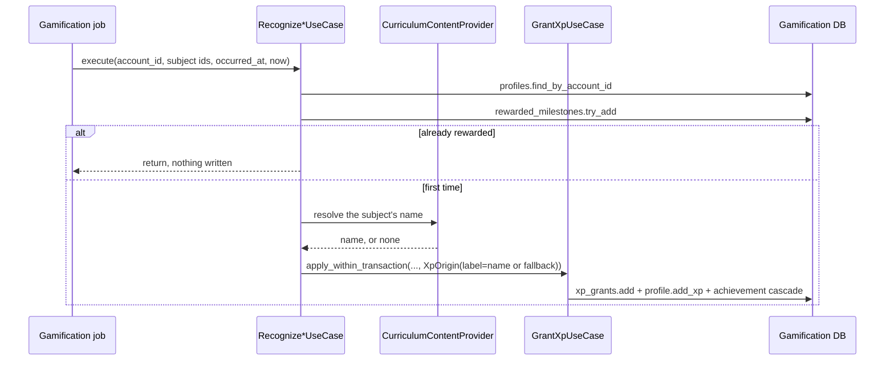

# Objective

Let a learner consult **every XP grant their account has received**, newest
first, with a readable origin, both relevant dates and the accumulated total,
through an authenticated **Histórico de XP** tab in the Gamification area.

Current behavior: `SHIFU-82`/`SHIFU-79` already persist each grant.
`gamification_xp_grants` exists, `GrantXpUseCase._grant`
(`grant_xp_use_case.py:120`) writes one `XpGrant` row per concession with
`amount`, `origin`, `occurred_at` (the fact) and `granted_at` (the concession),
and `DeleteGamificationProfileUseCase` purges those rows with the account. What
is missing is everything that makes that ledger **consultable and explainable**:
`XpGrantsRepository` has `add` and `remove_many_by_account_id` and no read
(`xp_grants_repository.py:6-11`), no use case or endpoint reads grants, and the
Gamification area has no history surface. `RP-08` is therefore recorded as
`partial` in [`../achievements/spec.md`](../achievements/spec.md) and in
[`../practice-calendar/spec.md`](../practice-calendar/spec.md). This Spec
delivers the learner-facing remainder.

It also repairs one gap the ledger cannot explain on its own: two of the four
stored origin labels never name their subject —
`recognize_competency_mastered_use_case.py:61` stores the generic
`'Competência dominada pela primeira vez'` with no Competência name anywhere in
the row. RP-08 requires an **origem legível**, and design node `u8vl4` renders
every row as a subject plus a descriptor, so the producers are corrected to
store the subject and the descriptor is derived at read time.

Mode: **complete**. The slice changes what already-shipped producers persist
into an existing field, and the read contract has an ordering and a totalling
guarantee whose failure is silent and user-visible only as a wrong history.

# Scope

| Area / actor | Included | Excluded or deferred |
| --- | --- | --- |
| XP ledger read (Usuário) | Authenticated read of every grant for the account, newest grant date first, with no pagination, plus the accumulated total | Filters, search, pagination and any per-record navigation — all forbidden by RP-08 and the PRD's Fora de Escopo |
| Readable origin (Sistema) | `XpOrigin.label` becomes the subject title for all four current sources; the type-and-context descriptor is derived at read time from `XpOrigin.source` and, for achievements, the account's own `EarnedAchievement` criterion | Any change to XP amounts, eligibility, idempotency or the cascade itself |
| Grant persistence (Sistema) | Confirmed as already delivered and preserved: amount, origin, fact date, concession date, one record per rewarded fact | New persistence, new columns, new tables or any backfill of existing rows |
| Histórico de XP tab (Usuário) | A third tab in the existing shell, rendering the design's summary, record list, fact-date line and preservation note, with loading, empty, error and recovery states | The `Visão geral` tab present in design node `u8vl4` — still unowned by any delivered ticket |
| Account lifecycle (Sistema) | Confirmed: grants purged with the rest of the Gamification state; a missing profile answers 404 | The 24-hour purge orchestration itself, already owned by the existing deletion job |

Selected product outcomes for this bounded slice:

| RP | Classification | Rationale |
| --- | --- | --- |
| RP-01 | partial | The history read is private to the owning account; the profile itself already exists from `SHIFU-82` |
| RP-04 | partial | Only the "mudanças futuras não recalculam recompensas antigas" guarantee, which the immutable record set already provides; levels themselves are `SHIFU-82` |
| RP-08 | full | Persistence, readable origin, both dates, explainable total, complete unordered-free listing, preservation after origin removal and the minimum-data limit are all delivered |
| RP-11 | partial | No duplicate record on reprocessing is preserved for the sources that exist; activity XP recovery remains `SHIFU-84` |
| RP-12 | partial | Records are purged and inaccessible for a deleted account, inside the existing deletion path |
| RP-13 | partial | Responsive, pt-BR, keyboard-operable and non-color-only for the Histórico de XP tab |

**Deferred consequence, stated explicitly.** `XpSource.ACTIVITY` has no producer:
XP proportional to an Activity score is RP-02, owned by `SHIFU-84`. The tab
therefore cannot show an `Atividade` row, even though design node `u8vl4` leads
with one. The row's mark and base descriptor are fixed in
[`design/handoff.md`](design/handoff.md), but no capture taken for this Spec can
contain the row, and reaching the reference's `Atividade · <Habilidade>` line
requires `SHIFU-84` to extend the descriptor derivation itself — see the
Technical Contract.

Design handoff for affected UI states and viewports:
[`design/handoff.md`](design/handoff.md).

# Behavior Contract

| ID | RP/JN/source coverage | Observable required behavior |
| --- | --- | --- |
| RF-01 | RP-08, RP-11; JN-09 | Every XP concession stays recorded for the life of the account with its amount, its readable origin, the date of the fact that caused it and the date it was granted. Reprocessing the same fact or achievement unlock never produces a second record. |
| RF-02 | RP-08; JN-09 | A readable origin is a **subject title** plus a **type-and-context descriptor**: the Habilidade for a diagnostic, the Competência for a first mastery, the Habilidade for a first completion, the achievement for an achievement reward. A subject whose catalogue name cannot be resolved still produces a readable origin and never prevents a grant the eligibility rules already allowed — the diagnostic's pre-existing early return for an unknown Habilidade (`recognize_diagnostic_completed_use_case.py:46-48`) is a `SHIFU-79` eligibility rule and is unchanged. |
| RF-03 | RP-08; JN-09 | The authenticated read returns every record of the account, with no pagination and no filter, ordered by concession date from newest to oldest, with a deterministic order between records sharing one concession instant. |
| RF-04 | RP-08 | The accumulated XP presented with the history equals the sum of the records presented with it. |
| RF-05 | RP-08; JN-09, JN-12 | Removing an Objetivo or Habilidade in Learning leaves every record and its text intact, and the history offers no navigation to any origin, removed or not. |
| RF-06 | RP-08 | The date of the fact and the date of the concession are preserved separately, and the fact date is presented only when it differs from the concession date. |
| RF-07 | RP-01, RP-12; JN-13 | The read returns only the authenticated account's own records. An account without a Gamification profile receives 404; an unauthenticated request receives 401; a deleted account's records are purged with the rest of its state. |
| RF-08 | RP-08 | A record holds only what the history needs — amount, origin, references and dates — and never copies answers, evaluations, progress or pedagogical feedback from Learning. |
| RF-09 | RP-04, RP-08 | A record is never recomputed: a later change to XP values or to the level curve leaves every stored amount and date unchanged. |
| RF-10 | RP-13 | The tab works on desktop and mobile, in pt-BR, is keyboard-operable, identifies each origin without relying on color or icon alone, and communicates its loading, empty, unavailable and recovery states clearly. |

| ID | RF coverage | Given | When | Then | Checks |
| --- | --- | --- | --- | --- | --- |
| CA-01 | RF-01, RF-08 | An account with a Gamification profile | A learning milestone or an achievement grants XP | One record exists carrying the amount, the origin, the fact date and the concession date, and nothing from Learning beyond identifiers | CI-02, CI-05 |
| CA-02 | RF-01 | A fact already rewarded for the account | The same event is delivered again | No second record is created and the total is unchanged | CI-05 |
| CA-03 | RF-02 | A diagnostic completing for a Habilidade named `Lógica de programação` | The grant is applied | The stored title is `Lógica de programação` and the history descriptor is `Diagnóstico concluído` | CI-02, CI-01 |
| CA-04 | RF-02 | A first Competência mastery whose Competência resolves to `Condicionais` | The grant is applied | The stored title is `Condicionais` and the history descriptor is `Primeiro domínio de Competência` | CI-02, CI-01 |
| CA-05 | RF-02 | A first Habilidade completion | The grant is applied | The stored title is the Habilidade name and the history descriptor is `Habilidade concluída` | CI-02, CI-01 |
| CA-06 | RF-02 | An achievement unlocked by the cascade | The reward grant is applied | The stored title is the achievement name and the history descriptor is `Conquista · <criterion>` taken from the account's own earned achievement | CI-02, CI-01 |
| CA-07 | RF-02 | A mastery or completion whose Habilidade content or Competência cannot be resolved | The grant is applied | The grant is still created and carries the fallback sentence as its title — never dropped, never raised | CI-02 |
| CA-08 | RF-02, RF-09 | A record stored before this delivery, whose title is the old full sentence | The history is read | It is returned in order with a descriptor, its stored text unchanged and never rewritten | CI-01 |
| CA-09 | RF-03, RF-04 | An account with records on several dates, two of them sharing one concession instant | The history is read | Every record is returned newest-concession-first, the tied pair has a deterministic order, and the reported total equals the sum of the returned amounts | CI-01, CI-03 |
| CA-10 | RF-03 | An account with a Gamification profile and no records | The history is read | The response is 200 with an empty record set and a total of 0 | CI-01, CI-03 |
| CA-11 | RF-07 | Two accounts each with their own records | Account A reads the history | Only A's records are returned | CI-03 |
| CA-12 | RF-07 | An authenticated account with no Gamification profile | The history is read | The API responds 404 | CI-01, CI-03 |
| CA-13 | RF-07 | An account whose Gamification profile is deleted | The deletion path runs | Its XP-grant rows are removed with the rest of its state | CI-04 |
| CA-14 | RF-05, RF-09 | An account with records | An Objetivo or Habilidade is removed in Learning | Every record, its amount, its dates and its text are unchanged | CI-01, CI-04 |
| CA-15 | RF-03, RF-04, RF-10 | An authenticated learner with records | They open `/gamification` and select the Histórico de XP tab | The section title, description, accumulated total and every record — origin, descriptor, concession date and amount — render newest-first from real data in pt-BR with no console errors | CI-06, CI-09, VM-01, VM-02 |
| CA-16 | RF-06 | A record whose fact date differs from its concession date, beside one where they match | The tab is rendered | The differing record shows the fact date as a second line under the concession date, and the matching one shows a single date | CI-06 |
| CA-17 | RF-10 | An account with a profile and no records | The tab is rendered | An empty state explains that XP will appear here, and no record list is rendered | CI-06, CI-08 |
| CA-18 | RF-10 | The Histórico de XP tab | The history query is loading, then fails | A loading state and then an error state with a working retry are announced, and the page shell and the other tabs stay intact | CI-06, CI-07, CI-08 |
| CA-19 | RF-10 | The Gamification area | It is opened at a narrow viewport and operated by keyboard | All three tabs are reachable and operable, and the records stack without horizontal overflow | CI-07, VM-01, VM-02 |
| CA-20 | RF-05, RF-10 | A rendered record | It is inspected | It contains no link and no row action, and the preservation note is visible on the tab | CI-06, VM-02 |

# Technical Contract

## Architecture Mapping

Owner: **Gamification**, end to end. No other business module is touched, no
event contract changes, and no migration is produced. Rules:
[python-conventions](../../../rules/python-conventions-rules.md),
[core-layer](../../../rules/core-layer-rules.md),
[database-layer](../../../rules/database-layer-rules.md),
[messaging-layer](../../../rules/messaging-layer-rules.md),
[rest-layer](../../../rules/rest-layer-rules.md),
[use-case-testing](../../../rules/use-case-testing-rules.md),
[controllers-testing](../../../rules/controllers-testing-rules.md),
[jobs-testing](../../../rules/jobs-testing-rules.md),
[typescript-conventions](../../../rules/typescript-conventions-rules.md),
[ui-layer](../../../rules/ui-layer-rules.md),
[web-app-routing](../../../rules/web-app-routing-rules.md),
[widget-testing](../../../rules/widget-testing-rules.md).

### The readable-origin decision

**Selected approach: the stored `label` becomes the subject, the descriptor is
derived at read time.** `XpOrigin` already carries `source`, `reference_id` and
`label`; producers stop writing a full sentence into `label` and write the
subject name instead, and `GetXpHistoryUseCase` maps `source` to the descriptor.

Two alternatives were rejected against the repository's own constraints:

- **Add `XpOrigin.subject`.** `Serialization.deserialize_value` reads dataclass
  fields with `data[field.name]`
  (`shared/database/sqlalchemy/serialization.py`), so a new field raises
  `KeyError` on every row already stored in the JSON `origin` column. That
  forces either a data migration over stored JSON or a change to shared
  serialization — blast radius outside this slice, for a field that would
  duplicate `label` forever.
- **Leave the producers untouched** and render `label` as the title with the
  source name beneath it. Zero producer risk, but a mastery row would still
  never name its Competência, which is precisely what RP-08's "origem legível"
  and design node `u8vl4` require.

The accepted cost is that this alters what already-shipped producers write into
an existing field. It is safe to do so because `label` is **write-once display
text**: nothing reads it today, no uniqueness, idempotency or amount decision
depends on it, and rows written before this delivery stay valid and readable —
their old sentence simply renders as a longer title above the derived
descriptor (`CA-08`). No backfill is performed, by RF-09.

### Gamification — core

| Action | Boundary | Element / Path | Required change |
| --- | --- | --- | --- |
| Create | Core / structure | `XpHistoryEntry` — `apps/server/src/shifu/gamification/core/domain/structures/xp_history_entry.py` | One projected record; re-exported from the package `__init__.py` |
| Create | Core / structure | `XpHistory` — `.../structures/xp_history.py` | The read result: total plus ordered records |
| Create | Core / domain | `achievement_criterion_label` — `apps/server/src/shifu/gamification/core/domain/achievement_criterion_label.py` | The criterion phrasing currently private to `list_achievements_use_case.py:30`, promoted to a shared domain helper beside `achievement_catalog.py` so both read paths use one vocabulary. The function is named after its module, per [python-conventions](../../../rules/python-conventions-rules.md) |
| Modify | Core / use case | `ListAchievementsUseCase` — `.../use_cases/list_achievements_use_case.py` | Import `achievement_criterion_label` and delete the private `_criterion_label`; no behavior change, and `test_list_achievements_use_case.py` must keep passing unedited because it asserts the rendered `criterion_label` output rather than the private helper |
| Modify | Core / interface | `XpGrantsRepository` — `.../interfaces/xp_grants_repository.py` | Add `find_many_by_account_id` |
| Create | Core / use case | `GetXpHistoryUseCase` — `.../use_cases/get_xp_history_use_case.py` | Project the account's grants into `XpHistory`; raise `GamificationProfileNotFoundError` when the account has no profile. **Deliberate divergence:** this matches `GetPracticeCalendarUseCase` but not `ListAchievementsUseCase`, which defaults to `level=1, total_xp=0` (`list_achievements_use_case.py:60-63`), so a profile-less account would see a working Conquistas tab beside an error-state Histórico tab. Profiles are created eagerly on account activation, so an absent profile on this path is corrupted state, and a ledger has no meaningful empty-but-valid default the way a locked catalogue does — 404 is the honest answer and matches two of the three reads |
| Modify | Core / use case | `RecognizeDiagnosticCompletedUseCase` — `.../use_cases/recognize_diagnostic_completed_use_case.py` | `label=skill.name` instead of `f'Diagnóstico concluído: {skill.name}'` (line 68). The existing early return for an unknown Habilidade is unchanged |
| Modify | Core / use case | `RecognizeCompetencyMasteredUseCase` — `.../use_cases/recognize_competency_mastered_use_case.py` | Accept `curriculum_content_provider` and a `skill_id` argument; resolve the Competência name through `get_skill_content(skill_id)` and store it as `label`, falling back to `'Competência dominada pela primeira vez'` when the Habilidade content or the Competência cannot be resolved |
| Modify | Core / use case | `RecognizeSkillCompletedUseCase` — `.../use_cases/recognize_skill_completed_use_case.py` | Accept `curriculum_content_provider`; store `skill.name` as `label`, falling back to `'Habilidade concluída pela primeira vez'` |
| Modify | Core / use case | `GrantXpUseCase` — `.../use_cases/grant_xp_use_case.py` | `label=achievement.name` instead of `f'Conquista: {achievement.name}'` (line 193) |
| Unchanged | Core / entity | `XpGrant`, `XpOrigin`, `XpSource` | Consumed as-is. `XpGrant` is already a `frozen_entity` validating a non-empty origin label, a positive amount and `occurred_at <= granted_at`, which is what RF-01 and RF-09 assert |

```python
@structure
class XpHistoryEntry:
    grant_id: str        # only entities own a bare `id`, per core-layer rules
    amount: int
    source: XpSource
    title: str           # the subject: Habilidade, Competência or achievement
    detail: str          # the type-and-context descriptor, derived from source
    occurred_at: datetime
    granted_at: datetime


@structure
class XpHistory:
    total_xp: int
    entries: tuple[XpHistoryEntry, ...]   # newest granted_at first


def achievement_criterion_label(
    kind: AchievementCriterionKind, target: int
) -> str:
    """The pt-BR phrasing of one achievement criterion, shared by both reads."""


class XpGrantsRepository(Protocol):
    def add(self, grant: XpGrant) -> None: ...

    def find_many_by_account_id(self, account_id: str) -> tuple[XpGrant, ...]:
        """Every grant for the account, newest concession first."""
        ...

    def remove_many_by_account_id(self, account_id: str) -> None: ...


class GetXpHistoryUseCase:
    def __init__(self, database: GamificationDatabase) -> None: ...

    def execute(self, account_id: str) -> XpHistory: ...


class RecognizeCompetencyMasteredUseCase:
    def __init__(
        self,
        database: GamificationDatabase,
        curriculum_content_provider: CurriculumContentProvider,
        identifier_provider: IdentifierProvider,
        grant_xp_use_case: GrantXpUseCase,
    ) -> None: ...

    def execute(
        self,
        account_id: str,
        competency_id: str,
        skill_id: str,
        skill_experience_id: str,
        *,
        occurred_at: datetime,
        now: datetime,
    ) -> None: ...


class RecognizeSkillCompletedUseCase:
    def __init__(
        self,
        database: GamificationDatabase,
        curriculum_content_provider: CurriculumContentProvider,
        identifier_provider: IdentifierProvider,
        grant_xp_use_case: GrantXpUseCase,
    ) -> None: ...
    # `execute` is unchanged.
```

**New concept — XP history projection.** `XpHistory` is a read-only view
assembled per request from rows that already exist; it owns no state and is
never persisted. Its source of truth is the `XpGrant` set plus, for achievement
rows only, the account's own `EarnedAchievement` rows, which snapshot the
criterion that was actually reached (`earned_achievements.find_many_by_account_id`).
Reading the criterion from the account's earned rows rather than from
`ACHIEVEMENT_CATALOG` is deliberate: RP-07 keeps a retired achievement in the
history of whoever obtained it, and a catalogue lookup would lose its criterion
the moment it is retired. When no earned row matches — which only a corrupted
state could produce — the descriptor degrades to `Conquista` rather than
failing the read.

**Descriptor derivation**, fixed here because consumers and checks depend on the
exact strings:

| `XpSource` | Descriptor | Producer of the title |
| --- | --- | --- |
| `activity` | `Atividade` | None yet — RP-02, `SHIFU-84` (see the note below) |
| `diagnosis` | `Diagnóstico concluído` | `RecognizeDiagnosticCompletedUseCase` |
| `competency-mastery` | `Primeiro domínio de Competência` | `RecognizeCompetencyMasteredUseCase` |
| `skill-completion` | `Habilidade concluída` | `RecognizeSkillCompletedUseCase` |
| `achievement` | `Conquista · {achievement_criterion_label(...)}` | `GrantXpUseCase._settle_achievements` |

**The `activity` descriptor is deliberately narrower than the reference.**
Design node `u8vl4` shows `Atividade · Lógica de programação`, which names the
Habilidade the Activity belongs to. This contract derives `detail` from
`XpOrigin.source` **alone**, and a source cannot carry a Habilidade name, so
`SHIFU-84` will have to extend the derivation — not merely populate a name —
to reach the reference's row. Stating otherwise would hand that ticket a
contract it cannot satisfy. The deviation is recorded in
[`design/handoff.md`](design/handoff.md).

**Total.** `total_xp` is the sum of the returned records, not
`gamification_profiles.total_xp`. RP-08 requires the total to be *explainable by
the set of records*, so the presented number is computed from exactly the set
presented (`RF-04`). The two are equal by construction, because
`GrantXpUseCase._grant` writes the record and applies `profile.add_xp` in the
same transaction; `CI-03` asserts that equality against persisted state rather
than assuming it.

**Ordering.** `granted_at` descending, then `id` descending. The tiebreak is
required, not decorative: the achievement cascade grants several records with
one shared `now` (`grant_xp_use_case.py:183-198`), so concession date alone does
not totally order them. Ids are ULIDs whose 16 trailing characters are
`secrets.choice` random (`system_identifier_provider.py:13-17`), so within one
millisecond the secondary key is **deterministic but arbitrary** — it fixes a
stable order across repeated reads, which is all `RF-03` and `CA-09` require.
No check may assert that the tied pair appears in creation order.

### Gamification — database

| Action | Boundary | Element / Path | Required change |
| --- | --- | --- | --- |
| Modify | Database / repository | `SqlalchemyXpGrantsRepository` — `.../database/sqlalchemy/repositories/xp_grants_repository.py` | Implement `find_many_by_account_id` with `select(XpGrantModel).where(account_id == ...).order_by(XpGrantModel.granted_at.desc(), XpGrantModel.id.desc())`, mapped through the existing `XpGrantMapper.to_domain` |
| Unchanged | Database / model | `XpGrantModel` — `.../models/xp_grant_model.py` | No column, constraint or index change. The existing `ix_gamification_xp_grant_account_id` already serves the only filter this read performs |
| Unchanged | Database / migration | — | **No migration is produced.** The single current head is `f01033e9cd81`, verified with `uv run alembic heads`; this Spec leaves it untouched |

### Gamification — messaging

| Action | Boundary | Element / Path | Required change |
| --- | --- | --- | --- |
| Modify | Messaging / job | `RecognizeCompetencyMasteredJob` — `.../jobs/recognize_competency_mastered_job.py` | Add `skill_id` to the `_normalize_payload` result (lines 108-113) and pass it to `use_case.execute`. The `_Payload` already validates `skill_id` (line 27), so the wire contract and `extra='forbid'` behavior are unchanged and no producer event changes |
| Modify | Messaging / composition | `GamificationInngestMessaging.register_jobs` — `.../gamification_inngest_messaging.py` | Pass the already-injected `curriculum_content_provider` into `RecognizeCompetencyMasteredUseCase` and `RecognizeSkillCompletedUseCase` |

No event name, payload or trigger changes anywhere in this slice, so the
`extra='forbid'` compatibility audit that `SHIFU-80` had to perform does not
recur.

### Gamification — REST

| Action | Boundary | Element / Path | Required change |
| --- | --- | --- | --- |
| Create | REST / controller | `GetXpHistoryController` — `apps/server/src/shifu/gamification/rest/controllers/get_xp_history_controller.py` | `GET /gamification/xp-history`; `AuthenticatedUser` + `GamificationPipe.get_database` dependencies; module-level `Response` model; no `try`/`except` |
| Modify | REST / router | `GamificationRouter.register` — `.../rest/router.py` | Register the new controller |
| Modify | REST / examples | `apps/server/rest-client/gamification/gamification.rest` | Add a non-secret example for the new route |

```python
class XpHistoryEntryResponse(BaseModel):
    id: str
    amount: int
    source: str
    title: str
    detail: str
    occurred_at: datetime = Field(serialization_alias='occurredAt')
    granted_at: datetime = Field(serialization_alias='grantedAt')


class Response(BaseModel):
    total_xp: int = Field(serialization_alias='totalXp')
    entries: tuple[XpHistoryEntryResponse, ...]
```

The transport keeps the field name `id`, sourced from `XpHistoryEntry.grant_id`.
[rest-layer rules](../../../rules/rest-layer-rules.md) place transport-only
naming in the controller-local Pydantic response model, which is what permits
the two names to differ; the sibling `AchievementOverviewEntry.code` is not a
precedent for renaming, since it keeps `code` on the wire.

Errors flow to the global `AppErrorHandler`: a missing profile raises
`GamificationProfileNotFoundError` (a `NotFoundError`) → 404; an unauthenticated
request is rejected by `AuthenticationPipe` → 401. The route takes no query
parameter, because RP-08 forbids pagination and filters.

### Web

| Action | Boundary | Element / Path | Required change |
| --- | --- | --- | --- |
| Modify | UI / widget | `GamificationTabs` — `apps/web/src/ui/gamification/widgets/pages/gamification-page/gamification-tabs/index.tsx` | Add `historico-xp` / `Histórico de XP` to the `GamificationTab` union and the `TABS` array; the trigger styling is unchanged |
| Modify | UI / page | `GamificationPage` — `.../gamification-page/index.tsx` | Add the third `TabsContent` rendering `XpHistoryTabPanel` |
| Create | UI / widget | `xp-history-tab-panel/{index.tsx,use-xp-history-tab-panel.ts}` | Owns the tab's state machine and renders loading, empty, error and populated branches plus the preservation note |
| Create | UI / query hook | `xp-history-tab-panel/use-xp-history-query.ts` | `queryKey: ['gamification', 'xp-history']`, `retry: false`; mirrors the `createServerFn` composition of `use-practice-calendar-query.ts` |
| Create | UI / widget | `xp-history-tab-panel/xp-history-summary/index.tsx` | Section title, description and the accumulated-XP block |
| Create | UI / widget | `xp-history-tab-panel/xp-history-table/index.tsx` | The record card, its decorative column headers and the record list |
| Create | UI / widget | `xp-history-tab-panel/xp-history-table/xp-history-row/index.tsx` | One record: origin mark, title, descriptor, concession date, optional fact date, amount |
| Modify | UI / shared | `apps/web/src/ui/shared/widgets/components/icon/index.tsx` | Add `award`, `badge-check` and `clipboard-check` to both the Lucide map and the `IconName` union; `target` and `graduation-cap` already exist |
| Modify | UI / shared hook | `apps/web/src/ui/shared/hooks/use-format-date.ts` | Add `formatShortDate(isoDateTime)` producing the reference's `13 set 2026` shape in the **viewer's** zone; the existing UTC-pinned formatters are unchanged because they format plain calendar dates |
| Create | Core / contract | `apps/web/src/core/gamification/xp-history.ts` | `XpHistory`, `XpHistoryEntry`, `XpSource` plain TS types |
| Modify | REST / service | `apps/web/src/rest/services/gamification-service.ts` | Add `getXpHistory(accessToken)` against `/gamification/xp-history` |

```ts
export type XpSource =
  | 'activity'
  | 'diagnosis'
  | 'competency-mastery'
  | 'skill-completion'
  | 'achievement'

export type XpHistoryEntry = {
  id: string
  amount: number
  source: XpSource
  title: string
  detail: string
  occurredAt: string
  grantedAt: string
}

export type XpHistory = {
  totalXp: number
  entries: XpHistoryEntry[]
}
```

No route file changes: the tab lives inside the existing `/gamification` page,
so `apps/web/src/routes/gamification/index.tsx`, `constants/routes.ts` and the
generated `routeTree.gen.ts` are untouched and `generate-routes` is not required.

State ownership: `use-gamification-page.ts` keeps owning the selected tab and is
**unchanged** — the tab union widens beneath it.
`use-xp-history-tab-panel.ts` owns the panel's derived state
(`loading | success | empty | error`, `isRetrying`, `handleRetry`) and is the
sole consumer of `use-xp-history-query.ts`. `xp-history-summary`,
`xp-history-table` and `xp-history-row` are pure renderers receiving props; no
state is duplicated and no child reaches into parent state. The row never
renders a link or a button, which is how RF-05's "no navigation to the origin"
is satisfied structurally rather than conditionally.

**Known precedent deviation.** `use-practice-calendar-query.ts` and
`use-achievements-query.ts` compose `AxiosRestClient` + `GamificationService`
inside a `createServerFn` instead of consuming `useRestContext()`, and
`gamificationService` is not registered in `RestContextValue`. The new query
hook mirrors that existing pattern for consistency within the module rather than
introducing a third composition style on the same page; correcting all three
together is a separate maintenance task.

### Expected file tree

```text
apps/server/
├── rest-client/gamification/gamification.rest                                 [M]
├── src/shifu/gamification/
│   ├── core/
│   │   ├── domain/
│   │   │   ├── achievement_criterion_label.py                                 [N]
│   │   │   └── structures/
│   │   │       ├── xp_history.py                                              [N]
│   │   │       ├── xp_history_entry.py                                        [N]
│   │   │       └── __init__.py                                                [M]
│   │   ├── interfaces/xp_grants_repository.py                                 [M]
│   │   └── use_cases/
│   │       ├── get_xp_history_use_case.py                                     [N]
│   │       ├── grant_xp_use_case.py                                           [M]
│   │       ├── list_achievements_use_case.py                                  [M]
│   │       ├── recognize_competency_mastered_use_case.py                      [M]
│   │       ├── recognize_diagnostic_completed_use_case.py                     [M]
│   │       ├── recognize_skill_completed_use_case.py                          [M]
│   │       └── __init__.py                                                    [M]
│   ├── database/sqlalchemy/repositories/xp_grants_repository.py               [M]
│   ├── messaging/inngest/
│   │   ├── jobs/recognize_competency_mastered_job.py                          [M]
│   │   └── gamification_inngest_messaging.py                                  [M]
│   └── rest/
│       ├── controllers/get_xp_history_controller.py                           [N]
│       ├── controllers/__init__.py                                            [M]
│       └── router.py                                                          [M]
└── tests/
    ├── gamification/
    │   ├── core/use_cases/
    │   │   ├── test_get_xp_history_use_case.py                                [N]
    │   │   ├── test_grant_xp_use_case.py                                      [M]
    │   │   ├── test_recognize_competency_mastered_use_case.py                 [M]
    │   │   ├── test_recognize_diagnostic_completed_use_case.py                [M]
    │   │   ├── test_recognize_skill_completed_use_case.py                     [M]
    │   │   ├── test_list_achievements_use_case.py                             (unchanged)
    │   │   └── test_delete_gamification_profile_use_case.py                   (unchanged)
    │   └── server/controllers/test_get_xp_history_controller.py               [N]
    └── messaging/inngest/jobs/gamification/
        └── test_recognize_competency_mastered_job.py                          [M]

apps/web/
├── src/
│   ├── core/gamification/xp-history.ts                                        [N]
│   ├── rest/services/gamification-service.ts                                  [M]
│   └── ui/
│       ├── shared/
│       │   ├── hooks/use-format-date.ts                                       [M]
│       │   └── widgets/components/icon/index.tsx                              [M]
│       └── gamification/widgets/pages/gamification-page/
│           ├── index.tsx                                                      [M]
│           ├── use-gamification-page.ts                                       (unchanged)
│           ├── gamification-tabs/index.tsx                                    [M]
│           ├── calendar-tab-panel/                                            (unchanged)
│           ├── achievements-tab-panel/                                        (unchanged)
│           ├── xp-history-tab-panel/
│           │   ├── index.tsx                                                  [N]
│           │   ├── use-xp-history-tab-panel.ts                                [N]
│           │   ├── use-xp-history-query.ts                                    [N]
│           │   ├── xp-history-summary/index.tsx                               [N]
│           │   ├── xp-history-table/
│           │   │   ├── index.tsx                                              [N]
│           │   │   └── xp-history-row/index.tsx                               [N]
│           │   └── tests/
│           │       ├── xp-history-tab-panel.test.tsx                          [N]
│           │       └── use-xp-history-tab-panel.test.ts                       [N]
│           └── tests/
│               ├── gamification-page.test.tsx                                 [M]
│               └── use-gamification-page.test.ts                              [M]
└── tests/gamification/gamification-page.test.ts                               [M]
```

Test-boundary notes, per
[core-layer](../../../rules/core-layer-rules.md),
[database-layer](../../../rules/database-layer-rules.md) and
[widget-testing](../../../rules/widget-testing-rules.md) rules: there are
deliberately **no** test files for `XpHistory`, `XpHistoryEntry`,
`achievement_criterion_label`, the SQLAlchemy repository, `use-xp-history-query.ts`,
`gamification-service.ts`, or the presentational row and table widgets. Each of
those would be a blocking contract defect. The ordering the repository performs
is proven through the controller test against real PostgreSQL; the child widgets
are proven through the real composition rendered by
`xp-history-tab-panel.test.tsx`.

`use-xp-history-tab-panel.ts` **does** take a dedicated hook test:
[widget-testing rules](../../../rules/widget-testing-rules.md) require the
component test to replace the owning hook with a typed mock, so without it the
hook's own four-way state derivation and retry path would be asserted nowhere
below Playwright. This mirrors the existing `use-gamification-page.test.ts` and
`use-calendar-tab-panel.test.ts` for the sibling hooks.

## Runtime Flow

Read — synchronous:



Every query is filtered by the `account_id` taken from the verified session,
never from a request parameter, so account isolation is structural (RF-07). The
profile lookup, the grant read and the earned-achievement read share one
`GamificationDatabase.transaction()`, so the returned total and record set are
read from one consistent snapshot even while a cascade commits concurrently.
The read performs no write, acquires no lock a grant would wait on, and is
therefore safe to repeat.

Write — unchanged, with the corrected label:



The subject lookup happens **after** the idempotency check and never decides
whether XP is granted: an unresolvable name produces the fallback title and the
grant still commits (`CA-07`). `RecognizeDiagnosticCompletedUseCase` keeps its
pre-existing early return for an unknown Habilidade, which is an eligibility
rule from `SHIFU-79`, not a labelling rule, and is out of scope here.

# Verification Contract

## Shared setup

- **Server unit** (`CI-01`, `CI-02`, `CI-04`): run from `apps/server`. No app, HTTP, session, Docker or Inngest. Every port is mocked with `create_autospec(Protocol, instance=True)` in an `autouse=True` fixture; all times are passed in explicitly as `now` / `occurred_at` — core never reads the clock. Cases are methods on a `Test<UseCase>` class named `test_should_*`.
- **Server controller** (`CI-03`): `TestClient` against `FastAPIApp.register(database_engine=...)` with real Alembic migrations and real repositories. The Testcontainers PostgreSQL fixture lives in `apps/server/tests/fixtures/postgres_fixture.py` and is registered through `pytest_plugins` in `tests/conftest.py`; the shared `client` fixture there also requires `redis_fixture` and the `x-shifu-bff-secret` header, so a Redis container is needed even though this read uses none. Follow the sibling suite `tests/gamification/server/controllers/test_get_practice_calendar_controller.py:23-57`, which builds a local `application` fixture with a test authentication provider rather than reusing the shared client. Two distinct seeded accounts are required for the isolation case, and one seeded account needs two grants sharing a single `granted_at` for the tiebreak case; each test owns and cleans its own rows. Never point at the Compose development database.
- **Server jobs** (`CI-05`): `apps/server/tests/fixtures/inngest_fixture.py` with disposable Inngest + PostgreSQL containers; the event is sent by name with a payload serialized from the domain event class, and effects are asserted from a fresh inspection session with bounded monotonic polling. Requires `SHIFU_RUN_REAL_INNGEST_TESTS=1`; a skip is not proof. If Docker is unavailable the check is Blocked, not passed.
- **Web component** (`CI-06`, `CI-07`): Vitest + jsdom from the repository root; `@testing-library/react` with `userEvent`. The panel test mocks `../use-xp-history-tab-panel` (typed `vi.mocked`, fresh return value per `beforeEach`) and renders the real internal child composition. Mock application wrappers (`Icon`, the domain hook), never Lucide or `useQuery`.
- **Web hook** (`CI-08`): `renderHook` with `./use-xp-history-query` mocked; the domain query hook itself is never tested directly, per widget-testing rules.
- **Web route** (`CI-09`): extend the existing `apps/web/tests/gamification/gamification-page.test.ts`; mocked transport asserting method, path, final URL and visible state. Mocked transport does not prove real persistence.
- **Manual/visual** (`VM-01`, `VM-02`): Playwright CLI from `apps/web` per [AGENTS.md](../../../../AGENTS.md). Confirm `docker compose ps` and web/API health first; reuse `.playwright-cli/states/shifu-auth-state.json` or sign in through the visible form. The account must already have grants from at least two distinct sources — produce them through real Learning facts, or through a disposable fixture; do **not** reset or reseed shared data. Artifacts stay under `apps/web/.playwright-cli/{logs,screenshots,snapshots,states}/`; paths and results go in Evaluation.

## Automated

### CI-01 — XP history projection, ordering, total and absence

**Criteria:** CA-03, CA-04, CA-05, CA-06, CA-08, CA-09, CA-10, CA-12, CA-14

**Expected result:** Grants are projected newest-concession-first with the correct descriptor per source, the total equals the sum of the projected amounts, a legacy sentence title is returned unchanged, an account with no grants yields an empty set and a total of 0, and an account with no profile raises `GamificationProfileNotFoundError`.

**Setup / inputs:** Mocked `GamificationDatabase`. Equivalence classes over the grant set — empty; one grant; grants on distinct `granted_at`; two grants sharing one `granted_at` with different ids; one grant per `XpSource` that has a producer; an achievement grant with and without a matching `EarnedAchievement`; a grant whose stored label is a pre-delivery sentence. `CA-14` is asserted as the absence of any mutation on the read path: the use case calls no `add`, `update` or `remove` on any repository.

**Proof:** `apps/server/tests/gamification/core/use_cases/test_get_xp_history_use_case.py` (planned)

```bash
uv run pytest tests/gamification/core/use_cases/test_get_xp_history_use_case.py
```

**Passing condition:** Exact entry order, exact `detail` strings from the descriptor table, `total_xp` equal to the summed amounts, the raised error type for a missing profile, and no write call on any mocked repository. Mocked ports prove projection, not persistence or SQL ordering — `CI-03` owns those.

### CI-02 — Producers store the subject as the readable origin

**Criteria:** CA-01, CA-03, CA-04, CA-05, CA-06, CA-07

**Expected result:** Each recognition use case stores an `XpOrigin` whose `label` is the subject's name — the Habilidade for a diagnostic and a completion, the Competência for a mastery, the achievement for a cascade reward — with the amount, `occurred_at` and `granted_at` unchanged from the current contract. An unresolvable Habilidade content or Competência still produces the grant, carrying the fallback sentence. `ListAchievementsUseCase` additionally renders exactly the same criterion text as before the helper extraction.

**Setup / inputs:** Mocked ports with `CurriculumContentProvider` returning: a Habilidade whose competencies include the mastered one; a Habilidade whose competencies do not; and `None`.

**Proof:** `apps/server/tests/gamification/core/use_cases/test_recognize_diagnostic_completed_use_case.py`, `test_recognize_competency_mastered_use_case.py`, `test_recognize_skill_completed_use_case.py`, `test_grant_xp_use_case.py` (existing files, extended — their current label assertions at `test_recognize_competency_mastered_use_case.py:30`, `test_recognize_skill_completed_use_case.py:30` and `test_recognize_diagnostic_completed_use_case.py:84,110` must be updated to the new contract), plus `test_list_achievements_use_case.py` (existing file, expected to need no edit) as the regression guard for the extracted criterion helper

```bash
uv run pytest tests/gamification/core/use_cases/test_recognize_diagnostic_completed_use_case.py \
  tests/gamification/core/use_cases/test_recognize_competency_mastered_use_case.py \
  tests/gamification/core/use_cases/test_recognize_skill_completed_use_case.py \
  tests/gamification/core/use_cases/test_grant_xp_use_case.py \
  tests/gamification/core/use_cases/test_list_achievements_use_case.py
```

**Passing condition:** The asserted `XpOrigin.label` for every class above, the unchanged amount and milestone behavior in each file's pre-existing cases, and a created grant in both unresolvable-subject cases. A dropped or raised grant in the fallback cases is a failure. `test_list_achievements_use_case.py` asserts the rendered criterion text (`:103`), not the private helper, so it must pass **unedited**; a required edit there means the extraction changed behavior and must be reconciled before `ready`.

### CI-03 — History endpoint contract, isolation and absence

**Criteria:** CA-09, CA-10, CA-11, CA-12

**Expected result:** 200 with the serialized total and records for the owning account, ordered newest-concession-first with the id tiebreak applied; 200 with an empty set for an account with a profile and no grants; 404 with no profile; 401 unauthenticated. Account A never sees account B's records.

**Setup / inputs:** Two seeded accounts with distinct grants, persisted through real repositories and migrations; one account additionally carries two grants written with a single `granted_at` and different ids.

**Proof:** `apps/server/tests/gamification/server/controllers/test_get_xp_history_controller.py` (planned)

```bash
uv run pytest tests/gamification/server/controllers/test_get_xp_history_controller.py
```

**Passing condition:** Exact status codes and response bodies read back from persisted state, the asserted record order including the tied pair, `totalXp` equal to both the summed response amounts and the seeded `gamification_profiles.total_xp`, and no cross-account leakage. This check also proves the repository read and its SQL ordering, which have no test of their own by rule.

### CI-04 — Account deletion purges XP records

**Criteria:** CA-13, CA-14

**Expected result:** `DeleteGamificationProfileUseCase` removes XP-grant rows along with the profile, achievements, milestones and practice days, and nothing in this Spec changes that path.

**Setup / inputs:** The existing mocked-repository cases, unchanged.

**Proof:** `apps/server/tests/gamification/core/use_cases/test_delete_gamification_profile_use_case.py` (existing file, expected to need no edit)

```bash
uv run pytest tests/gamification/core/use_cases/test_delete_gamification_profile_use_case.py
```

**Passing condition:** `xp_grants.remove_many_by_account_id` still called once with the account id; no call when there is no profile. A required edit to this file is a signal that the slice touched the deletion contract and must be reconciled before `ready`.

### CI-05 — Competency-mastery job carries the Habilidade identifier

**Criteria:** CA-01, CA-02

**Expected result:** A real `learning/competency-mastered` event delivered to the registered function still grants XP exactly once and now persists a record whose title is the Competência name; a duplicate delivery adds no second record.

**Setup / inputs:** Disposable Inngest + PostgreSQL containers; payload serialized from the Learning event class, whose `skill_id` field already exists.

**Proof:** `apps/server/tests/messaging/inngest/jobs/gamification/test_recognize_competency_mastered_job.py` (existing file, extended)

```bash
SHIFU_RUN_REAL_INNGEST_TESTS=1 uv run pytest \
  tests/messaging/inngest/jobs/gamification/test_recognize_competency_mastered_job.py
```

**Passing condition:** Row count and stored origin asserted from a fresh session after bounded polling; duplicate delivery leaves the count at 1. A skipped run is Blocked, not passing.

### CI-06 — Histórico de XP tab renders records, dates and states

**Criteria:** CA-15, CA-16, CA-17, CA-18, CA-20

**Expected result:** The summary renders the title, description and accumulated total; every record renders its origin, descriptor, concession date and amount in order; a record whose fact date differs renders the extra line while a matching one does not; an account with no records renders the empty state and no list; loading and error states render with a working retry; no record contains a link or a button, and the preservation note is present.

**Setup / inputs:** `use-xp-history-tab-panel` mocked with loading, success, empty and error return values; the success value includes one record per producing source, one record whose `occurredAt` and `grantedAt` fall on different days and one where they do not.

**Proof:** `apps/web/src/ui/gamification/widgets/pages/gamification-page/xp-history-tab-panel/tests/xp-history-tab-panel.test.tsx` (planned)

```bash
pnpm --filter web exec vitest run src/ui/gamification/widgets/pages/gamification-page/xp-history-tab-panel/tests/xp-history-tab-panel.test.tsx
```

**Passing condition:** Role-first queries; rendered order asserted on the accessible names, not on indexes into a mock; pt-BR visible and accessible labels asserted; `queryAllByRole('link')` and `queryAllByRole('button')` empty inside the record list. No snapshots or class-name assertions.

### CI-07 — Tab shell carries three tabs without regression

**Criteria:** CA-18, CA-19

**Expected result:** The page renders Calendário, Conquistas and Histórico de XP, defaults to Calendário, switches to each, and the two existing panels still render their loading, error and populated states unchanged.

**Setup / inputs:** `use-gamification-page` mocked; the existing cases in `gamification-page.test.tsx` and `use-gamification-page.test.ts` extended for the third tab.

**Proof:** `apps/web/src/ui/gamification/widgets/pages/gamification-page/tests/{gamification-page.test.tsx,use-gamification-page.test.ts}` (existing files, extended)

```bash
pnpm --filter web exec vitest run src/ui/gamification/widgets/pages/gamification-page/tests
```

**Passing condition:** Tab roles and `aria-selected` asserted for all three tabs; every previously passing achievements and calendar assertion still passes; the page header and all three tab triggers still render on the loading, error and ready branches. No class-name or snapshot assertion — [widget-testing rules](../../../rules/widget-testing-rules.md) forbid both, and the page shell's layout classes are applied unconditionally, so there is no branch for them to survive.

### CI-08 — History tab hook state and retry

**Criteria:** CA-17, CA-18

**Expected result:** The hook reports `loading` while the query is pending, `error` when it rejects or returns nothing, `empty` for a successful response with no records, and `success` otherwise; `handleRetry` refetches and `isRetrying` is true only while refetching an already-loaded query.

**Setup / inputs:** `renderHook` with `use-xp-history-query` mocked across those four return shapes.

**Proof:** `apps/web/src/ui/gamification/widgets/pages/gamification-page/xp-history-tab-panel/tests/use-xp-history-tab-panel.test.ts` (planned)

```bash
pnpm --filter web exec vitest run src/ui/gamification/widgets/pages/gamification-page/xp-history-tab-panel/tests/use-xp-history-tab-panel.test.ts
```

**Passing condition:** Each state, the returned entries and total for the success branch, `isRetrying`, and the refetch call asserted on the hook's returned values — the complete public return contract, per [widget-testing rules](../../../rules/widget-testing-rules.md). This check exists because `CI-06` mocks this hook by rule, so its logic has no other coverage below Playwright.

### CI-09 — History route integration

**Criteria:** CA-15

**Expected result:** Opening `/gamification` and selecting the Histórico de XP tab invokes the `getXpHistory` server function and renders the returned records and total.

**Setup / inputs:** Mocked transport in the existing route suite, which intercepts `**/_serverFn/**` and identifies the call through the `serverFnExport` helper (`apps/web/tests/gamification/gamification-page.test.ts:6`). The upstream `GET /gamification/xp-history` is issued inside the SSR process and is **not observable from Playwright**; unlike the calendar, this query carries no payload, so the server-function export name is the only observable. The existing `getAchievements_*` interception must stay in place, since the page hook runs that query on every tab.

**Proof:** `apps/web/tests/gamification/gamification-page.test.ts` (existing file, extended)

```bash
pnpm --filter web exec playwright test tests/gamification/gamification-page.test.ts
```

**Passing condition:** The `getXpHistory` server-function export is observed exactly once for the tab, and the final URL and visible state are asserted; keyboard tab activation exercised. Mocked transport proves neither the upstream HTTP contract nor real persistence — `CI-03` owns the former and `VM-01` the latter.

### CI-10 — Applicable baseline checks

**Scope:** `apps/server` (gamification only), `apps/web`, and the directly affected consumers listed above.

**Checks, with separate dispositions per
[scoped static-check guidance](../../../tooling.md#scoped-type-lint-and-complexity-checks):**

- **Types** — `cd apps/server && uv run poe check:types`; `pnpm --filter web check:types` from the repository root. Required; both configured projects are affected. Type checks use the project configuration rather than a file list, to preserve tsconfig and consumer context.
- **Lint / format** — `cd apps/server && uv run ruff check --no-fix <exact changed paths>` and `uv run ruff format --check <exact changed paths>`; `pnpm exec biome check <exact changed paths>` from the repository root. Web lints with **Biome**, not ESLint (`apps/web/package.json:11`); no ESLint is installed. Required, and must not rewrite source.
- **Architecture** — `cd apps/server && uv run poe check:architecture`; `pnpm --filter web check:architecture` from the repository root. Required on both sides: Gamification gains a new read path and a provider dependency, and Tach must confirm it still imports only `shifu.shared`, while the Web panel adds a new widget subtree and a `core/gamification` contract that dependency-cruiser must confirm respects the layer direction.
- **Complexity** — no dedicated metrics command, threshold or baseline is configured in this repository, so none is invented. The obligation is discharged by the configured complexity lint rules inside the scoped checks above: Ruff `C90` on the Server side and Biome's configured complexity rules on the Web side. Record the diagnostics and their severity; no quantitative score is claimed.

**Passing condition:** Every required gate passes, each static disposition has an actual command result, and the selected tests are confirmed to have executed with non-zero collected counts.

**Mutation testing — required, narrowly.** The concrete risk is that
`GetXpHistoryUseCase` owns two silent correctness rules: the newest-first
ordering with its id tiebreak, and the total summed from the projected set. A
reversed comparator or a sum taken over the wrong collection produces a
plausible-looking history that misstates a learner's record, and an assertion
that only checks set membership would pass.

This Spec changes **six** eligible production `core/use_cases/**` files, and
each one needs a disposition:

| File | Disposition | Rationale |
| --- | --- | --- |
| `get_xp_history_use_case.py` | **Local target** | New branching correctness logic: ordering, tiebreak, totalling and descriptor selection |
| `recognize_diagnostic_completed_use_case.py` | Not locally targeted | One string literal moved into an existing field |
| `recognize_competency_mastered_use_case.py` | Not locally targeted | Subject lookup plus one literal; `CI-02` asserts both the resolved and the fallback label exactly |
| `recognize_skill_completed_use_case.py` | Not locally targeted | As above |
| `grant_xp_use_case.py` | Not locally targeted | One string literal in the cascade's achievement origin |
| `list_achievements_use_case.py` | Not locally targeted | A private helper is replaced by an identical imported one; `CI-02` proves the rendered output is unchanged |

For the five not locally targeted, the **changed** logic is a string literal or a
moved helper whose output `CI-02` asserts exactly, so a focused local run adds no
evidence those assertions do not already give. Note that mutmut scores every
mutant in a changed file, not only its changed lines, so each of these files is
still scored on its pre-existing logic — `grant_xp_use_case.py`'s cascade and
`list_achievements_use_case.py`'s entry building included.

**Expected scope movement.** `achievement_criterion_label` moves to
`core/domain/`, and `--core` mutates only `core/use_cases/**`
([Tooling](../../../tooling.md#mutation-testing)), so its five criterion branches
leave the mutation-scored boundary and `list_achievements_use_case.py`'s own
score will shift. Evaluation must record this as an expected consequence of the
extraction rather than treating a baseline move as a regression.

**The local scope is not the whole gate.** Server CI runs
`--all --core --shard N/12` and applies a fixed **70% minimum to mutants in
changed `core/use_cases/**` files** ([Tooling](../../../tooling.md#mutation-testing)),
so **all six** files above are scored in CI regardless of this Spec's `--files`
selection, and a changed file with no scored mutants fails that gate. The local
run below is a focused pre-CI check of the riskiest file, not a substitute for
it; Evaluation records both.

- **Targets (local run):** `src/shifu/gamification/core/use_cases/get_xp_history_use_case.py`.
- **Runner:** mutmut 3.8 via the Server Poe script, verified in [Tooling](../../../tooling.md#mutation-testing). Core runs need no Docker.

```bash
cd apps/server && uv run poe test:mutation --core \
  --files src/shifu/gamification/core/use_cases/get_xp_history_use_case.py
```

- **Selected tests:** only `tests/gamification/core/use_cases/test_get_xp_history_use_case.py`. Controller, job and Web tests are excluded.
- **Pass condition:** no surviving mutant in the ordering, tiebreak, totalling or descriptor-selection branches, and every changed core use-case file clears CI's 70% new-code gate. Runner success alone is not proof — Evaluation must record exact targets, the command, elapsed time and mutant outcomes.
- **Survivor disposition:** each survivor is either killed by a new assertion in the owning use-case test, or recorded as a justified equivalent mutant with its reason. Deferral requires an explicit note; an unavailable runner leaves this Blocked rather than passed.
- **Web:** Not applicable — no mutation runner exists for Web or packages. Web correctness is covered by `CI-06`–`CI-09` and the static gates.

## Manual

### VM-01 — Real authenticated XP history journey

**Type:** Manual

**Criteria:** CA-15, CA-19

**Tool / setup:** Playwright CLI from `apps/web` with the shared manual setup above, against real services and a real authenticated session.

**Procedure:** Open `/gamification`; reach the Histórico de XP tab **by keyboard** and activate it; read the accumulated total and the records; confirm the newest record is first and that each row names its origin and its type; switch to Conquistas and read the total XP shown under `Seu nível` — the bare `<n> XP` value, **not** the adjacent `<n> XP para o próximo nível` (`profile-summary-card/index.tsx:20-21`) — then return to Histórico de XP; repeat the tab activation at a 390 × 844 viewport.

**Passing condition:** Final URL stays `/gamification`; the `GET /gamification/xp-history` request returns 200 from the real API; the displayed total equals the sum of the displayed amounts **and** the total XP under `Seu nível` on the Conquistas tab for the same account, which reads the profile column and is on screen without any database access; records are ordered newest-concession-first; visible focus is present at every step; no horizontal overflow at the narrow viewport; no console errors beyond known unrelated noise. Close only the processes started for the check.

## Visual

### VM-02 — Histórico de XP tab against design node `u8vl4`

**Type:** Visual

**Criteria:** CA-15, CA-19, CA-20

**Reference / setup:** [`design/handoff.md`](design/handoff.md) and
[`design/u8vl4.png`](design/u8vl4.png) (1440 × 1100, exported at scale 1 from
`design/shifu.pen` and visually inspected 2026-10-18). Captured during `VM-01`
at 1440 × 900 and at 390 × 844.

**Capture / comparison:** Compare the tab bar with Histórico de XP active, the
section title and description, the accumulated-XP block, the record card with
its column headers, each record's origin mark, title, descriptor, date and
amount, and the preservation note. At the narrow viewport confirm the record
stacks without horizontal overflow, per `documentation/design.md` §9.

**Passing condition:** Hierarchy, row vocabulary and token usage match the
reference; each origin remains identifiable from its text alone; no clipping or
horizontal overflow at either viewport. Accepted deviations: the three-tab bar
instead of the reference's four tabs; the absent `Atividade` row, which no
producer can create until `SHIFU-84`; the achievement criterion wording reused
from the Conquistas tab; the fact-date second line required by RF-06, which the
reference month does not exercise because every example row has matching dates;
the mobile layout, which has no reference frame and follows `design.md` §9. Inspecting the saved images is required — saving a
screenshot is not a pass.

# Documentation Alignment

| Document / authority | Governs | Required update or confirmation | Disposition / dependency |
| --- | --- | --- | --- |
| [PRD — Gamification](https://joaogoliveiragarcia.atlassian.net/wiki/spaces/Shifu/pages/82903042/Shifu+PRD+Gamification), content ID `82903042`, **version 3**, last edited 2026-10-04, retrieved **2026-10-18 (complete page)** | RP-01, RP-04, RP-08, RP-11, RP-12, RP-13; JN-09, JN-12, JN-13 | confirmed | No PRD change required or authorized. **Reported conflict, unchanged from `SHIFU-80`:** this ticket's traceability section cites "versão 2"; the canonical page is at version 3. The Jira citation is stale; this Spec follows the canonical page and does not edit Jira |
| [SHIFU-81](https://joaogoliveiragarcia.atlassian.net/browse/SHIFU-81) | Delivery scope, acceptance criteria, exclusions | confirmed | Objective, scope and exclusions consumed as written; the ticket's CA-01/CA-02 persistence criteria are satisfied by already-delivered behavior, which this Spec confirms rather than rebuilds. No Jira write performed or requested |
| `design/shifu.pen` node `u8vl4` ("14.3 Gamificação · Histórico de XP · Redesign") | Histórico de XP visual authority | confirmed | Inspected read-only through the Pencil CLI and exported to `design/u8vl4.png` on 2026-10-18; recorded in [`design/handoff.md`](design/handoff.md) with accepted deviations |
| [`documentation/design.md`](../../../design.md) §6.5 T34, §9 responsive, §10 language | Record content, mobile adaptation, pt-BR vocabulary | confirmed | T34's "sem atalho de navegação" is satisfied structurally: the row renders no interactive element at all |
| [`documentation/modules.md`](../../../modules.md), [`architecture.md`](../../../architecture.md), `apps/server/tach.toml` | Module ownership and import boundaries | confirmed | Gamification still imports only `shifu.shared`; `CurriculumContentProvider` is a shared port already composed for this module. Re-verified by `check:architecture` in `CI-10` |
| Rule Pack listed in Architecture Mapping | Layer placement, test boundaries, conventions | confirmed | Test-boundary exclusions enumerated under the file tree; recheck affected rules before conclusion |
| [`documentation/tooling.md`](../../../tooling.md) | Commands, test selection, mutation policy, scoped static checks | confirmed | Commands taken from the current catalogue; the single migration head `f01033e9cd81` was verified with `uv run alembic heads` and is deliberately left untouched |
| [`../achievements/spec.md`](../achievements/spec.md), [`../practice-calendar/spec.md`](../practice-calendar/spec.md) | Prior Gamification deliveries; both record RP-08 as partial and name `SHIFU-81` as its owner | confirmed | Reconciled: `../achievements/spec.md`'s RP-08 rationale and Outcome paragraph, and `../practice-calendar/spec.md`'s RP-08 rationale, now record the learner-facing History tab as delivered by this Spec; both still correctly name `SHIFU-84` for the remaining Activity-score XP gap |

# Revision History

| Revision | Date | Contract change | Reason / source |
| --- | --- | --- | --- |
| 1 | 2026-10-18 | Initial contract | SHIFU-81 against PRD — Gamification version 3. Consequential decisions: XP-grant persistence is confirmed as already delivered rather than rebuilt, so this slice adds only a read path and a tab; `XpOrigin.label` is repurposed from a full sentence to the subject's name with the descriptor derived at read time, because `Serialization.deserialize_value` indexes dataclass fields directly and a new `XpOrigin` field would raise `KeyError` on every stored row; rows written before this delivery are deliberately not backfilled and render their old sentence as a longer title; the achievement descriptor reads its criterion from the account's own `EarnedAchievement` rather than the catalogue, so a retired achievement keeps its criterion; the presented total is summed from the returned records rather than read from `gamification_profiles.total_xp`, because RP-08 requires the total to be explainable by exactly the set presented; and ordering is `granted_at` descending with an `id` tiebreak, because one achievement cascade writes several records at a single instant |

## Outcome

Delivered and concluded 2026-10-19 at this revision (1). Full validation
evidence, four self-found/self-resolved findings (`ACH-01`–`ACH-04`), and the
independent Implementation and Visual review (`ACH-05`, `ACH-06`, one
documentation-only correction) are in [`evaluation.md`](./evaluation.md),
status `completed`. Delivered: RF-01–RF-10 and all 20 `CA-*`, covering the
readable-origin repair for all four existing producers, the authenticated
read-only history projection with its ordering/tiebreak/totalling guarantees,
and the third Histórico de XP tab with loading/empty/error/recovery states.
`RP-08` moves from `partial` to `full` across the Gamification module; the
sibling `../achievements/spec.md` and `../practice-calendar/spec.md` deferral
notes are reconciled. Explicitly deferred, unchanged from the Spec: the
`Atividade` row and activity-score XP recovery (`SHIFU-84`), and the `Visão
geral` tab in design node `u8vl4` (unowned by any delivered ticket).
**Publication not requested:** this is a local closure — all work remains
uncommitted in the `feat/shifu-81` working tree; no commit, push or PR was
performed.
