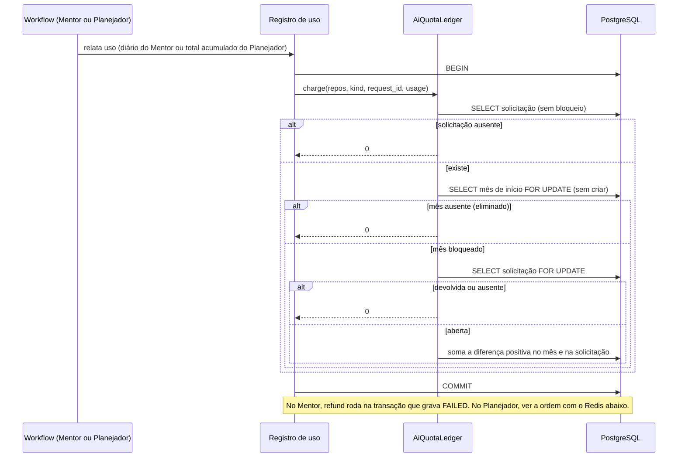

# Objective

Entregar a cota mensal de IA compartilhada por Mentor e planejamento assistido, do motor à interface. O servidor mede o uso, guarda o consumo por conta e mês, bloqueia novos inícios a partir de 100% e devolve o uso de falhas. A Web mostra o percentual e a renovação na aba "Uso da IA", no indicador do cabeçalho e nos pontos onde a IA é iniciada.

A entrega cobre toda a história SHIFU-54 e a tarefa SHIFU-118. Hoje não existe motor de cota. `MentorAccessProvider.record_usage` só confere a conta, o Planejador não registra uso e o cabeçalho do Mentor mostra um botão desativado "IA · indisponível".

Modo complete. O risco material está na concorrência entre admissões e cobranças, na nova persistência com migração, na idempotência de relatórios repetidos, na eliminação por encerramento de conta e na integração em quatro superfícies Web.

# Scope

| Area / actor | Included | Excluded or deferred |
| --- | --- | --- |
| Motor de cota (Sistema) | Uma cota mensal por conta, igual para todos, com limite e pesos configurados. Mês civil em America/Sao_Paulo, renovado no dia 1. Unidades ponderadas por tokens de entrada e saída. Cobrança por diferença, idempotente, com devolução em falhas. | Desconto por cache de prompt, cotas por plano, renovação por data de cadastro, limite editável pelo usuário ou por tela administrativa. |
| Admissão (Usuário, Sistema) | Bloqueio a partir de 100% em: nova mensagem do Mentor, nova tentativa do Mentor, novo planejamento, reinício e nova tentativa de planejamento. | Bloqueio de respostas a um planejamento em andamento e de etapas internas já iniciadas. |
| Medição (Sistema) | Respostas do Mentor, incluindo revisão e leitura de anexos durante a resposta. Entrevista e proposta do Planejador. | Títulos, resumos, análise de memória, avaliação de código de Learning e classificação de intenção sem modelo. Tarefas de fundo não descontam. |
| Leitura (Usuário) | `GET /intelligence/ai-quota` com percentual inteiro, status e data de renovação, apenas da conta autenticada. | Exposição de unidades, limite absoluto, custo ou histórico. |
| Web — Sua conta (Usuário) | Aba "Uso da IA" em `/account/ai-usage`, entre Segurança e Excluir conta, com estados normal, perto do limite, esgotado e indisponível. | Outras informações além de percentual e renovação. |
| Web — Cabeçalho (Usuário) | Indicador "IA · N%" nos cabeçalhos desktop e mobile, com link para a página. Remoção do botão provisório do cabeçalho do Mentor. | Indicador em telas públicas. |
| Web — Mentor (Usuário) | Aviso a partir de 80%, dispensável até o fim do mês. Em 100%, envio, anexos, ditado e "Tentar novamente" bloqueados com cartão explicativo. Histórico, renomear e excluir continuam. | Mudanças no fluxo de resposta além do bloqueio. |
| Web — Início e Planejador (Usuário) | Em 100%, "Planejar com IA" bloqueado no Início; "Tentar novamente" e "Reiniciar planejamento" bloqueados no Planejador. "Criar manualmente", "Cancelar" e "Criar objetivo" continuam. | Atalho novo para criação manual dentro do Planejador. |
| Encerramento de conta (Sistema) | Job que elimina os dados de cota ao receber o evento de conta excluída. | Limpeza de meses antigos de contas ativas. |
| Correções de design | Abas de Sua conta e botão de menu mobile com 44 px. | Outras revisões visuais fora das telas listadas. |

Cobertura do PRD de Intelligence versão 10:

- **RP-02:** full.
- **JN-06:** full.
- **RP-01:** partial, apenas "medir e controlar o uso de IA".
- **RP-06:** partial, apenas o bloqueio por cota de novas mensagens e novas tentativas.
- **RP-07:** partial, apenas o bloqueio por cota do planejamento assistido.
- **RP-11:** partial, apenas a eliminação do consumo vinculado ao usuário no encerramento da conta.
- **RP-12:** partial, apenas os estados de cota responsivos, acessíveis e em pt-BR.

As telas afetadas estão no arquivo Shifu do Penpot, nas páginas "🖥️ Desktop" e "📱 Mobile", listadas em [Design Contract](#design-contract).

# Behavior Contract

| ID | RP/JN/source coverage | Observable required behavior |
| --- | --- | --- |
| RF-01 | RP-02, RP-01; SHIFU-54 CA-01 | Mentor e Planejador compartilham uma única cota mensal por conta, igual para todas as contas. O limite em unidades e os pesos de entrada e saída são configurações obrigatórias do servidor. O mês é o mês civil em America/Sao_Paulo e renova no dia 1. O limite vigente é copiado no primeiro registro do mês e vale até o fim desse mês. |
| RF-02 | RP-02, RP-06, RP-07, JN-06; SHIFU-54 CA-02, CA-03, CA-05 | Um início verificado é recusado quando as unidades usadas no mês atingem o limite. Inícios verificados: nova mensagem do Mentor (inclusive a primeira mensagem de uma conversa nova), nova tentativa do Mentor, novo planejamento, reinício e nova tentativa de planejamento. A recusa não cria mensagem, tentativa, planejamento nem evento. Respostas a um planejamento em andamento nunca são recusadas. Uma operação iniciada abaixo do limite termina mesmo que ultrapasse 100%. Dois inícios simultâneos abaixo do limite podem ambos seguir. |
| RF-03 | RP-02; SHIFU-54 CA-04, CA-05, CA-06 | Contam: respostas do Mentor, inclusive revisão e leitura de anexos durante a resposta, e entrevista e proposta do Planejador. Não contam: títulos, resumos, análise de memória e avaliação de código de Learning. Cada chamada vale tokens de entrada × peso de entrada + tokens de saída × peso de saída, e o total da solicitação é arredondado para cima. Relatórios repetidos não cobram de novo. A cobrança vai sempre para o mês em que a solicitação começou. Um relatório só com total cobra o total pelo peso de entrada e registra aviso. Uma chamada sem contagem, onde hoje é tolerada, custa zero e registra aviso. |
| RF-04 | RP-02, RP-06; SHIFU-54 CA-04 | Uma solicitação que falha é devolvida integralmente. Isso inclui falha do Mentor, resposta expirada ou parada pelo limite por hora, falha ou expiração do planejamento e proposta reprovada na validação. Cancelamento voluntário mantém o uso ocorrido, inclusive o relatado depois do cancelamento enquanto o processamento termina. Respostas concluídas, fora de escopo e sem suporte mantêm a cobrança. Relatórios de uma solicitação devolvida ou inexistente são ignorados. |
| RF-05 | RP-02, JN-06, RP-11; SHIFU-118 | `GET /intelligence/ai-quota` devolve, só para a conta autenticada, o percentual inteiro arredondado para baixo (pode passar de 100), a data de renovação em ISO 8601 e o status: `normal` abaixo de 80, `near_limit` a partir de 80 e `blocked` quando o uso atinge o limite. Sem registro no mês, devolve 0% e `normal`. |
| RF-06 | RP-02, JN-06, RP-12; SHIFU-118 | Sua conta ganha a aba "Uso da IA" em `/account/ai-usage`, entre Segurança e Excluir conta. A página mostra apenas o percentual (numeral e barra de progresso), "da cota usada", a data de renovação por extenso (por exemplo "1º de dezembro de 2026") e uma frase por status, com o texto dos quadros do Penpot. Em erro, mostra o estado indisponível com "Tentar novamente". Os cabeçalhos desktop e mobile mostram o indicador com link para a página, nos estados normal, perto do limite, esgotado e indisponível. O indicador não aparece durante o primeiro carregamento. |
| RF-07 | RP-02, RP-06, JN-06, RP-12 | No Mentor, a partir de 80% e abaixo de 100%, o cartão de aviso aparece acima do compositor. o botão de fechar do cartão (ícone X com nome acessível "Dispensar aviso") o esconde até o fim do mês, por conta, neste navegador. Em 100%, o cartão de bloqueio aparece e não pode ser fechado. Envio, anexos, ditado e "Tentar novamente" ficam desativados, e o campo mostra "Envio pausado até a renovação da cota". Ler o histórico, renomear e excluir conversas continuam. O botão provisório "IA · indisponível" do cabeçalho do Mentor deixa de existir. |
| RF-08 | RP-02, RP-07, JN-06 | Em 100%, o Início desativa o campo e "Planejar com IA" e mostra o cartão de bloqueio, mantendo "Criar manualmente". No Planejador, "Tentar novamente" das falhas e "Reiniciar planejamento" da proposta ficam desativados com o cartão de bloqueio, mantendo "Cancelar" e "Criar objetivo". |
| RF-09 | RP-02, RP-12 | Se a leitura falhar, indicador e página mostram indisponível e os compositores continuam ativos, porque o servidor decide. Uma recusa 429 por cota em qualquer início mostra o cartão de bloqueio, não o erro genérico, e atualiza a leitura. A leitura também se atualiza ao montar, ao recuperar o foco da janela e ao terminar uma resposta do Mentor. |
| RF-10 | RP-11; SHIFU-54 CA-07 | Quando a conta é excluída, todos os registros de cota da conta são eliminados. Relatórios tardios dessa conta não recriam registros. |
| RF-11 | RP-12 | Todos os estados de cota funcionam em desktop e mobile, em pt-BR, operáveis por teclado e sem depender só de cor. Botões desativados continuam visíveis e focáveis e apontam ao texto do cartão de bloqueio. As abas de Sua conta e o botão de menu mobile têm 44 px de altura. |

| ID | RF coverage | Given | When | Then | Checks |
| --- | --- | --- | --- | --- | --- |
| CA-01 | RF-01 | O limite e os pesos estão configurados e a conta não tem registro no mês | Um início verificado acontece em 15/11 às 23h30 de São Paulo | O registro de novembro é criado com o limite vigente e a renovação é 1º de dezembro | CI-01 / CI-03 |
| CA-02 | RF-01 | Um dos três valores obrigatórios falta ou é zero | O servidor inicia | A inicialização falha com erro de configuração | VM-10 |
| CA-03 | RF-02 | O uso do mês é igual ou maior que o limite | A conta envia mensagem, tenta de novo no Mentor, inicia, reinicia ou tenta de novo um planejamento | A resposta é 429 com `ai_quota_exhausted` e nenhuma mensagem, tentativa, planejamento ou evento é criado | CI-01 / CI-03 |
| CA-04 | RF-02 | O uso está acima do limite e há planejamento em entrevista | A conta envia respostas | As respostas são aceitas e o planejamento continua | CI-01 / CI-03 |
| CA-05 | RF-02 | O uso está em 99% | Duas mensagens são enviadas ao mesmo tempo | Ambas são aceitas e as cobranças finais somam corretamente, sem perda de atualização | CI-03 |
| CA-06 | RF-03 | Uma resposta do Mentor relata chamadas com entrada e saída | O registro de uso é chamado e repetido com o mesmo diário | O mês recebe o total ponderado arredondado para cima uma única vez | CI-01 |
| CA-07 | RF-03 | O Planejador relata o total acumulado após entrevista e proposta | Uma repetição interna reinicia a contagem | Diferenças negativas são ignoradas e o primeiro gasto permanece | CI-01 / CI-04 |
| CA-08 | RF-03 | Uma resposta começou em 31/10 às 23h59 de São Paulo | O relatório chega em 1º/11 | A cobrança vai para outubro | CI-01 / CI-03 |
| CA-09 | RF-03 | Títulos, resumos, análise de memória ou avaliação de Learning rodam | Seus usos são registrados | Nenhuma unidade é cobrada | CI-01 |
| CA-10 | RF-03 | Uma chamada relata apenas o total, ou nenhuma contagem onde isso é tolerado | O uso é registrado | O total usa o peso de entrada, a chamada sem contagem custa zero e ambas registram aviso | CI-01 |
| CA-11 | RF-04 | Uma solicitação acumulou cobranças | Ela falha, expira, é parada pelo limite por hora ou é reprovada na validação | O mês perde exatamente o valor cobrado e a solicitação fica devolvida | CI-01 / CI-03 |
| CA-12 | RF-04 | Uma solicitação foi cancelada, concluída, fora de escopo ou sem suporte | O processamento termina | A cobrança permanece, inclusive uso relatado após o cancelamento | CI-01 |
| CA-13 | RF-04 | Uma solicitação foi devolvida ou não existe | Chega um relatório de uso | Nada é cobrado | CI-01 |
| CA-14 | RF-05 | A conta usou 41,9%, 80%, 100% ou 130% | Ela lê `GET /intelligence/ai-quota` | Recebe 41/normal, 80/near_limit, 100/blocked ou 130/blocked, com a renovação correta | CI-01 / CI-03 |
| CA-15 | RF-05 | Duas contas têm usos diferentes, ou a requisição não tem sessão | A leitura é feita | Cada conta vê só o próprio uso e a requisição sem sessão recebe 401 | CI-03 |
| CA-16 | RF-06 | A conta está autenticada | Abre a aba ou clica no indicador | A página mostra o estado correspondente e as demais abas continuam | CI-07 / CI-09 / VM-01 / VM-05 |
| CA-17 | RF-06, RF-09 | A leitura falha | A página e o cabeçalho renderizam | Ambos mostram indisponível e "Tentar novamente" refaz a leitura | CI-07 / VM-05 |
| CA-18 | RF-07 | O uso está em 85% | A conta dispensa o aviso e recarrega | O aviso continua oculto no mês e volta quando a chave do mês não existe | CI-07 / VM-02 / VM-06 |
| CA-19 | RF-07 | O uso está em 100% | A conta abre uma conversa com resposta falha | Envio, anexos, ditado e "Tentar novamente" estão desativados com o cartão e histórico, renomear e excluir funcionam | CI-07 / VM-03 / VM-06 |
| CA-20 | RF-08 | O uso está em 100% | A conta abre o Início e o Planejador | "Planejar com IA", "Tentar novamente" e "Reiniciar planejamento" estão desativados e "Criar manualmente", "Cancelar" e "Criar objetivo" funcionam | CI-07 / VM-04 / VM-07 / VM-08 |
| CA-21 | RF-09 | A leitura mostra 79% mas o servidor já está em 100% | A conta envia uma mensagem ou inicia um planejamento | O 429 mostra o cartão de bloqueio sem toast genérico e a leitura é refeita | CI-07 / CI-09 |
| CA-22 | RF-10 | A conta tem registros de cota | O evento de conta excluída é processado, uma ou duas vezes | Não restam registros da conta e um relatório tardio não recria nenhum | CI-01 / CI-05 |
| CA-23 | RF-11 | Qualquer estado de cota | A conta navega por teclado e leitor de tela em 1440×900 e 390×844 | Todos os estados têm texto e os de aviso e bloqueio também têm ícone, botões desativados são focáveis e descritos e alvos mobile têm 44 px | CI-07 / CI-09 / VM-01–VM-04 |
| CA-24 | RF-01, RF-03 | Uma resposta real do Mentor termina | A conta relê a página de uso | O percentual aumenta e os registros persistidos conferem com a página | VM-09 |

## Design Contract

Fonte: arquivo Shifu do Penpot, lido e exportado apenas pela Penpot MCP. Desktop em 1440×900 e mobile em 390×844. Os quadros mais altos que a janela (proposta do Planejador) representam a página inteira rolada.

| Surface / route | State / viewport | Penpot page / board / components | CA / Visual check | Allowed deviations |
| --- | --- | --- | --- | --- |
| `/account/ai-usage` | Normal, Perto do limite, Cota esgotada, Indisponível; desktop | 🖥️ Desktop / grupo "Sua conta / Uso da IA" / "Sua conta / Uso da IA — <estado> / Desktop"; componentes Quota card, Account tabs, App header, AI quota indicator | CA-16, CA-17 / VM-05 | Data de renovação conforme o mês real |
| `/account/ai-usage` | os mesmos quatro; mobile | 📱 Mobile / "Sua conta / Uso da IA — <estado> / Mobile"; Mobile header, Account tabs | CA-16, CA-17 / VM-05 | Idem |
| `/` (Início) | Normal e Cota esgotada; desktop e mobile | grupo "Objetivos / Início" / "Objetivos / Início — Normal" e "— Cota esgotada" / Desktop e Mobile; Quota blocked card / Inline e / Stacked | CA-20 / VM-07 | Objetivos reais da conta |
| `/intelligence` (Mentor) | Normal, Perto do limite; desktop e mobile | grupo "Mentor / Nova conversa" / "— Normal" e "— Perto do limite"; Quota warning card | CA-18 / VM-06 | Conversas reais no histórico |
| `/intelligence` (Mentor) | Cota esgotada com resposta falha; desktop e mobile | "Mentor / Conversa — Cota esgotada / Desktop" e "/ Mobile"; Quota blocked card | CA-19 / VM-06 | Texto real das mensagens |
| `/intelligence/planner/$planningId` | Falha com cota esgotada; desktop e mobile | grupo "Planejamento / Planejador" / "Planejamento / Falha — Cota esgotada / Desktop" e "/ Mobile" | CA-20 / VM-08 | Intenção real |
| `/intelligence/planner/$planningId` | Proposta com cota esgotada; desktop e mobile | "Planejamento / Proposta — Cota esgotada / Desktop" e "/ Mobile" | CA-20 / VM-08 | Proposta real; pontilhado do fundo do grafo, que o Penpot não desenha |
| Cabeçalhos | Indicador em todos os estados | 🧩 Components / "AI quota indicator" (State = Normal, Near-limit, Blocked, Unavailable); "App header"; "Mobile header" | CA-16, CA-23 / VM-05–VM-08 | Nenhuma |

Componentes de referência na página 🧩 Components: "AI quota indicator", "Quota card", "Quota warning card", "Quota blocked card / Inline", "Quota blocked card / Stacked", "Account tabs", "Tab", "App header" e "Mobile header".

Mapeamento visual para tokens existentes, sem cores novas:

- **Cartões de aviso e bloqueio:** fundo `bg-accent` (`--accent`, #3d1414), borda `border-primary/45`, texto `text-selo-text` (`--selo-text`), raio `rounded-xl`, ícone de 16 px. O cartão de bloqueio tem o link "Ver uso da IA" com texto `text-foreground` sublinhado e alvo de 44 px; o cartão de aviso tem, em vez do link, um botão de fechar só com ícone X (nome acessível "Dispensar aviso", alvo de 44 px). Medidas dos quadros: bloqueio inline com 52 px de altura no desktop e empilhado com cerca de 115 px no mobile, com o link alinhado ao texto; aviso com 74 px no desktop e cerca de 135 px no mobile.
- **Indicador:** estados normal em `text-muted-foreground`; perto do limite e esgotado em `text-selo-text` com ícone `triangle-alert` ou `circle-pause`; indisponível em `text-muted-foreground`. Fonte mono do cabeçalho existente. Os estados normal e indisponível não têm ícone, só o texto "IA · N%" e "IA · indisponível". O ícone `circle-pause` ainda não existe no componente `Icon` e entra nesta entrega a partir do `CirclePause` do lucide.
- **Botões bloqueados pela cota:** variantes atuais de `Button` com `aria-disabled="true"`. O `Button` compartilhado ganha estilos `aria-disabled:` iguais aos atuais `disabled:`, sem nova variante.
- **Abas de Sua conta:** `min-h-11` em mobile e desktop.
- **Botão de menu mobile:** `size-11`.

Textos dos cartões, conforme os quadros do Penpot. `<data>` é a renovação por extenso, com ordinal no dia 1 ("1º de dezembro de 2026"):

| Superfície | Texto do cartão |
| --- | --- |
| Aviso no Mentor (80% a 99%) | "Você já usou <N>% da sua cota de IA deste mês. Quando ela acabar, o Mentor e o planejamento assistido pausam até <data>." |
| Bloqueio no Mentor | "Sua cota de IA acabou. Novas mensagens e novas tentativas voltam em <data>. Seu histórico continua disponível." |
| Bloqueio no Início | "Sua cota de IA acabou. O planejamento com IA volta em <data>. Você pode criar um Objetivo manualmente agora." |
| Bloqueio no Planejador (falha) | "Sua cota de IA acabou. Novas tentativas voltam em <data>. Você ainda pode cancelar e criar um Objetivo manualmente." |
| Bloqueio no Planejador (proposta) | "Sua cota de IA acabou. Reiniciar o planejamento volta em <data>. Você ainda pode criar este Objetivo agora." |
| Página, normal | "O Mentor e o planejamento assistido estão disponíveis." |
| Página, perto do limite | "Perto do limite. Quando a cota acabar, o Mentor e o planejamento assistido pausam até a renovação." |
| Página, cota esgotada | "Cota esgotada. O Mentor e o planejamento assistido voltam em <data>. Seus Objetivos e Atividades continuam disponíveis." |
| Página, indisponível | "Não foi possível carregar o uso da IA agora. Tente de novo em instantes." com botão "Tentar novamente" |

A página mostra também o subtítulo "Quanto da sua cota mensal de IA você já usou." e a barra de progresso de 8 px.

Interface preservada: navegação principal, menu da conta, botão flutuante do Mentor, histórico de conversas, grafo e lista da proposta, e todo o fluxo sem IA.

# Technical Contract

## Architecture Mapping

Owner: Intelligence. Rules: [Python Conventions](../../../rules/python-conventions-rules.md), [Core Layer](../../../rules/core-layer-rules.md), [Use Case Testing](../../../rules/use-case-testing-rules.md), [Database Layer](../../../rules/database-layer-rules.md), [REST Layer](../../../rules/rest-layer-rules.md), [Controllers Testing](../../../rules/controllers-testing-rules.md), [Provision Layer](../../../rules/provision-layer-rules.md), [Messaging Layer](../../../rules/messaging-layer-rules.md), [Jobs Testing](../../../rules/jobs-testing-rules.md), [AI Layer](../../../rules/ai-layer-rules.md), [Server App Layer](../../../rules/server-app-layer-rules.md), [TypeScript Conventions](../../../rules/typescript-conventions-rules.md), [UI Layer](../../../rules/ui-layer-rules.md), [Web App Routing](../../../rules/web-app-routing-rules.md), [Widget Testing](../../../rules/widget-testing-rules.md).

| Action | Boundary | Element / Path | Required change |
| --- | --- | --- | --- |
| Create | Core domain | `AiQuotaMonth`, `AiQuotaCharge` em `intelligence/core/domain/entities/` | Entidades do mês e da solicitação, com transições de cobrança e devolução. |
| Create | Core domain | `AiQuotaStatus`, `AiQuotaRequestKind` em `domain/enums/` | Status lido e tipo de solicitação. |
| Create | Core domain | `AiQuotaUsage`, `AiQuotaPolicy`, `AiTokenCount` em `domain/structures/` | Leitura, configuração e contagem de tokens. |
| Create | Core domain | `AiQuotaExhaustedError` em `domain/errors/` | Erro pt-BR de recusa por cota. |
| Create | Core ports | `AiQuotaMonthsRepository`, `AiQuotaChargesRepository`, `AiQuotaCalendarProvider` em `core/interfaces/` | Persistência com bloqueio e calendário de São Paulo. Exportados no `__init__`. |
| Modify | Core ports | `IntelligenceDatabase`/`IntelligenceDatabaseRepositories` em `core/interfaces/intelligence_database.py` | Novos campos `ai_quota_months` e `ai_quota_charges`. |
| Create | Core use cases | `AiQuotaLedger` em `core/use_cases/ai_quota_ledger.py` | Classe auxiliar, não um caso de uso. Cada caso de uso consumidor a constrói internamente a partir de `AiQuotaPolicy`, `AiQuotaCalendarProvider` e `ClockProvider`, como já acontece com `MentorActionPlanner`. Admite, registra, cobra e devolve dentro da transação do chamador. Sem arquivo de teste próprio. |
| Create | Core use cases | `GetAiQuotaUsageUseCase`, `RecordPlanningInferenceUsageUseCase`, `PurgeAiQuotaForAccountUseCase` | Leitura, cobrança do Planejador e eliminação. |
| Modify | Core use cases | `CreateMentorSessionUseCase`, `SubmitMentorMessageUseCase`, `RetryMentorResponseUseCase`, `StartPlanningUseCase`, `RestartPlanningUseCase`, `RetryPlanningUseCase` | Recebem `quota_policy` e `quota_calendar`, constroem o ledger e admitem antes de criar estado. |
| Modify | Core use cases | `AnswerPlanningQuestionsUseCase` | Recebe `database`, `quota_policy` e `quota_calendar` e registra a nova operação sem verificar o limite. |
| Modify | Core use cases | `RecordMentorInferenceUsageUseCase` | Recebe `quota_policy` e `quota_calendar` e cobra a diferença do diário na mesma transação. |
| Modify | Core use cases | `FailMentorResponseUseCase`, `ProcessMentorResponseUseCase` (falha interna) | Recebem `quota_policy` e `quota_calendar` e devolvem na mesma transação de cada passagem para `FAILED`. |
| Modify | Core use cases | `CompletePlanningOperationUseCase`, `GetPlanningSessionUseCase` | Passam a depender também de `IntelligenceDatabase`, `quota_policy` e `quota_calendar`. Devolvem falha, reprovação na validação e expiração na ordem definida em [Runtime Flow](#runtime-flow). |
| Modify | REST e composição | `rest/controllers/get_planning_session_controller.py`, `answer_planning_questions_controller.py`, `create_mentor_session_controller.py`, `submit_mentor_message_controller.py`, `retry_mentor_response_controller.py`, `start_planning_controller.py`, `restart_planning_controller.py`, `retry_planning_controller.py`, `ai/intelligence_workflows_registry.py` | Passam banco, política e calendário aos casos de uso que constroem. |
| Create | Database | modelos, mapeadores e repositórios SQLAlchemy de `intelligence_ai_quota_months` e `intelligence_ai_quota_charges` | `SqlalchemyAiQuotaMonthsRepository` e `SqlalchemyAiQuotaChargesRepository`, com `SELECT … FOR UPDATE`. |
| Modify | Database | `intelligence/database/sqlalchemy/intelligence_database.py` e `repositories/__init__.py` | Expõem os dois repositórios. |
| Create | Database | revisão Alembic gerada por `uv run alembic revision -m "add intelligence ai quota"` | Duas tabelas, chaves, verificações e índice. O nome do arquivo vem do comando. |
| Create | Provider | `ZoneinfoAiQuotaCalendarProvider` em `intelligence/providers/ai_quota_calendar/zoneinfo/` | Mês e renovação em America/Sao_Paulo. Sem teste próprio. As bordas de mês são provadas pelos controladores com relógio controlado. |
| Modify | Settings | `Settings` em `shared/settings.py`, `apps/server/.env.example`, `iac/staging/locals.tf`, `.github/workflows/server-app-ci.yaml` (todos os jobs que iniciam a aplicação ou chamam `get_settings`, inclusive evals), `.github/workflows/web-app-ci.yaml` (jobs cujo Playwright inicia a API real) | Três valores obrigatórios. CI usa os mesmos valores de teste: 1000, 1 e 4. |
| Modify | Test setup | `apps/server/tests/conftest.py` | Atribui os três valores com `os.environ[...] =` antes de importar a aplicação, para que os testes não dependam do ambiente local. |
| Modify | Composition | `intelligence/pipes/intelligence_pipe.py`, `app.py`, `intelligence/ai/intelligence_workflows_registry.py` | Política e calendário em `app.state` e no registro de workflows. O ledger não fica no estado da aplicação. |
| Create | REST | `GetAiQuotaUsageController` em `rest/controllers/get_ai_quota_usage_controller.py` | `GET /intelligence/ai-quota`. |
| Modify | REST | `rest/router.py`, `rest/intelligence_error_handler.py` | Registra a rota e mapeia `AiQuotaExhaustedError` para 429. |
| Modify | REST examples | `apps/server/rest-client/intelligence/intelligence.rest` | Exemplo da leitura. |
| Create | Messaging | `PurgeAiQuotaOnAccountDeletedJob` em `messaging/inngest/jobs/` | Consome o evento de conta excluída. |
| Modify | Messaging | `messaging/inngest/intelligence_inngest_messaging.py`, `shared/core/interfaces/telemetry_provider.py`, `shared/messaging/inngest/job_lifecycle_telemetry.py`, `shared/providers/console_telemetry_provider/console_telemetry_provider.py` | Registro e identificação do job. |
| Modify | AI | `ai/agno/workflows/plan_goal_workflow.py` | Relata o total acumulado após cada execução de entrevista e proposta. |
| Modify | Web core | `core/intelligence/ai-quota-usage.ts` [N], `core/intelligence/ai-quota-warning-dismissal-store.ts` [N], `core/intelligence/fakers/ai-quota-usage-faker.ts` [N] | Tipo, porta de armazenamento e faker. |
| Create | Web provision | `provision/intelligence/local-storage-ai-quota-warning-dismissal-store.ts` | Adaptador `localStorage`. |
| Modify | Web REST | `rest/services/intelligence-service.ts` | `getAiQuotaUsage`. |
| Create | Web hook | `ui/intelligence/hooks/use-ai-quota-usage-query.ts` | Consulta compartilhada e sua função de servidor. |
| Create | Web widgets | página `ai-usage-page`, componentes `ai-quota-indicator`, `ai-quota-warning-card`, `ai-quota-blocked-card` | Ver árvore. |
| Modify | Web widgets | compositor do Mentor, `response-status`, `mentor-chat/header`, `planning-intent-composer`, `planner-page`, `planning-proposal-review`, `account-navigation`, `desktop-header`, `mobile-header` | Ver árvore. |
| Modify | Web hooks | `use-submit-mentor-message-action.ts`, `use-retry-mentor-response-action.ts`, `use-start-planning-action.ts`, `use-restart-planning-action.ts`, `use-retry-planning-action.ts`, `planning-request-error.ts`, `use-mentor-response-stream.ts` | As funções de servidor convertem o 429 por cota em uma falha tipada devolvida como dado. Ver [Web](#web). |
| Modify | Web core e provision | `core/intelligence/planning-session.ts` (`PLANNING_FAILURE_KINDS` ganha `quota-exhausted`), `provision/planning/planning-server-provider.ts` (`planningFailure` reconhece `RestError` 429 com código `ai_quota_exhausted`) | Classificação do Planejador. |
| Modify | Web context | `ui/intelligence/contexts/mentor-context/use-mentor-context-provider.ts` | Trata a falha tipada de envio e nova tentativa: marca o bloqueio, não mostra a mensagem genérica e invalida a consulta. |
| Modify | Web shared | `ui/shadcn/button.tsx` | Variantes ganham estilo `aria-disabled:` igual ao `disabled:` atual, para botões bloqueados que continuam focáveis. |
| Modify | Web widgets | `planner-page/planning-proposal-review/restart-planning-dialog/` | A confirmação do reinício trata a falha tipada de cota. |
| Create / Modify | Web routes | `routes/account/ai-usage/index.tsx` [N], `constants/routes.ts`, `routeTree.gen.ts` (gerado) | Rota autenticada. |
| Modify | Web shared | `ui/shared/widgets/components/icon/index.tsx` | Novo nome `circle-pause` mapeado para `CirclePause`. |

### Expected file tree

```text
apps/server/
├── .env.example                                                         [M]
├── migrations/versions/<revisão gerada>_add_intelligence_ai_quota.py   [N] (nome gerado pelo Alembic)
├── rest-client/intelligence/intelligence.rest                          [M]
├── src/shifu/
│   ├── app.py                                                           [M]
│   ├── shared/
│   │   ├── settings.py                                                  [M]
│   │   ├── core/interfaces/telemetry_provider.py                        [M]
│   │   ├── messaging/inngest/job_lifecycle_telemetry.py                 [M]
│   │   └── providers/console_telemetry_provider/console_telemetry_provider.py [M]
│   └── intelligence/
│       ├── core/
│       │   ├── domain/
│       │   │   ├── entities/ai_quota_month.py                           [N]
│       │   │   ├── entities/ai_quota_charge.py                          [N]
│       │   │   ├── enums/ai_quota_status.py                             [N]
│       │   │   ├── enums/ai_quota_request_kind.py                       [N]
│       │   │   ├── structures/ai_quota_usage.py                         [N]
│       │   │   ├── structures/ai_quota_policy.py                        [N]
│       │   │   ├── structures/ai_token_count.py                         [N]
│       │   │   └── errors/ai_quota_exhausted_error.py                   [N]
│       │   │   (e os __init__.py de cada pacote)                        [M]
│       │   ├── interfaces/
│       │   │   ├── ai_quota_months_repository.py                        [N]
│       │   │   ├── ai_quota_charges_repository.py                       [N]
│       │   │   ├── ai_quota_calendar_provider.py                        [N]
│       │   │   ├── intelligence_database.py                             [M]
│       │   │   └── __init__.py                                          [M]
│       │   └── use_cases/
│       │       ├── ai_quota_ledger.py                                   [N]
│       │       ├── get_ai_quota_usage_use_case.py                       [N]
│       │       ├── record_planning_inference_usage_use_case.py          [N]
│       │       ├── purge_ai_quota_for_account_use_case.py               [N]
│       │       ├── record_mentor_inference_usage_use_case.py            [M]
│       │       ├── create_mentor_session_use_case.py                    [M]
│       │       ├── submit_mentor_message_use_case.py                    [M]
│       │       ├── retry_mentor_response_use_case.py                    [M]
│       │       ├── fail_mentor_response_use_case.py                     [M]
│       │       ├── process_mentor_response_use_case.py                  [M]
│       │       ├── start_planning_use_case.py                           [M]
│       │       ├── restart_planning_use_case.py                         [M]
│       │       ├── retry_planning_use_case.py                           [M]
│       │       ├── answer_planning_questions_use_case.py                [M]
│       │       ├── complete_planning_operation_use_case.py              [M]
│       │       ├── get_planning_session_use_case.py                     [M]
│       │       └── __init__.py                                          [M]
│       ├── database/sqlalchemy/
│       │   ├── intelligence_database.py                                 [M]
│       │   ├── models/ai_quota_month_model.py                           [N]
│       │   ├── models/ai_quota_charge_model.py                          [N]
│       │   ├── mappers/ai_quota_month_mapper.py                         [N]
│       │   ├── mappers/ai_quota_charge_mapper.py                        [N]
│       │   ├── repositories/ai_quota_months_repository.py               [N]
│       │   ├── repositories/ai_quota_charges_repository.py              [N]
│       │   └── (os __init__.py de models, mappers e repositories)        [M]
│       ├── providers/ai_quota_calendar/
│       │   ├── __init__.py                                              [N]
│       │   └── zoneinfo/
│       │       ├── __init__.py                                          [N]
│       │       └── zoneinfo_ai_quota_calendar_provider.py               [N]
│       ├── pipes/intelligence_pipe.py                                   [M]
│       ├── rest/
│       │   ├── controllers/get_ai_quota_usage_controller.py             [N]
│       │   ├── controllers/get_planning_session_controller.py           [M]
│       │   ├── controllers/answer_planning_questions_controller.py      [M]
│       │   ├── controllers/create_mentor_session_controller.py          [M]
│       │   ├── controllers/submit_mentor_message_controller.py          [M]
│       │   ├── controllers/retry_mentor_response_controller.py          [M]
│       │   ├── controllers/start_planning_controller.py                 [M]
│       │   ├── controllers/restart_planning_controller.py               [M]
│       │   ├── controllers/retry_planning_controller.py                 [M]
│       │   ├── controllers/__init__.py                                  [M] (se exportar controladores)
│       │   ├── router.py                                                [M]
│       │   └── intelligence_error_handler.py                            [M]
│       ├── messaging/inngest/
│       │   ├── jobs/purge_ai_quota_on_account_deleted_job.py            [N]
│       │   ├── jobs/__init__.py                                         [M]
│       │   └── intelligence_inngest_messaging.py                        [M]
│       └── ai/
│           ├── agno/workflows/plan_goal_workflow.py                     [M]
│           └── intelligence_workflows_registry.py                       [M]
└── tests/
    ├── conftest.py                                                      [M] valores de cota de teste
    ├── intelligence/core/use_cases/
    │   ├── test_get_ai_quota_usage_use_case.py                          [N]
    │   ├── test_record_planning_inference_usage_use_case.py             [N]
    │   ├── test_purge_ai_quota_for_account_use_case.py                  [N]
    │   ├── test_record_mentor_inference_usage_use_case.py               [M]
    │   ├── test_create_mentor_session_use_case.py                       [M]
    │   ├── test_submit_mentor_message_use_case.py                       [M]
    │   ├── test_retry_mentor_response_use_case.py                       [M]
    │   ├── test_fail_mentor_response_use_case.py                        [M]
    │   ├── test_fail_stale_mentor_response_use_case.py                  [M]
    │   ├── test_process_mentor_response_use_case.py                     [M]
    │   ├── test_start_planning_use_case.py                              [M]
    │   ├── test_restart_planning_use_case.py                            [M]
    │   ├── test_retry_planning_use_case.py                              [M]
    │   ├── test_answer_planning_questions_use_case.py                   [M]
    │   ├── test_complete_planning_operation_use_case.py                 [M]
    │   └── test_get_planning_session_use_case.py                        [M]
    ├── intelligence/server/controllers/
    │   ├── test_get_ai_quota_usage_controller.py                        [N]
    │   ├── test_retry_mentor_response_controller.py                     [N]
    │   ├── test_create_mentor_session_controller.py                     [N]
    │   ├── test_submit_mentor_message_controller.py                     [M]
    │   ├── test_start_planning_controller.py                            [M]
    │   ├── test_restart_planning_controller.py                          [M]
    │   ├── test_retry_planning_controller.py                            [M]
    │   ├── test_get_planning_session_controller.py                      [M]
    │   └── test_answer_planning_questions_controller.py                 [M]
    ├── intelligence/ai/workflows/test_plan_goal_workflow.py             [M]
    └── messaging/inngest/jobs/intelligence/test_purge_ai_quota_on_account_deleted_job.py [N]

apps/web/
├── src/
│   ├── constants/routes.ts                                              [M] accountAiUsage
│   ├── routes/account/ai-usage/index.tsx                                [N]
│   ├── routeTree.gen.ts                                                 [M] gerado por generate-routes
│   ├── core/intelligence/
│   │   ├── ai-quota-usage.ts                                            [N]
│   │   ├── ai-quota-warning-dismissal-store.ts                          [N]
│   │   ├── planning-session.ts                                          [M] quota-exhausted
│   │   └── fakers/ai-quota-usage-faker.ts                               [N]
│   ├── provision/
│   │   ├── intelligence/local-storage-ai-quota-warning-dismissal-store.ts [N]
│   │   └── planning/planning-server-provider.ts                         [M]
│   ├── rest/services/intelligence-service.ts                            [M]
│   └── ui/
│       ├── shadcn/button.tsx                                            [M] estilo aria-disabled
│       ├── intelligence/
│       │   ├── contexts/mentor-context/
│       │   │   ├── use-mentor-context-provider.ts                       [M]
│       │   │   └── tests/
│       │   │       ├── use-mentor-context-provider.test.ts              [M]
│       │   │       └── mentor-transport-consumer.test.tsx               [M]
│       │   ├── hooks/
│       │   │   ├── use-ai-quota-usage-query.ts                          [N]
│       │   │   ├── planning-request-error.ts                            [M]
│       │   │   ├── use-submit-mentor-message-action.ts                  [M]
│       │   │   ├── use-retry-mentor-response-action.ts                  [M]
│       │   │   ├── use-start-planning-action.ts                         [M]
│       │   │   ├── use-restart-planning-action.ts                       [M]
│       │   │   ├── use-retry-planning-action.ts                         [M]
│       │   │   └── use-mentor-response-stream.ts                        [M]
│       │   └── widgets/
│       │       ├── pages/ai-usage-page/
│       │       │   ├── index.tsx                                        [N]
│       │       │   ├── use-ai-usage-page.ts                             [N]
│       │       │   └── tests/
│       │       │       ├── ai-usage-page.test.tsx                       [N]
│       │       │       └── use-ai-usage-page.test.ts                    [N]
│       │       ├── components/
│       │       │   ├── ai-quota-indicator/
│       │       │   │   ├── index.tsx                                    [N]
│       │       │   │   ├── use-ai-quota-indicator.ts                    [N]
│       │       │   │   └── tests/
│       │       │   │       ├── ai-quota-indicator.test.tsx              [N]
│       │       │   │       └── use-ai-quota-indicator.test.ts           [N]
│       │       │   ├── ai-quota-warning-card/
│       │       │   │   ├── index.tsx                                    [N]
│       │       │   │   ├── use-ai-quota-warning-card.ts                 [N]
│       │       │   │   └── tests/
│       │       │   │       ├── ai-quota-warning-card.test.tsx           [N]
│       │       │   │       └── use-ai-quota-warning-card.test.ts        [N]
│       │       │   ├── ai-quota-blocked-card/index.tsx                  [N] (renderizador puro)
│       │       │   └── mentor-chat/
│       │       │       ├── header/index.tsx                             [M] remove o botão provisório
│       │       │       ├── conversation/composer/index.tsx              [M]
│       │       │       ├── conversation/composer/use-composer.ts        [M]
│       │       │       ├── conversation/composer/tests/composer.test.tsx [M]
│       │       │       ├── conversation/composer/tests/use-composer.test.ts [M]
│       │       │       ├── conversation/response-status/index.tsx       [M]
│       │       │       └── tests/mentor-chat.test.tsx                   [M]
│       │       ├── layouts/planning-intent-composer/
│       │       │   ├── index.tsx                                        [M]
│       │       │   ├── use-planning-intent-composer.ts                  [M]
│       │       │   └── tests/planning-intent-composer.test.tsx          [M]
│       │       └── pages/planner-page/
│       │           ├── index.tsx                                        [M]
│       │           ├── use-planner-page.ts                              [M]
│       │           ├── tests/planner-page.test.tsx                      [M]
│       │           ├── tests/use-planner-page.test.ts                   [M]
│       │           └── planning-proposal-review/
│       │               ├── index.tsx                                    [M]
│       │               ├── use-planning-proposal-review.ts              [M]
│       │               ├── restart-planning-dialog/index.tsx            [M]
│       │               ├── restart-planning-dialog/use-restart-planning-dialog.ts [M]
│       │               └── tests/
│       │                   ├── planning-proposal-review.test.tsx        [M]
│       │                   ├── use-planning-proposal-review.test.ts     [M]
│       │                   ├── restart-planning-dialog.test.tsx         [M]
│       │                   └── use-restart-planning-dialog.test.ts      [M]
│       ├── identity/widgets/layouts/account-layout/
│       │   ├── account-navigation/index.tsx                             [M] aba e 44 px
│       │   └── tests/account-layout.test.tsx                            [M]
│       └── shared/widgets/
│           ├── components/icon/index.tsx                                [M] circle-pause
│           └── layouts/app-layout/
│               ├── desktop-header/index.tsx                             [M] indicador
│               ├── desktop-header/tests/desktop-header.test.tsx         [M]
│               ├── mobile-header/index.tsx                              [M] indicador e menu 44 px
│               ├── mobile-header/tests/mobile-header.test.tsx           [M]
│               └── tests/app-layout.test.tsx                            [M]
└── tests/
    ├── support/identity-account-upstream.mjs                            [M] cenário de cota esgotada
    ├── intelligence/ai-usage-page.test.ts                               [N]
    ├── intelligence/intelligence-page.test.ts                           [M]
    ├── intelligence/planner-page.test.ts                                [M]
    ├── identity/account-layout.test.ts                                  [M]
    ├── shared/home-page.test.ts                                         [M]
    └── shared/app-layout.test.ts                                        [M]

.github/workflows/server-app-ci.yaml                                     [M]
.github/workflows/web-app-ci.yaml                                        [M]
iac/staging/locals.tf                                                    [M]
documentation/tooling.md                                                 [M]
documentation/architecture.md                                            [M] cota passa de adiada a implementada
```

### Conceitos novos

**Mês de cota (`AiQuotaMonth`).** É a fonte de verdade do uso visível. Pertence a Intelligence e existe uma linha por conta e mês. Guarda unidades usadas e o limite copiado das configurações quando a linha nasce. Exemplo: com limite 1.000.000 e 850.000 usadas, a leitura é 85% e `near_limit`. Toda admissão, cobrança e devolução bloqueia essa linha primeiro.

**Solicitação cobrada (`AiQuotaCharge`).** Representa uma solicitação de IA que pode gastar: uma tentativa de resposta do Mentor ou uma operação do Planejador. Nasce com zero unidades quando a solicitação começa. Guarda quanto já foi cobrado, o mês de início e se foi devolvida. Ela torna a cobrança idempotente: o novo total é comparado com o já cobrado e só a diferença positiva entra no mês. Exemplo: o diário soma 1.200 unidades e a linha tem 1.000, então o mês recebe 200.

**Livro da cota (`AiQuotaLedger`).** Classe auxiliar construída por cada caso de uso consumidor, sem transação própria. Recebe os repositórios da transação do chamador para que admissão, cobrança e devolução fiquem atômicas com a mudança que as causou. Ela aplica a política (limite e pesos) e o calendário. Seus cenários são provados pelos testes dos casos de uso que a usam.

**Política (`AiQuotaPolicy`).** Valores lidos uma vez das configurações na composição e passados ao Core como dados. O Core não lê variáveis de ambiente.

**Calendário (`AiQuotaCalendarProvider`).** Converte um instante UTC no mês de São Paulo e na data de renovação. A implementação usa `zoneinfo`. Exemplo: 2026-11-01T02:30Z ainda é 31 de outubro em São Paulo, então pertence a outubro.

**Dispensa do aviso.** Preferência local por navegador, não um dado do servidor. A chave é `shifu:ai-quota-warning-dismissed:<accountId>:<YYYY-MM>`. O mês é o anterior a `renewsOn`. Falha de leitura mostra o aviso. Falha de escrita oculta o aviso só na sessão atual.

### Declarações Core

```python
# intelligence/core/domain/enums/ai_quota_status.py
class AiQuotaStatus(StrEnum):
    NORMAL = 'normal'
    NEAR_LIMIT = 'near_limit'
    BLOCKED = 'blocked'

# intelligence/core/domain/enums/ai_quota_request_kind.py
class AiQuotaRequestKind(StrEnum):
    MENTOR_RESPONSE = 'mentor_response'
    PLANNING_OPERATION = 'planning_operation'

# intelligence/core/domain/structures/ai_quota_policy.py
@structure
class AiQuotaPolicy:
    monthly_limit_units: int      # > 0
    input_weight: Decimal         # > 0
    output_weight: Decimal        # > 0

# intelligence/core/domain/structures/ai_token_count.py
@structure
class AiTokenCount:
    input_tokens: int | None
    output_tokens: int | None
    used_tokens: int | None

# intelligence/core/domain/structures/ai_quota_usage.py
@structure
class AiQuotaUsage:
    percentage: int               # piso de used * 100 / limit; pode passar de 100
    status: AiQuotaStatus
    renews_on: date

# intelligence/core/domain/entities/ai_quota_month.py
@entity
class AiQuotaMonth:
    account_id: str
    month: date                   # primeiro dia do mês de São Paulo
    used_units: int
    limit_units: int
    created_at: datetime
    updated_at: datetime

    @classmethod
    def create(cls, account_id: str, month: date, limit_units: int, now: datetime) -> 'AiQuotaMonth': ...
    @property
    def is_exhausted(self) -> bool: ...          # used_units >= limit_units
    def add(self, units: int, now: datetime) -> None: ...       # units >= 0
    def subtract(self, units: int, now: datetime) -> None: ...  # nunca abaixo de zero

# intelligence/core/domain/entities/ai_quota_charge.py
@entity
class AiQuotaCharge:
    request_kind: AiQuotaRequestKind
    request_id: str
    account_id: str
    month: date
    charged_units: int
    refunded: bool
    created_at: datetime
    updated_at: datetime

    @classmethod
    def create(cls, kind: AiQuotaRequestKind, request_id: str, account_id: str, month: date, now: datetime) -> 'AiQuotaCharge': ...
    def charge_up_to(self, total_units: int, now: datetime) -> int: ...  # devolve a diferença positiva aplicada; 0 se devolvida
    def refund(self, now: datetime) -> int: ...                         # devolve as unidades a subtrair; 0 se já devolvida

# intelligence/core/domain/errors/ai_quota_exhausted_error.py
class AiQuotaExhaustedError(RateLimitError):
    title: str = 'Cota de IA esgotada'
    message: str = 'Sua cota mensal de IA acabou. O Mentor e o planejamento assistido voltam na renovação.'
```

```python
# intelligence/core/interfaces/ai_quota_months_repository.py
class AiQuotaMonthsRepository(Protocol):
    def ensure_and_lock(self, account_id: str, month: date, limit_units: int, now: datetime) -> AiQuotaMonth: ...  # só na admissão e no registro
    def lock_existing(self, account_id: str, month: date) -> AiQuotaMonth | None: ...                        # cobrança e devolução; nunca cria
    def find_by_account_and_month(self, account_id: str, month: date) -> AiQuotaMonth | None: ...
    def update(self, month: AiQuotaMonth) -> None: ...
    def lock_by_account_id(self, account_id: str) -> None: ...
    def remove_by_account_id(self, account_id: str) -> int: ...

# intelligence/core/interfaces/ai_quota_charges_repository.py
class AiQuotaChargesRepository(Protocol):
    def add(self, charge: AiQuotaCharge) -> None: ...
    def find(self, kind: AiQuotaRequestKind, request_id: str) -> AiQuotaCharge | None: ...             # sem bloqueio
    def find_for_update(self, kind: AiQuotaRequestKind, request_id: str) -> AiQuotaCharge | None: ...
    def update(self, charge: AiQuotaCharge) -> None: ...
    def remove_by_account_id(self, account_id: str) -> int: ...

# intelligence/core/interfaces/ai_quota_calendar_provider.py
class AiQuotaCalendarProvider(Protocol):
    def month_of(self, instant: datetime) -> date: ...
    def renewal_of(self, month: date) -> date: ...
```

`ensure_and_lock` cria a linha com `INSERT … ON CONFLICT DO NOTHING` e depois a lê com `SELECT … FOR UPDATE`. Uma linha que já existe mantém o limite copiado. `lock_existing` só bloqueia uma linha que já existe e devolve `None` quando ela não existe, para que cobrança e devolução nunca recriem um mês eliminado.

```python
# intelligence/core/use_cases/ai_quota_ledger.py
class AiQuotaLedger:
    def __init__(self, policy: AiQuotaPolicy, calendar: AiQuotaCalendarProvider, clock: ClockProvider) -> None: ...

    def admit(self, repositories: IntelligenceDatabaseRepositories, kind: AiQuotaRequestKind, request_id: str, account_id: str) -> None:
        """Bloqueia o mês, recusa com AiQuotaExhaustedError quando esgotado e registra a solicitação."""

    def register(self, repositories: IntelligenceDatabaseRepositories, kind: AiQuotaRequestKind, request_id: str, account_id: str) -> None:
        """Registra a solicitação sem verificar o limite (respostas a um planejamento em andamento)."""

    def charge(self, repositories: IntelligenceDatabaseRepositories, kind: AiQuotaRequestKind, request_id: str, usage: Sequence[AiTokenCount]) -> int:
        """Cobra a diferença entre o total ponderado arredondado para cima e o já cobrado.
        Ordem: find (sem bloqueio) → lock_existing do mês de início → find_for_update.
        Para sem efeito quando a solicitação ou o mês não existem, ou quando a solicitação foi devolvida."""

    def refund(self, repositories: IntelligenceDatabaseRepositories, kind: AiQuotaRequestKind, request_id: str) -> int:
        """Subtrai o valor cobrado do mês de início e marca a solicitação como devolvida. Mesma ordem de bloqueio de charge. Idempotente."""

# intelligence/core/use_cases/get_ai_quota_usage_use_case.py
class GetAiQuotaUsageUseCase:
    def __init__(self, database: IntelligenceDatabase, policy: AiQuotaPolicy, calendar: AiQuotaCalendarProvider, clock: ClockProvider) -> None: ...
    def execute(self, account_id: str) -> AiQuotaUsage: ...

# intelligence/core/use_cases/record_planning_inference_usage_use_case.py
class RecordPlanningInferenceUsageUseCase:
    def __init__(self, database: IntelligenceDatabase, quota_policy: AiQuotaPolicy, quota_calendar: AiQuotaCalendarProvider, clock: ClockProvider) -> None: ...
    def execute(self, operation_id: str, cumulative: AiTokenCount) -> None: ...

# intelligence/core/use_cases/purge_ai_quota_for_account_use_case.py
class PurgeAiQuotaForAccountUseCase:
    def __init__(self, database: IntelligenceDatabase) -> None: ...
    def execute(self, account_id: str) -> int: ...   # linhas removidas; repetir devolve 0
```

Regras do cálculo de unidades em `charge`:

- Chamada com entrada e saída: `input × input_weight + output × output_weight`.
- Chamada só com total: `used × input_weight`, com aviso `ai_quota_total_only_usage` no logger padrão do módulo (`logging.getLogger(__name__)`), como já faz `update_learner_memories_use_case.py`. O aviso leva o tipo e o id da solicitação, nunca conteúdo.
- Chamada sem contagem, onde o chamador a tolera hoje: zero, com aviso `ai_quota_unknown_usage` no mesmo logger.
- O total da solicitação é a soma com `Decimal`, arredondada para cima uma vez.

Mudanças nos casos de uso existentes:

Todos os casos de uso abaixo recebem `quota_policy: AiQuotaPolicy` e `quota_calendar: AiQuotaCalendarProvider` no construtor, além das dependências atuais, e constroem o ledger com o relógio que já recebem.

- **Admissão:** `CreateMentorSessionUseCase`, `SubmitMentorMessageUseCase`, `RetryMentorResponseUseCase`, `StartPlanningUseCase`, `RestartPlanningUseCase` e `RetryPlanningUseCase` chamam `admit` antes de criar mensagem, tentativa, operação ou evento. Nos três de planejamento, `admit` roda numa transação do banco confirmada antes de gravar o planejamento no Redis.
- **Registro sem verificação:** `AnswerPlanningQuestionsUseCase` passa a receber `database` e chama `register` para a nova operação numa transação confirmada antes da gravação no Redis.
- **Cobrança do Mentor:** `RecordMentorInferenceUsageUseCase`, depois de `journal_usage`, converte `read_usage` em `AiTokenCount` e chama `charge` na mesma transação. A chamada a `MentorAccessProvider.record_usage` continua como verificação de acesso.
- **Devolução do Mentor:** cada `transition(…, FAILED, …)` bem-sucedida em `FailMentorResponseUseCase` e na falha interna de `ProcessMentorResponseUseCase` chama `refund` na mesma transação. `FailStaleMentorResponseUseCase` delega a esse caminho e fica coberto.
- **Devolução do Planejador:** `CompletePlanningOperationUseCase` e `GetPlanningSessionUseCase` passam a receber `database`. Os dois gravam primeiro o resultado no Redis com compare-and-set e só então devolvem no banco. `CompletePlanningOperationUseCase` devolve quando o resultado gravado é `failed` ou `validation_failed`. `GetPlanningSessionUseCase` devolve quando grava a expiração. Se a gravação no Redis for recusada porque o planejamento já mudou, nada é devolvido. Assim um cancelamento ou uma conclusão que vença a corrida mantém a cobrança, conforme RF-04. Se a devolução falhar depois da gravação, o caso de uso registra o aviso `ai_quota_refund_failed` no logger padrão do módulo e não falha a operação. A perda de unidades nesse caso raro é uma limitação aceita, porque refazer a gravação no Redis seria recusado e não haveria como repetir a devolução.

### Persistência

```text
intelligence_ai_quota_months
  account_id   VARCHAR(26)  NOT NULL
  month        DATE         NOT NULL
  used_units   BIGINT       NOT NULL  CHECK (used_units >= 0)
  limit_units  BIGINT       NOT NULL  CHECK (limit_units > 0)
  created_at   TIMESTAMPTZ  NOT NULL
  updated_at   TIMESTAMPTZ  NOT NULL
  PRIMARY KEY (account_id, month)
  CHECK (EXTRACT(DAY FROM month) = 1)

intelligence_ai_quota_charges
  request_kind   VARCHAR(32)  NOT NULL  CHECK (request_kind IN ('mentor_response', 'planning_operation'))
  request_id     VARCHAR(26)  NOT NULL
  account_id     VARCHAR(26)  NOT NULL
  month          DATE         NOT NULL
  charged_units  BIGINT       NOT NULL  CHECK (charged_units >= 0)
  refunded       BOOLEAN      NOT NULL  DEFAULT false
  created_at     TIMESTAMPTZ  NOT NULL
  updated_at     TIMESTAMPTZ  NOT NULL
  PRIMARY KEY (request_kind, request_id)
  INDEX ix_intelligence_ai_quota_charges_account_id (account_id)
```

- **Sem chave estrangeira para Identity:** os módulos ficam isolados, e a eliminação vem pelo evento.
- **Migração:** só cria tabelas, sem preencher dados. A reversão remove as duas tabelas. Ela não importa código de runtime.
- **Retenção:** meses antigos ficam até a exclusão da conta.

### REST

```http
GET /intelligence/ai-quota
Authorization: Bearer <token>

200 OK
Cache-Control: private, no-store
{ "percentage": 85, "status": "near_limit", "renews_on": "2026-12-01" }

401 sem sessão (contrato compartilhado)
```

Recusa por cota nos inícios verificados:

```http
POST /intelligence/mentor-sessions                        (primeira mensagem de uma conversa nova)
POST /intelligence/mentor-sessions/{session_id}/messages   (e retry de resposta, start, restart e retry de planejamento)
429 Too Many Requests
{ "code": "ai_quota_exhausted", "message": "Sua cota mensal de IA acabou. O Mentor e o planejamento assistido voltam na renovação." }
```

O controlador define a classe `Response` no próprio módulo, com `response_model=Response` e `status_code=200`. `IntelligenceErrorHandler.register` adiciona o tratador de `AiQuotaExhaustedError`. As rotas exatas dos inícios são as já existentes e não mudam.

### Configuração e composição

```python
# shared/settings.py
ai_quota_monthly_limit_units: int = Field(gt=0)
ai_quota_input_weight: Decimal = Field(gt=0)
ai_quota_output_weight: Decimal = Field(gt=0)
```

- **Sem padrão:** os três valores são obrigatórios e a ausência impede a inicialização.
- **Ambientes:** recebem valores não secretos em `apps/server/.env.example`, em `iac/staging/locals.tf` e em todos os jobs de `server-app-ci.yaml` e `web-app-ci.yaml` que iniciam a API ou chamam `get_settings`. O CI usa 1000, 1 e 4, os mesmos valores de teste.
- **Testes do servidor:** `tests/conftest.py` atribui os três valores com `os.environ[...] =` antes de importar a aplicação. Um `.env.local` de desenvolvedor não altera os resultados esperados.
- **`app.py`:** cria `AiQuotaPolicy` e `ZoneinfoAiQuotaCalendarProvider` e os guarda em `app.state`.
- **`IntelligencePipe`:** ganha `get_ai_quota_policy` e `get_ai_quota_calendar_provider`. Os controladores passam esses valores aos casos de uso que constroem.
- **`IntelligenceWorkflowsRegistry`:** recebe política e calendário e os repassa aos casos de uso que constrói, inclusive `RecordMentorInferenceUsageUseCase`, `CompletePlanningOperationUseCase`, `RecordPlanningInferenceUsageUseCase` e `PurgeAiQuotaForAccountUseCase`.

### Job de eliminação

`PurgeAiQuotaOnAccountDeletedJob` segue `PurgeLearnerMemoriesOnAccountDeletedJob`:

- **Função:** `FUNCTION_ID = 'intelligence-purge-ai-quota-on-account-deleted'`, com nome do evento de conta excluída injetado pela composição.
- **Payload:** validação estrita de `account_id` e `deleted_at`. Payload inválido gera `NonRetriableError`.
- **Tentativas:** três novas tentativas.
- **Passo `purge_ai_quota`:** idempotente. Bloqueia os meses da conta e remove as duas tabelas da conta na mesma transação.

Relatórios tardios não encontram a solicitação e são ignorados.

### Planejador

`PlanGoalWorkflow` soma `RunOutput.metrics` de cada execução de agente de entrevista e proposta. Depois de cada execução, chama `RecordPlanningInferenceUsageUseCase.execute(operation_id, cumulative)`. O workflow não toma decisão de cota. Falha ao registrar o uso segue a mesma política de falha do relatório de progresso existente.

### Web

```ts
// core/intelligence/ai-quota-usage.ts
export const AI_QUOTA_STATUSES = ['normal', 'near_limit', 'blocked'] as const
export type AiQuotaStatus = (typeof AI_QUOTA_STATUSES)[number]
export type AiQuotaUsage = {
  percentage: number
  status: AiQuotaStatus
  renewsOn: string // ISO 8601 date
}
export const AI_QUOTA_EXHAUSTED_CODE = 'ai_quota_exhausted'
export function aiQuotaMonthKey(renewsOn: string): string // 'YYYY-MM' do mês anterior à renovação

// core/intelligence/ai-quota-warning-dismissal-store.ts
export type AiQuotaWarningDismissalStore = {
  isDismissed(accountId: string, monthKey: string): boolean
  dismiss(accountId: string, monthKey: string): void
}

// rest/services/intelligence-service.ts (novo método)
getAiQuotaUsage(accessToken: string): Promise<AiQuotaUsage>

// ui/intelligence/hooks/use-ai-quota-usage-query.ts
export const AI_QUOTA_USAGE_QUERY_KEY = ['intelligence', 'ai-quota-usage'] as const
export function useAiQuotaUsageQuery(): {
  aiQuotaUsage: AiQuotaUsage | null
  aiQuotaAccountId: string | null
  isLoadingAiQuotaUsage: boolean
  aiQuotaUsageError: Error | null
  refetchAiQuotaUsage: () => Promise<void>
}
```

A consulta usa uma função de servidor TanStack Start que lê o acesso atual, chama o serviço e devolve `{ usage, accountId }`. O `accountId` vem da sessão do servidor e serve só para a chave da dispensa. Configuração: `retry: false`, `staleTime: 0`, `refetchOnMount: true`, `refetchOnWindowFocus: true`.

Recusa por cota através da fronteira das funções de servidor. O `start.ts` atual não serializa `RestError`, então o código não chega ao navegador como erro. A recusa passa a viajar como dado tipado:

- **Planejador:** `PLANNING_FAILURE_KINDS` ganha `quota-exhausted`. `planningFailure` em `provision/planning/planning-server-provider.ts` devolve `{ kind: 'quota-exhausted' }` para `RestError` com status 429 e código `ai_quota_exhausted`. As funções de servidor de início, reinício e nova tentativa já devolvem falhas tipadas por esse caminho. `use-start-planning-action.ts` passa a usar o mesmo caminho. `planning-request-error.ts` expõe o novo tipo aos widgets.
- **Mentor:** as funções de servidor de criação de conversa (primeira mensagem), envio e nova tentativa devolvem `MentorStartResult`. Outros erros continuam lançados como hoje.

```ts
// core/intelligence/ai-quota-usage.ts (complemento)
export type AiQuotaExhaustedFailure = { kind: 'quota-exhausted' }
export type MentorStartResult<T> =
  | { ok: true; value: T }
  | { ok: false; failure: AiQuotaExhaustedFailure }
```

- **Contexto do Mentor:** `use-mentor-context-provider.ts` trata `ok: false` sem mostrar "Não foi possível enviar sua mensagem", marca o bloqueio da conversa e invalida a consulta.

Propriedade do estado:

- **Consulta:** é a única dona do uso. A página, o indicador, o compositor do Mentor, o compositor do Início e o Planejador a leem.
- **Invalidação:** `use-mentor-response-stream.ts` invalida `AI_QUOTA_USAGE_QUERY_KEY` ao receber um evento terminal. Toda falha `quota-exhausted` também a invalida.
- **Bloqueio local:** as superfícies tratam como bloqueadas quando a consulta diz `blocked` ou quando um início recebeu `quota-exhausted` nesta tela. A recusa do servidor vence uma leitura antiga.

Widgets:

- **`ai-usage-page`:** página roteada dentro de `AccountLayout`, com a mesma estrutura das páginas de Perfil e Segurança. O hook `use-ai-usage-page` lê a consulta e escolhe o estado. Usa `MotionEntrance` e `AnimatedNumber` para o percentual. O estado indisponível chama `refetchAiQuotaUsage`.
- **`ai-quota-indicator`:** link `Anchor` para `accountAiUsage`, com `aria-label` completo, por exemplo "Uso da IA: 85% da cota mensal, perto do limite". O hook mapeia status para ícone e texto. Fica oculto até a primeira resposta.
- **`ai-quota-warning-card`:** recebe `accountId` e `renewsOn`. O hook lê e grava a dispensa pela porta. Tem `role="status"` e o botão "Dispensar aviso".
- **`ai-quota-blocked-card`:** renderizador puro com `message` e `id` para `aria-describedby`. Tem `role="status"`. Quando aparece logo após um 429, usa `role="alert"`. Mostra "Ver uso da IA".
- **Botões bloqueados:** usam `aria-disabled="true"` com `aria-describedby` apontando ao cartão e ignoram o clique. Assim continuam focáveis. A aparência vem dos novos estilos `aria-disabled:` do `Button`.
- **Diálogo de reinício:** `restart-planning-dialog` trata a falha `quota-exhausted` na confirmação, fecha o diálogo e mostra o cartão de bloqueio.

# Runtime Flow

```mermaid
sequenceDiagram
  participant W as Web
  participant C as Controlador de início
  participant U as Caso de uso
  participant L as AiQuotaLedger
  participant DB as PostgreSQL
  W->>C: POST início (sessão autenticada)
  C->>U: execute(account_id da sessão, …)
  U->>DB: BEGIN
  U->>L: admit(repos, kind, request_id, account_id)
  L->>DB: INSERT mês ON CONFLICT DO NOTHING; SELECT mês FOR UPDATE
  alt usado >= limite
    L-->>U: AiQuotaExhaustedError
    U->>DB: ROLLBACK
    C-->>W: 429 ai_quota_exhausted
  else disponível
    L->>DB: INSERT solicitação (0 unidades)
    U->>DB: grava mensagem/tentativa/evento
    U->>DB: COMMIT
    C-->>W: 2xx
  end
```



Garantias:

- **Contexto confiável:** a conta vem sempre da sessão autenticada ou da tentativa ou operação gravada. Nunca vem do corpo da requisição.
- **Ordem global de bloqueio:** primeiro as linhas existentes do Mentor que o chamador já bloqueia (tentativa e diário), depois o mês, depois a solicitação. Admissão, registro, cobrança, devolução e eliminação seguem essa ordem, sem impasse entre si.
- **Eliminação concorrente:** a eliminação bloqueia os meses da conta e apaga solicitações e meses. Uma cobrança ou devolução que esperava esse bloqueio encontra o mês ausente depois e para sem efeito. Ela nunca recria o mês, porque só a admissão e o registro criam meses, e esses inícios já são recusados para conta excluída pelas verificações de acesso.
- **Planejador e Redis:** admissão e registro confirmam no banco antes de gravar no Redis. Toda devolução do Planejador roda depois de uma gravação aceita no Redis. A justificativa está em [Declarações Core](#declarações-core).
- **Recusa sem efeitos:** a recusa reverte a transação e não deixa linha de solicitação.
- **Planejamento:** a admissão confirma antes de gravar no Redis. Se a gravação no Redis falhar, sobra uma solicitação com zero unidades, que não afeta o uso.
- **Concorrência a 99%:** duas admissões serializadas pelo bloqueio veem o mesmo uso abaixo do limite e ambas seguem, como aceito.
- **Falha do banco de cota:** durante a admissão, o início falha com o erro de indisponibilidade existente. Durante a cobrança do Mentor, o registro de uso falha como já falha hoje uma falha do diário. Durante a cobrança do Planejador, segue a política de falha do relatório de progresso.
- **Leitura:** é uma transação curta sem bloqueio. Sem linha, usa o limite das configurações e mostra 0%.
- **Conta encerrada:** as verificações de acesso existentes já recusam inícios e efeitos.

# Verification Contract

## Shared setup

- **Servidor (testes automatizados):** testes de caso de uso usam portas simuladas e fakers de Intelligence. Testes de controlador usam o PostgreSQL descartável de Testcontainers que `uv run poe test:integration` já sobe. Testes de job usam as fixtures de Inngest e PostgreSQL em `apps/server/tests/fixtures/inngest_fixture.py`. Nenhum teste toca dados compartilhados.
- **Configuração de teste:** as fixtures do servidor fornecem `AI_QUOTA_MONTHLY_LIMIT_UNITS=1000`, `AI_QUOTA_INPUT_WEIGHT=1` e `AI_QUOTA_OUTPUT_WEIGHT=4`, para resultados fáceis de conferir.
- **Web (testes de componente):** Vitest com transporte simulado e `@/core/intelligence/fakers/ai-quota-usage-faker`. Suítes animadas usam movimento reduzido.
- **Web (Playwright de integração):** `pnpm --filter web exec playwright test` com o servidor de teste já configurado em `apps/web/playwright.config.ts`. Saídas em `apps/web/.playwright-cli/logs/`.
- **Checks manuais e visuais:**
  - **Serviços:** `docker compose ps` mostra PostgreSQL, Inngest e Redis saudáveis. Iniciar apenas o que faltar, inclusive `docker compose up -d redis`, e parar só o que a verificação iniciou. API com `uv run poe dev` (porta 7777) e Web com `pnpm --filter web dev` (porta 7000).
  - **Conta:** a conta local de teste `01SHF000000000000000000001`, com o estado salvo em `apps/web/.playwright-cli/states/shifu-auth-state.json`. Se o estado expirar, entrar pela tela e salvar um novo, sem imprimi-lo.
  - **Percentuais:** antes de cada estado, salvar a linha do mês da conta, se existir, e gravar `used_units` para 42%, 85% e 100% do limite configurado. Ao final, restaurar a linha salva ou remover a linha criada.
  - **Planejamentos:** criar sessões temporárias no Redis local com o repositório `RedisPlanningSessionsRepository` (uma falha e uma proposta) e removê-las ao final. Abrir o Planejador a partir do Início, ou registrando a entrada em memória com `registerPlanningEntry` antes de navegar pelo cliente, porque um link direto abandona o planejamento de propósito.
  - **Encerramento:** fechar a sessão `shifu-118` do Playwright CLI e os processos iniciados.

## Automated

### CI-01 — Regras de cota nos casos de uso

**Criteria:** CA-01, CA-03, CA-04, CA-06–CA-14, CA-22

**Expected result:** o ledger e os casos de uso aplicam admissão, registro sem verificação, cobrança por diferença, cálculo de unidades, mês de início, devolução e eliminação conforme RF-01–RF-05 e RF-10.

**Setup / inputs:** classes de equivalência de uso: abaixo de 80%, exatamente 80%, entre 80% e 100%, exatamente 100% e acima de 100%. Bordas de mês: 31/10 23h59 e 01/11 00h00 em São Paulo e 2026-11-01T02:30Z. Relatórios completo, só total e sem contagem. Resultados de planejamento: proposta, lote, fora de escopo, sem suporte, falha, reprovação na validação e expiração.

**Proof:** o ledger não tem arquivo de teste próprio. Os testes dos casos de uso constroem os consumidores reais sobre portas simuladas com autospec, política como dado e calendário simulado. Cada cenário do ledger fica no consumidor que o usa: admissão em `create_mentor_session`, `submit_mentor_message` e nos inícios de planejamento, cálculo de unidades e mês de início em `record_mentor_inference_usage`, total acumulado em `record_planning_inference_usage`, devolução em `fail_mentor_response`, `process_mentor_response`, `complete_planning_operation` e `get_planning_session`, registro sem verificação em `answer_planning_questions`.

- `test_get_ai_quota_usage_use_case.py`, `test_record_planning_inference_usage_use_case.py` e `test_purge_ai_quota_for_account_use_case.py` (planejados)
- testes alterados de `create_mentor_session`, `submit_mentor_message`, `retry_mentor_response`, `record_mentor_inference_usage`, `fail_mentor_response`, `fail_stale_mentor_response`, `process_mentor_response`, `start_planning`, `restart_planning`, `retry_planning`, `answer_planning_questions`, `complete_planning_operation` e `get_planning_session`

```bash
# apps/server
uv run pytest tests/intelligence/core/use_cases/test_get_ai_quota_usage_use_case.py tests/intelligence/core/use_cases/test_record_planning_inference_usage_use_case.py tests/intelligence/core/use_cases/test_purge_ai_quota_for_account_use_case.py tests/intelligence/core/use_cases/test_record_mentor_inference_usage_use_case.py tests/intelligence/core/use_cases/test_create_mentor_session_use_case.py tests/intelligence/core/use_cases/test_submit_mentor_message_use_case.py tests/intelligence/core/use_cases/test_retry_mentor_response_use_case.py tests/intelligence/core/use_cases/test_fail_mentor_response_use_case.py tests/intelligence/core/use_cases/test_fail_stale_mentor_response_use_case.py tests/intelligence/core/use_cases/test_process_mentor_response_use_case.py tests/intelligence/core/use_cases/test_start_planning_use_case.py tests/intelligence/core/use_cases/test_restart_planning_use_case.py tests/intelligence/core/use_cases/test_retry_planning_use_case.py tests/intelligence/core/use_cases/test_answer_planning_questions_use_case.py tests/intelligence/core/use_cases/test_complete_planning_operation_use_case.py tests/intelligence/core/use_cases/test_get_planning_session_use_case.py
```

**Passing condition:** todos os testes selecionados executam e passam. A recusa prova que nenhum repositório de mensagem, tentativa, sessão ou evento recebeu escrita. Os testes de títulos, resumos, memória e avaliação de Learning existentes continuam sem chamar o ledger (CA-09).

### CI-03 — Endpoint, recusas 429, persistência e concorrência

**Criteria:** CA-01, CA-03–CA-05, CA-08, CA-11, CA-14, CA-15

**Expected result:**

- **Leitura:** devolve 0/normal sem linha, 41/normal, 80/near_limit, 100/blocked e 130/blocked, com `renews_on` correto, `Cache-Control: private, no-store` e isolamento entre contas. Sem sessão, devolve 401.
- **Bordas de mês com o calendário real:** com o relógio da aplicação controlado, uma admissão em 2026-11-01T02:30Z cria a linha de outubro e uma em 2026-11-01T03:00Z cria a de novembro. Uma cobrança relatada depois da virada vai para o mês de início.
- **Expiração do planejamento:** a leitura do planejamento expirado devolve as unidades da operação.
- **Recusas:** cada início verificado devolve 429 `ai_quota_exhausted` sem criar mensagem, tentativa, sessão de planejamento ou evento. Respostas a um planejamento em andamento são aceitas acima do limite.
- **Concorrência:** duas cobranças simultâneas na mesma conta somam sem perda de atualização.
- **Banco:** as restrições recusam unidades negativas, mês fora do dia 1 e chave duplicada.

**Proof:**

- `tests/intelligence/server/controllers/test_get_ai_quota_usage_controller.py` (planejado)
- `tests/intelligence/server/controllers/test_retry_mentor_response_controller.py` (planejado)
- `tests/intelligence/server/controllers/test_create_mentor_session_controller.py` (planejado)
- alterações em `test_submit_mentor_message_controller.py`, `test_start_planning_controller.py`, `test_restart_planning_controller.py`, `test_retry_planning_controller.py`, `test_get_planning_session_controller.py` (devolução por expiração) e `test_answer_planning_questions_controller.py`

```bash
# apps/server
uv run pytest tests/intelligence/server/controllers/test_get_ai_quota_usage_controller.py tests/intelligence/server/controllers/test_retry_mentor_response_controller.py tests/intelligence/server/controllers/test_create_mentor_session_controller.py tests/intelligence/server/controllers/test_submit_mentor_message_controller.py tests/intelligence/server/controllers/test_start_planning_controller.py tests/intelligence/server/controllers/test_restart_planning_controller.py tests/intelligence/server/controllers/test_retry_planning_controller.py tests/intelligence/server/controllers/test_get_planning_session_controller.py tests/intelligence/server/controllers/test_answer_planning_questions_controller.py
```

**Passing condition:** os testes executam sobre o schema migrado no PostgreSQL descartável e passam. O teste de concorrência usa duas conexões reais em threads e confere o total persistido.

### CI-04 — Relato de uso do Planejador

**Criteria:** CA-07

**Expected result:** o workflow chama `RecordPlanningInferenceUsageUseCase` com o total acumulado após cada execução de entrevista e proposta e não toma decisão de cota.

**Proof:** `apps/server/tests/intelligence/ai/workflows/test_plan_goal_workflow.py` (alterado).

```bash
# apps/server
uv run pytest tests/intelligence/ai/workflows/test_plan_goal_workflow.py
```

**Passing condition:** com a persistência real que o teste do workflow já usa, as linhas de solicitação e de mês gravadas conferem com as métricas simuladas dos agentes, inclusive numa repetição interna que não cobra de novo.

### CI-05 — Eliminação pelo evento de conta excluída

**Criteria:** CA-22

**Expected result:** o evento remove os registros de cota da conta. Repetir o evento devolve zero. Payload inválido falha sem nova tentativa.

**Proof:** `apps/server/tests/messaging/inngest/jobs/intelligence/test_purge_ai_quota_on_account_deleted_job.py` (planejado).

```bash
# apps/server
SHIFU_RUN_REAL_INNGEST_TESTS=1 uv run pytest tests/messaging/inngest/jobs/intelligence/test_purge_ai_quota_on_account_deleted_job.py
```

**Passing condition:** o job registrado no Inngest descartável processa o evento real e as consultas ao banco confirmam a ausência de linhas.

### CI-06 — Migração em base descartável

**Criteria:** CA-01, CA-03

**Expected result:** a revisão aplica e reverte sem afetar outras tabelas.

**Setup:** PostgreSQL descartável com `DATABASE_URL` explicitamente isolado. Não usar a conexão compartilhada nem criar arquivo de teste de migração.

```bash
# apps/server
uv run alembic upgrade head
uv run alembic check
uv run alembic downgrade -1
uv run alembic upgrade head
```

**Passing condition:** os quatro comandos terminam sem erro, `alembic check` não acusa diferenças e a inspeção do schema mostra as tabelas, chaves, verificações e índice de [Persistência](#persistência). A evidência registra o hash gerado.

### CI-07 — Widgets, hooks e páginas Web

**Criteria:** CA-16–CA-21, CA-23

**Expected result:**

- **Indicador:** quatro estados com link e rótulo completo.
- **Página:** quatro estados, e "Tentar novamente" refaz a leitura.
- **Aviso:** aparece de 80% a 99%. A dispensa persiste por conta e mês. Falha de leitura mostra o aviso. Falha de escrita oculta só na sessão.
- **Mentor bloqueado:** envio, anexos, ditado e "Tentar novamente" desativados com `aria-describedby`. Histórico, renomear e excluir funcionam.
- **Início e Planejador bloqueados:** "Planejar com IA", "Tentar novamente" e "Reiniciar planejamento" desativados. "Criar manualmente", "Cancelar" e "Criar objetivo" funcionam.
- **Recusa 429:** em qualquer início mostra o cartão sem toast genérico e invalida a consulta.
- **Erro de leitura:** mantém os compositores ativos.
- **Navegação:** a ordem das abas inclui "Uso da IA" entre Segurança e Excluir conta.

**Proof:** os testes de componente simulam o hook dono, como exige a regra de testes de widget. O comportamento dos hooks fica nos testes de hook:

- **Hooks novos:** `use-ai-usage-page.test.ts` (escolha do estado e nova leitura), `use-ai-quota-indicator.test.ts` (status para ícone e rótulo) e `use-ai-quota-warning-card.test.ts` (chave do mês, persistência, falha de leitura e de escrita).
- **Hooks e contexto existentes:** `use-composer.test.ts`, `use-planner-page.test.ts`, `use-planning-proposal-review.test.ts`, `use-restart-planning-dialog.test.ts`, `use-mobile-header.test.ts`, `use-mentor-context-provider.test.ts` e `mentor-transport-consumer.test.tsx`.
- **Componentes:** `ai-usage-page.test.tsx`, `ai-quota-indicator.test.tsx`, `ai-quota-warning-card.test.tsx`, `composer.test.tsx`, `mentor-chat.test.tsx`, `planning-intent-composer.test.tsx`, `planner-page.test.tsx`, `planning-proposal-review.test.tsx`, `restart-planning-dialog.test.tsx`, `desktop-header.test.tsx`, `mobile-header.test.tsx`, `account-layout.test.tsx` e `app-layout.test.tsx`.

A consulta e as ações não têm testes próprios. Os consumidores acima as cobrem.

```bash
# raiz
pnpm --filter web exec vitest run \
  src/ui/intelligence/widgets/pages/ai-usage-page/tests \
  src/ui/intelligence/widgets/components/ai-quota-indicator/tests \
  src/ui/intelligence/widgets/components/ai-quota-warning-card/tests \
  src/ui/intelligence/widgets/components/mentor-chat/conversation/composer/tests/composer.test.tsx \
  src/ui/intelligence/widgets/components/mentor-chat/conversation/composer/tests/use-composer.test.ts \
  src/ui/intelligence/widgets/components/mentor-chat/tests/mentor-chat.test.tsx \
  src/ui/intelligence/contexts/mentor-context/tests/use-mentor-context-provider.test.ts \
  src/ui/intelligence/contexts/mentor-context/tests/mentor-transport-consumer.test.tsx \
  src/ui/intelligence/widgets/layouts/planning-intent-composer/tests/planning-intent-composer.test.tsx \
  src/ui/intelligence/widgets/pages/planner-page/tests/planner-page.test.tsx \
  src/ui/intelligence/widgets/pages/planner-page/tests/use-planner-page.test.ts \
  src/ui/intelligence/widgets/pages/planner-page/planning-proposal-review/tests/planning-proposal-review.test.tsx \
  src/ui/intelligence/widgets/pages/planner-page/planning-proposal-review/tests/use-planning-proposal-review.test.ts \
  src/ui/intelligence/widgets/pages/planner-page/planning-proposal-review/tests/restart-planning-dialog.test.tsx \
  src/ui/intelligence/widgets/pages/planner-page/planning-proposal-review/tests/use-restart-planning-dialog.test.ts \
  src/ui/identity/widgets/layouts/account-layout/tests/account-layout.test.tsx \
  src/ui/shared/widgets/layouts/app-layout/tests/app-layout.test.tsx \
  src/ui/shared/widgets/layouts/app-layout/desktop-header/tests/desktop-header.test.tsx \
  src/ui/shared/widgets/layouts/app-layout/mobile-header/tests/mobile-header.test.tsx \
  src/ui/shared/widgets/layouts/app-layout/mobile-header/tests/use-mobile-header.test.ts
```

**Passing condition:** todos executam e passam, sem testes pulados na seleção.

### CI-08 — Rota gerada

**Criteria:** CA-16

```bash
# raiz
pnpm --filter web generate-routes
```

**Passing condition:** `routeTree.gen.ts` inclui `/account/ai-usage/` e não fica diferente depois de gerado novamente.

### CI-09 — Jornadas de navegador

**Criteria:** CA-16, CA-20, CA-23

**Expected result:**

- **Página de uso:** estados, aba e caminho por teclado.
- **Indicador:** presente em desktop e mobile. O botão de menu mobile tem 44 px.
- **Abas:** "Uso da IA" na posição certa, com 44 px em mobile.
- **Planejador:** botões bloqueados com o cartão, e o cartão depois de uma recusa `quota-exhausted`.
- **Mentor (`/intelligence`):** aviso perto do limite e sua dispensa, bloqueio em 100% e recusa `quota-exhausted` no envio e na nova tentativa.
- **Início:** bloqueio em 100%, recusa `quota-exhausted` ao planejar e "Criar manualmente" disponível.

Os cenários que só precisam de um estado de widget usam o transporte `_serverFn` simulado, como as suítes existentes. A classificação real do 429 (CA-21) é provada sem simular `_serverFn`: o upstream controlado `tests/support/identity-account-upstream.mjs`, que já fica entre as funções de servidor e a API nas suítes de navegador, ganha por conta um cenário de cota esgotada. Nesse cenário ele responde 429 `{ "code": "ai_quota_exhausted" }` às rotas de envio e nova tentativa do Mentor e de início, reinício e nova tentativa de planejamento, e repassa o resto à API real. Assim a função de servidor e `planningFailure` reais rodam. Há um cenário assim em `intelligence-page.test.ts`, `home-page.test.ts` e `planner-page.test.ts`.

**Proof:**

- `apps/web/tests/intelligence/ai-usage-page.test.ts` (planejado)
- alterações em `apps/web/tests/shared/app-layout.test.ts`, `apps/web/tests/identity/account-layout.test.ts`, `apps/web/tests/intelligence/planner-page.test.ts`, `apps/web/tests/intelligence/intelligence-page.test.ts` e `apps/web/tests/shared/home-page.test.ts`

```bash
# raiz
pnpm --filter web exec playwright test tests/intelligence/ai-usage-page.test.ts tests/shared/app-layout.test.ts tests/identity/account-layout.test.ts tests/intelligence/planner-page.test.ts tests/intelligence/intelligence-page.test.ts tests/shared/home-page.test.ts
```

**Passing condition:** os cenários executam no projeto Chromium configurado e passam, com artefatos em `apps/web/.playwright-cli/logs/`.

### CI-10 — Tipos dos projetos afetados

**Scope:** Server e Web.

```bash
# apps/server
uv run poe check:types
# raiz
pnpm --filter web check:types
```

**Passing condition:** zero erros, sem afrouxar a configuração.

### CI-11 — Lint e formatação restritos aos arquivos

**Scope:** arquivos Python, TS e TSX criados ou alterados na árvore, mais o caminho real da revisão Alembic gerada.

```bash
# apps/server
uv run ruff check --no-fix <arquivos Python da árvore>
uv run ruff format --check <arquivos Python da árvore>
# raiz, com caminhos relativos à raiz (apps/web/src/...)
pnpm exec biome check <arquivos TS e TSX da árvore>
```

O `pyproject.toml` da raiz define `fix = true`, por isso `--no-fix` é obrigatório para o check não reescrever arquivos.

**Passing condition:** zero erros e zero avisos na seleção reconciliada com o diff real. A lista executada faz parte da evidência.

### CI-12 — Complexidade configurada

**Scope:** lógica de admissão, cobrança, devolução e hooks de bloqueio.

**Tool:** o mesmo Ruff de CI-11, com C90 e limite McCabe configurado no projeto. No Web, as regras de complexidade configuradas no Biome.

**Passing condition:** nenhum diagnóstico de complexidade nos arquivos de CI-11. Não existe gate de métricas separado. Se surgir obrigação sem ferramenta, ela fica Blocked.

### CI-13 — Arquitetura, construção e integridade de testes

```bash
# raiz
pnpm check:test-integrity
pnpm --filter web check:architecture
pnpm --filter web build
# apps/server
uv run poe check:architecture
uv run poe build
```

**Passing condition:** sem ciclos, sem dependência nova entre módulos de negócio, sem testes de fontes proibidas e com construção concluída.

A seleção segue a [política de Tooling](../../../tooling.md#selecting-unit-and-integration-tests). As suítes completas não são exigidas, porque a mudança não abrange uma suíte inteira.

## Manual

### VM-01 — Aba e página de uso por teclado

**Type:** Manual

**Criteria:** CA-16, CA-23

**Tool / setup:** Playwright CLI em `apps/web`, sessão `shifu-118`, conta e percentual de 42% do Shared setup.

**Procedure:**
1. Em 1440×900, abrir `/account` e chegar a "Uso da IA" só com Tab e Enter.
2. Conferir o percentual, "da cota usada", a renovação e a frase.
3. Repetir em 390×844.

**Passing condition:** a URL é `/account/ai-usage`, os textos conferem com a leitura real, o foco é visível em cada passo e o console não tem erros novos.

### VM-02 — Aviso de 80% no Mentor

**Type:** Manual

**Criteria:** CA-18

**Procedure:**
1. Gravar 85%.
2. Abrir `/intelligence` e conferir o cartão de aviso e o indicador perto do limite.
3. Acionar "Dispensar aviso" pelo teclado.
4. Recarregar e conferir que o cartão não volta.
5. Remover a chave do mês com `localstorage-delete` e conferir que volta.

**Passing condition:** o comportamento confere em 1440×900 e 390×844 e nenhuma requisição ao servidor é feita ao dispensar.

### VM-03 — Mentor bloqueado

**Type:** Manual

**Criteria:** CA-19

**Procedure:**
1. Gravar 100%.
2. Abrir uma conversa com resposta falha.
3. Tentar enviar, anexar, ditar e "Tentar novamente".
4. Abrir o histórico, renomear e excluir uma conversa descartável criada na preparação.

**Passing condition:** os controles bloqueados não enviam requisição, o cartão aparece e o leitor de acessibilidade do snapshot associa a descrição. Histórico, renomear e excluir funcionam com respostas reais.

### VM-04 — Início e Planejador bloqueados

**Type:** Manual

**Criteria:** CA-20

**Procedure:**
1. Gravar 100% e abrir o Início.
2. Conferir "Planejar com IA" desativado e acionar "Criar manualmente".
3. Abrir os planejamentos temporários de falha e proposta pelo caminho do Shared setup.
4. Conferir "Tentar novamente" e "Reiniciar planejamento" desativados.
5. Acionar "Criar objetivo" na proposta, sem salvar se o fluxo pedir confirmação final.

**Passing condition:** a criação manual abre `/learning/goals/new`, os bloqueios não geram requisições e "Criar objetivo" segue o fluxo real. Os planejamentos temporários são removidos ao final.

### VM-09 — Cobrança real

**Type:** Manual

**Criteria:** CA-24

**Procedure:**
1. Com a conta abaixo de 80%, ler a página.
2. Enviar uma mensagem curta ao Mentor e esperar a resposta.
3. Reler a página e consultar `used_units` do mês e a linha da solicitação no banco local.
4. Enviar outra mensagem e cancelá-la durante a resposta.
5. Conferir que a solicitação cancelada mantém sua cobrança.

**Passing condition:** o percentual aumenta, o banco confere com a leitura e a solicitação cancelada não é devolvida. A linha do mês volta ao estado salvo ao final.

### VM-10 — Configuração obrigatória na inicialização

**Type:** Manual

**Criteria:** CA-02

**Tool / setup:** terminal num diretório temporário vazio fora do repositório, sem `.env.local`, e sem outro servidor na porta 7777. `<raiz>` é o caminho absoluto do repositório.

**Procedure:** `uv run poe dev` e `Settings` leem `.env.local` do diretório atual, então a verificação não roda em `apps/server`. Cada tentativa usa um arquivo temporário copiado de `<raiz>/apps/server/.env.local` sem a variável testada:

```bash
# no diretório temporário
uv run --project <raiz>/apps/server --env-file <arquivo temporário> python <raiz>/apps/server/src/main.py
```

Para cada uma das três variáveis, testar o arquivo sem ela e depois com valor `0`. Por fim, iniciar com os três valores válidos. Apagar o diretório e os arquivos temporários ao final.

**Passing condition:** as seis tentativas inválidas encerram na inicialização com erro de validação que nomeia a variável. A tentativa válida responde em `/health`. O processo é parado ao final.

## Visual

### VM-05 — Uso da IA e indicador

**Type:** Visual

**Criteria:** CA-16, CA-17

**Reference / setup:** 🖥️ Desktop e 📱 Mobile, grupo "Sua conta / Uso da IA", quadros Normal, Perto do limite, Cota esgotada e Indisponível. Capturas de VM-01, mais o estado indisponível obtido com a API parada.

**Capture / comparison:** exportar cada quadro pela Penpot MCP e comparar com a captura em 1440×900 e 390×844.

**Passing condition:** layout, textos, ícones, cores, espaçamentos e alvos conferem. Desvios aceitos: a data de renovação real.

### VM-06 — Mentor perto do limite e bloqueado

**Type:** Visual

**Criteria:** CA-18, CA-19

**Reference / setup:** "Mentor / Nova conversa — Normal", "— Perto do limite" e "Mentor / Conversa — Cota esgotada", em Desktop e Mobile. Capturas de VM-02 e VM-03.

**Passing condition:** posição e aparência dos cartões, do compositor pausado e do indicador conferem. Desvios aceitos: conversas e mensagens reais.

### VM-07 — Início

**Type:** Visual

**Criteria:** CA-20

**Reference / setup:** "Objetivos / Início — Normal" e "— Cota esgotada", em Desktop e Mobile. Capturas de VM-04.

**Passing condition:** cartão de bloqueio, campo desativado e "Criar manualmente" conferem. Desvio aceito: objetivos reais.

### VM-08 — Planejador

**Type:** Visual

**Criteria:** CA-20

**Reference / setup:** "Planejamento / Falha — Cota esgotada" e "Planejamento / Proposta — Cota esgotada", em Desktop e Mobile. Capturas de VM-04. A proposta usa a página inteira.

**Passing condition:** cartão, botões desativados e ativos e indicador conferem. Desvios aceitos: intenção e proposta reais, e o pontilhado do fundo do grafo.

# Documentation Alignment

- **PRD canônico:** "Shifu — PRD — Intelligence", <https://joaogoliveiragarcia.atlassian.net/wiki/spaces/Shifu/pages/83099649>, conteúdo 83099649, versão 10, lido pela Atlassian Shifu MCP em 2026-11-10 às 17:54 (America/Sao_Paulo). Selecionados: RP-01, RP-02, RP-06, RP-07, RP-11 e RP-12; JN-06.
- **Jira:**
  - SHIFU-118 — "Implementar página Uso da IA e indicador de cota no cabeçalho" (Dev Task).
  - SHIFU-54 — "Controlar e acompanhar a cota mensal compartilhada de IA" (História, epic SHIFU-14).
- **Divergências registradas, sem alterar as fontes:**
  - SHIFU-54 cita a versão 7 do PRD. Esta Spec usa a versão 10, a atual.
  - SHIFU-118 manda o endpoint responder "não encontrado" enquanto não houver motor e cita `shifu.fig`. Esta Spec entrega o motor junto, então a leitura sempre responde. A referência de design é o arquivo Shifu no Penpot, conforme as regras do repositório.
  - SHIFU-118 deixa fora o comportamento dentro do Mentor e do Planejador. Ele entra aqui porque a entrega cobre toda a SHIFU-54.
- **Rule Pack:** as regras listadas em [Architecture Mapping](#architecture-mapping).
- **Documentação a atualizar na implementação:**
  - `documentation/tooling.md`: as três variáveis obrigatórias.
  - `documentation/architecture.md` (obrigatório): a seção de Intelligence hoje diz que a cota mensal está adiada e que não há contabilidade de cota. Ela passa a descrever a cota persistida, o ledger e a eliminação.
  - `apps/server/.env.example`
  - `iac/staging/locals.tf`
- **Escritas externas:** nenhuma no Jira ou no Confluence sem pedido explícito.

# Revision History

| Revision | Date | Change |
| --- | --- | --- |
| 1 | 2026-11-10 | Contrato inicial com o motor de cota de SHIFU-54 e a interface de SHIFU-118. |
| 2 | 2026-11-11 | A primeira mensagem de uma conversa nova (`CreateMentorSessionUseCase`) passa a ser início verificado e medido, como a nova mensagem do Mentor já exigia em RF-02. A lista de arquivos e os testes foram completados. Nenhum comportamento novo. |
| 3 | 2026-11-11 | Esclarecimento de design após a revisão visual contra o Penpot: onde o texto da Spec e os quadros divergiam, valem os quadros. Página de uso com subtítulo, barra e data por extenso; cartão de aviso com botão X em vez de link; textos de cartão por superfície; indicador sem ícone nos estados normal e indisponível; campo pausado com "Envio pausado até a renovação da cota". Nenhuma regra de cota mudou. |
