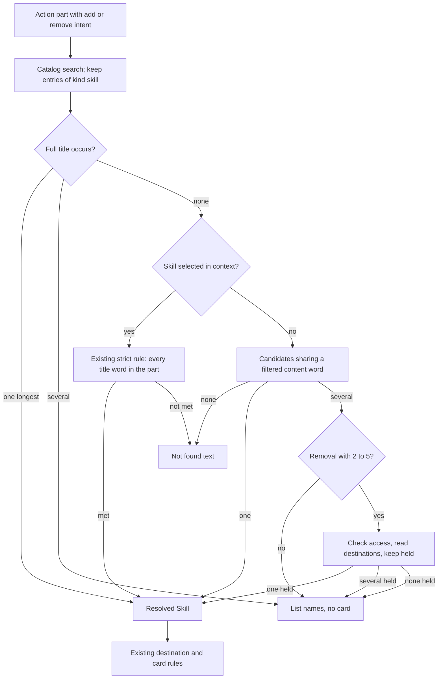

# Objective

A learner who asks the Mentor to add or remove a Skill can name it by part of its title. "Remova a habilidade JavaScript" shows the removal card for "JavaScript essencial" instead of "Não encontrei essa Habilidade no Currículo.". The card still names the full Skill and nothing runs until the learner presses its button. When the context has already selected a Skill, as on a Skill page, the strict rule stays, because only that Skill is visible to the planner.

Baseline (current source): `MentorActionPlanner._resolve_skill` trusts a Curriculum search result only when the full title occurs in the message, or when every content word of the title is in the message. A partial name reaches neither rule, so the planner answers that the Skill was not found, even when exactly one Skill matches.

Mode: **compact**. The change replaces one private resolution rule inside the existing local planner. It adds no persistence, REST, event, model call or web surface.

This change refines the Skill resolution of [Mentor confirmed actions revision 1](../../spec.md) (RF-01 "the Curriculum resolves exactly one existing Skill", RF-03 and CA-03). The base Spec is not edited. Its clarification and not-found texts stay in force.

# Scope

| Area / actor | Included | Excluded or deferred |
| --- | --- | --- |
| Learner asks to add or remove a Skill in the Mentor | A partial Skill name resolves when exactly one Skill shares a content word with the request, outside a Skill page; command words and named Objective titles do not count as Skill words (an Objective title is removed as a whole phrase); for removal, the Skills the learner holds break a tie among 2 to 5 candidates | Partial names on a Skill page; tolerance for spelling mistakes; ranking candidates by how many words they share; naming a Skill by its description; any new card, text or state |
| Intelligence planner | The Skill resolution step of `MentorActionPlanner` and the tests of its consumer use case | Intent classification, message splitting, destination rules (RF-02), proposal persistence, the decline route, Learning execution, web cards |
| Product outcomes | Intelligence RP-17 with JN-21 and JN-22: **full** for the Skill identification step only | The Spec does not change confirmation, destination, justification or outcome rules |

# Behavior Contract

| ID | RP/JN/source coverage | Required behavior |
| --- | --- | --- |
| RF-01 | RP-17, JN-21, JN-22; user request | A message part with the `add_skill` or `remove_skill` intent whose request does not contain a full Skill title resolves to a Skill when exactly one Curriculum Skill shares at least one content word with the part. A content word has at least 3 letters and is not a stopword, as in the existing `_content_words`, and it is also not a command word and does not come from inside an occurrence of an Objective title (RF-06). The proposal then follows the unchanged destination and card rules of the base Spec (RF-01 to RF-03). The card and the action text name the full Skill. |
| RF-02 | RP-17; base Spec RF-01, CA-03(a) | When several Skills share a content word with the part, no card is produced. The answer is the existing "Encontrei mais de uma Habilidade parecida: <nomes>. Qual delas você quer?" with at most 5 names, in catalog order. |
| RF-03 | RP-17, JN-22 | For removal with 2 to 5 candidates, the planner keeps only the candidates the learner holds in at least one Objective. One held candidate resolves as in RF-01. Several held candidates give the RF-02 list of the held ones. No held candidate gives the RF-02 list of all candidates. With more than 5 candidates, or for addition, no tie-break runs. |
| RF-04 | RP-17; base Spec RF-01, RF-03, RF-04 | Existing safeguards stay. A full Skill title in the part still wins, and when several titles occur the longest wins. Entries that are not Skills are ignored. A part that shares no content word, after the RF-06 filtering, with any Skill answers "Não encontrei essa Habilidade no Currículo.". The tie-break reads respect the account access check. There is no model call and no quota use. |
| RF-05 | RP-17; base Spec RF-01 | When `context.skill_id` is set, which happens on a Skill page and when the same message already named a full Skill title, only that Skill is visible to the planner and the existing strict rule applies unchanged: the full title occurs in the part, or every content word of the title is in the part. A partial name does not resolve in that case, and a request that names another Skill is not turned into a card for the visible Skill. |
| RF-06 | RP-17 | Words that are not about the Skill never count as shared. Command words are always ignored: the destination nouns "objetivo", "objetivos", "habilidade" and "habilidades"; the action verbs the planner already recognizes through its action-verb pattern; and at least these request words: "meu", "minha", "meus", "minhas", "ao", "aos", "com", "atual", "este", "esta", "esse", "essa", "neste", "nesta". The implementation may extend this list without amending the Spec. Every occurrence of the full title of one of the learner's Objectives in the part, compared without case and accents, is removed before the words are taken, longest title first when titles overlap; the titles come from the Objectives in the page context. If that leaves no word that could name a Skill, the occurrences are kept and only the command words stay ignored. Accepted trade-off: a request with no Skill word whose only content word is the title of an Objective, such as "Remova a habilidade do Objetivo Python", then proposes the Skill that matches that word. |

| ID | RF coverage | Given | When | Then | Proof |
| --- | --- | --- | --- | --- | --- |
| CA-01 | RF-01 | The learner holds the only Skill sharing a word with the request: "JavaScript essencial" | "Remova a habilidade JavaScript" is processed | One removal proposal for that Skill with its Objective and experience id, and the action text "Preparei uma proposta para você confirmar." | CI-01 / VM-01 |
| CA-02 | RF-01 | The Curriculum has one Skill, "Funções em Python", and the learner has one Objective | "Adicione funções ao meu Objetivo" is processed | One add proposal for "Funções em Python" fixed to that Objective | CI-01 |
| CA-03 | RF-02 | Several Skills share a word with the request, or more than 5 do | An add or remove request is processed | The clarification text lists at most 5 names, no proposal is produced, and no destination is read for addition | CI-02 |
| CA-04 | RF-03 | A removal request matches 2 to 5 Skills | The learner holds exactly one, several, or none of them | One held Skill gives its removal proposal; several give the list of held names; none gives the list of all candidate names | CI-02 |
| CA-05 | RF-04 | A request shares no content word with any Skill; or its text contains a full Skill title; or the search returns entries that are not Skills; or access fails during a tie-break | The request is processed | "Não encontrei essa Habilidade no Currículo."; the longest full title resolves as before; non-Skill entries never resolve; the access error stops the tie-break before the next read | CI-03 |
| CA-06 | RF-05 | The page context selects the Skill "Funções em Python", which is the only eligible Skill | The learner asks "Remova Funções em Python do meu Objetivo", "Remova a habilidade Python" and "Remova React em Python do meu Objetivo" | The full name gives the removal card for the page Skill; the partial name and the request that names React answer "Não encontrei essa Habilidade no Currículo." with no destination read | CI-03 |
| CA-07 | RF-01, RF-06 | The catalog has "Python essencial", "Objetivo e planejamento" and "JavaScript essencial"; the learner holds "Python essencial" and "JavaScript essencial" and has Objectives titled "Aprender Python" and "JavaScript" | The learner sends, in separate requests, "Adicione Haskell ao Objetivo Aprender Python", "Adicione Haskell ao meu Objetivo", "Remova a habilidade Python do Objetivo Aprender Python" and "Remova a habilidade JavaScript do Objetivo JavaScript" | The first two answer "Não encontrei essa Habilidade no Currículo."; the third resolves "Python essencial" through the word that stays after the Objective title is removed; the fourth resolves "JavaScript essencial" because removing the Objective title would leave no Skill word, so the occurrences are kept. For both, only the final destination read happens, which shows that no tie-break ran | CI-01 |

# Technical Contract

## Architecture Mapping

Owner: Intelligence. Rules: [Python Conventions](../../../../../rules/python-conventions-rules.md), [Core Domain](../../../../../rules/core-layer-rules.md) and [Use Case Testing](../../../../../rules/use-case-testing-rules.md). The [AI Layer rules](../../../../../rules/ai-layer-rules.md) were considered and do not apply: no agent, model, prompt, workflow or provider changes.

Accepted decisions: one distinctive word is enough when exactly one Skill shares it (Q1); removal prefers the Skills the learner holds (Q2); add and remove share one rule (Q3); the action text stays unchanged (Q4); a Skill page keeps the strict rule (Q5); command words and named Objective titles are ignored as Skill words (Q6).

| Action | Boundary | Element / Path | Required change |
| --- | --- | --- | --- |
| Modify | Core use case helper | `MentorActionPlanner._resolve_skill` and its call in `_plan_first`, in `apps/server/src/shifu/intelligence/core/use_cases/mentor_action_planner.py` | The private method receives the context snapshot, the action kind and the access check, applies RF-01 to RF-06 and keeps its return shape. The command vocabulary is a private class constant beside `_STOPWORDS`. `plan`, the public constants and every public declaration are unchanged. |
| Modify | Use case test | `apps/server/tests/intelligence/core/use_cases/test_prepare_mentor_response_use_case.py`, classes `TestPrepareMentorActions` and `TestPrepareMentorActionSkillResolution` | New scenarios for CA-01 to CA-05 through `PrepareMentorResponseUseCase`, the public consumer of the planner. `TestPrepareMentorActions` holds the scenarios with fixed catalogs; `TestPrepareMentorActionSkillResolution` already models the loose real catalog search and the Skill-page narrowing, so it owns the scenarios that depend on them. Existing scenarios stay unless a decision recorded in this Spec amends them. |

```text
apps/server/
├── src/shifu/intelligence/core/use_cases/
│   └── mentor_action_planner.py [M]
└── tests/intelligence/core/use_cases/
    └── test_prepare_mentor_response_use_case.py [M]
```

No new file, port, structure, error, REST route, `.rest` example, migration, event or web path is created. `MentorActionPlanner` has no dedicated test module because it is a helper of the use case; the existing consumer module covers it, as the Use Case Testing rules allow.

Resolved shape of the changed private method. The unchanged members of the class are not repeated:

```python
def _resolve_skill(
    self,
    account_id: str,
    part: str,
    context: MentorContextSnapshot,
    kind: MentorActionKind,
    assert_access: Callable[[], None],
) -> tuple[MentorCatalogEntry | None, tuple[str, ...]]:
    """The one Skill the part names, else the names to suggest (maybe none)."""
```

**Partial name resolution** is the new concept. Its purpose is to let the learner name a Skill by a part of its title. It lives in the planner, which Intelligence owns, and has no state. Its inputs are the message part, the context snapshot (the selected Skill, the eligible references and the `goals` facts with the learner's Objective titles, whose ids are ULID-shaped), the Curriculum search results already filtered by eligibility, the action kind and the destination read port `MentorGoalDestinationsProvider`. Its output is one Skill, or the names to suggest, or nothing. It reads no new source of truth. The Curriculum owns Skills and Learning owns the learner's experiences, read through the existing port. The learner's confirmation on the card remains the only effect trigger, so a wrong partial match costs one refusal. Failure and authorization behavior is unchanged: an access failure raised by `assert_access` propagates as it does today.

Example: the catalog has "JavaScript essencial" and "JavaScript avançado" and the learner holds only the first. "Remova a habilidade JavaScript" gives two candidates. The tie-break keeps the held one and shows the removal card for "JavaScript essencial". The lexical intent classifier still requires the word "objetivo" or "habilidade" in the part, so a bare "Remova JavaScript" is not an action request and is unchanged.

Private helpers: the new rule has several branches, and Ruff's `C90` default limit applies. The implementation may split `_resolve_skill` into private helpers in the same module. That does not amend this contract.

Cost accepted: each tie-break read opens a Learning read of all the learner's Objectives for one candidate. At most 5 such reads run per removal request, and the final read for the resolved Skill repeats one of them.

## Runtime Flow



The planner runs inside the existing preparation of a Mentor response, under the trusted account context and the access check the use case already performs. The full-title step is the current behavior. The Skill-page branch keeps the current strict rule. The candidate step uses the filtered words of RF-06, and the candidate and tie-break steps are new. The tie-break calls `assert_access` and then reads the destinations of one candidate at a time, at most 5 reads. Nothing is written. After resolution, the existing flow reads the destinations again for the resolved Skill and applies RF-02 to RF-04 of the base Spec, so persistence, the card and the composer block are untouched. A rejected request has no side effect: no proposal, no event and no quota charge.

# Verification Contract

## Shared setup

The automated checks run from `apps/server` with `uv`, no Docker and no network. They use the existing `_PrepareActionSetup` fixture, which builds `PrepareMentorResponseUseCase` with `create_autospec` mocks for the catalog and destination ports. Scenarios override `catalog_provider.search` and `goal_destinations.read`; the tie-break scenarios give per-Skill destinations through `read.side_effect`.

The manual check uses the real stack from [Tooling](../../../../../tooling.md#running-the-applications): PostgreSQL, Redis, the Inngest Dev Server from Docker Compose, the API on 7777 and the web app on 7000. The Mentor index must be prepared with `uv run poe db:index:mentor` from `apps/server`, because intent classification needs it. The seed learner is the account documented in Tooling and defined in `apps/server/src/shifu/shared/database/seed_data.py`; it holds "JavaScript essencial" in the Objective "Aprender a programar". Do not reset or reseed shared data. If the learner does not hold that Skill or the index is missing, the check is Blocked, not adjusted. Stop only the processes the task started.

## Automated

### CI-01 — A partial name resolves to the one matching Skill

**Criteria:** CA-01, CA-02, CA-07

**Expected result:** a removal card and an add card for the full Skill, with the existing text block and no model call; command words and Objective titles do not create matches.

**Setup / inputs:** one matching Skill in the catalog. Equivalence classes: removal with the Skill held in one Objective; addition with a single Objective and the Skill absent; requests whose only shared words are command words or occurrences of a named Objective title, with the Objective titles given as `goals` facts in the context. The partial name is a single title word.

**Proof:** `apps/server/tests/intelligence/core/use_cases/test_prepare_mentor_response_use_case.py`, boundary use case with mocked ports. Planned scenarios:
`test_should_propose_a_removal_for_a_skill_named_by_one_word_of_its_title`, `test_should_propose_an_addition_for_a_skill_named_by_one_word_of_its_title`, `test_should_not_match_a_skill_through_command_words`, `test_should_not_match_a_skill_through_a_named_objective_title`, `test_should_resolve_the_skill_word_that_stays_next_to_an_objective_title` and `test_should_keep_the_objective_title_when_no_skill_word_is_left`. Scenarios with Objective titles give the `goals` facts through `context_snapshot(facts=...)` returned by `context_provider.read`, with ULID-shaped ids.

```bash
cd apps/server && uv run pytest tests/intelligence/core/use_cases/test_prepare_mentor_response_use_case.py
```

**Passing condition:** the whole file passes with the six planned scenarios executed; the two Objective title removal scenarios assert that `goal_destinations.read` is called exactly once, so a command word wrongly kept as a candidate cannot hide behind the removal tie-break; the drafts equal the expected `MentorActionProposalDraft`; the file runs without skips.

### CI-02 — Several matches list names; removal breaks ties by held Skills

**Criteria:** CA-03, CA-04

**Expected result:** no proposal and the RF-02 text, or the one held Skill's removal card.

**Setup / inputs:** classes: addition with several matches; removal with exactly 1, several and 0 held among 2 to 5 candidates; removal and addition with more than 5 candidates. Boundary values: 1, 2, 5 and 6 candidates.

**Proof:** same file and command as CI-01. Planned scenarios:
`test_should_propose_the_only_held_skill_when_several_share_a_word_for_a_removal`,
`test_should_list_only_the_held_skills_when_several_are_held_for_a_removal`,
`test_should_list_every_candidate_when_none_is_held_for_a_removal`,
`test_should_break_the_tie_among_five_candidates_with_five_reads`,
`test_should_list_five_names_without_destination_reads_when_more_than_five_match`,
`test_should_not_read_destinations_to_break_a_tie_for_an_addition`.

**Passing condition:** texts equal the RF-02 template with names in catalog order and at most 5. `goal_destinations.read` is not called for addition lists or for more than 5 candidates. For removal with several or no held candidates it is called once per candidate. With one held candidate it is called once per candidate plus one final read for the resolved Skill. The 5-candidate scenario asserts exactly 5 tie-break reads before the final read.

### CI-03 — Existing safeguards and the Skill page rule are preserved

**Criteria:** CA-05, CA-06

**Expected result:** the not-found text, the longest full title and the access error behave as before.

**Setup / inputs:** a request with no shared content word; the existing scenarios for a full title and for non-Skill entries; an `assert_access` that raises during a tie-break; the Skill page context built by `_use_real_like_search(page_skill=...)`, which sets `skill_id` to the page Skill as the Learning context provider does, in addition to narrowing the eligible references, and keeps `skill_id` unset when `page_skill` is not given.

**Proof:** same file and command. Existing scenarios `test_should_say_the_skill_is_unknown_when_nothing_matches`, `test_should_resolve_the_skill_whose_title_occurs_in_the_message` and `test_should_ignore_catalog_entries_that_are_not_skills` stay and pass. The existing Skill page scenarios `test_should_accept_a_full_name_request_on_the_skill_page` and `test_should_not_propose_the_page_skill_when_the_message_names_another` stay with their expectations; only the helper changes. Planned scenarios: `test_should_say_the_skill_is_unknown_when_no_content_word_is_shared`, `test_should_stop_the_tie_break_when_access_fails` and `test_should_not_resolve_a_partial_name_on_the_skill_page`.

**Passing condition:** all pass; after the access error no later destination read happens.

### CI-04 — Applicable baseline checks

**Scope:** the two modified Python files and their consumer module.

**Checks:** [Tooling scoped checks](../../../../../tooling.md#scoped-type-lint-and-complexity-checks), all from `apps/server` unless noted.

```bash
cd apps/server && uv run poe check:types
cd apps/server && uv run ruff check --no-fix src/shifu/intelligence/core/use_cases/mentor_action_planner.py tests/intelligence/core/use_cases/test_prepare_mentor_response_use_case.py
cd apps/server && uv run ruff format --check src/shifu/intelligence/core/use_cases/mentor_action_planner.py tests/intelligence/core/use_cases/test_prepare_mentor_response_use_case.py
cd apps/server && uv run poe check:architecture
# from the repository root:
pnpm check:test-integrity
```

`check:types` is project-wide. If it reports diagnostics that exist before this change, Evaluation records the pre-change baseline and requires no new diagnostics in the touched files.

Complexity is the configured Ruff `C90` lint in the lint command above. No dedicated metrics tool is configured and none is required for this change.

**Passing condition:** every command exits 0 with no warnings, the complexity lint reports nothing on the changed methods, and CI-01 to CI-03 executed their intended scenarios.

## Manual

### VM-01 — The Mentor proposes the card for a partial Skill name

**Type:** Manual

**Criteria:** CA-01

**Tool / setup:** Playwright CLI from `apps/web` and the terminal, with the shared setup. Use the short seeded conversation "Organização dos estudos", which has a Mentor reply. Do not use "Prática de lógica", whose seeded message has no reply and refuses a new message, nor "Listas e laços em Python", which is one message short of the summarization threshold and would start a model call.

**Procedure:** sign in through the visible form as the seed learner; open the Mentor page; open "Organização dos estudos"; send "Remova a habilidade JavaScript"; wait for the answer; press "Recusar" on the card. Then, from the repository root, run this read-only query:

```bash
docker compose exec -T postgres psql -U shifu -d shifu -c "select c.charged_units, c.refunded from intelligence_ai_quota_charges c join intelligence_mentor_response_attempts a on a.id = c.request_id join intelligence_mentor_messages m on m.session_id = a.session_id and m.id = a.learner_message_id where m.content = 'Remova a habilidade JavaScript' order by c.created_at desc limit 1;"
```

**Passing condition:** the URL stays on the Mentor page; the conversation shows the action card "Remover JavaScript essencial?" with its Objective and the buttons "Remover habilidade" and "Recusar", and not "Não encontrei essa Habilidade no Currículo."; the card moves to the declined state after "Recusar"; the console has no errors; the query returns `charged_units` 0, which confirms that the turn made no model charge; the experience still exists, because "Remover habilidade" is never pressed; the browser session is closed.

## Visual

Not applicable. The card, its copy, layout and states are unchanged, and the Spec names no Penpot board.

# Documentation Alignment

| Document / authority | Governs | Required update or confirmation | Disposition / dependency |
| --- | --- | --- | --- |
| [Shifu — PRD — Intelligence](https://joaogoliveiragarcia.atlassian.net/wiki/spaces/Shifu/pages/83099649/Shifu+PRD+Intelligence), content 83099649, version 10 (2026-10-23T21:57:11Z), read in full through Atlassian Shifu MCP on 2026-11-12; no parent page | RP-17, JN-21, JN-22 | Unchanged intent. RP-17 does not require the full Skill title and JN-22 says the Mentor "identifica a experiência". | No external write. Reread if the page version changes before conclusion. |
| [Mentor confirmed actions](../../spec.md) revision 1 | RF-01, RF-03, CA-03 | Refined by this change; its texts stay valid and the file is not edited. | Cite this change when the base Spec is next revised. |
| Python Conventions, Core Domain, Use Case Testing | Planner and consumer tests | Confirm the planner keeps private helpers and the tests stay in the consumer module. | Recheck before conclusion. |
| `documentation/architecture.md` | Mentor runtime description | No update needed for this change. | None. |

# Revision History

| Revision | Date | Contract change | Reason / source |
| --- | --- | --- | --- |
| 1 | 2026-11-12 | Initial contract | User request after "Remova a habilidade JavaScript" failed for "JavaScript essencial". Decisions: one distinctive word is enough (Q1), removal prefers held Skills (Q2), add and remove share the rule (Q3), the action text is unchanged (Q4), a Skill page keeps the strict rule (Q5), command words and named Objective titles are ignored (Q6). Spec Reviewer findings on the page-narrowed case and false matches are resolved by Q5 and Q6. |

Follow [SDD](../../../../../sdd.md) and [Create Spec](../../../../../prompts/create-spec-prompt.md).
