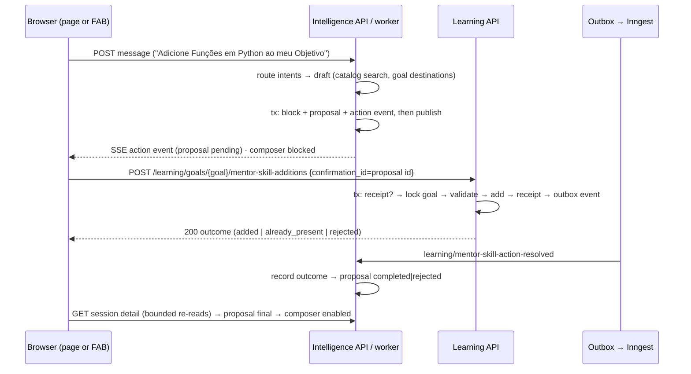

# Objective

The Mentor proposes, in a card inside the conversation, to **add an existing Curriculum
Skill to one of the learner's Objectives** or to **remove one Skill experience**. Only the
card's button confirms. The browser forwards the confirmation to **Learning's own routes**,
which revalidate the active account, ownership and Learning rules, execute, store a
**receipt** under the confirmation id and return the outcome at once. Repeating the same
confirmation returns the same outcome without duplicating an addition or reaching an
experience created later. A Learning outcome event lets Intelligence finalize the card.
While a card has no final outcome, the conversation does not accept new messages
(Intelligence PRD v10, RP-06/RP-17). Cards work in the Mentor page and the FAB, on desktop
and mobile, with keyboard and accessible states in pt-BR.

**Mode: complete** — new persistence in two modules, a new write path into Learning,
idempotency and concurrency guarantees, an outcome event with a consuming job, account
purge, new REST surfaces and a new conversation item in the web.

**Baseline (current source):**

- General Mentor answers are local and deterministic, routed by
  `LocalMentorRouteProvider` over the `MentorIntent` labels; the model is used only when
  no local answer exists or for attachments
  ([mentor-generation-fallback](../mentor-context/changes/mentor-generation-fallback/spec.md)).
  The Mentor has no tools, no proposal and no card code.
- `MentorResponseEventKind` is closed (`status`, `consultation`, `block`, `completed`,
  `failed`, `cancelled`) with a matching database CHECK and web Zod enum.
- `AddSkillToGoalUseCase` raises `SkillAlreadyAddedError` for a duplicate, always writes
  `inclusion_reason=None` and checks the goal and inserts in two transactions.
  `RemoveSkillFromGoalUseCase` removes by `(goal_id, skill_id)`, so a stale request would
  reach an experience re-added later. Neither keeps a confirmation record.
- `GoalSkillRow` already renders a non-null `inclusionReason` read-only on the Objective
  page; the column `learning_skill_experiences.inclusion_reason` (2000) exists.
- SHIFU-101 deferred the inferred recurring-difficulty confirmation (its Q35); nothing
  exists for the shared card to reuse.
- Intelligence purges memories, attachments and summaries on `identity/account.deleted`;
  Identity does not yet emit that event, and Learning has no account purge.

# Scope

| Area / actor | Included | Excluded or deferred |
| --- | --- | --- |
| Learner in the Mentor (page and FAB) | Explicit requests to add or remove a Skill produce one persisted card; Objective picker; "Recusar"; button-only confirmation; processing, success, rejection, declined, recoverable failure and uncertain states; resume; composer block; desktop 1440 and mobile 390; keyboard; pt-BR | Proposals generated by AI or offered without an explicit request (Q2, Q3, Q43); more than one card per answer (Q28) |
| Intelligence | Two local intents; proposal record and "ação" response event; decline route; session detail action items; outcome job; account purge job; message refusal while a card is pending | Inferred recurring-difficulty memory and its card variant (Q1); monthly quota; Identity's account-deleted producer |
| Learning | Two Mentor routes with receipts and an outcome event; add with justification and existing-experience return; removal of the exact experience | Changes to the manual add/remove flows and their contracts (Q17); Learning account purge (Q18); base-skill selection from the Mentor |
| Shared | One narrow read port for the learner's Objectives and a Skill's experiences | Any write port between modules (Q15) |
| Web | Generic `mentor-action-card`, behavior-owning `skill-action-card` with picker, three action hooks, composer reason, cache invalidation | Moving legacy controller tests (Q37); new routes |

Canonical outcomes (Intelligence PRD content 83099649 **v10**; Learning PRD content 83066881
**v26**):

- **Intelligence RP-17 — full** for adding and removing Skills; the inferred-difficulty use
  of the shared card is **deferred** (Q1).
- **Intelligence RP-06 — partial:** only the v10 rule that an unresolved action card
  blocks new messages in its conversation.
- **Intelligence RP-14 — partial:** only the reusable card presentation; inferred
  difficulty confirmation deferred.
- **Intelligence RP-03, RP-11, RP-12, RP-13 — partial:** card resume, isolation, session
  deletion and account purge of proposals, responsive/accessible cards; the rest unchanged.
- **Intelligence JN-21, JN-22 — full.**
- **Learning RP-03, RP-21, RP-23 — partial:** the Mentor entry for add and remove, with
  revalidation, receipts and recovery; manual flows unchanged.
- **Learning RP-29 — partial:** receipts hold identifiers only and follow Learning's
  still-deferred account purge (Q18). **Learning JN-14 (Mentor path), JN-23 — full.**
- Intelligence RP-02 (quota) and RP-01 are not affected: no AI call is made.

Design references and approved adaptations: [design/handoff.md](design/handoff.md).

# Behavior Contract

| ID | RP/JN/source coverage | Observable required behavior |
| --- | --- | --- |
| RF-01 | Intelligence RP-17, JN-21; Q2, Q3, Q27, Q30, Q43 | A message part classified by the local intent `add_skill` produces an add proposal only when the learner explicitly asks to add a Skill, the Curriculum resolves exactly one existing Skill and a destination exists (RF-02). The card shows "Adicionar <Habilidade>?", "Objetivo: <título>" and the justification "Você pediu ao Mentor para adicionar esta Habilidade." followed by the Skill's Curriculum description. No model call, no quota use. Ambiguous or unknown Skill → clarification text without card; a near-miss such as "quero estudar <Habilidade>" → no card. |
| RF-02 | Intelligence RP-17; Q6, Q7, Q8, Q44 | The destination is fixed when the message names exactly one of the learner's Objectives, when the FAB context hint carries an Objective, or when the learner has exactly one Objective. Otherwise the card starts on a picker step with the learner's Objectives captured at proposal time; Objectives that already contain the Skill are disabled with "Já contém esta Habilidade". Choosing shows the full proposal with "Trocar Objetivo" until confirmation; the choice is local until confirmation. A later page or context change never alters a presented card. No Objective → text explaining that the Mentor does not create Objectives, with a shortcut to manual creation; a fixed destination that already contains the Skill → text with a shortcut to the existing experience; neither creates a card. |
| RF-03 | Intelligence RP-17, JN-22; Learning RP-21, JN-14; Q9 | The local intent `remove_skill` produces a removal proposal only from a learner request and only for a Skill present in the learner's experiences. The card targets exactly one experience id; when the Skill exists in several Objectives and the destination is not fixed by RF-02 rules, the picker lists only those Objectives. The card shows "Remover <Habilidade>?", "Objetivo: <título>", "Você pediu para retirar esta Habilidade do Objetivo." and the consequences text of the design handoff before "Remover habilidade", without any additional modal. |
| RF-04 | Intelligence RP-03, RP-17; Q12, Q27, Q28, Q30 | A proposal exists in the server before any card is shown: the proposal, its short text block and an `action` response event are persisted in one transaction before publication. At most one proposal per Mentor answer; a second requested action receives text asking the learner to repeat it afterwards. The session detail returns every proposal of the conversation with its current state, so the same card renders after reload, in the page and in the FAB. |
| RF-05 | Intelligence RP-17; Learning RP-23; Q5, Q19 | Only the card buttons act. A new message while a proposal is pending is refused with 409 and changes nothing, so agreement typed in chat never executes. "Recusar" persists `declined`; the card shows "Remoção recusada"/"Adição recusada" and cannot be confirmed after reload. Declining a proposal that already has an outcome is refused with 409. |
| RF-06 | Learning RP-03, RP-23, JN-23; Intelligence RP-17; Q17, Q23, Q24 | `POST /learning/goals/{goal_id}/mentor-skill-additions` revalidates the active account (authentication), Objective ownership and Curriculum existence under a lock on the Objective. It adds only the identified Skill as a `not_started` experience with the justification, without bases, diagnostic or inherited results; a Skill already in the Objective returns the existing experience (`already_present`). Not owned or missing Objective → `rejected/goal_unavailable`; Skill not in the Curriculum → `rejected/skill_unavailable`; inactive account → 401 without receipt. |
| RF-07 | Learning RP-21, RP-23; Intelligence RP-17; Q9, Q23, Q24 | `POST /learning/goals/{goal_id}/mentor-skill-removals` removes only the experience whose id is in the request, when it belongs to that owned Objective, together with its history (cascade as in the manual removal). The Objective remains even when empty; other experiences, including the same Skill in other Objectives, and the Curriculum are untouched; late evaluation results stay no-ops. A missing, foreign or mismatched experience → `rejected/experience_unavailable`; a stale confirmation never reaches an experience created later. |
| RF-08 | Intelligence RP-17; Learning RP-21, RP-23; Q4, Q14, Q16 | The proposal id is the confirmation id. Learning stores one receipt per (account, confirmation id) in the same transaction as the change, including rejections. The same request again returns the same body and emits nothing; a different payload under the same id returns 409; concurrent identical requests produce exactly one effect and identical bodies. Receipts keep only identifiers, operation, outcome and a request fingerprint, never pedagogical history. |
| RF-09 | Intelligence RP-17; Learning RP-23; Q25 | The first resolution emits `learning/mentor-skill-action-resolved` in the receipt transaction. The Intelligence job records `completed` (with `added`, `already_present` or `removed`) or `rejected` (with the reason) on the matching proposal of the same account; an outcome overrides an earlier `declined`; unknown ids, other accounts, an operation, Skill, Objective or experience that does not match the proposal, and repeated identical deliveries change nothing. |
| RF-10 | Intelligence RP-17; Q10, Q13, Q35, Q46 | The card distinguishes proposal, processing (status line, no buttons, no resend), success ("<Habilidade> adicionada", "<Habilidade> já está no Objetivo", "<Habilidade> removida" with "Ver Objetivo" or "Ver Habilidade"), rejection (reason text, no buttons), declined, recoverable failure (a safe server error after rollback: "Tentar novamente" and "Recusar") and uncertain result (network error, timeout, empty response or 409: only "Verificar resultado", never claiming failure). Retry and verify resend the original proposal data under the same confirmation id; the first confirmation locks the chosen Objective. |
| RF-11 | Intelligence RP-06, RP-17 (v10); Q19, Q21 | While any proposal of the conversation is not final (pending, processing, recoverable failure or uncertain), the composer is disabled with "Confirme ou recuse a ação proposta para continuar." and the server refuses new messages with 409. After a Learning outcome, the browser re-reads the session detail at short bounded intervals ("Atualizando a conversa…") until the proposal is final, then enables the composer; when the limit is reached it offers "Tentar novamente" to re-read. Other conversations stay independent. |
| RF-12 | Intelligence RP-17; Learning RP-03, JN-23; Q34 | After a `completed` outcome the browser invalidates the Objective detail and the home Objectives queries. The Objective page shows the justification of a Mentor-added Skill read-only through the existing `GoalSkillRow`. |
| RF-13 | Intelligence RP-03, RP-11, RP-13; Learning RP-29 (partial); Q18 | Proposals belong to the account and conversation: another account gets 404 on decline and never sees them. Deleting a conversation removes its proposals. Cancelling or failing the attempt that created a pending proposal removes that proposal in the same transaction. `identity/account.deleted` purges the account's proposals. Mentor reads and declines revalidate access through `MentorAccessProvider`. Learning receipts remain until Learning's account purge is delivered (recorded gap). |
| RF-14 | Intelligence RP-12, RP-14 (partial), RP-17; Q31, Q45, Q47 | One presentational `mentor-action-card` renders every state of both operations and is ready for the future memory variant without implementing it. Cards render in the page and the FAB at 1440 and 390 px; buttons stack at full width below 480 px; every action is keyboard operable; state changes are announced through a status region and focus moves to the result; texts are pt-BR and states never depend on color alone. |

| ID | RF coverage | Given | When | Then | Checks |
| --- | --- | --- | --- | --- | --- |
| CA-01 | RF-01, RF-04 | A learner with one Objective asks "Adicione Funções em Python ao meu Objetivo" | The answer is processed | One `add_skill` proposal and one `action` event are persisted before publication with the fixed destination and the justification; the card shows title, destination and reason; no model request | CI-03, CI-06, CI-13, VM-01 |
| CA-02 | RF-02, RF-14 | A learner with two Objectives, one already containing the Skill, sends an explicit add request from the page | The card renders and the learner picks the available Objective | The picker lists both, the containing one disabled with "Já contém esta Habilidade"; the proposal shows the chosen Objective and "Trocar Objetivo"; navigating away and back keeps the same card | CI-03, CI-07, CI-08, VM-01 |
| CA-03 | RF-01, RF-02 | (a) the Skill text matches several or no Skills; (b) the learner has no Objective; (c) the fixed destination already contains the Skill; (d) "quero estudar Funções em Python" | The answer is processed | (a) clarification text; (b) text with the manual-creation shortcut; (c) text with the experience shortcut; (d) normal answer; no proposal in any case | CI-03, CI-06, CI-13 |
| CA-04 | RF-04 | One message asks to add one Skill and remove another | The answer is processed and the conversation is reopened | Exactly one proposal and text asking to repeat the other request; the session detail returns the proposal with its state and the card renders identically in page and FAB | CI-03, CI-04, CI-06, CI-07 |
| CA-05 | RF-05, RF-11 | A pending proposal | The learner sends "sim", or presses "Recusar" | The message is refused with 409 and nothing executes; decline persists `declined`, Learning is unchanged, the card stays declined after reload; declining again after an outcome returns 409 | CI-03, CI-04, CI-07 |
| CA-06 | RF-03, RF-14 | The learner asks to remove a Skill present in one Objective, then in two Objectives | The answer is processed | The card targets the exact experience id with the consequences and "Remover habilidade", no modal; with two Objectives the picker lists only them | CI-03, CI-06, CI-07, CI-13, VM-02 |
| CA-07 | RF-06 | An add confirmation for an owned Objective | Learning executes it, and the variants: Skill already present, foreign or deleted Objective, Skill missing from the Curriculum, inactive account | `added` with a `not_started` experience carrying the justification, no bases, no diagnostic; `already_present` with the existing experience; `rejected/goal_unavailable` without revealing existence; `rejected/skill_unavailable`; 401 without receipt | CI-01, CI-02 |
| CA-08 | RF-07 | A removal confirmation for an experience with attempts, evaluations and progress; the same Skill in another Objective | Learning executes it; then the Skill is re-added and the old confirmation is replayed with a new id but the old experience id | The experience and its history are gone, the Objective remains (also when empty), the other experience is intact; the stale request returns `rejected/experience_unavailable` and the new experience is intact | CI-01, CI-02 |
| CA-09 | RF-08 | A resolved confirmation (added, removed or rejected) | The same request is repeated, a different payload reuses the id, and two identical requests run concurrently | Same body and no second outbox event; 409 for the divergent payload; one effect, one receipt and identical bodies for the concurrent pair | CI-01, CI-02 |
| CA-10 | RF-09 | A pending, declined or unknown proposal | `learning/mentor-skill-action-resolved` is delivered once or twice, or with a Skill or Objective that the proposal does not offer | Pending and declined proposals become `completed`/`rejected` with the outcome; unknown id, other account, mismatched values and duplicate delivery change nothing | CI-03, CI-05 |
| CA-11 | RF-10 | A proposal card | The learner confirms and the response is 200, a safe 503, a network error/timeout, or a 409 | Processing shows the status line and no buttons; 200 shows the matching success or rejection state; 503 shows "Tentar novamente" and "Recusar"; network error, timeout and 409 show only "Verificar resultado"; retry and verify resend the original data and confirmation id with the locked Objective | CI-07, CI-08 |
| CA-12 | RF-11 | A conversation with a non-final proposal, and a second conversation | The learner tries to type in each; then the outcome is recorded | The first composer is disabled with the reason, the second is enabled; after the outcome the browser re-reads with "Atualizando a conversa…" and enables the composer when final; after the limit, "Tentar novamente" re-reads | CI-03, CI-04, CI-07, CI-08 |
| CA-13 | RF-12 | A completed addition from the Mentor while the Objective page was cached | The learner follows "Ver Objetivo" | The Objective page shows the new Skill with the justification read-only; the home Objectives list is refreshed | CI-07, CI-08, VM-01 |
| CA-14 | RF-13 | Proposals of account A | Account B declines one; A deletes the conversation; the attempt is cancelled while its proposal is pending; `identity/account.deleted` arrives for A; A's access revision changes | B gets 404; the conversation's proposals are gone; the cancelled attempt's pending proposal is removed and the composer unblocks; A's proposals are purged; the decline is rejected by access | CI-03, CI-04, CI-05 |
| CA-15 | RF-14 | Cards in page 1440 and FAB/mobile 390 | The learner uses only the keyboard | Every button and picker option is reachable and operable with touch targets of at least 44 px; buttons stack below 480 px; status changes are announced and focus moves to the result; visuals match the handoff references | CI-07, CI-08, VM-01, VM-02, VM-03, VM-04 |

# Technical Contract

## Architecture Mapping

Owners: Intelligence (proposal, card, decline, outcome recording), Learning (execution,
receipt, outcome event), Shared (read port only). Rules:
[Python](../../../rules/python-conventions-rules.md),
[Core](../../../rules/core-layer-rules.md),
[Use-case testing](../../../rules/use-case-testing-rules.md),
[REST](../../../rules/rest-layer-rules.md),
[Controller testing](../../../rules/controllers-testing-rules.md),
[Database](../../../rules/database-layer-rules.md),
[Provider](../../../rules/provision-layer-rules.md),
[Messaging](../../../rules/messaging-layer-rules.md),
[Job testing](../../../rules/jobs-testing-rules.md),
[AI](../../../rules/ai-layer-rules.md),
[Server application](../../../rules/server-app-layer-rules.md),
[TypeScript](../../../rules/typescript-conventions-rules.md),
[UI](../../../rules/ui-layer-rules.md),
[Widget testing](../../../rules/widget-testing-rules.md),
[Web App Routing](../../../rules/web-app-routing-rules.md) (canonical `ROUTES` entries and
builders for the Objective and Skill links, Q51). The Validation Package rule is not
selected: no `packages/validation` consumer exists.

**Selected approach (Q15).** No module calls another's use case or provider for writes.
The browser confirms through Learning's own routes; Learning's transaction writes the
change, the receipt and an outbox event; an Intelligence Inngest job records the outcome.
The rejected alternatives were an in-process Shared write port (the Provider Rule forbids a
provider calling another module's use cases) and a fully asynchronous confirmation (the card
would wait on background jobs in the happy path).

| Action | Boundary | Element / Path | Required change |
| --- | --- | --- | --- |
| Create | Shared core | `MentorGoalDestinationsProvider`, `MentorGoalDestinations`, `MentorGoalDestination` in `shared/core/{interfaces,domain/structures}/` | Read-only port: the account's Objectives with titles and, for one Skill, its experience per Objective. Exported from the package barrels. |
| Create | Learning provider | `LearningMentorGoalDestinationsProvider` in `learning/providers/learning_mentor_goal_destinations_provider.py` | Implements the port with `LearningDatabase` repositories only (no use case). |
| Create | Learning core | `MentorActionReceipt` entity; `MentorActionOperation`, `MentorActionOutcome`, `MentorActionRejectionReason` enums; `MentorActionResolution` structure; `MentorActionConflictError`; `MentorSkillActionResolvedEvent`; `MentorActionReceiptsRepository` | Declarations below; exports in each barrel. |
| Modify | Learning core | `LearningDatabaseRepositories` (`learning/core/interfaces/learning_database.py`), `GoalsRepository` | Adds `mentor_action_receipts`; adds `find_by_id_for_update(goal_id)`. |
| Create | Learning use cases | `AddSkillToGoalFromMentorUseCase`, `RemoveSkillExperienceFromMentorUseCase` | One transaction each: receipt check, Objective lock, validation, effect, receipt, event. |
| Create / Modify | Learning database | `MentorActionReceiptModel` (`learning_mentor_action_receipts`), mapper, `SqlalchemyMentorActionReceiptsRepository`; `SqlalchemyGoalsRepository.find_by_id_for_update`; repository group wiring | Unique `(account_id, confirmation_id)`; no FK to experiences or goals; `try_add` uses a savepoint and returns `False` on the unique violation. |
| Create / Modify | Learning REST | `AddSkillToGoalFromMentorController`, `RemoveSkillExperienceFromMentorController`; `LearningRouter`; Learning pipes | Two POST routes with controller-local `Request`/`Response`; registered in the router. |
| Create | Intelligence core | `MentorActionProposal` entity; `MentorActionKind`, `MentorActionProposalStatus`, `MentorActionProposalOutcome`, `MentorActionProposalRejectionReason` enums; `MentorActionCandidateGoal`, `MentorActionProposalDraft` structures; `MentorActionPendingError`, `MentorActionProposalFinalizedError`; `MentorActionProposalsRepository` | Declarations below. |
| Modify | Intelligence core | `MentorIntent` (+`ADD_SKILL`, `REMOVE_SKILL`), `MentorResponseEventKind` (+`ACTION`), `MentorResponseEvent` (+`action_proposal: MentorActionProposalItem`), `PreparedMentorResponse` (+`action_proposal`), `MentorSessionDetail` in `core/domain/structures/mentor_session_detail.py` (+`action_items`), `IntelligenceDatabaseRepositories` (+`mentor_action_proposals`) | Scoped excerpts below; other members unchanged. |
| Modify | Intelligence use cases | `PrepareMentorResponseUseCase` (+`goal_destinations_provider`), `PublishMentorResponseBlockUseCase` (+`identifier_provider`), `SubmitMentorMessageUseCase`, `GetMentorSessionUseCase`, `ReadMentorResponseEventsUseCase`, `CancelMentorResponseUseCase`, `FailMentorResponseUseCase`, `RemoveMentorSessionUseCase` | Builds the draft (RF-01–RF-03 and the preparation rules), persists proposal + `action` event with the action block, refuses new messages while pending (new-submission branch only), returns action items, hydrates `action` events, removes the attempt's pending proposal on cancel/fail, removes the session's proposals on session deletion (the session is soft-deleted, so no cascade fires). |
| Create | Intelligence use cases | `DeclineMentorActionProposalUseCase`, `RecordMentorActionOutcomeUseCase`, `PurgeMentorActionProposalsForAccountUseCase` | Declarations below. |
| Modify | Intelligence AI data and routing | `ai/data/mentor-intents.json`, `ai/data/mentor-index-manifest.json` (`intent_thresholds`), `ai/data/mentor-evaluation.json`, `providers/routing/local/local_mentor_route_provider.py` | Examples for `add_skill`/`remove_skill` and their calibrated thresholds in the manifest (`MentorResources._validate` requires every `MentorIntent` there); the resource version changes, so the offline index is rebuilt with `uv run python -m shifu.mentor_indexes` (AI Rule: no synchronous reindex). Action intents produce no FAQ, fact or generation block for their part (the Core builds the answer). |
| Modify | Intelligence AI workflow and outputs | `ai/agno/workflows/agno_process_mentor_response_workflow.py`; `ai/intelligence_workflows_registry.py`; `ai/agno/outputs/mentor_answer_block_output.py` | The local publish step passes the draft to `PublishMentorResponseBlockUseCase` with its block; the registry injects the destinations port into preparation and `IdentifierProvider` into publication; `MentorAnswerBlockOutput.intent` rejects `add_skill`/`remove_skill`, so a generated block can never carry an action intent. |
| Create / Modify | Intelligence evals | `apps/server/evals/classify_mentor_intent_eval.py` [N] (`ClassifyMentorIntentEval`, selector `classify-mentor-intent`); `apps/server/evals/run.py` [M] (`EVAL_CLASSES`) | Local eval modeled on `ClassifyLearnerMemoryEval` (Q49): loads `MentorResources` and the cases of `mentor-evaluation.json`, embeds corpus and cases with the local E5 model in process, and runs the real `EmbeddingsMentorIntentClassifierProvider` over an in-memory `MentorEmbeddingsRepository` built inside the eval (no database, no remote model). Gates per-intent precision/recall and the hard-negative false-positive rate. |
| Create / Modify | Intelligence database | `MentorActionProposalModel` (`intelligence_mentor_action_proposals`), mapper, `SqlalchemyMentorActionProposalsRepository`; `MentorResponseEventModel` (+`action_proposal_id`, CHECK adds `action`) | FKs to session (`ON DELETE CASCADE`), learner message and attempt; JSONB candidate goals; index `(account_id, session_id, status)`. |
| Create / Modify | Intelligence messaging | `RecordMentorActionOutcomeJob`, `PurgeMentorActionProposalsOnAccountDeletedJob` in `intelligence/messaging/inngest/jobs/`; `jobs/__init__.py`; `intelligence_inngest_messaging.py` (`register_jobs` gains the outcome event name and both use cases) | Event names injected by composition. Payload models mirror `purge_learner_memories_on_account_deleted_job.py`: strict, frozen, `extra='forbid'`, non-empty ids, UTC `resolved_at`, closed value sets for operation/outcome/reason; invalid payload → `NonRetriableError`. |
| Create / Modify | Intelligence REST | `DeclineMentorActionProposalController` (own `Response` model nesting the shared action item shape); `MentorSessionSchemas.Detail` (+`action_items`), `MentorSessionSchemas.ActionItem`; stream event schema (+`action_proposal`); `IntelligenceRouter`; error translation | `MentorActionPendingError` and `MentorActionProposalFinalizedError` map to 409 through `AppErrorHandler`. |
| Modify | Composition | `apps/server/src/shifu/app.py` | Builds the Learning destinations provider, passes it to the Intelligence registry, passes the outcome and account-deleted event names and use cases to `register_jobs`; `FastAPIApp.register` gains an optional `mentor_goal_destinations_provider` override like `mentor_context_provider`, used by HTTP tests. |
| Create | Migration | `apps/server/migrations/versions/<generated by alembic revision --autogenerate>` | Creates both tables, adds the event column and widens the kind CHECK; reviewed downgrade. |
| Modify | REST examples | `apps/server/rest-client/learning/learning.rest`, `apps/server/rest-client/intelligence/intelligence.rest` | Non-secret examples for the three new routes and the 409 cases. |
| Create | Fakers | `fakers/learning/entities/mentor_action_receipt_faker.py`, `fakers/intelligence/entities/mentor_action_proposal_faker.py` | Valid defaults with keyword overrides. |
| Modify | Web routes | `apps/web/src/constants/routes.ts` | Adds `learningGoal: '/learning/goals/$goalId'` and `learningSkill: '/learning/goals/$goalId/skills/$skillId'` with builders `learningGoalPath({ goalId })` and `learningSkillPath({ goalId, skillId })`, excluded from `StaticRouteName` like the other dynamic routes (Web App Routing Rule, Q51). No route file is added or moved, so `routeTree.gen.ts` is not regenerated. Existing raw `to=` paths in Learning widgets are not migrated. |
| Create / Modify | Web core | `core/intelligence/mentor-action-proposal.ts` [N]; `core/intelligence/mentor-response.ts` [M]; `core/learning/mentor-skill-action-outcome.ts` [N] | Declarations below. |
| Modify | Web REST | `rest/services/learning-service.ts` (+`addSkillToGoalFromMentor`, `removeSkillExperienceFromMentor`), `rest/services/intelligence-service.ts` (+`declineMentorActionProposal`, `actionItems` in session detail mapping) | Same factory pattern; Intelligence keeps its snake_case DTO mapping. |
| Create / Modify | Web hooks | `ui/intelligence/hooks/{use-confirm-mentor-skill-addition-action,use-confirm-mentor-skill-removal-action,use-decline-mentor-action-proposal-action}.ts` [N] in the module hooks directory by user decision (Q53), a recorded deviation from the UI Rule's colocation of single-consumer hooks; `hooks/use-mentor-response-stream.ts` [M] | Server functions with module-scope Zod validators (precedent `use-submit-mentor-message-action.ts`); stream Zod accepts `action`. |
| Modify | Web context | `contexts/mentor-context/{use-mentor-context-provider.ts,types/mentor-context-value.ts}` | Exposes `blockingActionProposalId`, `isRefreshingActions`, `hasActionRefreshTimedOut`, `refreshActions`, `onActionResolved`. |
| Modify | Web answer rendering | `mentor-chat/conversation/message-list/message-item/answer-block/{index.tsx [M], use-answer-block.ts [N]}` | Internal Markdown links (Q52): the hook matches an `href` against a closed list (`ROUTES.learningGoalsNew`, `ROUTES.learningGoal`, `ROUTES.learningSkill`), extracts the params and the renderer emits a typed TanStack `Link` (route pattern + explicit params, no cast, no reload). Any other path starting with `/` renders as plain text; external `http(s)` links keep the native anchor with `rel='noopener noreferrer'`. The hook returns a pure `resolveLink(href)` that the Markdown `a` override calls; matching compares against the `ROUTES` patterns and extracts `goalId` and `skillId` as named in the route files. `message-item.test.tsx` renders inside a memory router instead of mocking TanStack `Link`. |
| Create / Modify | Web widgets | `widgets/components/mentor-action-card/` [N]; `mentor-chat/conversation/{use-conversation.ts,composer/*,message-list/index.tsx}` [M]; `message-list/skill-action-card/` with `objective-picker/` [N] | Composition below. |

### Expected file tree

```text
apps/server/
├── migrations/versions/<alembic-generated>.py [N]
├── rest-client/{learning/learning.rest,intelligence/intelligence.rest} [M]
├── src/shifu/
│   ├── app.py [M]
│   ├── shared/core/
│   │   ├── interfaces/{__init__.py [M], mentor_goal_destinations_provider.py [N]}
│   │   └── domain/structures/{__init__.py [M], mentor_goal_destinations.py [N], mentor_goal_destination.py [N]}
│   ├── fakers/
│   │   ├── learning/entities/mentor_action_receipt_faker.py [N]
│   │   └── intelligence/entities/mentor_action_proposal_faker.py [N]
│   ├── learning/
│   │   ├── core/
│   │   │   ├── domain/
│   │   │   │   ├── entities/mentor_action_receipt.py [N]
│   │   │   │   ├── enums/{mentor_action_operation,mentor_action_outcome,mentor_action_rejection_reason}.py [N]
│   │   │   │   ├── structures/mentor_action_resolution.py [N]
│   │   │   │   ├── errors/mentor_action_conflict_error.py [N]
│   │   │   │   └── events/mentor_skill_action_resolved_event.py [N]
│   │   │   ├── interfaces/{mentor_action_receipts_repository.py [N], learning_database.py [M], goals_repository.py [M]}
│   │   │   └── use_cases/{add_skill_to_goal_from_mentor_use_case.py, remove_skill_experience_from_mentor_use_case.py} [N]
│   │   ├── database/sqlalchemy/
│   │   │   ├── learning_database.py [M]
│   │   │   ├── models/mentor_action_receipt_model.py [N]
│   │   │   ├── mappers/mentor_action_receipt_mapper.py [N]
│   │   │   └── repositories/{mentor_action_receipts_repository.py [N], goals_repository.py [M]}
│   │   ├── providers/learning_mentor_goal_destinations_provider.py [N]
│   │   ├── pipes/<learning pipe> [M]
│   │   └── rest/
│   │       ├── controllers/{add_skill_to_goal_from_mentor_controller.py, remove_skill_experience_from_mentor_controller.py} [N]
│   │       └── router.py [M]
│   └── intelligence/
│       ├── ai/
│       │   ├── data/{mentor-intents.json, mentor-index-manifest.json, mentor-evaluation.json} [M]
│       │   ├── agno/workflows/agno_process_mentor_response_workflow.py [M]
│       │   ├── agno/outputs/mentor_answer_block_output.py [M]
│       │   └── intelligence_workflows_registry.py [M]
│       ├── core/
│       │   ├── domain/
│       │   │   ├── entities/mentor_action_proposal.py [N]
│       │   │   ├── enums/{mentor_action_kind,mentor_action_proposal_status,mentor_action_proposal_outcome,mentor_action_proposal_rejection_reason}.py [N]
│       │   │   ├── enums/{mentor_intent,mentor_response_event_kind}.py [M]
│       │   │   ├── structures/{mentor_action_candidate_goal,mentor_action_proposal_draft}.py [N]
│       │   │   ├── structures/mentor_action_proposal_item.py [N]
│       │   │   ├── structures/{mentor_response_event,prepared_mentor_response,mentor_session_detail}.py [M]
│       │   │   └── errors/{mentor_action_pending_error,mentor_action_proposal_finalized_error}.py [N]
│       │   ├── interfaces/{mentor_action_proposals_repository.py [N], intelligence_database.py [M]}
│       │   └── use_cases/
│       │       ├── {decline_mentor_action_proposal,record_mentor_action_outcome,purge_mentor_action_proposals_for_account}_use_case.py [N]
│       │       └── {prepare_mentor_response,publish_mentor_response_block,submit_mentor_message,get_mentor_session,read_mentor_response_events,cancel_mentor_response,fail_mentor_response,remove_mentor_session}_use_case.py [M]
│       ├── providers/routing/local/local_mentor_route_provider.py [M]
│       ├── database/sqlalchemy/
│       │   ├── intelligence_database.py [M]
│       │   ├── models/{mentor_action_proposal_model.py [N], mentor_response_event_model.py [M]}
│       │   ├── mappers/{mentor_action_proposal_mapper.py [N], <response event mapper> [M]}
│       │   └── repositories/mentor_action_proposals_repository.py [N]
│       ├── messaging/inngest/
│       │   ├── intelligence_inngest_messaging.py [M]
│       │   └── jobs/{__init__.py [M], record_mentor_action_outcome_job.py [N], purge_mentor_action_proposals_on_account_deleted_job.py [N]}
│       └── rest/
│           ├── controllers/decline_mentor_action_proposal_controller.py [N]
│           ├── schemas/{mentor_session_schemas.py, <response event schema>} [M]
│           └── router.py [M]
├── evals/{classify_mentor_intent_eval.py [N], run.py [M]}
└── tests/
    ├── learning/core/use_cases/{test_add_skill_to_goal_from_mentor_use_case.py, test_remove_skill_experience_from_mentor_use_case.py} [N]
    ├── learning/server/controllers/{test_add_skill_to_goal_from_mentor_controller.py, test_remove_skill_experience_from_mentor_controller.py} [N]
    ├── intelligence/core/use_cases/{test_decline_mentor_action_proposal_use_case.py, test_record_mentor_action_outcome_use_case.py, test_purge_mentor_action_proposals_for_account_use_case.py} [N]
    ├── intelligence/core/use_cases/{test_prepare_mentor_response_use_case.py, test_publish_mentor_response_block_use_case.py, test_submit_mentor_message_use_case.py, test_get_mentor_session_use_case.py, test_read_mentor_response_events_use_case.py, test_cancel_mentor_response_use_case.py, test_fail_mentor_response_use_case.py, test_remove_mentor_session_use_case.py} [M]
    ├── intelligence/server/controllers/{test_decline_mentor_action_proposal_controller.py, test_get_mentor_session_controller.py, test_submit_mentor_message_controller.py} [N]
    ├── intelligence/ai/workflows/test_agno_process_mentor_response_workflow.py [M]
    └── messaging/inngest/jobs/intelligence/{test_record_mentor_action_outcome_job.py, test_purge_mentor_action_proposals_on_account_deleted_job.py} [N]

apps/web/
├── src/
│   ├── constants/routes.ts [M]
│   ├── core/
│   │   ├── intelligence/{mentor-action-proposal.ts [N], mentor-response.ts [M]}
│   │   └── learning/mentor-skill-action-outcome.ts [N]
│   ├── rest/services/{learning-service.ts, intelligence-service.ts} [M]
│   └── ui/intelligence/
│       ├── hooks/
│       │   ├── use-confirm-mentor-skill-addition-action.ts [N]
│       │   ├── use-confirm-mentor-skill-removal-action.ts [N]
│       │   ├── use-decline-mentor-action-proposal-action.ts [N]
│       │   └── use-mentor-response-stream.ts [M]   (tests/mentor-server-functions.test.ts not extended)
│       ├── contexts/mentor-context/
│       │   ├── use-mentor-context-provider.ts [M]
│       │   ├── types/mentor-context-value.ts [M]
│       │   └── tests/{use-mentor-context-provider.test.ts, mentor-transport-consumer.test.tsx} [M]
│       └── widgets/components/
│           ├── mentor-action-card/
│           │   ├── index.tsx [N]                     pure renderer of every state
│           │   └── tests/mentor-action-card.test.tsx [N]
│           └── mentor-chat/conversation/
│               ├── use-conversation.ts [M]           ConversationItem 'action'
│               ├── tests/{conversation.test.tsx, use-conversation.test.ts} [M]
│               ├── composer/{index.tsx, use-composer.ts} [M]
│               ├── composer/tests/{composer.test.tsx, use-composer.test.ts} [M]
│               └── message-list/
│                   ├── index.tsx [M]
│                   ├── message-item/
│                   │   ├── answer-block/{index.tsx [M], use-answer-block.ts [N]}
│                   │   ├── answer-block/tests/use-answer-block.test.ts [N]
│                   │   └── tests/message-item.test.tsx [M]
│                   └── skill-action-card/
│                       ├── index.tsx [N]
│                       ├── use-skill-action-card.ts [N]
│                       ├── objective-picker/index.tsx [N]   pure, controlled by the parent hook
│                       └── tests/{skill-action-card.test.tsx, use-skill-action-card.test.ts} [N]
└── tests/
    ├── intelligence/intelligence-page.test.ts [M]   page surface
    ├── shared/app-layout.test.ts [M]                FAB surface (AppLayout owns the FAB)
    └── learning/goal-detail-page.test.ts [M]
```

`<learning pipe>`, `<response event mapper>` and `<response event schema>` are the existing
files that own those concerns; the implementer edits them in place.

### New concepts

**Mentor action proposal (Intelligence).** A persisted, learner-owned record of one
proposed operation in a conversation. Created only by `PublishMentorResponseBlockUseCase`
from a `MentorActionProposalDraft` that preparation built from the local route (RF-01–RF-03);
never by the model. Source of truth for what the card shows: operation, Skill name, fixed
Objective or candidate list, experience id for removal, justification and status. Status
`pending` → `declined` (learner, decline route) or `completed`/`rejected` (outcome job). An
outcome may replace `declined`; nothing replaces `completed`/`rejected`. Deleted with its
conversation, with its attempt when cancelled/failed while `pending`, and by the account
purge. Example: learner asks "Adicione Funções em Python ao meu Objetivo"; with one Objective
"Aprender a programar", the proposal is `add_skill`, goal fixed, justification "Você pediu ao
Mentor para adicionar esta Habilidade. Funções, parâmetros e retornos em Python.".

**Confirmation id.** The proposal id (ULID). It is sent to Learning as `confirmation_id`
and identifies the receipt; one proposal can produce at most one Learning effect.

**Mentor action receipt (Learning).** Minimal operational record of a resolved
confirmation, required by Learning RP-21/RP-23 to recover the same result. It stores the
account, confirmation id, operation, Objective, Skill, experience id, outcome, rejection
reason, a SHA-256 fingerprint of the canonical request (operation, goal id, skill id,
justification or experience id) and the resolution time. It has no foreign key to goals or
experiences, so it survives the removal; it holds no justification text and no pedagogical
history. Example: a lost response followed by "Verificar resultado" finds the receipt and
returns the stored `removed` outcome without deleting anything else.

**Outcome.** `added`, `already_present`, `removed` or `rejected` with reason
`goal_unavailable`, `skill_unavailable` or `experience_unavailable`. Rejections are final
and recorded; transient failures are not outcomes (nothing is committed).

**Goal destinations.** A read-only Shared projection, produced by Learning, used only when
an action intent exists: the account's Objectives (id, title) and, for one Skill, the
experience id in each Objective (or none). It authorizes nothing; Learning revalidates at
execution.

**Blocking proposal (web).** The first non-final proposal of the current conversation,
derived by the Mentor context from the session detail. While it exists the composer is
disabled; after a Learning outcome the context re-reads the session detail up to 10 times
at 1-second intervals until that proposal is final.

### Shared declarations

```python
# shared/core/interfaces/mentor_goal_destinations_provider.py
class MentorGoalDestinationsProvider(Protocol):
    def read(self, account_id: str, skill_id: str) -> MentorGoalDestinations: ...

# shared/core/domain/structures/mentor_goal_destination.py
@structure
class MentorGoalDestination:
    goal_id: str
    title: str
    skill_experience_id: str | None  # experience of the requested Skill in this Objective

# shared/core/domain/structures/mentor_goal_destinations.py
@structure
class MentorGoalDestinations:
    goals: tuple[MentorGoalDestination, ...]  # ordered by goal creation, oldest first
```

### Learning declarations

```python
class MentorActionOperation(StrEnum):
    ADD_SKILL = 'add_skill'
    REMOVE_SKILL = 'remove_skill'

class MentorActionOutcome(StrEnum):
    ADDED = 'added'
    ALREADY_PRESENT = 'already_present'
    REMOVED = 'removed'
    REJECTED = 'rejected'

class MentorActionRejectionReason(StrEnum):
    GOAL_UNAVAILABLE = 'goal_unavailable'
    SKILL_UNAVAILABLE = 'skill_unavailable'
    EXPERIENCE_UNAVAILABLE = 'experience_unavailable'

@frozen_entity
class MentorActionReceipt:
    id: str
    account_id: str
    confirmation_id: str
    operation: MentorActionOperation
    goal_id: str
    skill_id: str | None
    skill_experience_id: str | None
    outcome: MentorActionOutcome
    rejection_reason: MentorActionRejectionReason | None
    request_fingerprint: str
    resolved_at: datetime

    @classmethod
    def create(cls, *, id: str, account_id: str, confirmation_id: str,
               operation: MentorActionOperation, goal_id: str, skill_id: str | None,
               skill_experience_id: str | None, outcome: MentorActionOutcome,
               rejection_reason: MentorActionRejectionReason | None,
               request_fingerprint: str, resolved_at: datetime) -> 'MentorActionReceipt': ...
    # invariant: rejection_reason is set iff outcome is REJECTED

@structure
class MentorActionResolution:
    confirmation_id: str
    operation: MentorActionOperation
    outcome: MentorActionOutcome
    rejection_reason: MentorActionRejectionReason | None
    goal_id: str
    skill_id: str | None
    skill_experience_id: str | None

class MentorActionConflictError(ConflictError):
    message: str = 'Esta confirmação já foi usada com outros dados.'
    title: str = 'Confirmação em conflito'

@structure
class MentorSkillActionResolvedPayload:
    account_id: str
    confirmation_id: str
    operation: str
    outcome: str
    rejection_reason: str | None
    goal_id: str
    skill_id: str | None
    skill_experience_id: str | None
    resolved_at: str  # UTC ISO 8601 with Z

@structure
class MentorSkillActionResolvedEvent(Event[MentorSkillActionResolvedPayload]):
    name: str = field(default='learning/mentor-skill-action-resolved', init=False)

class MentorActionReceiptsRepository(Protocol):
    def find_by_confirmation_id(self, account_id: str, confirmation_id: str) -> MentorActionReceipt | None: ...
    def try_add(self, receipt: MentorActionReceipt) -> bool: ...  # False on (account, confirmation) conflict

class GoalsRepository(Protocol):  # excerpt; other members unchanged
    def find_by_id_for_update(self, goal_id: str) -> Goal | None: ...

class AddSkillToGoalFromMentorUseCase:
    def __init__(self, learning_database: LearningDatabase,
                 curriculum_catalog_provider: CurriculumCatalogProvider,
                 identifier_provider: IdentifierProvider, clock_provider: ClockProvider) -> None: ...
    def execute(self, account_id: str, goal_id: str, confirmation_id: str,
                skill_id: str, justification: str) -> MentorActionResolution: ...

class RemoveSkillExperienceFromMentorUseCase:
    def __init__(self, learning_database: LearningDatabase,
                 identifier_provider: IdentifierProvider, clock_provider: ClockProvider) -> None: ...
    def execute(self, account_id: str, goal_id: str, confirmation_id: str,
                skill_experience_id: str) -> MentorActionResolution: ...
```

Use-case guarantees, in one Learning transaction:

1. Compute the fingerprint. An existing receipt for `(account_id, confirmation_id)` with the
   same fingerprint returns its resolution and emits nothing; a different fingerprint raises
   `MentorActionConflictError`.
2. Lock the Objective (`find_by_id_for_update`). Missing or another account →
   `rejected/goal_unavailable`.
3. Add: `find_skill_by_id` missing → `rejected/skill_unavailable`; existing experience for
   `(goal_id, skill_id)` → `already_present` with its id; otherwise create a
   `SkillExperience` with `NOT_STARTED`, the justification as `inclusion_reason`, no
   foundations, no `CompetencyProgress` (same as the manual add) → `added`.
   Remove: `skill_experiences.find_by_id_for_update`; missing or `goal_id` mismatch →
   `rejected/experience_unavailable`; otherwise `skill_experiences.remove` → `removed`.
4. After acquiring the Objective lock, re-read the receipt: a concurrent identical request
   that held the lock first has committed it, so step 1 applies and nothing else runs.
5. `receipts.try_add(receipt)` after the effect. It returns `False` only when another
   request committed the same confirmation id without contending for the same lock (the
   `goal_unavailable` path, or a divergent payload naming another Objective). Then the use
   case reads the winner's receipt: same fingerprint and no effect performed → return the
   winner's resolution; otherwise raise `MentorActionConflictError`, which rolls back any
   effect of this transaction.
6. Emit `MentorSkillActionResolvedEvent` through `repositories.events.add` only when the
   receipt was newly added. Order: receipt check → Objective lock → receipt re-check →
   validation → effect → `try_add` → event.

### Learning HTTP contracts

```text
POST /learning/goals/{goal_id}/mentor-skill-additions      200
Request  {"confirmation_id": ULID, "skill_id": ULID, "justification": str 1..2000, trimmed}
POST /learning/goals/{goal_id}/mentor-skill-removals       200
Request  {"confirmation_id": ULID, "skill_experience_id": ULID}
Response {"confirmationId", "operation", "outcome", "rejectionReason", "goalId", "skillId", "skillExperienceId"}
Errors   401 inactive/expired session (no receipt) · 409 MentorActionConflictError · 422 invalid body
```

The response uses camelCase aliases like the existing Learning responses; the controller
validates `MentorActionResolution` through a module-level `TypeAdapter`.

### Intelligence declarations

```python
class MentorIntent(StrEnum):  # excerpt; existing members unchanged
    ADD_SKILL = 'add_skill'
    REMOVE_SKILL = 'remove_skill'

class MentorResponseEventKind(StrEnum):  # excerpt
    ACTION = 'action'

class MentorActionKind(StrEnum):
    ADD_SKILL = 'add_skill'
    REMOVE_SKILL = 'remove_skill'

class MentorActionProposalStatus(StrEnum):
    PENDING = 'pending'
    DECLINED = 'declined'
    COMPLETED = 'completed'
    REJECTED = 'rejected'

class MentorActionProposalOutcome(StrEnum):
    ADDED = 'added'
    ALREADY_PRESENT = 'already_present'
    REMOVED = 'removed'

class MentorActionProposalRejectionReason(StrEnum):
    GOAL_UNAVAILABLE = 'goal_unavailable'
    SKILL_UNAVAILABLE = 'skill_unavailable'
    EXPERIENCE_UNAVAILABLE = 'experience_unavailable'

@structure
class MentorActionCandidateGoal:
    goal_id: str
    title: str
    contains_skill: bool
    skill_experience_id: str | None

@structure
class MentorActionProposalDraft:
    kind: MentorActionKind
    skill_id: str
    skill_name: str
    goal_id: str | None                    # fixed destination, else None
    goal_title: str | None
    skill_experience_id: str | None        # removal with fixed destination
    candidate_goals: tuple[MentorActionCandidateGoal, ...]  # empty when fixed
    justification: str | None              # add only

@entity
class MentorActionProposal:
    id: str
    account_id: str
    session_id: str
    learner_message_id: str
    attempt_id: str
    kind: MentorActionKind
    skill_id: str
    skill_name: str
    goal_id: str | None
    goal_title: str | None
    skill_experience_id: str | None
    candidate_goals: tuple[MentorActionCandidateGoal, ...]
    justification: str | None
    status: MentorActionProposalStatus
    outcome: MentorActionProposalOutcome | None
    rejection_reason: MentorActionProposalRejectionReason | None
    resolved_goal_id: str | None
    resolved_skill_experience_id: str | None
    created_at: datetime
    updated_at: datetime

    @classmethod
    def create(cls, *, id: str, account_id: str, session_id: str, learner_message_id: str,
               attempt_id: str, draft: MentorActionProposalDraft,
               created_at: datetime) -> 'MentorActionProposal': ...
    def decline(self, now: datetime) -> None: ...     # pending → declined, else MentorActionProposalFinalizedError
    def resolve(self, outcome: MentorActionProposalOutcome | None,
                rejection_reason: MentorActionProposalRejectionReason | None,
                goal_id: str, skill_experience_id: str | None, now: datetime) -> bool: ...
                # pending/declined → completed|rejected; same final outcome → False; other final → False

class MentorActionPendingError(ConflictError):
    message: str = 'Confirme ou recuse a ação proposta para continuar.'
    title: str = 'Ação pendente'

class MentorActionProposalFinalizedError(ConflictError):
    message: str = 'Esta ação já foi concluída.'
    title: str = 'Ação já concluída'

class MentorActionProposalsRepository(Protocol):
    def add(self, proposal: MentorActionProposal) -> None: ...
    def find_by_id_for_update(self, account_id: str, proposal_id: str) -> MentorActionProposal | None: ...
    def find_many_by_session(self, account_id: str, session_id: str) -> list[MentorActionProposal]: ...
    def exists_pending(self, account_id: str, session_id: str) -> bool: ...
    def update(self, proposal: MentorActionProposal) -> None: ...
    def remove_pending_by_attempt_id(self, account_id: str, attempt_id: str) -> int: ...
    def remove_by_session_id(self, account_id: str, session_id: str) -> int: ...
    def remove_by_account_id(self, account_id: str) -> int: ...

@structure
class MentorActionProposalItem:  # immutable read projection (precedent: MentorConversationMemoryItem)
    id: str
    source_message_id: str
    kind: MentorActionKind
    skill_id: str
    skill_name: str
    goal_id: str | None
    goal_title: str | None
    skill_experience_id: str | None
    candidate_goals: tuple[MentorActionCandidateGoal, ...]
    justification: str | None
    status: MentorActionProposalStatus
    outcome: MentorActionProposalOutcome | None
    rejection_reason: MentorActionProposalRejectionReason | None
    resolved_goal_id: str | None
    resolved_skill_experience_id: str | None
    created_at: datetime

@structure
class MentorResponseEvent:  # excerpt; existing fields unchanged
    action_proposal: MentorActionProposalItem | None = None   # kind ACTION only, hydrated with current state

@structure
class MentorSessionDetail:  # excerpt (core/domain/structures/mentor_session_detail.py)
    action_items: tuple[MentorActionProposalItem, ...] = ()

@structure
class PreparedMentorResponse:  # excerpt
    action_proposal: MentorActionProposalDraft | None = None

class PrepareMentorResponseUseCase:  # constructor excerpt
    def __init__(self, ..., goal_destinations_provider: MentorGoalDestinationsProvider) -> None: ...

class PublishMentorResponseBlockUseCase:  # constructor and execute excerpts
    def __init__(self, ..., identifier_provider: IdentifierProvider) -> None: ...
    def execute(self, attempt_id: str, execution_owner: str, block: MentorResponseBlock,
                expected_context: MentorContextSnapshot,
                action_proposal: MentorActionProposalDraft | None = None) -> bool: ...

class DeclineMentorActionProposalUseCase:
    def __init__(self, database: IntelligenceDatabase, clock_provider: ClockProvider,
                 access_provider: MentorAccessProvider) -> None: ...
    def execute(self, account_id: str, session_id: str, proposal_id: str) -> MentorActionProposalItem: ...

class RecordMentorActionOutcomeUseCase:
    def __init__(self, database: IntelligenceDatabase, clock_provider: ClockProvider) -> None: ...
    def execute(self, account_id: str, confirmation_id: str, operation: str,
                outcome: str, rejection_reason: str | None, goal_id: str,
                skill_id: str | None, skill_experience_id: str | None) -> bool: ...
    # Changes nothing unless the proposal exists for the account, the operation equals its
    # kind, skill_id equals its Skill (when present) and goal_id is its fixed Objective or
    # one of its candidates; for removals, skill_experience_id must be the fixed experience
    # or the chosen candidate's experience. The browser chose these values, so they are
    # checked against the proposal before it is finalized.

class PurgeMentorActionProposalsForAccountUseCase:
    def __init__(self, database: IntelligenceDatabase) -> None: ...
    def execute(self, account_id: str) -> int: ...
```

Preparation rules (RF-01–RF-03, Q6, Q8, Q9, Q27, Q28, Q30): only the first action intent of
the message produces a draft; a Skill is accepted when `MentorCatalogProvider.search` returns
exactly one Skill-kind entry for the part after the existing eligibility filter, or when one
entry's normalized title occurs in the part; destinations come from
`MentorGoalDestinationsProvider.read`; an Objective is fixed by exactly one normalized title
match in the part, else by the attempt's context hint goal id when it is among the
destinations, else when the account has exactly one Objective. Otherwise the draft carries the
candidates (add: all Objectives with `contains_skill`; removal: only Objectives with an
experience). Cases without a valid draft produce the text blocks of CA-03. The action's text
block reads "Preparei uma proposta para você confirmar." and is the only block for that part.

`SubmitMentorMessageUseCase` raises `MentorActionPendingError` under the existing session
lock when `exists_pending` is true, only in the new-submission branch beside
`MentorResponseConflictError`; an exact replay of an earlier submission key still returns
its stored result. `RetryMentorResponseUseCase` is unchanged.
`CancelMentorResponseUseCase` and `FailMentorResponseUseCase` call
`remove_pending_by_attempt_id` in their existing transaction. `RemoveMentorSessionUseCase`
calls `remove_by_session_id` beside its other child-table removals, because the session row
is soft-deleted and no cascade fires.

Text-only cases (CA-03) use Markdown links inside the block, which `AnswerBlock` already
renders: no Objective → "Ainda não encontrei Objetivos seus. O Mentor não cria Objetivos;
você pode [criar um Objetivo](/learning/goals/new)."; already present → "<Habilidade> já está
no Objetivo <título>. [Ver Habilidade](/learning/goals/<goal_id>/skills/<skill_id>)."; a second
action in the same message → "Para a outra ação, envie o pedido de novo depois de responder a
esta proposta."; ambiguous Skill → "Encontrei mais de uma Habilidade parecida: <nomes>. Qual
delas você quer?" (or "Não encontrei essa Habilidade no Currículo." when none). The stored
justification is text composed by the Mentor but delivered to Learning by the browser, so
Learning treats it as learner-supplied text (bounded, rendered as plain text).

### Intelligence HTTP and event contracts

```text
POST /intelligence/mentor-sessions/{session_id}/action-proposals/{proposal_id}/decline   200
Response ActionItem · Errors 404 unknown/foreign · 409 MentorActionProposalFinalizedError · 401/403 access

GET /intelligence/mentor-sessions/{session_id}   (excerpt) adds "action_items": [ActionItem]
POST /intelligence/mentor-sessions/{session_id}/messages   adds 409 MentorActionPendingError

ActionItem (snake_case, as the rest of the session detail)
{ id, source_message_id, kind, skill_id, skill_name, goal_id, goal_title, skill_experience_id,
  candidate_goals: [{goal_id, title, contains_skill, skill_experience_id}], justification,
  status, outcome, rejection_reason, resolved_goal_id, resolved_skill_experience_id, created_at }

SSE event: data.kind = "action", data.action_proposal = ActionItem, data.block = null
```

The outcome job validates the Learning payload with its own strict Pydantic model (no
Learning import; `extra='forbid'`, frozen, non-empty ids, UTC `resolved_at`, closed sets for
operation, outcome and reason) and calls `RecordMentorActionOutcomeUseCase`;
`outcome = rejected` maps to status `rejected` with the reason, other outcomes to
`completed`. The purge job mirrors
`PurgeLearnerMemoriesOnAccountDeletedJob`.

### Persistence

- `learning_mentor_action_receipts`: `id` String(26) PK; `account_id` String(26) not null;
  `confirmation_id` String(26) not null; `operation` String(16) CHECK in
  (`add_skill`,`remove_skill`); `goal_id` String(26) not null; `skill_id` String(26) null;
  `skill_experience_id` String(26) null; `outcome` String(16) CHECK; `rejection_reason`
  String(32) null CHECK; CHECK `(outcome = 'rejected') = (rejection_reason IS NOT NULL)`;
  `request_fingerprint` String(64) not null; `resolved_at` timestamptz not null;
  UNIQUE `uq_learning_mentor_action_receipt_confirmation (account_id, confirmation_id)`.
- `intelligence_mentor_action_proposals`: `id` String(26) PK; `account_id`; `session_id` FK
  `intelligence_mentor_sessions.id` ON DELETE CASCADE; `learner_message_id` FK messages ON
  DELETE CASCADE; `attempt_id` FK attempts ON DELETE CASCADE; `kind`, `status`, `outcome`,
  `rejection_reason` with CHECKs; `skill_id`, `skill_name` String(255); `goal_id`,
  `goal_title` String(255), `skill_experience_id` nullable; `candidate_goals` JSONB not null
  default `[]`; `justification` String(2000) null; `resolved_goal_id`,
  `resolved_skill_experience_id` nullable; timestamps; index
  `ix_mentor_action_proposal_session_status (account_id, session_id, status)`.
- `intelligence_mentor_response_events`: nullable `action_proposal_id` FK proposals ON DELETE
  CASCADE; the `kind` CHECK adds `action`; CHECK `(kind = 'action') = (action_proposal_id IS
  NOT NULL)`.
- One Alembic revision generated with `uv run alembic revision --autogenerate -m "add mentor
  action proposals and receipts"` from `apps/server`, reviewed by hand (CHECK constraints are
  written explicitly), with a downgrade that drops the column, restores the CHECK and drops
  both tables. Existing rows need no backfill.

### Web declarations and composition

```ts
// core/intelligence/mentor-action-proposal.ts
export type MentorActionKind = 'add_skill' | 'remove_skill'
export type MentorActionProposalStatus = 'pending' | 'declined' | 'completed' | 'rejected'
export type MentorActionProposalOutcome = 'added' | 'already_present' | 'removed'
export type MentorActionRejectionReason =
  | 'goal_unavailable' | 'skill_unavailable' | 'experience_unavailable'
export type MentorActionCandidateGoal = {
  goalId: string; title: string; containsSkill: boolean; skillExperienceId: string | null
}
export type MentorActionProposal = {
  id: string; sourceMessageId: string; kind: MentorActionKind
  skillId: string; skillName: string
  goalId: string | null; goalTitle: string | null; skillExperienceId: string | null
  candidateGoals: MentorActionCandidateGoal[]; justification: string | null
  status: MentorActionProposalStatus; outcome: MentorActionProposalOutcome | null
  rejectionReason: MentorActionRejectionReason | null
  resolvedGoalId: string | null; resolvedSkillExperienceId: string | null; createdAt: string
}

// core/learning/mentor-skill-action-outcome.ts
export type MentorSkillActionOutcome = {
  confirmationId: string; operation: 'add_skill' | 'remove_skill'
  outcome: 'added' | 'already_present' | 'removed' | 'rejected'
  rejectionReason: 'goal_unavailable' | 'skill_unavailable' | 'experience_unavailable' | null
  goalId: string; skillId: string | null; skillExperienceId: string | null
}

// core/intelligence/mentor-response.ts (excerpt)
kind: 'status' | 'consultation' | 'block' | 'completed' | 'failed' | 'cancelled' | 'action'
actionProposal: MentorActionProposal | null

// rest/services/learning-service.ts (excerpt)
addSkillToGoalFromMentor(accessToken: string, goalId: string, input: {
  confirmationId: string; skillId: string; justification: string }): Promise<MentorSkillActionOutcome>
removeSkillExperienceFromMentor(accessToken: string, goalId: string, input: {
  confirmationId: string; skillExperienceId: string }): Promise<MentorSkillActionOutcome>

// rest/services/intelligence-service.ts (excerpt)
declineMentorActionProposal(accessToken: string, sessionId: string, proposalId: string): Promise<MentorActionProposal>
// MentorSessionDetail gains actionItems: MentorActionProposal[]

// hooks
export const useConfirmMentorSkillAdditionAction = () =>
  ({ confirmSkillAddition, error, isPending })   // (goalId, {confirmationId, skillId, justification})
export const useConfirmMentorSkillRemovalAction = () =>
  ({ confirmSkillRemoval, error, isPending })    // (goalId, {confirmationId, skillExperienceId})
export const useDeclineMentorActionProposalAction = () =>
  ({ declineActionProposal, error, isPending })  // (sessionId, proposalId)

// mentor-context-value.ts (excerpt)
blockingActionProposalId: string | null
isRefreshingActions: boolean
hasActionRefreshTimedOut: boolean
refreshActions: () => void
onActionResolved: (proposalId: string) => void
```

Widget ownership:

- `mentor-action-card` (pure renderer, `ui/intelligence/widgets/components/`). Props:
  `icon: { name: IconName; tone: 'jade' | 'danger' | 'muted' }` (icon box of the handoff),
  `title`, `destination?`, `reason?`, `consequences?`,
  `result?`, `statusText?`, `actions: MentorActionCardAction[]` (`label`, `variant: 'primary'
  | 'danger' | 'outline'`, `onSelect` or `href`, `disabled?`), `children?` (picker slot),
  `resultRef?`. Renders the Zel1j anatomy, a `role="status"` region for `statusText`/`result`,
  and stacks actions below 480 px; every action keeps the `Button` minimum height of 44 px
  (design.md §8). No state, no hook.
- `skill-action-card` (`message-list/skill-action-card/`) owns the interaction through
  `use-skill-action-card.ts`: local states `idle | processing | failed | uncertain`, the chosen
  Objective (`selectedGoalId`), the locked request after the first confirmation, the mapping
  from proposal + local state to card props (copy from the handoff), confirm/retry/verify via
  the two Learning action hooks, decline via the Intelligence hook (all three in
  `ui/intelligence/hooks/`, Q53),
  `onActionResolved` on a Learning outcome, query invalidation
  (`['learning','goal-detail', goalId]`, `['learning','home-goals']`) on `completed`, and
  focus on the result. "Ver Objetivo" and "Ver Habilidade" render TanStack
  `Link to={ROUTES.learningGoal} params={{ goalId }}` and
  `Link to={ROUTES.learningSkill} params={{ goalId, skillId }}` directly, because `Anchor`
  accepts only static route names (Web App Routing Rule, dynamic paths use the typed Router
  contract). Error classification uses `HTTP_STATUS_CODE`: a REST failure with a
  body and status 503 → `failed`; a network error, timeout, missing body or 409 →
  `uncertain`.
- `objective-picker` (pure) renders the candidate options as outline buttons with
  `aria-pressed`, disabled options with "Já contém esta Habilidade", and the hint; selection is
  a prop callback.
- `use-conversation.ts` adds `{ type: 'action'; proposal }` items placed after the answer of
  `sourceMessageId` (as memory markers), merging the stream's `action` events with
  `actionItems` from the session detail by proposal id (detail wins when both exist).
- `composer` shows the blocked reason line and disables input, attachment and dictation
  while `blockingActionProposalId` is set; it shows "Atualizando a conversa…" during
  refresh and "Tentar novamente" (calls `refreshActions`) after timeout.
- `use-mentor-context-provider.ts` derives `blockingActionProposalId` from the current
  session's `actionItems` with status `pending` (local `processing`, `failed` and
  `uncertain` cards are still `pending` on the server, so no extra local state is shared),
  and runs the bounded refresh of the session query after `onActionResolved`. Page and FAB
  share it.

Dependency direction: context → session query; skill-action-card hook → action hooks and
context; renderers receive props only. No new context, no provider–consumer cycle.

## Runtime Flow



- **Trusted context.** Every route uses `SharedPipe.get_authenticated_user` (active account,
  current access version). Intelligence use cases also call `MentorAccessProvider`. The
  browser never supplies an account id.
- **Recovery.** A lost Learning response leaves the card `uncertain`; "Verificar resultado"
  resends the same request and receives the receipt's outcome. A safe 503 means the
  transaction rolled back; "Tentar novamente" resends the same request. Reloading while the
  proposal is `pending` but Learning has resolved shows the proposal card; confirming again
  returns the stored outcome without a new event.
- **Concurrency.** Two tabs confirming the same proposal: the Objective row lock serializes
  them and the second sees the receipt; the receipt unique key covers the no-Objective
  rejection path. A decline racing an outcome: the outcome wins (RF-09). A manual add racing a
  Mentor add of the same Skill: see the next bullet.
- **Failure of the outcome job.** Inngest retries with the existing policy; until it records
  the outcome, the composer stays blocked and the re-read limit offers "Tentar novamente".
- **Manual add racing a Mentor add.** The manual path does not lock the Objective; if its
  insert wins between the Mentor path's check and insert, the unique constraint aborts the
  Mentor transaction, the API returns the safe 503, the card shows a recoverable failure and
  "Tentar novamente" returns `already_present`.
- **Cancel or failure after Learning resolved.** If the attempt is cancelled or fails after
  Learning committed but before the outcome job runs, the pending proposal is removed with
  the attempt, the Learning effect stays, the job finds no proposal and changes nothing, and
  the Objective page shows the effect. This window only exists while the answer is still
  running, which is unlikely because the card is published at the end of the local step.
- **Account closure.** Inactive accounts get 401 on all three routes; pending proposals are
  purged by the account-deleted job once Identity emits the event.

# Verification Contract

## Shared setup

- **Server tests.** Use-case tests mock ports with autospecced fakes and fakers. Controller
  tests use the shared PostgreSQL Testcontainer fixture from `apps/server/tests/conftest.py`
  (Alembic head, function-scoped table cleanup) and the existing authenticated-client
  helpers (Learning) and `mentor_client` / `configure_mentor_access` from
  `apps/server/tests/fixtures/intelligence_fixture.py` (Intelligence); Curriculum skills come
  from the existing catalog fixtures used by `test_create_goal_controller.py`. Job tests use the disposable Inngest/PostgreSQL fixture
  `apps/server/tests/fixtures/inngest_fixture.py` with `SHIFU_RUN_REAL_INNGEST_TESTS=1`. The
  workflow test uses its existing local NLP/index fixtures; no external model is called.
- **Web tests.** Vitest with Testing Library and the existing context/hook mocks; Playwright
  route suites use `apps/web/tests/fixtures/{bff-fixture,mentor-stream-fixture}.ts` and
  `apps/web/tests/support/` backends; these prove browser behavior, not real persistence.
- **Manual.** Docker Compose services healthy (`docker compose ps`, API and web health),
  web at `http://127.0.0.1:7000`, Inngest Dev Server running with the Intelligence functions
  registered, and the Mentor index rebuilt with `uv run python -m shifu.mentor_indexes` from
  `apps/server` after the intent data changes. The user authorized this rebuild on the shared
  local Compose database for this delivery's manual journeys (Q50); it holds no personal data
  and is reverted by rerunning the command from the previous code. Account `student.seed@shifu.com` (password from
  `apps/server/src/shifu/shared/database/seed_data.py`, resolved privately, never printed).
  Each journey creates its own Objective through the UI with a unique title
  ("SHIFU-104 <timestamp>") and does not reseed or reset shared data; the task removes its
  Objectives at the end through the UI. Auth state from
  `apps/web/.playwright-cli/states/shifu-auth-state.json`, refreshed by signing in when needed.

## Automated

### CI-01 — Learning use cases resolve, reject and replay confirmations

**Criteria:** CA-07, CA-08, CA-09

**Expected result:** added/already_present/removed/rejected resolutions with the stated
reasons; justification stored as `inclusion_reason`; no foundations and no
`CompetencyProgress` created; replay returns the stored resolution without
`events.add`; divergent fingerprint raises `MentorActionConflictError`; `try_add` returning
`False` reads the winner's receipt.

**Proof:** `apps/server/tests/learning/core/use_cases/test_add_skill_to_goal_from_mentor_use_case.py`,
`apps/server/tests/learning/core/use_cases/test_remove_skill_experience_from_mentor_use_case.py` (planned).

```bash
cd apps/server && uv run pytest tests/learning/core/use_cases/test_add_skill_to_goal_from_mentor_use_case.py tests/learning/core/use_cases/test_remove_skill_experience_from_mentor_use_case.py
```

**Passing condition:** every listed outcome has a test; selected tests execute and pass.

### CI-02 — Learning Mentor routes against PostgreSQL

**Criteria:** CA-07, CA-08, CA-09

**Expected result:** 200 bodies for each outcome; receipt and one outbox event row
(`learning/mentor-skill-action-resolved`) on first resolution only; identical replay body and
no second event; 409 on divergent payload; 422 on invalid bodies; 401 for an inactive account
with no receipt; a foreign Objective rejected as `goal_unavailable`; removal deletes the
experience with attempts/evaluations/progress while the Objective and another Objective's
experience of the same Skill remain; stale removal after re-add returns
`experience_unavailable` and the new experience remains; two concurrent identical requests
(threads with independent clients) produce one experience/removal, one receipt and identical
bodies.

**Proof:** `apps/server/tests/learning/server/controllers/test_add_skill_to_goal_from_mentor_controller.py`,
`apps/server/tests/learning/server/controllers/test_remove_skill_experience_from_mentor_controller.py` (planned).

```bash
cd apps/server && uv run pytest tests/learning/server/controllers/test_add_skill_to_goal_from_mentor_controller.py tests/learning/server/controllers/test_remove_skill_experience_from_mentor_controller.py
```

**Passing condition:** all scenarios above execute against the Testcontainer database.

### CI-03 — Intelligence use cases build, block, decline, record and purge

**Criteria:** CA-01, CA-02, CA-03, CA-04, CA-05, CA-06, CA-10, CA-12, CA-14

**Expected result:** preparation drafts per the preparation rules (fixed destination by name,
hint or single Objective; candidates otherwise; containing Objectives flagged; removal
candidates only with experiences; one draft per message; no draft for ambiguous Skill, no
Objective, already-present fixed destination); publication persists proposal and `action`
event together and with a generated id; submit raises `MentorActionPendingError` for a new
submission while pending but returns the stored result for an exact replay; session detail
returns proposals in order; event reads hydrate `action` events with the current state;
decline transitions and errors; outcome recording including override of `declined`, ignore
unknown/other account, mismatched operation/Skill/Objective/experience, idempotent repeat;
cancel/fail remove the attempt's pending proposal; session removal removes its proposals;
purge removes the account's proposals.

**Proof:** new `test_decline_mentor_action_proposal_use_case.py`,
`test_record_mentor_action_outcome_use_case.py`,
`test_purge_mentor_action_proposals_for_account_use_case.py`; modified
`test_prepare_mentor_response_use_case.py`, `test_publish_mentor_response_block_use_case.py`,
`test_submit_mentor_message_use_case.py`, `test_get_mentor_session_use_case.py`,
`test_read_mentor_response_events_use_case.py`, `test_cancel_mentor_response_use_case.py`,
`test_fail_mentor_response_use_case.py`, `test_remove_mentor_session_use_case.py`, all under
`apps/server/tests/intelligence/core/use_cases/`.

```bash
cd apps/server && uv run pytest tests/intelligence/core/use_cases/test_decline_mentor_action_proposal_use_case.py tests/intelligence/core/use_cases/test_record_mentor_action_outcome_use_case.py tests/intelligence/core/use_cases/test_purge_mentor_action_proposals_for_account_use_case.py tests/intelligence/core/use_cases/test_prepare_mentor_response_use_case.py tests/intelligence/core/use_cases/test_publish_mentor_response_block_use_case.py tests/intelligence/core/use_cases/test_submit_mentor_message_use_case.py tests/intelligence/core/use_cases/test_get_mentor_session_use_case.py tests/intelligence/core/use_cases/test_read_mentor_response_events_use_case.py tests/intelligence/core/use_cases/test_cancel_mentor_response_use_case.py tests/intelligence/core/use_cases/test_fail_mentor_response_use_case.py tests/intelligence/core/use_cases/test_remove_mentor_session_use_case.py
```

**Passing condition:** new and existing tests in these files pass; existing assertions are
not weakened.

### CI-04 — Intelligence routes against PostgreSQL

**Criteria:** CA-04, CA-05, CA-12, CA-14

**Expected result:** decline 200 with `declined`, 409 after an outcome, 404 for another
account or unknown id, access rejection after a revision change; session detail includes
`action_items` with current state and survives a second read; message submission returns
409 while a proposal is pending and succeeds after decline; deleting the conversation removes
its proposals.

**Proof:** `apps/server/tests/intelligence/server/controllers/test_decline_mentor_action_proposal_controller.py`,
`test_get_mentor_session_controller.py`, `test_submit_mentor_message_controller.py` (planned,
new location per Q37).

```bash
cd apps/server && uv run pytest tests/intelligence/server/controllers/test_decline_mentor_action_proposal_controller.py tests/intelligence/server/controllers/test_get_mentor_session_controller.py tests/intelligence/server/controllers/test_submit_mentor_message_controller.py
```

**Passing condition:** scenarios execute against the Testcontainer database.

### CI-05 — Registered Intelligence jobs

**Criteria:** CA-10, CA-14

**Expected result:** a `learning/mentor-skill-action-resolved` event finalizes a pending
proposal (`completed`/`added`, `rejected`/reason) and a declined one; an unknown id or another
account changes nothing; a duplicate delivery is a no-op; an invalid payload is non-retriable;
`identity/account.deleted` purges the account's proposals only.

**Proof:** `apps/server/tests/messaging/inngest/jobs/intelligence/test_record_mentor_action_outcome_job.py`,
`apps/server/tests/messaging/inngest/jobs/intelligence/test_purge_mentor_action_proposals_on_account_deleted_job.py` (planned).

```bash
cd apps/server && SHIFU_RUN_REAL_INNGEST_TESTS=1 uv run pytest tests/messaging/inngest/jobs/intelligence/test_record_mentor_action_outcome_job.py tests/messaging/inngest/jobs/intelligence/test_purge_mentor_action_proposals_on_account_deleted_job.py
```

**Passing condition:** tests run (not skipped) against the registered functions.

### CI-06 — Mentor answer workflow publishes the proposal

**Criteria:** CA-01, CA-03, CA-04, CA-06

**Expected result:** in the existing in-process harness (real `LocalMentorRouteProvider` and
spaCy, stubbed index similarities, mocked context, catalog and destinations, per the Job
Testing Rule), an `add_skill` match with one Skill and one Objective persists one proposal
and an `action` event before publication; a `remove_skill` match persists a removal proposal
with the experience id; an ambiguous Skill yields the clarification block; a two-action
message yields one proposal and the repeat text; a generated block can never carry an action
intent; the Markdown links of the text-only cases equal the literal paths `/learning/goals/new`
and `/learning/goals/<goal_id>/skills/<skill_id>` (CI-08 follows them to the routed pages as
the drift check); no model endpoint is called.

**Proof:** `apps/server/tests/intelligence/ai/workflows/test_agno_process_mentor_response_workflow.py` (modified).

```bash
cd apps/server && uv run pytest tests/intelligence/ai/workflows/test_agno_process_mentor_response_workflow.py
```

**Passing condition:** new cases pass; existing cases unchanged. Classification quality is
CI-13's responsibility.

### CI-13 — Local intent calibration eval

**Criteria:** CA-01, CA-03, CA-06

**Expected result:** `ClassifyMentorIntentEval` classifies the positive and paraphrase cases
of `mentor-evaluation.json` as `add_skill`/`remove_skill`, keeps hard negatives such as
"quero estudar Funções em Python" and "o que é uma função?" out of the action intents, and
keeps every existing intent's cases above the eval's thresholds with the calibrated manifest
values. Local NLP only: identical in double and real modes, no model calls.

**Proof:** `apps/server/evals/classify_mentor_intent_eval.py` (planned), registered in
`apps/server/evals/run.py`; data in
`src/shifu/intelligence/ai/data/{mentor-intents,mentor-index-manifest,mentor-evaluation}.json`.

```bash
cd apps/server && uv run python evals/run.py --workflow classify-mentor-intent
```

**Passing condition:** the report under `apps/server/test-results/evals/` shows every case
group passing; the chosen thresholds and the per-intent precision, recall and hard-negative
false-positive rate are recorded in Evaluation. Current-head CI runs the full eval
catalogue. The eval needs the pinned local E5 model offline: locally it is prepared by
`uv run python -m shifu.mentor_indexes`, and in CI by the existing "Prepare pinned local
Mentor model" step of the `evals` job in `.github/workflows/server-app-ci.yaml`. Its
in-memory repository lives under `evals/` only and reproduces the database `find_nearest`
behavior (cosine distance, eligibility filter, ordering) with the same query and passage
prefixes as `prepare_indexes`.

### CI-07 — Web widgets, hooks and context

**Criteria:** CA-02, CA-04, CA-05, CA-11, CA-12, CA-13, CA-15

**Expected result:** `MentorActionCard` renders each state's texts, actions, status region and
stacked layout class; `SkillActionCard`/`useSkillActionCard` cover picker (disabled
containing option, selection, "Trocar Objetivo"), confirm add/remove with the confirmation id,
locked Objective on retry/verify, decline, 200/503/network/timeout/409 classification,
success links asserting the route pattern (`ROUTES.learningGoal`, `ROUTES.learningSkill`)
and the explicit params, rejection copy, invalidation of both query keys and focus on the
result;
`Conversation`/`useConversation` place action items after the source answer and merge stream
and detail; `Composer`/`useComposer` show the reason, refreshing and retry; the Mentor context
provider derives the blocking proposal and runs the bounded refresh; answer links to the three
internal routes render as typed links with the route pattern and params, unknown internal
paths render as text and external links keep the native anchor (`useAnswerBlock`, and the
rendering through `MessageItem`); a streamed `action`
event reaches the conversation through the transport consumer suite (the stream hook is
covered through its consumer; `hooks/tests/mentor-server-functions.test.ts` is not
extended).

**Proof:** new `mentor-action-card/tests/mentor-action-card.test.tsx`,
`skill-action-card/tests/{skill-action-card.test.tsx,use-skill-action-card.test.ts}`,
`message-item/answer-block/tests/use-answer-block.test.ts`; modified
`message-item/tests/message-item.test.tsx`,
`conversation/tests/{conversation.test.tsx,use-conversation.test.ts}`,
`composer/tests/{composer.test.tsx,use-composer.test.ts}`,
`contexts/mentor-context/tests/{use-mentor-context-provider.test.ts,mentor-transport-consumer.test.tsx}`
(paths under `apps/web/src/ui/intelligence/`).

```bash
pnpm --filter web exec vitest run src/ui/intelligence/widgets/components/mentor-action-card/tests/mentor-action-card.test.tsx src/ui/intelligence/widgets/components/mentor-chat/conversation/message-list/skill-action-card/tests/skill-action-card.test.tsx src/ui/intelligence/widgets/components/mentor-chat/conversation/message-list/skill-action-card/tests/use-skill-action-card.test.ts src/ui/intelligence/widgets/components/mentor-chat/conversation/tests/conversation.test.tsx src/ui/intelligence/widgets/components/mentor-chat/conversation/tests/use-conversation.test.ts src/ui/intelligence/widgets/components/mentor-chat/conversation/composer/tests/composer.test.tsx src/ui/intelligence/widgets/components/mentor-chat/conversation/composer/tests/use-composer.test.ts src/ui/intelligence/contexts/mentor-context/tests/use-mentor-context-provider.test.ts src/ui/intelligence/contexts/mentor-context/tests/mentor-transport-consumer.test.tsx src/ui/intelligence/widgets/components/mentor-chat/conversation/message-list/message-item/answer-block/tests/use-answer-block.test.ts src/ui/intelligence/widgets/components/mentor-chat/conversation/message-list/message-item/tests/message-item.test.tsx
```

**Passing condition:** all files execute and pass; no dedicated tests for query/action hooks
or REST services.

### CI-08 — Browser route suites

**Criteria:** CA-02, CA-11, CA-12, CA-13, CA-15

**Expected result:** the `/intelligence` page renders a streamed `action` event as a card,
with keyboard-only confirm and decline, picker, composer reason and unblocking after the
refreshed detail turns final, and the uncertain state on an aborted Learning request; the
FAB (owned by `AppLayout`) renders the same card on a goal route at 1440 and 390 px with
stacked buttons; following "Ver Objetivo", "Ver Habilidade" and the text-only Markdown links
reaches the routed pages (`/learning/goals/$goalId`, `/learning/goals/$goalId/skills/$skillId`,
`/learning/goals/new`); `/learning/goals/$goalId` shows a Mentor justification read-only after
invalidation. Requests to the Learning and Intelligence BFF are asserted by method, path
and body.

**Proof:** `apps/web/tests/intelligence/intelligence-page.test.ts`,
`apps/web/tests/shared/app-layout.test.ts`,
`apps/web/tests/learning/goal-detail-page.test.ts` (modified).

```bash
pnpm --filter web exec playwright test tests/intelligence/intelligence-page.test.ts tests/shared/app-layout.test.ts tests/learning/goal-detail-page.test.ts
```

**Passing condition:** new scenarios execute and pass with output under
`apps/web/.playwright-cli/logs/`; mocked transport limits are recorded.

### CI-09 — Server static checks

**Scope:** changed Python source and tests under `apps/server/src/shifu/{shared,learning,intelligence}`, `app.py`, migration and new tests.

**Checks:** `uv run poe check:types` (project); `uv run ruff check --no-fix <changed-paths...>`
(includes C90 complexity); `uv run ruff format --check <changed-paths...>`;
`uv run poe check:architecture` (module boundaries: no Learning ↔ Intelligence import).
See [Tooling](../../../tooling.md#scoped-type-lint-and-complexity-checks).

**Passing condition:** no diagnostics; complexity disposition recorded from the Ruff C90
result.

### CI-10 — Web static checks

**Scope:** changed files under `apps/web/src/{core,rest,ui/intelligence}` and the two
browser suites.

**Checks:** `pnpm --filter web check:types`; `pnpm exec biome check <changed-paths...>`
(includes configured complexity rules); `pnpm --filter web check:architecture`.

**Passing condition:** no diagnostics; complexity disposition recorded from Biome.

### CI-11 — Dedicated complexity metrics

**Disposition:** no configured metrics runner exists; recorded as unavailable and not
required by this contract. Ruff C90 and Biome complexity in CI-09/CI-10 are the configured
gates.

### CI-12 — Migration and test integrity

**Checks:** in a disposable database, `uv run alembic upgrade head`, `uv run alembic
downgrade -1`, `uv run alembic upgrade head` from `apps/server`, with a data preflight
showing existing response events keep their kinds; `pnpm check:test-integrity` from the
repository root after adding the new test files.

**Passing condition:** upgrade/downgrade/upgrade succeed and constraints exist as specified;
test integrity passes. Results are recorded as delivery evidence (no migration test module).

Selection rationale: tests are limited to the changed use cases, routes, jobs, workflow and
widgets plus their direct consumers (session detail, message submission, cancel/fail,
conversation, composer, context, goal page). No full suite is required; broaden only if the
shared response-event change breaks other consumers, recording why
([Tooling](../../../tooling.md#selecting-unit-and-integration-tests)).

## Manual

### VM-01 — Add a Skill from the Mentor page (desktop 1440)

**Type:** Manual

**Criteria:** CA-01, CA-02, CA-13, CA-15

**Tool / setup:** Playwright CLI from `apps/web`, shared manual setup; the task creates two
Objectives through the UI, one already containing "Funções em Python" (manual add) and one
without it.

**Procedure:** open `/intelligence`, new conversation, send "Adicione Funções em Python ao
meu Objetivo"; with the keyboard only: pick the available Objective, check "Trocar Objetivo",
press "Adicionar habilidade"; confirm the success card and the enabled composer; follow
"Ver Objetivo".

**Passing condition:** card persisted (visible after reload), picker disables the containing
Objective, `POST /learning/goals/{goal_id}/mentor-skill-additions` returns `added`, the
Objective page shows the Skill with the justification read-only, no console errors, focus
visible at every step; captures for VM-03.

### VM-02 — Remove a Skill from the FAB (mobile 390)

**Type:** Manual

**Criteria:** CA-06, CA-15

**Tool / setup:** Playwright CLI at 390×844, shared manual setup, the Objective from VM-01
open at `/learning/goals/<id>`.

**Procedure:** open the FAB, send "Remova Funções em Python deste Objetivo"; read the
consequences; press "Remover habilidade" with the keyboard; follow "Ver Objetivo".

**Passing condition:** consequences visible before the button, no modal, stacked full-width
buttons, `mentor-skill-removals` returns `removed`, the Objective remains without that Skill,
the composer unblocks; captures for VM-04; the task's Objectives are removed afterwards.

## Visual

### VM-03 — Add card states (desktop)

**Type:** Visual

**Criteria:** CA-01, CA-02, CA-11, CA-15

**Reference / setup:** [XOwCJ](design/references/XOwCJ.png),
[AyIMM](design/references/AyIMM.png), [Fbn2b](design/references/Fbn2b.png) (add completed),
[Zel1j](design/references/Zel1j.png); captures from VM-01 at 1440×900.

**Capture / comparison:** picker, proposal and success captures compared for anatomy,
spacing, typography, icon box, button variants and copy.

**Passing condition:** matches the references with the handoff adaptations (explicit
request text, status line, outline mapping); other states are covered by CI-07/CI-08.

### VM-04 — Removal card (mobile)

**Type:** Visual

**Criteria:** CA-06, CA-15

**Reference / setup:** [EmQFg](design/references/EmQFg.png),
[BbWyG](design/references/BbWyG.png), [Fbn2b](design/references/Fbn2b.png) (success);
captures from VM-02 at 390×844.

**Capture / comparison:** proposal and success captures compared for full-width card,
stacked buttons, danger variant, icon box and consequences copy.

**Passing condition:** matches the references with the handoff adaptations.

# Documentation Alignment

| Document / authority | Governs | Required update or confirmation | Disposition / dependency |
| --- | --- | --- | --- |
| [Shifu — PRD — Intelligence](https://joaogoliveiragarcia.atlassian.net/wiki/spaces/Shifu/pages/83099649/Shifu+PRD+Intelligence), content 83099649, **version 10** (2026-10-23T21:57:11Z, "RP-06 e RP-17: card de ação sem desfecho final bloqueia novas mensagens na conversa (SHIFU-104)"), space 82509828, parent 82804737; v9 read in full 2026-10-23, v10 reread in full after the update | RP-17, JN-21, JN-22 full; RP-06 (v10 rule), RP-03, RP-11, RP-12, RP-13, RP-14 partial | Updated in this session at the user's explicit request (Q20, Q22): three paragraphs added to RP-06 and RP-17; readback diff showed only those additions | Done; recheck version at conclusion |
| [Shifu — PRD — Learning](https://joaogoliveiragarcia.atlassian.net/wiki/spaces/Shifu/pages/83066881/Shifu+PRD+Learning), content 83066881, version 26 (2026-10-05T02:11:45Z), read in full 2026-10-23 | RP-03, RP-21, RP-23 (Mentor entry), RP-29 partial; JN-14 (Mentor path), JN-23 | Unchanged intent | Recheck version at conclusion |
| [SHIFU-104](https://joaogoliveiragarcia.atlassian.net/browse/SHIFU-104) (Dev Task, parent SHIFU-29, blocks SHIFU-47, SHIFU-36, SHIFU-108, SHIFU-106) | Delivery scope and acceptance | Cites Intelligence v7; v10 prevails. The memory-card criterion is partial (Q1): shared component delivered, inferred-difficulty confirmation deferred. Proposals only on explicit request (Q3) | No Jira change |
| [modules.md](../../../modules.md) Intelligence and dependency graph | "Intelligence forwards the confirmed action" | Delivered as the Intelligence web UI forwarding to Learning's routes; no server call between modules (Q15). Consider rewording at conclusion | Confirm at conclusion |
| [architecture.md](../../../architecture.md) | Module boundaries, outbox, Inngest | Unchanged | — |
| [design.md](../../../design.md) T12, T14, T38, T42, §7 | Card presentation and states | Implemented with the handoff adaptations; T42 memory use deferred | — |
| [mentor-memory/spec.md](../mentor-memory/spec.md) | Deferred inferred-difficulty card | Still deferred (Q1) | Future delivery |
| Rules selected above and [Tooling](../../../tooling.md) | Boundaries and commands | Confirmed. New controller tests follow the Controller Testing Rule location `tests/<module>/server/controllers/` (Q37); moving legacy `tests/<module>/rest/controllers/` is separate maintenance. Existing `LearningMentorContextProvider` receives a use case, a deviation from the Provider Rule that this delivery does not copy. Web App Routing selected for the new `ROUTES` entries (Q51); existing raw Learning paths remain separate maintenance. **Accepted deviation (Q53):** the three single-consumer action hooks live in `ui/intelligence/hooks/` instead of beside `skill-action-card`, contrary to `ui-layer-rules.md` "A hook that is exclusive to one component widget remains colocated with that widget"; the UI Rule itself is not changed by this delivery | Recheck if scope expands |
| Learning account purge | RP-29 | Receipts await Learning's purge (Q18) | Recorded gap |

# Revision History

| Revision | Date | Contract change | Reason / source |
| --- | --- | --- | --- |
| 1 | 2026-10-23 | Initial contract | SHIFU-104 against Intelligence v10 and Learning v26; user decisions Q1–Q48: memory variant deferred (Q1); local intents, explicit requests only (Q2, Q3, Q43); destination rules and picker (Q6–Q9, Q44); four outcomes (Q10); no expiry (Q11); proposal table and `action` event (Q12, Q13); confirmation id = proposal id (Q14); confirmation through Learning routes with receipts and outcome event (Q15, Q16, Q23–Q25); Mentor add reuses manual rules (Q17); purge (Q18); composer block and PRD amendment (Q19–Q22); read port (Q26); preparation step (Q27); one card per answer (Q28); decline route (Q29); exists-before-shown (Q30); web composition (Q31–Q35); names, tests and journeys (Q36–Q41); design references and adaptations (Q42, Q45–Q48); intent calibration eval (Q49); index rebuild authorization (Q50); `ROUTES` entries for Objective and Skill links (Q51); internal Markdown links through typed Router links (Q52); action hooks in the module hooks directory as an accepted UI Rule deviation (Q53). Independent Spec review findings applied before readiness |

Follow [SDD](../../../sdd.md) and [Create Spec](../../../prompts/create-spec-prompt.md).
