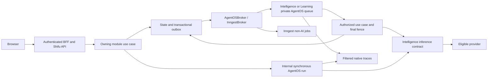

# Objective

Modo **complete**. Entregar SHIFU-103 com anexos privados e análise de arquivos
no Mentor, executando todos os fluxos ativos de IA por Agno AgentOS nos módulos
proprietários, substituindo a telemetria ativa Langfuse e estabelecendo evals
versionados e gates de CI. Esta é a única Spec da entrega; runtime, anexos,
armazenamento, UI, avaliação e CI são partes do mesmo contrato.

O aprendiz envia texto obrigatório com até cinco arquivos, consulta previews de
imagem no histórico e recebe respostas com fontes reais e limites de leitura.
S3 privado é a implementação de produção; MinIO é usado no desenvolvimento local.
Intelligence continua dono das experiências de IA e do lifecycle dos anexos;
Learning mantém autoridade sobre notas e efeitos pedagógicos; Shared contém
infraestrutura técnica e o port/provider neutro de armazenamento.

O baseline usa Agno 3.1.2, Inngest para respostas do Mentor e avaliações oficiais,
Langfuse opcional e Jev por HTTP direto. Ainda não existem entidades/storage de
anexos. O Mentor geral responde localmente, conforme
[mentor-context rev18](../mentor-context/spec.md). Planejamento com modelos,
memórias, resumos, ações e cota não são ativados nesta entrega. Inferência nova
para respostas do Mentor fica restrita à interpretação e consulta de anexos.

# Scope

### Runtime, operação e qualidade

| Área / ator | Incluído | Excluído ou adiado |
| --- | --- | --- |
| Intelligence | IntelligenceWorkflowsRegistry e AgentOS interno próprio; título síncrono; pipeline local do Mentor; serviços de inferência; telemetria anônima | Ativar writer/reviewer de respostas gerais, planejamento, memória, resumos, ações ou cota |
| Learning | LearningWorkflowsRegistry e AgentOS interno próprio; avaliação de código preliminar, oficial, diagnóstica e revisão; separação do job misto atual | Alterar pesos, modelos de questão, notas, feedback, progresso ou prática no navegador |
| Shared | AgentOSBroker reutilizável, cliente interno, settings e exportação filtrada; recursos PostgreSQL/Redis separados por módulo | Regras dos módulos; substituir jobs sem IA do Inngest |
| Desenvolvimento e operação | Execução interna autenticada; migrations; fixtures descartáveis; traces filtrados; CI Server/Web com jobs independentes e build próprio, sem verify | Expor APIs nativas ao browser; apagar histórico/volumes do Langfuse |
| Qualidade | Prompts nos agentes e datasets sintéticos no Git; Eval Suites completas obrigatórias na validação, execução real explicitamente habilitada e relatórios | Studio, publicação de prompts independente do deploy, datasets com dados de produção |

Disposição de produto: Intelligence RP-01/03/04/05/06/11/13 **partial**, apenas
preservação dos contratos ativos e infraestrutura; RP-07–10/14/15/17 **deferred**.
Learning RP-09/11/12/13/14/24/29 **partial**, preservação da avaliação entregue.
Os resultados completos dos PRDs não são declarados implementados por esta migração.

### Anexos e experiência do aprendiz

| Área / ator | Incluído | Excluído ou adiado |
| --- | --- | --- |
| Aprendiz autenticado | PNG, JPG/JPEG, WebP, PDF, JSON, CSV, TXT; texto obrigatório; até 5 arquivos de até 10 MB cada | Envio só de arquivos, áudio/vídeo, outros formatos, compartilhamento |
| Compositor e histórico | Página/FAB, desktop/mobile, preparação individual, remoção/substituição antes de enviar, preview de imagem, reabertura autorizada | Editar mensagem ou substituir arquivo já enviado |
| Análise | Extração local, interpretação visual elegível, recuperação mínima de trechos, PDFs textuais/escaneados, fontes e cobertura parcial | Internet, plugins/OCR externos sem elegibilidade, executar arquivos/código |
| Persistência e operação | S3 privado, MinIO local, metadados/chunks com escopo, lifecycle e reconciliação | Alterar política de retenção; concluir o fluxo ausente de encerramento de conta |
| Personalização e pedagogia | Preservar limites de acesso, diagnóstico e Learning; não tratar arquivo como fato pessoal | Implementar SHIFU-101/memórias, planejamento, ações, cota ou geração geral |

RP-16 **full** para análise/anexos, exceto integração futura com criação de memória,
que permanece **deferred** como RP-14. RP-01/03/04/05/06/11/12/13 **partial** para
garantias desta entrega. JN-20 é a jornada principal. Desenho e adaptações aprovadas
estão em [design/handoff.md](design/handoff.md); não alteram o arquivo Pencil.

# Behavior Contract

IDs RF/CA/CI/VM são únicos nesta Spec. Prefixos I: e L: identificam Intelligence
e Learning; referências RP/JN sem prefixo na seção de anexos pertencem a Intelligence.
IDs canônicos RP/JN não foram renumerados. Requisitos do runtime preservam RF-01–08
e CA-01–07; anexos usam RF-09–17 e CA-08–14. A tabela de migração de IDs está no
histórico de consolidação.

### Runtime e contratos preservados

Prefixos `I:` e `L:` identificam respectivamente Intelligence e Learning nas fontes.

| ID | RP/JN/source coverage | Observable required behavior |
| --- | --- | --- |
| RF-01 | I:RP-01/04/05/06; pedido global aprovado | Todo fluxo ativo de IA passa pelo runtime interno do módulo proprietário: título, serviço de decisão Jev e execução de respostas do Mentor. NLP continua determinístico e reproduzível; respostas gerais continuam locais sem geração/revisão. Nenhuma capability dormente é ativada. |
| RF-02 | I:RP-03/06; L:RP-09/11/12; compatibilidade aprovada | Título mantém primeira mensagem limitada a 1000 codepoints, uma tentativa de até 3 s, fallback atual e limite de 120 caracteres. Feedback preliminar mantém HTTP 200 síncrono, sem tentativa oficial, nota persistida, progresso ou outbox. |
| RF-03 | I:RP-06; L:RP-13/14; JN-08/11 | Trabalho assíncrono admitido sobrevive a reinício; duplicação, reentrega e resultados tardios não duplicam efeitos. Falha preserva histórico/answer congelada e permite retry previsto no produto. Nenhum status de sucesso antes do efeito obrigatório. |
| RF-04 | I:RP-03/11/13; L:RP-06/07/14/21/22/29 | Autorização é revalidada antes de executar e antes de aplicar efeitos. Cancelamento, exclusão, encerramento de conta, abandono de diagnóstico e substituição de experiência invalidam resultados antigos. Runtime não recria objetos excluídos. |
| RF-05 | L:RP-11/12/13/20/24/27 | Jev mantém decisões fechadas sobre snapshot autorizado. Learning valida chaves/níveis, calcula nota e efeitos; falha/inconclusivo obrigatório nunca vira zero, nota parcial ou redistribuição de pesos. Revisão preserva resultado oficial concluído e diagnóstico não revela resultados individuais. |
| RF-06 | I:RP-01/11/13; L:RP-24/29 | Inferência principal, alternativa e juiz de eval usam endpoint elegível ZDR e logging de prompts desligado no agregador. Tokens, credenciais, prompts, conteúdo privado e respostas brutas não entram em traces/logs/registros operacionais do AgentOS. Configuração inadequada falha de forma segura. |
| RF-07 | I:RP-13; L:RP-29; substituição aprovada | AgentOS substitui o uso atual do Langfuse; telemetria contém somente atributos permitidos e tokens/custo efetivamente informados. Falha de telemetria não causa falha de negócio. Histórico do Langfuse não é apagado. |
| RF-08 | I:RP-01/13; L:RP-11/24; suíte aprovada | Regressão usa prompts e casos sintéticos versionados, identifica versão/modelo e retorna relatório e exit code. Suites de agentes não substituem testes de execução dos workflows, persistência ou autorização. |

| ID | RF coverage | Given | When | Then | Checks |
| --- | --- | --- | --- | --- | --- |
| CA-01 | RF-01/02 | App composta e endpoints controlados | Criar conversa, responder sem arquivo, pedir feedback preliminar | Contratos atuais preservados; título passa pelo AgentOS; resposta geral não chama modelo; prévia não cria efeito oficial | CI-01/02; VM-01 |
| CA-02 | RF-03 | Outbox comprometido e workers reais | Perder notificação, reiniciar AgentOSBroker/worker e duplicar entrega | Trabalho retomado ou falha recuperável visível, nunca perdido; mesmo efeito aplicado uma vez | CI-03 |
| CA-03 | RF-04 | Run pendente/em execução | Cancelar/excluir/abandonar/encerrar conta ou recriar experiência | Resultado tardio rejeitado, nenhum dado reaparece, outras experiências preservadas | CI-03/04 |
| CA-04 | RF-05 | Rubrica congelada e Jev controlado | Retornar todos os níveis, chaves inválidas, falha ou inconclusivo | Mesmas decisões/nota/feedback válidos; falha não fabrica nota; diagnóstico/revisão mantêm restrições | CI-02/04 |
| CA-05 | RF-06/07 | Marcadores sintéticos em conteúdo, erro e credencial | Executar sucesso, timeout, retry e falha de tracing | Nenhum marcador privado no DB/queue/traces/logs; atributos permitidos presentes; custo ausente não inventado; endpoint inelegível não chamado | CI-03/05 |
| CA-06 | RF-08 | Versão fixa de prompt/modelo e dataset sintético | Executar suite selecionada e caso propositalmente reprovado | Relatório reproduzível por configuração, sem alegar determinismo do modelo; reprovação retorna exit não zero; nenhuma escrita de produto | CI-06 |
| CA-07 | RF-01/03 | Migração aplicada e jobs sem IA registrados | Executar job determinístico Learning e consumidores preservados | Inngest mantém caminho sem IA; somente um destino executa cada pedido misto/legado | CI-03/04/07 |

### Anexos, fontes e lifecycle

| ID | RP/JN/source coverage | Observable required behavior |
| --- | --- | --- |
| RF-09 | RP-16; JN-20; SHIFU-103 | Informar formatos/limites antes de selecionar; validar individualmente, máximo 5 arquivos e10MB por arquivo. Texto não vazio continua obrigatório. Arquivos inválidos/falhos não apagam texto ou irmãos. |
| RF-10 | RP-03/06/16 | Preparar arquivos no draft sem criar conversa vazia. Upload/processamento/status independentes. Envio associa somente arquivos prontos/parciais autorizados, texto e resposta à mensagem de forma atômica; falha impede envio até remover/substituir o arquivo. |
| RF-11 | RP-03/12/16; preview solicitado | Página e FAB compartilham draft; imagens exibem preview no compositor e na mensagem histórica. Demais formatos exibem nome, tipo, tamanho e estado. Reabrir conversa mantém anexos reais e privados. |
| RF-12 | RP-16 | Extrair texto localmente e interpretar imagem/página escaneada somente por inferência elegível. Distinguir páginas analisadas, ilegíveis e não interpretadas. Arquivo totalmente ilegível falha; parcial utilizável pode prosseguir com limitação explícita. |
| RF-13 | RP-04/05/16 | Consultar apenas anexos da conversa atual quando necessários. Respostas identificam arquivo e página/trecho real; não alegam ler partes não analisadas. Aceitar texto indicando páginas/trechos específicos; fonte inacessível não é usada. |
| RF-14 | RP-04/05/13/16 | Arquivo não amplia acesso nem contorna diagnóstico/conteúdo bloqueado/limites de dicas. Instruções no arquivo são dados não confiáveis; não mudam políticas, ferramentas ou autoridade. Não executar código, macro, fórmula ou endereço contido no arquivo. |
| RF-15 | RP-11/13/16 | S3/MinIO sem acesso público; toda leitura/download/preview valida conta ativa e proprietário. Conteúdo e cópias derivados seguem lifecycle, sem URLs públicas ou tokens no browser/logs. Falha/timeout preserva estados recuperáveis, não fabrica análise. |
| RF-16 | RP-03/06/11/13/16 | Cancelamento/exclusão/revogação bloqueiam efeitos antigos; exclusão remove acesso imediatamente e alcança originais, previews, chunks/índices e cópias temporárias. Workers/retries não recriam arquivos. S3 e banco são reconciliados sem alegar transação distribuída. |
| RF-17 | RP-14/16 | Conteúdo de arquivo não cria memória automaticamente nem prova fatos pessoais. Indicação do usuário é condição necessária para integração futura com SHIFU-101; esta entrega não cria memória. |

| ID | RF coverage | Given | When | Then | Checks |
| --- | --- | --- | --- | --- | --- |
| CA-08 | RF-09/10 | Draft com texto e seleção | Selecionar0/1/5/6 arquivos, limites e formatos válidos/inválidos | Limites por arquivo, erro identificado, texto/irmãos preservados; texto em branco nunca envia; zero arquivos conserva comportamento local | CI-11/12/14 |
| CA-09 | RF-10/11 | Nova conversa ou conversa selecionada | Preparar e enviar; repetir chave; alternar página/FAB | Nenhuma conversa vazia; associação única e imutável; mesmos arquivos/texto replay, divergência conflito; preview e estado compartilhados | CI-11/12/14; VM-02/03/04 |
| CA-10 | RF-12 | Arquivos de cada formato, PDF textual/escaneado/misto | Processar e falhar parcialmente | Conteúdo real ou falha segura; cobertura por página correta, irmãos preservados e parcial explicado | CI-13/16 |
| CA-11 | RF-13/14 | Arquivo da própria conversa e contexto autorizado | Perguntar geral, pedir parte específica ou tentar bypass | Geral permanece local; somente trechos necessários entram em inferência; referências reais e cobertura explícita; diagnóstico/acesso bloqueado prevalecem | CI-13/15/16 |
| CA-12 | RF-15/16 | Contas A/B e arquivo privado | Ler/trocar IDs, revogar acesso, cancelar/excluir durante processamento | Acesso não autorizado negado; nenhuma URL pública/secret leak; callbacks tardios não escrevem nem recriam; cleanup comprovado | CI-11/12/13 |
| CA-13 | RF-11 | Mensagem com imagem e outros formatos | Reabrir e navegar por teclado no desktop/mobile | Preview histórico carregado pela BFF privada, alt/nome acessível, fontes navegáveis, composer alcançável sem overflow | CI-14/15; VM-02/03/04 |
| CA-14 | RF-17 | Arquivo descreve pessoa ou dificuldade | Analisar com/sem declaração pessoal | Nenhuma criação de memória neste slice; nenhuma inferência pessoal tácita | CI-13/16 |

# Technical Contract

## Architecture Mapping

As duas árvores abaixo são vistas complementares do mesmo escopo final: runtime
compartilhado e extensão de anexos/UI. Um caminho repetido identifica o mesmo
arquivo e uma única implementação; [N] é novo em relação ao baseline da entrega.
As fases Core, registries, storage e runner são compartilhados por todos os
consumidores descritos, sem segunda instância ou segundo workflow de inferência.

### Runtime, registries, evals e CI

Intelligence possui prompts, agentes e providers de inferência. Cada módulo possui
os workflows nativos das suas operações: Intelligence para Mentor e Learning para
avaliação oficial. Shared possui fila, brokers e coordenação técnicos, sem Workflow
de entrega envolvendo outro Workflow.
Cada módulo compõe seus workflows no próprio WorkflowsRegistry. A aplicação
inicia/encerra os registries e conecta somente os ports Shared entre módulos.
Não há composition/agentos_runtime.py nem um Shared AgentOSRuntime com o catálogo
global; Composition continua apenas como autoridade de ligação entre módulos.

Rule Pack: [Python](../../../rules/python-conventions-rules.md),
[TypeScript](../../../rules/typescript-conventions-rules.md),
[Core](../../../rules/core-layer-rules.md),
[Application](../../../rules/server-app-layer-rules.md),
[REST](../../../rules/rest-layer-rules.md),
[Provider](../../../rules/provision-layer-rules.md),
[Database](../../../rules/database-layer-rules.md),
[Messaging](../../../rules/messaging-layer-rules.md),
[AI](../../../rules/ai-layer-rules.md),
[Use cases](../../../rules/use-case-testing-rules.md),
[Controllers](../../../rules/controllers-testing-rules.md),
[Jobs](../../../rules/jobs-testing-rules.md).

As regras atuais exigem Inngest para durabilidade/prova de IA e proíbem suites
diretas de agentes. O pedido aprovado autoriza alterar essas autoridades na
implementação: AgentOS será a fronteira real para workflows assíncronos com IA; Inngest continua
para os demais. Uma exceção explícita permitirá evals sintéticos opt-in em
`apps/server/evals`, sem transformá-los em testes unitários de adapters.
Nenhuma redução das garantias de integração, privacidade ou domínio é autorizada.

| Action | Boundary | Element / Path | Required change |
| --- | --- | --- | --- |
| Create | Shared messaging | `shared/messaging/agentos/` | AgentOSBroker/cliente/settings/observabilidade técnicos reutilizáveis; nenhuma instância AgentOS ou lista global de workflows |
| Modify | Shared outbox | `shared/core/interfaces/events_repository.py`, adapter SQLAlchemy e `shared/messaging/inngest/inngest_broker.py` | Reserva/ack por destino; seleção exclusiva por evento/run; manter semântica transactional e stable event-row IDs |
| Create/Modify | Intelligence AI/provider | `intelligence/ai/agno/`, providers e `intelligence/ai/intelligence_workflows_registry.py` | Migrar título legado para layout atual; workflow Learning usa Step com provider Jev HTTP injetado; adapter consumidor preserva port Shared |
| Create/Modify/Delete | Domain execution | Fases públicas de preparação/publicação/finalização do Mentor; preparação e conclusão Learning | Extrair operações Core da orquestração monolítica; preservar guardas, claims, journaling e efeitos; retirar ProcessMentorResponseUseCase após migrar consumidores |
| Create | Module registries | `intelligence/ai/intelligence_workflows_registry.py`, `learning/ai/learning_workflows_registry.py` | Cada registry constrói os workflows locais, sua instância AgentOS, app/cliente internos, fila e AgentOSBroker; app.py administra lifecycle e conexões Shared |
| Delete after consumer migration | Legacy global assembly | `composition/mentor_answer_runtime.py`, `composition/mentor_telemetry.py` | Mover a montagem de dependências específicas para IntelligenceWorkflowsRegistry; app.py recebe ports dos registries, sem montar workflows individuais |
| Create | Module workflows | `intelligence/ai/agno/workflows/`, `learning/ai/agno/workflows/` | Um Workflow nativo registrado por operação, com Steps de preparação, inferência e conclusão; sem Workflow filho de entrega ou inferência |
| Delete/Modify | Migrated consumers | Job Inngest de resposta do Mentor, registro Learning misto e fixtures legadas | Remover caminho Mentor antigo; manter ramo determinístico Learning; migrar todas as seleções afetadas, incluindo NLP e privacidade, para o runtime correspondente |
| Replace | Telemetry | `LangfuseMentorTelemetryProvider`, `composition/mentor_telemetry.py` | Preservar Core port; substituir adapter por AgentOS/OpenTelemetry filtrado; remover dependência/config ativa Langfuse com lockfile, sem apagar dados |
| Modify | CI | `.github/workflows/server-app-ci.yaml` | Separate types/lint/architecture/unit/integration/build/mutation-shards/evals jobs; controllers and all jobs in one integration job; unfiltered real evals and individual job status with no verify aggregate; preserve auxiliary proof |
| Modify | Web CI | `.github/workflows/web-app-ci.yaml` | Independent type-check/lint-check/architecture-check/unit-tests/integration-tests/build jobs; remove verify; preserve commands, browser infrastructure, triggers and reports |
| Create | Quality | `apps/server/evals/`, scripts de cobertura e fixture AgentOS | Suites completas e relatórios obrigatórios; execução real explicitamente habilitada, infraestrutura real descartável; métricas por arquivo explícito |

Árvore esperada, caminhos novos são **planned**; helpers privados podem variar:

```text
.github/workflows/[M] server-app-ci.yaml, web-app-ci.yaml
apps/server/
  [M] pyproject.toml, uv.lock, tach.toml
  evals/
    [N] run.py
    [N] generate_mentor_title_eval.py
    [N] evaluate_code_activity_eval.py
  [N] evals/data/mentor-title.json, code-rubric.json
  [N] scripts/check_changed_coverage.py
  src/shifu/
    [M] app.py
    shared/
      core/interfaces/[M] events_repository.py
      core/interfaces/[M] outbox_event.py
      messaging/
        agentos/[N] agentos_settings.py, agentos_broker.py, agentos_client.py, agentos_observability.py
        inngest/[M] inngest_broker.py
      database/sqlalchemy/repositories/[M] events_repository.py
    intelligence/
      pipes/[M] intelligence_pipe.py
      ai/[N] intelligence_workflows_registry.py
      ai/agno/
        agents/[N] mentor_title_agent.py
        outputs/[N] mentor_title_output.py
        workflows/[N] agno_generate_mentor_title_workflow.py, process_mentor_response_workflow.py
      providers/
        mentor_title/agentos/[N] agentos_mentor_title_provider.py
        code_rubric_assessor/agentos/[N] agentos_code_rubric_assessor_provider.py
        telemetry/agentos/[N] agentos_mentor_telemetry_provider.py
      core/domain/structures/[N] prepared_mentor_response.py
      core/use_cases/[N] prepare_mentor_response_use_case.py, publish_mentor_response_block_use_case.py, assert_mentor_response_current_use_case.py, renew_mentor_response_claim_use_case.py, release_mentor_response_claim_use_case.py, fail_mentor_response_use_case.py, record_mentor_inference_usage_use_case.py
      core/use_cases/[M] finalize_mentor_response_use_case.py
    learning/
      pipes/[M] learning_pipe.py
      ai/[N] learning_workflows_registry.py
      ai/agno/workflows/[N] evaluate_code_activity_workflow.py
      core/domain/structures/[N] prepared_code_question_assessment.py, code_question_assessment_decisions.py, prepared_code_activity_evaluation.py
      core/use_cases/[N] prepare_code_activity_evaluation_use_case.py
      messaging/inngest/jobs/[M] evaluate_choice_activity_job.py
      core/use_cases/[M] evaluate_choice_activity_use_case.py
  tests/
    fixtures/[N] agentos_fixture.py
    intelligence/server/controllers/[M] test_create_mentor_session_controller.py, test_mentor_runtime_composition_controller.py
    learning/server/controllers/[M] test_preview_activity_question_feedback_controller.py
    intelligence/core/use_cases/[N] test_prepare_mentor_response_use_case.py, test_publish_mentor_response_block_use_case.py, test_assert_mentor_response_current_use_case.py, test_renew_mentor_response_claim_use_case.py, test_release_mentor_response_claim_use_case.py, test_fail_mentor_response_use_case.py, test_record_mentor_inference_usage_use_case.py
    intelligence/core/use_cases/[M] test_finalize_mentor_response_use_case.py
    learning/core/use_cases/[N] test_prepare_code_activity_evaluation_use_case.py
    learning/core/use_cases/[M] test_evaluate_choice_activity_use_case.py, test_preview_activity_question_feedback_use_case.py
    intelligence/server/agentos/[N] test_process_mentor_response_workflow.py, test_mentor_privacy_workflow.py, test_mentor_nlp_workflow.py
    learning/server/agentos/[N] test_evaluate_code_activity_workflow.py
    messaging/inngest/jobs/learning/[M] test_evaluate_choice_activity_job.py
apps/web/scripts/[N] check-changed-coverage.ts
documentation/
  [M] architecture.md, tooling.md, rules.md
  rules/[M] ai-layer-rules.md, messaging-layer-rules.md, jobs-testing-rules.md, server-app-layer-rules.md
  features/intelligence/mentor-attachments/[N] spec.md, interactive-spec.html
```

Alembic revisions are generated during implementation with the existing
`uv run poe db:migrate <message>` command; actual filenames are not known now.
CI workflow files are selected from the actual affected registration and fixtures;
Server integration selection must include the new real runtime and retain non-AI
Inngest checks. Update `.env.example` files for typed server-only settings.
Existing legacy title classes under `ai/generative/agno` are removed only after
all composed consumers switch. Old Langfuse integration tests are replaced by
privacy/telemetry runtime cases, not silently retained as dormant passing evidence.

### Workflow-named eval classes and single runner

Each capability has one eval class, named for its owning workflow, under
apps/server/evals. GenerateMentorTitleEval in generate_mentor_title_eval.py
covers AgnoGenerateMentorTitleWorkflow; EvaluateCodeActivityEval in
evaluate_code_activity_eval.py covers EvaluateCodeActivityWorkflow. The
attachment contract includes ProcessMentorResponseEval and PrepareMentorAttachmentEval.
Names associate quality evidence with the operation; these classes are not
Workflow subclasses, production registrations or a second workflow framework.
PurgeMentorAttachmentsWorkflow has no model-quality target and remains covered
by real lifecycle/integration checks rather than an artificial quality eval.

Each class owns dataset loading, its native Case definitions or captured-decision
cases, and capability-specific scoring. Its constructor receives the production
agent(s)/eligible judge or isolated composed rubric consumer, never production
account data. Agent cases use native Case/run_cases; Jev cases score captured
consumer decisions without pretending Jev or Workflow is a native Case target.
Private scorer helpers may remain in the same file; no mandatory global scorer
hierarchy or eval_runtime container is introduced.

run.py is the sole CLI. It constructs selected eval dependencies through the
owning reusable factories, applies real/double mode and eligible model/budget
settings, closes owned resources and merges normalized reports. It does not
start production registries/workers, run domain policies or duplicate agents.
Each eval exposes run(name: str | None = None, tag: str | None = None) returning
its normalized JSON-compatible suite report; native SuiteResult is normalized by
the owning class. Reports retain case IDs, outcomes/errors/skips/duration and
suite status plus the version/profile metadata required by CI-06. The runner's
metadata adds mode and selected scope, not raw prompts or credentials.

CLI contract from apps/server:

```bash
uv run python evals/run.py --output-dir test-results/evals
uv run python evals/run.py --workflow generate-mentor-title --output-dir test-results/evals
uv run python evals/run.py --workflow generate-mentor-title --name python_lists
uv run python evals/run.py --tag smoke
uv run python evals/run.py --list
```

No --workflow runs every available eval class and is the CI invocation. Local
validation always supplies --workflow for changed/affected operations; the CLI
does not infer Git scope. --workflow is repeatable to select multiple impacted
operations without running unrelated evals. Explicit selection accepts
names generate-mentor-title, evaluate-code-activity, process-mentor-response
and prepare-mentor-attachment.
These are eval selector names; they do not rename native workflow IDs. --name
and --tag narrow cases within selected classes; --list enumerates matching
cases without model calls. Unknown workflow/case/tag or an empty executable
selection exits 2. Exit 1 means a selected case failed, a required case was
skipped, setup/report writing failed or a required real run was blocked; exit 0
requires a nonempty successful selection. Running all continues across failed
classes and reports every selected class. Every full CI run requires all four eval classes; missing attachment classes
cannot be counted as passing validation.
--output-dir writes separate workflow-named JSON reports and a summary.json;
it defaults to ignored test-results/evals. The report identifies filtered runs
as partial at the case level: smoke/name selection never satisfies acceptance.
Selecting complete affected workflow classes is sufficient for the local gate;
only CI requires the complete catalogue.
SHIFU_RUN_REAL_AI_EVALS=1 enables eligible real inference; without it results
are marked doubles and cannot satisfy the required real-model quality gate.

### Local affected scope and full CI evals

Local verification runs all cases only for changed/affected workflow quality
classes, with explicit --workflow selections recorded in Evaluation. The impact
selection includes changes to a workflow's agents/prompts/model configuration,
consumed typed contracts, retrieval/extraction inputs, eval cases or scorers.
Changes to shared dependencies select every demonstrably affected consumer
workflow, not merely the file whose name appears in the diff. A common runner,
judge/model factory or shared dataset/scoring change affecting all classes may
therefore require all locally, with the reason recorded. No impact means local
quality evals are Not applicable with a documented reason; runtime/persistence
checks remain independently selected. Every impacted class runs its complete
real-model cases; --name/--tag are iteration tools only.

CI always runs every available eval class with every case, regardless of changed
workflow selection, using SHIFU_RUN_REAL_AI_EVALS=1 and no --workflow/--name/--tag
filter. Amend the existing server-app-ci.yaml with a required evals job and
expose its status directly, without an aggregate verify job. Keep current workflow triggers;
inside every triggered Server CI run the eval catalogue is unfiltered. Resolve
eligible credentials through CI secrets/settings, enforce bounded budgets and
upload all reports/summary even after failure. Missing credentials or eligible
service, skipped/empty cases, doubles-only output or report failure cannot yield
a successful required job. A separate doubles run may prove runner/scorers but
cannot replace full real CI quality evidence. No external CI/secrets are changed
while authoring; this is an implementation obligation.

Local scope proof and complete current-head CI proof are distinct: local results
cover affected classes; published acceptance needs successful full current-head
CI evals. Local-only delivery records CI publication as not applicable, without
requiring unrelated local evals or claiming full CI was executed.

### Server CI job boundaries

The Server workflow owns the following separate validation categories. These
are CI execution boundaries; all controller and asynchronous job tests remain
server integration tests regardless of the transport under test.

| Job category | Required selection / command from apps/server |
| --- | --- |
| type-check | uv run poe check:types |
| lint-check | uv run poe check:lint |
| architecture-check | uv run poe check:architecture |
| build | uv build, then require source distribution and wheel under dist/ |
| unit-tests | uv run poe test:unit plus existing focused mutation-runner/report tooling checks as steps in this category |
| integration-tests | Controllers/REST and registered Inngest/AgentOS job/workflow integration; current uv run poe test:integration plus uv run poe test:jobs, with real AgentOS and Inngest flags enabled |
| mutation | Preserve separate matrix shards 1–12: uv run poe test:mutation --all --core --shard N/12 |
| evals | SHIFU_RUN_REAL_AI_EVALS=1 uv run python evals/run.py --output-dir test-results/evals; no workflow/name/tag filter |

Merge the existing inngest-jobs setup/commands into the integration job; do not
add a separate AgentOS job-test CI category. Keep controller and job commands
as distinguishable steps/reports inside integration. Provision disposable DB,
Redis, native Inngest/AgentOS fixtures and required pinned local NLP artifacts
before those steps. The current test:integration selector already discovers
module-owned server/agentos tests but does not cover legacy
tests/messaging/inngest/jobs, so the existing test:jobs step is still required.
No empty/skipped runtime selection counts as integration success. Existing
required tooling checks move into unit-tests rather than disappearing with the
standalone mutation-tooling job. Preserve distribution build/verification as
steps in a separate build job, independent of architecture-check. Remove
the Server verify aggregate entirely; retain mutation-summary only to collect
shard reports and enforce thresholds, including failed or missing shards. Each
CI category exposes its own status. Repository branch-protection changes are
external configuration and are not performed by this local workflow edit. Reports for integration, mutation and evals
remain available on failure. This grouping does not broaden local validation:
local integration and eval selections stay scoped to affected consumers.
The planned CI file amendment must reconcile needs/result checks when removing
old standalone inngest-jobs, mutation-tooling, distributions and verify entries; no
required proof may be silently dropped or replaced by a skipped dependency.

### Web CI job boundaries and individual statuses

The Web workflow follows the same independent-check convention as Server. Its
existing build remains a separate job, and its verify aggregate is removed.
The exact job IDs in both CI files match the agreed names; no stale needs or
needs.<old-id>.result references remain. Renaming jobs does not change their
application commands or introduce Server-only eval/mutation categories in Web.

| Web job ID | Required command from repository root |
| --- | --- |
| type-check | pnpm --filter web check:types |
| lint-check | pnpm --filter web check:lint |
| architecture-check | pnpm --filter web check:architecture |
| unit-tests | pnpm --filter web test:unit |
| integration-tests | pnpm --filter web test:integration |
| build | pnpm --filter web build |

Preserve each job's checkout/pnpm/Node setup and frozen-lockfile installation.
The integration job retains its disposable PostgreSQL/Redis services, server
Python/uv installation and migration, Chromium installation, test environment,
real browser selection and Playwright report upload on failure. The build job
retains its existing server-only configuration inputs. Preserve existing workflow
triggers, concurrency and permissions. These CI job changes do not authorize
new frontend behavior, model inference, mutation tooling or an unrelated local
full test suite. Local validation stays selected by actual affected consumers.

Published delivery checks each applicable current-head Server/Web job status
and the mutation summary directly, with no verify umbrella. Jobs that fail or
are skipped/cancelled cannot stand in for their required proof. CI reports and
local scoped results remain distinct. Branch-protection settings are external;
this local change does not create or update required-check rules.
The already-requested CI-file organization does not implement AgentOS or eval
classes: the required Server eval job remains blocked until evals/run.py and
eligible model configuration are delivered. The user approved this written contract and requested ready status; successful YAML/static checks are not full CI evidence.

### Execution and public declarations

Existing synchronous consumer ports remain unchanged; they are framework-neutral
Protocols, not a second executable workflow type:

```python
class GenerateMentorTitleWorkflow(Protocol):
    def generate(self, first_message: str) -> str: ...

class CodeRubricAssessorProvider(Protocol):
    def assess(self, request: CodeRubricAssessmentInput) -> CodeRubricDecisions: ...
```

The title transport adapter is named `AgentOSMentorTitleProvider`; its legacy
Core Protocol name is compatibility only, not another Workflow class.
All concrete operation workflows subclass the same native Agno `Workflow`, are
registered directly and use the same runtime admission/lifecycle. Their visible
Steps contain the entire operation graph. Do not create a delivery Workflow that
calls an inference Workflow, or register an assessment child Workflow.

| Native operation | Owning path | Visible graph |
| --- | --- | --- |
| AgnoGenerateMentorTitleWorkflow | intelligence/ai/agno/workflows | Resolve private title handoff → title Agent → validate/store transient result |
| ProcessMentorResponseWorkflow | intelligence/ai/agno/workflows | Prepare/claim/context → publish local blocks → Core-selected attachment generation/review with bounded native Loop → publish approved blocks → finalize |
| EvaluateCodeActivityWorkflow | learning/ai/agno/workflows | Prepare frozen official source or synchronous assessment handoff → direct injected Jev assessment Step → Core grade/effects or transient decisions result |

The sole Learning workflow supports two strict transport variants: official mode
contains attempt_id/run_id; synchronous assessment mode contains only an opaque,
trusted one-shot handoff reference. The latter preserves the existing preliminary
Core consumer and returns decisions through that handoff, with no official writes.
`AgentOSCodeRubricAssessorProvider` calls this registered operation in assessment
mode. The workflow itself receives the underlying Jev implementation via the
Shared assessor port, never that AgentOS adapter; thus no recursion/nested run.

Jev remains the Intelligence-owned Decisions HTTP provider with
`typesafe/jev-1.13`, two attempts total for429/5xx/transport,0.5s delay and30s
request timeout. Native recovery must not multiply normal provider retries.
`CodeRubricAssessmentInput` and `CodeRubricDecisions` retain their existing shapes;
Learning computes scores and validates every saved key/level. No fake Agent is
introduced for Jev. New Learning-native orchestration does not import Intelligence
classes: Composition injects the Shared protocol. Amend AI Rules and narrow Tach
boundaries to permit module-owned native orchestration while Intelligence retains
all model/provider/prompt ownership. No blanket cross-module import exception.

New framework-free Core phase declarations (one public action per use case):

```python
@structure
class PreparedMentorResponse:
    attempt_id: str
    execution_owner: str
    account_id: str
    session_id: str
    learner_message_id: str
    context: MentorContextSnapshot
    local_blocks: tuple[MentorResponseBlock, ...]
    attachment_request: MentorGenerationRequest | None

class PrepareMentorResponseUseCase:
    def execute(self, attempt_id: str, execution_owner: str) -> PreparedMentorResponse | None: ...
class PublishMentorResponseBlockUseCase:
    def execute(self, attempt_id: str, execution_owner: str,
                block: MentorResponseBlock, expected_context: MentorContextSnapshot) -> bool: ...
class AssertMentorResponseCurrentUseCase:
    def execute(self, attempt_id: str, execution_owner: str) -> None: ...
class RenewMentorResponseClaimUseCase:
    def execute(self, attempt_id: str, execution_owner: str) -> bool: ...
class ReleaseMentorResponseClaimUseCase:
    def execute(self, attempt_id: str, execution_owner: str) -> None: ...
class FailMentorResponseUseCase:
    def execute(self, attempt_id: str, execution_owner: str,
                failure_code: str) -> MentorResponseStatus: ...
class RecordMentorInferenceUsageUseCase:
    def execute(self, attempt_id: str, execution_owner: str,
                usage: MentorInferenceUsage) -> None: ...

@structure
class PreparedCodeQuestionAssessment:
    question_key: str
    assessment_input: CodeRubricAssessmentInput
@structure
class CodeQuestionAssessmentDecisions:
    question_key: str
    decisions: CodeRubricDecisions
@structure
class PreparedCodeActivityEvaluation:
    attempt_id: str
    run_id: str
    questions: tuple[PreparedCodeQuestionAssessment, ...]
class PrepareCodeActivityEvaluationUseCase:
    def execute(self, attempt_id: str, run_id: str) -> PreparedCodeActivityEvaluation | None: ...
class EvaluateChoiceActivityUseCase:
    def execute(self, attempt_id: str, run_id: str,
                code_decisions: tuple[CodeQuestionAssessmentDecisions, ...] = ()) -> None: ...
```

Preparation owns active-account/source/claim/context and pedagogical routing.
Publication revalidates current account/context/session/attempt/claim and preserves
progressive, deduplicated blocks/events. Reuse the existing
`FinalizeMentorResponseUseCase.execute(account_id, session_id, learner_message_id,
content, attempt_id, execution_owner=None) -> bool`; it requires content exactly
equal to approved persisted blocks and applies the response once. Do not call the
old Process use case's private methods from Workflow. Remove its monolithic
orchestration and migrate its old test matrix into the phase consumers above.
Existing dormant general-generation components are not registered or activated;
any obsolete active linkage to AnswerMentorMessageWorkflow is removed, including
its old legacy consumer tests, while historical completed artifacts remain read-only.

An explicit opaque execution_owner identifies each Mentor execution, distinct
from the native queue lease. Retain five-minute domain claim and30-second renewal
through Core use cases; current ContextVar state is not assumed to survive native
Steps/deep copies/threads. Failure/cancel/finally cleanup is guarded by that owner;
reclaim cannot overwrite another owner or a terminal attempt. Inference remains
outside transactions, with Core assertion before each call and publication afterward.

Learning preparation uses frozen attempt/rubric, not current Curriculum source.
Completion accepts exactly one decision set per code question, rejects missing/
extra/duplicate sets and calculates choice/code parts and official effects inside
Core. Choice-only completion uses the empty default and stays on Inngest.
Preliminary consumer retains its public signature/Shared port, and adds post-call
active-account/revision revalidation before exposing existing feedback.

All native StepOutputs and persisted run inputs/outputs contain only IDs, opaque
references, closed status and counts. Private context/candidates/decisions are held
in execution-scoped memory/handoff, never registry-singleton mutable fields,
native session_state or unchecked agent StepOutput. Direct Agent calls inside
visible Steps return structured private results into that memory and only safe
references to the graph. No nested Workflow/arun to hide inference sequencing.
Each module registry builds and registers only its own workflow instances. Shared
receives module-scoped transport/settings/observability dependencies, not a global
workflow catalogue, business registrations or another Workflow constructor. Native queue jobs are
framework tickets only. Real runtime tests live under each owning module's
`tests/<module>/server/agentos`, enter registered HTTP/outbox/queue, and never invoke
Workflow/Step internals. Update Jobs/AI Rules and Tooling to govern that boundary.
One transaction owner per Core action; blocking SQL/SDK calls use worker threads.

No new public REST endpoint is introduced. Public Mentor creation, submit, SSE,
retry/cancel and Learning submission/preliminary/diagnostic contracts remain
unchanged, including existing status codes and immutable idempotency keys.

### Module workflow registries

`IntelligenceWorkflowsRegistry` lives under Intelligence ai and
constructs title, Mentor response, attachment preparation and purge workflows.
`LearningWorkflowsRegistry` lives under Learning ai and constructs
the sole EvaluateCodeActivityWorkflow, including its synchronous assessment mode.
These are Shifu composition/lifecycle objects, not additional Workflow subclasses
or Agno Studio registries. They do not execute domain rules themselves.
This unified delivery registers title, Mentor response, attachment preparation
and purge in Intelligence and code evaluation in Learning.

Each registry is directly in the owning module ai directory, beside the agno
package. This is a deliberate, user-approved composition exception to current
AI-layer Rules: only these registry files may assemble module providers/Core
operations and native AgentOS runtime resources through Shared technical helpers.
Workflow/Agent code retains the existing bans on direct SQL/ORM, controllers,
FastAPI and messaging transport. Registries do not implement domain persistence,
authorization, grading or retry business policy. Amend AI Rules, Rule routing,
Architecture and narrow Tach boundaries for these exact owning paths; do not open
a blanket exception for the ai package or cross-business-module imports.

Each registry owns a native AgentOS instance (IDs shifu-intelligence and
shifu-learning), its registered workflow set, internal app/client, durable queue,
module AgentOSBroker and bounded resource cleanup. No central runtime collects
both sets. Only modules with active AI operations instantiate a registry now;
future modules follow the same convention when needed.

Each registry constructs its local database/UoW adapter, clocks/IDs, own providers,
agents, use-case factories and workflows, using its owning Pipe reusable factories.
The global app supplies shared technical settings and necessary cross-module Core ports, starts their lifespans and exposes only existing Core
consumer dependencies to pipes/controllers. It imports no individual Workflow
class. It connects the Intelligence-owned Jev implementation through the Shared
CodeRubricAssessorProvider port to Learning's registry. The preview transport
adapter targets Learning's client; the Learning workflow receives the underlying
Jev implementation, never that adapter. Start Intelligence before Learning;
stop Learning before closing its borrowed Intelligence provider. There is no
cross-business-module concrete import and no root composition/agentos_runtime.py.

Queue/run/session/trace tables and DB pools are module-owned with separate schemas;
Redis coordination prefixes and queue concurrency/timeout settings are module
scoped. The underlying PostgreSQL/Redis services may be shared. Shutdown of one
registry closes only its owned pools/workers/client/handoff; it never disposes a
borrowed domain DB/provider or the other registry's resources. Its health and
workflow discovery report only its local registrations. A client cannot address
a foreign module workflow or consume a foreign module handoff.

AgentOSBroker instances reserve destination agentos:intelligence or
agentos:learning respectively, acknowledge only their own durable admission and
release only their own reservations. Reconnection/classification/deadlines retain
the outbox guarantees above. Shared technical code cannot import module registries
or route by business rules; each registry supplies its own canonical event mapping.

Required registered-boundary tests extend CI-03/04: both registries run together;
foreign workflow/handoff requests are rejected; each queue receives only its
module events; stopping/restarting one preserves the other registry and its
pending work; sanitized traces reach the correct module store; partial startup
failure cleans owned resources. Native schema constraints/DDL and global tracer
setup remain independently checked. No registry-owned direct test suite.

Dependencies are assembled inside each registry; no WorkflowsDependencies
bundle classes/files or externally assembled local use-case/provider graph remain.
Shared authority ports still cross module boundaries through app-level binding,
not concrete cross-business imports. The existing Shared access port is used for
account/revision checks; Learning does not call Mentor usage for grading/quotas.

```python
class IntelligenceWorkflowsRegistry:
    MODULE_ID: ClassVar[str] = 'intelligence'

    def __init__(self, settings: AgentOSSettings,
                 observability: AgentOSObservability,
                 access_provider: MentorAccessProvider,
                 context_provider: MentorContextProvider,
                 catalog_provider: MentorCatalogProvider) -> None: ...
    @property
    def client(self) -> AgentOSClient: ...
    @property
    def database(self) -> IntelligenceDatabase: ...
    @property
    def code_rubric_assessor(self) -> CodeRubricAssessorProvider: ...
    @property
    def mentor_title_provider(self) -> GenerateMentorTitleWorkflow: ...
    def lifespan(self) -> AbstractAsyncContextManager[None]: ...

class LearningWorkflowsRegistry:
    MODULE_ID: ClassVar[str] = 'learning'

    def __init__(self, settings: AgentOSSettings,
                 observability: AgentOSObservability,
                 assessor: CodeRubricAssessorProvider,
                 access_provider: MentorAccessProvider,
                 curriculum_content_provider: CurriculumContentProvider) -> None: ...
    @property
    def client(self) -> AgentOSClient: ...
    @property
    def database(self) -> LearningDatabase: ...
    def lifespan(self) -> AbstractAsyncContextManager[None]: ...
```

Owning Pipes expose ordinary create_* factories with explicit inputs and Core-port
return types, callable without Request/Depends. Example resulting additions:

```python
class IntelligencePipe:
    # Existing request getters remain unchanged; selected new factory excerpt.
    @staticmethod
    def create_database() -> IntelligenceDatabase: ...

class LearningPipe:
    # Existing request getters remain unchanged; selected new factory excerpt.
    @staticmethod
    def create_database() -> LearningDatabase: ...
```

The same pattern applies to actual local provider/use-case factories needed by
registry assembly: each returns its explicit Core port/action and has no Request
or Depends default. Existing factories already independent of Request may be
reused. Registry private builders choose/configure dependencies through those
methods; native workflow constructors receive resolved dependencies, never
FastAPI Request/Depends objects or owning Pipe imports. Each execution creates its
own use-case instance and enters its own Core UoW transaction.

At HTTP boundaries, existing Pipe get_* methods use Request.app.state and FastAPI
Annotated/Depends to return current registry-owned Core ports. app.py exposes only
those resolved ports using the existing state keys, so Pipes never import the
registry class or call back into it to construct dependencies; registry→own Pipe
factories remains acyclic. No fabricated Request or request-scoped SQL session is
captured for queue execution. FastAPI does not resolve Depends when an ordinary
Python worker calls a function; background workflows explicitly use the factory
path, with existing lifecycle/transaction ownership. No custom DI container or
manual solve_dependencies integration is introduced.

Learning's registry also receives the existing Shared CurriculumContentProvider
from app binding, required by EvaluateChoiceActivityUseCase for the skill catalog
and progress calculation. It injects this port into its local use-case factories;
worker execution never invokes the Request-based curriculum getter or constructs
Curriculum private infrastructure. No extra curriculum catalog port is introduced
without an actual consumer requirement.

Extend the narrow registry exception to importing its own module Pipe factory
methods only. Amend Application/AI Rules to distinguish reusable construction
factories from request getters; keep all other Workflow/Agent layering constraints.
Pipes/registries receive no direct test suite. Existing controller and registered
runtime checks prove both HTTP resolution and request-independent worker execution,
including execution after the initiating HTTP response/session has ended.

Constructing a registry does not start workers, run migrations or seed data.
Lifespan owns start/stop and failed-start cleanup; app.py enters Intelligence then
Learning and exits in reverse order. Each registry client is bound to its local
app and registrations. Synchronous transport adapters consume that client outside
Core; controllers/use cases keep only their existing neutral protocols.

### Durable admission, dispatch and migration

`AgentOSBroker` is the concrete infrastructure component in
`shared/messaging/agentos/agentos_broker.py`. Each module registry creates one broker
instance. It consumes committed requests only for its module destination and
submits directly to that module registered native workflow queue and acknowledges only durable acceptance. Its name replaces
AgentOSOutboxRelay; it is not a Workflow or a business-rule owner.

Public broker contract excerpts extend existing `EventsRepository` only at its
infrastructure-facing methods: `reserve_available(..., destination: str)` and
`find_earliest_wakeup(..., destination: str)` take a validated delivery destination;
other existing members remain unchanged. `OutboxEvent` gains destination metadata
with allowed values `inngest`, `agentos:intelligence`, `agentos:learning` or
temporarily `unrouted` during migration.
Use-case `add(event)` stays vendor-neutral. Composition injects owning-module
classification for legacy mixed Learning events, based on the saved immutable
attempt, before delivery reservation. Assignment is durable compare-and-set on
the event row; an unclassified row cannot be acked/dropped. Each broker can reserve
only its destination, so it cannot steal or mark another destination's work done.
Preserve all existing outbox fields and add the corresponding static migration.

Only a plain, registered, JSON/ID-only Workflow may use native
`POST /workflows/{workflow_id}/runs` with `background=true`. Admission must
receive the durable PENDING acknowledgement from an active queue worker. The
adapter rejects any unsupported payload/factory/media/version shape that would
fall back to a process-local task. `Workflow.arun(background=True)` alone is not
durability proof. Pending tickets contain event/run IDs, not private snapshots.

Core persists canonical events in its own transaction. Each module AgentOSBroker selects
its exclusive destination; ack happens only after durable admission. A crash
between admission and ack can cause duplicate tickets, so domain claim/unique
constraints keyed by event ID and exact attempt/evaluation-run ID fence effects.
Do not infer exactly-once inference or admission from queue support.

Current `intelligence/mentor.response.requested` carries attempt_id. Learning's
existing `learning/activity-submission.requested` carries its immutable attempt
reference; destination is derived from the saved submission type in the owning
module, never browser input. Preserve legacy pending requests via startup draining
and a data preflight: each legacy request is routed once to the new AI workflow or
existing deterministic job. Disabling an old consumer precedes enabling the new
consumer for the same namespace. No state reset, dropped pending rows or duplicate
current result is allowed. Failure leaves the row visibly retryable.

AgentOS PostgreSQL queue uses bounded attempts, claim/heartbeat and finite timeout.
Configure `max_attempts=2` for crash recovery, no unbounded retries; replay may
rerun work rather than resume completed Steps. Persisted domain claim must allow
recovery of abandoned processing without letting concurrent generations commit.
Transient provider failures already mapped to a terminal domain failure use the
existing user retry, with a new run identity and the same submitted answer.
Redis coordinates cross-worker cancellation/events; PostgreSQL/domain state remains
truth. Parent cancellation propagates to owned child inference, with final fences
even if the provider cannot cancel an in-flight HTTP request.

Alembic creates separate agentos_intelligence and agentos_learning schemas
with native tables and constraints
matching installed 3.1.2. Review static migration DDL; do not import runtime classes
in migrations. Configure `auto_provision_dbs=False`, precreate queue tables and
verify the runtime role cannot execute DDL: enqueue can otherwise lazily create
tables despite that flag. Upgrade preserves submitted answers, current runs and
titles; downgrade applicability is documented and verified in disposable DBs.

### Internal surface and privacy

Each module registry owns its internal ASGI app/client and native AgentOS lifespan.
The global app lifecycle starts/stops registries only; in-process authenticated
HTTP transport calls the intended module app without a public mount.
Native AgentOS routers must not be appended to Shifu's public FastAPI application.
No public access to sessions, agents, workflows, evals, files, scheduler or traces.
Service auth, explicit route allowlist and docs disabled apply to the internal
surface; native auth is not a substitute for Shifu account/resource authorization.

PostgresDb is explicit; agents doing inference do not inherit a database that
stores private input/output. Disable native telemetry, media/executor output/event
storage, history and caching unless separately authorized. Framework runtime
records store identifiers and safe status only. Private assessment snapshots are
passed only into nonpersistent execution after module authorization; resulting
domain results are stored solely by their owning module. Test actual framework
serialization, including failures and pending RunOutput, rather than flags alone.

For synchronous transient input (title text/preliminary rubric), use an opaque,
single-use in-memory handoff owned by the internal execution adapter, scoped to
trusted caller/capability and deadline. Native run input/output contains only its
opaque reference and safe completion state; private typed input/result remains
in the nonpersistent handoff and is released on success, timeout/cancel and
shutdown. This is not durable admission: process loss invokes the existing
synchronous failure/fallback. Queued workflows use persisted owning-module source IDs
instead; they never rely on that transient handoff for restart recovery. Native
db inheritance or store flags alone cannot justify private payloads in run records.
No handoff token is returned to browser or written to traces.

`MentorTelemetryProvider.scope` and `record_inference` remain the public port.
Replace concrete Langfuse references in routing with that port. Install the actual
OpenInference instrumentation extras needed for Agno 3.1.2; successful startup is
not proof of tracing because missing instrumentation currently only warns.
Configure the process-wide OpenTelemetry provider once before module registries start;
remove active Langfuse exporter registration. AgentOS setup_tracing does not expose
a sanitizer and does not replace an existing TracerProvider. Therefore install
an explicit pre-export allowlist processor/export boundary, or emit only safe
manual spans into the native trace store. Unfiltered native spans never reach DB.

Module registries receive the shared filtered observability service. The single
process-wide tracer exports safe spans to the intended module trace store using a
trusted module_id; neither registry calls setup_tracing to replace global state.
Both native AgentOS instances keep unchecked automatic tracing disabled.

Allowed attributes: trusted module_id, random correlation ID, capability/stage, model profile,
duration, safe outcome/failure class, and actual finite token/cost usage. Drop
user/session IDs, private inputs/outputs/tools, raw exception names/messages,
prompts and hidden reasoning from names, attributes, events and status descriptions.
Model/provider totals missing in a response remain absent. Telemetry failure is
best effort; operational run-status persistence needed for recovery is mandatory.

Apply canonical lifecycle to any personal runtime association: account closure
immediately denies access/effects and purges active copies/queues/caches within
24 h; minimal permitted logs/backups follow their 30-day limits. Do not assume
native queue retention alone satisfies deletion. A late native framework write
must be fenced or reconciled into the same purge. Identity's complete deletion
producer/coordination is not implemented here; consume the existing
`identity/account.deleted` shape at the boundary and prove it with fixtures.
No claim that the missing production account-close flow has been delivered.

### Contratos de anexos e UI

Owner: Intelligence. Rule Pack: Python, TypeScript, Core, UI, Web Routing, REST,
Provider, Database, Messaging, AI, Server Application, Use-case/Controller/Job/Widget
Testing, conforme [router de Rules](../../../rules.md). O contrato de runtime nesta Spec
reconcilia as regras de Inngest-only e a exceção de evals; anexos reutilizam essa
infraestrutura e não criam testes diretos de adapters/agents/repos.

| Action | Boundary | Element / Path | Required change |
| --- | --- | --- | --- |
| Create | Intelligence Core | Batches, anexos, chunks e ports/use cases abaixo | Lifecycle/ownership e associação à mensagem; nenhuma dependência S3/Agno/FastAPI/Core |
| Modify | Existing Core | Create/Submit/Get/Remove Mentor use cases, PrepareMentorResponseUseCase/PublishMentorResponseBlockUseCase e repositories | Fingerprint v2 com arquivos, projections, retrieval autorizado e cleanup/fences; preservar v1 e as fases públicas do contrato de runtime desta Spec |
| Create | Database | Models/mappers/repositories para batches, anexos e chunks | FK/unique/checks/locks e Alembic com backfill vazio para mensagens existentes |
| Create | Shared Core / Providers | FileStorageProvider e S3FileStorageProvider | Port técnico neutro e adapter S3/MinIO em Shared; somente I/O de objetos e tradução segura de erros, sem dependências de Intelligence |
| Create | Intelligence Providers | Extração local | Decodificação limitada e resultados de extração tipados; autorização e lifecycle permanecem no Core de Intelligence |
| Create | AI | Agentes visuais/resposta, outputs estruturados e workflows | Entrada mínima, cobertura/citações, perfil principal/alternativo elegível, revisão limitada |
| Create | REST and messaging | Controllers batch/arquivo; workflows AgentOS | Rotas públicas Shifu protegidas; registro nativo interno e outbox por IDs |
| Modify/Create | Web | Context compartilhado, actions/queries, composer e MessageItem | Estado único, upload/previews/fontes via BFF; filhos puros reutilizados |
| Modify | Catalog/config | FAQ, manifests, examples, settings/Compose | Retirar FAQ de anexos indisponíveis; gerar índice compatível; MinIO e dependências explícitos |

Árvore esperada (todos `[N]` são planned; organização de helpers privada):

```text
apps/server/
  [M] pyproject.toml, uv.lock
  rest-client/intelligence/[M] intelligence.rest
  rest-client/intelligence/[N] mentor-attachments.rest
  src/shifu/
    [M] app.py
    intelligence/
      ai/[N] intelligence_workflows_registry.py
      core/
        domain/
          entities/[N] mentor_attachment_batch.py, mentor_attachment.py
          enums/[N] mentor_attachment_status.py
          structures/[N] mentor_attachment_view.py, mentor_attachment_chunk.py, mentor_attachment_source.py, mentor_attachment_extraction.py, mentor_attachment_batch_view.py, mentor_attachment_file.py, prepared_mentor_attachment.py
          structures/[M] mentor_response_block.py, mentor_generation_request.py
          events/[N] mentor_attachment_preparation_requested_event.py, mentor_attachment_cleanup_requested_event.py
        interfaces/[N] mentor_attachments_repository.py, mentor_attachment_batches_repository.py, mentor_attachment_chunks_repository.py, mentor_attachment_extractor_provider.py
        interfaces/[M] intelligence_database.py, mentor_messages_repository.py
        use_cases/
          [N] create_mentor_attachment_batch_use_case.py, upload_mentor_attachment_use_case.py, get_mentor_attachment_batch_use_case.py, remove_mentor_attachment_use_case.py, read_mentor_attachment_use_case.py, prepare_mentor_attachment_use_case.py, complete_mentor_attachment_use_case.py, fail_mentor_attachment_use_case.py, renew_mentor_attachment_claim_use_case.py, release_mentor_attachment_claim_use_case.py, purge_mentor_attachments_use_case.py
          [M] create_mentor_session_use_case.py, submit_mentor_message_use_case.py, get_mentor_session_use_case.py, remove_mentor_session_use_case.py
          [N] prepare_mentor_response_use_case.py, publish_mentor_response_block_use_case.py
      database/sqlalchemy/
        [M] intelligence_database.py
        models/[N] mentor_attachment_batch_model.py, mentor_attachment_model.py, mentor_attachment_chunk_model.py
        mappers/[N] mentor_attachment_batch_mapper.py, mentor_attachment_mapper.py, mentor_attachment_chunk_mapper.py
        repositories/[N] mentor_attachment_batches_repository.py, mentor_attachments_repository.py, mentor_attachment_chunks_repository.py
      providers/
        attachment_extraction/local/[N] local_mentor_attachment_extractor_provider.py
      ai/
        agno/
          agents/[N] mentor_attachment_vision_agent.py, mentor_attachment_answer_agent.py
          agents/[M] mentor_reviewer_agent.py
          outputs/[N] mentor_attachment_interpretation_output.py, mentor_attachment_answer_output.py
          workflows/[N] prepare_mentor_attachment_workflow.py, purge_mentor_attachments_workflow.py
          workflows/[N] process_mentor_response_workflow.py
        data/[M] mentor-answers.json
      rest/controllers/[N] create_mentor_attachment_batch_controller.py, upload_mentor_attachment_controller.py, get_mentor_attachment_batch_controller.py, remove_mentor_attachment_controller.py, read_mentor_attachment_controller.py
      rest/controllers/[M] create_mentor_session_controller.py, submit_mentor_message_controller.py, get_mentor_session_controller.py
      rest/[M] router.py
      pipes/[M] intelligence_pipe.py
    shared/
      [M] settings.py
      core/interfaces/[N] file_storage_provider.py
      providers/s3_file_storage_provider/[N] s3_file_storage_provider.py
      pipes/[N] file_storage_pipe.py
  tests/
    fixtures/[N] agentos_fixture.py
    fixtures/[N] mentor_attachment_fixture.py
    intelligence/core/use_cases/[N] test_upload_mentor_attachment_use_case.py, test_prepare_mentor_attachment_use_case.py, test_complete_mentor_attachment_use_case.py, test_fail_mentor_attachment_use_case.py, test_renew_mentor_attachment_claim_use_case.py, test_release_mentor_attachment_claim_use_case.py, test_purge_mentor_attachments_use_case.py
    intelligence/core/use_cases/[M] test_create_mentor_session_use_case.py, test_submit_mentor_message_use_case.py, test_remove_mentor_session_use_case.py
    intelligence/server/controllers/[N] test_create_mentor_attachment_batch_controller.py, test_upload_mentor_attachment_controller.py, test_get_mentor_attachment_batch_controller.py, test_remove_mentor_attachment_controller.py, test_read_mentor_attachment_controller.py
    intelligence/server/controllers/[M] test_create_mentor_session_controller.py, test_submit_mentor_message_controller.py, test_get_mentor_session_controller.py
    intelligence/server/agentos/[N] test_prepare_mentor_attachment_workflow.py, test_purge_mentor_attachments_workflow.py, test_answer_mentor_attachments_workflow.py
  evals/[N] process_mentor_response_eval.py, prepare_mentor_attachment_eval.py
  evals/[N] run.py
  evals/data/[N] mentor-attachments.json
apps/web/src/
  core/intelligence/[N] mentor-attachment.ts
  core/intelligence/[M] mentor-response.ts
  core/shared/interfaces/[M] rest-client.ts
  rest/axios/[M] axios-rest-client.ts
  rest/services/[M] intelligence-service.ts
  provision/attachments/[N] mentor-attachment-server-provider.ts
  routes/api/intelligence/
    mentor-attachment-batches/$batchId/attachments/[N] index.ts
    mentor-sessions/$sessionId/attachments/$attachmentId/file/[N] index.ts
  [M] routeTree.gen.ts
  ui/intelligence/
    contexts/mentor-context/
      [M] index.tsx, use-mentor-context-provider.ts, types/mentor-context-value.ts
      tests/[M] use-mentor-context-provider.test.ts
    hooks/
      [M] mentor-server-functions.ts, use-mentor-context.ts, use-create-mentor-session-action.ts, use-submit-mentor-message-action.ts, use-mentor-response-stream.ts
      [N] use-create-mentor-attachment-batch-action.ts, use-upload-mentor-attachment-action.ts, use-mentor-attachment-batch-query.ts, use-remove-mentor-attachment-action.ts, use-mentor-attachment-file-query.ts
    widgets/components/
      mentor-attachment-preview/[N] index.tsx
      mentor-chat/
        [M] index.tsx
        conversation/
          [M] index.tsx
          composer/[M] index.tsx, use-composer.ts, tests/composer.test.tsx, tests/use-composer.test.ts
          composer/attachment-list/[N] index.tsx
          message-list/[M] index.tsx
          message-list/message-item/[M] index.tsx, use-message-item.ts
          message-list/message-item/tests/[M] use-message-item.test.ts
          message-list/message-item/tests/[N] message-item.test.tsx
          message-list/message-item/sources/[N] index.tsx
apps/web/tests/intelligence/[M] intelligence-page.test.ts
apps/web/tests/shared/[M] app-layout.test.ts
apps/web/tests/intelligence/[N] mentor-attachments-api-handler.test.ts
[M] docker-compose.yaml, .env.example, apps/server/.env.example
documentation/features/intelligence/mentor-attachments/
  [N] spec.md, design/handoff.md
```

Planned registrations are not a claim that files already exist. Alembic revision
filename is generated by the existing db:migrate command.
Barrels/exports needed by new public declarations are included in implementation.

### Domain declarations and concepts

A **batch** is a private temporary preparation scope owned by an account and
optionally an existing session. It is not a conversation or historical message.
It has a server deadline, renews only on authorized activity and is consumed once
by the successful message. Orphan batches expire after 1 h of inactivity; expiry
immediately prevents new writes, cleanup is queued/reconciled. This bounded
temporary lease is operational cleanup, not a new user-data retention policy.

An **attachment** has stable identity and generation, immutable original bytes
once accepted, individual status and optional message binding. An analyzed chunk
is a derived immutable part with file/page/locator provenance; it is never a
Curriculum entity. The database owns status/relationships, S3 owns private bytes;
no browser state or object existence alone establishes authority.

Expected public declarations, with normal repository `@entity/@structure`
decorators and one class per module. Entity construction is through validated
`create` factories; only entities own a bare immutable `id`.

```python
class MentorAttachmentStatus(StrEnum):
    UPLOADING = 'uploading'
    PROCESSING = 'processing'
    READY = 'ready'
    PARTIAL = 'partial'
    FAILED = 'failed'
    REMOVED = 'removed'

@entity
class MentorAttachmentBatch:
    id: str
    account_id: str
    session_id: str | None
    generation: int
    expires_at: datetime
    consumed_by_message_id: str | None
    revoked_at: datetime | None

    @classmethod
    def create(cls, batch_id: str, account_id: str, session_id: str | None,
               now: datetime, expires_at: datetime) -> 'MentorAttachmentBatch': ...
    def consume(self, message_id: str) -> None: ...
    def revoke(self, now: datetime) -> None: ...

@entity
class MentorAttachment:
    id: str
    account_id: str
    batch_id: str
    session_id: str | None
    message_id: str | None
    generation: int
    upload_key: str
    filename: str
    media_type: str
    size_bytes: int
    checksum: str
    object_key: str
    preview_key: str | None
    status: MentorAttachmentStatus
    failure_code: str | None
    created_at: datetime
    execution_owner: str | None
    claim_expires_at: datetime | None
    analyzed_pages: tuple[int, ...]
    illegible_pages: tuple[int, ...]
    uninterpreted_pages: tuple[int, ...]

    @classmethod
    def create(cls, attachment_id: str, account_id: str, batch_id: str,
               upload_key: str, filename: str, media_type: str, size_bytes: int,
               checksum: str, object_key: str, now: datetime) -> 'MentorAttachment': ...
    def bind(self, session_id: str, message_id: str) -> None: ...
    def transition(self, status: MentorAttachmentStatus,
                   failure_code: str | None = None) -> None: ...
    def apply_extraction(self, extraction: 'MentorAttachmentExtraction',
                         status: MentorAttachmentStatus) -> None: ...
    def revoke(self) -> None: ...

@structure
class MentorAttachmentView:
    attachment_id: str
    filename: str
    media_type: str
    size_bytes: int
    status: MentorAttachmentStatus
    failure_code: str | None
    analyzed_pages: tuple[int, ...]
    illegible_pages: tuple[int, ...]
    uninterpreted_pages: tuple[int, ...]

@structure
class MentorAttachmentBatchView:
    batch_id: str
    expires_at: datetime
    attachments: tuple[MentorAttachmentView, ...]

@structure
class MentorAttachmentFile:
    filename: str
    media_type: str
    content: bytes

@structure
class MentorAttachmentSource:
    attachment_id: str
    chunk_id: str
    page_number: int | None
    locator: str

@structure
class MentorAttachmentChunk:
    chunk_id: str
    attachment_id: str
    generation: int
    page_number: int | None
    locator: str
    content: str

class FileStorageProvider(Protocol):
    def put(self, object_key: str, content: bytes, media_type: str) -> None: ...
    def read(self, object_key: str) -> bytes: ...
    def remove(self, object_key: str) -> None: ...

@structure
class MentorAttachmentExtraction:
    chunks: tuple[MentorAttachmentChunk, ...]
    analyzed_pages: tuple[int, ...]
    illegible_pages: tuple[int, ...]
    uninterpreted_pages: tuple[int, ...]

class MentorAttachmentExtractorProvider(Protocol):
    def extract(self, content: bytes, media_type: str, attachment_id: str,
                generation: int) -> MentorAttachmentExtraction: ...

class MentorAttachmentBatchesRepository(Protocol):
    def find_by_id(self, batch_id: str, *, for_update: bool = False
                   ) -> MentorAttachmentBatch | None: ...
    def add(self, batch: MentorAttachmentBatch) -> None: ...
    def update(self, batch: MentorAttachmentBatch) -> None: ...
    def find_expired(self, now: datetime, limit: int
                     ) -> tuple[MentorAttachmentBatch, ...]: ...

class MentorAttachmentsRepository(Protocol):
    def find_by_id(self, attachment_id: str, *, for_update: bool = False
                   ) -> MentorAttachment | None: ...
    def find_by_batch_id(self, batch_id: str) -> tuple[MentorAttachment, ...]: ...
    def find_by_message_id(self, message_id: str) -> tuple[MentorAttachment, ...]: ...
    def add(self, attachment: MentorAttachment) -> None: ...
    def update(self, attachment: MentorAttachment) -> None: ...
    def remove(self, attachment_id: str) -> None: ...

class MentorAttachmentChunksRepository(Protocol):
    def add_many(self, chunks: tuple[MentorAttachmentChunk, ...]) -> None: ...
    def find_by_attachment_id(self, attachment_id: str,
                             generation: int) -> tuple[MentorAttachmentChunk, ...]: ...
    def remove_by_attachment_id(self, attachment_id: str) -> None: ...
    def find_many_eligible(self, account_id: str, session_id: str,
                           attachment_ids: tuple[str, ...],
                           page_numbers: tuple[int, ...]) -> tuple[MentorAttachmentChunk, ...]: ...
```

The extractor handles local text/formats; interpretation combines it with vision
for selected images/scanned pages. Internal raster/visual request schemas remain
in AI/provider boundaries; the vision agent receives authorized prepared input,
not S3 credentials/URLs or unrestricted tools. Sources/chunks are validated
against stored current-generation provenance before becoming domain output.

New application signatures (constructors receive ports, trusted authentication
is translated at boundary; no SDK/session in Core):

```python
class CreateMentorAttachmentBatchUseCase:
    def execute(self, account_id: str, session_id: str | None) -> MentorAttachmentBatchView: ...
class UploadMentorAttachmentUseCase:
    def execute(self, account_id: str, batch_id: str, upload_key: str,
                filename: str, media_type: str, content: bytes) -> MentorAttachmentView: ...
class GetMentorAttachmentBatchUseCase:
    def execute(self, account_id: str, batch_id: str) -> MentorAttachmentBatchView: ...
class RemoveMentorAttachmentUseCase:
    def execute(self, account_id: str, batch_id: str, attachment_id: str) -> None: ...
class ReadMentorAttachmentUseCase:
    def execute(self, account_id: str, session_id: str,
                attachment_id: str, preview: bool) -> MentorAttachmentFile: ...
@structure
class PreparedMentorAttachment:
    attachment_id: str
    generation: int
    execution_owner: str
    media_type: str
    content: bytes

class PrepareMentorAttachmentUseCase:
    def execute(self, attachment_id: str, generation: int,
                execution_owner: str) -> PreparedMentorAttachment | None: ...
class CompleteMentorAttachmentUseCase:
    def execute(self, attachment_id: str, generation: int,
                execution_owner: str, extraction: MentorAttachmentExtraction) -> MentorAttachmentStatus: ...
class FailMentorAttachmentUseCase:
    def execute(self, attachment_id: str, generation: int,
                execution_owner: str, failure_code: str) -> MentorAttachmentStatus: ...
class RenewMentorAttachmentClaimUseCase:
    def execute(self, attachment_id: str, generation: int, execution_owner: str) -> bool: ...
class ReleaseMentorAttachmentClaimUseCase:
    def execute(self, attachment_id: str, generation: int, execution_owner: str) -> None: ...
class PurgeMentorAttachmentsUseCase:
    def execute(self, account_id: str, session_id: str | None,
                batch_id: str | None) -> None: ...
```

Repositories expose owning `find_by_id/add/update` and explicit locked generation/
binding compare-and-set operations; add batches/attachments/chunks to the existing
`IntelligenceDatabase` UoW repository group. The declarations above define the
ports; no combined repository mega-interface. Rows include
account_id, batch/session/message refs, generation, object/preview refs, checksum,
status, created/expiry timestamps and safe failure_code. Unique(account,batch,
upload_key) protects replay; differing content under the same upload_key conflicts.
Unique(message,attachment) and one-time binding prevent reuse across messages.

The existing create/submit requests gain optional `attachment_batch_id` and
`attachment_ids: tuple[str,...]=()`. Other parameters/signatures remain as source.
Submission fingerprint v2 includes text, normalized context hint and ordered
attachment IDs/checksums. Existing stored v1 fingerprints remain replayable for
text-only requests; same key/different files or divergent text returns conflict.
Atomic first send creates conversation/message/attempt/outbox and consumes batch;
subsequent send follows existing conversation lock/pending-answer guard.
The UoW excerpt adds `mentor_attachment_batches: MentorAttachmentBatchesRepository`,
`mentor_attachments: MentorAttachmentsRepository` and
`mentor_attachment_chunks: MentorAttachmentChunksRepository`; existing members
remain unchanged. Existing projection fields are unchanged.
Historical messages expose `attachments: tuple[MentorAttachmentView,...]=()`.
Response blocks gain `sources: tuple[MentorAttachmentSource,...]=()` in persisted
snapshot/events/SSE; old stored blocks/messages deserialize with empty defaults.

### REST and authenticated BFF

All paths are beneath `/intelligence`; response models stay controller-local.
Examples in `rest-client/intelligence/mentor-attachments.rest` contain no secrets.

| Method / path | Request | Success | Safe failure |
| --- | --- | --- | --- |
| POST `/mentor-attachment-batches` | JSON `{session_id?: string}` | 201 `{batch_id, expires_at}` | 401 unauthenticated;403 inactive;404 missing/foreign session |
| POST `/mentor-attachment-batches/{batch_id}/attachments` | multipart `file`, `upload_key` UUIDv4 | 201 attachment view;200 exact replay | 404 foreign/missing;409 consumed/expired/divergent;413 limit;422 unsupported/malformed |
| GET `/mentor-attachment-batches/{batch_id}` | none | 200 `{batch_id, expires_at, attachments}` | 404 foreign/missing;409 expired |
| DELETE `/mentor-attachment-batches/{batch_id}/attachments/{attachment_id}` | none | 204 | 404 foreign/missing;409 already bound |
| GET `/mentor-sessions/{session_id}/attachments/{attachment_id}/file` | `preview: bool=false` | 200 binary, validated Content-Type/disposition | 404 foreign/missing/deleted;409 not yet available |

Read supports attachment-image preview only through the private BFF; non-images
download with attachment disposition. No public/presigned browser URL is used.
Responses and failures have private/no-store, nosniff and safe filename headers.
Do not serve JSON/TXT/CSV as active HTML. No range/inline PDF viewer is introduced.
New preparation subtree receives the existing Mentor privacy middleware guarantees.
Body limit applies before buffering multipart, including concurrent uploads and
chunked transfer; enforce10_000_000 bytes per file and bounded request overhead.

Existing POST `/mentor-sessions` and POST `/mentor-sessions/{session_id}/messages`
retain201/200 replay and202/200 replay respectively. Omitted attachment fields
preserve current behavior. All user-visible errors are pt-BR with safe codes.

Web declarations (camelCase domain contracts; wire aliases remain transport):

```typescript
export type MentorAttachmentStatus =
  | 'uploading' | 'processing' | 'ready' | 'partial' | 'failed' | 'removed'
export type MentorAttachment = {
  attachmentId: string; filename: string; mediaType: string; sizeBytes: number
  status: MentorAttachmentStatus; failureCode: string | null
  analyzedPages: number[]; illegiblePages: number[]; uninterpretedPages: number[]
}
export type MentorAttachmentSource = {
  attachmentId: string; chunkId: string; pageNumber: number | null; locator: string
}
// Excerpts: all existing members are unchanged.
export type MentorContextAttachmentMembers = {
  draftAttachments: MentorDraftAttachment[]
  isPreparingAttachments: boolean
  addAttachments(files: File[]): Promise<void>
  removeAttachment(localKey: string): Promise<void>
}
// MentorMessage gains attachments: MentorAttachment[]
// MentorResponseBlock gains sources: MentorAttachmentSource[]
// create/submit inputs gain attachmentBatchId?: string; attachmentIds?: string[]
```

`RestClient.postFormData/getFile` gain the same optional request-options headers
contract as authenticated JSON calls; Axios implements it. BFF obtains server-only
token; browser receives File/Blob or typed safe metadata, never JWT or storage key.
`MentorDraftAttachment` is UI-owned in context types (not Core) and has
`{localKey: string; file: File; previewUrl: string | null;
attachment: MentorAttachment | null; error: string | null}`. Core types never import
React/browser File state. Shared binary transport result is Blob, not a fabricated
File with missing filename; existing getFile consumers are compiled/covered.
Expected transport excerpts: `getFile(url: string, options?: RestRequestOptions):
Promise<RestResponse<Blob>>` and `postFormData<T>(url: string, body: FormData,
options?: RestRequestOptions): Promise<RestResponse<T>>`.

New operation hooks use the existing service/context boundary; metadata uses createServerFn:
batch-create/upload/remove are writes; batch-query owns status polling; file-query
owns authorized binary read. Upload and binary download use the explicit BFF API
routes in the tree, not assumptions about Blob serialization by server functions.
Server-only provision handler receives Request and resource IDs and returns Response;
it uses authenticated IntelligenceService, validates same-origin for upload,
propagates abort/limits and safe headers, never creates a separate ad hoc API client.
They have no direct tests. BFF handlers are validated through planned
`mentor-attachments-api-handler.test.ts`, not service-unit tests. Route metadata
is generated by `pnpm --filter web generate-routes`, never edited manually.

### Shared UI state and rendering

`MentorContextProvider` remains mounted once in AppLayout, keyed by account, shared
between IntelligencePage and MentorFab. Its provider hook owns batch, selected
files, upload/poll state, object URLs and generation cancellation; it invokes
operation hooks, never the consumer hook. `useMentorContext` only consumes context;
widget hooks depend on it, avoiding provider/consumer cycles.

Polling is bounded and active only for current processing batch; stopping a poll
does not cancel durable processing. Account/scope change, new/select conversation,
expired batch and successful send stop old polls and revoke temporary object URLs.
Close/expand FAB preserves draft as existing text behavior; late results are
discarded by account/batch generation. Successful send replaces draft metadata
with server-authoritative history; send failure preserves draft/text/files. There
is no new React Query cache for details: existing explicit reads remain source of
truth, smallest current detail/history refresh after send; no token/private blob
in query key or persisted cache.

Composer owns textarea/keyboard/file-picker interaction in `use-composer`; nested
AttachmentList is a pure renderer. Shared `MentorAttachmentPreview` pure renderer
is reused for composer/history and has props `{filename, src, mediaType}` with
semantic filename/alt; owner handles loading/error. MessageItem owns authorized
preview loading and object URL cleanup through its colocated hook; pure Sources
child renders validated file/page/chunk references and triggers the owning read.
No hooks/tests are fabricated for pure structural children. Existing message
order, streaming sequence/reconnect and cancellation state remain unchanged;
extend validation for structured citations and reject unknown/cross-session refs.

### Processing, storage and transactions

`FileStorageProvider` is a new module-neutral technical Protocol at
shared/core/interfaces/file_storage_provider.py; its complete declaration above
uses only primitive object keys, bytes and media types. `S3FileStorageProvider`
implements it at shared/providers/s3_file_storage_provider/s3_file_storage_provider.py,
following the one-folder-per-provider Shared convention. Shared owns only
byte/object I/O and safe SDK error translation; it imports no Intelligence entity,
repository, use case or attachment-specific type. Intelligence Core owns key
allocation, authorization, conversation binding, retention and cleanup decisions.
Its use cases consume the Shared port; local extraction stays in Intelligence.
A reusable Shared FileStoragePipe create_file_storage_provider factory creates the storage adapter from typed
settings; IntelligenceWorkflowsRegistry consumes that factory and owns the client
lifespan for its use. Request dependencies reuse that instance through app state,
without a Pipe-to-registry import or per-request SDK client. There is no planned
MentorAttachmentStorageProvider or Intelligence-owned S3 adapter. S3 provider uses typed server settings: bucket, region, endpoint, addressing style
and credentials. Local MinIO is a documented Compose service; test storage uses
disposable MinIO. No committed real secrets or VITE credential values. Pin exact
SDK/parser/image dependencies through uv after official docs verification; no
library is claimed installed at authoring. No unrestricted network parser/OCR.

Validate allowlisted extension, declared media type and actual decoding; safe
normalized basename, byte count and checksum. Reject zero-byte, encrypted/unreadable
PDF and malformed JSON/CSV/text safely. TXT/CSV/JSON use bounded supported Unicode
decoding; JSON never becomes an instruction/operation. Image decompression/pixel
and PDF raster/time/output budgets are explicit typed provider limits with finite
defaults, recorded in Tooling/tests. Over-budget portions become uninterpreted;
no silent truncation or guessed content. All PDF pages receive a coverage category;
one-based page numbers and text locators are stable. Do not require unlimited OCR.

Upload reserve transaction locks account-owned batch, applies max 5 against
reservations+accepted siblings and creates a generation-specific object reference.
S3 write occurs outside DB transaction; completion rechecks batch/generation and
authorization, updates metadata and commits preparation event. If DB completion
fails or batch expires, remove owned object and enqueue/reconcile cleanup. Missing
object never becomes READY; lost cleanup acknowledgement remains retryable.

Canonical preparation event owns `{attachment_id: str, generation: int}` in the
same event module. Cleanup event carries only account/session/batch identifiers
and deletion generation; no bytes/prompt in outbox/native queue. Actual AgentOS
IDs `intelligence-prepare-mentor-attachment` and
`intelligence-purge-mentor-attachments` are registered by IntelligenceWorkflowsRegistry. Payload
normalization strict at boundary; finite recovery inherited from this Spec’s runtime contract.
Their concrete classes are `PrepareMentorAttachmentWorkflow(Workflow)` and
`PurgeMentorAttachmentsWorkflow(Workflow)`, defined in the owning
`intelligence/ai/agno/workflows` package. Each is registered directly. There is
no messaging wrapper Workflow, interpretation child Workflow or attachment-answer
child Workflow. This Spec's `ProcessMentorResponseWorkflow` includes
the Core-selected attachment branch in its own native graph.

| Registered operation | Graph |
| --- | --- |
| PrepareMentorAttachmentWorkflow | Core preparation/claim → local extractor → selected direct vision Agent calls → Core validation/completion |
| ProcessMentorResponseWorkflow | Core preparation/context/retrieval → local response or direct attachment writer/reviewer with bounded Loop → progressive Core publication → existing finalizer |
| PurgeMentorAttachmentsWorkflow | Trusted deletion scope → Core purge/reconciliation, with bounded effects |

Preparation owns account/conversation/batch validation, current generation and
exclusive domain claim, then returns the minimum private source. The native graph
invokes the injected local extraction port and task-focused vision Agent directly.
Completion validates the structured extraction/provenance and current claim/access
before committing chunks/status atomically; it never treats agent output as
permission. Failure, renewal and release use the same explicit generation/owner.
Use a five-minute domain lease with30-second renewal, distinct from the AgentOS
queue lease; reclaim cannot overwrite completed/removed/replaced attachments.
All new Core phases receive only framework-free values and ports. The earlier
unimplemented ProcessMentorAttachmentUseCase/InterpretMentorAttachmentWorkflow
proposals are replaced, not implemented as forwarding layers.

Private bytes, raster pages, extracted text, candidate answers and review details
live only in per-execution memory/handoff. Every native Step returns safe IDs,
references, status or counts; no private source is added to persisted native
StepOutput/session state. Direct native Agent invocation is part of the visible
workflow Step; no nested Workflow.run/arun provides hidden inference sequencing.
Storage/core adapters are not additional workflow types.

Indexes live in Intelligence DB repository, not provider/Agno SQL. Retrieve only
current conversation eligible chunks before ranking limit; version derived records
with extractor/index/model revision. Query embeddings use pinned reproducible
provider; no request-time corpus training/rebuild. Core preparation selects minimum
retrieved chunks and validates pedagogical eligibility; Workflow only executes that
selected graph. Source references must exist in those supplied chunks. Reuse
MentorReviewerAgent only for the attachment branch, with maximum one revision
(two drafts, two reviews); general generation/review stays disabled. Invalid
output/source fails safely. Principal/alternative models follow central eligible
profiles; user cannot select models/settings.

Existing `MentorGenerationRequest` gains optional empty-default fields
`attachment_chunks: tuple[MentorAttachmentChunk,...]=()` and
`attachment_coverage: tuple[MentorAttachmentView,...]=()`. The original fields
remain, as a framework-neutral prepared snapshot used by Core and native Steps,
not as input to a second inference Workflow. The previous proposed composed
AnswerMentorMessageWorkflow consumer is removed with the runtime monolith;
legacy dormant code is not registered/activated. The attachment agents receive
resolved models and structured Pydantic output dependencies. They never import
another module's repositories, expose account grants/provider metadata or assign
an official score. Actual test admission remains HTTP/outbox/real queue through
`tests/intelligence/server/agentos`, not direct Workflow or Agent internals.

Allowed attachment transitions: uploading→processing/failed/removed;
processing→ready/partial/failed/removed; ready/partial/failed→removed. Removal
increments generation before storage cleanup. Binding preserves ready/partial
state and makes association immutable. Failed-file replacement creates a new
attachment/upload key; a late old completion cannot target the replacement.
Purge selector accepts session or batch, not both; both absent is account purge
only on trusted account-deletion delivery. Deadline clock and expiry checks use
injected ClockProvider, never browser time.

Deletion locks same conversation/batch used for association/completion, marks
unavailable and invalidates generations before cleanup. S3 deletion is idempotent;
durable reconciliation removes originals/previews/temp raster/extraction/index
copies and cannot adopt unrelated objects. Conversation deletion queues cleanup
immediately; retry/backoff observably preserves obligations. Canonical individual
conversation purge deadline is not published: do not invent24h or promise a new
deadline. Account closure follows the existing24h active purge rule through the
boundary consumer; full Identity producer remains a separate dependency.

## Runtime Flow

### Execução e admissão de IA



1. Trusted account comes from Shifu authentication. Module loads authorized
   immutable context; browser metadata never authorizes inference or grading.
2. Synchronous title/preliminary flow calls the internal runtime and returns the
   existing typed result. Overall deadline/cancellation bounds include queue-free
   admission overhead; the title fallback deadline remains 3 s.
3. Official async flow commits its state/outbox before AgentOSBroker admission. Domain
   claim is durable and permits bounded recovery after worker loss.
4. Inference occurs outside DB transaction. Afterward the use case reloads and
   locks exact current identities/account grant before writing its validated
   result and domain events. Shared/AgentOS never calculates score or emits rewards.
5. Safe traces are exported separately. Readiness verifies registered IDs, active
   queue and configured filter; shutdown stops brokers, drains bounded telemetry
   and releases owned resources without tearing down shared services.

### Jornada de anexos

1. Aprendiz seleciona arquivo no compositor compartilhado. UI valida limite e
   preserva seleção/texto; BFF autenticada cria batch sem conversa e envia arquivo.
2. Use case valida dono/bytes/formato, reserva slot e escreve objeto privado fora
   da transação; conclusão comprometida publica pedido de preparação via outbox.
3. AgentOS executa processamento, revalida geração e grava chunks/status. Poll
   autorizado mostra READY/PARTIAL/FAILED. Falha de um arquivo não altera irmãos.
4. Com texto não vazio e todos os arquivos escolhidos utilizáveis, send consome
   batch e associa anexos na mesma transação da mensagem/attempt/outbox existente.
5. Pipeline decide se conteúdo de arquivo é necessário; consulta autorizada mínima
   produz resposta com fontes/cobertura. Pergunta geral conserva resposta local.
6. Histórico carregado pelo servidor mostra metadados/previews. Cancel/delete/account
   change invalida callbacks e elimina acesso; cleanup real S3/DB segue fences.

# Verification Contract

## Shared setup

### Runtime e consumidores existentes

Commands run from `apps/server` unless stated otherwise. Existing unit fakers,
`tests/fixtures/postgres_fixture.py`, controller conftest and real Inngest fixture
are the baseline; exact fixture exports are reconciled before implementation.
New `tests/fixtures/agentos_fixture.py` is planned: disposable PostgreSQL + Redis,
Alembic head, real internal HTTP/queue/lifespan, two independently restartable
workers and bounded readiness polling. It never uses the development DB.
Remote inference uses endpoint doubles with captured requests at transport, not
replacement workflows. Isolate account/session/experience/run IDs per scenario;
teardown only owned fixtures. `SHIFU_RUN_REAL_AGENTOS_TESTS=1` is a **planned** flag,
to be added to fixture and CI; skipped/empty selections cannot pass.

### Arquivos e UI

Reutilizar setup AgentOS abaixo e controllers PostgreSQL descartáveis.
`mentor_attachment_fixture.py` planned fornece MinIO isolado e arquivos sintéticos:
sete formatos, imagens válidas/corrompidas, PDF textual/escaneado/misto/encriptado,
JSON/CSV/TXT Unicode e marcadores de prompt-injection/secrets. Nunca dados reais.
Endpoint double captura inferência real composta; não substitui workflow por
resposta pronta. Limpar apenas recursos próprios depois de execuções terminais.
Contas A/B ativas, conta inativa, conversa removida e experiências pedagógicas são
criadas por factories/fixtures; nenhuma autorização de seed/reset compartilhado.
Comandos Server em `apps/server`, Web no root com caminhos relativos ao app.
Arquivos novos são seleções **planned** até entregues; zero testes/skip não passa.

Checks estáticos ou de cobertura que usem os mesmos comandos/consumidores podem
reutilizar a mesma prova válida no mesmo candidato. O catálogo CI-01–19 mantém
obrigações distintas sem exigir execuções locais duplicadas ou suites não afetadas.

## Automated

### CI-01 — Synchronous title and local Mentor compatibility

**Criteria:** CA-01. Existing composed controller paths:
`tests/intelligence/server/controllers/test_create_mentor_session_controller.py`
and `test_mentor_runtime_composition_controller.py`.

```bash
uv run pytest tests/intelligence/server/controllers/test_create_mentor_session_controller.py tests/intelligence/server/controllers/test_mentor_runtime_composition_controller.py
```

Prove native registration is used for title, valid/invalid output, 1000/120 bounds,
3 s fallback and no general-answer inference. Preserve idempotent creation and
absence of empty conversations. These are controller proofs, not agent-unit tests.

### CI-02 — Preliminary rubric semantics

**Criteria:** CA-01/04. Existing consumer test
`tests/learning/server/controllers/test_preview_activity_question_feedback_controller.py`.

```bash
uv run pytest tests/learning/server/controllers/test_preview_activity_question_feedback_controller.py
```

Transport double covers all six question-kind classes, supported levels, missing/
extra keys, inconclusive, 429/5xx/timeout, exact retry count and saved rubric context.
Real composed native workflow/provider, synchronous HTTP200, no official writes.

### CI-03 — Durable admission, recovery and privacy lifecycle

**Criteria:** CA-02/03/05/07. Planned real-runtime owning workflow tests:

```bash
SHIFU_RUN_REAL_AGENTOS_TESTS=1 uv run pytest tests/intelligence/server/agentos/test_process_mentor_response_workflow.py tests/intelligence/server/agentos/test_mentor_privacy_workflow.py tests/intelligence/server/agentos/test_mentor_nlp_workflow.py
```

Publish committed canonical events, run actual AgentOSBroker/native queue, kill/restart
workers at admission/claim/inference/commit, expire reservations without another
notification, duplicate event and cancel/delete with a blocked endpoint. Fresh
inspection proves current ordered messages/events/SSE and absent forbidden effects.
Inspect native DB/queue/logs for synthetic secret markers, denied runtime DDL and
late-write cleanup. Wrong principal and internal-public-router requests are denied.
NLP tests retain real pinned models/indexes, eligibility, abstention and mismatch
proof from migrated old job cases; external inference remains controlled.

### CI-04 — Official and mixed Learning dispatch

**Criteria:** CA-03/04/07. Planned AgentOS code workflow plus modified existing choice job:

```bash
SHIFU_RUN_REAL_AGENTOS_TESTS=1 uv run pytest tests/learning/server/agentos/test_evaluate_code_activity_workflow.py
SHIFU_RUN_REAL_INNGEST_TESTS=1 uv run pytest tests/messaging/inngest/jobs/learning/test_evaluate_choice_activity_job.py
```

Run serially to avoid resource contention. Cover code/choice/mixed Activity,
learning/diagnostic/review, frozen answer retry, invalid decisions, failed mandatory
criteria, duplicate deliveries and exclusive destination of legacy rows. Account
closure, abandoned diagnostic and removed/re-added experience cannot accept late
result. Exactly one official attempt/evaluation/effect; no hidden diagnostic leak.

### CI-05 — Filtered telemetry and usage

**Criteria:** CA-05. Extend CI-03 privacy workflow through its consumer execution path,
not a provider test. Inspect trace/span names, attributes/events/status descriptions
and native DB run records. Allowlisted spans visible; secrets never persist; real
usage retained, absent usage absent; failing exporter does not alter business result.

### CI-06 — Synthetic regression quality

**Criteria:** CA-06. Required validation gate. From apps/server execute complete
real cases for changed/affected classes locally; CI executes the whole catalogue.
The commands below select each runtime class when affected, not a mandate to
rerun both for every future change. Smoke tags are iteration-only:

```bash
uv run python evals/run.py --workflow generate-mentor-title --output-dir test-results/evals/doubles
uv run python evals/run.py --workflow evaluate-code-activity --output-dir test-results/evals/doubles
SHIFU_RUN_REAL_AI_EVALS=1 uv run python evals/run.py --workflow generate-mentor-title --output-dir test-results/evals/real
SHIFU_RUN_REAL_AI_EVALS=1 uv run python evals/run.py --workflow evaluate-code-activity --output-dir test-results/evals/real
```

Runner acceptance also checks --list performs no inference, workflow/name/tag
selection executes exactly the matching case IDs, unknown/empty selectors return
exit 2, and a failed selected class still produces reports for the other classes
in an aggregate run with exit 1. Report-write/setup failures cannot return success.
The full real CI run must report all four nonempty eval classes for this delivery. Scoped local acceptance
requires all cases only from the changed/affected classes identified above.
These checks use synthetic controlled endpoints inside the eval boundary; they
are not dedicated provider/registry tests.

Native `agno.eval.Case/run_cases` targets Agent/Team, not Workflow. Title cases directly
evaluate the task-focused agent under the new opt-in quality exception. Rubric
suite evaluates captured results from the composed HTTP consumer using saved
synthetic expectations; it must not pretend a native Case supports Workflow/Jev.
All configured binary/scorer expectations must pass; no uncalibrated numeric judge
threshold. A deliberately wrong synthetic response proves failing exit/report.
The planned runners implement SHIFU_RUN_REAL_AI_EVALS as the explicit real-model
opt-in; controlled doubles prove fixtures/scorers, not real inference quality.
The required CI job explicitly enables real mode and runs every eval class.
Local acceptance requires complete affected classes; CI requires the full
catalogue. Both use eligible endpoints, bounded timeout/cost and synthetic content only.
Title cases cover task fit and the contracted size/source limits. Rubric cases
cover frozen questions/criteria, correct closed decisions, malformed/inconclusive
results and no score fabrication. Any model judge uses an eligible profile and
explicit binary rubric. No synthetic eval may mutate product state.
Reports include every selected case ID, prompt/dataset revisions, model/profile,
scorer outcomes, real/double mode, elapsed time, failures and exit status. Store
ignored JSON under test-results/evals and record command/path/disposition in
Evaluation. Missing credentials, unavailable eligible endpoint, skipped/empty
selection or an unexecuted required real suite leave CI-06 Blocked, never Pass;
unchanged/unaffected classes are not required to rerun locally. Native
agent quality and captured rubric decision evals do not prove Workflow durability,
authorization or official persistence; CI-03/04 remain required separately.

### CI-07 — Domain and migration invariants

**Criteria:** CA-02/03/04/07.

```bash
uv run pytest tests/intelligence/core/use_cases/test_prepare_mentor_response_use_case.py tests/intelligence/core/use_cases/test_publish_mentor_response_block_use_case.py tests/intelligence/core/use_cases/test_finalize_mentor_response_use_case.py tests/intelligence/core/use_cases/test_assert_mentor_response_current_use_case.py tests/intelligence/core/use_cases/test_renew_mentor_response_claim_use_case.py tests/intelligence/core/use_cases/test_release_mentor_response_claim_use_case.py tests/intelligence/core/use_cases/test_fail_mentor_response_use_case.py tests/intelligence/core/use_cases/test_record_mentor_inference_usage_use_case.py tests/learning/core/use_cases/test_prepare_code_activity_evaluation_use_case.py tests/learning/core/use_cases/test_evaluate_choice_activity_use_case.py
```

Mock ports only. Required mutation targets actual changed
the new/modified Intelligence phase use cases listed above and
`src/shifu/learning/core/use_cases/evaluate_choice_activity_use_case.py`:

```bash
uv run poe test:mutation --core --files src/shifu/intelligence/core/use_cases/prepare_mentor_response_use_case.py
uv run poe test:mutation --core --files src/shifu/learning/core/use_cases/evaluate_choice_activity_use_case.py
```

Repeat the first command for each actual changed eligible Intelligence phase use-case path from the tree; include Learning preparation and completion. Each command selects one actual changed eligible target. Require >=70% changed-file score,
no surviving mutation of authorization/run equality/idempotent effect guards;
record equivalent/survived/uncovered/errors individually. No whole-package mutation.
Alembic upgrade/preflight/native table constraints/no-DDL and applicable downgrade
are disposable-environment evidence through CI-03/04, not migration-owned tests.

### CI-08 — Types and architecture

`uv run poe check:types`, `uv run poe check:architecture`, `uv run poe build`.
From repository root, `pnpm --filter web check:types` covers the new Web tooling
script under the affected existing TypeScript project configuration.
No forbidden business imports, new runtime exceptions in Core or broad Tach
exclusions. Application/registration changes require affected consumer checks.

### CI-09 — Scoped lint and complexity

Run `uv run ruff check --no-fix` and `uv run ruff format --check` on the exact
created/modified Python paths selected from this tree and final diff. Ruff C90
configured McCabe default 10 must pass; no suppressed complexity solely to pass.
Tooling changes to Web script use root `pnpm exec biome check apps/web/scripts/check-changed-coverage.ts`.
Biome warning disposition explicit; no dedicated quantitative complexity baseline
exists or is required by this contract.

### CI-10 — Coverage measurement tooling

Changed production Server/Web files require >=85% statements/functions/lines and
>=80% branches **per file**, through permitted consumers. Current Server has no
coverage dependency and no complete per-file metrics runner; current Web V8 alone
does not implement the full selection gate. Introduce scoped runners/dependencies
and Tooling policy within this slice. Define Python statement/line/function-entry
and branch denominators explicitly (no unsupported metric relabeled as proven).
Document concrete executable commands and selections after runner delivery.
Until measurable reports exist this required check is **Blocked**, never inferred
from pytest/static/CI success. Reports include every changed eligible production
file, including indirect infrastructure exercised by owning integration tests;
unexecuted files are not omitted. No forbidden adapter suite to raise coverage.

### CI-11 — Core validation, binding and late-result fences

**Criteria:** CA-08/09/12. Ports mocked; planned/new e atuais:

```bash
uv run pytest tests/intelligence/core/use_cases/test_upload_mentor_attachment_use_case.py tests/intelligence/core/use_cases/test_prepare_mentor_attachment_use_case.py tests/intelligence/core/use_cases/test_complete_mentor_attachment_use_case.py tests/intelligence/core/use_cases/test_fail_mentor_attachment_use_case.py tests/intelligence/core/use_cases/test_renew_mentor_attachment_claim_use_case.py tests/intelligence/core/use_cases/test_release_mentor_attachment_claim_use_case.py tests/intelligence/core/use_cases/test_purge_mentor_attachments_use_case.py tests/intelligence/core/use_cases/test_create_mentor_session_use_case.py tests/intelligence/core/use_cases/test_submit_mentor_message_use_case.py tests/intelligence/core/use_cases/test_remove_mentor_session_use_case.py
```

Prove0/1/5/6 files,9_999_999/10_000_000/10_000_001 bytes, blank/nonblank text,
parallel fifth slot, stale generations, foreign/consumed batch, v1/v2 replay,
different-content conflict, atomic failure/rollback, idempotent purge and no empty
history. No provider/repository/domain-entity-owned tests.

### CI-12 — Real HTTP, S3 and database ownership

**Criteria:** CA-08/09/12. New controllers plus modified create/submit/get:

```bash
uv run pytest tests/intelligence/server/controllers/test_create_mentor_attachment_batch_controller.py tests/intelligence/server/controllers/test_upload_mentor_attachment_controller.py tests/intelligence/server/controllers/test_get_mentor_attachment_batch_controller.py tests/intelligence/server/controllers/test_remove_mentor_attachment_controller.py tests/intelligence/server/controllers/test_read_mentor_attachment_controller.py tests/intelligence/server/controllers/test_create_mentor_session_controller.py tests/intelligence/server/controllers/test_submit_mentor_message_controller.py tests/intelligence/server/controllers/test_get_mentor_session_controller.py
```

Actual registered HTTP app and disposable PostgreSQL/MinIO; bytes/checksum readback,
status/headers, multipart oversize/chunked bodies, malformed/foreign IDs, inactive
account and unavailable asset. Simulate S3-success/DB-failure, batch expiry and
send race; prove compensation/reconciliation and no public read. Alembic upgrade
preserves existing messages and empty attachment defaults; constraints checked
through controllers; applicable downgrade recorded as disposable evidence.

### CI-13 — Registered processing, answers and cleanup

**Criteria:** CA-10/11/12/14. Planned native queue selection:

```bash
SHIFU_RUN_REAL_AGENTOS_TESTS=1 uv run pytest tests/intelligence/server/agentos/test_mentor_attachment_workflow_boundaries.py tests/intelligence/server/agentos/test_mentor_attachment_workflow_recovery.py tests/intelligence/server/agentos/test_process_mentor_response_workflow.py
```

Cover each format, PDF categories/page requests, total/partial unreadability,
parser/raster budgets, storage/inference timeout, eligible fallback, malformed
outputs/citations, prompt injection, pedagogical blocking and memory absence.
Capture minimal endpoint input and no whole-file replay on unrelated follow-up;
fresh DB/S3 readback of sources/chunks/order/cleanup. Stop worker, duplicate event,
remove batch/conversation/account while blocked at inference/S3 completion, then
release old worker: no resurrected artifacts or effects, successful siblings stay.
Verify framework queue/run/trace privacy inherited from this Spec’s runtime contract.

### CI-14 — Shared composer/history behavior

**Criteria:** CA-08/09/13.

```bash
pnpm --filter web exec vitest run src/ui/intelligence/contexts/mentor-context/tests/use-mentor-context-provider.test.ts src/ui/intelligence/widgets/components/mentor-chat/conversation/composer/tests/composer.test.tsx src/ui/intelligence/widgets/components/mentor-chat/conversation/composer/tests/use-composer.test.ts src/ui/intelligence/widgets/components/mentor-chat/conversation/message-list/message-item/tests/use-message-item.test.ts src/ui/intelligence/widgets/components/mentor-chat/conversation/message-list/message-item/tests/message-item.test.tsx
```

Finite statuses and interactions; preserves drafts on failure/close/expand;
switch/account clears private state; stale polls ignored, object URLs revoked,
nonblank text required, ready/partial sources shown, focus/status/filename accessible.
Component tests mock each widget's own colocated hook with a typed fresh return,
render real internal children and verify preview/source/removal markup and public
callback delegation; hook/route tests prove real state/transport wiring.
No operation-hook/service/pure-preview-owned tests.

### CI-15 — Route/BFF and structured event integration

**Criteria:** CA-11/13.

```bash
pnpm --filter web exec playwright test tests/intelligence/intelligence-page.test.ts tests/shared/app-layout.test.ts tests/intelligence/mentor-attachments-api-handler.test.ts
```

Existing route suites prove browser behavior with controlled transport; new BFF API
suite proves authenticated upload/binary headers and failures at registered handler.
Validate SSE sources, ordering/reconnect/default-old-block handling through existing
context/page consumers; wrong IDs/citations do not turn into arbitrary browser URLs.
Mocked browser requests alone do not prove server persistence or real auth.

### CI-16 — Attachment quality regression

**Criteria:** CA-10/11/14; complements CA-12 through synthetic injection cases.
Required validation gate, not an optional demonstration. The planned complete
suite includes synthetic image, textual/scanned/mixed PDF, JSON/CSV/TXT, illegible
and partial coverage, precise page/chunk sources, minimal retrieval, malicious
file instructions and no personal-memory inference. Deterministic scorer checks
assert real source membership, correct coverage and absence of fabricated sources;
quality checks cover the included vision, attachment answer and reviewer agents.
Execute from apps/server after delivering the runner and versioned cases.
Locally select only changed/affected attachment classes and run all their cases;
the commands below show both selectors for when both are affected. CI runs the
full available catalogue without workflow/name/tag filters, as required by the
runtime contract above. Shared retrieval, agent, dataset or scorer changes include every
affected consumer in the local selection:

```bash
uv run python evals/run.py --workflow prepare-mentor-attachment --output-dir test-results/evals/doubles
uv run python evals/run.py --workflow process-mentor-response --output-dir test-results/evals/doubles
SHIFU_RUN_REAL_AI_EVALS=1 uv run python evals/run.py --workflow prepare-mentor-attachment --output-dir test-results/evals/real
SHIFU_RUN_REAL_AI_EVALS=1 uv run python evals/run.py --workflow process-mentor-response --output-dir test-results/evals/real
```

PrepareMentorAttachmentEval owns interpretation/coverage cases for the included
vision agent; deterministic extraction remains covered by CI-13. ProcessMentorResponseEval
owns attachment-answer/reviewer quality cases, validated source membership and
malicious-input/no-personal-inference outcomes. Both classes live in the owning
eval files and follow the common run/report/selection contract defined above. They share the versioned synthetic attachment dataset but select explicit,
nonempty capability cases. Purge has no AI quality class; CI-13 proves cleanup.
The sole run.py runner registers these two selectors so a no-filter run
executes all four eval classes. Native Case targets included task-focused
Agent/Team instances, not Workflow.
CI-13 proves registered runtime/persistence/authorization; this quality gate
cannot replace it. The new runner implements SHIFU_RUN_REAL_AI_EVALS as an explicit
real-model opt-in; without it controlled doubles validate cases/scorers only.
Local acceptance requires each changed/affected attachment eval class in full;
CI acceptance requires both attachment classes plus every other available class.
Required real-model runs use eligible endpoints and every configured
binary/scorer criterion passing, with at least one deliberately wrong synthetic
answer rejected to prove failing exit/report. Smoke selection alone is insufficient.
No uncalibrated numeric judge threshold is introduced. Any model judge uses an
eligible profile and explicit binary rubric.
Reports identify all selected case IDs, prompt/dataset revisions, model/profile,
scorer outcomes, real/double mode, elapsed time, failures and exit status. Store
ignored JSON under test-results/evals and record its path/command/disposition in
Evaluation. Missing credentials, unavailable eligible endpoint, skipped/empty
cases or an unexecuted required real suite leave this gate Blocked, never Pass.
Unchanged/unaffected workflows are not mandatory local reruns; record the scope
and dependency rationale in Evaluation. Required current-head full CI remains
separate from these local results.
Real runs use only synthetic content and bounded timeout/cost settings; no
production source data, secrets or private operational data enter datasets/reports.

### CI-17 — Types, architecture and build

Server `uv run poe check:types`, `uv run poe check:architecture`, `uv run poe build`;
Web root `pnpm --filter web check:types`, `pnpm --filter web check:architecture`,
`pnpm --filter web build`. Affected consumers must compile with empty-default
attachment/source fields; no SDK/ORM/Core or business-module dependency violations.

### CI-18 — Lint and complexity

Exact created/modified paths from final diff: Server `uv run ruff check --no-fix`
and `uv run ruff format --check`; Web root `pnpm exec biome check`.
Separate lint/complexity results. Server C90 McCabe default 10 gate; Web configured
Biome complexity diagnostics explicitly disposed. No independent quantitative
complexity runner/baseline is asserted or required.

### CI-19 — Changed-file coverage and mutation

Require per eligible production file 85% statements/functions/lines and80% branches
via permitted consumer selections CI-11–15. Use the scoped runners delivered by
CI-10; until available/measurable this obligation is **Blocked**. Record
exact sources and metrics; unexecuted indirect providers are not excluded.

Mutation required for actual changed Intelligence Core use cases controlling
upload limits, binding, deletion and stale-result guards. Use the existing runner,
one explicit target at a time, e.g.:

```bash
uv run poe test:mutation --core --files src/shifu/intelligence/core/use_cases/complete_mentor_attachment_use_case.py
```

Select all actual changed eligible paths above with related use-case tests only;
>=70% changed-file score and no unexplained surviving guard/ownership mutation.
Review uncovered/error/equivalent outcomes; no Docker/full-package/--all mutation.
Web mutation Not applicable because no runner exists.

## Manual

### VM-01 — Real compatibility path

**Type:** Manual. **Criteria:** CA-01. Use Tooling and Playwright CLI from `apps/web`;
check Compose and API `/health`, start only required services. Privately load existing
auth state or sign in through visible form; source seed account documented in
Tooling is used only if already present, never reseed shared data.
Create a Mentor conversation, observe title and local response; request preliminary
feedback on an existing authorized code question. Verify real HTTP, visible result,
no new official attempt and console; inspect internal runtime registration/status
through authenticated terminal. Save concise observations and ignored browser paths
in Evaluation. Close task-owned browser/processes only.

### VM-02 — Real page/FAB attachment journey

**Type:** Manual. **Criteria:** CA-09/13. Playwright CLI from `apps/web`.
Check Compose/API/web health; start only documented required services including
new MinIO after Tooling update. Existing auth-state file stays ignored/private;
sign in visibly if absent. Use authorized existing account, no reseed.
On `/intelligence`, select synthetic PNG+textual PDF before first send, write text,
wait ready, confirm no empty history, send and observe persisted previews/sources.
Reopen conversation and expand/collapse through FAB from a protected route;
same stored attachments remain readable. Repeat shared composer happy path at
1440 × 900 and 390 × 844; inspect real requests, URL, console and keyboard reachability.
Record response/persistence separately from screenshots. Teardown task-owned sessions.

## Visual

### VM-03 — Desktop page and FAB

**Type:** Visual. **Criteria:** CA-09/13. References and approved adaptations in
design/handoff.md. Inspect VM-02 captures of ready draft with image preview and
settled historical image+sources: page 1440 × 1180 and FAB 1440 × 900, panel 566 × 800 bounded
by viewport. Tokens, filename legibility, image fit, controls and focus conform.

### VM-04 — Mobile shared composer and history

**Type:** Visual. **Criteria:** CA-09/13.390 × 844 fullscreen reference adaptation.
Inspect VM-02 captures of ready draft and reopened history; filename/sources wrap,
preview stays in viewport, independent content scroll and reachable composer,
44 px targets, no horizontal overflow. Accepted absence of dedicated attachment
mobile frames is recorded in handoff; negative states covered automatically only.

# Documentation Alignment

| Document / authority | Governs | Required update or confirmation | Disposition / dependency |
| --- | --- | --- | --- |
| [Intelligence PRD](https://joaogoliveiragarcia.atlassian.net/wiki/spaces/Shifu/pages/83099649), Shifu — PRD — Intelligence, 83099649 v9; full read initially 2026-10-14 00:40 UTC, metadata rechecked 16:12 UTC; updated 2026-10-13T16:12:19.811Z; parent PRD's 82804737 beneath Shifu 82509992 | I:RP-01/03/04/05/06/11/12/13/14/16; JN-20 | Preserve runtime behavior/privacy and consume complete attachment outcome; memory deferred; no external edit | Partial delivery, no PRD checkbox update |
| [Learning PRD](https://joaogoliveiragarcia.atlassian.net/wiki/spaces/Shifu/pages/83066881), Shifu — PRD — Learning, 83066881 v26, complete read 2026-10-14 16:12:10–16:12:51 UTC; updated 2026-10-05T02:11:45.152Z; parent not returned, markdown loses underline only | L:RP-06/07/09/11/12/13/14/20/21/22/24/27/29 | Preserve grading/lifecycle and transport compatibility | No external amendment |
| [Privacy policy](https://joaogoliveiragarcia.atlassian.net/wiki/spaces/Shifu/pages/100106241), v4; full read in this task; updated 2026-10-08T01:07:15.769Z | Account lifecycle and logging | Account active copies 24 h/minimal logs and backups 30 d; do not invent individual conversation deadline | Individual deadline remains unspecified |
| [Architecture](../../../architecture.md), [Modules](../../../modules.md), selected Rules and [Tooling](../../../tooling.md) | Runtime, ownership, tests and operations | Amend runtime diagrams, dispatch, lifecycle, real AgentOS fixture/CI and explicit synthetic eval exception; retain non-AI Inngest; S3/MinIO/extraction lifecycle, allowed consumers and independent Server/Web CI | Authorized implementation deliverable; do not silently treat current Inngest rule as already amended |
| [Mentor context rev18](../mentor-context/spec.md) and sessions management artifacts | Existing local-only flow, APIs/shared UI | Amend attachment-specific inference/projections/FAQ, preserve local general answers | No dormant global generation activation |
| [Agno tracing](https://docs.agno.com/agent-os/tracing/overview), [Eval Suites](https://docs.agno.com/evals/suite/overview); installed Agno 3.1.2 source | Native APIs and limitations | Confirm queue admission, global tracer and privacy flags against installed code | Source evidence, not instruction |
| [SHIFU-103](https://joaogoliveiragarcia.atlassian.net/browse/SHIFU-103), issue12613, parent SHIFU-29; created2026-10-05, updated18:09:33.890-0300 | Delivery slice and exclusions | Text+files, previews and global runtime decisions recorded locally | Issue references PRD v7; current v9 authority prevails without silently editing issue |
| [SHIFU-101](https://joaogoliveiragarcia.atlassian.net/browse/SHIFU-101) | Structured personal memories | No auto-personalization; future integration requires explicit declaration | Not implemented/deferred, not an attachment delivery shortcut |
| [Design handoff](design/handoff.md) | Required references, tokens, states/viewports | Saved references inspected; explicitly approved missing-state/mobile adaptations | Pencil unavailable during research; staged user design preserved |

Research traced MentorContext/composer/MessageItem, BFF/REST, submission fingerprints,
UoW/delete fences, Jev consumers and native AgentOS admission/tracing/eval limits.
Source authority metadata above is preserved from complete reads in this task.
Earlier runtime revision 13 and attachment revision 7 passed independent compatibility
review. The fresh independent consolidation review passed with no compatibility findings.
The user approved the unified written contract on 2026-10-14; status is ready. CI organization was updated
at the user's explicit request; AgentOS, storage, eval classes and coverage runners
remain planned. No production/model/runtime verification is claimed by consolidation.

# Revision History

## Consolidated history

| Revision | Date | Contract change | Reason / source |
| --- | --- | --- | --- |
| 8 | 2026-10-14 | Consolidate attachment rev7 and AgentOS runtime rev13 into one contract; unique local IDs, internal runtime dependencies, one guide and authority | User requested one single Spec |

## Identifier migration

Earlier runtime IDs are retained. Earlier attachment IDs are remapped consistently
in behavior, checkers and the design handoff. No delivered evidence is being reused
under changed IDs; both drafts were still awaiting implementation.

| Earlier draft | Earlier IDs | Unified IDs |
| --- | --- | --- |
| Runtime rev13 | RF-01–08; CA-01–07; CI-01–10; VM-01 | Unchanged |
| Attachments rev7 | RF-01–09 | RF-09–17 |
| Attachments rev7 | CA-01–07 | CA-08–14 |
| Attachments rev7 | CI-01–09 | CI-11–19 |
| Attachments rev7 | VM-01–03 | VM-02–04 |

## Attachment draft history before consolidation

| Revision | Date | Contract change | Reason / source |
| --- | --- | --- | --- |
| 1 | 2026-10-14 | Complete initial attachment contract and approved design | SHIFU-103; S3/MinIO, local extraction+vision+retrieval, required text, image previews, global AgentOS dependency and Q13 design approval |
| 2 | 2026-10-14 | Rename AgentOS execution units and real-runtime test paths to workflows; retain Inngest job naming | User annotation: native Agno workflows do not need application Job naming |
| 3 | 2026-10-14 | Unified native operation graphs and AI paths, removing delivery/inference nesting; explicit Core preparation/completion and claim phases | User requested one workflow type |
| 4 | 2026-10-14 | Register attachments in IntelligenceWorkflowsRegistry, remove central runtime composition and name S3 adapter S3FileStorageProvider | User module-registry instruction and storage-provider annotation |

| 5 | 2026-10-14 | Shared FileStorageProvider/S3FileStorageProvider with neutral dependencies; complete real-model attachment eval suite required in Verification Contract | User requested Shared storage ownership and evals as validation obligations |

| 6 | 2026-10-14 | PrepareMentorAttachmentEval and ProcessMentorResponseEval own attachment quality cases; shared evals/run.py selects and reports all classes | User approved one concise eval class per workflow |

| 7 | 2026-10-14 | Local eval selection follows affected workflow/dependency scope; complete real catalogue is mandatory in CI | User requested changed workflows locally and all workflows in CI |

## Runtime draft history before consolidation

| Revision | Date | Contract change | Reason / source |
| --- | --- | --- | --- |
| 1 | 2026-10-14 | Initial complete contract, global runtime, filtered observability and synthetic regression | User-approved design Q12/Q13, AgentOS correction and global scope; Langfuse replacement Q11 |
| 2 | 2026-10-14 | Rename AgentOS execution units and real-runtime test paths to workflows; retain Inngest job naming | User annotation: native Agno workflows do not need application Job naming |
| 3 | 2026-10-14 | One native Workflow per operation, unified graph and owning AI paths; public Core phases and real-runtime consumer tests | User explicitly requested one workflow type, without delivery/inference Workflow nesting |
| 4 | 2026-10-14 | Rename AgentOS outbox delivery component to AgentOSBroker in agentos_broker.py | Explicit user annotation |
| 5 | 2026-10-14 | Module-owned IntelligenceWorkflowsRegistry/LearningWorkflowsRegistry and independent AgentOS apps/queues; remove central runtime composition | User requested runtimes per module and module-named workflow registries |
| 6 | 2026-10-14 | Registry owns local dependency assembly through reusable owning Pipe factories; remove dependency bundles; reserve Depends for HTTP | User requested registry-managed dependencies and asked for FastAPI Pipe integration |

| 7 | 2026-10-14 | Required complete title/rubric eval suites, explicit real-model opt-in, case-level reports and Blocked disposition when missing | User requested evals in the validation contract |

| 8 | 2026-10-14 | One workflow-named eval class per quality target; one CLI with workflow/name/tag selection and complete aggregate reports | User approved concise eval classes and common runner |

| 9 | 2026-10-14 | Local complete evals limited to affected workflow classes; full unfiltered real eval catalogue required in Server CI | User requested changed workflows locally and all workflows in CI |

| 10 | 2026-10-14 | Server CI separates types, lint, architecture, unit, combined controller/job integration, mutation shards and evals; preserve auxiliary checks/aggregation | User specified Server CI categories and controller/job integration grouping |

| 11 | 2026-10-14 | Remove Server verify aggregate; retain distributions inside architecture-check and individual job statuses; reconcile user-renamed job IDs | User explicitly requested removal of verify |

| 12 | 2026-10-14 | Move distribution build/verification into a separate build job; architecture-check only validates boundaries | User requested a build job instead |

| 13 | 2026-10-14 | Reconcile Server/Web CI files, independent named jobs and standalone builds; remove both verify aggregates while preserving runtime/browser proof | User requested the Spec reflect the updated Web and Server workflows |
