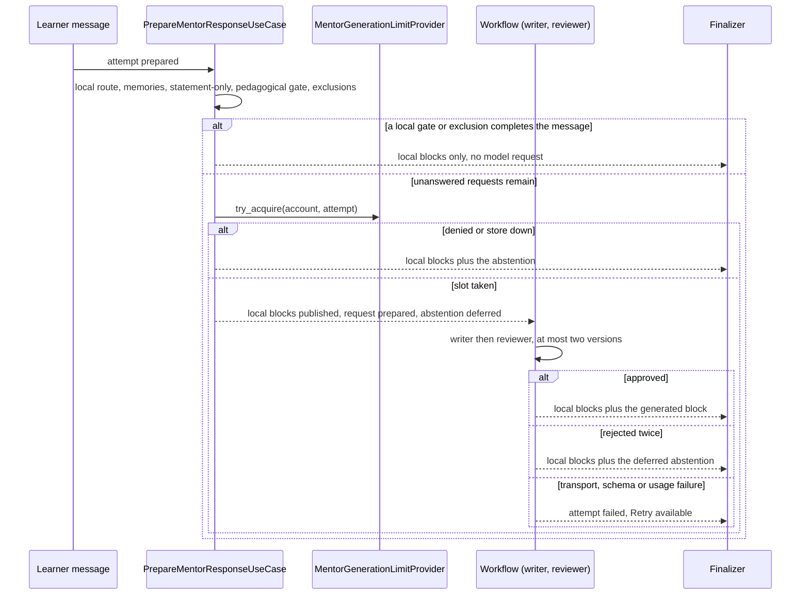

# Objective

Today a Mentor question without a local answer, such as "Olá", ends in the fixed abstention "Ainda não encontrei uma resposta local confiável…". The generation code exists and is dormant: Amendment 16 of [Mentor context](../../spec.md) made the Mentor local-only, and the answer runtime only crosses the model boundary for attachment-backed messages.

This change turns the abstention into a fallback. When no local answer exists, the Mentor asks the writer model, the reviewer model approves the text, and the learner sees the generated answer. The abstention remains the safe outcome when the model is off, the hourly limit is reached, the limit store is down, or the reviewer rejects the answer twice.

Baseline (current source): `LocalMentorRouteProvider` adds the abstention block whenever a part has no local answer and returns generation requests for it. `PrepareMentorResponseUseCase` builds a `MentorGenerationRequest` only when `attachment_context` exists. `AgnoProcessMentorResponseWorkflow` returns early when a request has no attachment context, so its general writer path (`_write_general_answer`) is unreachable and was never exercised with real history. `OpenrouterMentorAnswerModelProvider.build` creates the models with zero data retention only when an API key and `OPENROUTER_PROMPT_LOGGING_DISABLED=true` exist.

Mode: **complete**. The change opens a path that sends learner content to an external provider, adds a cost control, and changes the answer workflow, the Core preparation step, the route result and the runtime composition.

This change supersedes the parts of Amendment 16 and of the parent and sibling Specs listed in Documentation Alignment that forbid generation for non-attachment questions. The base Spec is not edited. Everything else of Amendment 16 stays in force: local answers first, authorized context only, the pedagogical gates, the deterministic abstention as the safe outcome, and Langfuse spans without identity or content.

# Scope

| Area / actor | Included | Excluded or deferred |
| --- | --- | --- |
| Learner asks a question with no local answer | A generated, reviewed answer replaces the abstention. Local answers of other parts of the message are kept. | A learner-facing quota, a monthly count, billing, or any change to the header label "IA · indisponível" |
| Pedagogical safety | The existing local gates run before any model request. The existing six-criteria reviewer approves every generated answer, in at most two versions. | Changes to the reviewer criteria, to its calibration, or to the pedagogical gates |
| Cost control | A per-account rolling-hour limit on generated answers to general questions, set by environment, default 30, 0 turns those answers off | A monthly quota, per-plan limits, Identity persistence, and any limit on attachment answers |
| Privacy | A closed projection of the request (unanswered text, recent history, conversation summary, authorized facts, relevant learner memories) goes to the existing zero-data-retention profile | New providers or models, retention claims beyond the existing profile, identity in telemetry |
| Failure handling | Model off, limit reached, limiter failure and double rejection show the abstention. Transport, schema or usage failure gives a failed attempt with Retry. | A new learner-facing "AI unavailable" message or state |
| Web and REST | None. Generated blocks use the block contract and rendering that attachment answers already use | Any widget, route or REST contract change |

Canonical outcomes (PRD Intelligence, content 83099649, version 9 of 2026-10-13T16:12:19Z, read in full on 2026-10-22):

- **RP-04 — partial.** Included: guidance generated from the learner's authorized context, and general explanations, when no curated answer exists. Deferred: the interface mark that Shifu information was consulted, and materials, activities and assessments without a Habilidade context.
- **RP-05 — partial.** Included: the pedagogical limits, now also enforced on generated text by the reviewer; the answer stays focused on learning; and it distinguishes an explanation from the consulted context. Unchanged: everything else of RP-05.
- **RP-01 — partial.** Included: the Mentor keeps answering when the local route cannot, with the existing zero-data-retention endpoint and no weaker alternative. Deferred (Q20): the interface message that AI is temporarily unavailable. When the model is off the learner sees the abstention.
- **RP-02 — deferred (Q20).** The monthly shared quota, its percentage and renewal date, the 80% notice and the block at 100% are not delivered. The per-account hourly limit is a provisional technical cost control, not the quota, and it differs from RP-02 in one way: a failed attempt keeps its slot, while RP-02 says Shifu failures must not reduce the quota. The abstention text says "resposta local", which is slightly inaccurate when the model was on but the limit denied it; it is kept unchanged. RP-06's rule that a retry depends on the quota is deferred with it.
- **RP-06, RP-11 — partial.** Completed-or-failed answers, cancellation, account isolation and account-closure fences, as in the parent Spec.
- **RP-13 — partial.** Included: the existing zero-data-retention profile with no logging of prompts and no weaker alternative, and context proportional to need (Q19). Deferred: the rest of the lifecycle items outside this change.

# Behavior Contract

"Local answer" means any block produced by the local route for a message part: curated answer, fact block, clarification, pedagogical refusal or the "Anotado" acknowledgement. "Unanswered part" means a part of the message that is in the route's generation requests and has no curated FAQ answer. The route reports these parts separately from the other generation requests. "Generated answer" means a block written by the writer and approved by the reviewer.

| ID | RP / JN / source | Observable required behavior |
| --- | --- | --- |
| RF-01 | RP-04; user request | With the model on, a free slot in the limit and no local gate or exclusion of RF-06 applying, an unanswered part is answered by a generated answer. The completed reply contains the generated text and does not contain the abstention. Example: "Olá" gets a generated greeting. |
| RF-02 | RP-04 | When some parts of a message have local answers and others do not, the local blocks stay first and in order, and one generated answer for the unanswered parts follows. A message with no unanswered part makes no model request, even if a part is also labeled as a hint or conversation request. |
| RF-03 | RP-05 | A generated answer is shown only after the reviewer approves all six criteria. The writer has at most two versions: a first one and one correction. If the second version is rejected, the completed reply carries the abstention instead, and the rejected text is never stored, published or shown. A generated block carries no sources and no intent. |
| RF-04 | RP-01 | When no model is configured (no API key or prompt logging not disabled), the Mentor behaves as today: the abstention, a completed reply and zero model requests. |
| RF-05 | RP-01, RP-06 | Each attempt cleared to call the model for a general answer takes one slot of a rolling one-hour limit kept per account. The default is 30 and `MENTOR_GENERATION_LIMIT_PER_HOUR` sets it, where 0 turns general answers off. A slot is idempotent per attempt: the same attempt never takes two. A retried attempt takes a new slot, and a failed attempt keeps its slot. Local answers never take a slot. When no slot is free, or the limit store fails, the abstention is shown and no model request is made. Accounts do not share slots. Attachment answers are outside this limit and unchanged. |
| RF-06 | RP-05, RP-13; parent RF-06/08 | The model is not used, and no slot is taken, when: a local gate refuses (the existing keyword-based pedagogical gates for a diagnostic in progress or a complete-solution request); a clarification question is produced; the message is statement-only with a memory receipt (it keeps its local blocks and the "Anotado" acknowledgement); the message carries at least one attachment and none of them is usable, that is pending, processing or failed (it keeps today's abstention); a question that mentions files but carries no attachment, such as "Como ler um arquivo em Python?", is an ordinary unanswered part; or every part with a generation request already has a curated FAQ answer. The reviewer is the second line for pedagogical limits that the keyword gates do not catch. When the memory analyzer fails and leaves no receipt, a pure statement is an unanswered part like any other. |
| RF-07 | RP-11, RP-13; parent RF-14/16 | The writer receives a closed projection of the request: the unanswered text, the history after the summary boundary as role and text, the conversation summary text and topics only, the state flags (`diagnostic_in_progress`, `skill_completed`, unavailable sources), the facts of the resolved Objetivo only when the context has an Objetivo (`context.goal_id` is set by an Objetivo title, an explicit reference, the page hint or the conversation's continuity; a Habilidade title alone does not count), that is every authorized fact except the account-wide lists (`goals`, `completed_skills`, `progress_overview`), the blocks already approved in this response, the correction, the learner memories the existing selection chooses (up to three recent explanation preferences plus the ones relevant to the message) labeled as declarations, and the block key and ordinal. It carries nothing of another account and none of the technical identifiers of the request (session, message, attempt and account ids), no attachment file names and no timestamps. Ids that are part of an authorized fact value, such as an Objetivo id inside a fact, stay as they are. The reviewer of a general request receives the same closed projection plus the candidate, never the whole request. The profile keeps zero data retention and no provider fallback. With no resolved Objetivo the reviewer has no facts, so for an official fact it can only mark `fact_fidelity` as inconclusive. That is accepted as a limit, not as an approval: any criterion that is not approved rejects the candidate, and two rejections show the abstention. The learner text and the generated text never appear in AgentOS run or trace tables, in logs, or in Langfuse spans. |
| RF-08 | RP-06; parent RF-12/13 | A transport, schema or usage failure of the writer or reviewer makes the attempt fail recoverably, and Retry works as today. Cancelling, deleting the conversation or losing account access during generation publishes no generated text and keeps the existing fences. A generated block is published only after approval. Each writer and reviewer call of each version is recorded under a key of its own, so a second version with different token counts never makes the attempt fail. |
| RF-09 | RP-01, RP-06 | The usage of generated answers is recorded as it is for attachment answers. There is no quota, balance or limit display: the header label does not change. |
| RF-10 | RP-05, RP-04 | A generated answer stays focused on learning and Habilidades: a request unrelated to learning gets a brief orientation about what the Mentor can do, in pt-BR. It tells apart what comes from the consulted Shifu context and what is a general explanation, never presents a general explanation as a fact about the learner, and never claims to have read a file or an attachment. When the answer would need information that was not consulted, it gives a general explanation and says that the current context could not be checked. These rules are in the writer's instructions, and the reviewer's instructions accept a brief learning-focused orientation to an unrelated request as adherent. Both are sent with every general request. |

| ID | RF coverage | Given | When | Then | Checks |
| --- | --- | --- | --- | --- | --- |
| CA-01 | RF-01, RF-07 | Model on, a free slot, an account with Objetivos, a learner memory and a conversation with earlier messages, including one with a timestamp | "Olá" | One generated block, no abstention, the writer then the reviewer saw one request each, and the writer payload is the closed projection of RF-07 with that account's data only, no context facts because no Objetivo is resolved, the reviewer request is the same projection plus the candidate, none of the session, message, attempt or account ids, no file name and no timestamp. The same message with a page hint that resolves an Objetivo carries that Objetivo's facts and not the account-wide lists | CI-01, CI-02 / VM-01 |
| CA-02 | RF-02 | A message with a curated FAQ part and an unmatched part; a message whose only generation request is a part that has a curated FAQ answer and a hint label | Each message is sent | First: the FAQ block, then one generated block, and `requested_part` holds only the unmatched part. Second: no model request and no slot, and the route's existing blocks are unchanged, including the abstention it already adds next to the FAQ block | CI-01 |
| CA-03 | RF-03 | The reviewer rejects the first version and approves the corrected one; in another case it rejects both versions | A question without a local answer | First case: the corrected text is shown after exactly two writer and two reviewer requests. Second case: exactly two writer and two reviewer requests, the abstention is the completed reply, and no rejected text exists in messages or blocks. The generated block has no sources and no intent | CI-03 (second version after one rejection; abstention after two, with exactly two writer and two reviewer calls) |
| CA-04 | RF-04 | No model configured | "Olá" | The abstention, completed, zero model requests, no slot taken | CI-01 / VM-01 |
| CA-05 | RF-05 | Limit 2 and a free store | Three questions without local answers, a local answer between them, a failed attempt then its retry, the same attempt prepared twice, a second account, aged entries in the window, limit 0, an attachment answer | The first two are generated, the third gets the abstention without a model request, the local answer takes no slot, the failed attempt keeps its slot and the retry takes a new one, the same attempt takes one slot, the second account has its own slots, an aged entry frees a slot, limit 0 never calls the model for general answers, and the attachment answer still works | CI-01 (decision, store failure); CI-03 (limit reached keeps the abstention with no model call; a local answer takes no slot; the failed attempt keeps its slot and its retry takes a new one; one slot for an attempt run twice; one slot per account; an aged entry frees a slot; limit 0 never calls the writer; an attachment answer works with the limit exhausted) |
| CA-06 | RF-05 | The limiter denies, or raises a service-unavailable error | The preparation step runs | The abstention stays, no generation request exists, and nothing else changes | CI-01 |
| CA-07 | RF-06 | A diagnostic in progress and a question about the activity; a complete-solution request with an activity; an ambiguous Objetivo title; "Prefiro exemplos curtos em JavaScript."; a statement-only message that also has a local FAQ block; a message with only a pending or failed attachment; a programming question about files with no attachment; a memory analyzer that fails on a pure statement | Each message is sent | The first six complete locally with their local blocks, zero model requests and no slot. The last two get a generated answer, and the writer instructions keep it from claiming to have read a file | CI-01 |
| CA-08 | RF-07 | Two accounts with different data and a learner memory | Both ask a question without a local answer | Each request holds only its own account's data, and no learner or generated text is found in any AgentOS table or in the captured logs | CI-02 (closed projection shape); CI-03 (two accounts each receive their own generated answer under a per-account limit). No AgentOS table or log exists in the test runtime, so there is nothing to scan |
| CA-09 | RF-08, RF-09 | The writer endpoint fails once; a cancel during generation; the conversation deleted during generation; two versions with different token counts | The attempts run | The failed attempt allows Retry and the retry produces the generated answer; cancel and delete publish no generated text; the two versions are recorded under distinct keys and the attempt completes; usage receipts exist for the generated attempt | CI-03 (writer failure fails closed and its retry produces the generated answer; cancel during review and delete during review publish no generated text; two versions recorded under `generated-0` and `generated-1` keys); VM-01 (usage receipts) |
| CA-10 | RF-10 | A question without a local answer; an unrelated question such as the capital of France; a question that needs context that was not consulted | The general request is sent | Automated: the writer request carries the focus, source-distinction, could-not-verify and no-file-claim instructions, and the reviewer request carries the adherence clarification. Manual with the real provider: the unrelated question gets a brief learning-focused orientation and is not rejected, and the context question marks what came from consulted context | CI-02 / VM-01 |

# Technical Contract

## Architecture Mapping

**Owner:** Intelligence, with the cost limit as an Intelligence port. Rules ([router](../../../../../rules.md)): Python Conventions, Core Layer, Use Case Testing, Provision Layer, AI Layer, Messaging Layer (the change alters recovery and idempotency of the answer workflow), Job Testing (registered AgentOS boundary). Re-run discovery if the scope expands.

**Selected approach and rationale:** keep the decision in Core and the execution in the existing workflow. The preparation use case already owns the gates and builds the generation request, so it decides whether the model is used, asks a new port for a slot, and keeps the abstention as a deferred fallback instead of publishing it. The route reports which generation requests have no FAQ answer. The workflow only runs the writer and reviewer for a request that has no attachment and publishes the fallback when the reviewer rejects. The provider boundary supplies a Redis limit provider or an always-off one. Rejected: deciding in the route provider (it has no account, no limit and no model state), a quota in Identity (not requested and a larger persistence change), failing the attempt on rejection (a retry would repeat the rejection), a flag read inside the workflow (the AI Layer keeps entitlement and quota decisions in application code before model execution).

| Action | Boundary | Element / Path | Required change |
| --- | --- | --- | --- |
| Create | Core port | `MentorGenerationLimitProvider` in `apps/server/src/shifu/intelligence/core/interfaces/mentor_generation_limit_provider.py` | Protocol below, exported from `core/interfaces/__init__.py` |
| Modify | Core structure | `PreparedMentorResponse` in `core/domain/structures/prepared_mentor_response.py` | New optional `generation_fallback` field |
| Modify | Core structure | `MentorRouteResult` in `core/domain/structures/mentor_route_result.py` | New `unanswered_requests` field |
| Modify | Core structure | `MentorGenerationRequest` in `core/domain/structures/mentor_generation_request.py` | Field comments updated: the summary and the memories now also reach the writer |
| Modify | Core use case | `PrepareMentorResponseUseCase` in `core/use_cases/prepare_mentor_response_use_case.py` | New constructor argument, general request, deferred fallback, exclusions of RF-06, fail-closed limit |
| Modify | Provider | `LocalMentorRouteProvider` in `providers/routing/local/local_mentor_route_provider.py` | Fill `unanswered_requests` with the generation requests that have no curated FAQ reference, including the whole message when the local index or the embeddings are unavailable, and clear it wherever the provider clears `generation_requests` (clarification). Its blocks, abstention and `generation_requests` stay as they are |
| Modify | AI workflow | `AgnoProcessMentorResponseWorkflow` in `ai/agno/workflows/agno_process_mentor_response_workflow.py` | Two versions, run the general writer and reviewer for a request without attachment, a recorded rejection, publish the fallback on rejection, per-version usage keys, a general block without sources and intent |
| Modify | AI agent | `MentorWriterAgent` in `ai/agno/agents/mentor_writer_agent.py` | Instructions that read the summary and the memories as declarations, never as proven mastery, forbid claiming to have read a file or an attachment, keep the answer focused on learning, distinguish consulted context from general explanation, and say when the current context could not be checked (RF-10). It builds its input with the shared projection. The registry's unavailable writer stand-in gets the same method |
| Create | AI input projection | `ai/agno/agents/mentor_general_request_projection.py` | The closed projection of RF-07, shared by the writer and the reviewer for a general request: the facts of the resolved Objetivo only when `context.goal_id` is set, without the account-wide lists, no technical ids, file names or timestamps |
| Modify | AI agent | `MentorReviewerAgent` in `ai/agno/agents/mentor_reviewer_agent.py` | For a general request (no attachment context) it receives the shared closed projection of RF-07 plus the candidate instead of the whole request, and its instructions accept a brief learning-focused orientation to an unrelated request as adherent. The six criteria and the attachment-backed review are unchanged |
| Modify | AI composition | `IntelligenceWorkflowsRegistry` in `ai/intelligence_workflows_registry.py` | Create the Redis client and the limit provider from model availability and settings, pass it to the preparation use case, close the client at shutdown |
| Create | Provider | `RedisMentorGenerationLimitProvider` in `providers/generation_limit/redis/redis_mentor_generation_limit_provider.py` | Rolling hour, idempotent per attempt, atomic, typed error on failure |
| Create | Provider | `UnavailableMentorGenerationLimitProvider` in `providers/generation_limit/unavailable_mentor_generation_limit_provider.py` | Always denies |
| Modify | Settings | `Settings` in `apps/server/src/shifu/shared/settings.py` and `apps/server/.env.example` | `mentor_generation_limit_per_hour` |
| Modify | Evals | `apps/server/evals/process_mentor_response_eval.py`, `evals/synthetic_model.py` | Five general-generation cases (writer and reviewer), a general-answer scorer, and a synthetic writer profile. The eval builds the agents directly and assigns the synthetic models (Revision 3). No test files are added for the evals |
| Modify | Use-case tests | `apps/server/tests/intelligence/core/use_cases/test_prepare_mentor_response_use_case.py` | Scenarios of CI-01, the new constructor argument in `_PrepareSubjectSetup`, and the changed expectation of `test_should_keep_general_generation_local` |
| Delete | Obsolete tests | Server and web test files outside use cases, controllers, jobs (server) and widgets, hooks, pages, layouts (web) | Removed by user decision on 2026-10-22, listed in the Evaluation. This includes the legacy workflow branches test and the registry composition suite |
| Modify | Docs | `documentation/architecture.md`, `documentation/tooling.md` | The generation fallback and the new environment variable |

Unchanged on purpose: the abstention and block keys of the route, intent resources and indexes, the six criteria of the reviewer, `OpenrouterMentorAnswerModelProvider` and its zero-data-retention profile, the attachment answer path and its absence of a limit, REST controllers and schemas, persistence, events, telemetry and the web. `PreparedMentorResponse.attachment_request` keeps its name although it now also carries a general request.

```text
apps/server/
├── src/shifu/
│   ├── shared/settings.py                                                      [M]
│   └── intelligence/
│       ├── core/
│       │   ├── interfaces/mentor_generation_limit_provider.py                  [N]
│       │   ├── domain/structures/
│       │   │   ├── prepared_mentor_response.py                                 [M]
│       │   │   ├── mentor_route_result.py                                      [M]
│       │   │   └── mentor_generation_request.py                                [M]
│       │   └── use_cases/prepare_mentor_response_use_case.py                   [M]
│       ├── ai/
│       │   ├── intelligence_workflows_registry.py                              [M]
│       │   └── agno/
│       │       ├── agents/mentor_writer_agent.py                               [M]
│       │       ├── agents/mentor_reviewer_agent.py                             [M]
│       │       ├── agents/mentor_general_request_projection.py                 [N]
│       │       └── workflows/agno_process_mentor_response_workflow.py               [M]
│       └── providers/
│           ├── routing/local_mentor_route_provider.py                          [M]
│           └── generation_limit/
│               ├── redis/redis_mentor_generation_limit_provider.py             [N]
│               └── unavailable_mentor_generation_limit_provider.py             [N]
├── evals/{process_mentor_response_eval,dependencies,synthetic_model}.py        [M]
├── .env.example                                                                [M]
└── tests/
    └── intelligence/
        ├── ai/workflows/test_agno_process_mentor_response_workflow.py           [N]
        └── core/use_cases/test_prepare_mentor_response_use_case.py             [M]
documentation/architecture.md                                                   [M]
documentation/tooling.md                                                        [M]
```

**Port and structure declarations.**

```python
class MentorGenerationLimitProvider(Protocol):
    def try_acquire(self, account_id: str, attempt_id: str) -> bool:
        """Take one slot for this attempt; True when it may call the model.

        Idempotent per attempt id. Raises ServiceUnavailableError when its store fails.
        """
        ...


@structure
class MentorRouteResult:
    # existing fields unchanged
    proposed_reference_ids: tuple[str, ...] = ()
    unanswered_requests: tuple[str, ...] = ()  # generation requests without a curated FAQ answer


@structure
class PreparedMentorResponse:
    # existing fields unchanged
    attachment_request: MentorGenerationRequest | None
    generation_fallback: MentorResponseBlock | None = None
```

`PrepareMentorResponseUseCase.__init__` gains `generation_limit_provider: MentorGenerationLimitProvider`. `execute` keeps its signature.

**New concepts.**

- **Unanswered requests.** Purpose: tell the preparation step which generation requests are not already covered by a curated answer, so a part with a FAQ answer is never sent to the model and never answered twice. Owner: the route provider fills it, Core preparation consumes it. It is a subset of `generation_requests`. Every place of the preparation that clears `generation_requests` (empty content, clarification, pedagogical refusal) also clears it; the gate returns only the requests, so the unanswered ones are the intersection with them. While the local index is unavailable, every question counts as unanswered and goes to the model, which is accepted as a degraded mode and takes slots like any general answer.
- **Generation fallback.** Purpose: keep the safe abstention available without showing it before the model answers. Owner: Core preparation. The abstention block (identified by `LOCAL_ABSTENTION_BLOCK_KEY`) is removed from `local_blocks` and carried in `PreparedMentorResponse.generation_fallback` only when a general request is built. It is published only when a valid review rejected the answer. It never exists for attachment-backed requests, which keep failing as today, and never for statement-only acknowledgements.
- **General generation request.** The existing `MentorGenerationRequest` with `attachment_context=None`. `requested_part` joins the unanswered requests. The preparation use case is its source of truth. The workflow handoff keeps it in memory only. The writer sees the closed projection of RF-07, not the whole request: the projection is built by `MentorWriterAgent`.
- **Generation limit provider.** A cost guard, not an entitlement. Input is an account and an attempt, output is allowed or denied. The Redis adapter keeps one sorted set per account at `mentor:generation-limit:<account_id>`, with the attempt id as member and the Redis server time in seconds as score. A script runs atomically on the server: it removes members older than 3600 seconds, returns allowed when the attempt is already a member, otherwise adds it only while the set holds fewer than the limit, and refreshes the key expiry. The server clock keeps all workers consistent. The adapter owns a synchronous Redis client created by the registry from `redis_url` and closed at shutdown, and maps every client error to `ServiceUnavailableError`. The key layout is part of this contract so that tests can age entries. A denial or a store failure is not an error for the learner: it keeps the abstention. Failed and cancelled attempts keep their slot, so an outage of the provider can use up the hour in retries. That is accepted.
- **Rejected review.** The workflow state gains a marker set only when the reviewer returned a valid, not-approved result for a general request. The fallback is published only with that marker. A malformed or missing step output does not publish it and fails the attempt as today.

**Settings.** `mentor_generation_limit_per_hour: int = Field(default=30, ge=0, le=1000)`, read from `MENTOR_GENERATION_LIMIT_PER_HOUR`. The registry builds the Redis limit provider when the writer and the reviewer models exist and the limit is above 0, and the unavailable provider otherwise.

**Preparation decision (inside `PrepareMentorResponseUseCase`).** After the route, the statement-only decision and the pedagogical gate:

1. If an attachment context exists, the existing attachment request is built, unchanged, and no slot is taken.
2. Otherwise a general request is possible only when: `route.unanswered_requests` is not empty after the gate; no clarification was produced; the message was not a statement-only message with a memory receipt; and the message does not carry attachments that are all unusable.
3. The claim is confirmed current, and then `generation_limit_provider.try_acquire(account_id, attempt_id)` is called once. An error of the claim check is not caught by the limit handling. When the snapshot of this attempt already holds a generated block (a re-preparation after a crash), the provider is not called and no slot is taken, and the general request is built as already cleared.
4. On `True`, build the general `MentorGenerationRequest` with `requested_part` taken from the unanswered requests, and move the abstention block into `generation_fallback`.
5. On `False` or `ServiceUnavailableError`, keep the abstention in `local_blocks` and build no request.

**Workflow change (inside `AgnoProcessMentorResponseWorkflow`).**

- `_MAX_REVIEW_ITERATIONS` becomes 2, with its use in the loop and in the step reference. The parent Spec and the earlier decision already set two versions. The attachment answers share the same loop and also have two versions from now on.
- `_write_state_correlated` stops returning early for a request without attachment and runs `_write_general_answer` and `_review_candidate` inside the loop. `_write_general_answer` calls the writer agent's projection instead of `asdict(request)`. A general block is built with no sources and no intent, whatever the model returns.
- Each version records usage under the key scope `generated-<iteration>` (zero-based), so writer and reviewer call keys never repeat across versions. The block key stays `generated-0`.
- The rejection marker is assigned on every review as "the result is valid and not approved", never kept from an earlier version. When the review result is valid and not approved, the state records the rejection. In `_publish_and_finalize`, a general request with a recorded rejection and a fallback publishes the fallback with the next ordinal (the count of already approved blocks) and finalizes. Without a recorded rejection, or without a fallback (attachment-backed requests), the attempt fails recoverably as today. Exceptions still end the attempt as failed through the existing translation.
- A recovered state is detected from the snapshot's approved blocks in `_consume_or_recover`. When it already holds the fallback, it finalizes with it, publishes no new generated block and runs no replay of model calls.
- Replay after the loss of the in-memory handoff reruns the earlier versions with the same usage keys. A different token count on the same key already fails the attempt today, for attachment answers as well. That limit is unchanged and recorded here: the recovery scenario of CI-02 runs with constant token counts, and the per-version keys prove their uniqueness in the scenario without recovery.

## Runtime Flow



1. The route, the gates and the memories work as today. Local blocks are published as soon as they are prepared, so the learner sees them while the model works. The abstention is not among them when a general request exists.
2. The limit provider is asked only for a message that still has unanswered requests and passes every exclusion. A retry is a new attempt and takes a new slot.
3. The writer and the reviewer run through the registered AgentOS queue with the existing inference guard, so cancel, delete and access loss stop the work and the existing late-result fences apply. The handoff lifetime covers two versions of two calls of 30 seconds.
4. The generated block takes the next ordinal after the published blocks. The abstention fallback takes the same ordinal when used.
5. Usage of each model call is recorded as for attachment answers. No learner text enters run or trace records, logs or spans.
6. The writer and the reviewer receive the same closed projection. It carries the facts of the resolved Objetivo only when the context has one (Q19), so a greeting or a general question leaves the Shifu state behind, for both calls. The history, the summary and the selected memories travel because they are the conversation itself. The closed projection, the zero-data-retention profile and the absence of provider fallback are the remaining controls.

# Verification Contract

## Shared setup

Automated checks are the use-case tests (CI-01, in-memory doubles) and the evals (CI-02). The evals run the real agents against a synthetic model in double mode and against OpenRouter in real mode; no disposable runtime is started.

The fixture options (`AgentOSMentorOptions`) are read before the app is built, so a test selects the model state and the limit with an indirect parameter. The existing registered suites that prove a local-only outcome with an unmatched question or a pure statement select the model off.

The local intent index version includes the Curriculum catalog projection. Accounts in the use-case tests come from `AccountFaker`. Runtime behavior of the registered workflow is proved by the evals (CI-02) and by the manual journey (VM-01); the repository keeps no AgentOS runtime test files (Revision 3).

Manual checks use a disposable `pgvector/pgvector:0.8.1-pg17` and a disposable Redis on free ports, `apps/server/scripts/create_agentos_runtime_role.sql`, `alembic upgrade head`, `shifu.shared.database.seed` (destructive: only after checking that `DATABASE_URL` points at the disposable host and port), `shifu.mentor_indexes`, the API and the web on free ports with all URLs exported for that stack (see [Tooling](../../../../../tooling.md)), and `playwright-cli` from `apps/web`. The real OpenRouter key comes from `apps/server/.env.local` and is never printed.

## Automated

### CI-01 — Preparation decisions with the limit provider

**Criteria:** CA-02, CA-06, CA-07

**Expected result:** the preparation use case builds a general request only when `unanswered_requests` is not empty and no gate, clarification, statement-only receipt or unusable-attachments exclusion applies, and the provider allows. It moves the abstention to the fallback in that case and keeps it in the local blocks otherwise. The provider is not called for local answers, refusals, clarifications, acknowledgements and attachment-backed requests, it is called once per attempt after the claim check, and a denial or an error from it leaves the abstention in place.

**Proof:** `apps/server/tests/intelligence/core/use_cases/test_prepare_mentor_response_use_case.py` [M], a new group of tests in the existing class, with the provider as an autospecced mock of the Protocol that returns a boolean explicitly. The existing attachment and acknowledgement tests keep passing, and `test_should_keep_general_generation_local` is rewritten to the new contract.

```bash
cd apps/server && uv run pytest tests/intelligence/core/use_cases/test_prepare_mentor_response_use_case.py
```

**Passing condition:** every scenario asserts the returned `PreparedMentorResponse` and the absence of calls to the provider where required; the tests run, not skipped.

### CI-02 — Generation quality evals

**Criteria:** CA-01, CA-08 (projection shape), CA-10

**Expected result:** the five `general_*` cases of the `process-mentor-response` eval pass in the synthetic double mode and with the real configured models. A greeting is answered with an offer of help. An unrelated question gets a brief learning-focused orientation and not the answer. A file question never claims a file was read. A question that needs unconsulted context says the context could not be verified. The reviewer approves a learning-focused orientation. Every input is the closed projection of RF-07 built by the shipped projection code.

**Proof:** `apps/server/evals/process_mentor_response_eval.py` [M] and its wiring. Evals have no test files by user decision.

```bash
cd apps/server && uv run python -m evals.run --workflow process-mentor-response
cd apps/server && OPENROUTER_PROMPT_LOGGING_DISABLED=true SHIFU_RUN_REAL_AI_EVALS=1 uv run --env-file .env.local python -m evals.run --workflow process-mentor-response --tag general
```

**Passing condition:** all selected cases pass, none skipped. The real mode needs a configured key; without it the real run is Blocked.

### CI-03 — Workflow run in process with mocked agents

**Criteria:** CA-03, CA-05, CA-08, CA-09

**Expected result:** the registered workflow, built with its real use cases over a disposable PostgreSQL and Redis and with the writer, reviewer and attachment answerer replaced by `unittest.mock.Mock`, publishes the first approved version, the second version after one rejection, or the abstention after two rejections; publishes a local answer without a slot; keeps the abstention with no model call when the hourly limit is reached or the limit is 0; counts the limit per account, frees an aged entry, takes one slot for an attempt run twice, keeps a failed attempt's slot and gives its retry a new one; answers an attachment question outside the limit; fails closed when the writer raises; publishes no generated text when the attempt is cancelled or the conversation deleted during review; and records each version's usage under its own `generated-N` keys.

**Proof:** `apps/server/tests/intelligence/ai/workflows/test_agno_process_mentor_response_workflow.py`, 14 cases.

```bash
cd apps/server && uv run pytest tests/intelligence/ai/workflows/test_agno_process_mentor_response_workflow.py -q
```

**Passing condition:** all 14 cases pass, none skipped.

### CI-04 — Static gates

**Scope:** the modified and created server files, the settings, the fixture and their consumers.

**Checks:**

- types: `cd apps/server && uv run poe check:types`;
- lint and format on exact changed paths: `uv run ruff check --no-fix <paths>` and `uv run ruff format --check <paths>`, which include the configured `C90` complexity rule (no quantitative complexity metric is configured or required; that disposition is recorded);
- architecture: `uv run poe check:architecture`;
- build: `uv run poe build`;
- the web type and architecture checks, because web test files were removed: `cd apps/web && pnpm check:types && pnpm check:architecture`.

See [Tooling](../../../../../tooling.md#scoped-type-lint-and-complexity-checks). The repository no longer enforces changed-file coverage thresholds.

**Passing condition:** zero errors and diagnostics.

## Manual

### VM-01 — Generated answer with the real provider

**Type:** Manual

**Criteria:** CA-01, CA-04, CA-10

**Tool / setup:** `playwright-cli` from `apps/web` against the disposable stack of Shared setup, 1440×900. This check is opt-in and uses the real OpenRouter key of `apps/server/.env.local` with `OPENROUTER_PROMPT_LOGGING_DISABLED=true`. If the key is missing, invalid or rejected, the check is Blocked, not passed. Langfuse stays disabled.

**Procedure:** sign in with the documented seed account. Start a conversation with "Olá" and wait for the reply. Ask "Qual é meu progresso no Objetivo?" in a second conversation, and "Qual é a capital da França?" in a new one. Restart only the API without the key and ask "Olá" in a third conversation. After each reply, read `usage_calls` of the latest attempt in the disposable database to see whether a model call was recorded.

**Passing condition:** the first reply is a generated greeting without the abstention text and its attempt has usage calls for the writer and the reviewer. The second is the local overview and its attempt has no usage calls. The unrelated question gets a brief reply that stays on learning, read and judged against RF-10. The third is the abstention with no usage calls. No console errors (warnings classified), no failed requests, and cleanup done by PID and container removal.

# Documentation Alignment

| Document / authority | Governs | Required update or confirmation | Disposition / dependency |
| --- | --- | --- | --- |
| [Shifu — PRD — Intelligence](https://joaogoliveiragarcia.atlassian.net/wiki/spaces/Shifu/pages/83099649/Shifu+PRD+Intelligence), content 83099649, space 82509828, version 9 (2026-10-13T16:12:19Z, "Remover elegibilidade ZDR do escopo do ditado browser-managed"), read in full through the Atlassian connector on 2026-10-22 | RP-01, RP-02, RP-04, RP-05, RP-06, RP-11, RP-13; JN-05, JN-06, JN-17 | No PRD change is expected. The delivery is partial against RP-01 (unavailability message), RP-02 and JN-06 (monthly quota) and RP-04 (consulted-information mark), as accepted by the user in Q20, and RP-13 uses context proportional to need (Q19). Recheck the version at conclusion. | External write not authorized; none planned |
| [Mentor context Spec revision 18](../../spec.md) | Local-only delivery | Superseded by this change, for non-attachment questions: Amendment 16 and its guard-test requirement, RF-03 and RF-04 ("no remote fallback"), RF-10, RF-14, RF-15, CA-04, CA-05, CA-06 and CA-10 ("never remote inference"). Everything else stays. Add a pointer at conclusion. | Confirm at conclusion |
| [Mentor memory Spec](../../../mentor-memory/spec.md) | Learner memories | Superseded for general answers: the scope exclusion of AI answers for general questions (line 57), memories only to attachment answers and reviewer (line 118), and the statements at lines 533 and 949. Memories now also reach the general writer, as labeled declarations. The statement-only "Anotado" behavior is unchanged. | Pointer at conclusion |
| [Mentor conversation summary Spec](../../../mentor-conversation-summary/spec.md) | Summary | Superseded: the exclusion of enabling general generation (line 47) and the related line 520. The summary now also reaches the general writer. | Pointer at conclusion |
| [Progress overview change](../progress-overview-without-context/spec.md) | Local progress answers | The local answers are unchanged and take no slot. Its VM-01 statement that a message matching nothing keeps the abstention holds only with the model off. | Pointer at conclusion |
| [architecture.md](../../../../../architecture.md) | Runtime boundaries | Describe the generation fallback and the limit provider | Update at conclusion |
| [tooling.md](../../../../../tooling.md) | Commands and environment | Document `MENTOR_GENERATION_LIMIT_PER_HOUR` | Update at conclusion |
| Rules | Boundaries | Confirmed: the limit decision is application code before model execution, providers get no dedicated tests, proof is through the registered AgentOS boundary | Recheck if scope expands |
| Jira | Delivery tracking | No ticket exists for this change; the user decides the key before commits | Open question for the user |

# Revision History

| Revision | Date | Contract change | Reason / source |
| --- | --- | --- | --- |
| 1 | 2026-10-22 | Initial contract: generated, reviewed answer for unanswered parts with the abstention as the safe fallback, a per-account hourly limit on general answers, local gates first | User decisions Q8 = every unanswered question goes to the model, including greetings; Q9 = keep the reviewer; Q10 = send the full existing request; Q11 = a technical hourly limit in Redis, no learner-facing quota; Q12 = model off shows the abstention, transient failure fails with Retry; Q13 = the limit is set by environment, default 30; Q14 = a double rejection shows the abstention; Q15 = the review loop has two versions; Q16 = a part with a curated answer, a message whose attachments are all unusable and a statement-only message never use the model; Q17 = the limit covers general answers only; Q18 = the file exclusion applies only to a message that carries attachments and none is usable; Q19 = the context facts go to the model only when an Objetivo or Habilidade is resolved (the full-request decision of Q10 is narrowed to respect the minimal context of RP-13); Q20 = deliver without the monthly quota and the unavailability message, recording RP-02 and part of RP-01 as deferred. The PRD was reread in full on 2026-10-22 and added RF-10. Corrected after the independent review: the loop constant, per-version usage keys, a closed writer projection, a general block without sources, the route's unanswered requests, the recorded rejection, and the list of superseded statements. Confirmed by the user at review of the written contract (2026-10-22), including the delta after the PRD reread: 0 turns general answers off, a retried or failed attempt keeps its slot, the writer receives the conversation summary and the learner memories, the Redis limit provider fails closed, and the Redis key layout is part of the contract. |
| 1 (clarification) | 2026-10-22 | No contract change. RF-07 wording: an inconclusive `fact_fidelity` is a limit that rejects the candidate, as the reviewer already behaves | Implementation review |
| 2 | 2026-10-22 | Verification contract only; behavior unchanged. CI-02 is now the generation evals (synthetic and real). The registered-runtime generation test file, the legacy workflow branches test, the registry composition suite and the other test files outside the allowed boundaries were removed. The affected criteria keep their proof in CI-01, the existing CI-03 suites and VM-01, and CA-03, CA-05, CA-08 and CA-09 lose the automated runtime scenarios they had | User decisions: use evals instead; only use cases, controllers and jobs can have tests on the server; widgets, hooks, pages and layouts on the web; remove the invalid test files across the project |
| 3 | 2026-10-22 | Verification contract only; behavior unchanged. Every AgentOS runtime test file was removed by user decision (`tests/<module>/server/agentos/`, the AgentOS-backed Mentor job tests and the `agentos_fixture.py` and `mentor_job_fixture.py` fixtures), so CI-03 now reuses CI-01 and CI-02 and the runtime proof is VM-01; the Expected file tree no longer lists them. Agents take no settings or model; `ai/eval_factories.py` and `evals/dependencies.py` were removed; each eval class builds its own target and assigns the synthetic models | User decision: only use cases, controllers, jobs and API handlers keep test files, and runtime behavior is proved by the evals |
| 4 | 2026-10-22 | Verification contract only; behavior unchanged. CI-03 is now the in-process workflow test with mocked agents (7 cases), which proves CA-03 and CA-08 and narrows the Partial scope of CA-05 and CA-09 to aged window entries, the retry slot, limit 0, the attachment slot, retry after failure and delete during generation | User decision: workflow tests are allowed, in process and with `unittest.mock.Mock` agents |
| 5 | 2026-10-22 | Verification contract only; behavior unchanged. CI-03 grows to 14 cases and proves CA-05 and CA-09 in full: local answer without a slot, limit 0, aged window entry, one slot for an attempt run twice, the failed attempt's slot and its retry, the attachment answer outside the limit, and delete during review | Continuation of revision 4 once workflow tests were allowed |
