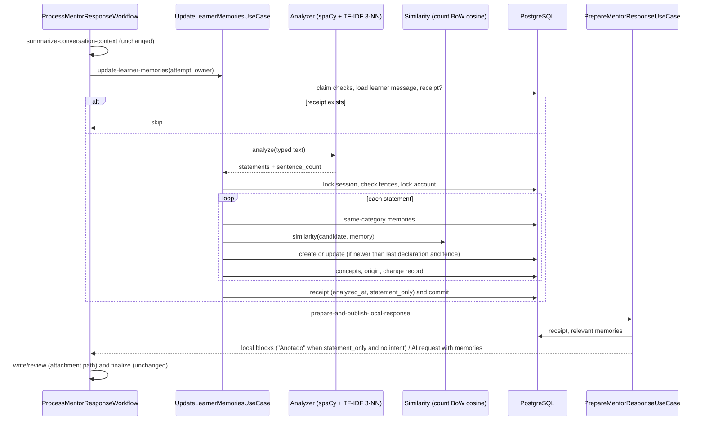

# Objective

The Mentor keeps **private learner memories** in the four RP-14 categories (explanation
preference, declared knowledge, interest or intention, recurring difficulty). Explicit
statements the learner types become memories automatically through a **local, white-box
NLP pipeline**: spaCy filters first-person, non-question sentences; a count bag-of-words
with TF-IDF and a 3-nearest-example vote classifies each sentence; count bag-of-words
cosine decides between creating and updating a memory and selects relevant memories for
answers. Creation and update are shown discreetly in the conversation. A "Memórias" page
offers search, category filters, List and Map, details, editing and deletion. Deleted
memories are never recreated by old messages, summaries or pending processing; deleting
a conversation keeps its memories with an inaccessible origin; account deletion purges
them. Memories never change Learning and the Planner never uses them.

**Mode: complete** — new persistence, a new step inside the registered AgentOS answer
workflow, fences against late processing and concurrent edits, account purge, a new REST
surface and a new routed page.

**Baseline (current source):** general Mentor answers are local and deterministic
([mentor-context rev18, Amendment 16](../mentor-context/spec.md)); only attachment
answers use the writer/reviewer agents. `ProcessMentorResponseWorkflow` runs
`summarize-conversation-context`, then local preparation, then the bounded
write/review loop and finalization. Agno native memory/storage is disabled. No memory,
proposal or card code exists; the Mentor page header renders a disabled
"Memórias. Indisponível no momento" button. Nothing in Intelligence uses bag-of-words or
TF-IDF (intent classification and FAQ retrieval use E5 and BM25).

**Extraction uses no AI provider.** It runs spaCy `pt_core_news_sm` (the instance the
registry already shares) and scikit-learn (declared explicitly by this delivery). No
text leaves Shifu; no model call, usage receipt or quota effect exists for memories.

**Course alignment (user context).** The technique choice applies the ISW037 NLP unit
(binary/count bag-of-words, TF-IDF with smoothed IDF and L2 normalization, cosine
similarity, nearest-example voting) to new work, following the professor's repository
`fabriciogmc/natural_language_processing` (`representation/bag_of_words_tf_idf.ipynb`,
`cosine_similarity_metric.ipynb`). Word2Vec is deferred to a Sprint 3 delivery.

# Scope

| Area / actor | Included | Excluded or deferred |
| --- | --- | --- |
| Learner (owner) | Automatic memories from explicit typed statements; "Memória criada"/"Memória atualizada" markers with "Ver memória"; Memórias page with search, category filter, List/Map, details, origins, concepts, edit (content only), delete; desktop 1440 and mobile 390; keyboard; pt-BR | Inferred recurring difficulty and its confirmation card; creating memories manually; editing category or concepts; sharing/exporting; browsing old versions |
| Intelligence — extraction | spaCy sentence filter; TF-IDF + 3-NN classification into 4 categories or "nenhuma"; count bag-of-words cosine for update and relevance; versioned synthetic examples, manifest and evaluation | Attachment content as a source; Mentor replies, summaries or other conversations as sources; Word2Vec; any LLM extraction |
| Intelligence — answer pipeline | New step `update-learner-memories`; relevant memories in the attachment answer and reviewer requests; fixed "Anotado" block for statement-only messages | AI answers for general questions; changes to intent classification, FAQ retrieval, thresholds or pedagogy |
| Lifecycle | Message receipt; per-account deletion fence; latest-declaration ordering; conversation deletion keeps memories (origin inaccessible); immediate account purge | Purging sessions/messages/attempts/events on account deletion (pre-existing gap); Identity producer of `identity/account.deleted` |
| Confirmed actions (RP-17) | — | Entire RP-17 and the shared card (SHIFU-104) |
| Quota (RP-02) | Memories record no usage | Quota implementation |
| Planner | Has no dependency on memories | — |

Selected canonical outcomes (PRD Intelligence, content 83099649 **v9**):

- **RP-14 — partial.** Included: four categories; automatic memories from explicit
  relevant statements; updates without confirmation following the latest explicit
  information; declared knowledge/difficulty never treated as mastery or diagnosis and no
  effect on Learning; only relevant memories used, per owner, never by the Planner;
  content, category, origin(s), creation/update information and concept relations;
  consult, edit and delete; conversation deletion keeps memories with inaccessible origin;
  deletion prevents recreation by old messages, summaries or pending processing while a new
  statement may create a new record; lifecycle under RP-11/RP-13; page with search,
  category filters, List/Map, details; creation/update markers with access to details and
  what changed. **Deferred:** inferred recurring difficulty with confirmation (and its
  RP-17 presentation); memories from attachment content (modules.md rule kept, Q2);
  personalization of local (non-AI) answers.
- **JN-18 — partial:** all steps except the inferred-difficulty confirmation.
- **RP-04 — partial:** relevant memories reach the existing AI answer paths only.
- **RP-03 / JN-14 — partial:** the memory side of conversation deletion.
- **RP-11 / RP-13 / JN-16 — partial:** owner-only access, active-account checks, immediate
  purge of memory data on account deletion, no recreation by pending processing,
  minimization (no conversation text copied into origins), no inference endpoint.
- **RP-12 — partial:** memory surfaces (page, map, markers) in pt-BR, desktop/mobile,
  keyboard, not color-only, clear loading/empty/success/recoverable-failure states.
- **RP-17 — deferred** (no confirmation card in this delivery).
- **RP-01 / RP-02 — not applicable** to memories (no AI provider, no usage).

Design: [design/handoff.md](design/handoff.md).

# Behavior Contract

Definitions used below:

- **Eligible sentence** — a sentence of the learner's typed message whose grammatical
  subject is the learner (pronoun "eu" as subject or a verb in first person singular) and
  that is not a question (does not end with "?" and does not start with an interrogative
  word). Sentences about other people, questions and empty fragments are not eligible.
- **Subject terms** — the lemmatized, casefolded and accent-stripped nouns, proper nouns,
  adjectives and verbs of a text, excluding stopwords and the category cue words listed in
  the manifest.
- **Concept** — a noun phrase of up to three words taken from spaCy noun chunks of the
  sentence, without determiners and cue words; key = normalized lemma form, label = the
  surface text (e.g. key `retorno de valor`, label "Retorno de valores"). At most three per
  memory.
- **Deletion fence** — per account, the timestamp of the most recent memory deletion
  (monotonic: never moves backwards).
- **Analysis receipt** — the mark on a learner message that its memory analysis committed.

| ID | RP / JN / source | Observable required behavior |
| --- | --- | --- |
| RF-01 | RP-14, JN-18; Q2, Q9, Q13 | For each answer run, the step `update-learner-memories` runs after `summarize-conversation-context` and before local preparation. It analyzes **only the current learner message's typed text**; attachment content, Mentor messages, summaries and other conversations are never inputs. A message with an analysis receipt is skipped. Only eligible sentences are classified. The step never fails the answer run. |
| RF-02 | RP-14; Q6, Q10, Q12 | Each eligible sentence is classified by a count bag-of-words over lemmatized unigrams and bigrams (keeping "eu" and negations, removing other stopwords), transformed by TF-IDF (`idf = ln((1 + n) / (1 + df)) + 1`, L2 norm) fitted **only** on the versioned training examples; the sentence is only transformed. Cosine similarity to every example selects the 3 nearest; the majority class wins (tie → the class of the single most similar example). If the most similar example scores below the manifest minimum, or the winner is `nenhuma`, the sentence produces nothing. Classes: the four categories and `nenhuma`. |
| RF-03 | RP-14; Q7, Q19 | A classified sentence yields one memory candidate: content = the sentence trimmed, without leading connectors from the manifest list; sentences whose content exceeds 280 code points produce nothing; up to three concepts. |
| RF-04 | RP-14; Q8, Q17 | The candidate is compared with the owner's memories **of the same category** by cosine similarity of count bag-of-words over subject terms, with the lexicon built from the two texts. If the best score reaches the manifest update threshold, that memory is updated (content, concepts, version + 1, a new origin, `last_declared_at` = source message `created_at`); otherwise a memory is created. An update applies only when the source message is newer than the memory's `last_declared_at`. Every creation/update writes a change record with the new content and, for updates, the previous content. |
| RF-05 | RP-14, RP-13; Q15, Q16 | Changes from a message created at or before the account's deletion fence are discarded. Analysis results commit in one transaction with the receipt, only while the attempt is still claimed/current, the session is not tombstoned and access is current (the summary step's fences). A failed analysis writes nothing and no receipt, so a retry may analyze again under the same fences. A committed analysis is never repeated (cancel/retry neither undoes nor duplicates). |
| RF-06 | RP-14, JN-18; Q14, Q22, Q26, Q36, Q38 | Session detail exposes the conversation's memory items (one per change record) anchored to the source message: kind `created`/`updated`, category, content, previous content (updates) and memory id. The web shows them after the answer of that turn, or right after the learner message when no answer exists. Each shows "Memória criada"/"Memória atualizada", "<categoria>: <texto>" or "Antes: …"/"Agora: …", and "Ver memória" linking to the Memórias page with that memory selected. After the memory is deleted the item shows "Memória excluída" with no text and no link. Editing a memory changes no item. No new SSE event kind or progress value is introduced: the Mentor context re-reads the detail on every terminal response event (`completed`, and newly `failed` and `cancelled`), and items appear from that read. |
| RF-07 | RP-14; Q21 | When every sentence of a message was classified as a memory statement, the message has no attachment-backed generation request, the route asks for no clarification and the only local block is the route's abstention block (a generative-only intent match, which has no local answer, does not prevent it), preparation (Core) replaces that abstention with one fixed block "Anotado. Vou considerar isso nas próximas explicações." Any other message keeps today's routing. |
| RF-08 | RP-14, RP-04; Q3, Q11, Q18 | Answer preparation passes relevant memories to the attachment answer agent and the reviewer: up to 3 most recently updated explanation preferences always, plus up to 5 other memories whose subject-term cosine with the current message reaches the manifest relevance threshold. Memories are labeled as learner declarations, not proven mastery. Local answers are unchanged except RF-07. Memories never reach Learning, Gamification or the Planner. |
| RF-09 | RP-14, JN-18; Q27, Q29 | `GET /intelligence/learner-memories?q=&category=` returns every owner memory matching the filters, without pagination, ordered by `updated_at` desc then `id`; `q` matches a casefolded, accent-stripped substring of the content. Each item has id, category, content, version, created/updated timestamps, origins (session id, message id or null, conversation title or null, availability, declared at) and concepts. |
| RF-10 | RP-14, RP-11 | `GET /intelligence/learner-memories/{memory_id}` returns one memory in the same shape; absent and foreign memories return the same 404. |
| RF-11 | RP-14, JN-18; Q28, Q36 | `PATCH /intelligence/learner-memories/{memory_id}` accepts `content` (1–280 code points after trim) and `expected_version`. A stale version returns 409 with no change; invalid content returns 422 with a memory-specific pt-BR message. Success recomputes concepts, increments the version, sets `last_declared_at` to the edit time and returns the memory. No change record or marker is created. |
| RF-12 | RP-14, RP-13, JN-18 | `DELETE /intelligence/learner-memories/{memory_id}` removes the memory, its origins and concepts, erases the content of its change records (which then show "Memória excluída"), and advances the account's deletion fence to the deletion time. Absent, already deleted and foreign ids return 204 with no effect. |
| RF-13 | RP-03, RP-14, JN-14 | Deleting a conversation removes that conversation's change records in the existing deletion transaction. Memories remain; origins keep only the session id (message reference cleared) and render as "Conversa excluída" without link; no conversation text is kept or read through memories. |
| RF-14 | RP-11, RP-13, JN-16; Q4 | `identity/account.deleted` purges all memory data of the account immediately: memories, origins, concepts, change records and the fence. Duplicate delivery succeeds with no effect; an invalid payload is non-retriable. Every memory endpoint requires authentication (401 without a valid token) and an active, current account through the existing access check (inactive or revoked access is rejected with no effect). |
| RF-15 | RP-11, RP-13, RP-14 | Only the owner reads or changes memories; responses are private and `no-store`. Server logs contain only counts and closed failure categories, never memory or message text. The memory step emits no Langfuse span (no Shared telemetry change). Memory text never enters AgentOS run inputs, step outputs or run records; it travels only inside the existing in-memory handoff to the answer request. |
| RF-16 | RP-12, RP-14, JN-18; Q37 | The routed page `/intelligence/memories` (authenticated) shows title, "Voltar ao Mentor", search, category filter (desktop single-choice chips "Todas · N" + four categories; mobile "Categoria: <rótulo>" menu), List/Map toggle, and a details panel (right on desktop, below on mobile) with category, text, "Declarada por você", created/updated dates, origins, concepts ("Relacionada a"), "Esta memória orienta explicações; não altera sua proficiência." and Editar/Excluir. URL search keeps `q`, `category`, `view` (`list` default, `map`) and `memory`; invalid values fall back to defaults. States: loading skeleton, empty, empty with filters, error with "Tentar novamente", edit form, edit conflict, save/delete failure inline, confirmation before deleting and "Memória excluída" after it. |
| RF-17 | RP-12, RP-14; Q19, Q39 | Map: hub "Suas memórias" linked to every visible memory; on desktop (≥ 1024 px) memories sharing a concept key get an extra link; on mobile only hub links. Positions are computed on a circle around the hub in list order (deterministic). Nodes show the category icon and an accessible name "<categoria>: <texto>", are keyboard focusable, and Enter/Space selects; zoom out/in controls. List and Map render exactly the same filtered memories. |
| RF-18 | RP-14, JN-18 | The Mentor page header "Memórias" button becomes a link to the Memórias page (desktop and mobile). The FAB gains no new control; markers work in page and FAB. |
| RF-21 | RP-14; Q34 | Each available origin in the details links to `/intelligence?session=<id>&message=<id>`. The Mentor page validates `message` as a ULID in its route `validateSearch` (invalid values dropped); after the conversation loads, it reveals that message with the existing `revealMessage` (loading older pages until found), scrolls to it and moves focus to it, then removes `message` from the URL. When the message no longer exists, the conversation opens normally. An unavailable origin has no link. |
| RF-19 | RP-14; Q12, Q41 | A versioned synthetic pt-BR evaluation, separate from the training examples, gates classification: per category precision ≥ 0.90 and recall ≥ 0.70, and at most 5% of `nenhuma` sentences become memories. Thresholds change only with user approval. |
| RF-20 | Q40 | The local seed adds about eight sample memories for the seed account across the four categories, with origins in seeded conversations and one origin in a seeded conversation that the seed then tombstones through the sessions repository. Reseeding clears memory data before messages and sessions, so `db:seed` keeps working with the new foreign keys. |

| ID | RF coverage | Given | When | Then | Checks |
| --- | --- | --- | --- | --- | --- |
| CA-01 | RF-01, RF-02, RF-03 | Messages with: one preference statement; a question; a third-person statement; a mixed "Prefiro X. Como funciona Y?"; a 300-code-point statement | The step runs | Only eligible sentences classified; one memory per classified sentence; question/third person/oversized produce nothing; content cleaned; concepts ≤ 3 | CI-01, CI-05 |
| CA-02 | RF-02, RF-19 | Versioned training and evaluation sets | Evaluation runs | Per-category precision ≥ 0.90, recall ≥ 0.70, `nenhuma` false positives ≤ 5%; failure exits non-zero | CI-07 |
| CA-03 | RF-04 | Memory "Prefiro exemplos em Python" (preference) and "Sei Python" (knowledge) | "Agora prefiro exemplos em JavaScript"; then "Prefiro explicações curtas" | First updates the preference memory (previous kept in the change record); second creates a new preference memory; the knowledge memory is untouched | CI-01, CI-05 |
| CA-04 | RF-04, RF-05 | A memory declared/edited at T; a message created before T processed late | Late commit | Update discarded; memory unchanged | CI-01 |
| CA-05 | RF-05 | Memory deleted at T; a pending or retried message created before T | Analysis commits | Nothing created or updated; a message created after T may create a new memory | CI-01, CI-05 |
| CA-06 | RF-05, RF-06 | Analysis committed, then the learner cancels or the answer fails, then retries | Detail re-read and retry | Memory and item kept; retry does not analyze again; no duplicates | CI-01, CI-05, CI-09 |
| CA-07 | RF-05 | Conversation deleted, attempt cancelled or access revoked during the step | Commit point | No memory, item or receipt written | CI-01, CI-05 |
| CA-08 | RF-05 | Analyzer raises | Answer run | Answer completes normally; nothing written; no receipt | CI-01, CI-05 |
| CA-09 | RF-07 | Statement-only message; message with a statement and a question; message with no statement | Local route | Only the first answers "Anotado. Vou considerar isso nas próximas explicações."; others unchanged; FAQ/abstention regressions green | CI-03, CI-05, CI-08 |
| CA-10 | RF-08 | Account with preferences, knowledge and difficulty memories; attachment answer | Prepare | Request carries ≤ 3 preferences + ≤ 5 relevant others above the threshold, labeled as declarations; unrelated memories absent; local answers unaffected | CI-03, CI-05 |
| CA-11 | RF-11 | Memory v1 | Edit with v1; edit with stale v1 after v2; empty and 281-code-point content | 200 with v2 and new concepts; 409 unchanged; 422; no new marker | CI-02, CI-04, CI-09 |
| CA-12 | RF-12, RF-06 | Memory with change records in a conversation | Delete twice; delete a foreign id | 204 each; memory, origins, concepts gone; items show "Memória excluída" with no text; fence advanced; foreign memory intact | CI-02, CI-04 |
| CA-13 | RF-13 | Memory with origins in conversations S1 and S2 | Delete S1 | S1 change records gone; memory kept; S1 origin unavailable, no title; S2 origin available | CI-03, CI-04 |
| CA-14 | RF-09, RF-10, RF-15, RF-16 | Accounts A and B with memories | A lists with q (accented/unaccented) and category; B reads A's id; page states | Correct filtering/order/shape; 404 for B; `no-store`; page renders all listed states, URL ↔ request ↔ UI consistent | CI-02, CI-04, CI-09, CI-10, VM-01, VM-02 |
| CA-15 | RF-17 | 8 memories, two sharing a concept | Map at 1440 and 390; keyboard | Hub links all; shared-concept link only on desktop; same set as List; focus and Enter select; details open | CI-09, CI-10, VM-01, VM-02 |
| CA-16 | RF-06, RF-18 | Conversation with created and updated items, one memory later deleted | Page and FAB | Items placed after the turn's answer (or after the message without answer); "Ver memória" navigates with `memory` selected; deleted item without link; header "Memórias" navigates | CI-09, CI-10, VM-01, VM-02 |
| CA-17 | RF-14 | Account with memory data; another account | `identity/account.deleted` delivered twice; malformed payload | All its memory data deleted, other account intact; second delivery no-op; malformed non-retriable without effect | CI-02, CI-06 |
| CA-18 | RF-15, RF-01 | Any analysis | It runs | No outbound call, usage receipt or text in logs/telemetry | CI-01, CI-05 |
| CA-19 | RF-20 | Disposable database at head | Run the seed module twice | Seed account has ~8 memories in four categories, one origin in a tombstoned conversation; the second run clears and recreates without FK errors | CI-18 |
| CA-21 | RF-21 | An origin whose message is in an older page; an origin whose message was deleted; an invalid `message` value | Follow the origin link | Older pages load, the message is focused and visible, `message` leaves the URL; deleted message opens the conversation without error; invalid value ignored | CI-09, CI-10, VM-01 |
| CA-20 | RF-14, RF-15 | Requests without token; account inactive or access revision changed | Call each memory route | 401 without token; access rejection with no read or write effect | CI-02, CI-04 |

# Technical Contract

## Architecture Mapping

**Owner:** Intelligence. Identity contributes only the existing `MentorAccessProvider`
and the `identity/account.deleted` name injected by composition. Learning, Curriculum,
Gamification and Shared gain nothing.

**Rules** ([router](../../../rules.md)): Python Conventions, Core Layer, Use Case Testing,
Database Layer, Provision Layer, AI Layer, Messaging Layer, Job Testing, REST Layer,
Controller Testing, Server App Layer, TypeScript Conventions, UI Layer, Web App Routing,
Widget Testing. Re-run discovery if scope expands.

**Selected approach and rationale:** extraction is a **pre-answer step of the existing
answer workflow** (precedent: SHIFU-102 summary step; reuses the attempt claim, fences and
the one-response-per-conversation rule; no new workflow, event or outbox route). The
classifier and the comparator are technology-named providers behind Core ports (AI Rules:
NLP adapters in providers, policy in Core). Markers come from persisted change records in
the session detail, so the strict SSE contract is untouched. Rejected: LLM extraction
(user decision, course requirement for white-box NLP, no inference cost); synchronous
extraction in message submission (spaCy in the request, mixed failures); separate Inngest
job (markers outside the conversation flow); new SSE event kind (lockstep contract risk);
E5 embeddings for memories (user decision: course techniques only); Word2Vec now (not yet
taught; deferred to Sprint 3, isolated in the similarity port).

| Action | Boundary | Element / Path | Required change |
| --- | --- | --- | --- |
| Create | Core entities | `LearnerMemory`, `LearnerMemoryChange` — `core/domain/entities/learner_memory.py`, `learner_memory_change.py` | Declarations below; exported. |
| Create | Core enums | `LearnerMemoryCategory`, `LearnerMemoryChangeKind` — `core/domain/enums/*.py` | `StrEnum`s; exported. |
| Create | Core structures | `LearnerMemoryConcept`, `LearnerMemoryStatement`, `LearnerMemoryAnalysis`, `LearnerMemoryOrigin`, `LearnerMemoryOriginView`, `LearnerMemoryDetails`, `LearnerMemoryFilter`, `LearnerMemoryContext`, `MentorConversationMemoryItem` — one module each under `core/domain/structures/` | Declarations below; exported. |
| Modify | Core structures | `MentorGenerationRequest`, `MentorSessionDetail` | Request adds `memories: tuple[LearnerMemoryContext, ...] = ()`; detail adds `memory_items: tuple[MentorConversationMemoryItem, ...] = ()`. |
| Create | Core errors | `LearnerMemoryNotFoundError` (NotFoundError), `LearnerMemoryConflictError` (ConflictError), `LearnerMemoryContentInvalidError` (ValidationError) | pt-BR messages specific to memories. |
| Create | Core ports | `LearnerMemoriesRepository`, `LearnerMemoryChangesRepository`, `LearnerMemoryAnalyzerProvider`, `LearnerMemorySimilarityProvider` — `core/interfaces/*.py` | Declarations below. Change records have their own conversation-scoped lifecycle, so they get their own port. |
| Modify | Core ports | `MentorMessagesRepository` (`mark_memory_analyzed`, `find_memory_analysis`); `IntelligenceDatabaseRepositories.learner_memories` and `.learner_memory_changes` | Existing members unchanged. `MentorRouteProvider` is **not** changed. |
| Create | Core use cases | `UpdateLearnerMemoriesUseCase`, `ListLearnerMemoriesUseCase`, `GetLearnerMemoryUseCase`, `EditLearnerMemoryUseCase`, `RemoveLearnerMemoryUseCase`, `PurgeLearnerMemoriesForAccountUseCase` | Signatures below. |
| Modify | Core use cases | `PrepareMentorResponseUseCase`, `RemoveMentorSessionUseCase`, `load_mentor_detail` (`mentor_detail.py`) | Prepare loads relevant memories and the message's `statement_only`, and owns the RF-07 policy (swaps the local abstention for the fixed block when `statement_only`, there is no attachment-backed request, no clarification and the only local block is the abstention, identified by its block key); Remove deletes the session's change records right after `lock_session`; detail adds memory items. |
| Create | Providers | `TfidfLearnerMemoryAnalyzerProvider` — `providers/memory_classification/tfidf/`; `BagOfWordsLearnerMemorySimilarityProvider` — `providers/text_similarity/bag_of_words/` | scikit-learn `CountVectorizer(ngram_range=(1, 2))` + `TfidfTransformer(norm='l2', smooth_idf=True)` + `cosine_similarity`; receive the shared `SpacyMentorTextPreprocessorProvider` and `LearnerMemoryResources`. The TF-IDF fit is **lazy and lock-protected on the first `analyze()` call** (inside the AgentOS step), never at registry construction; `concepts()` (edit path) uses only spaCy noun chunks and never triggers the fit. |
| Modify | Providers | `SpacyMentorTextPreprocessorProvider` (first-person/question analysis, subject terms, noun chunks) | Existing behavior unchanged. Route providers are untouched. |
| Create | AI data | `ai/data/mentor-memory-examples.json`, `mentor-memory-evaluation.json`, `mentor-memory-manifest.json`, `ai/data/learner_memory_resources.py` | Versioned, synthetic, `contains_real_learner_data: false`; manifest holds `format_version`, `examples_version`, `preprocessor` (`pt_core_news_sm`), `preprocessor_version` (3.8.0), `k = 3`, minimum similarity, update and relevance thresholds, connectors and cue words; resources validate at load (precedent `mentor_resources.py`). |
| Modify | AI workflow | `ProcessMentorResponseWorkflow`; `MentorAttachmentAnswerAgent`, `MentorReviewerAgent` instructions; `IntelligenceWorkflowsRegistry` | New step `update-learner-memories` (`max_retries=0`, executor never raises, CPU work off the event loop) between summary and preparation; agents read `memories` as declarations; registry builds analyzer and comparator with the shared lazy spaCy instance, accepts `learner_memory_analyzer: LearnerMemoryAnalyzerProvider | None = None` (test seam for fault injection), and exposes `learner_memory_analyzer`, `learner_memory_similarity` and `purge_learner_memories_use_case`. |
| Create | SQLAlchemy | Models, mappers and `SqlalchemyLearnerMemoriesRepository` | Tables below; registered. |
| Modify | SQLAlchemy | `MentorMessageModel` + `SqlalchemyMentorMessagesRepository` | Receipt columns. |
| Create | Migration | `apps/server/migrations/versions/<generated>_add_learner_memories.py` | `uv run poe db:migrate "add learner memories"` from `apps/server`, reviewed; downgrade drops the tables and columns. No backfill. |
| Create | Messaging | `PurgeLearnerMemoriesOnAccountDeletedJob` — `messaging/inngest/jobs/purge_learner_memories_on_account_deleted_job.py` | `FUNCTION_ID = 'intelligence-purge-learner-memories-on-account-deleted'`; injected `_EVENT_NAME`; step `purge_learner_memories`; `retries=3`. |
| Modify | Messaging / composition | `IntelligenceInngestMessaging.register_jobs`; `apps/server/src/shifu/app.py`; `pipes/intelligence_pipe.py` | Register the job beside the existing purge jobs with `AccountDeletedEvent.EVENT_NAME`; assign `app.state.learner_memory_analyzer` from the registry; add `IntelligencePipe.get_learner_memory_analyzer_provider` (reads `request.app.state`) so edit never builds a new analyzer. |
| Create | REST | `ListLearnerMemoriesController`, `GetLearnerMemoryController`, `EditLearnerMemoryController`, `RemoveLearnerMemoryController` | Contract below; module-local `Response`. |
| Modify | REST | `get_mentor_session_controller.py`, `MentorSessionSchemas.Detail` (inherited by `submit_mentor_message_controller.Response`), `rest/router.py`; `rest-client/intelligence/learner-memories.rest` [N]; `rest-client/intelligence/intelligence.rest` [M] | Detail gains `memory_items`; the existing detail example notes it. |
| Modify | Seed | `intelligence/database/intelligence_seeder.py`; `shared/database/seed.py`; `shared/database/seed_data.py` | Seeder receives the memory repositories, `clear()` removes memory data (`remove_all`) before messages and sessions, creates sample memories and tombstones one seeded session; seed composition passes the repositories and builds the sample data (both files are already Tach-excluded). |
| Create / Modify | Eval | `apps/server/evals/classify_learner_memory_eval.py` [N]; `evals/run.py` (`EVAL_CLASSES`), `evals/dependencies.py` (`build_evaluator` branch), `tests/evals/test_run.py` [M] | Selector `classify-learner-memory`. |
| Modify | Dependency | `apps/server/pyproject.toml`, `uv.lock` | `uv add scikit-learn` (explicit; today only transitive). |
| Modify | CI | `.github/workflows/server-app-ci.yaml`, `.github/workflows/web-app-ci.yaml` | New test files in the changed-file coverage lists. |
| Create / Modify | Web | Route, core types, service, context, widgets below | Composition below. The Mentor context re-reads detail on `failed` and `cancelled` as well as `completed`. `routes/intelligence/index.tsx` adds the `message` search value; `use-intelligence-page.ts` reveals it once with `revealMessage` and clears it (RF-21). |

### Expected file tree

```text
apps/server/
├── pyproject.toml                                   [M] scikit-learn
├── uv.lock                                          [M]
├── migrations/versions/<generated>_add_learner_memories.py   [N]
├── rest-client/intelligence/learner-memories.rest   [N]
├── rest-client/intelligence/intelligence.rest       [M] detail gains memory_items
├── evals/
│   ├── classify_learner_memory_eval.py              [N]
│   ├── dependencies.py                              [M]
│   └── run.py                                       [M]
├── tests/                                           (see Verification Contract)
└── src/shifu/
    ├── app.py                                       [M] job registration, app.state analyzer
    ├── fakers/intelligence/
    │   ├── __init__.py                              [N]
    │   └── entities/{__init__.py,learner_memory_faker.py}   [N]
    ├── shared/database/
    │   ├── seed.py                                  [M]
    │   └── seed_data.py                             [M]
    └── intelligence/
        ├── ai/
        │   ├── data/
        │   │   ├── mentor-memory-examples.json      [N]
        │   │   ├── mentor-memory-evaluation.json    [N]
        │   │   ├── mentor-memory-manifest.json      [N]
        │   │   └── learner_memory_resources.py      [N]
        │   ├── agno/
        │   │   ├── agents/mentor_attachment_answer_agent.py   [M]
        │   │   ├── agents/mentor_reviewer_agent.py            [M]
        │   │   └── workflows/process_mentor_response_workflow.py   [M]
        │   └── intelligence_workflows_registry.py   [M]
        ├── core/
        │   ├── domain/
        │   │   ├── entities/
        │   │   │   ├── learner_memory.py            [N]
        │   │   │   └── learner_memory_change.py     [N]
        │   │   ├── enums/
        │   │   │   ├── learner_memory_category.py   [N]
        │   │   │   └── learner_memory_change_kind.py   [N]
        │   │   ├── structures/
        │   │   │   ├── learner_memory_concept.py    [N]
        │   │   │   ├── learner_memory_statement.py  [N]
        │   │   │   ├── learner_memory_analysis.py   [N]
        │   │   │   ├── learner_memory_origin.py     [N]
        │   │   │   ├── learner_memory_origin_view.py   [N]
        │   │   │   ├── learner_memory_details.py    [N]
        │   │   │   ├── learner_memory_filter.py     [N]
        │   │   │   ├── learner_memory_context.py    [N]
        │   │   │   ├── mentor_conversation_memory_item.py   [N]
        │   │   │   ├── mentor_generation_request.py [M]
        │   │   │   └── mentor_session_detail.py     [M]
        │   │   └── errors/
        │   │       ├── learner_memory_not_found_error.py   [N]
        │   │       ├── learner_memory_conflict_error.py    [N]
        │   │       └── learner_memory_content_invalid_error.py   [N]
        │   ├── interfaces/
        │   │   ├── learner_memories_repository.py   [N]
        │   │   ├── learner_memory_changes_repository.py    [N]
        │   │   ├── learner_memory_analyzer_provider.py     [N]
        │   │   ├── learner_memory_similarity_provider.py   [N]
        │   │   ├── mentor_messages_repository.py    [M]
        │   │   └── intelligence_database.py         [M]
        │   └── use_cases/
        │       ├── update_learner_memories_use_case.py     [N]
        │       ├── list_learner_memories_use_case.py       [N]
        │       ├── get_learner_memory_use_case.py          [N]
        │       ├── edit_learner_memory_use_case.py         [N]
        │       ├── remove_learner_memory_use_case.py       [N]
        │       ├── purge_learner_memories_for_account_use_case.py   [N]
        │       ├── prepare_mentor_response_use_case.py     [M]
        │       ├── remove_mentor_session_use_case.py       [M]
        │       └── mentor_detail.py                        [M]
        ├── providers/
        │   ├── memory_classification/tfidf/tfidf_learner_memory_analyzer_provider.py   [N]
        │   ├── text_similarity/bag_of_words/bag_of_words_learner_memory_similarity_provider.py   [N]
        │   └── text_preprocessing/spacy/spacy_mentor_text_preprocessor_provider.py   [M]
        ├── database/
        │   ├── intelligence_seeder.py                      [M]
        │   └── sqlalchemy/
        │       ├── models/
        │       │   ├── learner_memory_model.py             [N]
        │       │   ├── learner_memory_origin_model.py      [N]
        │       │   ├── learner_memory_concept_model.py     [N]
        │       │   ├── learner_memory_change_model.py      [N]
        │       │   ├── learner_memory_fence_model.py       [N]
        │       │   └── mentor_message_model.py             [M]
        │       ├── mappers/learner_memory_mapper.py        [N] (one mapper per model; names may split)
        │       ├── repositories/
        │       │   ├── learner_memories_repository.py      [N]
        │       │   ├── learner_memory_changes_repository.py   [N]
        │       │   └── mentor_messages_repository.py       [M]
        │       └── intelligence_database.py                [M]
        ├── messaging/inngest/
        │   ├── intelligence_inngest_messaging.py           [M]
        │   └── jobs/purge_learner_memories_on_account_deleted_job.py   [N]
        ├── pipes/intelligence_pipe.py                      [M] get_learner_memory_analyzer_provider
        └── rest/
            ├── router.py                                   [M]
            ├── schemas/mentor_session_schemas.py           [M]
            └── controllers/
                ├── list_learner_memories_controller.py     [N]
                ├── get_learner_memory_controller.py        [N]
                ├── edit_learner_memory_controller.py       [N]
                ├── remove_learner_memory_controller.py     [N]
                └── get_mentor_session_controller.py        [M]

apps/web/
├── tests/
│   ├── intelligence/
│   │   ├── memories-page.test.ts                    [N] routed page suite (mocked transport)
│   │   └── intelligence-page.test.ts                [M]
│   └── shared/app-layout.test.ts                    [M] FAB marker and "Ver memória"
└── src/
    ├── constants/routes.ts                          [M] intelligenceMemories: '/intelligence/memories'
    ├── routeTree.gen.ts                             [M] generated
    ├── routes/intelligence/memories/index.tsx       [N]
    ├── routes/intelligence/index.tsx                [M] `message` search value
    ├── routes/intelligence/tests/-intelligence-route.test.ts   [M] `message` validation
    ├── core/intelligence/
    │   ├── learner-memory.ts                        [N]
    │   └── fakers/learner-memory-faker.ts           [N]
    ├── rest/services/intelligence-service.ts        [M]
    └── ui/
        ├── shared/widgets/components/icon/index.tsx [M] sliders-horizontal, compass, puzzle, lock
        └── intelligence/
            ├── constants/learner-memory-categories.ts   [N]
            ├── contexts/mentor-context/use-mentor-context-provider.ts   [M] memoryItems; re-read on failed/cancelled
            ├── contexts/mentor-context/tests/use-mentor-context-provider.test.ts   [M]
            └── widgets/
                ├── components/mentor-chat/
                │   ├── header/index.tsx                 [M]
                │   ├── tests/mentor-chat.test.tsx       [M]
                │   └── conversation/
                │       ├── use-conversation.ts          [M]
                │       ├── memory-change-marker/index.tsx   [N]
                │       ├── composer/tests/composer.test.tsx [M]
                │       └── tests/{conversation.test.tsx,use-conversation.test.ts}   [M]
                ├── pages/intelligence-page/
                │   ├── use-intelligence-page.ts         [M] reveal origin message
                │   └── tests/use-intelligence-page.test.ts   [M]
                └── pages/memories-page/
                    ├── index.tsx                        [N]
                    ├── use-memories-page.ts             [N]
                    ├── use-learner-memories-query.ts    [N]
                    ├── use-learner-memory-query.ts      [N]
                    ├── use-edit-learner-memory-action.ts    [N]
                    ├── use-remove-learner-memory-action.ts  [N]
                    ├── memory-filters/{index.tsx,use-memory-filters.ts,tests/}   [N]
                    ├── memory-list/index.tsx            [N]
                    │   └── memory-list-item/index.tsx   [N]
                    ├── memory-map/{index.tsx,use-memory-map.ts,tests/}   [N]
                    │   ├── memory-map-hub/index.tsx     [N]
                    │   └── memory-map-node/index.tsx    [N]
                    ├── memory-details/index.tsx         [N]
                    │   └── memory-origin-list/index.tsx [N]
                    ├── memory-edit-form/{index.tsx,use-memory-edit-form.ts,tests/}   [N]
                    ├── memory-removed-notice/index.tsx  [N]
                    ├── memories-feedback/index.tsx      [N]
                    └── tests/{memories-page.test.tsx,use-memories-page.test.ts}   [N]
```

### New concepts

- **Learner memory** — Intelligence-owned record of one explicit statement: owner,
  category, content (the learner's cleaned sentence, ≤ 280 code points), version,
  `last_declared_at` and timestamps. Source of truth is
  `intelligence_learner_memories`. Created/updated only by `UpdateLearnerMemoriesUseCase`;
  edited/deleted only by the owner. It has no effect outside Intelligence and no Learning
  meaning; agents receive it as "declaração do aprendiz, não domínio comprovado".
- **Origin** — link from a memory to the conversation and the exact learner message that
  produced a creation or update. Multiple origins per memory. When the conversation is
  deleted the message row disappears (reference set null) and the tombstoned session id
  remains; reads render the origin as unavailable without title. No conversation text is
  copied.
- **Concept** — up to three normalized noun phrases per memory, recomputed on create,
  update and edit, deleted with the memory. They feed the details chips and the
  shared-concept links of the Map. They are not Curriculum concepts and imply nothing about
  mastery.
- **Change record** — record of a creation or update with new and previous content,
  anchored to the source message, immutable except for privacy erasure. It is the data of
  the conversation markers and has its own port (`LearnerMemoryChangesRepository`). Memory
  deletion first erases its texts and unlinks it (explicit `erase_by_memory_id`, called
  before the memory row is removed); conversation deletion removes it.
- **Analysis receipt** — `memory_analyzed_at` and `memory_statement_only` on the learner
  message, written in the same transaction as the analysis results. Prevents repeated
  analysis and tells preparation whether to answer "Anotado". Example: "Prefiro exemplos em
  Python." → receipt with `statement_only = true` → preparation (Core) replaces the
  abstention with "Anotado…".
- **Deletion fence** — one row per account with nullable `deleted_through` (null = no
  deletion yet; the row is inserted on the first memory write so it can be locked); memory
  deletion sets it to `greatest(coalesce(current, now), now)`. Any change whose source message `created_at` ≤ fence is
  discarded, so pending or retried analysis of older messages cannot restore deleted
  memories, while newer statements still create new ones. It stores no content.
- **Analyzer provider** — spaCy sentence/eligibility analysis plus the TF-IDF 3-NN
  classifier; returns statements with category, cleaned content and concepts. Fitted lazily
  (lock-protected) from the versioned examples on the first `analyze()` call inside the
  AgentOS step; never fitted on learner input and never during an HTTP request.
- **Similarity provider** — count bag-of-words cosine over subject terms of two texts, with
  the lexicon built from both. Used for update decisions and relevance. The single seam
  where a later Word2Vec implementation can replace the comparison.

### Declarations (Python, Core)

```python
# core/domain/enums/learner_memory_category.py
class LearnerMemoryCategory(StrEnum):
    EXPLANATION_PREFERENCE = 'explanation_preference'
    DECLARED_KNOWLEDGE = 'declared_knowledge'
    INTEREST_OR_INTENTION = 'interest_or_intention'
    RECURRING_DIFFICULTY = 'recurring_difficulty'

# core/domain/enums/learner_memory_change_kind.py
class LearnerMemoryChangeKind(StrEnum):
    CREATED = 'created'
    UPDATED = 'updated'

# core/domain/structures/learner_memory_concept.py
@structure
class LearnerMemoryConcept:
    key: str      # normalized lemma form, ≤ 80
    label: str    # surface text, ≤ 80

# core/domain/structures/learner_memory_statement.py
@structure
class LearnerMemoryStatement:
    category: LearnerMemoryCategory
    content: str                      # cleaned sentence, 1..280 code points
    concepts: tuple[LearnerMemoryConcept, ...]   # ≤ 3

# core/domain/structures/learner_memory_analysis.py
@structure
class LearnerMemoryAnalysis:
    statements: tuple[LearnerMemoryStatement, ...]
    sentence_count: int

    @property
    def statement_only(self) -> bool: ...   # sentence_count > 0 and every sentence is a statement

# core/domain/entities/learner_memory.py
@entity
class LearnerMemory:
    id: str
    account_id: str
    category: LearnerMemoryCategory
    content: str
    version: int
    last_declared_at: datetime
    created_at: datetime
    updated_at: datetime

    @classmethod
    def create(cls, *, id: str, account_id: str, statement: LearnerMemoryStatement,
               declared_at: datetime, now: datetime) -> LearnerMemory: ...
    def apply_declaration(self, content: str, declared_at: datetime, now: datetime) -> bool: ...
    # False (no change) when declared_at <= last_declared_at
    def edit(self, content: str, expected_version: int, now: datetime) -> None: ...
    # raises LearnerMemoryConflictError on stale version, LearnerMemoryContentInvalidError on invalid content

# core/domain/entities/learner_memory_change.py
@frozen_entity
class LearnerMemoryChange:
    id: str
    account_id: str
    memory_id: str | None
    session_id: str
    message_id: str
    kind: LearnerMemoryChangeKind
    category: LearnerMemoryCategory
    content: str | None
    previous_content: str | None
    created_at: datetime

# core/domain/structures/learner_memory_origin.py
@structure
class LearnerMemoryOrigin:
    session_id: str
    message_id: str | None
    declared_at: datetime

# core/domain/structures/learner_memory_origin_view.py
@structure
class LearnerMemoryOriginView:
    session_id: str
    message_id: str | None
    conversation_title: str | None    # null when the conversation is deleted
    is_available: bool
    declared_at: datetime

# core/domain/structures/learner_memory_details.py
@structure
class LearnerMemoryDetails:
    memory: LearnerMemory
    origins: tuple[LearnerMemoryOriginView, ...]
    concepts: tuple[LearnerMemoryConcept, ...]

# core/domain/structures/learner_memory_filter.py
@structure
class LearnerMemoryFilter:
    query: str | None = None          # trimmed, ≤ 100
    category: LearnerMemoryCategory | None = None

# core/domain/structures/learner_memory_context.py
@structure
class LearnerMemoryContext:
    category: LearnerMemoryCategory
    content: str

# core/domain/structures/mentor_conversation_memory_item.py
@structure
class MentorConversationMemoryItem:
    change_id: str                    # serialized as `id` by the REST response
    source_message_id: str
    kind: LearnerMemoryChangeKind
    category: LearnerMemoryCategory
    memory_id: str | None             # null after the memory is deleted
    content: str | None
    previous_content: str | None
    created_at: datetime

# core/domain/structures/mentor_generation_request.py (scoped excerpt; other fields unchanged)
    memories: tuple[LearnerMemoryContext, ...] = ()   # read by attachment answer and reviewer

# core/domain/structures/mentor_session_detail.py (scoped excerpt)
    memory_items: tuple[MentorConversationMemoryItem, ...] = ()

# core/interfaces/learner_memory_analyzer_provider.py
class LearnerMemoryAnalyzerProvider(Protocol):
    def analyze(self, text: str) -> LearnerMemoryAnalysis: ...
    def concepts(self, content: str) -> tuple[LearnerMemoryConcept, ...]: ...   # used by edit

# core/interfaces/learner_memory_similarity_provider.py
class LearnerMemorySimilarityProvider(Protocol):
    def similarity(self, left: str, right: str) -> float: ...   # 0.0..1.0

# core/interfaces/learner_memories_repository.py
class LearnerMemoriesRepository(Protocol):
    def lock_account(self, account_id: str) -> datetime | None: ...   # inserts the fence row if absent, locks it; returns deleted_through (None = no deletion)
    def advance_fence(self, account_id: str, at: datetime) -> None: ...
    def find_many(self, account_id: str, filter: LearnerMemoryFilter) -> tuple[LearnerMemoryDetails, ...]: ...
    def find_details(self, account_id: str, memory_id: str) -> LearnerMemoryDetails | None: ...
    def find_many_by_account(self, account_id: str) -> tuple[LearnerMemory, ...]: ...
    def find_by_id_for_update(self, account_id: str, memory_id: str) -> LearnerMemory | None: ...
    def add(self, memory: LearnerMemory, concepts: tuple[LearnerMemoryConcept, ...], origin: LearnerMemoryOrigin) -> None: ...
    def update(self, memory: LearnerMemory, concepts: tuple[LearnerMemoryConcept, ...]) -> None: ...
    def add_origin(self, memory_id: str, origin: LearnerMemoryOrigin) -> None: ...
    def remove(self, account_id: str, memory_id: str) -> bool: ...   # memory, origins, concepts
    def remove_by_account_id(self, account_id: str) -> int: ...      # memories, origins, concepts, fence
    def remove_all(self) -> None: ...                                # seed maintenance only

# core/interfaces/learner_memory_changes_repository.py
class LearnerMemoryChangesRepository(Protocol):
    def add(self, change: LearnerMemoryChange) -> None: ...
    def find_items_by_session(self, account_id: str, session_id: str) -> tuple[MentorConversationMemoryItem, ...]: ...
    def erase_by_memory_id(self, account_id: str, memory_id: str) -> None: ...   # privacy erasure scoped to the owner: texts null, memory_id null
    def remove_by_session_id(self, session_id: str) -> None: ...
    def remove_by_account_id(self, account_id: str) -> int: ...
    def remove_all(self) -> None: ...                                # seed maintenance only

# core/interfaces/mentor_messages_repository.py (added members)
    def mark_memory_analyzed(self, message_id: str, analyzed_at: datetime, statement_only: bool) -> None: ...
    def find_memory_analysis(self, message_id: str) -> tuple[datetime, bool] | None: ...

# use case signatures
class UpdateLearnerMemoriesUseCase:
    def execute(self, attempt_id: str, execution_owner: str) -> None: ...   # never raises
class ListLearnerMemoriesUseCase:
    def execute(self, account_id: str, filter: LearnerMemoryFilter) -> tuple[LearnerMemoryDetails, ...]: ...
class GetLearnerMemoryUseCase:
    def execute(self, account_id: str, memory_id: str) -> LearnerMemoryDetails: ...
class EditLearnerMemoryUseCase:
    def execute(self, account_id: str, memory_id: str, content: str, expected_version: int) -> LearnerMemoryDetails: ...
class RemoveLearnerMemoryUseCase:
    def execute(self, account_id: str, memory_id: str) -> None: ...
class PurgeLearnerMemoriesForAccountUseCase:
    def execute(self, account_id: str) -> int: ...
```

Use cases receive `IntelligenceDatabase`, `MentorAccessProvider`, `ClockProvider`,
`IdentifierProvider` and, where needed, the analyzer/similarity ports. Read/write use cases
authorize with operation keys `memory:list`, `memory:read:<id>`, `memory:edit:<id>`,
`memory:remove:<id>` and `assert_current`.

### Persistence

All tables are Intelligence-owned; timestamps are timezone-aware UTC.

- `intelligence_learner_memories`: `id` String(26) PK; `account_id` String(26) not null;
  `category` String(32) with CHECK in the four values; `content` Text not null with CHECK
  `char_length(content) BETWEEN 1 AND 280`; `content_search` Text not null (casefold +
  accent strip, same normalization as `MentorSessionMapper.to_search_title`); `version`
  Integer not null CHECK ≥ 1; `last_declared_at`, `created_at`, `updated_at` not null.
  Index `(account_id, updated_at DESC, id)`.
- `intelligence_learner_memory_origins`: `id` PK; `memory_id` FK → memories ON DELETE
  CASCADE; `session_id` FK → `intelligence_mentor_sessions.id` without cascade (tombstones
  remain; the seed clears memory data before sessions);
  `message_id` FK → `intelligence_mentor_messages.id` ON DELETE SET NULL, nullable;
  `declared_at` not null; unique `(memory_id, message_id)` where `message_id` is not null.
- `intelligence_learner_memory_concepts`: PK `(memory_id, concept_key)`; `memory_id` FK
  ON DELETE CASCADE; `concept_key` String(80); `label` String(80); `position` SmallInteger
  CHECK 0..2.
- `intelligence_learner_memory_changes`: `id` PK; `account_id`; `memory_id` FK ON DELETE
  SET NULL nullable; `session_id` FK → sessions; `message_id` FK → messages ON DELETE
  CASCADE; `kind` CHECK in (`created`,`updated`); `category` CHECK; `content`,
  `previous_content` Text nullable; `created_at`. CHECK: `memory_id IS NULL` ⇒ both texts
  null; `kind = 'created'` ⇒ `previous_content IS NULL`. Index `(session_id, created_at)`.
- `intelligence_learner_memory_fences`: `account_id` String(26) PK; `deleted_through`
  timestamptz **nullable** (null = no deletion yet).
- `intelligence_mentor_messages`: add `memory_analyzed_at` timestamptz nullable and
  `memory_statement_only` Boolean not null default false.

Transactions: the analysis commit, edit, delete and purge each run in one Intelligence
transaction. Memory writes call `lock_account` (row lock on the fence row, inserted when
absent) after any session lock, always in the order session → account.

### REST contract

All routes under the existing `/intelligence` router, authenticated through `SharedPipe`,
account from the token only, `Cache-Control: private, no-store`, errors `{code, message}`
in pt-BR, extra fields rejected.

- `GET /learner-memories?q=<≤100>&category=<category>` → 200
  `{"items": [Memory]}` where `Memory = {id, category, content, version, created_at,
  updated_at, origins: [{session_id, message_id, conversation_title, is_available,
  declared_at}], concepts: [{key, label}]}`. Invalid `category` → 422.
- `GET /learner-memories/{memory_id}` → 200 `Memory`; 404 absent/foreign.
- `PATCH /learner-memories/{memory_id}` body `{content, expected_version}` → 200 `Memory`;
  404; 409 stale version; 422 invalid content.
- `DELETE /learner-memories/{memory_id}` → 204 (absent/foreign included, no effect).
- `GET /mentor-sessions/{session_id}` (existing) → `Detail` gains `memory_items:
  [{id, source_message_id, kind, category, memory_id, content, previous_content,
  created_at}]` (also inherited by the submit response).

`apps/server/rest-client/intelligence/learner-memories.rest` documents the four routes
with placeholder tokens and ids only.

### Web contracts

```ts
// core/intelligence/learner-memory.ts
export type LearnerMemoryCategory =
  | 'explanation_preference'
  | 'declared_knowledge'
  | 'interest_or_intention'
  | 'recurring_difficulty'

export type LearnerMemoryOrigin = {
  sessionId: string
  messageId: string | null
  conversationTitle: string | null
  isAvailable: boolean
  declaredAt: string
}

export type LearnerMemoryConcept = { key: string; label: string }

export type LearnerMemory = {
  id: string
  category: LearnerMemoryCategory
  content: string
  version: number
  createdAt: string
  updatedAt: string
  origins: LearnerMemoryOrigin[]
  concepts: LearnerMemoryConcept[]
}

export type MentorConversationMemoryItem = {
  id: string
  sourceMessageId: string
  kind: 'created' | 'updated'
  category: LearnerMemoryCategory
  memoryId: string | null
  content: string | null
  previousContent: string | null
  createdAt: string
}
```

`IntelligenceService` adds `listLearnerMemories(token, {q, category})`,
`getLearnerMemory(token, memoryId)`, `editLearnerMemory(token, memoryId, {content,
expectedVersion})`, `removeLearnerMemory(token, memoryId)`, and maps
`detail.memory_items` into `MentorSessionDetail.memoryItems`. Server functions follow the
existing in-hook `createServerFn` pattern with strict Zod inputs and
`getMentorScopedService`.

Route search (`routes/intelligence/memories/index.tsx`, `validateSearch`):
`{ q?: string (trimmed, ≤ 100), category?: LearnerMemoryCategory, view: 'list' | 'map'
(default 'list'), memory?: ULID }`; invalid values are dropped deterministically.

### Widget composition and state ownership

- `MemoriesPage` (page) owns the URL state through `use-memories-page.ts`: consumes the
  search already validated by the route's `validateSearch` (the only parser; no second
  parser in the hook),
  updates it on filter/view/selection changes, owns `isEditing`, the delete confirmation and
  the post-delete notice. `use-memories-page.ts` is the **single consumer** of every
  page-local query/action hook and passes values and handlers to children as props.
- `use-learner-memories-query.ts` (TanStack Query, key `['learner-memories', accountEmail,
  q, category]`) reads the list; `use-learner-memory-query.ts` (key `['learner-memory',
  accountEmail, memoryId]`, enabled only when the selected id is absent from the list)
  supports deep links outside the filter. `use-edit-learner-memory-action.ts` and
  `use-remove-learner-memory-action.ts` invalidate the `['learner-memories']` and
  `['learner-memory']` prefixes on success. No dedicated tests for these hooks.
- `MemoryFilters` owns the debounced search input (300 ms) and emits filter changes;
  desktop chips use `aria-pressed`; mobile uses a dropdown menu; the view toggle uses Tabs.
- `MemoryList`/`MemoryListItem` and `MemoryDetails`/`MemoryOriginList` are pure renderers
  with callbacks; `MemoryRemovedNotice` and `MemoriesFeedback` are pure.
- `MemoryMap` owns layout and zoom in `use-memory-map.ts`: hub at the center, memories at
  angle `2πi/n − π/2` on a fixed radius in list order, edges hub→memory, plus
  memory↔memory edges for shared concept keys when the viewport is ≥ 1024 px. Custom nodes
  `MemoryMapHub` and `MemoryMapNode` are pure.
- `MemoryEditForm` owns the textarea value and client validation (1–280 after trim) in
  `use-memory-edit-form.ts`; it receives `isSaving`, the save error, the conflict state and
  `onSave`/`onCancel` from the page hook. On 409 the page hook refetches and passes the
  current content; the form stays open.
- Conversation: `use-conversation.ts` adds `{kind: 'memory-change', item}` entries placed
  after the answer to `sourceMessageId` (or after the message when no answer exists);
  `MemoryChangeMarker` is a pure renderer with an `Anchor`-based "Ver memória" link to
  `intelligenceMemories` with `memory` search. The Mentor context maps `memoryItems` from
  the detail and additionally re-reads it on `failed` and `cancelled` events; no new state
  source.
- `MentorChatHeader`: the "Memórias" button becomes an `Anchor` to
  `intelligenceMemories`; the three tests asserting the disabled state are updated.

## Runtime Flow



1. The learner message is accepted as today (`SubmitMentorMessageUseCase`) and the answer
   ticket runs the registered workflow.
2. After summarization, `update-learner-memories` loads the attempt and its learner
   message under the existing claim; a receipt short-circuits.
3. Analysis runs outside the transaction (CPU work off the event loop). If it raises, the
   step logs a closed failure category with counts and returns; no write.
4. Commit: `lock_session` (tombstone check) → attempt still claimed/current →
   `assert_current` → `lock_account` (returns the fence). Statements from a message with
   `created_at ≤ fence` are dropped. For each remaining statement: load same-category
   memories, compute similarity, update the best ≥ threshold when the message is newer than
   its `last_declared_at`, else create; replace concepts; add origin and change record.
   Write the receipt; commit.
5. Preparation reads the receipt: when `statement_only` is true, there is no attachment-backed
   request, the unchanged route asks for no clarification and the only local block is the
   abstention, Core replaces the abstention block with the fixed "Anotado" block. For attachment answers it loads memories (`find_many_by_account`),
   selects ≤ 3 preferences + ≤ 5 relevant others via the similarity port and adds them to
   `MentorGenerationRequest.memories`.
6. Finalization is unchanged. The Mentor context re-reads the detail on `completed`,
   `failed` and `cancelled`; the detail includes `memory_items`, and the web renders markers.
   The memory step records no progress value.
7. Edit (analyzer from `IntelligencePipe`, shared spaCy; may lazily load the spaCy model,
   never fits TF-IDF): authorize → transaction → `lock_account` → `find_by_id_for_update` → `edit`
   (409/422) → recompute concepts with `LearnerMemoryAnalyzerProvider.concepts` → `update`.
8. Delete: authorize → transaction → `lock_account` → `find_by_id_for_update(account_id,
   memory_id)`; when absent or foreign, return with no effect; otherwise
   `erase_by_memory_id(account_id, memory_id)` → `remove` →
   `advance_fence(now)` (stored as `greatest(coalesce(fence, now), now)`); idempotent.
9. Conversation deletion: existing transaction; after `lock_session`,
   `learner_memory_changes.remove_by_session_id`; messages removal sets origin `message_id`
   null.
10. Account deletion: the Inngest job validates the payload strictly and calls
    `PurgeLearnerMemoriesForAccountUseCase` in one transaction (changes, then memories and
    fence); repeats return 0.

Concurrency: two conversations of one account serialize memory writes through the fence
row lock; lock order is always session → account. The partial unique index
`uq_mentor_active_attempt` keeps one analysis per conversation. Clock: the fence only moves
forward (`greatest`), so a host clock step backwards cannot reopen recreation.

# Verification Contract

## Shared setup

All test files marked `[N]` are **planned**; at implementation kickoff reconcile names
with the actual diff and runner discovery. Invoke only existing files and verified test
names. An empty selection, skip or unavailable dependency is not a pass.

**Server automated.** `apps/server/tests/conftest.py`, `tests/fixtures/postgres_fixture.py`
(disposable PostgreSQL 17 + pgvector, Alembic head, per-test cleanup of every public table), `redis_fixture.py`, `agentos_fixture.py` and
`mentor_job_fixture.py` (registered AgentOS runtime with real local spaCy;
`controlled_mentor_endpoint` for the attachment/reviewer double), `inngest_fixture.py`.
Two active accounts from `AccountFaker`
(`src/shifu/fakers/identity/entities/account_faker.py`); memories from
`LearnerMemoryFaker` [N] (`src/shifu/fakers/intelligence/entities/`). Use-case tests mock Core ports with `create_autospec`; no
Docker. AgentOS tests require `SHIFU_RUN_REAL_AGENTOS_TESTS=1` and the pinned local Mentor
model prepared as in CI; Inngest tests require `SHIFU_RUN_REAL_INNGEST_TESTS=1` (port
override `SHIFU_INNGEST_FASTAPI_PORT` when 7777 is busy).

**Web automated.** Vitest under `apps/web` with `tests/setup.ts`; widget tests mock only the
owning behavior hook and render real children; `@xyflow/react` is mocked in Vitest as in
`goal-skill-graph/tests`. Playwright suites import from `tests/playwright.ts` with the BFF
fixture (mocked transport; proves rendered contracts, not real auth or persistence).

**Manual/visual.** Real local services: `docker compose ps`, API `GET /health`, web login;
Web 7000, API 7777. Database at Alembic head; the local seed (RF-20) is applied **only if
the developer chooses to reseed** — never reset shared data from the task. Actor: the
local seed account documented in Tooling; resolve the password privately; load
`apps/web/.playwright-cli/states/shifu-auth-state.json` without printing it or sign in
through the form. Create one fresh conversation whose first message carries a unique
marker (`[SHIFU-101 VM <timestamp>]`). Cleanup: delete only the conversation and the
memories created by the journey; close task-started sessions; keep shared services
running. Artifacts under `apps/web/.playwright-cli/{screenshots,snapshots,logs}/`.

## Automated

### CI-01 — Memory step policy, ordering, fences and failures

**Criteria:** CA-01, CA-03, CA-04, CA-05, CA-06, CA-07, CA-08, CA-18

**Expected result:** receipt short-circuit; eligible/non-eligible handling as reported by a
mocked analyzer; create vs update at the threshold boundary (just below / at); category
isolation; update discarded when the message is not newer than `last_declared_at`;
statements dropped at/before the fence and accepted after it, and a null fence accepts
everything; no write and no receipt when
the session is tombstoned, the attempt is not current or access is revoked; analyzer
exception ⇒ no write, no receipt, no raise; receipt carries `statement_only`; change
records with previous content on updates; lock order session → account; no usage receipt
or outbound call.

**Proof:** `apps/server/tests/intelligence/core/use_cases/test_update_learner_memories_use_case.py` [N].

```bash
cd apps/server && uv run pytest tests/intelligence/core/use_cases/test_update_learner_memories_use_case.py
```

**Passing condition:** every listed case asserted, including absent effects.

### CI-02 — Memory reads, edit, delete and purge use cases

**Criteria:** CA-11, CA-12, CA-14, CA-17, CA-20

**Expected result:** list/get authorize and isolate accounts; filter normalization; edit
success, stale version (409), invalid content (422), concept recompute, no change record;
delete calls `erase_by_memory_id` before `remove` (order asserted) and advances the fence
monotonically from null or a later value, repeat/foreign no effect (a foreign delete calls
neither erase nor remove and leaves the owner's change texts intact); purge removes change
records then memory data and returns 0 on repeat; inactive or revoked access raises before
any repository call (CA-20).

**Proof:** `tests/intelligence/core/use_cases/test_list_learner_memories_use_case.py`,
`test_get_learner_memory_use_case.py`, `test_edit_learner_memory_use_case.py`,
`test_remove_learner_memory_use_case.py`,
`test_purge_learner_memories_for_account_use_case.py` [N].

```bash
cd apps/server && uv run pytest tests/intelligence/core/use_cases/test_list_learner_memories_use_case.py tests/intelligence/core/use_cases/test_get_learner_memory_use_case.py tests/intelligence/core/use_cases/test_edit_learner_memory_use_case.py tests/intelligence/core/use_cases/test_remove_learner_memory_use_case.py tests/intelligence/core/use_cases/test_purge_learner_memories_for_account_use_case.py
```

**Passing condition:** all branches asserted.

### CI-03 — Preparation, conversation deletion and detail

**Criteria:** CA-09, CA-10, CA-13

**Expected result:** prepare reads `statement_only` from the receipt, applies the RF-07 swap in Core with route
inputs unchanged, and builds
`memories` (≤ 3 preferences always, ≤ 5 others ≥ threshold, unrelated excluded); without
memories inputs equal today's; `RemoveMentorSessionUseCase` calls
`learner_memory_changes.remove_by_session_id` right after `lock_session` (order asserted);
the fixed "Anotado" block replaces the abstention only when `statement_only`, there is no
attachment-backed request, no clarification and the abstention is the only local block; detail loader
returns `memory_items` with deleted-memory items textless.

**Proof:** `tests/intelligence/core/use_cases/test_prepare_mentor_response_use_case.py`,
`test_remove_mentor_session_use_case.py`, `test_get_mentor_session_use_case.py` [M].

```bash
cd apps/server && uv run pytest tests/intelligence/core/use_cases/test_prepare_mentor_response_use_case.py tests/intelligence/core/use_cases/test_remove_mentor_session_use_case.py tests/intelligence/core/use_cases/test_get_mentor_session_use_case.py
```

**Passing condition:** new and existing cases pass.

### CI-04 — Controllers and persistence

**Criteria:** CA-11, CA-12, CA-13, CA-14, CA-20

**Expected result:** 401 without token and access rejection for an inactive account on
the memory routes (shared wiring proven on list and edit); list (filters, accent-insensitive `q`, order, shape, 422 category,
`no-store`), get (200/404 same body for absent and foreign), edit (200/409/422, persisted
version and concepts), delete (204 repeat and foreign, rows gone, change texts null,
fence advanced; a foreign delete leaves the owner's memory and change texts intact); session detail and the submit response include `memory_items` (exact key sets updated); conversation deletion keeps
memories and marks the origin unavailable; database constraints reject invalid category,
content length and textless rules.

**Proof:** `tests/intelligence/server/controllers/test_list_learner_memories_controller.py`,
`test_get_learner_memory_controller.py`, `test_edit_learner_memory_controller.py`,
`test_remove_learner_memory_controller.py` [N];
`test_get_mentor_session_controller.py`, `test_remove_mentor_session_controller.py`,
`test_submit_mentor_message_controller.py` [M].

```bash
cd apps/server && uv run pytest tests/intelligence/server/controllers/test_list_learner_memories_controller.py tests/intelligence/server/controllers/test_get_learner_memory_controller.py tests/intelligence/server/controllers/test_edit_learner_memory_controller.py tests/intelligence/server/controllers/test_remove_learner_memory_controller.py tests/intelligence/server/controllers/test_get_mentor_session_controller.py tests/intelligence/server/controllers/test_remove_mentor_session_controller.py tests/intelligence/server/controllers/test_submit_mentor_message_controller.py
```

**Passing condition:** status, headers, bodies and persisted effects asserted.

### CI-05 — Registered answer workflow with memories

**Criteria:** CA-01, CA-03, CA-05, CA-06, CA-07, CA-08, CA-09, CA-10, CA-18

**Expected result:** through the registered Intelligence AgentOS runtime with real spaCy,
scikit-learn and PostgreSQL: a preference statement creates one memory, change record and
receipt, and the answer completes; a later contradiction updates it with previous content;
a mixed message creates the memory and keeps normal routing for the question; a
statement-only message gets the "Anotado" block; retry after a failed answer does not
analyze again; deleting the conversation during the step leaves no memory; a memory deleted
before a retried older message is not recreated; an analyzer fault (injected through the
registry seam only in that scenario) leaves the answer intact; for an attachment answer the
captured attachment and reviewer requests contain the relevant memories only; memory text
is absent from persisted AgentOS run/step records; zero model calls or usage receipts for
analysis.

**Proof:** `apps/server/tests/intelligence/server/agentos/test_process_mentor_response_memories.py` [N];
composition-only updates in `test_process_mentor_response_workflow.py` [M]. Affected legacy
consumer run unchanged (not extended): `tests/intelligence/ai/test_intelligence_workflows_registry.py`
(registry constructor gains the analyzer seam).

```bash
cd apps/server && SHIFU_RUN_REAL_AGENTOS_TESTS=1 uv run pytest tests/intelligence/server/agentos/test_process_mentor_response_memories.py tests/intelligence/server/agentos/test_process_mentor_response_workflow.py
cd apps/server && uv run pytest tests/intelligence/ai/test_intelligence_workflows_registry.py
```

**Passing condition:** all scenarios pass with real local models (not skipped); effects
observed through the database.

### CI-06 — Account-deleted memory purge job

**Criteria:** CA-17

**Expected result:** registered function `intelligence-purge-learner-memories-on-account-deleted`
on `identity/account.deleted` deletes all memory data of that account and none of another;
duplicate delivery succeeds without effect; malformed or extra-field payload is
non-retriable with no effect; the existing summary and attachment purge jobs still run.

**Proof:** `apps/server/tests/messaging/inngest/jobs/intelligence/test_purge_learner_memories_on_account_deleted_job.py` [N].

```bash
cd apps/server && SHIFU_RUN_REAL_INNGEST_TESTS=1 uv run pytest tests/messaging/inngest/jobs/intelligence/test_purge_learner_memories_on_account_deleted_job.py
```

**Passing condition:** real Inngest execution (not skipped) with persisted effects asserted.

### CI-07 — Classifier evaluation

**Criteria:** CA-02

**Expected result:** the evaluation set (≈ 20 sentences per class, synthetic pt-BR,
including negation, third person, questions and off-topic chat, disjoint from training)
meets per-category precision ≥ 0.90, recall ≥ 0.70 and `nenhuma` false positives ≤ 5%;
the report lists per-class metrics and misclassified examples' expected/actual classes; a
deliberately failing case in `tests/evals/test_run.py` proves non-zero exit.

**Proof:** `apps/server/evals/classify_learner_memory_eval.py` [N]; datasets under
`src/shifu/intelligence/ai/data/`; `evals/run.py`, `tests/evals/test_run.py` [M].

```bash
cd apps/server && uv run python evals/run.py --workflow classify-learner-memory --output-dir test-results/evals
cd apps/server && uv run pytest tests/evals/test_run.py
```

**Passing condition:** exit code 0 with thresholds met; CI `evals` job runs it.

### CI-08 — Mentor-context router regression

**Criteria:** CA-09

**Expected result:** existing local FAQ/abstention and NLP integrity behavior unchanged when
`statement_only` is false.

**Proof:** existing `tests/intelligence/server/agentos/test_process_mentor_response_workflow.py::test_registered_runtime_keeps_indexed_faq_and_abstention_local`
and `tests/messaging/inngest/jobs/intelligence/test_mentor_nlp_integrity_job.py`.

```bash
cd apps/server && SHIFU_RUN_REAL_AGENTOS_TESTS=1 uv run pytest "tests/intelligence/server/agentos/test_process_mentor_response_workflow.py::test_registered_runtime_keeps_indexed_faq_and_abstention_local"
cd apps/server && SHIFU_RUN_REAL_INNGEST_TESTS=1 uv run pytest tests/messaging/inngest/jobs/intelligence/test_mentor_nlp_integrity_job.py
```

**Passing condition:** pass unchanged (not skipped). Affected because
preparation now swaps the local abstention when `statement_only`.

### CI-09 — Web widgets and context

**Criteria:** CA-06, CA-11, CA-14, CA-15, CA-16, CA-21

**Expected result:** `MemoriesPage` renders loading, list, map, empty, empty-with-filters,
error with retry, details, edit, conflict, save/delete failure, delete confirmation and
removed notice from its mocked hook; `useMemoriesPage` maps validated search ↔ state,
selection, edit/delete flows and 409 refetch; `MemoryFilters` debounce, chips
`aria-pressed`, mobile menu labels in pt-BR; `MemoryMap`/`useMemoryMap` deterministic
positions, desktop-only shared-concept edges, focus and Enter selection, zoom bounds;
`MemoryEditForm` validation, pending, conflict; `Conversation`/`useConversation` place
created/updated/deleted markers after the turn's answer or the message; the header link;
`useIntelligencePage` reveals the `message` search value once, focuses it and clears it,
and ignores a missing message (CA-21);
the context maps `memoryItems` and re-reads detail on `completed`, `failed` and
`cancelled`.

**Proof:** `apps/web/src/ui/intelligence/widgets/pages/memories-page/tests/{memories-page.test.tsx,use-memories-page.test.ts}`,
`memory-filters/tests/{memory-filters.test.tsx,use-memory-filters.test.ts}`,
`memory-map/tests/{memory-map.test.tsx,use-memory-map.test.ts}`,
`memory-edit-form/tests/{memory-edit-form.test.tsx,use-memory-edit-form.test.ts}` [N];
`components/mentor-chat/conversation/tests/{conversation.test.tsx,use-conversation.test.ts}`,
`components/mentor-chat/tests/mentor-chat.test.tsx`,
`conversation/composer/tests/composer.test.tsx`,
`contexts/mentor-context/tests/use-mentor-context-provider.test.ts`,
`widgets/pages/intelligence-page/tests/use-intelligence-page.test.ts`,
`routes/intelligence/tests/-intelligence-route.test.ts` [M].

```bash
pnpm --filter web exec vitest run src/ui/intelligence/widgets/pages/intelligence-page/tests/use-intelligence-page.test.ts src/routes/intelligence/tests/-intelligence-route.test.ts src/ui/intelligence/widgets/pages/memories-page src/ui/intelligence/widgets/components/mentor-chat/conversation/tests/conversation.test.tsx src/ui/intelligence/widgets/components/mentor-chat/conversation/tests/use-conversation.test.ts src/ui/intelligence/widgets/components/mentor-chat/tests/mentor-chat.test.tsx src/ui/intelligence/widgets/components/mentor-chat/conversation/composer/tests/composer.test.tsx src/ui/intelligence/contexts/mentor-context/tests/use-mentor-context-provider.test.ts
```

**Passing condition:** all listed files execute and pass.

### CI-10 — Web browser integration

**Criteria:** CA-14, CA-15, CA-16, CA-21

**Expected result:** with mocked transport: an origin link opens
`/intelligence?session=…&message=…`, older pages are requested until the message appears,
the message is focused and `message` leaves the URL; unauthenticated redirect; canonical URL;
initial URL `q/category/view/memory` reaches the list request and visible state; filter and
view changes update the URL; invalid search values fall back deterministically (proof of
the single `validateSearch` parser); loading, empty, error/retry;
edit (PATCH body with `expected_version`, 409 path), delete (confirmation, DELETE request,
removed notice, refreshed list); Map selection by keyboard; 390 px layout without
horizontal overflow; Mentor page header "Memórias" navigates; markers render and "Ver
memória" navigates with `memory` selected; in the FAB, markers render and "Ver memória"
navigates to the page.

**Proof:** `apps/web/tests/intelligence/memories-page.test.ts` [N];
`apps/web/tests/intelligence/intelligence-page.test.ts`, `apps/web/tests/shared/app-layout.test.ts` [M].

```bash
pnpm --filter web exec playwright test tests/intelligence/memories-page.test.ts tests/intelligence/intelligence-page.test.ts tests/shared/app-layout.test.ts
```

**Passing condition:** new and existing scenarios pass.

### CI-11 — Server types

**Scope:** `apps/server`. **Command:** `cd apps/server && uv run poe check:types`.
**Passing condition:** zero errors.

### CI-12 — Web types

**Scope:** `apps/web` and consumers. **Command:** `pnpm --filter web check:types`.
**Passing condition:** zero errors.

### CI-13 — Server lint, format and complexity lint

**Scope:** every changed/created Python path. **Commands:**

```bash
cd apps/server && uv run ruff check --no-fix <changed-paths...>
cd apps/server && uv run ruff format --check <changed-paths...>
```

**Passing condition:** zero diagnostics including configured `C90`. No quantitative
complexity metric is configured or required; record that disposition.

### CI-14 — Web lint and complexity lint

**Scope:** every changed/created web path. **Command:** `pnpm exec biome check
<changed-paths...>` from the repository root. **Passing condition:** zero errors;
configured complexity rules reported; no quantitative metric required.

### CI-15 — Architecture, routes and builds

**Commands:** `cd apps/server && uv run poe check:architecture`; `pnpm --filter web
generate-routes` (review the generated diff); `pnpm --filter web check:architecture`;
`pnpm --filter web build`; `cd apps/server && uv run poe build`. **Passing condition:** all
pass; no cross-module import; generated route tree synchronized.

### CI-16 — Migration upgrade, downgrade and drift

**Expected result:** in a disposable PostgreSQL 17 + pgvector container started for this
check (never the developer or shared database), without `.env.local`:

```bash
cd apps/server && DATABASE_URL=postgresql+psycopg://shifu:<disposable-password>@127.0.0.1:<disposable-port>/shifu uv run alembic upgrade head
cd apps/server && DATABASE_URL=postgresql+psycopg://shifu:<disposable-password>@127.0.0.1:<disposable-port>/shifu uv run alembic downgrade -1
cd apps/server && DATABASE_URL=postgresql+psycopg://shifu:<disposable-password>@127.0.0.1:<disposable-port>/shifu uv run alembic upgrade head
```

Confirm the variable name and runtime role script (`scripts/create_agentos_runtime_role.sql`)
against `DatabaseSettings` and CI before running; tables, constraints and indexes exist as
declared; CI "Check Alembic migration drift" passes. Recorded as delivery evidence.

**Passing condition:** commands succeed against a disposable database only.

### CI-17 — CI coverage and evals wiring

**Scope:** `.github/workflows/server-app-ci.yaml`, `.github/workflows/web-app-ci.yaml`.
**Expected result:** new and modified test files appear in the changed-file coverage lists;
the changed-file coverage checkers pass (85% statements/lines/functions, 80% branches per
changed file); the `evals` job runs `classify-learner-memory`. **Passing condition:**
current-head CI green for those jobs (publication only; local-only completion records CI as
not applicable).

### CI-18 — Seed in a disposable database

**Criteria:** CA-19

**Expected result:** in the same kind of disposable PostgreSQL used by CI-16 (never the
developer database), with `SHIFU_SERVER_APP_MODE=local` (the seed guard's default) and
`DATABASE_URL` pointing at the disposable database, run the seed module twice:

```bash
cd apps/server && DATABASE_URL=postgresql+psycopg://shifu:<disposable-password>@127.0.0.1:<disposable-port>/shifu uv run alembic upgrade head
cd apps/server && DATABASE_URL=postgresql+psycopg://shifu:<disposable-password>@127.0.0.1:<disposable-port>/shifu uv run python -m shifu.shared.database.seed
cd apps/server && DATABASE_URL=postgresql+psycopg://shifu:<disposable-password>@127.0.0.1:<disposable-port>/shifu uv run python -m shifu.shared.database.seed
```

Inspect through SQL that the seed account has ~8 memories in four categories, one origin
whose session is tombstoned and no FK error on the second run. Recorded as delivery
evidence (no seed-specific test module, per Database Rules).

**Passing condition:** both runs succeed against the disposable database; rows as expected.

## Manual

### VM-01 — Desktop journey: create, update, consult, edit, delete

**Type:** Manual

**Criteria:** CA-06, CA-14, CA-15, CA-16, CA-19

**Tool / setup:** Playwright CLI from `apps/web` (`playwright-cli -s=shifu open
http://127.0.0.1:7000/intelligence`), shared setup, 1440×900.

**Procedure:** create the marked conversation with "Prefiro exemplos curtos em
JavaScript."; wait for the answer and see "Memória criada · Ver memória" with the category
line after the answer; send "Agora prefiro exemplos em Python." and see "Memória
atualizada" with Antes/Agora; activate "Ver memória" and confirm the Memórias page with that
memory selected; switch List/Map and confirm the same memories (seeded ones included when
present, optional — the task never reseeds shared data); follow an available origin link and confirm the conversation opens focused on that
message; open a memory with a deleted-conversation origin when seeded data exists; edit the created memory and
save; delete it through the confirmation; return to the conversation and see "Memória
excluída" on its marker; delete the marked conversation.

**Passing condition:** URLs `/intelligence?session=<id>` and
`/intelligence/memories?…memory=<id>`; requests include list, PATCH (200) and DELETE (204);
no console errors (warnings classified); captures saved for VM-03..VM-06; cleanup done.

### VM-02 — Mobile and keyboard journey

**Type:** Manual

**Criteria:** CA-14, CA-15, CA-16

**Tool / setup:** same setup at 390×844.

**Procedure:** on the Mentor page use "Memórias"; use "Categoria: Todas" and "Ver Mapa";
select a node by keyboard (Tab, Enter); read details below the map; open a conversation
with a marker and follow "Ver memória"; complete one edit using only the keyboard.

**Passing condition:** no horizontal overflow, targets ≥ 44 px, visible focus, keyboard
path complete; captures saved for VM-07, VM-08.

## Visual

### VM-03 — Map with details (f3v5R) and deleted origin (ik6EW)

**Type:** Visual · **Criteria:** CA-13, CA-15 · **Reference:**
[f3v5R.png](design/references/f3v5R.png), [ik6EW.png](design/references/ik6EW.png); VM-01
captures at 1440×900. **Passing condition:** header, search, chips, toggle, hub-and-nodes
map, details anatomy and locked origin row match; accepted deviations per handoff
(first-person text, fixed "Declarada por você", circular positions).

### VM-04 — List with details (Z9YWg9)

**Type:** Visual · **Criteria:** CA-14 · **Reference:**
[Z9YWg9.png](design/references/Z9YWg9.png). **Passing condition:** list rows (category,
text, provenance line), selected row style and details panel match; accepted deviations.

### VM-05 — Edit (pdFGc) and deleted (eXEBk)

**Type:** Visual · **Criteria:** CA-11, CA-12 · **Reference:**
[pdFGc.png](design/references/pdFGc.png), [eXEBk.png](design/references/eXEBk.png).
**Passing condition:** edit panel (read-only category, content field, helper text,
Cancelar/Salvar memória) and removed notice match; confirmation dialog follows the shared
dialog header.

### VM-06 — Conversation markers (jesf3, Kp8Ou)

**Type:** Visual · **Criteria:** CA-16 · **Reference:**
[jesf3.png](design/references/jesf3.png), [Kp8Ou.png](design/references/Kp8Ou.png).
**Passing condition:** marker anatomy and placement after the turn's answer; Antes/Agora
lines; the "Anotado" reply is an accepted deviation.

### VM-07 — Mobile list and map (F9LDz, TAQwm)

**Type:** Visual · **Criteria:** CA-14, CA-15 · **Reference:**
[F9LDz.png](design/references/F9LDz.png), [TAQwm.png](design/references/TAQwm.png); VM-02
captures. **Passing condition:** stacked controls, radial map with hub links only, details
below, no overflow.

### VM-08 — Mobile updated marker (yRKMv)

**Type:** Visual · **Criteria:** CA-16 · **Reference:**
[yRKMv.png](design/references/yRKMv.png). **Passing condition:** marker anatomy at 390 px
and the "Memórias" entry visible.

Integration runs after all scopes are integrated, using the files above; tests are
selected only for the scoped changes and their direct consumers
([Tooling selection policy](../../../tooling.md#selecting-unit-and-integration-tests)).
Broaden only for demonstrated dependency impact, recording why. Fix failures and rerun affected checks; review and conclusion
reuse unaffected current proof.

# Documentation Alignment

| Document / authority | Governs | Required update or confirmation | Disposition / dependency |
| --- | --- | --- | --- |
| [Shifu — PRD — Intelligence](https://joaogoliveiragarcia.atlassian.net/wiki/spaces/Shifu/pages/83099649/Shifu+PRD+Intelligence), content 83099649, **version 9** (2026-10-13T16:12:19Z, "Remover elegibilidade ZDR do escopo do ditado browser-managed"), space 82509828, retrieved complete 2026-10-20T23:39Z | RP-14, JN-18 (partial); RP-03/04/11/12/13, JN-14/16 (partial); RP-17 deferred; RP-01/02 not applicable | No PRD change. Deferred: inferred difficulty with confirmation, attachment-sourced memories, local-answer personalization. Recheck version at conclusion. | External write not authorized; none required |
| [SHIFU-101](https://joaogoliveiragarcia.atlassian.net/browse/SHIFU-101) (Dev Task, parent SHIFU-29, blocks SHIFU-46 and SHIFU-106) | Delivery scope and acceptance | Cites PRD v7; v9 prevails (RP-14 text unchanged). CA-02 (inferred confirmation), CA-10 (attachments) and CA-12 (confirmation state) are partially delivered as recorded in Scope; the ticket's "componente compartilhado de confirmação" integration is not needed in this delivery. | No Jira change |
| [SHIFU-104](https://joaogoliveiragarcia.atlassian.net/browse/SHIFU-104) | Shared confirmation card | Its memory integration is deferred with the inferred difficulty | Future delivery |
| [modules.md](../../../modules.md) Intelligence | Memory ownership; attachments never create memories | Unchanged; this delivery follows the attachment rule (conflict with PRD RP-14 reported, Q2) | Confirm at conclusion |
| [architecture.md](../../../architecture.md) "Agentic workflow composition" and stack | Mentor workflow description; classical NLP | Add that the answer workflow analyzes learner statements locally (spaCy + scikit-learn TF-IDF/cosine) before preparation, and that scikit-learn is an explicit dependency | Update at implementation |
| [mentor-context spec rev18](../mentor-context/spec.md) | Local routing | The statement-only "Anotado" block (RF-07) supersedes the abstention for that case only | Record if that Spec is reopened; no edit now |
| [mentor-context design handoff](../mentor-context/design/handoff.md) | Memories frames exclusion | Superseded for the frames in [this handoff](design/handoff.md) | — |
| [mentor-sessions-management spec](../mentor-sessions-management/spec.md) | Deletion, header placeholder | Deletion removes change records; the "Memórias" placeholder becomes a link (RF-07 "origin links resolve to unavailable" is implemented here) | — |
| [mentor-attachments spec](../mentor-attachments/spec.md) | RF-17 (no memory from files) | Consistent: attachment content never reaches extraction; requests gain `memories` | — |
| [mentor-conversation-summary spec](../mentor-conversation-summary/spec.md) | RF-04 (summaries never feed memories) | Consistent; the memory step runs after summarization | — |
| [Privacy policy v4](https://joaogoliveiragarcia.atlassian.net/wiki/spaces/Shifu/pages/100106241) | Lifecycle of memories and origins | Implemented for the memory scope (no copy of deleted conversation content; recreation fence; account purge) | — |
| [design.md](../../../design.md) T38/T40/T42 | Memory UI | T38/T40 implemented with the handoff deviations; T42 for memories deferred | — |
| Pre-existing RP-11 gap | Account deletion of sessions/messages/attempts/events | Not fixed; this Spec purges memory data only | Out of scope; reported |
| Rules (selected above) and [Tooling](../../../tooling.md) | Boundaries and commands | Confirmed; no rule change. Validation Package not selected: `packages/validation` / `@scoops/validation` does not exist and Zod inputs stay single-consumer (in-hook server functions, route `validateSearch`). UI Layer's Sonner requirement cannot apply (no `ui/shared/notifications`, no Sonner dependency): no comment-only catch blocks; failures render inline. | Recheck if scope expands |

# Revision History

| Revision | Date | Contract change | Reason / source |
| --- | --- | --- | --- |
| 1 | 2026-10-20 | Initial contract | SHIFU-101 against PRD v9; user decisions Q1–Q41 (recorded in conversation): local white-box NLP (spaCy filter, TF-IDF + 3-NN classification, count bag-of-words cosine for update/relevance) as the ISW037 course application; Word2Vec deferred to Sprint 3; inferred difficulty and confirmation card deferred (Q35); no creation-type field (Q33); origins by message with links that open the conversation on that message (Q34, confirmed after review); pre-answer step (Q13); markers from persisted change records (Q14, Q22); receipt and account fence (Q15, Q16); latest-declaration ordering (Q17); relevance rule (Q18); "Anotado" block (Q21); hub map with shared-concept links (Q19, Q39); first-person single text (Q7); URL state (Q37); "Ver memória" navigation (Q38); seed memories (Q40); evaluation thresholds (Q41) |
| 2 | 2026-10-21 | RF-07 predicate made satisfiable: "Anotado" applies when the message is statement-only, there is no attachment-backed request, no clarification and the only local block is the abstention (identified by its block key); an intent match without a local block does not prevent it (verified with the real route: "Prefiro exemplos curtos em JavaScript." matches `explain_concept`). Observable behavior is unchanged. Also applied to the Technical Contract, Runtime Flow step 5 and CI-03 | Implementation exploration: the local route always adds a generation request next to the abstention for a plain statement, so the revision 1 condition ("no generation request") could not hold |
