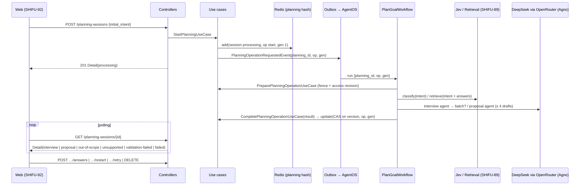

# Objective

Give the Planner a backend flow that turns a free-form learning intention into a
valid Goal proposal: the intention is classified first, the authorized Skill
candidates are retrieved, DeepSeek through OpenRouter (orchestrated with Agno) either
asks one batch of objective questions or composes a proposal, the proposal is
mechanically validated with up to three automatic corrections, and the whole
temporary state lives in Redis bound to the authenticated account with at most one
operation in progress. Nothing is created in Learning; a valid proposal is exposed for
the review screens of `SHIFU-92`/`SHIFU-93` and the confirmation of `SHIFU-95`.

# Scope

| Area / actor | Included | Excluded or deferred |
| --- | --- | --- |
| Temporary state (system) | Redis hash per planning with TTL, optimistic version, one operation per planning, generation fence for restarts, deletion on cancel | Durable history, resumable abandoned sessions, account-wide listing |
| API (learner) | `POST /intelligence/planning-sessions`, `GET …/{planning_id}`, `POST …/{planning_id}/answers`, `POST …/{planning_id}/restart`, `POST …/{planning_id}/retry`, `DELETE …/{planning_id}` | Confirmation / `Criar objetivo` (`SHIFU-95`), UI (`SHIFU-92`, `SHIFU-93`) |
| Orchestration (system) | Registered AgentOS workflow `intelligence-plan-goal`: classification (SHIFU-89), retrieval (SHIFU-89), interview agent, proposal agent, mechanical validation, bounded correction loop, publication with cancel/restart fences | Monthly AI quota and inference guards (`SHIFU-54`), Mentor |
| Interview (system) | Batches of 1–4 single/multiple-choice questions, 2–6 options, optional exclusive `Não sei`, at most 3 answered batches per generation, previous answers kept in context | Free text, `Outro`, schedule/pace/deadline questions |
| Proposal (system) | Title, description, 1+ existing Skills without duplicates, one justification each, direct Curriculum relations among the proposed Skills | Mandatory order or priority among Skills, new curricular content |
| Outcomes (learner) | Distinguishable `processing`, `interview`, `proposal`, `out-of-scope`, `unsupported`, `validation-failed`, `failed` (recoverable) | Quota-blocked state (`SHIFU-54`) |
| Privacy / language | Only the account owner reads or changes the planning; `MentorAccessProvider` revision checked before late effects; pt-BR messages; no prompts, ids or provider details exposed | Account-closure purge job (covered by TTL ≤ 2 h; canonical purge is RP-11 tooling) |

PRD coverage: `RP-07` **implemented** (backend part: classification before interview,
temporary state, one operation, cancel, retry preserving context), `RP-08`
**implemented** (batches, formats, exclusive `Não sei`, no repeated or schedule
questions as instructions and mechanical constraints), `RP-09` **implemented**
(validated proposal, ≤ 3 corrections, unsupported outcome), `RP-10` **partial**
(restart with the original intent; confirmation belongs to `SHIFU-95`), `RP-11`
**partial** (ownership, revision check, TTL), `RP-12` **partial** (pt-BR payloads).
Journeys `JN-07`, `JN-08`, `JN-09`, `JN-10`, `JN-11`, `JN-12`, `JN-15` are covered up
to the state exposed by the API.

# Behavior Contract

| ID | RP/JN/source coverage | Observable required behavior |
| --- | --- | --- |
| RF-01 | RP-07; JN-15 | Starting a planning classifies the intention before any question or proposal. `out-of-scope` ends the planning with a short pt-BR guidance and no batch or proposal; `ambiguous` and `learning` continue; a classification failure yields `failed` (recoverable), never `out-of-scope`. |
| RF-02 | RP-07, RP-08 | The flow reads only the current intent, the answers of the active generation, and Skill names, descriptions and direct relations from `CurriculumCatalogProvider`. No Learning, Gamification, Competency, material or Activity data is read. |
| RF-03 | RP-08; JN-08 | A batch has 1–4 questions, each `single` or `multiple` with 2–6 options; a question may add the exclusive option `Não sei`; no free text and no `Outro`. Submitting answers requires the current batch id, every question answered with valid option ids, exactly one for `single`, at least one for `multiple`, and `Não sei` alone. Answered batches stay in the context of later operations. At most three batches are asked per generation; afterwards the flow composes a proposal. |
| RF-04 | RP-08, RP-09; JN-07 | When the context is sufficient the flow composes a proposal directly. An exposed proposal has title, description, at least one Skill from the candidate set, no duplicates, a justification per Skill, and the direct Curriculum relations among the proposed Skills. |
| RF-05 | RP-09; JN-10 | An invalid draft stays internal; the composer receives the problems and may correct up to three times after the initial draft. If still invalid, the planning ends as `validation-failed` with guidance to retry or create manually; no invalid proposal is exposed. |
| RF-06 | RP-09; JN-11 | When the composer reports that no combination of candidate Skills represents the intention, or no candidate exists, the planning ends as `unsupported` with pt-BR guidance and no invented Skill. |
| RF-07 | RP-07, RP-10 | A planning has at most one operation in progress. Concurrent answers, restarts or retries while an operation runs are rejected with a conflict. Cancel is always possible before confirmation and deletes the state. |
| RF-08 | RP-07, RP-10 | A result is applied only when the planning still exists and its current operation id and generation match the operation that produced it; late results of cancelled or restarted plannings are discarded. |
| RF-09 | RP-07; JN-12, JN-15 | A technical failure keeps the intent and the answers and exposes `failed` with a recoverable message. Retry re-runs the same operation kind over the preserved context without repeating answered batches. An operation older than the configured timeout is reported as `failed` so the learner can retry. State expires by TTL. |
| RF-10 | RP-10; JN-09 | Restarting with a new intent increments the generation, discards batches, answers, proposal and message, re-classifies, and starts a new operation; the original intent of the previous generation is replaced by the submitted one. |
| RF-11 | RP-07, RP-11, RP-12 | Only the owner account can read, answer, restart, retry or cancel a planning; other accounts receive `not_found`. The owner's access revision is re-checked before late effects. Every message destined to the interface is pt-BR; prompts, model ids, Skill ids of non-proposed candidates and provider errors are not exposed. |
| RF-12 | RP-09, RP-10 | The delivery writes no Learning or Curriculum row; the only durable rows are outbox events, the AgentOS run records and the Redis hash. |

| ID | RF coverage | Given | When | Then | Checks |
| --- | --- | --- | --- | --- | --- |
| CA-01 | RF-01, RF-07 | An authenticated learner and a clear learning intent | `POST /intelligence/planning-sessions` | `201` with `status == processing`, `operation.kind == start`, `generation == 1`; the Redis hash exists under the account; one outbox event `intelligence/planning.operation.requested` | CI-03 |
| CA-02 | RF-01 | Jev decides `out-of-scope` for a shopping request | workflow runs | `GET` shows `status == out-of-scope` with a pt-BR message, no batch, no proposal, and no model call for questions or proposal | CI-04 |
| CA-03 | RF-01, RF-09 | Jev fails (5xx, transport) | workflow runs | `status == failed`, `failure_code == service_unavailable`, intent preserved; `POST …/retry` returns `202` and the planning returns to `processing` | CI-01, CI-04 |
| CA-04 | RF-02, RF-03 | An ambiguous intent | workflow runs and the interview agent asks | `status == interview` with one batch of 1–4 questions, each with 2–6 options plus `Não sei` when allowed; the model payload carries only intent, answers and candidate Skill texts | CI-04 |
| CA-05 | RF-03 | A planning in `interview` | `POST …/answers` with a missing question, an unknown option, two options on a `single` question, or `Não sei` combined with another option | `400 validation_error`; the planning is unchanged and no event is emitted | CI-01, CI-03 |
| CA-06 | RF-03 | A planning in `interview` and a complete valid batch | `POST …/answers` | `202`, `status == processing`, `operation.kind == answer`, `answered_batches == 1`, the batch is no longer exposed, one new outbox event | CI-01, CI-03 |
| CA-07 | RF-03, RF-04 | Three batches already answered | workflow runs | The interview agent is not called again; the proposal agent composes | CI-02, CI-04 |
| CA-08 | RF-04 | A sufficient intent | workflow runs | `status == proposal` with title, description, ≥ 1 Skill from the candidates, unique ids, a justification per Skill, relations restricted to proposed Skills, `consulted_curriculum == true` | CI-04 |
| CA-09 | RF-05 | The composer first returns a duplicated or unknown Skill | workflow runs | The invalid draft is never exposed; the composer receives the problems; the corrected draft is exposed as `proposal` | CI-02, CI-04 |
| CA-10 | RF-05 | The composer returns invalid drafts four times | workflow runs | `status == validation-failed`, `failure_code == validation_exhausted`, pt-BR guidance; four composer calls and no further | CI-02, CI-04 |
| CA-11 | RF-06 | The composer reports `supported == false` | workflow runs | `status == unsupported` with pt-BR guidance and no proposal | CI-04 |
| CA-12 | RF-07 | A planning in `processing` | `POST …/answers`, `…/restart` or `…/retry` | `409 conflict`; no new operation or event | CI-01, CI-03 |
| CA-13 | RF-07 | Two concurrent valid answer submissions | both arrive | Exactly one `202`; the other `409`; exactly one new event | CI-03 |
| CA-14 | RF-08 | A planning cancelled while its operation runs | the late result arrives | `update` is refused; `GET` returns `404`; nothing is recreated | CI-01, CI-04 |
| CA-15 | RF-08, RF-10 | A planning whose first run is still blocked past the operation timeout, reported as `failed` and then restarted with a new intent | the late result of the previous generation arrives | It is discarded; the new generation completes with its own result; previous answers and proposal are gone | CI-01, CI-04 |
| CA-16 | RF-09 | An operation started before `now - planning_operation_timeout_seconds` | `GET` | `status == failed`, `failure_code == operation_timeout`, retry allowed | CI-01, CI-03 |
| CA-17 | RF-11 | A planning owned by another account | any route | `404 not_found`; no state change | CI-01, CI-03 |
| CA-18 | RF-11, RF-12 | Any completed planning | inspection | Redis holds one hash with TTL ≤ `planning_session_ttl_seconds`; no Learning or Curriculum row changed; the API body contains no prompt, model id or provider error text | CI-03, CI-04 |

Isolation: the Redis key is derived from the planning id and the document stores the
owner account id and access revision; every read filters by owner. Persistence: Redis
hash plus outbox events. Failures: typed `NotFoundError`, `ConflictError`,
`ValidationError` and `ServiceUnavailableError` subclasses through `AppErrorHandler`.
Concurrency: optimistic version on every write, operation id + generation fences on
completion. Accessibility: not applicable, no UI.

# Technical Contract

## Architecture Mapping

Owner: `intelligence`; `shared` gains two settings. Rules: [Core Layer](../../../rules/core-layer-rules.md),
[AI Layer](../../../rules/ai-layer-rules.md), [REST Layer](../../../rules/rest-layer-rules.md),
[Messaging Layer](../../../rules/messaging-layer-rules.md), [Controller Testing](../../../rules/controllers-testing-rules.md),
[Job Testing](../../../rules/jobs-testing-rules.md), [Use Case Testing](../../../rules/use-case-testing-rules.md),
[Python Conventions](../../../rules/python-conventions-rules.md).

| Action | Boundary | Element / Path | Required change |
| --- | --- | --- | --- |
| Replace | intelligence entity | `PlanningSession` — `core/domain/entities/planning_session.py` | Mutable aggregate of the temporary planning with the transitions below; the Postgres-backed stub (model, mapper, SQLAlchemy repository, `IntelligenceDatabaseRepositories.planning_sessions`) is removed and the table dropped by migration |
| Create | intelligence enums | `PlanningSessionStatus`, `PlanningOperationKind`, `PlanningQuestionKind`, `PlanningOperationResultKind` — `core/domain/enums/` | Closed sets below |
| Create | intelligence structures | `PlanningOption`, `PlanningQuestion`, `PlanningQuestionBatch`, `PlanningAnswer`, `PlanningAnsweredBatch`, `PlanningOperation`, `PlanningProposalSkill`, `PlanningSkillRelation`, `PlanningProposal`, `PlanningProposalDraft`, `PlanningOperationContext`, `PlanningOperationResult` — `core/domain/structures/planning_*.py` | Immutable values with the invariants below; `PlanningProposalDraft.problems(candidates)` is the mechanical validation |
| Create | intelligence errors | `PlanningSessionNotFoundError(NotFoundError)`, `PlanningOperationConflictError(ConflictError)`, `PlanningStateConflictError(ConflictError)`, `PlanningAnswersInvalidError(ValidationError)` — `core/domain/errors/` | pt-BR messages |
| Create | intelligence event | `PlanningOperationRequestedEvent` / `PlanningOperationRequestedPayload(planning_id, operation_id, generation)` — `core/domain/events/planning_operation_requested_event.py` | Name `intelligence/planning.operation.requested`, destination `agentos:intelligence` |
| Replace | intelligence port | `PlanningSessionsRepository` — `core/interfaces/planning_sessions_repository.py` | `add`, `find_by_id`, `update` (optimistic), `remove` |
| Replace / Create | intelligence use cases | `StartPlanningUseCase` (rewritten), `GetPlanningSessionUseCase`, `AnswerPlanningQuestionsUseCase`, `RestartPlanningUseCase`, `RetryPlanningUseCase`, `CancelPlanningUseCase`, `PreparePlanningOperationUseCase`, `CompletePlanningOperationUseCase` — `core/use_cases/` | Signatures below; reuse `ClassifyPlanningIntentUseCase` and `RetrievePlanningSkillsUseCase` |
| Create | intelligence provider | `RedisPlanningSessionsRepository` — `providers/planning/redis/redis_planning_sessions_repository.py` | Hash `shifu:planning:{planning_id}` with fields `version` and `document`, Lua compare-and-set, TTL from settings |
| Create | intelligence provider | `OpenrouterPlannerModelProvider` — `providers/openrouter/planner_model_provider.py` | `deepseek/deepseek-v4.1-flash` through OpenRouter with the same privacy `extra_body` as the Mentor, 60 s timeout, `None` without key or prompt-logging opt-out |
| Create | intelligence AI | `PlanningInterviewAgent`, `PlanningProposalAgent` — `ai/agno/agents/`; `PlanningInterviewOutput`, `PlanningProposalOutput` — `ai/agno/outputs/`; `PlanGoalWorkflow` — `ai/agno/workflows/plan_goal_workflow.py` | Agents with one responsibility, strict output schemas; workflow steps below |
| Modify | intelligence composition | `IntelligenceWorkflowsRegistry` — `ai/intelligence_workflows_registry.py`; `IntelligencePipe`; `app.py` | Registry builds the Redis repository, the agents, the workflow and the event projection; exposes `planning_sessions`; pipe exposes `get_planning_sessions_repository`, `get_planning_operation_timeout` |
| Create / Replace | intelligence REST | `StartPlanningController` (rewritten), `GetPlanningSessionController`, `AnswerPlanningQuestionsController`, `RestartPlanningController`, `RetryPlanningController`, `CancelPlanningController` — `rest/controllers/`; `PlanningSessionSchemas` — `rest/schemas/planning_session_schemas.py`; `IntelligenceRouter` | Routes below; `Cache-Control: private, no-store` |
| Modify | shared settings | `Settings.planning_session_ttl_seconds` (7200), `Settings.planning_operation_timeout_seconds` (180) — `shared/settings.py` | Validated bounds |
| Modify | shared transport | `AgentOSClient._SAFE_FIELD_NAMES` — `shared/messaging/agentos/agentos_client.py` | Allowlists the ID-only ticket fields `planning_id` and `operation_id` (`generation` and `event_id` already exist); no module import enters Shared |
| Create | migration | `apps/server/migrations/versions/<generated>_drop_intelligence_planning_sessions.py` | Drops `intelligence_planning_sessions`; downgrade recreates it |
| Remove | legacy tests | `tests/rest/controllers/intelligence/test_start_planning_controller.py`, `tests/core/intelligence/use_cases/test_start_planning_use_case.py` | Replaced by module-first tests |
| Modify | CI | `.github/workflows/server-app-ci.yaml` | Changed-file coverage selection includes the new test modules |

Expected declarations:

```python
# core/domain/enums
class PlanningSessionStatus(StrEnum):
    PROCESSING = 'processing'; INTERVIEW = 'interview'; PROPOSAL = 'proposal'
    OUT_OF_SCOPE = 'out-of-scope'; UNSUPPORTED = 'unsupported'
    VALIDATION_FAILED = 'validation-failed'; FAILED = 'failed'
class PlanningOperationKind(StrEnum): START = 'start'; ANSWER = 'answer'; RESTART = 'restart'; RETRY = 'retry'
class PlanningQuestionKind(StrEnum): SINGLE = 'single'; MULTIPLE = 'multiple'
class PlanningOperationResultKind(StrEnum):
    BATCH = 'batch'; PROPOSAL = 'proposal'; OUT_OF_SCOPE = 'out-of-scope'
    UNSUPPORTED = 'unsupported'; VALIDATION_FAILED = 'validation-failed'; FAILED = 'failed'

# core/domain/structures (all @structure)
PlanningOption(id: str, text: str, exclusive: bool = False)
PlanningQuestion(id, text, kind, options: tuple[PlanningOption, ...])   # 2..6 options after the exclusive one, unique ids/texts
PlanningQuestionBatch(id, questions: tuple[PlanningQuestion, ...])      # 1..4, unique ids
PlanningAnswer(question_id, option_ids: tuple[str, ...])
PlanningAnsweredQuestion(question: PlanningQuestion, option_ids: tuple[str, ...])  # companion, validates the selection
PlanningAnsweredBatch(batch_id, items: tuple[PlanningAnsweredQuestion, ...])
PlanningOperation(id, kind, started_at, stage: PlanningOperationStage | None = None)
PlanningProposalSkill(skill_id, name, justification)
PlanningSkillRelation(skill_id, foundation_skill_id)
PlanningProposal(title, description, skills, relations)                  # ≥ 1 skill, unique, relations ⊆ skills
PlanningProposalDraftSkill(skill_id, justification)                      # companion
PlanningProposalDraft(title, description, skills: tuple[PlanningProposalDraftSkill, ...])
    .problems(candidates: Mapping[str, str]) -> tuple[str, ...]           # pt-BR problem list; empty means valid
PlanningOperationContext(planning_id, operation_id, generation, account_id, intent,
                         answered_batches, classification: PlanningIntentKind | None)
PlanningOperationResult(kind, batch=None, proposal=None, message=None, failure_code=None,
                        classification=None, consulted_curriculum=False)
    + factories: batch(...), proposal(...), out_of_scope(...), unsupported(...), validation_failed(...), failed(code)

# core/domain/entities/planning_session.py (@entity)
class PlanningSession:
    id, account_id, access_revision, intent, generation: int, version: int, status,
    operation: PlanningOperation | None, last_operation_kind: PlanningOperationKind | None,
    classification: PlanningIntentKind | None, consulted_curriculum: bool,
    answered_batches: tuple[PlanningAnsweredBatch, ...], current_batch: PlanningQuestionBatch | None,
    proposal: PlanningProposal | None, message: str | None, failure_code: str | None,
    created_at, updated_at
    batch -> current_batch; answered_batch_count -> len(answered_batches)   # read-only views for the HTTP contract
    @classmethod start(planning_id, account_id, access_revision, intent, operation_id, now)
    submit_answers(batch_id, answers, operation_id, now)        # raises PlanningStateConflictError / PlanningOperationConflictError / PlanningAnswersInvalidError
    restart(intent, access_revision, operation_id, now)         # raises PlanningOperationConflictError while processing
    retry(operation_id, now)                                    # only from FAILED
    expire_operation(now, timeout) -> bool
    complete(operation_id, generation, result, now) -> bool    # False when the fence rejects the result

# core/interfaces/planning_sessions_repository.py
class PlanningSessionsRepository(Protocol):
    def add(self, session: PlanningSession) -> None: ...                 # ConflictError when the id exists
    def find_by_id(self, planning_id: str) -> PlanningSession | None: ...
    def update(self, session: PlanningSession) -> bool: ...              # compare-and-set on session.version; increments it on success
    def remove(self, planning_id: str) -> bool: ...

# core/use_cases
StartPlanningUseCase(sessions, database, access, identifiers, clock).execute(account_id, intent) -> PlanningSession
GetPlanningSessionUseCase(sessions, clock, operation_timeout: timedelta).execute(account_id, planning_id) -> PlanningSession
AnswerPlanningQuestionsUseCase(sessions, database, identifiers, clock).execute(account_id, planning_id, batch_id, answers) -> PlanningSession
RestartPlanningUseCase(sessions, database, access, identifiers, clock).execute(account_id, planning_id, intent) -> PlanningSession
RetryPlanningUseCase(sessions, database, identifiers, clock).execute(account_id, planning_id) -> PlanningSession
CancelPlanningUseCase(sessions).execute(account_id, planning_id) -> None
PreparePlanningOperationUseCase(sessions, access).execute(planning_id, operation_id, generation) -> PlanningOperationContext | None
CompletePlanningOperationUseCase(sessions, clock).execute(planning_id, operation_id, generation, result) -> bool
```

Workflow `PlanGoalWorkflow` (`id='intelligence-plan-goal'`), input `{planning_id,
operation_id, generation, event_id?}`:

1. `prepare-and-classify`: `PreparePlanningOperationUseCase`; `None` ends the run
   silently. Without answered batches the intent is classified
   (`ClassifyPlanningIntentUseCase`); `out-of-scope` completes the operation with that
   outcome; a classification error completes it as `failed(service_unavailable)`.
2. `retrieve-and-interview`: `RetrievePlanningSkillsUseCase` over intent + answers;
   no candidate → `unsupported`. With fewer than three answered batches the
   `PlanningInterviewAgent` decides; `needs_clarification` with a valid batch
   completes the operation with that batch. Otherwise the run continues.
3. `compose-and-validate-proposal` (`Loop`, `max_iterations=4`): `PlanningProposalAgent`
   receives intent, answers, candidates and the previous problems; `supported == false`
   → `unsupported`; a valid draft → proposal; an invalid draft → next iteration with the
   problems; after the fourth invalid draft → `validation-failed(validation_exhausted)`.
4. `publish-result`: relations from `find_direct_foundations_for_many` restricted to
   the proposed Skills; `CompletePlanningOperationUseCase` applies the result under the
   fence. Any unexpected exception completes the operation as `failed(service_unavailable)`.

Private per-run state travels through `AgentOSHandoffStore` references, never through
AgentOS step outputs, as the Mentor workflow does.

HTTP contract (prefix `/intelligence`; all responses `Cache-Control: private, no-store`):

| Route | Body | Success | Errors |
| --- | --- | --- | --- |
| `POST /planning-sessions` | `{initial_intent}` | `201 Detail` | `422` empty intent, `401`, `503` |
| `GET /planning-sessions/{planning_id}` | — | `200 Detail` | `404` |
| `POST /planning-sessions/{planning_id}/answers` | `{batch_id, answers: [{question_id, option_ids}]}` | `202 Detail` | `400 validation_error`, `404`, `409 conflict` |
| `POST /planning-sessions/{planning_id}/restart` | `{initial_intent}` | `202 Detail` | `404`, `409`, `422` |
| `POST /planning-sessions/{planning_id}/retry` | — | `202 Detail` | `404`, `409` |
| `DELETE /planning-sessions/{planning_id}` | — | `204` | `404` only when owned by another account |

`Detail`: `id`, `status`, `intent`, `generation`, `created_at`, `updated_at`,
`operation {kind, started_at} | null`, `consulted_curriculum`, `batch {id, questions
[{id, text, kind, options [{id, text, exclusive}]}]} | null`, `answered_batch_count`,
`proposal {title, description, skills [{skill_id, name, justification}],
relations [{skill_id, foundation_skill_id}]} | null`, `message | null`,
`failure_code | null`.

Expected file tree:

```text
apps/server/src/shifu/shared/settings.py                                                              [M]
apps/server/src/shifu/shared/messaging/agentos/agentos_client.py                                      [M]
apps/server/tests/shared/messaging/agentos/test_agentos_client.py                                      [M]
apps/server/src/shifu/intelligence/core/domain/enums/planning_session_status.py                       [N]
apps/server/src/shifu/intelligence/core/domain/enums/planning_operation_kind.py                       [N]
apps/server/src/shifu/intelligence/core/domain/enums/planning_question_kind.py                        [N]
apps/server/src/shifu/intelligence/core/domain/enums/planning_operation_result_kind.py                [N]
apps/server/src/shifu/intelligence/core/domain/enums/__init__.py                                      [M]
apps/server/src/shifu/intelligence/core/domain/structures/planning_option.py                          [N]
apps/server/src/shifu/intelligence/core/domain/structures/planning_question.py                        [N]
apps/server/src/shifu/intelligence/core/domain/structures/planning_question_batch.py                  [N]
apps/server/src/shifu/intelligence/core/domain/structures/planning_answer.py                          [N]
apps/server/src/shifu/intelligence/core/domain/structures/planning_answered_batch.py                  [N]
apps/server/src/shifu/intelligence/core/domain/structures/planning_operation.py                       [N]
apps/server/src/shifu/intelligence/core/domain/structures/planning_proposal_skill.py                  [N]
apps/server/src/shifu/intelligence/core/domain/structures/planning_skill_relation.py                  [N]
apps/server/src/shifu/intelligence/core/domain/structures/planning_proposal.py                        [N]
apps/server/src/shifu/intelligence/core/domain/structures/planning_proposal_draft.py                  [N]
apps/server/src/shifu/intelligence/core/domain/structures/planning_operation_context.py               [N]
apps/server/src/shifu/intelligence/core/domain/structures/planning_operation_result.py                [N]
apps/server/src/shifu/intelligence/core/domain/structures/__init__.py                                 [M]
apps/server/src/shifu/intelligence/core/domain/entities/planning_session.py                           [M]
apps/server/src/shifu/intelligence/core/domain/errors/planning_session_not_found_error.py             [N]
apps/server/src/shifu/intelligence/core/domain/errors/planning_operation_conflict_error.py            [N]
apps/server/src/shifu/intelligence/core/domain/errors/planning_state_conflict_error.py                [N]
apps/server/src/shifu/intelligence/core/domain/errors/planning_answers_invalid_error.py               [N]
apps/server/src/shifu/intelligence/core/domain/errors/__init__.py                                     [M]
apps/server/src/shifu/intelligence/core/domain/events/planning_operation_requested_event.py           [N]
apps/server/src/shifu/intelligence/core/domain/events/__init__.py                                     [M]
apps/server/src/shifu/intelligence/core/interfaces/planning_sessions_repository.py                    [M]
apps/server/src/shifu/intelligence/core/interfaces/intelligence_database.py                            [M]
apps/server/src/shifu/intelligence/core/use_cases/start_planning_use_case.py                          [M]
apps/server/src/shifu/intelligence/core/use_cases/get_planning_session_use_case.py                    [N]
apps/server/src/shifu/intelligence/core/use_cases/answer_planning_questions_use_case.py               [N]
apps/server/src/shifu/intelligence/core/use_cases/restart_planning_use_case.py                        [N]
apps/server/src/shifu/intelligence/core/use_cases/retry_planning_use_case.py                          [N]
apps/server/src/shifu/intelligence/core/use_cases/cancel_planning_use_case.py                         [N]
apps/server/src/shifu/intelligence/core/use_cases/prepare_planning_operation_use_case.py              [N]
apps/server/src/shifu/intelligence/core/use_cases/complete_planning_operation_use_case.py             [N]
apps/server/src/shifu/intelligence/core/use_cases/__init__.py                                          [M]
apps/server/src/shifu/intelligence/providers/planning/redis/redis_planning_sessions_repository.py     [N]
apps/server/src/shifu/intelligence/providers/openrouter/planner_model_provider.py                     [N]
apps/server/src/shifu/intelligence/providers/openrouter/__init__.py                                   [M]
apps/server/src/shifu/intelligence/ai/agno/agents/planning_interview_agent.py                         [N]
apps/server/src/shifu/intelligence/ai/agno/agents/planning_proposal_agent.py                          [N]
apps/server/src/shifu/intelligence/ai/agno/agents/__init__.py                                         [M]
apps/server/src/shifu/intelligence/ai/agno/outputs/planning_interview_output.py                       [N]
apps/server/src/shifu/intelligence/ai/agno/outputs/planning_proposal_output.py                        [N]
apps/server/src/shifu/intelligence/ai/agno/outputs/__init__.py                                        [M]
apps/server/src/shifu/intelligence/ai/agno/workflows/plan_goal_workflow.py                            [N]
apps/server/src/shifu/intelligence/ai/agno/workflows/__init__.py                                      [M]
apps/server/src/shifu/intelligence/ai/intelligence_workflows_registry.py                              [M]
apps/server/src/shifu/intelligence/pipes/intelligence_pipe.py                                         [M]
apps/server/src/shifu/intelligence/rest/schemas/planning_session_schemas.py                           [N]
apps/server/src/shifu/intelligence/rest/controllers/start_planning_controller.py                      [M]
apps/server/src/shifu/intelligence/rest/controllers/get_planning_session_controller.py                [N]
apps/server/src/shifu/intelligence/rest/controllers/answer_planning_questions_controller.py           [N]
apps/server/src/shifu/intelligence/rest/controllers/restart_planning_controller.py                    [N]
apps/server/src/shifu/intelligence/rest/controllers/retry_planning_controller.py                      [N]
apps/server/src/shifu/intelligence/rest/controllers/cancel_planning_controller.py                     [N]
apps/server/src/shifu/intelligence/rest/router.py                                                      [M]
apps/server/src/shifu/intelligence/database/sqlalchemy/{models,mappers,repositories}/planning_session_* [D]
apps/server/src/shifu/intelligence/database/sqlalchemy/intelligence_database.py                       [M]
apps/server/src/shifu/app.py                                                                           [M]
apps/server/migrations/versions/b8d1f3a2c4e6_drop_intelligence_planning_sessions.py                   [N]
apps/server/tests/intelligence/core/domain/test_planning_session_domain.py                            [N]
apps/server/tests/intelligence/core/use_cases/planning_test_setup.py                                  [N]
apps/server/tests/intelligence/core/use_cases/test_{start_planning,get_planning_session,answer_planning_questions,restart_planning,retry_planning,cancel_planning,prepare_planning_operation,complete_planning_operation}_use_case.py [N]
apps/server/tests/intelligence/server/controllers/test_{start_planning,get_planning_session,answer_planning_questions,restart_planning,retry_planning,cancel_planning}_controller.py [N]
apps/server/tests/intelligence/server/controllers/planning_test_support.py                            [N]
apps/server/tests/intelligence/server/controllers/conftest.py                                          [M]
apps/server/tests/intelligence/server/agentos/test_plan_goal_workflow.py                              [N]
apps/server/tests/intelligence/ai/test_intelligence_workflows_registry.py                             [M]
apps/server/tests/fixtures/agentos_fixture.py                                                          [M]
apps/server/tests/rest/controllers/intelligence/test_start_planning_controller.py                     [D]
apps/server/tests/core/intelligence/use_cases/test_start_planning_use_case.py                         [D]
.github/workflows/server-app-ci.yaml                                                                   [M]
documentation/features/intelligence/planner-goal-flow/{spec,evaluation}.md                             [N]
```

## Runtime Flow



# Verification Contract

## Shared setup

Use-case tests are infrastructure-free (autospec of `PlanningSessionsRepository`,
`IntelligenceDatabase`, `MentorAccessProvider`, `IdentifierProvider`, `ClockProvider`).
Controller tests use `FastAPIApp.register(postgres_database.engine)` with the real
transactional outbox, the Testcontainers Redis of `tests/fixtures/redis_fixture.py`
(autouse) backing `RedisPlanningSessionsRepository`, an autospec `MentorAccessProvider`
and the authenticated-user override. The registered AgentOS test uses
`tests/fixtures/agentos_fixture.py` extended with `ControlledDecisionsTransport`
(Jev kind and failure switches), planner branches on the model transport (queued
interview and proposal outputs, failure count, a gate that blocks the first call) and
`PLANNING_OPERATION_TIMEOUT_SECONDS=10`; the test module seeds the Curriculum Skills and
prepares the Planner index behind the running app; it requires
`SHIFU_RUN_REAL_AGENTOS_TESTS=1` and Docker. Controller tests neutralize the AgentOS
relay (`planning_client` fixture) so the outbox rows stay observable. The real DeepSeek run is opt-in through
`SHIFU_RUN_REAL_OPENROUTER_TESTS=1` with `OPENROUTER_API_KEY` and is never the only
proof.

## Automated

### CI-01 — Use-case decisions over mocked ports

**Criteria:** CA-03, CA-05, CA-06, CA-12, CA-14, CA-15, CA-16, CA-17

**Expected result:** start, answer, restart, retry, cancel, get, prepare and complete
apply the entity transitions, emit `PlanningOperationRequestedEvent` inside the module
transaction only after a successful Redis write, translate a refused compare-and-set
into `PlanningOperationConflictError`, drop fenced results, report timed-out operations
as `failed`, and hide other accounts' plannings behind `PlanningSessionNotFoundError`.

**Proof:** `tests/intelligence/core/use_cases/test_*planning*_use_case.py`

```bash
cd apps/server && uv run pytest tests/intelligence/core/use_cases -k planning -q -p no:tach
```

**Passing condition:** all assertions pass; failure paths assert the absence of
events and writes.

### CI-02 — Domain conformance of the planning aggregate

**Criteria:** CA-05, CA-07, CA-09, CA-10

**Expected result:** batch/question/option invariants, answer validation (missing
question, unknown option, single with two options, exclusive `Não sei` combined),
proposal draft problems (missing title/description, no Skill, unknown Skill, duplicate,
missing justification), fence rejections in `complete`, restart reset and retry
eligibility.

**Proof:** `tests/intelligence/core/domain/test_planning_session_domain.py`

```bash
cd apps/server && uv run pytest tests/intelligence/core/domain/test_planning_session_domain.py -q -p no:tach
```

**Passing condition:** every invariant has a passing and a rejecting case.

### CI-03 — HTTP contracts over real Redis and outbox

**Criteria:** CA-01, CA-05, CA-06, CA-12, CA-13, CA-16, CA-17, CA-18

**Expected result:** each route returns the declared status and `Detail`, the Redis
hash and TTL are observable, outbox rows carry the canonical event, concurrent answers
yield one `202` and one `409`, foreign accounts get `404`, cancel deletes the hash,
and bodies never carry prompts or ids beyond the contract.

**Proof:** `tests/intelligence/server/controllers/test_*planning*_controller.py`

```bash
cd apps/server && uv run pytest tests/intelligence/server/controllers -k planning -q -p no:tach
```

**Passing condition:** assertions pass against the disposable PostgreSQL and Redis.

### CI-04 — Registered AgentOS workflow

**Criteria:** CA-02, CA-03, CA-04, CA-07, CA-08, CA-09, CA-10, CA-11, CA-14, CA-15, CA-18

**Expected result:** through the real registry, admission and queue, the workflow
produces every outcome from controlled Jev and model transports: direct proposal with
relations, interview batch then proposal, out-of-scope without model calls,
unsupported, invalid-then-corrected draft, four invalid drafts, Jev failure then retry,
and late results discarded after cancel and after restart; the captured model requests
contain only intent, answers and candidate Skill texts.

**Proof:** `tests/intelligence/server/agentos/test_plan_goal_workflow.py`

```bash
cd apps/server && SHIFU_RUN_REAL_AGENTOS_TESTS=1 uv run pytest tests/intelligence/server/agentos/test_plan_goal_workflow.py -q -p no:tach -s
```

**Passing condition:** every scenario reaches its terminal state within the bounded
wait and the recorded transports show the expected call counts.

### CI-05 — Applicable baseline checks

```bash
cd apps/server && uv run poe check:lint && uv run poe check:types && uv run poe check:architecture && uv run poe test:unit
cd apps/server && uv run alembic check
```

**Passing condition:** every gate passes; the migration leaves no drift.

## Manual

### VM-01 — Real planning with DeepSeek through OpenRouter

**Type:** Manual (opt-in)

**Criteria:** CA-04, CA-08

**Tool / setup:** `OPENROUTER_API_KEY` and `OPENROUTER_PROMPT_LOGGING_DISABLED=true` in
`apps/server/.env.local`; Compose services up; seeded catalog; Planner index prepared.

**Procedure:** run the server, `POST /intelligence/planning-sessions` with
"Quero aprender a fazer sites" and poll `GET` until a terminal state; answer the batch
if asked; record the final `Detail`.

**Passing condition:** a `proposal` or `interview` state in pt-BR built only from
seeded Skills; limits of the evidence recorded in `evaluation.md`.

## Visual

Not applicable: this delivery has no user interface.

# Documentation Alignment

| Document / authority | Governs | Required update or confirmation | Disposition / dependency |
| --- | --- | --- | --- |
| Shifu — PRD — Intelligence, content `83099649`, version 4, retrieved 2026-10-20 | RP-07 to RP-12; JN-07 to JN-12, JN-15 | Flow, formats, limits, restart and fences as specified | Confirmed, no Confluence write |
| `documentation/modules.md` | Goal Planner responsibilities | Matches: batches, proposal, confirmation deferred to Learning | Confirmed |
| AI Layer Rules | Agents, workflows, registered-boundary tests, transport doubles | Followed | Confirmed |
| Messaging Layer Rules | Event ownership, outbox, AgentOS projection | Followed; new event projected by the Intelligence registry | Confirmed |
| REST Layer Rules | Routes, schemas, error handler | Followed; web client keeps consuming `id`/`created_at` of the start response | Confirmed |
| SHIFU-89 spec | Classification and retrieval contracts | Consumed unchanged | Confirmed |

# Revision History

| Revision | Date | Contract change | Reason / source |
| --- | --- | --- | --- |
| 1 | 2026-10-20 | Initial contract | SHIFU-91 and PRD Intelligence v4; Mentor workflow and registry patterns reused |
| 3 | 2026-10-20 | `PlanningOperation.stage` (`analyzing`, `retrieving`, `interviewing`, `composing`) reported by the workflow through `ReportPlanningProgressUseCase` under the same operation/generation fence and exposed as `Detail.operation.stage`; `.rest` examples for every planner route | SHIFU-92: the interview page represents the real processing stage of the backend (see `../planner-interview/spec.md`) |
| 2 | 2026-10-20 | `Detail.answered_batch_count` replaces `answered_batches`; companion structures `PlanningAnsweredQuestion` and `PlanningProposalDraftSkill`; entity read-only views `batch` and `answered_batch_count`; CA-15 restated (a restart is refused while an operation runs, so the generation fence is proven through the timeout path); migration id and test support files recorded | Implementation: the HTTP contract maps entity attributes through `from_attributes`, and RF-07 already forbids a restart during processing |
