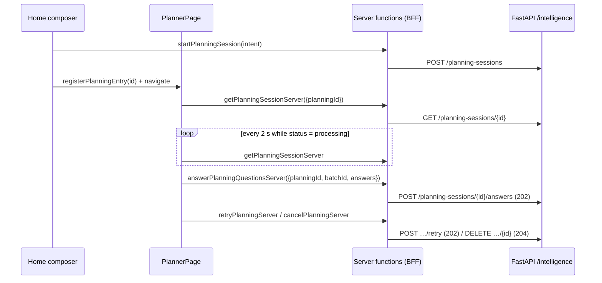

# Objective

Give the learner a dedicated, authenticated Planner page at
`/intelligence/planner/$planningId` that consumes the `SHIFU-91` contract: it shows the
initial intention, asks one question per step with free navigation inside the current
batch, enforces single/multiple choice with an exclusive `Não sei`, sends the complete
batch, represents the real processing stages of the backend, keeps `Cancelar` always
available, distinguishes the four terminal outcomes with their exits, recovers from
technical failures with `Tentar novamente`, and hands a valid proposal to the review
boundary that `SHIFU-93` renders. The placeholder page shipped by `SHIFU-60` is replaced.
Complete mode: the page owns twenty-four approved frames and a route integration suite.

# Scope

| Area / actor | Included | Excluded or deferred |
| --- | --- | --- |
| Entry (learner) | The existing Home composer keeps starting the planning and navigating to the page; the page reads the intention from the backend state | Re-implementing the Home, prefilled intention on return |
| Interview (learner) | One question per step, `Anterior`/`Próxima`/step buttons, single and multiple choice, exclusive `Não sei`, `Enviar respostas` on the last step only when the batch is complete, answers kept only in page memory, new batch replaces the previous one | Free text, `Outro`, editing answered batches, persistent answers in the browser |
| Processing (learner) | Real states from the backend: `analyzing`, `retrieving` (Curriculum consultation without details), `interviewing`, `composing`; busy primary action; `Cancelar` available; duplicate submissions and concurrent retries blocked | Monthly quota (`SHIFU-54`), Mentor |
| Outcomes (learner) | `out-of-scope`, `unsupported`, `validation-failed`, recoverable `failed`; exits `Reformular`, `Criar manualmente`, `Tentar novamente` | Rendering, editing, list/graph and restart modal of the proposal (`SHIFU-93`), `Criar objetivo` (`SHIFU-95`) |
| Review handoff (system) | Explicit typed boundary rendered when the status is `proposal`, including when no batch was asked | The review widgets themselves |
| Backend (system) | `operation.stage` reported by the workflow between its steps so the page represents the real processing stage; `.rest` examples for the whole planner API | Any change to classification, retrieval, agents or validation |
| Responsiveness / a11y | Desktop and mobile frames, keyboard selection and navigation, visible focus, pt-BR accessible names and live messages | Light theme |

PRD coverage: `RP-07` **implemented** (entry without creating Goals, processing with cancel,
technical failure preserved while the page is active), `RP-08` **implemented** (one
question per step, free navigation inside the batch, formats, exclusive `Não sei`,
complete batch sent, batch replacement), `RP-09` **partial** (distinguishable outcomes and
handoff of the valid proposal; the review itself is `SHIFU-93`), `RP-12` **implemented**
for the Planner page. Journeys `JN-07`, `JN-08`, `JN-10`, `JN-11`, `JN-12`, `JN-15` are
covered up to the review handoff.

# Behavior Contract

| ID | RP/JN/source coverage | Observable required behavior |
| --- | --- | --- |
| RF-01 | RP-07; JN-07, JN-08 | The Home composer (`SHIFU-60`) starts the planning and navigates to `/intelligence/planner/$planningId`. The page loads the planning from `GET /intelligence/planning-sessions/{id}` and shows the stored intention under `O que você quer alcançar`. No Goal or Skill is created by the page. |
| RF-02 | RP-08; JN-08 | While the status is `interview`, the page shows one question per step. `Pergunta N de M deste conjunto` and a step trail with `N · Atual`, `N · Respondida`, `N · Pendente` describe only the current batch. `Anterior`, `Próxima` and the step buttons move freely among the questions; selections are kept when the learner returns to a question. |
| RF-03 | RP-08 | A `single` question renders radios; a `multiple` question renders checkboxes. No free text and no `Outro` exist. In a `multiple` question, selecting the exclusive option clears the other selections and selecting another option clears the exclusive one. |
| RF-04 | RP-08 | The last step offers `Enviar respostas`, enabled only when every question of the batch has at least one selection. The submission posts the batch id and every question with its selected option ids. Unsent answers live only in page memory. |
| RF-05 | RP-08 | A new batch replaces the previous one: the step trail, the answers in memory and the current step reset. Previously sent batches are not editable through the interface. |
| RF-06 | RP-07, RP-08, RP-12 | While the status is `processing`, the page shows the preserved intention and the real stage: `Analisando seu objetivo…`, `Consultando o Currículo…` (no internal detail), `Preparando o próximo passo…`, `Montando sua proposta…`; before the workflow reports a stage, the copy derives from the operation kind. The primary action is busy and disabled; new submissions and retries are blocked; `Cancelar` stays available. The page polls the backend every 2 s only while processing. |
| RF-07 | RP-07; JN-12 | `Cancelar` deletes the planning and returns to the Home. Opening the page without the in-memory entry registered by the composer (reload, direct link, return through history) abandons the planning (best-effort delete) and returns to the Home. Late results after a cancel never reopen the flow because polling stops and the query is removed. |
| RF-08 | RP-07; JN-12, JN-15 | A `failed` status keeps the planning on the page and offers `Tentar novamente`, which posts `/retry` and resumes polling over the preserved context. A transport failure of the page's own requests shows a recoverable error with a retry of the request and is never presented as `out-of-scope` or `unsupported`. A conflict (`409`) is shown as an in-progress operation and the state is refreshed. |
| RF-09 | RP-07, RP-09; JN-10, JN-11, JN-15 | `out-of-scope`, `unsupported`, `validation-failed` and `failed` are visually and textually distinct. Exits: `Reformular` and `Criar manualmente` for the first two, plus `Tentar novamente` for `validation-failed`. `Reformular` abandons the planning and returns to the Home composer; `Criar manualmente` abandons it and opens `/learning/goals/new`. No invalid proposal is ever rendered. |
| RF-10 | RP-08, RP-09; JN-07, JN-08 | When the status becomes `proposal`, the interview surface disappears and the page renders the review boundary `PlanningProposalHandoff` with the full proposal payload, also when the interview was skipped. |
| RF-11 | RP-12 | The page follows the approved frames, reuses Shifu tokens, works at 1440 × 900 and 390 × 844 without horizontal scroll, is operable by keyboard (steps, options, actions) with visible focus, and announces step label changes and processing/failure notices through live regions in pt-BR. |
| RF-12 | RP-07 (backend) | The workflow reports its stage (`analyzing`, `retrieving`, `interviewing`, `composing`) on the current operation; a report for a cancelled, restarted or superseded operation is discarded; the GET detail exposes `operation.stage` (`null` until the first report). |

| ID | RF coverage | Given | When | Then | Checks |
| --- | --- | --- | --- | --- | --- |
| CA-01 | RF-01 | An authenticated learner on the Home | They submit an intention through the composer | The browser navigates to the planner URL, the page calls the GET detail and shows the intention text; no Learning request is made | CI-03 |
| CA-02 | RF-02 | An `interview` planning with three questions | The page renders | Step 1 is current, 2 and 3 are pending, the label reads `Pergunta 1 de 3 deste conjunto`, only question 1 is visible | CI-02 / CI-03 / VM-02 |
| CA-03 | RF-02 | Question 1 answered | The learner presses `Próxima`, then `Anterior`, then step `3` | The visited question changes each time, question 1 keeps its selection and reads `1 · Respondida` from other steps | CI-02 / CI-03 |
| CA-04 | RF-03 | A `multiple` question with `Não sei` and two options selected | The learner selects `Não sei` | Only `Não sei` is checked; selecting another option afterwards unchecks `Não sei` | CI-02 / CI-03 |
| CA-05 | RF-04 | The last step with one question still unanswered | The page renders | `Enviar respostas` is disabled; the guidance tells the learner to review the steps | CI-02 / CI-03 |
| CA-06 | RF-04 | Every question answered on the last step | The learner presses `Enviar respostas` | `POST …/answers` carries `batch_id` and one `{question_id, option_ids}` per question; the page switches to the processing surface | CI-03 |
| CA-07 | RF-05 | A processing planning after a submission | The GET returns a new `interview` batch | The new questions replace the previous ones, the trail restarts at step 1 and no previous answer is preselected | CI-02 / CI-03 |
| CA-08 | RF-06 | A `processing` planning | The GET reports each stage in turn | The notice shows the stage copy and the busy label of that stage; the primary action is disabled; `Cancelar` is enabled | CI-02 / CI-03 / VM-02 |
| CA-09 | RF-06 | A `processing` planning | Polling | A GET is sent about every 2 s while processing and stops after a terminal status | CI-02 / CI-03 |
| CA-10 | RF-07 | Any state | The learner presses `Cancelar` | `DELETE /intelligence/planning-sessions/{id}` is sent and the URL becomes `/`; a later poll response never renders the planner again | CI-02 / CI-03 |
| CA-11 | RF-07 | The planner URL opened without the registered entry | The page mounts | A best-effort delete is sent and the browser returns to `/` without rendering questions | CI-02 / CI-03 |
| CA-12 | RF-08 | A `failed` planning | The learner presses `Tentar novamente` | `POST …/retry` is sent, the processing surface appears and the next interview batch renders | CI-02 / CI-03 |
| CA-13 | RF-08 | The GET detail fails with a server error | The page renders | A recoverable error with `Tentar novamente` appears, with no out-of-scope or unsupported copy; the retry refetches and renders the planning | CI-02 / CI-03 |
| CA-14 | RF-08 | A submission answered with `409` | The response arrives | The conflict message is shown, no duplicate request is sent, and the state is refreshed | CI-02 / CI-03 |
| CA-15 | RF-09 | `out-of-scope` | The page renders | Title `Vamos planejar sua aprendizagem`, scope guidance, `Criar manualmente` and `Reformular`; no question or proposal | CI-02 / CI-03 / VM-02 |
| CA-16 | RF-09 | `unsupported` | The page renders | Title `Ainda não temos Habilidades para isso`, Curriculum guidance, `Reformular` and `Criar manualmente`; no Skill name is invented | CI-02 / CI-03 / VM-02 |
| CA-17 | RF-09 | `validation-failed` | The page renders | Title `Não conseguimos concluir sua proposta`, `Nenhum objetivo foi criado`, actions `Criar manualmente`, `Reformular`, `Tentar novamente` | CI-02 / CI-03 / VM-02 |
| CA-18 | RF-09 | `out-of-scope` | `Reformular` / `Criar manualmente` | A delete is sent and the URL becomes `/` or `/learning/goals/new` respectively | CI-02 / CI-03 |
| CA-19 | RF-10 | A planning whose GET returns `proposal` | The page renders | The review boundary receives the proposal (title, description, skills, relations) and the interview controls are absent | CI-02 / CI-03 |
| CA-20 | RF-11 | The interview at 390 × 844 | The page renders | Actions stack (`Anterior`, `Próxima`/`Enviar respostas`, then `Cancelar`), no horizontal scroll, and Tab/Arrow/Space/Enter operate steps, options and actions | CI-03 / VM-02 |
| CA-21 | RF-11 | Any state | Assistive technology | Step buttons expose `aria-current='step'`, options expose their pt-BR names, the step label and notices are live regions | CI-02 / CI-03 |
| CA-22 | RF-12 | A processing operation in the registered workflow | The workflow passes its steps | The GET shows `operation.stage` progressing; a stage reported for another operation id or generation is discarded | CI-01 |
| CA-23 | RF-01, RF-07 | The planning does not exist or belongs to another account (`404`) | The page renders | `Planejamento não encontrado` with a return to the Home; no delete is attempted | CI-02 / CI-03 |

# Technical Contract

## Architecture Mapping

Owner: `intelligence`. Rules: [UI layer](../../../rules/ui-layer-rules.md),
[web routing](../../../rules/web-app-routing-rules.md),
[widget testing](../../../rules/widget-testing-rules.md),
[TypeScript conventions](../../../rules/typescript-conventions-rules.md),
[core layer](../../../rules/core-layer-rules.md), [AI layer](../../../rules/ai-layer-rules.md),
[REST layer](../../../rules/rest-layer-rules.md), [use-case testing](../../../rules/use-case-testing-rules.md),
[controllers testing](../../../rules/controllers-testing-rules.md), [design](../../../design.md).

| Action | Boundary | Element / Path | Required change |
| --- | --- | --- | --- |
| Create | server core | `PlanningOperationStage` — `apps/server/src/shifu/intelligence/core/domain/enums/planning_operation_stage.py` | `StrEnum` with `ANALYZING='analyzing'`, `RETRIEVING='retrieving'`, `INTERVIEWING='interviewing'`, `COMPOSING='composing'`; exported from the enums package |
| Modify | server core | `PlanningOperation` — `…/core/domain/structures/planning_operation.py` | Field `stage: PlanningOperationStage \| None = None` |
| Modify | server core | `PlanningSession.report_progress` — `…/core/domain/entities/planning_session.py` | New transition fenced by operation id, generation and `PROCESSING`; replaces the operation with the stage and touches `updated_at` |
| Create | server core | `ReportPlanningProgressUseCase` — `…/core/use_cases/report_planning_progress_use_case.py` | Loads, applies `report_progress`, CAS update; returns `bool`; exported |
| Modify | server AI | `PlanGoalWorkflow` — `…/ai/agno/workflows/plan_goal_workflow.py` | Keyword `progress_use_case`; best-effort stage reports before classification, retrieval, interview agent and the first proposal draft; `deep_copy` forwards the use case |
| Modify | server composition | `IntelligenceWorkflowsRegistry` — `…/ai/intelligence_workflows_registry.py` | Builds `ReportPlanningProgressUseCase(self._planning_sessions, self._clock_provider)` for the workflow |
| Modify | server REST | `PlanningSessionSchemas.Operation` — `…/rest/schemas/planning_session_schemas.py` | `stage: PlanningOperationStage \| None` |
| Modify | server docs | `apps/server/rest-client/intelligence/intelligence.rest` | Examples for GET, answers, restart, retry and cancel |
| Create | web core | `planning-session.ts` — `apps/web/src/core/intelligence/planning-session.ts` | Domain types below and `PLANNING_ID_PATTERN` |
| Create | web core | `PlanningSessionFaker`, `PlanningQuestionFaker` — `apps/web/src/core/intelligence/fakers/planning-session-faker.ts` | Deterministic builders used by Vitest and Playwright |
| Modify | web constants | `ROUTES.intelligencePlanner`, `intelligencePlannerPath` — `apps/web/src/constants/routes.ts` | Canonical dynamic path and builder; `RouteName` keeps excluding dynamic routes |
| Modify | web REST | `IntelligenceService` — `apps/web/src/rest/services/intelligence-service.ts` | `getPlanningSession`, `answerPlanningQuestions`, `retryPlanning`, `cancelPlanning` with snake_case → camelCase mapping (`restart` stays a backend route until SHIFU-93 consumes it) |
| Create | web provision | `withPlanningService`, `PlanningFailure` — `apps/web/src/provision/planning/planning-server-provider.ts` | Server-only access + service composition and REST → failure mapping shared by the planner server functions |
| Create | web hooks | `usePlanningSessionQuery` — `apps/web/src/ui/intelligence/hooks/use-planning-session-query.ts` | Server function `getPlanningSessionServer`; query with conditional 2 s polling |
| Create | web hooks | `useAnswerPlanningQuestionsAction`, `useRetryPlanningAction`, `useCancelPlanningAction` — `apps/web/src/ui/intelligence/hooks/use-{answer-planning-questions,retry-planning,cancel-planning}-action.ts` | Server functions + mutations with domain names |
| Create | web hooks | `PlanningRequestError` — `apps/web/src/ui/intelligence/hooks/planning-request-error.ts` | `AppError` subclass carrying the failure `kind` on the client |
| Create | web UI | `registerPlanningEntry`, `consumePlanningEntry` — `apps/web/src/ui/intelligence/planning-entry.ts` | In-memory one-shot marker written by the composer before navigating (RF-07) |
| Modify | web UI | `usePlanningIntentComposer` — `apps/web/src/ui/intelligence/widgets/layouts/planning-intent-composer/use-planning-intent-composer.ts` | Calls `registerPlanningEntry(session.id)` before `navigateToPlanner` |
| Create | web UI | `PlannerPage` — `apps/web/src/ui/intelligence/widgets/pages/planner-page/` | Page widget, owning hook, CSS and nested pure widgets (tree below) |
| Modify | web routing | `apps/web/src/routes/intelligence/planner/$planningId/index.tsx` | Renders `PlannerPage` |
| Delete | web UI | `apps/web/src/ui/intelligence/widgets/pages/planner-placeholder-page/index.tsx`, `apps/web/tests/intelligence/planner-placeholder-page.test.ts` | Replaced by the page and its suite |
| Modify | web shared | `Button` — `apps/web/src/ui/shadcn/button.tsx` | `variant: 'outline'` (transparent, `border-control-border`), variants as a lookup map |
| Modify | web shared | `Icon` — `apps/web/src/ui/shared/widgets/components/icon/index.tsx` | `compass`, `shield-alert`, `triangle-alert` |
| Modify | CI | `.github/workflows/web-app-ci.yaml`, `.github/workflows/server-app-ci.yaml` | New Vitest files in the scoped coverage run; new server test module in the planner selection |

Domain types (`apps/web/src/core/intelligence/planning-session.ts`):

```ts
export type PlanningSessionStatus =
  | 'processing' | 'interview' | 'proposal' | 'out-of-scope'
  | 'unsupported' | 'validation-failed' | 'failed'
export type PlanningOperationKind = 'start' | 'answer' | 'restart' | 'retry'
export type PlanningOperationStage = 'analyzing' | 'retrieving' | 'interviewing' | 'composing'
export type PlanningQuestionKind = 'single' | 'multiple'
export type PlanningOption = { id: string; text: string; exclusive: boolean }
export type PlanningQuestion = { id: string; text: string; kind: PlanningQuestionKind; options: PlanningOption[] }
export type PlanningQuestionBatch = { id: string; questions: PlanningQuestion[] }
export type PlanningOperation = { kind: PlanningOperationKind; startedAt: string; stage: PlanningOperationStage | null }
export type PlanningProposalSkill = { skillId: string; name: string; justification: string }
export type PlanningSkillRelation = { skillId: string; foundationSkillId: string }
export type PlanningProposal = { title: string; description: string; skills: PlanningProposalSkill[]; relations: PlanningSkillRelation[] }
export type PlanningSession = {
  id: string; status: PlanningSessionStatus; intent: string; generation: number
  createdAt: string; updatedAt: string; operation: PlanningOperation | null
  consultedCurriculum: boolean; batch: PlanningQuestionBatch | null
  answeredBatchCount: number; proposal: PlanningProposal | null
  message: string | null; failureCode: string | null
}
export type PlanningAnswer = { questionId: string; optionIds: string[] }
export type PlanningFailureKind = 'unauthorized' | 'not-found' | 'conflict' | 'invalid-request' | 'unavailable'
export type PlanningFailure = { kind: PlanningFailureKind; message?: string }
```

Server functions return `PlanningSession | PlanningFailure` (cancel returns
`{ cancelled: true } | PlanningFailure`) so the failure kind survives the server-function
boundary, as the Learning activity page already does; the hooks convert a failure into
`PlanningRequestError(kind, message)`.

Page hook contract (`usePlannerPage({ planningId })`), values before handlers:

```ts
view: 'loading' | 'request-error' | 'not-found' | 'interview' | 'processing'
    | 'failed' | 'out-of-scope' | 'unsupported' | 'validation-failed' | 'proposal'
intent: string | null
steps: { number: number; questionId: string; state: 'current' | 'answered' | 'pending' }[]
stepLabel: string            // `Pergunta 2 de 3 deste conjunto` | `Revisando pergunta 1 de 3 · conjunto respondido`
currentQuestion: PlanningQuestion | null
selectedOptionIds: string[]
guidance: string
isFirstStep, isLastStep, isBatchComplete, canSubmit: boolean
processingStage: { title: string; support: string; busyLabel: string } | null
proposal: PlanningProposal | null
errorMessage: string | null  // submission / retry / conflict feedback
isSubmitting, isRetrying, isCancelling, isAbandoning: boolean
questionHeadingRef: RefObject<HTMLHeadingElement>
handleSelectSingle(optionId), handleToggleMultiple(optionId, checked), handleGoToStep(index),
handlePrevious(), handleNext(), handleSubmitAnswers(), handleCancel(), handleRetry(),
handleReformulate(), handleCreateManually(), handleRetryLoad(), handleReturnHome()
```

Nested widgets are pure renderers with exported `<Name>Props`:
`PlanningIntentSummary { intent }`, `PlanningStepTrail { label; steps; onSelectStep }`,
`PlanningQuestionCard { question; selectedOptionIds; guidance; headingRef; disabled; onSelectSingle; onToggleMultiple }`,
`PlanningProcessingNotice { tone: 'processing' | 'failure'; title; support }`,
`PlanningOutcome { icon; tone: 'neutral' | 'alert'; title; description; actions }`,
`PlanningProposalHandoff { planningId; intent; proposal; onCancel; isCancelling }`.

Expected file tree:

```text
apps/server/src/shifu/intelligence/
├── core/domain/enums/planning_operation_stage.py                     [N]
├── core/domain/enums/__init__.py                                     [M]
├── core/domain/structures/planning_operation.py                      [M]
├── core/domain/entities/planning_session.py                          [M]
├── core/use_cases/report_planning_progress_use_case.py               [N]
├── core/use_cases/__init__.py                                        [M]
├── ai/agno/workflows/plan_goal_workflow.py                           [M]
├── ai/intelligence_workflows_registry.py                             [M]
└── rest/schemas/planning_session_schemas.py                          [M]
apps/server/rest-client/intelligence/intelligence.rest                [M]
apps/server/tests/intelligence/
├── core/domain/test_planning_session_domain.py                       [M]
├── core/use_cases/test_report_planning_progress_use_case.py          [N]
├── server/controllers/test_get_planning_session_controller.py        [M]
└── server/agentos/test_plan_goal_workflow.py                         [M]
apps/web/src/
├── constants/routes.ts                                               [M]
├── constants/tests/routes.test.ts                                    [M]
├── core/intelligence/planning-session.ts                             [N]
├── core/intelligence/fakers/planning-session-faker.ts                [N]
├── provision/planning/planning-server-provider.ts                    [N]
├── rest/services/intelligence-service.ts                             [M]
├── routes/intelligence/planner/$planningId/index.tsx                 [M]
├── routes/intelligence/planner/$planningId/tests/-planner-route.test.ts [N]
├── ui/shadcn/button.tsx                                              [M]
├── ui/shared/widgets/components/icon/index.tsx                       [M]
└── ui/intelligence/
    ├── planning-entry.ts                                             [N]
    ├── hooks/planning-request-error.ts                               [N]
    ├── hooks/use-planning-session-query.ts                           [N]
    ├── hooks/use-answer-planning-questions-action.ts                 [N]
    ├── hooks/use-retry-planning-action.ts                            [N]
    ├── hooks/use-cancel-planning-action.ts                           [N]
    ├── hooks/tests/planning-server-functions.test.ts                 [N]
    ├── widgets/layouts/planning-intent-composer/use-planning-intent-composer.ts [M]
    ├── widgets/layouts/planning-intent-composer/tests/planning-intent-composer.test.tsx [M]
    └── widgets/pages/planner-page/
        ├── index.tsx                                                 [N]
        ├── use-planner-page.ts                                       [N]
        ├── planner-page.css                                          [N]
        ├── planning-intent-summary/index.tsx                         [N]
        ├── planning-step-trail/index.tsx                             [N]
        ├── planning-question-card/index.tsx                          [N]
        ├── planning-processing-notice/index.tsx                      [N]
        ├── planning-outcome/index.tsx                                [N]
        ├── planning-proposal-handoff/index.tsx                       [N]
        └── tests/
            ├── planner-page.test.tsx                                 [N]
            └── use-planner-page.test.ts                              [N]
apps/web/tests/intelligence/planner-page.test.ts                      [N]
documentation/features/intelligence/planner-interview/
├── spec.md, evaluation.md                                            [N]
└── design/handoff.md + 24 PNG exports (scale 1)                      [N]
```

Dependency direction: route → `PlannerPage` → `usePlannerPage` → query/action hooks →
server functions → `withPlanningService` → `IntelligenceService`. The page hook is the
single owner of the in-memory answers, the current step, the submission/retry/cancel
orchestration and the exits; `usePlanningSessionQuery` owns the cache key
`['intelligence', 'planning-session', planningId]`, `retry: false`,
`refetchOnWindowFocus: false` and the conditional `refetchInterval`; the page removes
the query on cancel/abandon. Mutations do not write to the cache: a `202`/`200` body is
set as the new query data so the processing surface appears immediately, then polling
takes over.

## Runtime Flow



Validation at the BFF: `planningId` must match the ULID pattern, `batchId` and ids are
bounded strings, answers carry at most 8 questions with at most 8 option ids each; the
backend remains the authority for completeness and the exclusive option (`400`). Rejections
map to `PlanningFailure` kinds; `unauthorized` sends the learner to `/login`.

# Verification Contract

## Shared setup

Server checks run from `apps/server` with `uv`, real Postgres and Redis through
Testcontainers (`TESTCONTAINERS_RYUK_DISABLED=true` locally, `-p no:tach`), the
`planning_client` fixture of `tests/intelligence/server/controllers/conftest.py` and the
`planner_runtime` fixture of `tests/intelligence/server/agentos/test_plan_goal_workflow.py`
(gated by `SHIFU_RUN_REAL_AGENTOS_TESTS=1`). Web unit checks run from `apps/web` with
Vitest (jsdom). The browser suite uses the shared fixture `apps/web/tests/playwright.ts`
(`authenticatedPage`, `bff`) with mocked `_serverFn` transport; it never calls the FastAPI
service. Fakers: `PlanningSessionFaker`, `PlanningQuestionFaker`, `PlanningFaker`.

## Automated

### CI-01 — Operation stage reported by the workflow and exposed by the API

**Criteria:** CA-22

**Expected result:** `report_progress` applies only to the current operation and
generation while processing; the use case persists it through CAS; the GET detail returns
`operation.stage`; the registered workflow shows `interviewing` while the interview model
call is gated.

**Proof:** `tests/intelligence/core/domain/test_planning_session_domain.py`,
`tests/intelligence/core/use_cases/test_report_planning_progress_use_case.py`,
`tests/intelligence/server/controllers/test_get_planning_session_controller.py`,
`tests/intelligence/server/agentos/test_plan_goal_workflow.py` (`test_should_discard_a_late_result_after_cancel`).

```bash
cd apps/server && TESTCONTAINERS_RYUK_DISABLED=true uv run pytest -p no:tach \
  tests/intelligence/core/domain/test_planning_session_domain.py \
  tests/intelligence/core/use_cases/test_report_planning_progress_use_case.py \
  tests/intelligence/server/controllers/test_get_planning_session_controller.py
cd apps/server && SHIFU_RUN_REAL_AGENTOS_TESTS=1 TESTCONTAINERS_RYUK_DISABLED=true uv run pytest -p no:tach \
  tests/intelligence/server/agentos/test_plan_goal_workflow.py -k late_result_after_cancel
```

**Passing condition:** all selected tests pass with the stage assertions.

### CI-02 — Planner page behavior under Vitest

**Criteria:** CA-02 … CA-05, CA-07 … CA-19, CA-21, CA-23

**Expected result:** the page maps every view to its markup and actions; the owning hook
derives steps, labels, guidance, exclusivity, submission guards, polling, cancel,
abandon, retry, conflict, not-found and handoff behavior with real query/action hooks and
mocked server-function transport; server functions validate input and map failures.

**Proof:** `src/ui/intelligence/widgets/pages/planner-page/tests/planner-page.test.tsx`,
`src/ui/intelligence/widgets/pages/planner-page/tests/use-planner-page.test.ts`,
`src/ui/intelligence/hooks/tests/planning-server-functions.test.ts`,
`src/routes/intelligence/planner/$planningId/tests/-planner-route.test.ts`,
`src/constants/tests/routes.test.ts`,
`src/ui/intelligence/widgets/layouts/planning-intent-composer/tests/planning-intent-composer.test.tsx`.

```bash
cd apps/web && pnpm exec vitest run src/ui/intelligence src/routes/intelligence src/constants/tests/routes.test.ts
```

**Passing condition:** every case passes; changed production files meet the repository
coverage thresholds (85 % statements/lines/functions, 80 % branches) through
`node --experimental-strip-types apps/web/scripts/check-changed-coverage.ts --base origin/main`
after the scoped coverage run listed in `.github/workflows/web-app-ci.yaml`.

### CI-03 — Route integration with mocked transport

**Criteria:** CA-01 … CA-21, CA-23

**Expected result:** the real route, middleware and page composition behave as the
contract states against stateful `_serverFn` mocks, at desktop and mobile widths, with
keyboard interaction and request assertions.

**Proof:** `apps/web/tests/intelligence/planner-page.test.ts`.

```bash
cd apps/web && pnpm test:integration tests/intelligence/planner-page.test.ts
```

**Passing condition:** every scenario passes; each mutation asserts method, export, body
and the visible outcome; the anonymous visitor is redirected to `/login`.

### CI-04 — Applicable baseline checks

**Scope:** `apps/web` and `apps/server`.

**Checks:** `pnpm --dir apps/web generate-routes` (no diff), `check:lint`,
`check:architecture`, `check:types`, `test:unit`; `cd apps/server && uv run poe lint`,
`uv run poe typecheck`, `uv run tach check`, planner unit/controller selections.

**Passing condition:** every gate passes; complexity lint is part of `ruff`/biome with no
quantitative score.

## Manual

### VM-01 — Interview against the real backend

**Type:** Manual

**Criteria:** CA-01, CA-06, CA-08, CA-10

**Tool / setup:** local FastAPI (`uv run poe dev`) with the AgentOS runtime, Redis 6380 and
`OPENROUTER_API_KEY`; web dev server on 7000; Playwright CLI.

**Procedure:** sign in, submit an intention on the Home, observe the processing stages,
answer a batch with keyboard and pointer at 1440 × 900 and 390 × 844, send it, reach a
proposal or an outcome, cancel.

**Passing condition:** requests, URL, console and captures match the contract. Without
the OpenRouter key the backend answers `failed` (`service_unavailable`); the procedure
then validates start, processing, failure, retry and cancel only, recorded as a
limitation.

## Visual

### VM-02 — Frames versus implementation

**Type:** Visual

**Criteria:** CA-02, CA-08, CA-15 … CA-17, CA-20

**Reference / setup:** `design/handoff.md` manifest; exports at scale 1 for the
twenty-four frames; captures from the browser suite at 1440 × 900 and 390 × 844.

**Capture / comparison:** side-by-side inspection of layout, spacing, typography, colors
and copy per frame.

**Passing condition:** structure and tokens match; deviations are listed in the handoff
with their reason.

# Documentation Alignment

| Document / authority | Governs | Required update or confirmation | Disposition / dependency |
| --- | --- | --- | --- |
| Shifu PRD Intelligence (Confluence 83099649, v4) | RP-07, RP-08, RP-09, RP-12; JN-07, JN-08, JN-10, JN-11, JN-12, JN-15 | Reformulate and manual creation exits, abandon on leave/reload, exclusive `Não sei`, free navigation inside the batch | Unchanged intent; no external write |
| `documentation/design.md` T15/T17, §4.5, §7, §8 | Planner page, question card, step trail, states, accessibility | Confirmed; frames exported to `design/` | None |
| `planner-goal-flow/spec.md` (SHIFU-91) | Planner API | Revision noting `operation.stage` | Updated in this delivery |
| `documentation/rules/ui-layer-rules.md` | Widget structure, hooks, shadcn usage, pt-BR | Confirmed (page + nested pure widgets, hook ownership, `outline` variant added to the shared primitive) | None |
| `documentation/rules/web-app-routing-rules.md` | `ROUTES`, route file, Playwright suite | `intelligencePlanner` added; suite named after the page | None |

Decisions: `D1` the backend exposes the stage so the four processing frames are real
states; `D2` `Reformular` abandons the planning and returns to the composer (the in-place
restart modal belongs to `SHIFU-93`); `D3` `Criar manualmente` abandons the planning and
opens the manual form; `D4` the review handoff is a typed nested widget that `SHIFU-93`
replaces; `D5` the entry marker lives in page memory so reload/direct links abandon the
planning as JN-12 requires; `D6` option visuals use a page CSS file over the shared
radio/checkbox primitives (precedent: Learning choice questions); `D7` the busy primary
action keeps the shared disabled opacity; `D8` the exclusive option text uses the
secondary tone in both formats; `D9` in the `interviewing` stage of a non-answer operation
the support copy omits `Suas respostas foram enviadas.`

# Revision History

| Revision | Date | Contract change | Reason / source |
| --- | --- | --- | --- |
| 1 | 2026-10-20 | Initial contract | SHIFU-92 ticket, PRD v4, twenty-four approved frames |
