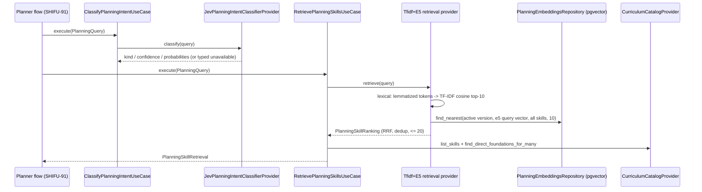

# Objective

The Goal Planner needs two typed capabilities before it can interview a learner or
compose a proposal: a classification of the learner's intent — learning, clearly out
of the Planner's purpose, or ambiguous — and an ordered set of real Curriculum Skills
that the intent and the interview answers point to. Neither exists today: Intelligence
only persists a `PlanningSession` with the raw intent, and the Mentor's NLP stack is
scoped to its own corpus and lifecycle.

This delivery (`SHIFU-89`) adds both capabilities as Intelligence ports with
technology-named providers: a Jev decision provider over OpenRouter for the
classification, and a hybrid retrieval provider that fuses a lexical TF-IDF ranking
over lemmatized Portuguese with a semantic ranking over `multilingual-e5-small`
embeddings through reciprocal rank fusion. Indexes are prepared offline from the
authorized Skill catalog; requests only transform the query and search the active
index. The capabilities are proven by labeled pt-BR evaluations with separate
classification and retrieval metrics. **Complete mode.** No Goal, Skill, relation or
proposal is created, and the Planner flow itself (`SHIFU-91`) is out of scope.

# Scope

| Area / actor | Included | Excluded or deferred |
| --- | --- | --- |
| Intent classification (Planner, system) | Closed-set decision `learning` / `out-of-scope` / `ambiguous` with confidence, typed technical failure, thresholds from a versioned manifest | Quota accounting and inference-guard scopes (`SHIFU-54`), Mentor routing |
| Lexical representation | pt-BR normalization, tokenization, stop-word removal and lemmatization with `pt_core_news_sm`, preserving negation tokens | Training a local classifier or embeddings model |
| Semantic representation | Normalized original text, no stop-word removal or lemmatization, embedded with the local multilingual model and the E5 prefixes | A reranking model |
| Index preparation | Offline TF-IDF fit and embedding of every authorized Skill into a versioned pgvector index with activation; request-time query transformation only | Catalog versioning and dynamic reindexing on curricular changes |
| Retrieval | Up to 10 lexical + up to 10 semantic candidates, RRF fusion, de-duplication by Skill id, at most 20 candidates, re-query with the full answer set | Generating questions, proposals, justifications or corrections (`SHIFU-91`) |
| Contracts | Typed Intelligence ports and use cases consumed by the Planner flow; authorized Skill text and direct foundations through the shared Curriculum catalog contract | Any UI, list/graph, review or restart modal (`SHIFU-92`, `SHIFU-93`) |
| Evaluation | Labeled pt-BR sets, confusion matrix, undue-refusal check, Recall@k and MRR for lexical, semantic and hybrid rankings, reproducible | Real remote model as the only proof |

PRD coverage: `RP-07` **partial** (classification before interview; sources restricted
to intent, answers and Curriculum; the temporary session and cancel/retry belong to
`SHIFU-91`), `RP-08` **partial** (the refined query over current answers; question
generation is `SHIFU-91`), `RP-09` **partial** (only existing Skills can ever be
candidates; proposal composition and validation are `SHIFU-91`), `RP-10` **deferred**
(nothing is confirmed or created). Journeys `JN-07`, `JN-08`, `JN-11` and `JN-15` are
covered up to the decision and candidate set. No UI state is affected, so there is no
design handoff for this delivery.

# Behavior Contract

| ID | RP/JN/source coverage | Observable required behavior |
| --- | --- | --- |
| RF-01 | RP-07; JN-15, JN-08 | `ClassifyPlanningIntentUseCase` returns exactly one of `learning`, `out-of-scope`, `ambiguous` with a confidence in `[0, 1]` and the closed-set probabilities. A transport, HTTP, schema or threshold failure raises `PlanningClassificationUnavailableError`; it is never reported as `out-of-scope`. |
| RF-02 | RP-07; JN-11 | Classification reads only the current intent and the submitted answers. `ambiguous` is a request for clarification; absence of curricular coverage is not inferred by the classifier. |
| RF-03 | RP-07, RP-08 | Retrieval reads only the current intent, the submitted answers, and the authorized Skill texts and direct foundations exposed by `CurriculumCatalogProvider`. No learner history, Competency, material, Activity or Gamification data is read. |
| RF-04 | RP-07, RP-08 | The lexical representation normalizes, tokenizes, removes pt-BR stop words and lemmatizes with `pt_core_news_sm`, keeping the negation tokens of the manifest. The semantic representation uses the normalized original text, unlemmatized and with stop words, embedded with `intfloat/multilingual-e5-small` at the pinned revision with the `query: ` / `passage: ` prefixes. |
| RF-05 | RP-07; AI Layer Rules | TF-IDF and Skill embeddings are prepared outside request handling and recorded under a manifest version; a request only vectorizes the query and searches the active version. A missing, inactive or incompatible index raises `PlanningIndexUnavailableError`. |
| RF-06 | RP-08, RP-09 | Retrieval takes up to 10 lexical and up to 10 semantic candidates, fuses them by reciprocal rank fusion with `rrf_k` from the manifest, removes duplicates by Skill id, returns at most 20 candidates ordered by fused score with a deterministic tie-break, and keeps both source rankings observable. |
| RF-07 | RP-08; JN-08 | A new query built from the intent and the full set of submitted answers produces a new query embedding and TF-IDF vector; the ranking reflects the updated query. |
| RF-08 | Modules, Core Layer Rules | Intelligence exposes `PlanningIntentClassifierProvider`, `PlanningSkillRetrievalProvider`, `PlanningTextPreprocessorProvider` and `PlanningEmbeddingsRepository` as core ports, and `ClassifyPlanningIntentUseCase` / `RetrievePlanningSkillsUseCase` as the consumable actions. Intelligence never imports Curriculum entities or repositories. |
| RF-09 | Ticket validation; AI Layer Rules | Labeled pt-BR evaluations run reproducibly: a confusion matrix for classification with zero undue refusals of valid learning requests, and Recall@5, Recall@10 and MRR for lexical, semantic and hybrid rankings, including clear, vague, out-of-scope, no-coverage and negated requests. |
| RF-10 | RP-09, RP-10 | The delivery creates no Goal, Skill, curricular relation or proposal. |

| ID | RF coverage | Given | When | Then | Checks |
| --- | --- | --- | --- | --- | --- |
| CA-01 | RF-01 | A query and a Jev decision answering `learning` above its threshold | `ClassifyPlanningIntentUseCase.execute` | `kind == learning`, confidence and probabilities returned | CI-01, CI-03 |
| CA-02 | RF-01 | Jev answers `out-of-scope` for a shopping request | execute | `kind == out-of-scope` | CI-01, CI-03 |
| CA-03 | RF-01 | Jev transport error, HTTP 5xx after retries, malformed body, or probabilities outside the closed set | execute | `PlanningClassificationUnavailableError`; no `out-of-scope` result | CI-01, CI-03 |
| CA-04 | RF-01 | No OpenRouter key configured | execute | `PlanningClassificationUnavailableError` | CI-01 |
| CA-05 | RF-02, RF-03 | A query carrying intent and answers | classify and retrieve | Only `intent` and `answers` reach the provider payload; the retrieval provider receives Skill texts from the catalog contract and nothing else | CI-01, CI-03 |
| CA-06 | RF-04 | `"Não quero front-end, prefiro APIs e bancos de dados"` | `lexical_tokens` | Tokens are lemmatized, stop words removed, and `não` preserved; `normalize` keeps the full sentence | CI-03 |
| CA-07 | RF-05 | No active index version | retrieve | `PlanningIndexUnavailableError` | CI-02, CI-03 |
| CA-08 | RF-05 | `planning_indexes` preparation over the seeded catalog | prepare and activate | Every Skill has one 384-dimension normalized vector under the manifest version; the previous active version is deactivated; an active version cannot be overwritten | CI-02 |
| CA-09 | RF-06 | Lexical and semantic rankings sharing Skills | retrieve | Each Skill appears once, the fused score equals the RRF sum of its ranks, the result has at most 20 entries and at most 10 per source ranking, ties break by Skill id | CI-01, CI-03 |
| CA-10 | RF-07 | The same intent with and without answers | retrieve twice | The second call embeds the combined text and its ranking differs where the answers add information | CI-03 |
| CA-11 | RF-08 | Static analysis | `tach check` and imports | Intelligence depends only on `shared`; the catalog contract gains `list_skills` and keeps its single Curriculum implementation | CI-04 |
| CA-12 | RF-09 | The labeled classification set | evaluation | Confusion matrix recorded; held-out accuracy ≥ 0.90; undue refusals of labeled learning requests = 0 | CI-03 |
| CA-13 | RF-09 | The labeled retrieval set over the seeded catalog | evaluation | Recall@5, Recall@10 and MRR recorded for lexical, semantic and hybrid; hybrid Recall@10 ≥ 0.90; hybrid MRR ≥ lexical MRR and ≥ 0.80; the no-coverage queries yield an empty lexical ranking and a top-1 cosine below every clear query's top-1 cosine, so no Skill can be presented as covering them | CI-03 |
| CA-14 | RF-10 | Any call of this delivery | — | No row is written to Learning or Curriculum tables; the only writes are the versioned embedding tables | CI-02, CI-03 |

Isolation: the index carries no account data; classification and retrieval are
stateless per call. Persistence: only the versioned embedding tables. Failures:
typed `ServiceUnavailableError` subclasses, never a silent empty result. Concurrency:
index activation is serialized with a row lock, as the Mentor index already does.
Accessibility: not applicable, no UI.

# Technical Contract

## Architecture Mapping

Owner: `intelligence`, with one additive method on the shared Curriculum catalog
contract implemented by `curriculum`. Rules: [Core Layer](../../../rules/core-layer-rules.md),
[AI Layer](../../../rules/ai-layer-rules.md), [Python Conventions](../../../rules/python-conventions-rules.md),
[Use Case Testing](../../../rules/use-case-testing-rules.md), [Database Layer](../../../rules/database-layer-rules.md).

| Action | Boundary | Element / Path | Required change |
| --- | --- | --- | --- |
| Modify | shared core port | `CurriculumCatalogProvider.list_skills` — `apps/server/src/shifu/shared/core/interfaces/curriculum_catalog_provider.py` | Adds `def list_skills(self) -> tuple[SkillCatalogEntry, ...]`; existing methods unchanged |
| Modify | curriculum provider | `DatabaseCurriculumCatalogProvider.list_skills` — `apps/server/src/shifu/curriculum/providers/curriculum_catalog_provider.py` | Reads `repositories.skills.find_all()` ordered by name |
| Create | intelligence enum | `PlanningIntentKind` — `core/domain/enums/planning_intent_kind.py` | `learning`, `out-of-scope`, `ambiguous` |
| Create | intelligence structures | `PlanningQuery`, `PlanningIntentClassification`, `PlanningSkillRankEntry`, `PlanningSkillRanking`, `PlanningSkillCandidate`, `PlanningSkillRetrieval`, `PlanningIndexedEmbedding`, `PlanningEmbeddingMatch` — `core/domain/structures/planning_*.py` | Immutable values with the invariants listed below |
| Create | intelligence errors | `PlanningClassificationUnavailableError`, `PlanningIndexUnavailableError` — `core/domain/errors/` | Both derive from `ServiceUnavailableError` |
| Create | intelligence ports | `PlanningIntentClassifierProvider`, `PlanningSkillRetrievalProvider`, `PlanningTextPreprocessorProvider`, `PlanningEmbeddingsRepository` — `core/interfaces/planning_*.py` | Protocols below; `IntelligenceDatabaseRepositories` gains `planning_embeddings` |
| Create | intelligence use cases | `ClassifyPlanningIntentUseCase`, `RetrievePlanningSkillsUseCase` — `core/use_cases/` | Signatures below |
| Create | intelligence data | `planner-index-manifest.json`, `planner-intent-evaluation.json`, `planner-retrieval-evaluation.json`, `planner_resources.py` — `ai/data/` | Versioned manifest and labeled sets; `PlannerResources` validates and hashes them into `version` |
| Create | intelligence providers | `SpacyPlanningTextPreprocessorProvider` — `providers/planning/text_preprocessing/spacy/`; `TfidfSentenceTransformersPlanningSkillRetrievalProvider` — `providers/planning/retrieval/sklearn/`; `JevPlanningIntentClassifierProvider` — `providers/planning/intent_classification/openrouter/` | Technology-named adapters of the ports; the retrieval provider receives the Skill texts at construction and reuses `SentenceTransformersEmbeddingsProvider` |
| Create | intelligence database | `PlanningEmbeddingVersionModel`, `PlanningSkillEmbeddingModel` — `database/sqlalchemy/models/`; `SqlalchemyPlanningEmbeddingsRepository` — `database/sqlalchemy/repositories/`; `PlanningEmbeddingsDatabaseRepository` — `database/planning_embeddings_database_repository.py` | Versioned pgvector index with activation and nearest search |
| Create | migration | `apps/server/migrations/versions/<generated>_add_planning_skill_embeddings.py` | Tables `intelligence_planning_embedding_versions(version PK, active)` and `intelligence_planning_skill_embeddings(version FK, skill_id, vector(384), PK(version, skill_id))` |
| Create | preparation | `prepare_planning_indexes.py` — `intelligence/`; `planning_indexes.py` — `shifu/`; `planning_dependencies.py` — `composition/` | Offline entry mirroring `mentor_indexes.py` |
| Modify | composition | `IntelligenceWorkflowsRegistry` — `ai/intelligence_workflows_registry.py`; `app.py`; `tach.toml` | Registry receives the Curriculum catalog contract, builds `LazyPlanningSkillRetrievalProvider` once (unavailable double without a catalog) and exposes `planning_intent_classifier` and `planning_skill_retrieval` over the shared decisions client; `app.state.planning_intent_classifier_provider` / `app.state.planning_skill_retrieval_provider` expose them for `SHIFU-91`, whose controller adds the `IntelligencePipe` getters; `shifu.planning_indexes` is a declared `tach` module |
| Modify | dependencies | `apps/server/pyproject.toml`, `uv.lock` | `scikit-learn>=1.7,<2` declared as a direct dependency, already resolved transitively |

Expected declarations:

```python
# shifu/intelligence/core/domain/enums/planning_intent_kind.py
class PlanningIntentKind(StrEnum):
    LEARNING = 'learning'
    OUT_OF_SCOPE = 'out-of-scope'
    AMBIGUOUS = 'ambiguous'

# shifu/intelligence/core/domain/structures/planning_query.py
@structure
class PlanningQuery:
    intent: str                          # non-blank
    answers: tuple[str, ...] = ()        # each non-blank

# planning_intent_classification.py
@structure
class PlanningIntentClassification:
    kind: PlanningIntentKind
    confidence: float                    # 0..1
    probabilities: tuple[tuple[str, float], ...]  # exactly the three kinds, each 0..1, sum within 0.02 of 1

# planning_skill_rank_entry.py / planning_skill_ranking.py (provider output)
@structure
class PlanningSkillRankEntry:
    skill_id: str
    score: float                         # > 0, RRF sum
    lexical_rank: int | None             # >= 1
    semantic_rank: int | None            # >= 1; at least one rank present

@structure
class PlanningSkillRanking:
    index_version: str
    lexical_ranking: tuple[str, ...]     # <= lexical_limit, unique
    semantic_ranking: tuple[str, ...]    # <= semantic_limit, unique
    entries: tuple[PlanningSkillRankEntry, ...]  # <= candidate_limit, unique ids, score desc then skill_id

# planning_skill_candidate.py / planning_skill_retrieval.py (use-case output)
@structure
class PlanningSkillCandidate:
    skill_id: str
    name: str
    description: str
    foundation_skill_ids: tuple[str, ...]
    score: float
    lexical_rank: int | None
    semantic_rank: int | None

@structure
class PlanningSkillRetrieval:
    index_version: str
    lexical_ranking: tuple[str, ...]
    semantic_ranking: tuple[str, ...]
    candidates: tuple[PlanningSkillCandidate, ...]   # <= 20, unique

# planning_indexed_embedding.py / planning_embedding_match.py
@structure
class PlanningIndexedEmbedding:
    skill_id: str
    vector: tuple[float, ...]            # 384, normalized

@structure
class PlanningEmbeddingMatch:
    skill_id: str
    similarity: float

# shifu/intelligence/core/interfaces/planning_*.py
class PlanningIntentClassifierProvider(Protocol):
    def classify(self, query: PlanningQuery) -> PlanningIntentClassification: ...

class PlanningSkillRetrievalProvider(Protocol):
    def retrieve(self, query: PlanningQuery) -> PlanningSkillRanking: ...

class PlanningTextPreprocessorProvider(Protocol):
    def normalize(self, text: str) -> str: ...
    def lexical_tokens(self, text: str) -> tuple[str, ...]: ...

class PlanningEmbeddingsRepository(Protocol):
    def prepare_version(self, version: str, vectors: tuple[PlanningIndexedEmbedding, ...]) -> None: ...
    def activate_version(self, version: str) -> None: ...
    def find_active_version(self) -> str | None: ...
    def find_nearest(self, version: str, query: tuple[float, ...], eligible_skill_ids: tuple[str, ...], limit: int) -> tuple[PlanningEmbeddingMatch, ...]: ...

# shifu/intelligence/core/use_cases/
class ClassifyPlanningIntentUseCase:
    def __init__(self, classifier: PlanningIntentClassifierProvider) -> None: ...
    def execute(self, query: PlanningQuery) -> PlanningIntentClassification: ...

class RetrievePlanningSkillsUseCase:
    def __init__(self, retrieval: PlanningSkillRetrievalProvider, catalog: CurriculumCatalogProvider) -> None: ...
    def execute(self, query: PlanningQuery) -> PlanningSkillRetrieval: ...
```

Manifest (`planner-index-manifest.json`): `format_version`, `model`,
`model_revision`, `dimension` (384), `normalized`, `query_prefix`, `passage_prefix`,
`preprocessor`, `preprocessor_version`, `negation`, `rrf_k` (60), `lexical_limit` (10),
`semantic_limit` (10), `candidate_limit` (20), `classifier_model`
(`typesafe/jev-1.13`), `intent_thresholds` for the three kinds, `calibration_status`.
`PlannerResources.version` is the SHA-256 of the canonical manifest and datasets,
bound to the canonical Skill catalog at preparation time, exactly as `MentorResources`.

Jev decision payload: one `choice` question `planning_intent` with the closed criteria
`learning`, `out-of-scope`, `ambiguous` (the enum values; pt-BR instructions, the intent and the answers
passed as `state` data, provider `zdr`/`deny` as the Mentor review does). The provider
maps `choice` + `confidence` + `probabilities` to `PlanningIntentClassification`;
`confidence` below the kind's threshold downgrades `learning`/`out-of-scope` to
`ambiguous`; any transport, HTTP, validation or closed-set violation raises
`PlanningClassificationUnavailableError`. No Mentor inference-guard or usage sink is
entered: quota belongs to `SHIFU-54`.

Expected file tree:

```text
apps/server/src/shifu/shared/core/interfaces/curriculum_catalog_provider.py                         [M]
apps/server/src/shifu/curriculum/providers/curriculum_catalog_provider.py                            [M]
apps/server/src/shifu/intelligence/core/domain/enums/planning_intent_kind.py                         [N]
apps/server/src/shifu/intelligence/core/domain/enums/__init__.py                                      [M]
apps/server/src/shifu/intelligence/core/domain/structures/planning_query.py                           [N]
apps/server/src/shifu/intelligence/core/domain/structures/planning_intent_classification.py           [N]
apps/server/src/shifu/intelligence/core/domain/structures/planning_skill_rank_entry.py                [N]
apps/server/src/shifu/intelligence/core/domain/structures/planning_skill_ranking.py                   [N]
apps/server/src/shifu/intelligence/core/domain/structures/planning_skill_candidate.py                 [N]
apps/server/src/shifu/intelligence/core/domain/structures/planning_skill_retrieval.py                 [N]
apps/server/src/shifu/intelligence/core/domain/structures/planning_indexed_embedding.py               [N]
apps/server/src/shifu/intelligence/core/domain/structures/planning_embedding_match.py                 [N]
apps/server/src/shifu/intelligence/core/domain/structures/__init__.py                                 [M]
apps/server/src/shifu/intelligence/core/domain/errors/planning_classification_unavailable_error.py    [N]
apps/server/src/shifu/intelligence/core/domain/errors/planning_index_unavailable_error.py             [N]
apps/server/src/shifu/intelligence/core/domain/errors/__init__.py                                     [M]
apps/server/src/shifu/intelligence/core/interfaces/planning_intent_classifier_provider.py             [N]
apps/server/src/shifu/intelligence/core/interfaces/planning_skill_retrieval_provider.py               [N]
apps/server/src/shifu/intelligence/core/interfaces/planning_text_preprocessor_provider.py             [N]
apps/server/src/shifu/intelligence/core/interfaces/planning_embeddings_repository.py                  [N]
apps/server/src/shifu/intelligence/core/interfaces/intelligence_database.py                            [M]
apps/server/src/shifu/intelligence/core/interfaces/__init__.py                                         [M]
apps/server/src/shifu/intelligence/core/use_cases/classify_planning_intent_use_case.py                [N]
apps/server/src/shifu/intelligence/core/use_cases/retrieve_planning_skills_use_case.py                [N]
apps/server/src/shifu/intelligence/core/use_cases/__init__.py                                          [M]
apps/server/src/shifu/intelligence/ai/data/planner-index-manifest.json                                [N]
apps/server/src/shifu/intelligence/ai/data/planner-intent-evaluation.json                             [N]
apps/server/src/shifu/intelligence/ai/data/planner-retrieval-evaluation.json                          [N]
apps/server/src/shifu/intelligence/ai/data/planner_resources.py                                       [N]
apps/server/src/shifu/intelligence/providers/planning/text_preprocessing/spacy/spacy_planning_text_preprocessor_provider.py            [N]
apps/server/src/shifu/intelligence/providers/planning/retrieval/sklearn/tfidf_sentence_transformers_planning_skill_retrieval_provider.py [N]
apps/server/src/shifu/intelligence/providers/planning/intent_classification/openrouter/jev_planning_intent_classifier_provider.py       [N]
apps/server/src/shifu/intelligence/providers/planning/lazy_planning_skill_retrieval_provider.py       [N]
apps/server/src/shifu/intelligence/database/sqlalchemy/models/planning_embedding_version_model.py     [N]
apps/server/src/shifu/intelligence/database/sqlalchemy/models/planning_skill_embedding_model.py       [N]
apps/server/src/shifu/intelligence/database/sqlalchemy/models/__init__.py                             [M]
apps/server/src/shifu/intelligence/database/sqlalchemy/repositories/planning_embeddings_repository.py [N]
apps/server/src/shifu/intelligence/database/sqlalchemy/repositories/__init__.py                       [M]
apps/server/src/shifu/intelligence/database/sqlalchemy/intelligence_database.py                       [M]
apps/server/src/shifu/intelligence/database/planning_embeddings_database_repository.py                [N]
apps/server/src/shifu/intelligence/prepare_planning_indexes.py                                        [N]
apps/server/src/shifu/intelligence/ai/intelligence_workflows_registry.py                              [M]
apps/server/src/shifu/composition/planning_dependencies.py                                            [N]
apps/server/src/shifu/planning_indexes.py                                                              [N]
apps/server/src/shifu/app.py                                                                           [M]
apps/server/migrations/versions/a7c9e2f4b1d3_add_planning_skill_embeddings.py                           [N]
apps/server/tach.toml                                                                                  [M]
apps/server/pyproject.toml / uv.lock                                                                   [M]
apps/server/tests/intelligence/core/domain/test_planning_domain.py                                     [N]
apps/server/tests/intelligence/core/use_cases/test_classify_planning_intent_use_case.py               [N]
apps/server/tests/intelligence/core/use_cases/test_retrieve_planning_skills_use_case.py               [N]
apps/server/tests/intelligence/adapters/test_planning_embeddings_repository.py                        [N]
apps/server/tests/intelligence/ai/test_planning_nlp_evaluation.py                                     [N]
apps/server/tests/intelligence/ai/test_intelligence_workflows_registry.py                             [M]
.github/workflows/server-app-ci.yaml                                                                   [M]
documentation/features/intelligence/planner-skill-retrieval/{spec,evaluation}.md                      [N]
```

## Runtime Flow



Preparation (`uv run python -m shifu.planning_indexes`): reads `list_skills()`,
binds the catalog to `PlannerResources.version`, embeds `passage: ` + normalized
`name. description` for every Skill, writes them under that version and activates it in
one transaction after all inference finished. The registry builds the retrieval provider
once per process: it fits TF-IDF on the lemmatized `name description` of every Skill and
refuses to serve when the active index version does not match the current catalog hash.

# Verification Contract

## Shared setup

Real PostgreSQL with `pgvector` through `tests/fixtures/postgres_fixture.py`
(Testcontainers; Docker required). Real local NLP: `pt_core_news_sm` and
`intfloat/multilingual-e5-small` at the pinned revision from the Hugging Face cache
(download once with `local_files_only=False`). Jev is a transport double
(`httpx.MockTransport`) by default; the real OpenRouter decisions endpoint runs only
when `SHIFU_RUN_REAL_OPENROUTER_TESTS=1` and `OPENROUTER_API_KEY` are set, and is never
the only proof. The seeded catalog (`build_development_seed`, which retains the seven Skills that
have ready Competencies) is the retrieval corpus; evaluation files reference Skills
by name and resolve ids through `list_skills()`.

## Automated

### CI-01 — Use-case decisions over mocked ports

**Criteria:** CA-01, CA-02, CA-03, CA-04, CA-05, CA-09

**Expected result:** the use cases return the typed structures, map every provider
failure to the typed unavailable error without ever producing `out-of-scope`, build
candidates only from the catalog contract, and keep the RRF invariants.

**Proof:** `tests/intelligence/core/use_cases/test_classify_planning_intent_use_case.py`,
`tests/intelligence/core/use_cases/test_retrieve_planning_skills_use_case.py`,
`tests/intelligence/core/domain/test_planning_domain.py` (structure invariants of CA-09)

```bash
cd apps/server && uv run pytest tests/intelligence/core/domain/test_planning_domain.py tests/intelligence/core/use_cases/test_classify_planning_intent_use_case.py tests/intelligence/core/use_cases/test_retrieve_planning_skills_use_case.py -q -p no:tach
```

**Passing condition:** all assertions pass; the Curriculum catalog double receives
only `list_skills` and `find_direct_foundations_for_many` calls.

### CI-02 — Versioned pgvector index

**Criteria:** CA-07, CA-08, CA-14

**Expected result:** preparation writes one vector per Skill under the version,
activation deactivates the previous version and refuses an overwrite of an active
version, `find_active_version` reports it, `find_nearest` respects eligibility and
limit, and the migration upgrades and downgrades cleanly.

**Proof:** `tests/intelligence/adapters/test_planning_embeddings_repository.py`

```bash
cd apps/server && uv run pytest tests/intelligence/adapters/test_planning_embeddings_repository.py -q -p no:tach
```

**Passing condition:** assertions pass against the real database.

### CI-03 — Labeled pt-BR evaluation of classification and retrieval

**Criteria:** CA-01, CA-02, CA-03, CA-05, CA-06, CA-07, CA-09, CA-10, CA-12, CA-13, CA-14

**Expected result:** with the real local models, the real index and the Jev transport
double, the evaluation reports the confusion matrix, the undue-refusal count, and
Recall@5 / Recall@10 / MRR for lexical, semantic and hybrid rankings, and asserts the
targets of CA-12 and CA-13; negation, refreshed query, de-duplication and limit cases
are explicit tests. The default run proves the decision contract, the threshold
mapping and every technical-failure path through the transport double (its matrix is
perfect by construction); the quality matrix of CA-12 comes from the opt-in real run.
The offline entry point runs as a subprocess against the disposable database.

**Proof:** `tests/intelligence/ai/test_planning_nlp_evaluation.py`

```bash
cd apps/server && uv run pytest tests/intelligence/ai/test_planning_nlp_evaluation.py -q -p no:tach -s
```

**Passing condition:** targets met; the printed metrics are copied into
`evaluation.md`. Opt-in real run: `SHIFU_RUN_REAL_OPENROUTER_TESTS=1` with
`OPENROUTER_API_KEY`; without a key the real-model test is skipped and recorded as such.

### CI-04 — Applicable baseline checks

**Scope:** `apps/server` and the Learning consumers of `CurriculumCatalogProvider`.

```bash
cd apps/server && uv run poe check:lint && uv run poe check:types && uv run poe check:architecture && uv run poe test:unit
cd apps/server && uv run poe test:integration
```

**Passing condition:** every gate passes; `tach` confirms Intelligence depends only on
`shared`; the Learning suites that mock the catalog contract still pass.

## Manual

### VM-01 — Prepare the index and query it against the seeded catalog

**Type:** Manual

**Criteria:** CA-08, CA-09, CA-10

**Tool / setup:** terminal; Compose services up; database migrated and seeded; model cached.

**Procedure:** run `uv run --env-file .env.local python -m shifu.planning_indexes`;
then run the evaluation command of CI-03 with `-s` and read the printed rankings for
`"quero aprender a programar do zero"`, `"não quero front-end, prefiro APIs"` and the
refreshed query with answers.

**Passing condition:** the preparation prints the activated version; rankings list
only seeded Skills, the negated query ranks `APIs web` above `HTML e CSS`, and the
refreshed query changes the order.

## Visual

Not applicable: this delivery has no user interface.

# Documentation Alignment

| Document / authority | Governs | Required update or confirmation | Disposition / dependency |
| --- | --- | --- | --- |
| Shifu — PRD — Intelligence, content `83099649`, version 4, retrieved 2026-10-20 | RP-07, RP-08, RP-09, RP-10; JN-07, JN-08, JN-11, JN-15 | Classification precedes the interview; sources limited to intent, answers and Curriculum; no proposal or creation | Confirmed, no Confluence write |
| AI Layer Rules | NLP providers, offline preparation, typed decision providers, consuming-boundary tests | Followed; the planner index has its own repository because its lifecycle differs from the Mentor's | Confirmed |
| Core Layer Rules | Structures, ports, use cases, errors | Followed | Confirmed |
| `documentation/modules.md` | Module boundaries | Intelligence consumes Curriculum through `shared` only | Confirmed by `tach` |

# Revision History

| Revision | Date | Contract change | Reason / source |
| --- | --- | --- | --- |
| 1 | 2026-10-20 | Initial contract | SHIFU-89 and Learning PRD Intelligence v4; Mentor NLP stack reused as a pattern, not as a dependency |
| 2 | 2026-10-20 | CA-13 retrieval target restated (hybrid ≥ lexical and ≥ 0.80 MRR, Recall@10 ≥ 0.90, no-coverage by empty lexical ranking and cosine gap); Jev criteria keyed by the enum values; `IntelligencePipe` getters deferred to `SHIFU-91`; domain conformance tests, registry test and CI coverage selection added to the file tree; retrieval set widened to the thirteen seeded Skills | Implementation evidence: a rank-only fusion always ranks something first, so "none in the top 3" was unverifiable; on the seeded catalog the lexical side adds noise for vague requests, so a strict "hybrid ≥ semantic" is not a property of RRF |
