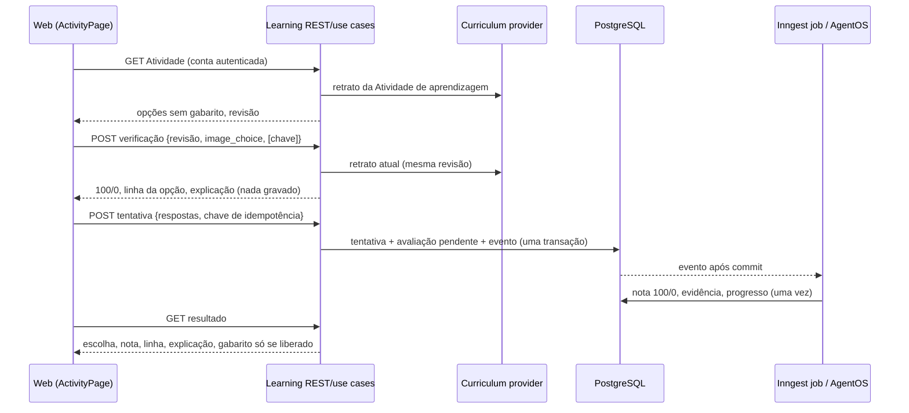

# Objective

Adicionar a questão de escolha por imagem às Atividades de aprendizagem. O aprendiz compara de duas a quatro imagens numeradas e escolhe a única que corresponde ao enunciado. Ele verifica a escolha e recebe um retorno provisório objetivo, com nota 100 ou 0 e sem IA. A tentativa e a nota oficiais continuam surgindo apenas no envio final da Atividade.

Hoje o Shifu não tem formato com imagens como alternativas nem lugar para guardar imagens curriculares. Este é um contrato **completo**, porque atravessa conteúdo, retrato compartilhado, avaliação durável, proteção do gabarito, interface responsiva, dados de exemplo e design.

# Scope

| Área / ator | Incluído | Excluído ou adiado |
| --- | --- | --- |
| Equipe de conteúdo em Curriculum | Questão com enunciado textual, 2 a 4 imagens distintas, exatamente uma correta, descrição textual e linha de retorno por imagem, explicações de acerto e erro e critérios por Conceito. Somente em aprendizagem. | Autoria pela interface, imagens no enunciado, Reconhecimento de Técnicas e geração de imagens durante o uso. |
| Aprendiz em Learning | Seleção e troca livre de uma imagem; **Verificar** com retorno 100/0 sem salvar nada; escolha em somente leitura após verificar; avanço sequencial; tentativa oficial no envio final. | Uso no Diagnóstico, crédito parcial, avaliação por IA e retomada da escolha verificada após recarregar a página. |
| Resultado e histórico | Imagem escolhida, nota, linha de retorno e explicação. A imagem correta só aparece após acerto posterior da questão ou domínio da Competência. Revisão após conclusão segue a regra existente. | Mudanças nas regras globais de progresso, domínio ou recompensa. |
| Interface desktop e mobile | Cartões numerados **Opção 1** a **Opção 4**, grade 4 colunas no desktop e 2 × 2 a 390 px, teclado, leitor de tela e estados sem depender de cor. | Ampliação de imagem em diálogo, novas rotas e redesenho de outros formatos. |
| Conteúdo de exemplo | Atividade **Ponto de cocção** na Habilidade de Culinária do seed, com a questão das cebolas como 2ª de 3 e quatro imagens WebP. | Currículo completo de Culinária e mudanças na ordenação de etapas. |
| Design | Botão **Verificar** no board desktop de seleção e três boards mobile novos no Penpot. | Exportar boards para a pasta da feature e usar `shifu.fig` ou OpenPencil. |

Entrega integral de Curriculum RP-03 para este formato e de Learning RP-34. As regras gerais de Learning RP-09, RP-13, RP-14, RP-18, RP-20, RP-25 e RP-27 valem integralmente no fluxo deste formato. A tarefa não entrega todas as modalidades desses requisitos gerais. Curriculum RP-04 e RP-06 aparecem como restrições: o formato é consultado por Learning sem alterar o conteúdo, e o exemplo não declara uma Habilidade de Culinária disponível.

O guard de diagnóstico do web não rejeita `pair_matching` hoje. Essa lacuna fica fora desta entrega e será tratada em tarefa própria.

# Behavior Contract

| ID | RP/JN/fonte | Comportamento observável |
| --- | --- | --- |
| RF-01 | Curriculum RP-03, RP-04, RP-06; JN-03, JN-04 | Curriculum aceita a questão somente com enunciado, 2 a 4 imagens, chaves, caminhos e descrições distintos, exatamente uma imagem correta, descrição e linha de retorno não vazias por imagem, explicações de acerto e erro e ao menos um critério por Conceito. O caminho da imagem tem a forma opaca `/curriculum/images/<16 hex>.webp` e a chave da opção não descreve a imagem. O formato só é aceito em Atividades de aprendizagem. |
| RF-02 | Learning RP-09, RP-25, RP-34; Curriculum RP-04 | A leitura privada da Atividade entrega o enunciado e as imagens na ordem do Curriculum, cada uma com chave, caminho e descrição. Não entrega qual imagem é correta, linhas de retorno ou explicações. A Atividade pode misturar este formato com os demais, com 3 a 5 questões. |
| RF-03 | Learning RP-09, RP-13, RP-34; JN-07 | **Verificar** envia uma única chave e a revisão da Atividade. Learning responde 100 quando a imagem é a correta e 0 nos demais casos, com a linha de retorno da imagem escolhida e a explicação correspondente. Nada é gravado: não há tentativa, avaliação, evento, progresso ou recompensa. |
| RF-04 | Learning RP-09, RP-14; JN-07, JN-08 | O envio final exige resposta válida em todas as questões, com exatamente uma imagem nesta questão. Ele cria uma única tentativa imutável por chave de idempotência, avaliação pendente e evento durável na mesma transação. Novos envios ficam bloqueados na Habilidade enquanto houver avaliação pendente ou com falha. |
| RF-05 | Learning RP-13, RP-14, RP-27, RP-34; Curriculum RP-03 | A avaliação oficial dá 100 ou 0, sem crédito parcial, sem IA e sem o Mentor. A nota participa da Atividade pelos pesos curriculares. A evidência por Conceito usa somente o critério curricular e permanece distinta da nota. Os efeitos ocorrem uma vez, e uma falha preserva a resposta para nova avaliação sem virar zero. |
| RF-06 | Learning RP-18, RP-20, RP-34; JN-13 | O resultado e o histórico mostram, em somente leitura, a imagem escolhida, a nota, a linha de retorno e a explicação, com **Resposta correta** ou **Resposta incorreta** em texto e ícone. Numa resposta incorreta, nenhum retorno, resposta HTTP ou marcação identifica a imagem correta até o acerto posterior dessa questão ou o domínio da Competência. Depois disso, ela pode ser identificada. Tentativas de revisão após a conclusão não alteram o resultado oficial. |
| RF-07 | Learning RP-09, RP-25, RP-34; JN-07 | Desktop e mobile apresentam uma questão por vez com dificuldade, posição, total e barra de progresso. As imagens funcionam como grupo de escolha única por clique, toque, teclado e tecnologia assistiva. Cada opção é anunciada como **Opção N** com sua descrição. Foco, seleção e resultado não dependem só de cor. Após **Verificar**, a escolha fica em somente leitura e o botão passa a **Próxima questão** ou, na última, **Enviar atividade**. O aviso diz que o retorno é provisório. |
| RF-08 | Learning RP-34; Curriculum RP-03 | O formato não existe no Diagnóstico. Curriculum, o retrato compartilhado, o envio de Learning e o serviço web rejeitam esse uso. |
| RF-09 | Curriculum RP-03, RP-07; Learning RP-29 | O seed local oferece a Atividade **Ponto de cocção** com a questão **Qual destas cebolas está caramelizada?**, quatro imagens revisadas pela equipe e descrições que não nomeiam a resposta. As imagens são arquivos estáticos do web e carregam a partir do caminho curricular. O conteúdo é fictício e não exige dados pessoais. |

| ID | RF | Dado | Quando | Então | Prova |
| --- | --- | --- | --- | --- | --- |
| CA-01 | RF-01 | Questões com 1, 2, 4 e 5 imagens; chaves, caminhos ou descrições repetidos, inclusive diferindo só em maiúsculas; zero ou duas corretas; descrição, linha de retorno ou explicação vazias; caminho fora do padrão; sem critério | Curriculum cria a questão | Só os casos com 2 a 4 imagens válidas são aceitos; os demais geram `InvalidActivityError` | CI-01 |
| CA-02 | RF-01, RF-08 | Questão válida numa Atividade diagnóstica | Curriculum cria a Atividade ou monta o retrato | A Atividade e o retrato são rejeitados | CI-01 |
| CA-03 | RF-02 | Atividade liberada com escolha única + imagem + escolha única | O dono lê a Atividade | Recebe 3 questões na ordem curricular. A de imagem traz as opções na ordem definida, sem marca de correta, linhas de retorno ou explicações | CI-02 |
| CA-04 | RF-02 | Outra conta ou Competência não liberada | Lê a mesma Atividade | Recebe a recusa privada existente, sem conteúdo | CI-02 |
| CA-05 | RF-03 | Revisão atual e chave da imagem correta, depois de uma incorreta | O dono verifica | Recebe 100 e a explicação de acerto, depois 0 e a explicação de erro, cada uma com a linha da imagem escolhida. Nenhuma tentativa, avaliação ou evento é criado | CI-03 |
| CA-06 | RF-03 | Nenhuma chave, duas chaves, chave desconhecida, revisão vencida ou campo de outro formato | Verifica | A requisição é rejeitada sem efeito | CI-03 |
| CA-07 | RF-04 | Respostas válidas para as 3 questões e chave de idempotência | Envia, repete o envio ou envia com avaliação pendente na Habilidade | Há uma tentativa, uma avaliação pendente e um evento. A repetição devolve a mesma tentativa. O envio bloqueado não cria nada | CI-04 |
| CA-08 | RF-04 | Resposta de imagem com zero ou duas chaves, ou chave desconhecida | Envia a Atividade | O envio é rejeitado sem tentativa | CI-04 |
| CA-09 | RF-05 | Tentativa com a imagem correta e outra com imagem incorreta, pesos 30/40/30 | A avaliação oficial executa pelo job real | A questão recebe 100 e 0, a nota ponderada fica correta, a evidência usa o critério curricular, não há chamada de IA e os efeitos ocorrem uma vez | CI-05 |
| CA-10 | RF-05 | Falha do Shifu durante a avaliação | Recupera pela ação existente | A mesma tentativa é reavaliada, sem zero intermediário nem tentativa nova | CI-05 |
| CA-11 | RF-06 | Tentativa incorreta antes de acerto posterior e de domínio | O dono abre o resultado ou o histórico | Vê a imagem escolhida, 0, a linha e a explicação. A resposta HTTP não identifica a imagem correta | CI-06, VM-03 |
| CA-12 | RF-06 | Acerto posterior dessa questão, ou Competência dominada | O dono abre a tentativa incorreta antiga | A imagem correta passa a ser identificada | CI-06, VM-03 |
| CA-13 | RF-06 | Habilidade concluída e nova tentativa de revisão | A avaliação de revisão conclui | Fica no histórico como revisão sem alterar o resultado oficial | CI-06 |
| CA-14 | RF-07 | Questão aberta no desktop e no mobile | O aprendiz escolhe por clique, toque e setas, troca a escolha e verifica | A escolha troca livremente antes de verificar. Depois fica bloqueada, com retorno visível, ícone e texto, e o botão segue o fluxo **Verificar → Próxima questão / Enviar atividade** | CI-07, VM-01, VM-02 |
| CA-15 | RF-07 | Leitor de tela | Percorre as opções | Cada opção é anunciada como **Opção N** com sua descrição. A imagem não é lida duas vezes | CI-07, VM-01 |
| CA-16 | RF-07 | Resposta incorreta verificada | O aprendiz observa os cartões | Só a imagem escolhida é marcada como erro. A correta não recebe destaque | CI-07, VM-02 |
| CA-17 | RF-08 | Atividade diagnóstica com `image_choice` vinda do servidor | O serviço web mapeia a Atividade | O web rejeita com **Tipo de questão indisponível para Diagnóstico.** | CI-07 |
| CA-18 | RF-09 | Seed local aplicado e sessão do aluno do seed | O aluno abre **Ponto de cocção** | As quatro imagens carregam com status 200 a partir de caminhos opacos, e as descrições não nomeiam a resposta | CI-07, VM-01 |
| CA-19 | RF-07 | Estados de seleção, acerto e erro a 1440 px e 390 px | Compara com o Penpot | As capturas seguem os boards, salvo os desvios aceitos | VM-04 |

Esta entrega não cria dado pessoal novo. A tentativa e a avaliação usam as tabelas JSON existentes, que já seguem a remoção da experiência e o encerramento da conta de RP-21, RP-22 e RP-29. As imagens são conteúdo compartilhado, não dados do aprendiz.

## Design Contract

Arquivo Penpot **Shifu**, ID `c6f51e89-5d00-81ce-8008-e18d06c175af`, inspecionado e exportado pelo Penpot MCP em 22/11/2026. Na página **🖥️ Desktop**, o grupo `Culinária / Escolha a imagem — Proposta` contém três boards de 1440 × 1080. A página **📱 Mobile** ainda não tem os boards deste formato.

Antes da comparação visual, a implementação faz duas edições visuais no Penpot. Elas são consistentes com o PRD e não mudam comportamento:

1. No board de seleção desktop, trocar **Próxima questão** por **Verificar**.
2. Criar na página Mobile o grupo `Culinária / Escolha a imagem — Proposta`, com três boards de 390 px de largura e altura livre. Eles usam os componentes existentes e a grade 2 × 2.

| Superfície | Estado / viewport | Página / board e componentes | CA / verificação | Desvio aceito |
| --- | --- | --- | --- | --- |
| Página de Atividade | Seleção, 1440 × 1080 | Desktop / `Culinária / Escolha a imagem — Seleção / Desktop` (`4537a419-63ba-8099-8008-e2934fc97b95`); `ImageChoice / Main`, `ImageChoice / Grid`, `App header`, `Button` | CA-14, CA-19 / VM-04 | Botão **Verificar** no lugar de **Próxima questão**. Título e posição vêm do seed. O botão primário existente mantém sua largura mínima de `sm:min-w-44`, maior que a do board. |
| Página de Atividade | Resposta correta, 1440 × 1080 | Desktop / `Culinária / Escolha a imagem — Resposta correta / Desktop` (`4537a419-63ba-8099-8008-e29433b8e49b`) | CA-14, CA-19 / VM-04 | Textos de retorno vêm do seed. |
| Página de Atividade | Resposta incorreta, 1440 × 1080 | Desktop / `Culinária / Escolha a imagem — Resposta incorreta / Desktop` (`4537a419-63ba-8099-8008-e29433eeac41`) | CA-16, CA-19 / VM-04 | Nenhum destaque na imagem correta. |
| Página de Atividade | Seleção, correta e incorreta, 390 px | Mobile / `Culinária / Escolha a imagem — Seleção / Mobile`, `… — Resposta correta / Mobile`, `… — Resposta incorreta / Mobile`, criados em 22/11/2026 | CA-14, CA-16, CA-19 / VM-04 | Altura cresce com rolagem, sem corte de conteúdo nem sobreposição da navegação. O botão flutuante do Mentor, do shell existente e igual nos outros formatos, cobre a ponta direita do botão primário nos estados verificados. |
| Resultado da tentativa | Incorreta antes da liberação, 1440 px e 390 px | Sem board próprio; reutiliza os cartões e o painel de retorno dos boards acima | CA-11 / VM-03 | Segue o layout atual de `ChoiceResultPage`. |

Mapeamento visual, usando apenas tokens e primitivas existentes:

- **Cartão:** borda `--control-border`, fundo `--card`, raio 6, preenchimento 8 e imagem 4:3 com `object-fit: cover`.
- **Rótulo:** **Opção N** em `--text-secondary`.
- **Seleção:** borda e marcador em `--primary`, fundo `--muted` e o texto **Selecionada** em `--selo-text`.
- **Resultado no cartão:** acerto com borda de 1,5 px em `--jade-solid`, ícone `check` e texto em `--jade-text`; erro com borda de 1,5 px em `--primary`, ícone `x` e texto em `--selo-text`; o texto é **Sua resposta**. O painel de retorno usa `--jade-tint` no acerto e `--accent` no erro.
- **Opções não escolhidas após verificar:** atenuadas.
- **Painel de retorno:** reutiliza `QuestionFeedback`, com **Resposta correta** ou **Resposta incorreta** e o aviso **Retorno provisório. O resultado oficial aparece ao enviar a Atividade.**
- **Botões e cabeçalho:** o botão é o primário existente; o cabeçalho é `ActivityQuestionHeader`, com o contexto **escolha uma imagem**.
- **Foco e toque:** foco com o anel existente; alvos de toque mobile de pelo menos 44 px.

Preservar o shell, os outros formatos de questão e as demais telas. Não criar cores, espaçamentos, tipografia, raios ou sombras novos.

# Technical Contract

## Architecture Mapping

Curriculum é a autoridade do conteúdo e do gabarito. Shared transporta apenas o retrato tipado entre módulos. Learning é dono de autorização, verificação provisória, tentativa, avaliação, evidência e histórico. O web é dono da apresentação e do estado de seleção.

Regras selecionadas em [`rules.md`](../../../rules.md):

- [Python](../../../rules/python-conventions-rules.md) e [TypeScript](../../../rules/typescript-conventions-rules.md);
- [Core](../../../rules/core-layer-rules.md) e [Use Case Testing](../../../rules/use-case-testing-rules.md);
- [Database](../../../rules/database-layer-rules.md), para os mappers de Curriculum e de tentativas de Learning, o seed e as fixtures;
- [Provision](../../../rules/provision-layer-rules.md), para o provider de conteúdo curricular;
- [REST](../../../rules/rest-layer-rules.md) e [Controller Testing](../../../rules/controllers-testing-rules.md);
- [Messaging](../../../rules/messaging-layer-rules.md) e [Jobs Testing](../../../rules/jobs-testing-rules.md), para o job existente sem mudança de registro;
- [AI Layer](../../../rules/ai-layer-rules.md), apenas para confirmar que o destino AgentOS não muda;
- [UI](../../../rules/ui-layer-rules.md) e [Widget Testing](../../../rules/widget-testing-rules.md).

Não há mudança de rota, então as regras de roteamento web não se aplicam.

| Ação | Limite | Elemento / caminho | Alteração necessária |
| --- | --- | --- | --- |
| Criar | Curriculum Core | `ImageChoiceOption`, `ImageChoiceQuestion` em `apps/server/src/shifu/curriculum/core/domain/structures/` | Variante `image_choice` com as validações de RF-01. Exportadas no barrel e incluídas em `ActivityQuestion`. |
| Modificar | Curriculum Core | `Activity` em `curriculum/core/domain/entities/activity.py` | Rejeitar o formato em Atividade diagnóstica e exigir `CorrectnessEvaluationPart` para a questão, como na ordenação. |
| Modificar | Curriculum DB | `ActivityMapper` em `curriculum/database/sqlalchemy/mappers/activity_mapper.py` | Registrar `'image_choice'` em `_KIND_QUESTION_TYPES`. Linhas JSON existentes continuam legíveis e não há migração. |
| Modificar | Curriculum Provider | `DatabaseCurriculumContentProvider` em `curriculum/providers/curriculum_content_provider/curriculum_content_provider.py` | Projetar a questão no retrato compartilhado somente em aprendizagem, com Conceitos da Competência. Incluir o formato nas regras de escala completa e nota possível 0–100 ao lado da escolha única. Não é evidência executável. |
| Criar | Shared Core | `CurriculumImageChoiceOptionSnapshot`, `CurriculumImageChoiceQuestionSnapshot` em `shared/core/domain/structures/` | Espelham RF-01 com `ValidationError`. |
| Modificar | Shared Core | `CurriculumLearningActivitySnapshot` | Inclui a variante na união. Exige `CurriculumChoicePartSnapshot` para ela e a rejeita em diagnóstico. |
| Criar | Learning Core | `ImageChoiceOptionDetail`, `ImageChoiceQuestionDetail`, `ImageChoiceResultDetail` em `learning/core/domain/structures/` | Projeções públicas sem gabarito e detalhe de resultado com liberação controlada. |
| Modificar | Learning Core | `ChoiceActivityDetail` em `learning/core/domain/structures/choice_activity_detail.py`; `ChoiceAttemptDetail` em `choice_attempt_detail.py` | As uniões fechadas de `questions` acrescentam `ImageChoiceQuestionDetail` e `ImageChoiceResultDetail`. |
| Modificar | Learning DB | `ActivityAttemptMapper` em `learning/database/sqlalchemy/mappers/activity_attempt_mapper.py` | Aceitar `'image_choice'` no conjunto de tipos do retrato gravado e desserializar para `CurriculumImageChoiceQuestionSnapshot`. Mapear a resposta gravada de uma questão `image_choice` explicitamente para `SingleChoiceAnswer`, sem passar pelo caminho legado. Tentativas antigas continuam legíveis e não há migração. O mapper de avaliação não muda, porque o resultado reutiliza `ChoiceEvaluationResult`. |
| Modificar | Learning Core | `MixedQuestionSnapshots` em `learning/core/use_cases/mixed_question_snapshots.py` | O formato conta como questão não textual e usa o retrato misto. |
| Modificar | Learning Core | `GetChoiceActivityUseCase` | Projeta `ImageChoiceQuestionDetail` na ordem curricular, sem `is_correct`, linhas de retorno ou explicações. |
| Modificar | Learning Core | `PreviewActivityQuestionFeedbackUseCase` | Valida exatamente uma chave conhecida e a revisão. Devolve `PreliminaryQuestionResult` com nota, acerto, explicação e o novo `option_feedback`. Não persiste nada. |
| Modificar | Learning Core | `SubmitChoiceActivityUseCase.normalize_answers` | Aceita a questão com uma chave conhecida e grava `SingleChoiceAnswer`. Mantém idempotência, transação, evento e bloqueio existentes. |
| Modificar | Learning Core | `EvaluateChoiceActivityUseCase` | Pontua 100/0 em `ChoiceEvaluationResult` e produz evidência pelo `ChoiceConceptCriterion` do retrato. Não aciona IA. |
| Modificar | Learning Core | `GetChoiceAttemptUseCase` | Monta `ImageChoiceResultDetail` a partir do retrato congelado da tentativa. `_is_fully_correct` reconhece o acerto da imagem. `disclosed_correct_option_key` só é preenchido para questões liberadas por `_released_question_keys`. |
| Modificar | Learning REST | `get_choice_activity_controller.py`, `preview_activity_question_feedback_controller.py`, `submit_choice_activity_controller.py`, `get_choice_attempt_controller.py`, `answer_request_shape.py` | `kind: 'image_choice'` com `selected_option_keys` de exatamente um item. Novas respostas `ImageChoiceQuestionResponse` e `ImageChoiceQuestionResultResponse`, mais o campo `option_feedback`. Métodos, rotas e erros existentes não mudam. |
| Modificar | REST client | `apps/server/rest-client/learning/activities.rest` | Exemplos sem credenciais de leitura, verificação, envio e resultado com `image_choice`. |
| Confirmar | Inngest / AgentOS | `EvaluateChoiceActivityJob`, `LearningWorkflowsRegistry.destination_for_event` | Sem código ou tradução, o destino continua `inngest`; com código, continua `agentos:learning`. Nenhuma mudança de registro ou workflow é esperada. Alterar só se a inspeção provar necessidade, reconciliando o contrato. |
| Modificar | Seed | `cooking_ordering_seed.py` renomeado para `curriculum/database/cooking_question_formats_seed.py`; `shared/database/seed_data.py` | Mantém a Atividade de ordenação. A Atividade 111 vira **Ponto de cocção**, com escolha única, imagem e escolha única, pesos 30/40/30 e o Conceito existente. |
| Criar | Web estático | `apps/web/public/curriculum/images/<16 hex>.webp`, quatro arquivos | Exportados dos fills do Penpot (`Photo / raw`, `translucent`, `caramelized`, `burnt`), convertidos para WebP 600 × 450 com qualidade ~82. O nome são os 16 primeiros hex do SHA-256 do arquivo WebP. |
| Modificar | Web core/REST | `apps/web/src/core/learning/choice-activity.ts`, `apps/web/src/rest/services/learning-service.ts` | Novos tipos e mapeamento de leitura, verificação, envio e resultado. `image_choice` entra no guard de diagnóstico. |
| Criar | Web UI | `ImageChoiceOptions` em `ui/learning/widgets/components/image-choice-options/` | Componente de apresentação compartilhado. Desenha os cartões nos estados de seleção, verificado e histórico, sem estado próprio. |
| Criar | Web UI | `ImageChoiceQuestion` em `ui/learning/widgets/pages/activity-page/image-choice-question/` | Questão com cabeçalho, enunciado e grupo de rádios sobre `ImageChoiceOptions`. Recebe a seleção e o estado por props. |
| Modificar | Web UI | `activity-page/index.tsx`, `use-activity-page.ts`, `question-feedback/index.tsx` | Despacho do formato, seleção por questão, verificação, bloqueio após verificar, rótulos de botão e retorno **Resposta correta/incorreta** com a linha da imagem. |
| Criar / modificar | Web UI | `choice-result-page/choice-result-detail/image-choice-result/index.tsx`, `choice-result-detail/index.tsx` | Resultado em somente leitura com `ImageChoiceOptions` e liberação controlada pelo servidor. |

### Conceitos novos

**Questão de escolha por imagem.** É uma variante de questão de Curriculum. Uma opção é uma imagem identificada por uma chave opaca, como `opt-` mais 12 hex. Ela aponta para um arquivo estático do web pelo `image_path`. Tem uma descrição acessível, que diz o que é visível sem nomear a resposta. Tem ainda a marca de correta e a linha de retorno mostrada quando aquela imagem é a escolhida.

Exemplo: a opção `opt-…` com o caminho `/curriculum/images/3f9a…webp` e a descrição *"Fatias brancas e firmes, sem brilho, espalhadas na frigideira escura."* Sua linha é *"Essa cebola ainda está crua."*

A ordem das opções é a ordem curricular, estável entre leituras e tentativas. O Curriculum é a fonte da verdade. Learning lê o retrato congelado na tentativa, por isso uma mudança futura de conteúdo não altera o histórico.

**Caminho opaco de imagem.** É o endereço relativo de um arquivo servido pelo próprio web, como as fontes. Ele não contém palavra que revele estado, posição ou acerto. O padrão é validado no domínio e no retrato. A existência física do arquivo é provada pelos testes de rota web e pela verificação manual, já que o servidor não lê a pasta do web.

**Linha de retorno da opção.** É um texto predefinido por imagem. Learning a devolve na verificação provisória e a lê do retrato congelado no resultado oficial. Ela nunca é gravada na avaliação. Numa resposta incorreta, a linha fala apenas da imagem escolhida.

### Declarações públicas planejadas

Cada classe Python ocupa seu próprio módulo, no estilo das estruturas existentes:

```python
@structure
class ImageChoiceOption:
    key: str            # opaca: 'opt-' + 12 hex
    image_path: str     # '/curriculum/images/<16 hex>.webp'
    description: str    # texto acessível; não nomeia a resposta
    is_correct: bool
    feedback: str       # linha mostrada quando esta imagem é a verificada


@structure
class ImageChoiceQuestion:
    key: str
    prompt: str
    options: tuple[ImageChoiceOption, ...]                # 2–4, exatamente uma correta
    correct_explanation: str
    incorrect_explanation: str
    concept_criteria: tuple[ChoiceConceptCriterion, ...]  # ao menos um
    kind: Literal['image_choice'] = 'image_choice'


@structure
class CurriculumImageChoiceOptionSnapshot:
    key: str
    image_path: str
    description: str
    is_correct: bool
    feedback: str


@structure
class CurriculumImageChoiceQuestionSnapshot:
    key: str
    kind: Literal['image_choice']
    prompt: str
    options: tuple[CurriculumImageChoiceOptionSnapshot, ...]
    correct_explanation: str
    incorrect_explanation: str
    concept_criteria: tuple[CurriculumChoiceConceptCriterionSnapshot, ...]


@structure
class ImageChoiceOptionDetail:
    key: str
    image_path: str
    description: str


@structure
class ImageChoiceQuestionDetail:
    key: str
    kind: Literal['image_choice']
    prompt: str
    options: tuple[ImageChoiceOptionDetail, ...]


@structure
class ImageChoiceResultDetail:
    question_key: str
    kind: Literal['image_choice']
    prompt: str
    options: tuple[ImageChoiceOptionDetail, ...]
    selected_option_key: str
    score: Decimal
    is_correct: bool
    option_feedback: str
    explanation: str
    disclosed_correct_option_key: str | None = None
```

Contratos ampliados ou reutilizados:

- `PreliminaryQuestionResult` mantém os campos atuais e acrescenta `option_feedback: str | None = None`. A estrutura já é declarada dentro de `preview_activity_question_feedback_use_case.py`, o que contraria a regra de uma estrutura por módulo em `domain/structures/`. Esta entrega amplia a declaração no lugar atual, registra essa dívida existente e não acrescenta nenhuma estrutura nova a módulos de caso de uso.
- A resposta gravada reutiliza `SingleChoiceAnswer(question_key, selected_option_key)`. A verificação reutiliza `ChoiceAnswerSubmission(question_key, selected_option_keys)` com um item.
- A avaliação reutiliza `ChoiceEvaluationResult`.
- `CurriculumLearningActivitySnapshot.questions` e o detalhe da Atividade em Learning incluem as novas variantes.
- Não há coluna, tabela ou migração Alembic nova: perguntas, respostas, retrato e partes da avaliação já são JSON.

Contrato REST, com as rotas existentes:

- **Requisição.** `AnswerRequest.kind` aceita `'image_choice'`, e `answer_request_shape` exige `selected_option_keys` com exatamente um item para esse `kind`. O mesmo corpo vale para `POST .../questions/{question_key}/preliminary-evaluations` e `POST .../activities/{activity_id}/attempts`.
- **Respostas.**
  - `ImageChoiceQuestionResponse` tem `{key, kind: 'image_choice', prompt, options: [{key, image_path, description}]}`.
  - A resposta da verificação acrescenta `option_feedback`.
  - `ImageChoiceQuestionResultResponse` tem `{question_key, kind, prompt, options, selected_option_key, score, is_correct, option_feedback, explanation, disclosed_correct_option_key}`, com `question_key` como nas demais questões de resultado. O último campo é omitido da resposta antes da liberação, porque a rota já exclui campos nulos.
- **Erros.** Seguem os existentes: 422 para forma inválida, a recusa privada para acesso indevido e o conflito para revisão vencida e bloqueios.

Extensões TypeScript em `choice-activity.ts`:

```ts
export type ImageChoiceOption = {
  key: string
  imagePath: string
  description: string
}

export type ImageChoiceQuestion = {
  key: string
  kind: 'image_choice'
  prompt: string
  options: readonly ImageChoiceOption[]
}

export type ImageChoiceAnswer = {
  kind: 'image_choice'
  questionKey: string
  selectedOptionKeys: readonly [string]
}

export type ImageChoiceResultQuestion = {
  kind: 'image_choice'
  key: string
  prompt: string
  options: readonly ImageChoiceOption[]
  selectedOptionKey: string
  score: number
  isCorrect: boolean
  optionFeedback: string
  explanation: string
  disclosedCorrectOptionKey?: string
}
```

`ActivityQuestion`, `ActivityAnswer` e `ActivityResultQuestion` incluem essas variantes. `PreliminaryQuestionResult` acrescenta `optionFeedback?: string`. O mapper REST converte `image_path`, `selected_option_key`, `option_feedback` e `disclosed_correct_option_key` para camelCase. Um `kind` desconhecido continua gerando erro.

### Árvore esperada

`[N]` marca arquivo novo e `[M]` arquivo existente. Helpers privados ficam a critério da implementação.

```text
apps/server/
  rest-client/learning/activities.rest                                                      [M]
  src/shifu/curriculum/core/domain/structures/image_choice_option.py                        [N]
  src/shifu/curriculum/core/domain/structures/image_choice_question.py                      [N]
  src/shifu/curriculum/core/domain/structures/{activity_question,__init__}.py               [M]
  src/shifu/curriculum/core/domain/entities/activity.py                                     [M]
  src/shifu/curriculum/database/sqlalchemy/mappers/activity_mapper.py                       [M]
  src/shifu/curriculum/database/cooking_question_formats_seed.py                            [N, renomeado de cooking_ordering_seed.py]
  src/shifu/curriculum/providers/curriculum_content_provider/curriculum_content_provider.py [M]
  src/shifu/shared/core/domain/structures/curriculum_image_choice_option_snapshot.py        [N]
  src/shifu/shared/core/domain/structures/curriculum_image_choice_question_snapshot.py      [N]
  src/shifu/shared/core/domain/structures/{curriculum_learning_activity_snapshot,__init__}.py [M]
  src/shifu/shared/database/seed_data.py                                                    [M]
  src/shifu/learning/core/domain/structures/image_choice_option_detail.py                   [N]
  src/shifu/learning/core/domain/structures/image_choice_question_detail.py                 [N]
  src/shifu/learning/core/domain/structures/image_choice_result_detail.py                   [N]
  src/shifu/learning/core/domain/structures/{choice_activity_detail,choice_attempt_detail,__init__}.py [M]
  src/shifu/learning/core/use_cases/mixed_question_snapshots.py                             [M]
  src/shifu/learning/database/sqlalchemy/mappers/activity_attempt_mapper.py                 [M]
  src/shifu/learning/core/use_cases/{get_choice_activity,preview_activity_question_feedback,submit_choice_activity,evaluate_choice_activity,get_choice_attempt}_use_case.py [M]
  src/shifu/learning/rest/controllers/{get_choice_activity,preview_activity_question_feedback,submit_choice_activity,get_choice_attempt}_controller.py [M]
  src/shifu/learning/rest/controllers/answer_request_shape.py                               [M]
  tests/fixtures/image_choice_activity_fixture.py                                           [N, segue fill_blanks_activity_fixture.py]
  tests/curriculum/core/domain/test_image_choice_question.py                                [N]
  tests/learning/core/use_cases/test_{get_choice_activity,preview_activity_question_feedback,submit_choice_activity,evaluate_choice_activity,get_choice_attempt}_use_case.py [M]
  tests/learning/server/controllers/test_{get_choice_activity,preview_activity_question_feedback,submit_choice_activity,get_choice_attempt}_controller.py [M]
  tests/messaging/inngest/jobs/learning/test_evaluate_choice_activity_job.py                [M]
apps/web/
  public/curriculum/images/<16 hex>.webp × 4                                                [N]
  src/core/learning/choice-activity.ts                                                      [M]
  src/rest/services/learning-service.ts                                                     [M]
  src/ui/learning/widgets/components/image-choice-options/index.tsx                         [N]
  src/ui/learning/widgets/components/image-choice-options/image-choice-options.css          [N]
  src/ui/learning/widgets/components/image-choice-options/tests/image-choice-options.test.tsx [N]
  src/ui/learning/widgets/pages/activity-page/index.tsx                                     [M]
  src/ui/learning/widgets/pages/activity-page/use-activity-page.ts                          [M]
  src/ui/learning/widgets/pages/activity-page/image-choice-question/index.tsx               [N]
  src/ui/learning/widgets/pages/activity-page/image-choice-question/tests/image-choice-question.test.tsx [N]
  src/ui/learning/widgets/pages/activity-page/question-feedback/index.tsx                   [M]
  src/ui/learning/widgets/pages/activity-page/question-feedback/tests/question-feedback.test.tsx [M]
  src/ui/learning/widgets/pages/activity-page/tests/{activity-page.test.tsx,use-activity-page.test.ts} [M]
  src/ui/learning/widgets/pages/choice-result-page/choice-result-detail/index.tsx           [M]
  src/ui/learning/widgets/pages/choice-result-page/choice-result-detail/image-choice-result/index.tsx [N]
  src/ui/learning/widgets/pages/choice-result-page/choice-result-detail/tests/choice-result-detail.test.tsx [M]
  tests/learning/{activity-page,choice-result-page}.test.ts                                 [M]
```

### Composição e estado no web

- `ActivityPage` continua sendo a página. `use-activity-page.ts` é o único dono do estado. Ele guarda a chave escolhida por questão, chama a ação de verificação existente do serviço Learning, congela a resposta após o retorno conclusivo e decide o rótulo do botão. Também monta a resposta do envio final.
- `ImageChoiceQuestion` não tem hook próprio. Ela recebe `question`, `selectedOptionKey`, `feedback`, `disabled` e `onSelectOption` e devolve a escolha. Usa `ActivityQuestionHeader`, `QuestionPrompt` e o `RadioGroup` existente, com rádios nativos para as setas do teclado.
- `ImageChoiceOptions` é apresentação pura. Recebe as opções, a escolha, o estado (`selecting`, `verified` ou `history`), o resultado e a chave liberada. Cada rádio se chama **Opção N**, liga a descrição por `aria-describedby` e trata a imagem como decorativa, com `alt=""`. É reutilizado pela questão e pelo resultado.
- `QuestionFeedback` ganha o ramo de escolha por imagem: ícone, **Resposta correta** ou **Resposta incorreta**, a linha da opção, a explicação e o aviso de retorno provisório.
- `ImageChoiceResult` recebe o detalhe já autorizado pelo servidor e não decide sozinho a liberação do gabarito.
- Cada widget novo exporta seu tipo de props no próprio `index.tsx`: `ImageChoiceQuestionProps`, `ImageChoiceOptionsProps` e `ImageChoiceResultProps`. Testes e mocks reutilizam esses tipos.
- `ImageChoiceOptions` tem contrato público de reuso por duas páginas e três estados, por isso recebe teste próprio em `components/image-choice-options/tests/image-choice-options.test.tsx`. As suítes das duas páginas cobrem a integração com cada consumidor.
- Não há contexto, provider, query ou ação nova. A dependência segue página → hook da página → serviço Learning pelo `RestContextProvider` existente. Após o envio final, a invalidação de cache da Atividade continua igual à atual. A verificação provisória não altera cache.
- Os testes de hook de query ou ação não existem por regra. A cobertura vem dos widgets consumidores e das rotas.

## Runtime Flow



1. **Leitura.** Learning autentica a conta e verifica Objetivo, Habilidade, Competência liberada e Atividade de aprendizagem. Como o formato não é textual, usa o retrato misto do Curriculum. A resposta projeta as opções na ordem curricular e remove `is_correct`, `feedback` e as explicações. O web recusa o formato se a Atividade vier marcada como diagnóstica.
2. **Verificação.** O aprendiz seleciona e pode trocar livremente. **Verificar** envia a revisão e uma chave. Learning rejeita sem efeito o acesso indevido, a revisão diferente da atual e a forma inválida: zero ou várias chaves, chave desconhecida ou campo de outro formato. Para uma escolha válida, calcula 100/0 e devolve a linha da opção e a explicação. Não há escrita no banco, evento ou cache. O web bloqueia a questão naquela passagem. Recarregar a página descarta respostas não enviadas, como nos demais formatos sem rascunho, conforme RP-09.
3. **Envio final.** Após a última questão, **Enviar atividade** envia todas as respostas com a chave de idempotência existente. Learning valida cada formato, rejeita diagnóstico e bloqueia o envio se houver avaliação pendente ou com falha na Habilidade. Numa transação, cria a tentativa imutável com o retrato congelado, a avaliação pendente e o evento de outbox. Repetir a mesma chave devolve a tentativa existente sem novo efeito.
4. **Avaliação oficial.** O destino existente envia o evento para Inngest, ou para AgentOS de Learning quando há código. As duas rotas usam a pontuação objetiva de Learning para a imagem, sem IA. A avaliação calcula a nota ponderada e as evidências por Conceito e aplica progresso, domínio e recomendação uma única vez. Uma falha deixa a avaliação recuperável pela ação **Tentar novamente**, com a mesma resposta. A remoção da experiência ou da conta impede que um evento tardio recrie dados.
5. **Resultado e histórico.** Learning carrega a tentativa e o retrato congelado e monta `ImageChoiceResultDetail`. A chave correta só é preenchida quando a Competência está dominada ou existe acerto posterior dessa questão na mesma Atividade. Em Habilidade concluída, a nova avaliação aparece como revisão, sem tocar no resultado oficial.

# Verification Contract

## Shared setup

- **Servidor.** Testes de caso de uso são livres de infraestrutura e usam portas com `create_autospec`. Testes de controller usam o app FastAPI registrado e PostgreSQL descartável de `apps/server/tests/fixtures/postgres_fixture.py`, que aplica `alembic upgrade head` no contêiner. O job usa Inngest e PostgreSQL descartáveis de `apps/server/tests/fixtures/inngest_fixture.py`.
- **Fixtures.** Atividade publicada pela fixture isolada nova `apps/server/tests/fixtures/image_choice_activity_fixture.py`, no padrão de `fill_blanks_activity_fixture.py`, com 3 questões: escolha única, imagem com 4 opções e escolha única. Pesos 30/40/30 e um Conceito com critério 100/0. Há uma variante com questão de código para o destino AgentOS. Antes de agir, cada teste confirma o vínculo Objetivo–Habilidade–Competência, a liberação e a revisão.
- **Web.** Vitest com o hook da página simulado nos testes de componente, conforme as regras de widget. Playwright automatizado com transporte simulado e caminhos reais de `public/curriculum/images/`, servidos pelo servidor de desenvolvimento do teste.
- **Verificações manuais.** Conferir `docker compose ps` e a saúde da API e do web. O seed local `uv run poe db:seed`, de `apps/server`, é destrutivo para as tabelas da aplicação. Aplicá-lo ao banco local compartilhado exige autorização explícita do usuário durante a implementação; sem ela, as verificações manuais ficam Blocked. A conta do seed e sua senha estão em `documentation/tooling.md`, na seção do seed local, e são resolvidas em privado. O estado do Playwright fica em `apps/web/.playwright-cli/states/`. A evidência fica sob `apps/web/.playwright-cli/{screenshots,snapshots,logs}/`.
- **Encerramento.** Encerrar apenas os processos iniciados pela tarefa e não apagar volumes nem serviços compartilhados.

## Automated

### CI-01 — Regras de conteúdo e recusa no diagnóstico

**Criteria:** CA-01, CA-02

**Expected result:** Só questões válidas com 2 a 4 imagens são criadas. Atividade diagnóstica e retrato diagnóstico com o formato são rejeitados.

**Setup / inputs:** Casos com 1, 2, 4 e 5 imagens; chave, caminho e descrição repetidos, inclusive diferindo só em maiúsculas; zero e duas corretas; descrição, linha ou explicação vazias; caminho `/curriculum/images/onion-raw.webp` e com hex de tamanho errado; sem critério.

**Proof:** `apps/server/tests/curriculum/core/domain/test_image_choice_question.py`, novo, como conformidade de domínio permitida. A recusa no diagnóstico é verificada nesse mesmo arquivo pela criação de `Activity` e de `CurriculumLearningActivitySnapshot`.

```bash
cd apps/server && uv run pytest tests/curriculum/core/domain/test_image_choice_question.py
```

**Passing condition:** Todos os casos listados executam e passam, sem seleção vazia.

### CI-02 — Leitura privada sem gabarito

**Criteria:** CA-03, CA-04

**Expected result:** O dono recebe as opções na ordem curricular sem `is_correct`, `feedback` ou explicações. Terceiros e Competência não liberada recebem a recusa privada.

**Proof:** `apps/server/tests/learning/core/use_cases/test_get_choice_activity_use_case.py` e `apps/server/tests/learning/server/controllers/test_get_choice_activity_controller.py`, em casos novos. O controller persiste o conteúdo real e prova a projeção do provider.

```bash
cd apps/server && uv run pytest tests/learning/core/use_cases/test_get_choice_activity_use_case.py tests/learning/server/controllers/test_get_choice_activity_controller.py
```

**Passing condition:** O JSON da resposta não contém nenhuma chave de gabarito para a questão de imagem, e os casos novos executam.

### CI-03 — Verificação provisória sem efeitos

**Criteria:** CA-05, CA-06

**Expected result:** 100 com a explicação de acerto e 0 com a de erro, cada uma com a linha da opção escolhida. Formas inválidas e revisão vencida são rejeitadas. Nenhuma tentativa, avaliação ou evento existe após as chamadas.

**Proof:** `apps/server/tests/learning/core/use_cases/test_preview_activity_question_feedback_use_case.py` e `apps/server/tests/learning/server/controllers/test_preview_activity_question_feedback_controller.py`.

```bash
cd apps/server && uv run pytest tests/learning/core/use_cases/test_preview_activity_question_feedback_use_case.py tests/learning/server/controllers/test_preview_activity_question_feedback_controller.py
```

**Passing condition:** O controller confirma, numa sessão nova do banco, a contagem zero de tentativas, avaliações e eventos.

### CI-04 — Envio final idempotente

**Criteria:** CA-07, CA-08

**Expected result:** Uma tentativa, uma avaliação pendente e um evento por chave de idempotência. A repetição devolve a mesma tentativa. O envio é bloqueado com avaliação pendente. Formas inválidas são rejeitadas sem gravação.

**Proof:** `apps/server/tests/learning/core/use_cases/test_submit_choice_activity_use_case.py` e `apps/server/tests/learning/server/controllers/test_submit_choice_activity_controller.py`.

```bash
cd apps/server && uv run pytest tests/learning/core/use_cases/test_submit_choice_activity_use_case.py tests/learning/server/controllers/test_submit_choice_activity_controller.py
```

**Passing condition:** As contagens persistidas conferem, e a resposta gravada é `SingleChoiceAnswer` com a chave escolhida. A tentativa relida numa sessão nova desserializa o retrato `image_choice` e a resposta pelo mapper de tentativas, sem o caminho legado.

### CI-05 — Avaliação oficial, evidência e recuperação

**Criteria:** CA-09, CA-10

**Expected result:** A imagem correta dá 100, a incorreta dá 0, a nota ponderada 30/40/30 fica correta e a evidência por Conceito usa o critério 100/0. Não há chamada de IA. Os efeitos ocorrem uma vez, e a falha é recuperada pela mesma tentativa, sem zero intermediário.

**Proof:** `apps/server/tests/learning/core/use_cases/test_evaluate_choice_activity_use_case.py` e o job real `apps/server/tests/messaging/inngest/jobs/learning/test_evaluate_choice_activity_job.py`. O job verifica o destino `inngest` sem código; o caso de uso verifica a pontuação na rota mista com código.

```bash
cd apps/server && uv run pytest tests/learning/core/use_cases/test_evaluate_choice_activity_use_case.py
cd apps/server && SHIFU_RUN_REAL_INNGEST_TESTS=1 uv run pytest tests/messaging/inngest/jobs/learning/test_evaluate_choice_activity_job.py
```

**Passing condition:** O teste do job executa sem ser pulado, com a função registrada, e não há efeitos duplicados ao reentregar o evento.

### CI-06 — Resultado, proteção do gabarito e revisão

**Criteria:** CA-11, CA-12, CA-13

**Expected result:** Antes da liberação, `disclosed_correct_option_key` é nulo no caso de uso e ausente na resposta HTTP, e nenhum campo do resultado identifica a opção correta. Depois de acerto posterior ou domínio, a chave aparece. A revisão em Habilidade concluída não altera o resultado oficial.

**Proof:** `apps/server/tests/learning/core/use_cases/test_get_choice_attempt_use_case.py` e `apps/server/tests/learning/server/controllers/test_get_choice_attempt_controller.py`.

```bash
cd apps/server && uv run pytest tests/learning/core/use_cases/test_get_choice_attempt_use_case.py tests/learning/server/controllers/test_get_choice_attempt_controller.py
```

**Passing condition:** Os casos de antes da liberação, depois do acerto posterior, depois do domínio e de revisão executam e passam.

### CI-07 — Widgets, páginas e rotas do web

**Criteria:** CA-14, CA-15, CA-16, CA-17, CA-18

**Expected result:**

- Seleção e troca por clique e setas, e bloqueio após verificar.
- Fluxo **Verificar → Próxima questão / Enviar atividade**.
- Nome **Opção N** com a descrição ligada e imagem decorativa.
- Só a imagem escolhida marcada no erro.
- Retorno com texto e ícone.
- Resultado com e sem liberação.
- Recusa no diagnóstico.
- Imagens carregadas, com `naturalWidth > 0`.

**Proof:**

- `apps/web/src/ui/learning/widgets/components/image-choice-options/tests/image-choice-options.test.tsx`, novo. Cobre os estados de seleção, verificado e histórico, com e sem liberação.
- `apps/web/src/ui/learning/widgets/pages/activity-page/image-choice-question/tests/image-choice-question.test.tsx`, novo.
- `apps/web/src/ui/learning/widgets/pages/activity-page/question-feedback/tests/question-feedback.test.tsx`.
- `apps/web/src/ui/learning/widgets/pages/activity-page/tests/activity-page.test.tsx` e `use-activity-page.test.ts`.
- `apps/web/src/ui/learning/widgets/pages/choice-result-page/choice-result-detail/tests/choice-result-detail.test.tsx`.
- `apps/web/tests/learning/activity-page.test.ts` e `choice-result-page.test.ts`.

```bash
pnpm --filter web exec vitest run src/ui/learning/widgets/components/image-choice-options/tests/image-choice-options.test.tsx src/ui/learning/widgets/pages/activity-page/image-choice-question/tests/image-choice-question.test.tsx src/ui/learning/widgets/pages/activity-page/question-feedback/tests/question-feedback.test.tsx src/ui/learning/widgets/pages/activity-page/tests/activity-page.test.tsx src/ui/learning/widgets/pages/activity-page/tests/use-activity-page.test.ts src/ui/learning/widgets/pages/choice-result-page/choice-result-detail/tests/choice-result-detail.test.tsx
```

```bash
pnpm --filter web exec playwright test tests/learning/activity-page.test.ts tests/learning/choice-result-page.test.ts
```

**Passing condition:** Os casos novos executam. Os cenários Playwright usam transporte simulado e não substituem VM-01 a VM-03.

### CI-08 — Tipos

**Scope:** contratos de Curriculum, Shared e Learning e seus consumidores; tipos e widgets do web.

```bash
pnpm --filter web check:types
cd apps/server && uv run poe check:types
```

**Passing condition:** Zero erros e avisos nos projetos configurados. Não executar `tsc` em arquivos avulsos.

### CI-09 — Lint e formato

**Scope:** caminhos de fonte e teste alterados nas duas aplicações. Durante a construção, a checagem é escopada:

```bash
pnpm exec biome check <caminhos web alterados>
cd apps/server && uv run ruff check --no-fix <caminhos Python alterados>
cd apps/server && uv run ruff format --check <caminhos Python alterados>
```

Após a integração, rodar os gates do projeto:

```bash
pnpm --filter web check:lint
cd apps/server && uv run poe check:lint
```

**Passing condition:** Zero erros e avisos, sem correção automática nem afrouxar regras. A seleção real fica registrada na Evaluation.

### CI-10 — Complexidade configurada

**Scope:** validação do domínio e do retrato, ramos novos dos casos de uso e `use-activity-page.ts`.

**Checks:** regras de complexidade do Biome, pelo comando de CI-09, e `C90` do Ruff, pelo comando de CI-09. Os diagnósticos e limites efetivos são registrados separadamente do lint. Não há medidor quantitativo configurado; essa medição fica registrada como não aplicável, sem inventar pontuação.

**Passing condition:** Zero avisos ou erros de complexidade.

### CI-11 — Arquitetura, build e integridade dos testes

```bash
pnpm --filter web check:architecture
pnpm --filter web build
pnpm check:test-integrity
cd apps/server && uv run poe check:architecture
cd apps/server && uv run poe build
```

**Passing condition:** Arquitetura e build sem erro ou aviso. Não há rota nova, então `generate-routes` não se aplica.

A integridade dos testes já falha no HEAD `381fa7f5` por dois arquivos anteriores a esta entrega: `apps/server/tests/curriculum/providers/test_curriculum_content_provider.py` e `apps/server/tests/learning/server/controllers/test_ordering_response_models.py`. Para esta entrega, a condição é não criar violação nova. A Evaluation registra a saída completa e identifica esses dois arquivos como pendência anterior. Nenhum caso novo é acrescentado a eles: a projeção do provider é provada pelos testes de controller. Os arquivos novos `test_image_choice_question.py` e `image-choice-options.test.tsx` aparecem como permitidos em `--list`.

## Manual

### VM-01 — Percurso real no desktop

**Type:** Manual

**Criteria:** CA-14, CA-15, CA-18

**Tool / setup:** Playwright CLI a 1440 × 1080, seed aplicado com autorização e aluno do seed autenticado.

**Procedure:**

1. Abrir Objetivos → **Culinária para iniciantes** → Habilidade → **Ponto de cocção**.
2. Responder a questão 1.
3. Na questão 2, escolher uma imagem por clique, trocar por setas e conferir o anúncio no snapshot de acessibilidade.
4. Escolher a imagem correta, **Verificar**, conferir o retorno e seguir.
5. Responder a questão 3 e **Enviar atividade**.

**Passing condition:**

- As quatro imagens carregam com status 200 de `/curriculum/images/…webp`.
- A verificação não cria tentativa, e o envio cria uma tentativa com avaliação concluída.
- O resultado oficial aparece, e a URL final é a do resultado.
- O console não tem erros, e o foco é visível em todo o percurso.
- Capturas dos estados de seleção e acerto para VM-04.

### VM-02 — Percurso real no mobile com resposta incorreta

**Type:** Manual

**Criteria:** CA-14, CA-16

**Tool / setup:** Playwright CLI a 390 px, mesma conta e nova passagem pela Atividade, depois que VM-01 terminou sem avaliação pendente.

**Procedure:** Escolher uma imagem incorreta por toque e **Verificar**. Conferir a grade 2 × 2, os alvos de toque e o retorno. Rolar até o botão e seguir até o envio.

**Passing condition:**

- Só a imagem escolhida aparece marcada como erro.
- Nem o DOM nem a resposta HTTP identificam a correta.
- Não há corte nem rolagem horizontal, e o console está limpo.
- Capturas dos estados de seleção e erro para VM-04.

### VM-03 — Resultado e histórico reais

**Type:** Manual

**Criteria:** CA-11, CA-12

**Tool / setup:** Tentativas de VM-01 e VM-02, desktop e mobile.

**Procedure:**

1. Abrir o resultado da tentativa incorreta e conferir a imagem escolhida, 0, a linha, a explicação e a ausência do gabarito no DOM e no HTTP.
2. Fazer uma nova passagem com acerto nessa questão.
3. Reabrir a tentativa incorreta antiga.

**Passing condition:** Antes do acerto, o gabarito fica oculto. Depois do acerto posterior, a imagem correta é identificada. A tentativa histórica continua em somente leitura, e o console está limpo.

## Visual

### VM-04 — Comparação com o Penpot

**Type:** Visual

**Criteria:** CA-19, CA-14, CA-16

**Reference / setup:** Os três boards desktop do Design Contract, já com **Verificar**, e os três boards mobile criados. Exportações novas pelo Penpot MCP, comparadas com as capturas de VM-01 e VM-02 nos mesmos estados e viewports.

**Capture / comparison:** Comparar layout, grade, proporção das imagens, tokens, tipografia, estados de seleção, acerto e erro, foco e contenção. Inspecionar as imagens; salvar a captura não basta.

**Passing condition:** Só os desvios aceitos no Design Contract. Depois das edições no Penpot, ler os shapes e rodar as checagens de alvo de toque, contraste, tipografia, contenção e sobreposição em todas as páginas do arquivo Shifu. Corrigir os avisos e verificar de novo até zero avisos. A evidência fica na Evaluation, sem pasta visual na feature.

# Documentation Alignment

| Documento / autoridade | Governa | Atualização ou confirmação | Estado / dependência |
| --- | --- | --- | --- |
| [Shifu — PRD — Learning](https://joaogoliveiragarcia.atlassian.net/wiki/spaces/Shifu/pages/83066881/Shifu+PRD+Learning), ID `83066881`, v36, atualizado em 22/11/2026 16:56:12 UTC, lido integralmente em 22/11/2026 | RP-09, RP-13, RP-14, RP-18, RP-20, RP-25, RP-27, RP-29 e RP-34; JN-07, JN-08 e JN-13 | O Jira cita a v32. A v32 não foi relida para comparação; este contrato segue as regras de escolha por imagem lidas na v36 completa. | Reconfirmar a versão antes de `ready` e na conclusão. |
| [Shifu — PRD — Curriculum](https://joaogoliveiragarcia.atlassian.net/wiki/spaces/Shifu/pages/83034113/Shifu+PRD+Curriculum), ID `83034113`, v19, atualizado em 02/11/2026 17:48:59 UTC, lido integralmente em 22/11/2026 | RP-03, RP-04, RP-06 e RP-07; JN-03 e JN-04 | Intenção inalterada. A linha de retorno por imagem detalha as "explicações predefinidas" sem identificar a correta. | Reconfirmar a versão antes de `ready`. |
| [Jira SHIFU-131](https://joaogoliveiragarcia.atlassian.net/browse/SHIFU-131), ID `12673`, Epic SHIFU-10 | Entrega e rastreio | A validação do ticket pede `shifu.fig` e OpenPencil. O AGENTS.md atual define o Penpot como única fonte de design. Este contrato segue o AGENTS.md e não altera o ticket. | Sem escrita no Jira autorizada. |
| [Infraestrutura](../../../infrastructure.md) | Uso de S3 | Confirmado: as imagens curriculares não usam S3, que fica restrito aos anexos do Mentor. | Sem atualização. |
| [Design](../../../design.md), [SDD](../../../sdd.md), [Architecture](../../../architecture.md), [Modules](../../../modules.md), [Tooling](../../../tooling.md) | Limites, telas e validação | A propriedade entre módulos fica inalterada. O `design.md` não tem seção por formato de questão e não precisa de mudança. | `evaluation.md` é criado no início da implementação. |
| [Rule Pack](../../../rules.md) | Camadas listadas na Architecture Mapping | Reler as regras de cada novo escopo antes de editá-lo e reavaliar se rotas ou outros módulos mudarem. | Revisão independente da Spec antes de `ready`. |
| Penpot, arquivo Shifu | Intenção visual | Trocar o botão para **Verificar** e criar três boards mobile, como edições visuais consistentes com o PRD. | Feito na implementação, antes de VM-04. |

# Revision History

| Revision | Date | Contract change | Reason / source |
| --- | --- | --- | --- |
| 1 | 2026-11-22 | Contrato inicial da escolha por imagem: conteúdo, retrato, verificação sem gravação, avaliação objetiva, proteção do gabarito, interface, seed, imagens estáticas opacas e design Penpot. | SHIFU-131, Learning v36, Curriculum v19 e decisões Q1–Q19. |
| 2 | 2026-11-22 | Reconciliação feita na implementação, sem mudar comportamento: o resultado usa `question_key`, como as demais questões de resultado. `disclosed_correct_option_key` é omitido da resposta HTTP antes da liberação. O mapeamento visual usa os tokens que reproduzem os boards do Penpot, com ícone `check`. Aceitos o botão primário existente com largura mínima e o botão flutuante do Mentor sobre a ponta do botão primário no mobile, ambos do shell atual. Os boards mobile foram criados. | Divergências encontradas pelos Builders entre o texto da Spec, as rotas existentes e os boards. |
