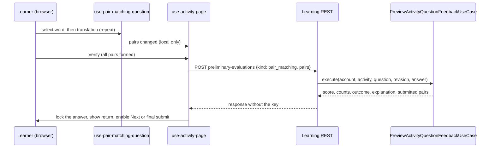
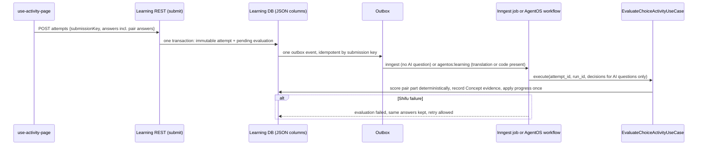

# Objective

Deliver the Learning Activity **word-translation pair matching** question
(`pair_matching`). The learner associates each word with its translation, may
remove or replace associations before verifying, verifies once every pair is
formed, and receives an objective provisional return. The question grade is
`100 × correct pairs ÷ total pairs`, with equal weight per pair. Correction,
provisional return, official evaluation and Concept evidence use no AI and no
Mentor. The format exists only in Learning Activities (three to five questions)
and never in diagnostic Activities.

This is a **complete** Spec. It crosses Curriculum (content and validation),
Shared (provider-neutral snapshots), Learning (answers, scoring, Concept
evidence, history and expected-answer protection) and the web Activity and
result UI. It adds a deterministic format to a path that so far routes only
AI-graded questions through the mixed snapshot.

Authority retrieved in full on 2026-11-19 (about 19:30 -03:00) through Atlassian
Shifu MCP: the [Learning PRD](https://joaogoliveiragarcia.atlassian.net/wiki/x/AYDzB)
("Shifu — PRD — Learning", content ID `83066881`, version 33, last modified
2026-11-12) and the [Curriculum PRD](https://joaogoliveiragarcia.atlassian.net/wiki/x/AQDzB)
("Shifu — PRD — Curriculum", content ID `83034113`, version 19, last modified
2026-11-02). The issue
[SHIFU-124](https://joaogoliveiragarcia.atlassian.net/browse/SHIFU-124)
("Implementar questões de associação de palavras e traduções", Dev Task under
Epic SHIFU-10) cites Learning version 29 and Curriculum version 16. Both PRDs
advanced since; the pair-matching rules are present in the current versions.
This task does not write to Jira or Confluence.

## Current behavior and product gap

`ActivityQuestion` in Curriculum has no pair format. Learning's mixed
`CurriculumLearningActivitySnapshot` and `get_learning_activity` path exist only
for AI-graded questions: `SubmitChoiceActivityUseCase` falls back to the
choice-only snapshot unless an Activity holds a code or translation question.
Learning's `ActivityAnswer`, `EvaluationPartResult`, detail unions, REST answer
shape and the web `ActivityPage` recognize choice, code and translation only.
Expected-answer protection for results exists for choice (`_released_question_keys`
in `GetChoiceAttemptUseCase`) and has no pair equivalent.

# Scope

| Area / actor | Included | Excluded or deferred |
| --- | --- | --- |
| Content | Curriculum `PairMatchingQuestion` with two equal-size sets (2 to 8 items), one-to-one answer key, three predefined explanations and objective Concept criteria, inside three-to-five-question Learning Activities | Diagnostic Activities; audio or image pairs; several accepted translations per word; distractors; reused items; authoring UI; full language curriculum |
| Answering | Word-then-translation selection by click, touch and keyboard; remove and replace before verifying; Verify only with all pairs formed; read-only answer after verifying | Drag and drop; saving an in-progress or verified pair state on the server or across reloads (Q2 = A) |
| Provisional return | Stateless server verification: submitted pairs, correct-pair count, grade, outcome label with icon and text, predefined explanation; advance to Next question or final submit | Per-pair correct/incorrect marks (Q3 = A); any AI or Mentor involvement; creating an attempt or official grade |
| Official evaluation | Final submit creates the immutable attempt; deterministic scoring; one coherent score, Concept evidence and progress effect; same-answer recovery after Shifu failure; review after completion preserves the official Skill result | New global progress or mastery rules; a new evaluation workflow |
| Result and history | Submitted pairs, counts, grade, label and explanation in provisional, official and history views; expected pairs protected until a later full-correct attempt or Competency mastery | Revealing expected pairs earlier |
| UI | Desktop and mobile question, provisional return and result detail; keyboard and assistive-technology operation; pt-BR controls with curricular item languages | New routes; changes to other question kinds' visuals |

Classification of selected outcomes for this bounded slice:

- Curriculum RP-03 (pair-matching rules) and RP-04 (Learning consults the
  content): **full**.
- Learning RP-09 (pair rules, read-only after verifying, sequential flow),
  RP-13 (objective grading), RP-18 (return and protection), RP-25 (responsive,
  accessible) and RP-27 (objective Concept evidence): **full** for this format.
- Learning RP-14 (recovery) and RP-20 (review after completion): **partial**.
  The existing machinery is reused unchanged and proven for this format.

Design: Q1 = B. The Penpot boards named in the Design Contract must exist before
visual checks can pass. Until then, the three desktop frames of the historical
`shifu.fig` (section "Atividade / Associação de pares — Proposta") and the
existing activity-page tokens are the accepted visual assumption. The visual
checks are **Blocked** until the boards exist in Penpot.

# Behavior Contract

| ID | RP/JN/source coverage | Observable required behavior |
| --- | --- | --- |
| RF-01 | Curriculum RP-03, JN-03; Learning RP-04 consumer | Curriculum defines a `PairMatchingQuestion` per question: source and target languages, a word set and a translation set of equal size from 2 to 8 items, and a one-to-one answer key. Every item has one occurrence and one correct pair. All items are used, with no distractors, reuse or alternative accepted translations. The two lists carry a display order, and content in which every translation sits at the position of its own word is rejected. Three explanations (full, partial, incorrect) and per-Concept objective criteria are required. Invalid content, content in a diagnostic Activity, or an unsupported combination makes the Activity unavailable. |
| RF-02 | Learning RP-09, RP-25; JN-07 | The learner sees one question at a time with both sets in the curricular display order. They select a word and then its translation by click, touch or keyboard. A translation without a selected word forms no pair. They can remove a pair or replace it by choosing another translation or word. Each item belongs to at most one pair. Verify is available only when every pair is formed. A complete answer may be wrong. |
| RF-03 | Learning RP-09, RP-18 | Verifying sends the pairs to the server for stateless evaluation. It returns the submitted pairs, the correct-pair count, the total, the grade `100 × correct ÷ total`, the outcome (full, partial or incorrect) and the predefined explanation for that outcome. No attempt, official grade, progress or reward is created. After verifying, the evaluated answer is read-only in that pass and the learner can only advance. The state is not persisted: leaving or reloading restarts that pass. |
| RF-04 | Learning RP-09, RP-13; JN-07 | Final submission of the whole Activity creates one immutable attempt, idempotent by submission key, and starts the official evaluation automatically. Pair answers are validated on the server: all items, each used once, only keys that exist in the question. The attempt grade uses the same deterministic rule and participates in the Activity grade by curricular weight. |
| RF-05 | Learning RP-13, RP-27; Curriculum RP-03 | Pair scoring, provisional return, official evaluation and Concept evidence use no AI and no Mentor. A pair question can share an Activity with choice, translation or code questions, and its scoring does not depend on those workflows. Concept evidence comes only from the question's objective criteria by outcome (full, partial or incorrect score, each optional) and is recorded apart from the grade. An absent score for the achieved outcome yields an inconclusive Concept observation (no value, never zero), as the choice format already does. |
| RF-06 | Learning RP-18; JN-13 | Provisional return, official result and history show the submitted pairs, correct-pair count, grade, predefined explanation and an outcome indication by text and icon, never by color alone. Pairs are not marked individually. Expected pairs missing from the answer are never revealed until a later full-correct attempt on that question or Competency mastery. The protection holds in all three views. A full-correct answer may show its own pairs. |
| RF-07 | Learning RP-14, RP-20; JN-08 | A Shifu failure during official evaluation keeps the saved answer and allows retry without a new attempt and without duplicating attempts, evidence or progress effects. A review attempt after Skill completion is stored in history and does not change the official Skill result. |
| RF-08 | Learning RP-25 | The flow works on desktop and mobile and by keyboard and assistive technologies. Selection, removal, replacement, formed pairs, focus, read-only state and outcome are announced and visible beyond color. Controls and guidance are in pt-BR while items keep the curricular languages. |
| RF-09 | Learning RP-09 (diagnostic exclusion); Curriculum RP-03 | The pair format is unavailable in diagnostic Activities, and the existing choice, code and translation behavior is unchanged. |

| ID | RF coverage | Given | When | Then | Checks |
| --- | --- | --- | --- | --- | --- |
| CA-01 | RF-01 | Pair content with unequal sets, fewer than 2 or more than 8 pairs, repeated key or text, broken one-to-one key, missing explanation, repeated Concept, or identity-aligned display order | The question or Activity is built | Construction raises the Curriculum invalid-activity error and no partial Activity is served | CI-01 |
| CA-02 | RF-01, RF-09 | A pair question in a diagnostic Activity, or a snapshot built from invalid pair content | The Activity is built or served | It is rejected and the Activity is unavailable | CI-01 / CI-02 |
| CA-03 | RF-01, RF-06 | A released learning Activity that mixes pair and choice questions | The learner opens it | Questions are ordered with both item lists in display order and no answer key, explanation text or Concept criterion is sent | CI-02 / VM-01 |
| CA-04 | RF-02 | Desktop, mobile, mouse, touch or keyboard | The learner selects a word and then a translation, removes a pair, and replaces a pair | Pairs form and change as defined, each item is in at most one pair, and a translation chosen first forms nothing | CI-08 / VM-01 |
| CA-05 | RF-02 | Fewer than all pairs formed | The learner tries to verify | Verify is unavailable; with all pairs formed, including a wrong set, it is available | CI-08 / VM-01 |
| CA-06 | RF-03, RF-06 | A complete answer with 0, some or all pairs correct | The learner verifies | The response carries submitted pairs, count, total, grade, outcome and the matching explanation; no pair is marked; no attempt, evaluation, outbox or progress row exists | CI-03 / CI-04 |
| CA-07 | RF-03 | A verified question | The learner tries to edit | The pairs are read-only and the only action is Next question or final submit; reload restarts the pass | CI-08 / VM-01 |
| CA-08 | RF-03, RF-04 | Pairs that are incomplete, repeat a word or translation, or use unknown keys | They are sent to preview or final submit | The request is rejected with a validation error and nothing is persisted | CI-03 / CI-05 |
| CA-09 | RF-04 | All questions answered with a stable submission key | The learner submits the Activity | One immutable attempt, one pending evaluation and one outbox event persist atomically; a matching replay returns the same attempt; a conflicting replay is rejected | CI-05 |
| CA-10 | RF-04, RF-05 | A pair-only deterministic Activity, or one mixed with choice | The evaluation job runs | The weighted Activity grade, per-question pair result and Concept evidence are recorded once, with the evaluation routed to the non-AI destination | CI-06 / CI-07 |
| CA-11 | RF-05 | A pair question mixed with translation or code in one Activity | The AI workflow applies the official result | The pair part is scored deterministically inside the same evaluation, with no assessor call for it | CI-06 |
| CA-12 | RF-05 | Concept criteria with full, partial and incorrect scores, some absent | Scoring completes | Concept observations follow the outcome score, independent of the question grade; an absent score yields an inconclusive observation, never zero | CI-06 |
| CA-13 | RF-06 | Attempts with full, partial and incorrect outcomes, with and without a later full-correct attempt or Competency mastery | The learner opens result or history | Label, count, grade and explanation show; expected pairs appear only after later full success or mastery | CI-09 / VM-03 |
| CA-14 | RF-07 | An official evaluation fails or completes twice | Retry or reprocess runs | The same saved pairs are reused and no attempt, evidence or progress effect is duplicated; a review attempt keeps the official Skill result | CI-07 |
| CA-15 | RF-08 | Desktop and mobile, keyboard and screen reader | The learner completes selection, verification and advance | Controls have accessible names, focus order, live announcements and text-plus-icon states, with no horizontal overflow at 375 px | VM-01 / VM-02 |
| CA-16 | RF-06, RF-09 | A pair-matching Activity | Question, return and result are inspected | No AI or Mentor field or call exists; the rendered states match the design references | CI-03 / VM-02 / VM-03 |

Cross-cutting guarantees: account isolation reuses Learning's goal ownership
checks. Concurrency reuses the per-experience and per-evaluation locking and run
id check already used by the choice and AI paths (CA-09, CA-10, CA-14).
Persistence reuses the existing JSON `answers`, `grading_snapshot` and evaluation
`parts` columns, so there is no migration (CI-05, CI-06, CI-09 prove the JSON
round trip through the real app).

## Design Contract

Read and export boards only through the Penpot MCP; do not extract a feature-local
bundle. Q1 = B: desktop board intent comes from the historical `shifu.fig` frames
until the Penpot boards exist. Boards to exist in the Shifu Penpot file, on the
Desktop and Mobile pages, in the Activity section grouped by state:

| Surface / route | State / viewport | Penpot page / board / components | CA / Visual check | Allowed deviations |
| --- | --- | --- | --- | --- |
| Activity page, pair question | Selection (word-then-translation, some pairs formed), 1280 px | Desktop: `Atividade / Associação — Palavra e tradução / Desktop` (exists in `shifu.fig` only); activity header, question prompt, pair lists | CA-03 / CA-04 / VM-02 | Penpot board pending; token mapping below |
| Activity page, pair question | Selection, 375 px | Mobile: `Atividade / Associação — Palavra e tradução / Mobile` (to draw) | CA-04 / CA-15 / VM-02 | Board to be created; lists stack |
| Activity page, provisional return | Full correct, 1280 px and 375 px | `Atividade / Associação — Resposta correta / Desktop` (in `shifu.fig`), `.../ Mobile` (to draw) | CA-06 / CA-07 / VM-02 | Same as above |
| Activity page, provisional return | Partial performance, 1280 px and 375 px | `Atividade / Associação — Desempenho parcial / Desktop` and `/ Mobile` (to draw) | CA-06 / VM-02 | Boards to be created |
| Activity page, provisional return | Incorrect, 1280 px and 375 px | `Atividade / Associação — Resposta incorreta / Desktop` (in `shifu.fig`), `.../ Mobile` (to draw) | CA-06 / VM-02 | Frames may mark pairs; contract forbids per-pair marks (Q3), so marks are an allowed deviation to remove |
| Result and history detail | Partial result with submitted pairs, 1280 px and 375 px | `Resultado / Associação — Desempenho parcial / Desktop` and `/ Mobile` (to draw), reusing the existing choice result components | CA-13 / VM-03 | Boards to be created |

Existing UI preserved: the activity header, progress bar, question prompt
(`QuestionPrompt`), footer actions, the choice, code and translation question
widgets, and the result page layout. Token mapping (source-verified in
`choice-question.css` and existing widgets): `--foreground`, `--muted`,
`--border`, `--control-border`, `--accent` and `--selo-text` are the semantic
tokens already used by the choice question. Selected, paired and read-only
states use these tokens plus an icon and text; the implementer maps remaining
surface and focus values to existing semantic tokens and shared primitives
(`Button`, `QuestionPrompt`, `ActivityQuestionHeader`) and introduces no
parallel color, spacing, radius or shadow.

# Technical Contract

## Architecture Mapping

Owner: Learning (answers, scoring, history, protection). Curriculum owns the
question content and validation. Shared owns the provider-neutral snapshot.
Intelligence is not touched. Rules: Python Conventions, Core Domain, Use Case
Testing, REST Layer, Controller Testing, Database Layer, Messaging Layer, Job
Testing (server); TypeScript Conventions, UI Layer, Widget Testing (web). AI
Layer does not apply because no AI path changes.

Design decisions recorded here:

- The pair question joins the **mixed snapshot** (`CurriculumLearningActivitySnapshot`
  and `get_learning_activity`). It is not added to `CurriculumChoiceActivitySnapshot`,
  whose typing is choice-only. Submit selects the mixed snapshot when an Activity
  holds any code, translation or pair question.
- Scoring happens in `EvaluateChoiceActivityUseCase`, which already scores mixed
  parts. The evaluation routes to `inngest` when no AI-graded question is present
  (`destination_for_event` already does this) and to the existing AgentOS workflow
  when a translation or code question is also present. No workflow is added.
- The weight part reuses `CorrectnessEvaluationPart` and `CurriculumChoicePartSnapshot`.
- The one-AI-category invariant stays: a pair question does not count as an AI
  category and mixes with either.

| Action | Boundary | Element / Path | Required change |
| --- | --- | --- | --- |
| Create | Curriculum domain | `curriculum/core/domain/structures/pair_matching_item.py`, `pair_matching_pair.py`, `pair_matching_concept_criterion.py`, `pair_matching_question.py` | `PairMatchingItem(key, text)`, `PairMatchingPair(word_key, translation_key)`, `PairMatchingConceptCriterion(concept_id, criterion, examples, limits, full_score, partial_score, incorrect_score)` and `PairMatchingQuestion`; validations in RF-01 raise `InvalidActivityError`. |
| Modify | Curriculum domain | `curriculum/core/domain/structures/activity_question.py`, `__init__.py`, `curriculum/core/domain/entities/activity.py` | Add `PairMatchingQuestion` to the union and exports. `Activity` rejects it for `ActivityType.DIAGNOSTIC`; no rubric pairing is required. |
| Modify | Curriculum persistence | `curriculum/database/sqlalchemy/mappers/activity_mapper.py` | JSON round trip for the new question kind; no schema change. |
| Modify | Curriculum provider | `curriculum/providers/curriculum_content_provider/curriculum_content_provider.py` | Build the pair snapshot in `get_learning_activity`; fail closed on invalid content; `get_choice_activity` keeps rejecting non-choice questions. |
| Create | Shared domain | `shared/core/domain/structures/curriculum_pair_matching_{item,pair,concept_criterion,question}_snapshot.py` | Immutable Learning-visible projection that carries the private answer key. |
| Modify | Shared domain | `shared/core/domain/structures/curriculum_learning_activity_snapshot.py`, `__init__.py` | Widen `questions` with the pair snapshot; require its part to be `CurriculumChoicePartSnapshot`; reject it when `activity_type == 'diagnostic'`; export. |
| Create | Learning domain | `learning/core/domain/structures/pair_matching_selection.py`, `pair_matching_answer.py`, `pair_matching_evaluation_result.py`, `pair_matching_question_detail.py`, `pair_matching_result_detail.py` | Declarations below. |
| Modify | Learning domain | `learning/core/domain/structures/activity_answer.py`, `evaluation_part_result.py`, `choice_activity_detail.py`, `choice_attempt_detail.py`, `__init__.py` | Widen the unions and exports. |
| Modify | Learning use cases | `learning/core/use_cases/preview_activity_question_feedback_use_case.py` | New stateless `pair_matching` branch and `PreliminaryQuestionResult` fields `submitted_pairs`, `correct_pair_count`, `total_pair_count`, `outcome`; never returns the answer key. |
| Modify | Learning use cases | `learning/core/use_cases/evaluate_choice_activity_use_case.py` | Score `pair_matching` parts in `_score_mixed_part`; add a branch in `_v2_observation_scores` that maps outcome to the criterion score; no assessor decisions required. |
| Modify | Learning use cases | `learning/core/use_cases/submit_choice_activity_use_case.py` | Use the mixed snapshot when a pair question is present; `normalize_answers` validates pair answers and returns `PairMatchingAnswer`. |
| Modify | Learning use cases | `learning/core/use_cases/get_choice_activity_use_case.py`, `get_choice_attempt_use_case.py` | Project `PairMatchingQuestionDetail` without the key; project `PairMatchingResultDetail`; extend `_released_question_keys` to release a pair question after a full-correct result or mastery. |
| Modify | Learning persistence | `learning/database/sqlalchemy/mappers/activity_attempt_mapper.py`, `activity_evaluation_mapper.py` | Dispatch `PairMatchingAnswer` and `PairMatchingEvaluationResult` in the JSON round trip; models and indexes unchanged. |
| Modify | Learning REST | `learning/rest/controllers/answer_request_shape.py`, `preview_activity_question_feedback_controller.py`, `submit_choice_activity_controller.py` | `kind: 'pair_matching'` with `pairs`; shape validation; preview `Response` gains the pair fields. |
| Modify | Learning REST | `learning/rest/controllers/get_choice_activity_controller.py`, `get_choice_attempt_controller.py` | Project the new question and result details in the existing discriminated unions; no new route. |
| Modify | REST examples | `apps/server/rest-client/learning/activities.rest` | Add non-secret pair examples for GET, preview, submit and attempt result, using `{{pairQuestionKey}}`. |
| Modify | Seed | `shared/database/seed_data.py` | Development Activity `pair-matching` (English to Portuguese) mixed with choice questions; source correction only, no reset. |
| Verify | Learning messaging | `learning/ai/learning_workflows_registry.py`, `learning/messaging/inngest/jobs/evaluate_choice_activity_job.py` | Expected unchanged: confirm by test that a pair-only mixed snapshot routes to `inngest` and runs through the existing job with no decisions. Amend this row if the check fails. |
| Modify | Web core | `apps/web/src/core/learning/choice-activity.ts`, `fakers` | Add the `pair_matching` question, answer, preview result and result detail types and fakers. |
| Modify | Web REST | `apps/web/src/rest/services/learning-service.ts` | Widen request and response typing; no endpoint. |
| Create | Web widget | `apps/web/src/ui/learning/widgets/pages/activity-page/pair-matching-question/index.tsx`, `use-pair-matching-question.ts`, `pair-matching-question.css` and tests | Described below. |
| Modify | Web widget | `activity-page/index.tsx`, `use-activity-page.ts`, `question-feedback/index.tsx` | Render the new branch; extend `assess()`, `canContinue`, `handleContinue`, `handleSubmit` and the server-function answer validator; render outcome and pairs in the feedback. |
| Modify | Web widget | `choice-result-page/choice-result-detail/index.tsx` | Render `PairMatchingResultDetail`. |

Expected file tree (new `[N]` and modified `[M]` only):

```text
apps/server/src/shifu/
├── curriculum/
│   ├── core/domain/
│   │   ├── entities/activity.py                              [M]
│   │   └── structures/
│   │       ├── activity_question.py, __init__.py             [M]
│   │       └── pair_matching_{item,pair,concept_criterion,question}.py [N]
│   ├── database/sqlalchemy/mappers/activity_mapper.py        [M]
│   └── providers/curriculum_content_provider/curriculum_content_provider.py [M]
├── shared/
│   ├── core/domain/structures/
│   │   ├── curriculum_learning_activity_snapshot.py, __init__.py [M]
│   │   └── curriculum_pair_matching_{item,pair,concept_criterion,question}_snapshot.py [N]
│   └── database/seed_data.py                                 [M]
└── learning/
    ├── core/domain/structures/
    │   ├── activity_answer.py, evaluation_part_result.py,
    │   │   choice_activity_detail.py, choice_attempt_detail.py, __init__.py [M]
    │   └── pair_matching_{selection,answer,evaluation_result,question_detail,result_detail}.py [N]
    ├── core/use_cases/
    │   └── {preview_activity_question_feedback,evaluate_choice_activity,
    │        submit_choice_activity,get_choice_activity,get_choice_attempt}_use_case.py [M]
    ├── database/sqlalchemy/mappers/{activity_attempt,activity_evaluation}_mapper.py [M]
    └── rest/controllers/
        ├── answer_request_shape.py                           [M]
        └── {preview_activity_question_feedback,submit_choice_activity,
             get_choice_activity,get_choice_attempt}_controller.py [M]
apps/server/rest-client/learning/activities.rest              [M]
apps/server/tests/
├── curriculum/core/domain/test_pair_matching_question.py     [N]
├── learning/core/use_cases/
│   └── test_{preview_activity_question_feedback,evaluate_choice_activity,
│        submit_choice_activity,get_choice_activity,get_choice_attempt}_use_case.py [M]
├── learning/server/controllers/
│   └── test_{preview_activity_question_feedback,submit_choice_activity,
│        get_choice_activity,get_choice_attempt}_controller.py [M]
├── learning/ai/workflows/test_evaluate_translation_activity_workflow.py [M]
└── messaging/inngest/jobs/learning/test_evaluate_choice_activity_job.py [M]
apps/web/src/
├── core/learning/choice-activity.ts, fakers                  [M]
├── rest/services/learning-service.ts                         [M]
└── ui/learning/widgets/pages/
    ├── activity-page/
    │   ├── index.tsx, use-activity-page.ts                   [M]
    │   ├── question-feedback/index.tsx                       [M]
    │   ├── tests/use-activity-page.test.ts                   [M]
    │   └── pair-matching-question/
    │       ├── index.tsx                                     [N]
    │       ├── use-pair-matching-question.ts                 [N]
    │       ├── pair-matching-question.css                    [N]
    │       └── tests/
    │           ├── pair-matching-question.test.tsx           [N]
    │           └── use-pair-matching-question.test.ts        [N]
    └── choice-result-page/choice-result-detail/
        ├── index.tsx                                         [M]
        └── tests/choice-result-detail.test.tsx               [M]
apps/web/tests/learning/activity-page.test.ts                 [M]
```

Test paths reflect the repository today: controller tests live under
`tests/learning/server/controllers/`, job tests under
`tests/messaging/inngest/jobs/learning/`. Provider and mapper files have no
dedicated tests; their behavior is proven at the consuming boundaries.

### Expected declarations

Python (Curriculum, creates):

```python
@structure
class PairMatchingItem:
    key: str
    text: str

@structure
class PairMatchingPair:
    word_key: str
    translation_key: str

@structure
class PairMatchingConceptCriterion:
    concept_id: str
    criterion: str
    examples: str
    limits: str
    full_score: int | None
    partial_score: int | None
    incorrect_score: int | None   # each score, when present, is 0..100

@structure
class PairMatchingQuestion:
    key: str
    prompt: str
    source_language: str
    target_language: str
    words: tuple[PairMatchingItem, ...]          # display order
    translations: tuple[PairMatchingItem, ...]   # display order
    correct_pairs: tuple[PairMatchingPair, ...]
    full_explanation: str
    partial_explanation: str
    incorrect_explanation: str
    concept_criteria: tuple[PairMatchingConceptCriterion, ...] = ()
    kind: Literal['pair_matching'] = 'pair_matching'
```

Learning (creates):

```python
@structure
class PairMatchingSelection:
    word_key: str
    translation_key: str

@structure
class PairMatchingAnswer:
    question_key: str
    pairs: tuple[PairMatchingSelection, ...]     # non-empty, no repeated word or translation

@structure
class PairMatchingEvaluationResult:
    question_key: str
    score: Decimal                               # 100 * correct_pair_count / total_pair_count
    correct_pair_count: int
    total_pair_count: int
    outcome: Literal['full', 'partial', 'incorrect']
    explanation: str

@structure
class PairMatchingQuestionDetail:
    key: str
    kind: Literal['pair_matching']
    prompt: str
    source_language: str
    target_language: str
    words: tuple[PairMatchingItemDetail, ...]
    translations: tuple[PairMatchingItemDetail, ...]   # no answer key, no explanations

@structure
class PairMatchingResultDetail:
    question_key: str
    prompt: str
    submitted_pairs: tuple[PairMatchingSelection, ...]
    score: Decimal
    correct_pair_count: int
    total_pair_count: int
    outcome: Literal['full', 'partial', 'incorrect']
    explanation: str
    disclosed_correct_pairs: tuple[PairMatchingSelection, ...] = ()
```

Modified (scoped excerpts, unchanged members as in source):

```python
type ActivityAnswer = (
    SingleChoiceAnswer | MultipleSelectionAnswer | CodeAnswer
    | TranslationAnswer | PairMatchingAnswer
)
type EvaluationPartResult = (
    ChoiceEvaluationResult | CodeEvaluationResult | CodeRubricResult
    | QualitativeEvaluationResult | TranslationRubricResult
    | PairMatchingEvaluationResult
)

@structure
class PreliminaryQuestionResult:      # added members only
    submitted_pairs: tuple[PairMatchingSelection, ...] = ()
    correct_pair_count: int | None = None
    total_pair_count: int | None = None
    outcome: str | None = None
```

REST: the existing preview route
`POST .../questions/{question_key}/preliminary-evaluations` and attempts route
`POST .../attempts` accept an answer item
`{ "kind": "pair_matching", "question_key": "...", "pairs": [{ "word_key": "...", "translation_key": "..." }] }`.
Preview `Response` adds `submitted_pairs`, `correct_pair_count`,
`total_pair_count` and `outcome` next to the existing `status`, `score` and
`explanation`. Errors keep the existing shapes: 422 for an invalid request shape (missing, empty or mixed fields), 400 `validation_error` for pairs that do not fit the question (incomplete, repeated or unknown items, wrong question key or answer kind),
409 for a stale activity revision or conflicting replay, 404 for access. No
response carries `correct_pairs`, except `disclosed_correct_pairs` in the
attempt result after release. `get_choice_activity` returns the question with
`words` and `translations` only.

TypeScript (web, Zod and types at the existing boundaries):

```ts
type PairMatchingQuestion = {
  kind: 'pair_matching'
  key: string
  prompt: string
  sourceLanguage: string
  targetLanguage: string
  words: { key: string; text: string }[]
  translations: { key: string; text: string }[]
}
type PairMatchingAnswer = {
  kind: 'pair_matching'
  questionKey: string
  pairs: { wordKey: string; translationKey: string }[]
}
```

`PreliminaryQuestionResult` gains `submittedPairs`, `correctPairCount`,
`totalPairCount` and `outcome`. `PairMatchingResultDetail` mirrors the server
detail with optional `disclosedCorrectPairs`.

### New concepts

**`PairMatchingQuestion`** (Curriculum) is a matching exercise. Example: words
`dog`, `house`, `water` against translations `casa`, `água`, `cachorro`, with the
key `dog→cachorro`, `house→casa`, `water→água`. It carries the answer key and
the explanations, owns no runtime behavior, and is the only place where the key
lives. The display order of both lists is curricular. Content is rejected when
the translation list repeats the word order of the key, because position would
then reveal every pair (Q5 = A). The 2 to 8 bound narrows the PRD floor of
non-empty sets: one pair is answered by elimination and tests nothing, and eight
fits mobile; this is an accepted assumption to confirm during Spec review.

**`PairMatchingConceptCriterion`** (Curriculum) maps a Concept to the three
outcomes the PRD names (Q4 = A). The observation for that Concept is the score of
the achieved outcome, and an absent score gives an inconclusive observation, never zero. It mirrors
`ChoiceConceptCriterion` and keeps the evidence apart from the grade.

**`PairMatchingEvaluationResult`** (Learning) is the stored per-question result.
It holds the counts and the outcome, so history and Concept evidence never
re-derive them from a snapshot that may later change. The outcome is `full` when
all pairs are correct, `incorrect` when none is, and `partial` otherwise.

**Answer protection** reuses the release rule of the choice format. A question is
released when a result for that question in the current or a later completed
attempt is `full`, or when the Competency is mastered. Only then does
`PairMatchingResultDetail.disclosed_correct_pairs` carry the key. Provisional
return never discloses the key, even for a mastered Competency, which the PRD
allows but does not require.

**Selection state (web).** `use-pair-matching-question.ts` owns the local pairing
state: the selected word, the formed pairs and the announcements. It reports the
pair list upward and takes a read-only flag from the page. Rules: choosing an
unpaired word selects it; choosing a paired word dissolves its pair and selects
it; choosing a translation with a selected word forms the pair and releases any
prior pair of that translation; choosing a translation with no selected word does
nothing and announces the needed first step; each paired item has an explicit
remove control; Escape clears the selection. `use-activity-page.ts` keeps the
verified answer through the existing `frozenAnswer` and `feedback` state, owns
the preview request and sequencing, and reports no pairs to the server before
Verify. Domain query and action hooks are not added: the answer flows through the
same `ActivityAnswer` state and server functions as other kinds. No context or
provider is introduced.

## Runtime Flow





Account identity comes from authentication, never from the body. Preview reads
only and writes no attempt, evaluation, outbox or progress row, and it checks the
activity revision (409 on mismatch) and that the question belongs to the
Activity. The submit use case validates every pair answer against the snapshot
before persisting: all items, each once, only known keys. The submit transaction
locks the Skill experience, checks the submission key and the unresolved
evaluation, and writes attempt, pending evaluation and one outbox event
together. A matching replay returns the same attempt, and a replay with different
content returns 409. The evaluation transaction re-checks the active `run_id`
before applying the result, so a stale or duplicate run applies no second effect.
Pair scoring cannot fail from an external provider, so the only failure paths are
infrastructure failures, which keep the saved pairs and use the existing retry.
A review attempt after Skill completion goes through the same path and the
existing review branch stores it without changing the official Skill result.

# Verification Contract

## Shared setup

Server checks run from `apps/server` with `uv run`. Use-case tests mock ports.
Controller tests use the real registered app and a disposable PostgreSQL through
`tests/fixtures` and `tests/conftest.py`. The job test uses the Testcontainers
fixture `tests/fixtures/inngest_fixture.py` with `SHIFU_RUN_REAL_INNGEST_TESTS=1`
through `uv run poe test:jobs`. Web unit checks run from the repository root with
`pnpm --filter web exec vitest run <path>`. Browser checks use Playwright CLI from
`apps/web` per `AGENTS.md`, with the authenticated state in
`.playwright-cli/states/shifu-auth-state.json`, after `docker compose ps` and the
web and API health endpoints are green. The Manual journey uses the development
Activity added to `shared/database/seed_data.py`. This change is a source
correction. Applying it to a shared database needs the existing seed command,
which must target an isolated database, because no reset of shared data is
authorized. Each automated test owns disposable fixtures. Pair fixtures use
fictitious English and Portuguese words and no personal data.

## Automated

### CI-01 — Pair content invariants

**Criteria:** CA-01 / CA-02

**Expected result:** Every invalid content class raises `InvalidActivityError`; valid content builds.

**Setup / inputs:** Equivalence classes: unequal sets, 1 pair, 2 pairs (minimum), 8 pairs (maximum), 9 pairs, repeated key, repeated text, answer key that skips or repeats an item, unknown key in the answer key, empty explanation, repeated Concept id, score outside 0..100, identity-aligned display order, a pair question in a diagnostic Activity.

**Proof:** `apps/server/tests/curriculum/core/domain/test_pair_matching_question.py` (planned; mirrors `test_translation_question.py`)

```bash
cd apps/server && uv run pytest tests/curriculum/core/domain/test_pair_matching_question.py
```

**Passing condition:** Each listed class raises and the boundary values 2 and 8 build; the selection runs more than zero tests.

### CI-02 — Safe activity projection and snapshot validation

**Criteria:** CA-02 / CA-03

**Expected result:** GET returns ordered questions with `words` and `translations` only, with no key, explanations or Concept criteria; the mixed snapshot rejects diagnostic placement or a pair part that is not a weight part.

**Setup / inputs:** A released learning Activity mixing one pair question with choice questions.

**Proof:** `apps/server/tests/learning/server/controllers/test_get_choice_activity_controller.py` and `apps/server/tests/learning/core/use_cases/test_get_choice_activity_use_case.py` (new pair cases)

```bash
cd apps/server && uv run pytest tests/learning/server/controllers/test_get_choice_activity_controller.py tests/learning/core/use_cases/test_get_choice_activity_use_case.py
```

**Passing condition:** The response schema omits private fields, the display order is preserved, existing cases stay green.

### CI-03 — Stateless preview and key protection

**Criteria:** CA-06 / CA-08 / CA-16

**Expected result:** Preview returns submitted pairs, count, total, grade, outcome and the matching explanation for 0, some and all pairs correct; invalid answers raise a validation error; no write occurs; the response has no key and no AI field.

**Setup / inputs:** Use-case level: finite combinations for sets of 2, 3 and 8 pairs covering all outcomes and the exact grade `100 × c ÷ t`; invalid classes: missing pair, repeated word, repeated translation, unknown key, wrong answer type, wrong question key, stale revision. Controller level: one full, one partial and one incorrect request against the real app, plus one invalid shape.

**Proof:** `apps/server/tests/learning/core/use_cases/test_preview_activity_question_feedback_use_case.py` and `apps/server/tests/learning/server/controllers/test_preview_activity_question_feedback_controller.py` (new pair cases)

```bash
cd apps/server && uv run pytest tests/learning/core/use_cases/test_preview_activity_question_feedback_use_case.py tests/learning/server/controllers/test_preview_activity_question_feedback_controller.py
```

**Passing condition:** Assertions cover every outcome and grade, no repository write call occurs, and the serialized response contains no answer-key field.

### CI-04 — Provisional return never leaks the key

**Criteria:** CA-06

**Expected result:** For every wrong or partial answer in a question of 2 to 4 pairs, the response contains only the submitted pairs and the three counts. Nothing in it identifies an expected pair absent from the answer.

**Setup / inputs:** Enumerated wrong and partial answers for a 3-pair question.

**Proof:** same files as CI-03

```bash
cd apps/server && uv run pytest tests/learning/core/use_cases/test_preview_activity_question_feedback_use_case.py -k pair
```

**Passing condition:** Each case asserts exact response fields; the `-k pair` selection runs at least the enumerated cases (confirm count before relying on the filter).

### CI-05 — Idempotent final submission and server validation

**Criteria:** CA-08 / CA-09

**Expected result:** A mixed Activity (choice and pair) with a stable key creates one attempt, one pending evaluation and one outbox event; an identical replay returns the same attempt; a conflicting replay returns 409 with no new rows; an invalid pair answer returns 422 or 400 with no rows.

**Setup / inputs:** Disposable PostgreSQL through the controller fixture; seeded mixed Activity.

**Proof:** `apps/server/tests/learning/server/controllers/test_submit_choice_activity_controller.py` and `apps/server/tests/learning/core/use_cases/test_submit_choice_activity_use_case.py` (new pair cases)

```bash
cd apps/server && uv run pytest tests/learning/server/controllers/test_submit_choice_activity_controller.py tests/learning/core/use_cases/test_submit_choice_activity_use_case.py
```

**Passing condition:** Row counts and identifiers match; the stored JSON answers round-trip to `PairMatchingAnswer`.

### CI-06 — Deterministic scoring, mixing and Concept evidence

**Criteria:** CA-10 / CA-11 / CA-12

**Expected result:** A pair part plus choice parts yields the weighted Activity grade; a pair part plus a translation part scores the pair part with no assessor call; Concept observations follow the outcome score, independent of the question grade; an absent outcome score produces an inconclusive observation (no value).

**Setup / inputs:** Mixed snapshot fixtures: pair with choice, pair with translation (fake decisions for translation only); full, partial and incorrect outcomes; Concept criteria with all three scores, and with each score absent.

**Proof:** `apps/server/tests/learning/core/use_cases/test_evaluate_choice_activity_use_case.py` (new pair cases) and `apps/server/tests/learning/ai/workflows/test_evaluate_translation_activity_workflow.py` (new case with a pair question)

```bash
cd apps/server && uv run pytest tests/learning/core/use_cases/test_evaluate_choice_activity_use_case.py tests/learning/ai/workflows/test_evaluate_translation_activity_workflow.py
```

**Passing condition:** Expected grades and observations match; the fake assessor is called for the translation question only; existing code, translation and choice cases remain green as regression.

### CI-07 — Official evaluation job, recovery and review

**Criteria:** CA-10 / CA-14

**Expected result:** A pair-only mixed Activity is routed to `inngest`, runs through the registered job and completes once. A failure keeps the saved pairs and a retry completes it once, with no duplicated attempt, evidence or progress. A review attempt after completion is stored without changing the official Skill result.

**Setup / inputs:** Real Inngest Testcontainers fixture; one pair Activity; one injected failure then retry; one completed Skill review.

**Proof:** `apps/server/tests/messaging/inngest/jobs/learning/test_evaluate_choice_activity_job.py` (new pair cases) and `apps/server/tests/learning/messaging/test_learning_inngest_messaging.py` (destination for a pair-only snapshot)

```bash
cd apps/server && uv run poe test:jobs
```

**Passing condition:** The run shows the new tests executed with the real-Inngest flag set (not skipped); exactly one completion transition per scenario; the stale run id is discarded.

### CI-08 — Selection widget and page behavior

**Criteria:** CA-04 / CA-05 / CA-07

**Expected result:** The hook and widget implement the selection rules; Verify is enabled only with all pairs; after verifying the answer is read-only; the page requests the preview once and locks the answer; Next and final submit follow the existing sequencing.

**Setup / inputs:** Equivalence classes: translation before word, unpaired word then translation, replace a pair via another translation, replace via another word, remove a pair, complete wrong set, incomplete set, 2 and 8 pairs, keyboard-only sequence, read-only after verify, preview failure then retry.

**Proof:** `apps/web/src/ui/learning/widgets/pages/activity-page/pair-matching-question/tests/use-pair-matching-question.test.ts`, `.../pair-matching-question.test.tsx` and `apps/web/src/ui/learning/widgets/pages/activity-page/tests/use-activity-page.test.ts` (planned; new pair cases)

```bash
pnpm --filter web exec vitest run src/ui/learning/widgets/pages/activity-page/pair-matching-question src/ui/learning/widgets/pages/activity-page/tests/use-activity-page.test.ts
```

**Passing condition:** Assertions cover every listed class, accessible names and live announcements, and the read-only state. Query and action hooks have no dedicated test and are exercised through these consumers.

### CI-09 — History, result detail and expected-answer protection

**Criteria:** CA-13

**Expected result:** The attempt result shows the label, counts, grade and explanation for full, partial and incorrect outcomes. `disclosed_correct_pairs` is empty until a later full-correct attempt or Competency mastery, then carries the key. The web detail renders text and icon states and no per-pair marks.

**Setup / inputs:** Attempts at each outcome, with and without a later full-correct attempt, with and without mastery.

**Proof:** `apps/server/tests/learning/server/controllers/test_get_choice_attempt_controller.py`, `apps/server/tests/learning/core/use_cases/test_get_choice_attempt_use_case.py` and `apps/web/src/ui/learning/widgets/pages/choice-result-page/choice-result-detail/tests/choice-result-detail.test.tsx` (new pair cases)

```bash
cd apps/server && uv run pytest tests/learning/server/controllers/test_get_choice_attempt_controller.py tests/learning/core/use_cases/test_get_choice_attempt_use_case.py
cd ../.. && pnpm --filter web exec vitest run src/ui/learning/widgets/pages/choice-result-page/choice-result-detail/tests/choice-result-detail.test.tsx
```

**Passing condition:** Protected fields are absent before release and present after; the label matches the outcome in every case.

### CI-10 — Applicable baseline checks

**Scope:** `apps/server/src/shifu/{curriculum,learning,shared}` and their consumers, `apps/web/src/{core/learning,rest/services,ui/learning}`, `apps/server/rest-client/learning`.

**Checks:**

```bash
cd apps/server
uv run poe check:types
uv run ruff check --no-fix <changed Python paths>
uv run ruff format --check <changed Python paths>
uv run poe check:architecture
cd ../..
pnpm --filter web check:types
pnpm exec biome check <changed web paths>
```

Server lint and complexity share the Ruff command (`C90` selected). Web lint and
complexity share the Biome command. The affected existing tests for choice, code
and translation questions run as regression through the checks above. No
dedicated complexity-metrics tool is configured, so that gate is **Blocked** and
is recorded as such, not inferred from lint. The REST examples are verified for
method, path and schema parity with the controllers by inspection and by
sending the pair examples against the running API during VM-01.

**Passing condition:** Zero type, lint, format and architecture diagnostics on the changed paths and their consumers (errors and warnings), and the complexity-metrics gate recorded Blocked.

## Manual

### VM-01 — Authenticated pair journey (desktop and mobile)

**Type:** Manual

**Criteria:** CA-03 / CA-04 / CA-05 / CA-07 / CA-15

**Tool / setup:** Playwright CLI from `apps/web`, authenticated state, the seeded pair Activity on an isolated database, API and web healthy.

**Procedure:** Open the Activity and reach the pair question. Select a translation first and confirm nothing forms. Select a word and a translation, remove a pair, replace a pair, and form all pairs. Confirm Verify was disabled until the last pair. Verify, read the return, confirm the answer is read-only, go to the next question, answer the rest, submit the Activity, open the result and then the history. Repeat the selection and verify steps by keyboard only, and at 375 px width.

**Passing condition:** Final URLs are the result and history routes; the preview and submit requests show the pair shape and the attempt exists in history; keyboard focus order and announcements work; no horizontal overflow at 375 px; no unclassified console error; session and process started for the task are closed.

## Visual

### VM-02 — Question and provisional-return states (desktop and mobile)

**Type:** Visual

**Criteria:** CA-03 / CA-04 / CA-06 / CA-15 / CA-16

**Reference / setup:** The Penpot boards listed for selection, full correct, partial and incorrect, each at 1280 px and 375 px. Captures come from the VM-01 journey; the partial and incorrect states use seeded answers chosen to produce them.

**Capture / comparison:** Fresh Penpot MCP exports compared with fresh Playwright captures for each of the eight state and viewport rows.

**Passing condition:** Layout, item lists, selected, paired and read-only indicators, outcome icon and text, and spacing match the board within accepted deviations. Per-pair marks seen in a board are an accepted deviation to remove. Each row is inspected and recorded individually. **Blocked** while the Penpot boards do not exist (Q1 = B).

### VM-03 — Result and history detail (desktop and mobile)

**Type:** Visual

**Criteria:** CA-13 / CA-16

**Reference / setup:** `Resultado / Associação — Desempenho parcial` at 1280 px and 375 px, reached from the VM-01 history step.

**Capture / comparison:** As VM-02.

**Passing condition:** Submitted pairs, counts, grade, label with icon and text and the explanation match the board, and no expected pair is shown. **Blocked** while the board does not exist.

Integration runs after all scopes are integrated, using the files above. The
existing choice, code and translation suites that cover the shared use cases and
controllers stay in the selection as regression, because both
`EvaluateChoiceActivityUseCase` and the answer request shape are modified shared
boundaries. Broader suites are not required unless a changed shared dependency
shows a gap. Failures are fixed and only the affected selections rerun.

# Documentation Alignment

| Document / authority | Governs | Required update or confirmation | Disposition / dependency |
| --- | --- | --- | --- |
| [Learning PRD](https://joaogoliveiragarcia.atlassian.net/wiki/x/AYDzB), "Shifu — PRD — Learning", content ID `83066881`, version 33, last modified 2026-11-12, retrieved 2026-11-19 | RP-09, RP-13, RP-14, RP-18, RP-20, RP-25, RP-27; JN-07, JN-08, JN-13 | Alignment confirmed; the issue cites version 29, which is superseded | No amendment; recheck the version before conclusion |
| [Curriculum PRD](https://joaogoliveiragarcia.atlassian.net/wiki/x/AQDzB), "Shifu — PRD — Curriculum", content ID `83034113`, version 19, last modified 2026-11-02, retrieved 2026-11-19 | RP-03, RP-04; JN-03, JN-04 | Alignment confirmed; the issue cites version 16, which is superseded. The 2 to 8 pair bound narrows the non-empty floor and is an accepted assumption pending review | No amendment; confirm the bound in Spec review |
| [SHIFU-124](https://joaogoliveiragarcia.atlassian.net/browse/SHIFU-124) | Delivery scope and traceability | Confirmed as source; its design reference names `shifu.fig` and OpenPencil, while `AGENTS.md` names Penpot | Conflict reported; resolved by Q1 = B. No Jira write |
| Penpot Shifu file | Visual intent | Boards in the Design Contract must be created; `shifu.fig` frames are the interim assumption | Penpot MCP was not connected during authoring. VM-02 and VM-03 stay Blocked until the boards exist |
| [`modules.md`](../../../modules.md), [`architecture.md`](../../../architecture.md) | Curriculum content, Learning decisions, Shared contracts | Confirmed: no Intelligence change and no new module dependency | Recheck at conclusion |
| [`rules.md`](../../../rules.md) Rule Pack | Server and web layers | Python Conventions, Core Domain, Use Case Testing, REST Layer, Controller Testing, Database Layer, Messaging Layer, Job Testing, TypeScript Conventions, UI Layer, Widget Testing | Recheck if scope expands |
| [`tooling.md`](../../../tooling.md) | Commands and static checks | Commands verified against `apps/server/pyproject.toml` and `apps/web/package.json` on 2026-11-19 | None |
| Parallel branch `feat/shifu-123` (fill-in-the-blank) | Shared unions in snapshot, answer and result types | Expect merge conflicts in `ActivityAnswer`, `EvaluationPartResult`, `CurriculumLearningActivitySnapshot` and the controllers | Reconcile after whichever branch merges first |

# Revision History

| Revision | Date | Contract change | Reason / source |
| --- | --- | --- | --- |
| 1 | 2026-11-19 | Initial contract | SHIFU-124 reconciled against Learning PRD v33 and Curriculum PRD v19. Decisions: Q1 = B accepted visual assumption with Blocked visual checks, Q2 = A browser-only verified state, Q3 = A no per-pair marks, Q4 = A three-outcome Concept criteria, Q5 = A curricular display order with identity rejection |
| 2 | 2026-11-19 | Clarified two guarantees found while implementing: an absent Concept score gives an inconclusive observation, as the choice format does, not no observation; invalid pair content returns 400 `validation_error` and only an invalid request shape returns 422. The preview response omits the pair fields for non-pair questions | Implementation of SHIFU-124 against the existing choice-format semantics and the shared error boundary; no product behavior changed |
