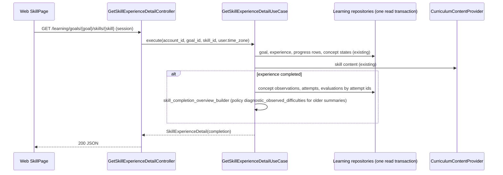

# Objective

When a Skill experience is completed, the learner opens its page and sees that it
is completed, compares the starting point with the final result per Competency and
overall, and reads three indicators of the experience and the day each Competency
was mastered. The learner keeps studying and sending review attempts without
changing the preserved result. When the learner adds a Skill that already has an
experience in another of their Goals, the add dialog and the Mentor proposal card
explain, before confirmation, that the new experience starts from zero.

Today the Skill detail endpoint does not return the completion summary that the
server already stores, so a completed Skill renders exactly like a Skill in
learning with a "Concluída" label. The learning completion path also stores every
starting point as completely covered, even when the diagnosis left gaps. The manual
add page is a placeholder that never mounts the existing catalog and dialog, the
activity result page gives no sign that the Skill was just completed, and the
mobile bottom bar has no active item on Learning pages.

Owning module: Learning. Intelligence UI consumes a Learning REST read contract in
the Mentor card through its own query hook and notice; no Intelligence server
contract changes and no web module imports another module's UI. This is a **complete** Spec
because the delivery fixes how the preserved result is recorded, adds a read model
built from several persisted sources, adds a REST endpoint and spans two web
modules.

# Scope

| Area / actor | Included | Excluded or deferred |
| --- | --- | --- |
| Learner, completed Skill page | Completed view with dates, three indicators, before/after per Competency and overall, mastery day per Competency, review block, notice that new scores do not change the summary, "Voltar ao Objetivo"; three states from Penpot; Competency rows link to the Competency page | Restarting a Skill; a separate "Revisar materiais" action; a materials library |
| Learning server, completed detail | `completion` overview on the Skill detail response, computed at read time in the account time zone | New tables, columns or migrations; snapshotting indicators |
| Learning server, completion through learning | Records the real starting coverage per Competency and Skill | Completion, mastery, regression and progress rules |
| Learning server, review | Tested guarantee that review evaluations change no progress, mastery, verification, summary, indicator or completion day | A review label on the result page (follow-up) |
| Learner, activity result page | "Habilidade concluída" notice with "Ver resumo final" when that learning attempt completed the Skill | New result layouts |
| Learner, manual add page | Mount the existing catalog and dialog on the add page, match "Habilidade / Adicionar", warn about the Skill in other Goals | Planner proposals; bulk add |
| Learner, Mentor add proposal card | Same warning relative to the card's destination Goal | Mentor removal card; any Intelligence persistence change |
| Learning server, other experiences | `GET /learning/skills/{skill_id}/experiences` for the authenticated account | Excluding the destination Goal on the server |
| Shared server domain | Move the UTC time zone fallback from Gamification to Shared | Any Gamification behavior change |
| App layout navigation | "Objetivos" active on every `/learning` page in the mobile bottom bar and the desktop header, through navigation items that declare their active route areas | Other navigation changes |
| Goal | No change: no result, progress or completion | Goal progress, rewards, XP |

Selected canonical outcomes for this slice:

- RP-19 — **full** for the completion summary, complementary indicators and their
  presentation.
- RP-20 — **full** for review without changing the result, the review block and
  access to Competencies, materials and history after completion.
- RP-05 — **partial**: only the completed-state presentation ("mostrar o resultado
  preservado e permitir revisão").
- RP-03 — **partial**: only the warning for a Skill already present in another Goal,
  in the manual add and Mentor add flows.
- RP-18 and RP-17 — **partial**: only "resultado da Atividade primeiro, depois o
  resumo final" when an evaluation completes the Skill.
- RP-15 and RP-07 — **partial**: only the identification of partial or unknown
  starting points in the summary.
- RP-25 — **partial**: the surfaces changed here are responsive, keyboard operable,
  not color-only and in pt-BR.

Penpot boards for every affected UI state are listed in the Design Contract.

# Behavior Contract

| ID | RP/JN/source coverage | Observable required behavior |
| --- | --- | --- |
| RF-01 | RP-05, RP-19 | An authenticated learner opening a completed Skill of their own Goal sees the Skill title, the "Concluída" status, the start day and the completion day. A Skill in any other status keeps its current page. |
| RF-02 | RP-19, RP-15, RP-07 | The completed view compares, for each Competency in curriculum order and for the Skill overall, the starting value with the final preserved value. A starting point with incomplete diagnosis coverage is labelled "Ponto de partida parcial"; one without any numeric value is labelled "Ponto de partida desconhecido" and shows "—" instead of an invented number. The overall starting value is the average of the known Competency starting values, labelled partial when any Competency is partial or unknown, and unknown when none is known. When the diagnosis completed the Skill, initial and final values are shown as equal ("=") and no evolution is claimed. Evolution is also written in numbers, never by color only. |
| RF-03 | RP-19 | The completed view shows, separately from the comparison and without the evolution color: the duration between start and completion counted in calendar days in the account time zone ("No mesmo dia" for 0, "1 dia", "N dias"); the number of learning Activities with at least one submitted learning attempt; the number of submitted learning attempts; and, per Competency, the day it was last mastered ("Dominada em 4 set"). Diagnostic and review Activities and attempts never count. When the diagnosis completed the Skill, the two counts are not shown and every mastery day is the completion day. These values do not change after completion. |
| RF-04 | RP-20 | The completed view shows a "Prática de revisão" block that is separate from the official result. With review attempts, it shows the number of submitted review attempts and the score of the review evaluation that finished most recently; without a finished review evaluation, the score is omitted. Without review attempts, it says that practice remains available. The view states that review scores do not change the official result of the Skill. |
| RF-05 | RP-19, RP-20, JN-12 | After completion, a new learning-activity submission is recorded as a review attempt and its evaluation is kept in the history. It changes no concept observation, concept state, Competency progress, mastery or mastery date, verification, recommendation, preserved summary, completion day or learning-attempt count; it opens no regression verification and the Skill never returns to learning. |
| RF-06 | RP-20, RP-08 | Each Competency row of the completed view is a link to that Competency's page, where its released materials and learning Activities stay available, with the existing way back to the Skill. Diagnostic Activities do not become repeatable practice. History and the completed view remain reachable while navigating. |
| RF-07 | RP-19, RP-07 | When an evaluation completes a Skill during learning, the stored completion summary records, per Competency and for the Skill, whether the diagnosis starting point covered every curricular Concept at easy, medium and hard with valid observations. The first stored summary and completion day are never replaced. |
| RF-08 | RP-18, RP-17, JN-11 | When the evaluation of a learning attempt completes the Skill, including while the learner was away, the learner first sees that Activity's result, which then shows "Habilidade concluída" and a "Ver resumo final" link to the completed view. Results of earlier learning attempts and of review attempts do not show the notice. |
| RF-09 | RP-03, JN-17, JN-23 | Before confirming the manual add of a Skill to a Goal, or a Mentor add proposal for a destination Goal, the learner is told when the same Skill already has an experience in another of their Goals: the notice names each other Goal and the current status of the Skill there, states that the new experience starts from zero with a new diagnosis and that no result is copied, and links to each existing experience. The notice never blocks or delays the addition and nothing is copied. When the lookup fails, the notice is omitted and the addition stays available. |
| RF-10 | RP-03, JN-17 | The manual add page lists and searches the Skill catalog and opens the existing confirmation dialog with suggested bases, so the RF-09 notice is reachable. Existing add, duplicate and base-selection behavior is preserved. |
| RF-11 | RP-03, RP-19 | Completing one experience gives no completion, result or summary to another experience of the same Skill or to any Goal. The other-experiences lookup returns only the authenticated account's experiences. |
| RF-12 | RP-25 | The completed view, the add page and dialog, the Mentor notice and the result notice work on desktop and mobile, their links and actions are keyboard operable with visible focus, state is never conveyed by color alone and all text is pt-BR. The mobile bottom bar and the desktop header mark "Objetivos" as active on every `/learning` page. |

| ID | RF coverage | Given | When | Then | Checks |
| --- | --- | --- | --- | --- | --- |
| CA-01 | RF-01 | A completed Skill of the learner's Goal | The learner opens it | "Concluída", the Skill title and "2 set → 13 set" style start and completion days appear | CI-01, CI-05, CI-09, CI-10, CI-15, VM-01 |
| CA-02 | RF-02 | A completed Skill with complete starting coverage | The learner reads the summary | Each Competency and the overall result show initial and final values with "→" and the legend "Ponto de partida" / "Evolução até agora" | CI-01, CI-05, CI-09, CI-15, VM-04 |
| CA-03 | RF-02 | Some Competencies have partial or unknown starting points | The learner reads the summary | Partial rows and the overall result are labelled "Ponto de partida parcial", an unknown row is labelled "Ponto de partida desconhecido" with "—", the overall initial value is the average of known values and the legend adds "Resultado sem ponto de partida" | CI-01, CI-05, CI-09, CI-15, VM-06 |
| CA-04 | RF-02, RF-03 | The diagnosis completed the Skill | The learner opens it | Values are shown with "=", the legend reads "Ponto de partida = resultado final", only the duration indicator appears and every mastery day is the completion day | CI-01, CI-09, VM-01, VM-05 |
| CA-05 | RF-03 | Learning and diagnostic attempts exist before completion and review attempts after it | The learner reads the indicators | The Activity count counts distinct learning Activities with a submitted learning attempt, the attempt count counts learning attempts, and diagnostic and review attempts are excluded | CI-01, CI-05 |
| CA-06 | RF-03 | Start and completion fall on the same local day, on consecutive days or eleven days apart, including a case where UTC and the account time zone give different days, and an account without a valid time zone | The learner reads the duration | It reads "No mesmo dia", "1 dia" and "11 dias" respectively, days follow the account time zone, and a missing or invalid zone falls back to UTC | CI-01, CI-09 |
| CA-07 | RF-03 | Each Competency was mastered on a stored day | The learner reads the list | Each row shows "Dominada em <dia>" from the Competency's stored mastery date in the account time zone | CI-01, CI-05, CI-09 |
| CA-08 | RF-04 | Review attempts exist, the latest finished review evaluation scored 85 and a newer review is still pending | The learner reads the review block | It shows the number of review attempts including the pending one, "85" as the last review score and the notice that review scores do not change the official result | CI-01, CI-09, VM-04 |
| CA-09 | RF-04 | No review attempt exists | The learner reads the review block | It says that practice remains available and that review scores do not change the official result | CI-01, CI-09, VM-05 |
| CA-10 | RF-05 | A completed Skill | A review attempt is submitted and its evaluation finishes | The evaluation is stored as completed with its score; concept observations, concept states, Competency progress, mastery and mastery dates, verifications, recommendation, completion summary, completion day and indicators are unchanged; no regression verification opens and the status stays completed | CI-02, VM-02 |
| CA-11 | RF-05 | A completed Skill | A learning Activity is submitted | The attempt is recorded with the review kind and the Skill stays completed | CI-02, VM-02 |
| CA-12 | RF-06 | A completed Skill | The learner activates a Competency row by pointer or keyboard | The Competency page opens with its released materials and learning Activities and the back link returns to the Skill | CI-09, CI-15, VM-01 |
| CA-13 | RF-07 | A Skill whose diagnosis left a Concept without a valid hard observation and another Competency with no numeric starting value | An evaluation completes the Skill during learning | The stored summary marks the affected Competencies and the Skill as not completely covered, keeps the known initial values and keeps the first stored summary if completion was already recorded | CI-02 |
| CA-14 | RF-08 | A learning attempt whose evaluation completed the Skill | The learner opens its result, during or after the evaluation | The result appears first and then "Habilidade concluída" with "Ver resumo final" linking to the Skill page | CI-04, CI-07, CI-13, CI-15 |
| CA-15 | RF-08 | An earlier learning attempt or a review attempt of a completed Skill | The learner opens its result | No completion notice appears | CI-04, CI-07, CI-13 |
| CA-16 | RF-09, RF-10 | The Skill is completed in Goal "Carreira em dados" and absent from the destination Goal | The learner selects it on the add page | The dialog shows "Você já tem esta Habilidade em outro Objetivo", names "Carreira em dados" and its status, says it starts from zero with a new diagnosis and nothing is copied, links to that experience and still allows "Adicionar habilidade", which creates a not-started experience | CI-03, CI-06, CI-11, CI-15, VM-03, VM-07 |
| CA-17 | RF-09 | The Skill exists in two other Goals | The dialog or the Mentor card opens | The notice lists each other Goal with its own status and link | CI-11, CI-12 |
| CA-18 | RF-09 | The lookup fails, or the Skill exists only in the destination Goal, or nowhere else | The dialog or the Mentor card opens | No notice appears and the addition remains available; the existing "already present" behavior is unchanged | CI-11, CI-12 |
| CA-19 | RF-09 | A Mentor add proposal whose destination Goal is fixed or chosen in the card, and the Skill exists in another Goal | The card shows the proposal | The notice appears relative to the current destination Goal and updates when the learner changes the destination, without blocking "Adicionar habilidade" | CI-12, CI-15, VM-08 |
| CA-20 | RF-10 | The learner opens the add page of an owned Goal | They search and select a Skill with or without suggested bases | The catalog filters by search, the dialog opens for every selected Skill, base selection and "Adicionar habilidade" behave as before, and "Voltar ao Objetivo" returns to the Goal | CI-11, CI-15, VM-03 |
| CA-21 | RF-11 | The same Skill exists in two Goals and one completes | Either experience or the Goal is read | The other experience keeps its own status and has no completion, and the Goal has no result | CI-01, CI-05 |
| CA-22 | RF-11 | Another account owns experiences of the same Skill | The learner calls the other-experiences endpoint, unauthenticated or authenticated | Unauthenticated returns 401 with no data; authenticated returns only the learner's own experiences; an unknown Skill returns an empty list | CI-03, CI-06 |
| CA-23 | RF-12 | Desktop (1440 × 900) and mobile (390 × 844) | The learner uses the completed view, the add dialog and the Mentor card by keyboard | Rows, links, dialog controls and "Voltar ao Objetivo" are reachable and operable with visible focus; the dialog traps focus and closes on Escape; texts are pt-BR; no information depends on color only | CI-09, CI-11, CI-15, VM-01, VM-03 |
| CA-24 | RF-12 | Any `/learning` page on mobile or desktop | The bottom bar or the desktop header renders | "Objetivos" is the active item and no other item is active; `/` keeps "Objetivos" active and other areas keep their current active item | CI-14, CI-15, VM-01 |

Isolation: every read uses the authenticated account from the server session. The
detail endpoint keeps its current 404 for a Goal, experience or Skill that the
account does not own. No write is added except the corrected coverage flags inside
the existing completion transaction.

## Design Contract

Penpot file "Shifu", read and exported only through the Penpot Shifu MCP connector.
Boards are grouped under the page group boards "Habilidade / Concluída" and
"Habilidade / Adicionar" on each page.

| Surface / route | State / viewport | Penpot page / board / components | CA / Visual check | Allowed deviations |
| --- | --- | --- | --- | --- |
| `/learning/goals/$goalId/skills/$skillId` | Evolução, 1440 × 900 | 🖥️ Desktop / "Habilidade / Concluída — Evolução / Desktop"; App header; Skill actions menu; Button | CA-01, CA-02, CA-08 / VM-04 | Real names, values and dates; page height follows content; the App header shows "Objetivos" active (Q32), while the three desktop completed boards show no active item |
| same | Evolução, 390 × 844 | 📱 Mobile / "Habilidade / Concluída — Evolução / Mobile"; Mobile header; Bottom nav (Objetivos active) | CA-01, CA-02, CA-08, CA-24 / VM-04 | Same |
| same | Concluída no diagnóstico, desktop and mobile | "Habilidade / Concluída — Concluída no diagnóstico / Desktop" and "/ Mobile" | CA-04, CA-09 / VM-05 | Same, including the desktop "Objetivos" active state |
| same | Ponto de partida parcial, desktop and mobile | "Habilidade / Concluída — Ponto de partida parcial / Desktop" and "/ Mobile" | CA-03 / VM-06 | Same, including the desktop "Objetivos" active state |
| `/learning/goals/$goalId/skills/add` | Dialog with other-Goal notice, desktop and mobile | "Habilidade / Adicionar — Já existe em outro Objetivo / Desktop" and "/ Mobile"; board "Add skill dialog" with Header (icon tile, title, description), Close button, Header separator, Other goal notice, Note, Actions | CA-16, CA-23 / VM-07 | Catalog rows show real curriculum Skills |
| `/intelligence` | Mentor add proposal with notice, desktop and mobile | "Mentor / Proposta de adição — Já existe em outro Objetivo / Desktop" and "/ Mobile"; Skill action card with Icon tile, Other goal notice | CA-19 / VM-08 | Conversation list and messages show the mocked conversation |
| Activity result page | "Habilidade concluída" notice | No board; accepted visual assumption: one bordered card using the existing result-page card tokens, a `circle-check` icon, text "Habilidade concluída" and an underlined "Ver resumo final" link | CA-14 / none | Approved assumption (Q11) |
| Mobile bottom navigation and desktop header | Objetivos active | 🧩 Components / "Bottom nav" variants; App header as on "Habilidade / Adicionar — Já existe em outro Objetivo / Desktop" | CA-24 / VM-04 | None |

The "Add skill dialog" boards were updated on 2026-11-21 (visual-only, Q22) to the
UI Layer dialog header rule: a 44 px icon tile with `graduation-cap`, title and
description to its right, a top-right close button (44 px touch target on mobile)
and a separator. After the edit, the Penpot checks on all four pages reported no
touch-target, contrast, text-size, containment or overlap warning; one
informational finding remains: the fixed-height "Main (scroll area)" of the
mobile "Objetivos / Início" boards clips goal cards below the fold by design.

Token and primitive mapping (source-verified in
`apps/web/src/ui/shared/styles/global.css` and the Penpot fills):

- page background `bg-background`; title `font-serif` 40/400 `text-foreground`;
- "Concluída" pill: `bg-jade-fill` with `text-background`, `circle-check` icon,
  12/600;
- date range and every numeric value: `font-mono`; dates 14 `text-secondary-foreground`;
- intro sentence 16 `text-secondary-foreground`;
- indicator cards and result cards: `bg-surface-alt`, `border-border`, 12 px radius;
  indicator values `font-mono` 20/600 `text-foreground`, labels 13 `text-muted-foreground`;
- legend swatches: starting point `bg-jade-fill`, evolution `bg-jade-text`, no
  starting point `bg-muted-foreground`; labels 12 `text-muted-foreground`;
- bars: track `bg-muted`, starting segment `bg-jade-fill`, gain segment
  `bg-jade-text`, unknown start `bg-muted-foreground`; widths grow with
  `ENTRANCE_FILL`;
- initial value `font-mono` 14 `text-muted-foreground`; final value `font-mono`
  16/600, `text-jade-text` when it rose, `text-foreground` when equal or the start
  is unknown;
- Competency name 16/500; "Dominada em" and starting-point labels 13
  `text-muted-foreground`; row dividers `border-border`; `chevron-right` icon;
- review block title 16/600, text 14 `text-secondary-foreground`, numbers
  `font-mono` 20/600;
- "Voltar ao Objetivo": shared `Button` `default` variant, full width on mobile;
- other-Goal notice: `bg-surface-alt`, `border-border`, `info` icon in
  `text-jade-text`, title 14/600, body 14 `text-secondary-foreground`, link
  underlined `text-foreground`;
- add dialog: shared shadcn `Dialog` primitives with the UI Layer header structure;
  icon tile `bg-accent` with `text-selo-text`; actions use `Button` `outline` and
  `default`.

Indicator values use `AnimatedNumber`; the completed view and the newly mounted
add page wrap their ready branches in `MotionEntrance` with existing `ENTRANCE_*`
variants. Preserved UI: learning, diagnosing and not-started Skill states, the
Competency page, the existing result page content, the Mentor card's other states
and the desktop header apart from its active item. UI work also follows
[`documentation/design.md`](../../../design.md).

# Technical Contract

## Architecture Mapping

Owner: Learning. Rules: [Python Conventions](../../../rules/python-conventions-rules.md),
[Core Domain](../../../rules/core-layer-rules.md),
[Use Case Testing](../../../rules/use-case-testing-rules.md),
[REST](../../../rules/rest-layer-rules.md),
[Server Application](../../../rules/server-app-layer-rules.md) for router registration,
[Controller Testing](../../../rules/controllers-testing-rules.md),
[Database](../../../rules/database-layer-rules.md),
[TypeScript Conventions](../../../rules/typescript-conventions-rules.md),
[UI Layer](../../../rules/ui-layer-rules.md),
[Web App Routing](../../../rules/web-app-routing-rules.md),
[Widget Testing](../../../rules/widget-testing-rules.md),
[Commit](../../../rules/commit-rules.md) when committing.

| Action | Boundary | Element / Path | Required change |
| --- | --- | --- | --- |
| Create | Shared core domain | `resolved_time_zone` in `apps/server/src/shifu/shared/core/domain/resolved_time_zone.py` | Moved unchanged from Gamification; returns the IANA zone or `UTC` |
| Delete | Gamification core domain | `apps/server/src/shifu/gamification/core/domain/resolved_time_zone.py` | Its four use cases import the shared function; behavior unchanged |
| Create | Learning core enum | `StartingPointCoverage` in `core/domain/enums/starting_point_coverage.py` | `complete`, `partial`, `unknown`; exported by the enums barrel |
| Create | Learning core structures | `SkillCompletionOverview`, `CompetencyCompletionOverview`, `SkillReviewOverview`, `SkillExperienceReference` | Declarations below; exported by the structures barrel |
| Modify | Learning core structure | `SkillExperienceDetail` | Adds `completion: SkillCompletionOverview | None = None`; required only when `skill_status` is completed |
| Modify | Learning core structure | `ChoiceAttemptDetail` | Adds `completes_skill: bool = False` |
| Modify | Learning domain policy | `AdaptiveLearningPolicy` in `core/domain/adaptive_learning_policy.py` | Exposes the existing diagnostic-difficulty rule as `diagnostic_observed_difficulties(concept_id, observations)`; `_concept_state` uses it for its baseline difficulties so the rule exists once; decisions unchanged |
| Create | Learning use-case helper | `skill_completion_overview_builder.py` | Pure function that assembles `SkillCompletionOverview` from the stored summary, progress rows, observations, attempts, evaluations, current curriculum labels and the resolved time zone |
| Modify | Learning use case | `GetSkillExperienceDetailUseCase.execute` | Gains `time_zone: str | None`; for completed experiences reads the extra sources in the existing transaction and returns `completion` |
| Modify | Learning use case | `EvaluateChoiceActivityUseCase._complete_skill` | Records starting coverage per Concept, Competency and Skill using `diagnostic_observed_difficulties`; event and first-value rule unchanged |
| Modify | Learning use case | `GetChoiceAttemptUseCase.execute` | Sets `completes_skill` |
| Create | Learning use case | `ListSkillExperiencesOfSkillUseCase` in `list_skill_experiences_of_skill_use_case.py` | Returns the account's experiences of one Skill |
| Modify | Learning core port | `SkillExperiencesRepository` | Adds `find_many_by_goal_ids_and_skill_id(goal_ids: list[str], skill_id: str) -> list[SkillExperience]` |
| Modify | Learning database | `SqlalchemySkillExperiencesRepository` in `database/sqlalchemy/repositories/skill_experiences_repository.py` | Implements the method with one `IN` query on `learning_skill_experiences`; empty input returns `[]` without querying |
| Modify | Learning REST | `GetSkillExperienceDetailController` | Passes `user.time_zone`; adds the `completion` response model |
| Move | Learning controller test | `tests/learning/rest/controllers/test_get_skill_experience_detail_controller.py` → `tests/learning/server/controllers/test_get_skill_experience_detail_controller.py` | `git mv`, so the CI integration selection runs it (Q29) |
| Modify | Learning REST | `GetChoiceAttemptController` | Adds `completes_skill` to `Response` |
| Create | Learning REST | `ListSkillExperiencesOfSkillController` | `GET /learning/skills/{skill_id}/experiences` returning `{ "experiences": [...] }`; exported by `rest/controllers/__init__.py` and registered in `LearningRouter.register` |
| Modify | REST examples | `apps/server/rest-client/learning/learning.rest`, `apps/server/rest-client/learning/activities.rest` | Completed Skill detail example, the new endpoint (200, 401) and `completes_skill` in the attempt example |
| Create | Fakers | `SkillCompletionOverviewFaker` | Valid default overview for web-independent server tests |
| Modify | Web core | `apps/web/src/core/learning/skill-experience.ts` | Completion types and `SkillExperienceDetail.completion` |
| Create | Web core | `apps/web/src/core/learning/skill-experience-reference.ts` | `SkillExperienceReference` |
| Modify | Web core | `apps/web/src/core/learning/choice-activity.ts` | `ChoiceAttemptDetail.completesSkill` |
| Modify | Web REST | `LearningService` in `apps/web/src/rest/services/learning-service.ts` | `listSkillExperiencesOfSkill(skillId)` and mapping of the new fields |
| Modify | Web routes | `ROUTES` in `apps/web/src/constants/routes.ts` | Adds `learningCompetency` |
| Modify | Web shared hook | `useFormatDate` in `apps/web/src/ui/shared/hooks/use-format-date.ts` | Adds `formatCompactDayLabel(isoDate)` returning "2 set" |
| Create | Web Learning query hook | `useSkillExperiencesOfSkillQuery` | Consumed by the add dialog hook |
| Modify | Web Learning action hook | `useAddSkillToGoalAction` | Also invalidates `['learning', 'skill-experiences-of-skill']` after success |
| Create / Modify | Web Learning widgets | Completed view, add dialog, catalog section, add page, result notice | Tree and contracts below |
| Create | Web Intelligence query hook | `useOtherSkillExperiencesQuery` in `ui/intelligence/hooks/use-other-skill-experiences-query.ts` | Calls `LearningService.listSkillExperiencesOfSkill` with the `core/learning` type; no `ui/learning` import |
| Modify | Web Intelligence widget | `SkillActionCard`, `useSkillActionCard` and the new nested `other-goal-experience-notice` | Render the card's own notice for the current destination and invalidate the Intelligence lookup after an addition |
| Modify | Web shared layout | `NavigationItem`, `APP_NAVIGATION_ITEMS` and `isNavigationItemActive` in `use-app-layout.ts`; desktop `navigation` and `mobile-bottom-navigation` consumers | Items may declare `activeRoutes`; "Objetivos" declares `['learning']`; the matcher receives the item |

Unchanged and referenced: `SkillCompletionSummary`, `CompetencyCompletionSummary`
and `ConceptCompletionSummary`
(`apps/server/src/shifu/learning/core/domain/structures/`), `SkillExperience.complete`,
the review branch in `EvaluateChoiceActivityUseCase._apply_v2`, the review-kind
selection in `SubmitChoiceActivityUseCase`, the Competency detail endpoint and page,
`AddSkillToGoalUseCase`, `AddSkillToGoalFromMentorUseCase` and the Mentor proposal
contract.

### Expected file tree

```text
apps/server/
├── rest-client/learning/
│   ├── activities.rest                                                  [M]
│   └── learning.rest                                                    [M]
├── src/shifu/
│   ├── fakers/learning/structures/
│   │   ├── __init__.py                                                  [M]
│   │   └── skill_completion_overview_faker.py                           [N]
│   ├── gamification/core/use_cases/
│   │   ├── fan_out_due_streak_reminders_use_case.py                      [M] import only
│   │   ├── get_gamification_overview_use_case.py                        [M] import only
│   │   ├── get_practice_calendar_use_case.py                            [M] import only
│   │   └── request_streak_reminder_use_case.py                          [M] import only
│   ├── shared/core/domain/resolved_time_zone.py                         [N]
│   └── learning/
│       ├── core/
│       │   ├── domain/
│       │   │   ├── adaptive_learning_policy.py                          [M]
│       │   │   ├── enums/
│       │   │   │   ├── __init__.py                                      [M]
│       │   │   │   └── starting_point_coverage.py                       [N]
│       │   │   └── structures/
│       │   │       ├── __init__.py                                      [M]
│       │   │       ├── choice_attempt_detail.py                         [M]
│       │   │       ├── competency_completion_overview.py                [N]
│       │   │       ├── skill_completion_overview.py                     [N]
│       │   │       ├── skill_experience_detail.py                       [M]
│       │   │       ├── skill_experience_reference.py                    [N]
│       │   │       └── skill_review_overview.py                         [N]
│       │   ├── interfaces/skill_experiences_repository.py               [M]
│       │   └── use_cases/
│       │       ├── __init__.py                                          [M]
│       │       ├── evaluate_choice_activity_use_case.py                 [M]
│       │       ├── get_choice_attempt_use_case.py                       [M]
│       │       ├── get_skill_experience_detail_use_case.py              [M]
│       │       ├── list_skill_experiences_of_skill_use_case.py          [N]
│       │       └── skill_completion_overview_builder.py                 [N]
│       ├── database/sqlalchemy/repositories/skill_experiences_repository.py [M]
│       └── rest/
│           ├── controllers/
│           │   ├── __init__.py                                          [M]
│           │   ├── get_choice_attempt_controller.py                     [M]
│           │   ├── get_skill_experience_detail_controller.py            [M]
│           │   └── list_skill_experiences_of_skill_controller.py        [N]
│           └── router.py                                                [M]
└── tests/learning/
    ├── core/use_cases/
    │   ├── test_evaluate_choice_activity_use_case.py                    [M]
    │   ├── test_get_choice_attempt_use_case.py                          [M]
    │   ├── test_get_skill_experience_detail_use_case.py                 [M]
    │   └── test_list_skill_experiences_of_skill_use_case.py             [N]
    └── server/controllers/
        ├── test_get_choice_attempt_controller.py                        [M]
        ├── test_get_skill_experience_detail_controller.py               [M] moved from tests/learning/rest/controllers
        └── test_list_skill_experiences_of_skill_controller.py           [N]

apps/web/
├── src/
│   ├── constants/routes.ts                                              [M]
│   ├── core/learning/
│   │   ├── choice-activity.ts                                           [M]
│   │   ├── fakers/skill-experience-detail-faker.ts                      [M]
│   │   ├── skill-experience-reference.ts                                [N]
│   │   └── skill-experience.ts                                          [M]
│   ├── rest/services/learning-service.ts                                [M]
│   ├── ui/
│   │   ├── intelligence/
│   │   │   ├── hooks/use-other-skill-experiences-query.ts               [N]
│   │   │   └── widgets/components/mentor-chat/conversation/message-list/skill-action-card/
│   │   │       ├── index.tsx                                            [M]
│   │   │       ├── use-skill-action-card.ts                             [M]
│   │   │       ├── other-goal-experience-notice/index.tsx               [N] pure renderer
│   │   │       └── tests/
│   │   │           ├── skill-action-card.test.tsx                       [M]
│   │   │           └── use-skill-action-card.test.ts                    [M]
│   │   ├── learning/
│   │   │   ├── hooks/
│   │   │   │   ├── use-add-skill-to-goal-action.ts                      [M]
│   │   │   │   └── use-skill-experiences-of-skill-query.ts              [N]
│   │   │   └── widgets/
│   │   │       ├── components/
│   │   │       │   ├── add-skill-foundations-dialog/
│   │   │       │   │   ├── index.tsx                                    [M]
│   │   │       │   │   ├── use-add-skill-foundations-dialog.ts          [N]
│   │   │       │   │   └── tests/
│   │   │       │   │       ├── add-skill-foundations-dialog.test.tsx    [M]
│   │   │       │   │       └── use-add-skill-foundations-dialog.test.ts [N]
│   │   │       │   └── other-goal-experience-notice/index.tsx           [N] pure renderer
│   │   │       ├── sections/add-skill-catalog-section/
│   │   │       │   ├── index.tsx                                        [M]
│   │   │       │   ├── use-add-skill-catalog-section.ts                 [N]
│   │   │       │   └── tests/
│   │   │       │       ├── add-skill-catalog-section-routing.test.tsx   [M]
│   │   │       │       └── use-add-skill-catalog-section.test.ts        [N]
│   │   │       └── pages/
│   │   │           ├── choice-result-page/
│   │   │           │   ├── index.tsx                                    [M]
│   │   │           │   ├── skill-completed-notice/index.tsx             [N] pure renderer
│   │   │           │   └── tests/choice-result-page.test.tsx            [M]
│   │   │           ├── goal-skill-add-page/
│   │   │           │   ├── goal-skill-add-page.css                      [M or removed if unused]
│   │   │           │   ├── index.tsx                                    [M]
│   │   │           │   └── tests/goal-skill-add-page.test.tsx           [N]
│   │   │           └── skill-page/
│   │   │               ├── index.tsx                                    [M]
│   │   │               ├── skill-completion/                            [N]
│   │   │               │   ├── index.tsx
│   │   │               │   ├── use-skill-completion.ts
│   │   │               │   ├── skill-completion-header/index.tsx
│   │   │               │   ├── skill-completion-indicators/index.tsx
│   │   │               │   ├── skill-completion-legend/index.tsx
│   │   │               │   ├── skill-completion-overall/index.tsx
│   │   │               │   ├── skill-completion-competency-list/
│   │   │               │   │   ├── index.tsx
│   │   │               │   │   └── skill-completion-competency-row/index.tsx
│   │   │               │   ├── skill-review-practice/index.tsx
│   │   │               │   └── tests/
│   │   │               │       ├── skill-completion.test.tsx
│   │   │               │       └── use-skill-completion.test.ts
│   │   │               └── tests/skill-page.test.tsx                    [M]
│   │   └── shared/
│   │       ├── hooks/use-format-date.ts                                 [M]
│   │       └── widgets/layouts/app-layout/
│   │           ├── use-app-layout.ts                                    [M]
│   │           ├── navigation/index.tsx                                 [M]
│   │           ├── desktop-header/tests/desktop-header.test.tsx         [M]
│   │           ├── mobile-bottom-navigation/
│   │           │   ├── index.tsx                                        [M]
│   │           │   └── tests/mobile-bottom-navigation.test.tsx          [M]
│   │           └── tests/use-app-layout.test.ts                         [M]
└── tests/
    ├── intelligence/intelligence-page.test.ts                           [M]
    ├── learning/
    │   ├── choice-result-page.test.ts                                   [M]
    │   ├── goal-skill-add-page.test.ts                                  [N]
    │   └── skill-page.test.ts                                           [M]
    └── shared/app-layout.test.ts                                        [M]
```

`apps/web/src/routeTree.gen.ts` is not affected: no route file is added or renamed.

### Server declarations

```python
# shared/core/domain/resolved_time_zone.py — moved unchanged
def resolved_time_zone(time_zone: str | None) -> str: ...


# learning/core/domain/enums/starting_point_coverage.py
class StartingPointCoverage(StrEnum):
    COMPLETE = 'complete'
    PARTIAL = 'partial'
    UNKNOWN = 'unknown'


# learning/core/domain/structures/competency_completion_overview.py
@structure
class CompetencyCompletionOverview:
    competency_id: str
    competency_name: str
    position: int
    initial_progress: Decimal | None      # None only when coverage is UNKNOWN
    initial_coverage: StartingPointCoverage
    final_progress: Decimal
    mastered_on: date                     # local day in the resolved time zone


# learning/core/domain/structures/skill_review_overview.py
@structure
class SkillReviewOverview:
    attempt_count: int                    # >= 0, every submitted review attempt
    latest_score: Decimal | None          # latest completed review evaluation


# learning/core/domain/structures/skill_completion_overview.py
@structure
class SkillCompletionOverview:
    started_on: date
    completed_on: date
    duration_days: int                    # (completed_on - started_on).days, >= 0
    completed_by_diagnosis: bool
    learning_activity_count: int | None   # None iff completed_by_diagnosis
    learning_attempt_count: int | None    # None iff completed_by_diagnosis
    initial_result: Decimal | None        # average of known Competency starts
    initial_result_coverage: StartingPointCoverage
    final_result: Decimal
    competencies: tuple[CompetencyCompletionOverview, ...]  # curriculum order
    review: SkillReviewOverview


# learning/core/domain/structures/skill_experience_reference.py
@structure
class SkillExperienceReference:
    goal_id: str
    goal_title: str
    skill_experience_id: str
    skill_id: str
    status: SkillExperienceStatus


# learning/core/domain/structures/skill_experience_detail.py — scoped excerpt
@structure
class SkillExperienceDetail:
    ...  # every current field unchanged
    completion: SkillCompletionOverview | None = None
    # __post_init__ additionally: completion is not None iff
    # skill_status is SkillExperienceStatus.COMPLETED


# learning/core/domain/structures/choice_attempt_detail.py — scoped excerpt
@structure
class ChoiceAttemptDetail:
    ...  # every current field unchanged
    completes_skill: bool = False


# learning/core/domain/adaptive_learning_policy.py — added public member
class AdaptiveLearningPolicy:
    @staticmethod
    def diagnostic_observed_difficulties(
        concept_id: str,
        observations: tuple[ConceptObservation, ...],
    ) -> frozenset[ActivityDifficulty]:
        """Difficulties with a numeric value among the latest valid diagnostic
        observation of each Activity for the Concept."""

    # One private selection, `_latest_valid_diagnostic_observations(concept_id,
    # observations)`, returns the latest valid diagnostic observation of each
    # Activity for a Concept. Both `diagnostic_observed_difficulties` and the
    # `_concept_state` baseline (per-difficulty means) are built from it, so the
    # selection is written once.


# learning/core/interfaces/skill_experiences_repository.py — added member
def find_many_by_goal_ids_and_skill_id(
    self, goal_ids: list[str], skill_id: str
) -> list[SkillExperience]: ...


# learning/core/use_cases/get_skill_experience_detail_use_case.py — signature
def execute(
    self,
    account_id: str,
    goal_id: str,
    skill_id: str,
    time_zone: str | None = None,
) -> SkillExperienceDetail: ...


# learning/core/use_cases/list_skill_experiences_of_skill_use_case.py
class ListSkillExperiencesOfSkillUseCase:
    def __init__(self, learning_database: LearningDatabase) -> None: ...

    def execute(
        self, account_id: str, skill_id: str
    ) -> list[SkillExperienceReference]: ...
```

Structure invariants: `SkillCompletionOverview` raises `ValueError` when
`completed_on < started_on`, when `duration_days` differs from the day difference,
when the counts are present for a diagnosis completion or absent otherwise, when a
count is negative, or when `initial_result` is `None` without `UNKNOWN` coverage.
`CompetencyCompletionOverview` raises when `initial_progress` is `None` without
`UNKNOWN` coverage, or present with it. Percentages use `Percentage.create`.

### New concepts

**Completion overview.** A read-only projection, owned by Learning core, that the
Skill detail use case builds for a completed experience on every read. It is not
persisted. Its Learning sources are frozen once the Skill is completed:

- the stored `SkillCompletionSummary`: the list of Competencies, initial and final
  values per Competency, per-Concept initial observed difficulties when stored,
  start and completion instants;
- diagnostic `ConceptObservation`s: starting coverage for older summaries that lack
  per-Concept data;
- `CompetencyProgress.mastered_at`: mastery instants;
- `ActivityAttempt`s of kind `learning` and `review` and their `ActivityEvaluation`s.

Review evaluations return before touching observations, concept states, progress or
the summary, and new attempts after completion always have the review kind, so
reads before and after a review give the same overview.

One input is live: the current curriculum from `CurriculumContentProvider` supplies
Competency names and positions, and, for older summaries only, the Concept list
used to derive coverage. The PRD states that the curriculum has no versions in the
MVP and is assumed not to change during an experience. The overview lists the
Competencies of the stored summary, ordered by their current position; a stored
Competency missing from the current curriculum is left out without failing the
read. The use case logs it with the standard library `logging` module, as the
Intelligence core use cases already do: one `WARNING` record per missing
Competency, holding only the skill experience id and the Competency id. Example: a Skill started at
2026-09-02 23:30 UTC and completed at 2026-09-13 02:00 UTC, read for an account in
`America/Sao_Paulo`, yields `started_on=2026-09-02`, `completed_on=2026-09-12`,
`duration_days=10`.

Rules applied by `skill_completion_overview_builder`:

- `completed_by_diagnosis` is true when the experience has no learning attempt.
- Counts: distinct `activity_id` and number of learning-kind attempts.
- `mastered_on`: the completion day when `completed_by_diagnosis`, otherwise the
  local day of the Competency's `mastered_at`, falling back to the completion day
  when the stored value is missing.
- Review: count review-kind attempts; `latest_score` is the score of the completed
  evaluation with the greatest `completed_at` among them.
- Starting coverage per Competency: `UNKNOWN` when the stored initial value is
  `None`; `COMPLETE` when every Concept of the Competency has all three
  difficulties among its initial observed difficulties; `PARTIAL` otherwise.
  Initial observed difficulties come from the stored `ConceptCompletionSummary`
  entries when the stored Competency has them, and otherwise from
  `AdaptiveLearningPolicy.diagnostic_observed_difficulties` over the experience's
  observations for each Concept of the current curriculum Competency.
- Overall start: the mean of known Competency initial values;
  `initial_result_coverage` is `COMPLETE` only when every Competency is `COMPLETE`,
  `UNKNOWN` when none is known, `PARTIAL` otherwise. The stored Skill-level initial
  value is not used for display.
- Instants convert to local days with `ZoneInfo(resolved_time_zone(time_zone))`.

**Diagnostic observed difficulties.** The learning policy already decides which
difficulties the diagnosis covered for a Concept: it keeps the latest valid
observation of each Activity, then the diagnostic ones with a numeric value. This
delivery moves that selection into one private policy helper, builds both the new
public `AdaptiveLearningPolicy.diagnostic_observed_difficulties` and the
`_concept_state` baseline from it, so the rule exists once and its decisions do
not change.
`_complete_skill` calls it for each curriculum Concept and stores the result as
`ConceptCompletionSummary.initial_observed_difficulties` (with
`final_observed_difficulties` from the concept states), the Competency flag as
`CompetencyCompletionSummary.initial_coverage_complete` and the Skill flag as
`SkillCompletionSummary.initial_coverage_complete`. The diagnosis completion path
keeps its current computation, which reaches the same result through
`_concept_state`.

**Other experiences of a Skill.** `SkillExperienceReference` tells the web which
Goals of the account already contain an experience of the Skill and its status. It
carries no progress, result or diagnosis data, so nothing can be copied. The web
filters out the destination Goal. The Learning add dialog and the Intelligence
Mentor card each consume it through their own query hook and their own notice
renderer, so neither web module imports the other's UI.

**`completes_skill`.** True when the attempt has the learning kind, its evaluation is
completed, the experience is completed, and no other learning attempt of the
experience was submitted after it. After completion every submission is a review,
and an unresolved evaluation blocks new submissions, so this identifies exactly the
attempt whose evaluation completed the Skill.

### REST contracts

`GET /learning/goals/{goal_id}/skills/{skill_id}` — unchanged path, auth, status
codes and existing fields. Adds a camelCase `completion` object, `null` unless the
Skill is completed:

```json
{
  "completion": {
    "startedOn": "2026-09-02",
    "completedOn": "2026-09-13",
    "durationDays": 11,
    "completedByDiagnosis": false,
    "learningActivityCount": 14,
    "learningAttemptCount": 22,
    "initialResult": 75.33,
    "initialResultCoverage": "partial",
    "finalResult": 91.0,
    "competencies": [
      {
        "competencyId": "01...",
        "competencyName": "Funções",
        "position": 4,
        "initialProgress": null,
        "initialCoverage": "unknown",
        "finalProgress": 86.0,
        "masteredOn": "2026-09-13"
      }
    ],
    "review": { "attemptCount": 3, "latestScore": 85.0 }
  }
}
```

Controller-local Pydantic models `CompletionResponse`, `CompletionCompetencyResponse`
and `CompletionReviewResponse` serialize through the existing module-level
`TypeAdapter`; percentages are `float`, days are ISO dates.

`GET /learning/skills/{skill_id}/experiences` — `skill_id` must match the ULID
pattern (422 otherwise, localized by `AppErrorHandler`); 401 without a session; 200
with:

```json
{
  "experiences": [
    {
      "goalId": "01...",
      "goalTitle": "Carreira em dados",
      "skillExperienceId": "01...",
      "skillId": "01...",
      "status": "completed"
    }
  ]
}
```

Ordered by goal title, then goal id. `experiences` is empty when no owned Goal
contains the Skill. The controller-local `Response` wraps the list, like the other
Learning collection endpoints.

`GET /learning/goals/{goal_id}/skills/{skill_id}/competencies/{competency_id}/activities/{activity_id}/attempts/{attempt_id}`
— adds `completes_skill: bool`; because the controller excludes defaults, the
field is present only when true.

`.rest` examples: completed detail and the new endpoint authenticated and
unauthenticated in `learning.rest`; `completes_skill` on the attempt example in
`activities.rest`.

### Web contracts

```ts
// core/learning/skill-experience.ts — added types
export type StartingPointCoverage = 'complete' | 'partial' | 'unknown'

export type CompetencyCompletionOverview = {
  competencyId: string
  competencyName: string
  position: number
  initialProgress: number | null
  initialCoverage: StartingPointCoverage
  finalProgress: number
  masteredOn: string
}

export type SkillReviewOverview = { attemptCount: number; latestScore: number | null }

export type SkillCompletionOverview = {
  startedOn: string
  completedOn: string
  durationDays: number
  completedByDiagnosis: boolean
  learningActivityCount: number | null
  learningAttemptCount: number | null
  initialResult: number | null
  initialResultCoverage: StartingPointCoverage
  finalResult: number
  competencies: CompetencyCompletionOverview[]
  review: SkillReviewOverview
}
// SkillExperienceDetail gains: completion: SkillCompletionOverview | null

// core/learning/skill-experience-reference.ts
export type SkillExperienceReference = {
  goalId: string
  goalTitle: string
  skillExperienceId: string
  skillId: string
  status: SkillExperienceStatus
}

// core/learning/choice-activity.ts — ChoiceAttemptDetail gains
completesSkill: boolean

// rest/services/learning-service.ts — added operation, same failure contract as
// its siblings: returns the domain value and throws the shared AppError on failure
listSkillExperiencesOfSkill(
  accessToken: string,
  skillId: string,
): Promise<SkillExperienceReference[]>   // unwraps { experiences }

// constants/routes.ts — added
learningCompetency: '/learning/goals/$goalId/skills/$skillId/competencies/$competencyId'

// ui/shared/hooks/use-format-date.ts — added member of useFormatDate()
formatCompactDayLabel(isoDate: string): string   // '2026-09-02' -> '2 set'

// ui/learning/hooks/use-skill-experiences-of-skill-query.ts
export const useSkillExperiencesOfSkillQuery = (skillId: string | null) => ({
  skillExperiencesOfSkill,        // SkillExperienceReference[], [] while loading
  skillExperiencesOfSkillError,   // unknown
  isLoadingSkillExperiencesOfSkill,
})

// ui/intelligence/hooks/use-other-skill-experiences-query.ts
export const useOtherSkillExperiencesQuery = (skillId: string | null) => ({
  otherSkillExperiences,          // SkillExperienceReference[], [] while loading or on error
  isLoadingOtherSkillExperiences,
})

// ui/shared/widgets/layouts/app-layout/use-app-layout.ts — scoped excerpt
export type NavigationItem = {
  label: string
  route: RouteName
  activeRoutes?: readonly RouteName[]   // extra areas that also activate the item
}
export const APP_NAVIGATION_ITEMS: readonly NavigationItem[] = [
  { label: 'Objetivos', route: 'root', activeRoutes: ['learning'] },
  { label: 'Progresso', route: 'gamification' },
  { label: 'Mentor', route: 'intelligence' },
]
export function isNavigationItemActive(pathname: string, item: NavigationItem): boolean
```

Both lookup queries are disabled while `skillId` is `null`, use the default cache
and `retry: false`, and follow the existing service-call pattern of their module's
queries, including the access token they already obtain. Learning uses the key
`['learning', 'skill-experiences-of-skill', skillId]`; Intelligence uses
`['intelligence', 'other-skill-experiences', skillId]`, so each module owns its
cache entry. `useAddSkillToGoalAction` invalidates the Learning key and
`useSkillActionCard`, next to its existing Goal invalidation, invalidates the
Intelligence key after a successful addition. The Intelligence hook exports the key
prefix as `OTHER_SKILL_EXPERIENCES_QUERY_KEY` so the literal exists once.

`isNavigationItemActive` keeps the current rule for `item.route` (`root` matches
only `/`; other routes match the path or a nested path) and also returns true when
the path equals, or is nested under, any of `item.activeRoutes`. Shared layout code
holds no Learning-specific branch; the menu configuration declares it. The mobile
bar's appended "Conta" item declares no extra routes.

`formatCompactDayLabel` formats a calendar date in UTC like the other day
formatters, so the server-chosen day never shifts.

### Web composition and state ownership

- `SkillPage` (`skill-page/index.tsx`) renders `SkillCompletion` when the page status
  is `completed` and `experience.completion` is present; learning keeps
  `SkillExperience`. The existing Skill query supplies the data, so there is no new
  request.
- `SkillCompletion` (`skill-completion/index.tsx`, props
  `{ goalId; skillId; skillName; completion: SkillCompletionOverview }`) wraps its
  tree in `MotionEntrance`. `useSkillCompletion` is the single owner of derived
  presentation:
  - the date range "2 set → 13 set";
  - the intro sentence per state;
  - the duration text ("No mesmo dia", "1 dia", "N dias");
  - which indicators show;
  - the legend items, one of `evolution`, `diagnosis` or `partial`;
  - per row, the comparison sign ("→" or "="), the starting label ("Ponto de partida
    parcial", "Ponto de partida desconhecido" or none), the mastery text, the bar
    segments and the final value tone;
  - the review block text.

  Children receive only prepared props and are pure renderers:
  - `SkillCompletionHeader` renders the title, the `SkillStatus`-styled "Concluída"
    pill, the dates and the shared `SkillActionsMenu`;
  - `SkillCompletionIndicators` uses `AnimatedNumber`;
  - `SkillCompletionLegend`;
  - `SkillCompletionOverall`;
  - `SkillCompletionCompetencyList` and `SkillCompletionCompetencyRow`. Each row is an
    TanStack `Link` with `to={ROUTES.learningCompetency}` and the row's params (the shared
    `Anchor` accepts only routes without params); its accessible
    name contains the name, both values and the mastery day;
  - `SkillReviewPractice`;
  - the "Voltar ao Objetivo" button is a `Link` with `to={ROUTES.learningGoal}` styled with
    the shared `Button` default classes;
  - `SkillCompletion` also receives `onRemove`, wired to the page's existing removal dialog,
    and two internal pure renderers, `skill-completion-comparison-bar` and
    `skill-completion-score-change`, hold the shared bar and the figure with its sign;
  - the header passes `surface='full'` to the shared `SkillActionsMenu`, whose new optional
    prop (default `'inset'`) fills the whole 44 px target with the design's 33% stroke, so
    the learning-state Skill page is unchanged.
- `GoalSkillAddPage` renders the Penpot layout: the "Voltar ao Objetivo" link, the
  "Adicionar Habilidade" heading and `AddSkillCatalogSection`, inside the
  `max-w-7xl` shell. Its content is wrapped in `MotionEntrance` with existing
  `ENTRANCE_*` variants, and the catalog list, which arrives after the page enters,
  has its own `MotionEntrance`.
- `AddSkillCatalogSection` keeps its props. Its new `useAddSkillCatalogSection` owns
  the selected Skill, the dialog error, the submit orchestration, consuming
  `useSkillCatalogQuery` and `useAddSkillToGoalAction`. After a successful addition the
  dialog closes and the learner stays on the add page (there is no post-add navigation
  and no Goal invalidation in the current code, and this delivery adds none). The catalog
  failure state offers a "Tentar novamente" button through `retrySkills`, and a failure
  that is not an `Error` shows "Não foi possível carregar as Habilidades." instead of an
  empty catalog. The catalog view, search input and foundation row were restyled with Shifu
  tokens (no behavior change), and the search placeholder follows the board:
  "Buscar no Currículo".
- `AddSkillFoundationsDialog` gains the props `goalId` and `skillId`. Its new
  `useAddSkillFoundationsDialog` owns base selection and submit state (the old dialog had
  no expansion state), keeps "Adicionar habilidade" enabled with no base selected (it is
  disabled only while submitting, as CA-16 requires),
  consumes `useSkillExperiencesOfSkillQuery(skillId)` and filters out `goalId`. The
  dialog uses shadcn `Dialog`, `DialogContent`, `DialogHeader`, `DialogTitle`,
  `DialogDescription` and `DialogFooter` with the header rule, and renders
  `OtherGoalExperienceNotice` when other experiences exist.
- `OtherGoalExperienceNotice` (Learning,
  `ui/learning/widgets/components/other-goal-experience-notice`, props
  `{ experiences: SkillExperienceReference[] }`) is a pure renderer. It shows one
  title and one line per experience: 'No Objetivo “<título>”, ela está <status em
  pt-BR, minúsculo>.' (curly quotes, as on the board), the sentence "Aqui ela começa do zero, com um novo
  diagnóstico, e nenhum resultado é copiado." once, and a `Link` "Ver em
  <título>" with `to={ROUTES.learningSkill}` per experience. It renders nothing for an
  empty list.
- `useSkillActionCard` consumes the Intelligence
  `useOtherSkillExperiencesQuery(proposal.skillId)` only while the card shows an add
  proposal awaiting confirmation. It filters out the effective destination Goal and
  returns `otherGoalExperiences`. `SkillActionCard` renders its own nested
  `other-goal-experience-notice` (Intelligence, same props and texts as the
  Learning notice, matching the Mentor board) above the actions. The query error
  becomes an empty list, so the warning stays optional, nothing is swallowed in a
  catch block and no toast is shown.
- `ChoiceResultPage` renders `SkillCompletedNotice` (props
  `{ goalId; skillId }`, `Link` with `to={ROUTES.learningSkill}`) after the result
  content when the loaded attempt has `completesSkill`.
- The desktop `Navigation` and `MobileBottomNavigation` pass the navigation item to
  `isNavigationItemActive`, so "Objetivos" is active for `/`, `/learning` and every
  path under `/learning/` in both. Other items keep their rules.

## Runtime Flow



1. **Skill page read.**
   - The trusted account comes from `AuthenticationPipe`, and the time zone from
     `AuthenticatedUser.time_zone`.
   - Ownership and 404 rules stay as they are.
   - Nothing is written.
   - A completed experience without a stored summary raises an unexpected error, which
     the shared error boundary already turns into its safe 503 response. Completion
     always stores one, so this case signals corrupted data. It is proven at the use case;
     no HTTP test forces the corrupted state.
2. **Completion during learning.**
   - `_apply_v2` keeps its order.
   - When the policy has no focus, `_complete_skill` uses the observations already
     loaded for the policy, or loads them through
     `concept_observations.find_many_by_skill_experience_id`. It takes the Concepts
     from the existing curriculum snapshot, applies
     `AdaptiveLearningPolicy.diagnostic_observed_difficulties` and builds the
     summary with coverage.
   - It runs inside the evaluation's existing transaction and emits the same
     `SkillCompletedEvent` payload.
   - `SkillExperience.complete` keeps the first summary and completion instant.
3. **Review evaluation.**
   - The existing branch updates only the evaluation.
   - This delivery adds no write to that path.
   - Its unit tests assert the absence of every other repository write and event.
4. **Other experiences.**
   - The use case reads the account's Goals.
   - If there are none, it returns `[]`.
   - Otherwise it calls `find_many_by_goal_ids_and_skill_id` once and maps each
     experience with its Goal title. Another account's Goals are never queried.
5. **Attempt result read.**
   - `GetChoiceAttemptUseCase` already loads the attempt, evaluation and experience.
   - It additionally lists the experience's learning attempts through
     `activity_attempts.find_many_by_skill_experience_id` to set `completes_skill`.
6. **Web.**
   - The skill page renders the completed view from the existing query.
   - The dialog and the Mentor card fetch other experiences through their own
     module's query hook when they open. Failure or loading shows no notice, and
     confirming does not wait on this query.
   - After a successful addition, each module invalidates its own lookup cache.

Concurrency: all reads use one transaction per request. The completion fix runs in
the evaluation transaction that already serializes completion with the experience
row; no new lock is needed.

# Verification Contract

## Shared setup

- **Server unit tests** use `create_autospec` mocks of `LearningDatabase`,
  repositories and `CurriculumContentProvider`, with fakers under
  `apps/server/src/shifu/fakers/learning`. No infrastructure.
- **Server controller tests** use the shared `TestClient` with the session-scoped
  PostgreSQL Testcontainer from `apps/server/tests/conftest.py` and the Alembic head.
  - Seed through Learning repositories and fakers.
  - Authenticate with the existing Learning controller fixtures, including a second
    account for isolation.
  - Tables are reset per test. Docker is required; a skipped run is Blocked, not
    passed.
- **Web unit tests:** Vitest with jsdom and the existing `RestContext` and router
  test utilities. Query/action hooks and services are covered through their
  consuming widgets.
- **Web route tests:** Playwright from `apps/web` with the authenticated `bff`
  fixture from `tests/playwright.ts`. Server-function calls are mocked through
  `bff.route`, keyed by the server-function export name, as in
  `tests/learning/skill-page.test.ts` and `tests/support/mentor-actions-backend.ts`.
  - Required visual captures are written to
    `apps/web/.playwright-cli/screenshots/skill-completion/`.
  - Playwright output goes under `apps/web/.playwright-cli/logs/`.
- **Manual journeys:**
  - Start Docker Compose services and check `/health`. Start the server
    (`uv run --env-file .env.local python src/main.py` in `apps/server`) and the web
    app (`pnpm --filter web dev`).
  - Sign in as `student.seed@shifu.com`, loading or refreshing
    `apps/web/.playwright-cli/states/shifu-auth-state.json`.
  - The seed has no completed Skill. Before VM-01, choose from
    `apps/server/src/shifu/shared/database/seed_data.py` a curriculum Skill whose
    diagnostic Activities are all objective, so no AI evaluator is needed. Create a
    new Goal through the app, add the Skill, and answer the diagnosis correctly so it
    completes directly. Record the Skill and Goal ids in Evaluation.
  - If no such Skill exists, VM-01, VM-02 and VM-05 are Blocked and are not replaced
    by mocks.
  - No reseed or reset is authorized. Task-created Goals may be removed through the
    app afterwards.
- **Penpot:** the "Penpot Shifu" connector must report the file "Shifu". If it is
  disconnected, run `node scripts/open-penpot.mjs` and wait for the user.

## Automated

### CI-01 — Completed Skill detail use case builds the overview

**Criteria:** CA-01 to CA-09, CA-21

**Expected result:** The use case returns the right `completion` for each scenario,
or `None` when the Skill is not completed.

**Setup / inputs:** Finite scenarios:
- statuses `not-started`, `diagnosing` and `learning`, each with no completion;
- completed with full coverage;
- completed with partial and unknown Competencies;
- completed by diagnosis;
- learning, diagnostic and review attempts mixed;
- durations of 0, 1 and 11 days;
- `America/Sao_Paulo` shifting a day;
- `None` and an invalid zone falling back to UTC;
- a missing `mastered_at`;
- coverage from stored per-Concept summary data, and from diagnostic observations
  for an older summary without it;
- a stored Competency missing from the current curriculum, left out, with one
  `WARNING` record holding only the two ids checked through pytest `caplog`;
- review with no attempts, with finished attempts and with a newer pending attempt;
- a second experience of the same Skill in another Goal staying learning.

**Proof:** `apps/server/tests/learning/core/use_cases/test_get_skill_experience_detail_use_case.py`,
class `TestGetSkillExperienceDetailUseCase`.

```bash
cd apps/server && uv run pytest tests/learning/core/use_cases/test_get_skill_experience_detail_use_case.py
```

**Passing condition:** Every scenario asserts the complete returned structure. No
repository write occurs. The selected tests run without skips.

### CI-02 — Learning completion records coverage and review changes nothing

**Criteria:** CA-10, CA-11, CA-13

**Expected result:**
- Completion during learning stores Competency and Skill coverage flags and the
  per-Concept observed difficulties from diagnostic observations.
- A pre-existing summary is kept.
- A review evaluation calls only `activity_evaluations.update`, and calls no
  update on observations, concept states, progress rows or experiences, and adds no
  event.
- Submitting after completion creates a review-kind attempt.

**Setup / inputs:** Diagnosis coverage complete, missing a hard observation, with
an inconclusive observation after a valid one for the same Activity, and with no
numeric start. A completed experience receiving a review evaluation, with scores 0
and 100. The existing policy scenarios in this file and in
`test_complete_diagnostic_use_case.py` rerun unchanged to prove that
`_concept_state` decisions are the same after it uses
`diagnostic_observed_difficulties`.

**Proof:** `apps/server/tests/learning/core/use_cases/test_evaluate_choice_activity_use_case.py`,
class `TestEvaluateChoiceActivityUseCase`. The review-kind submission is covered by
the existing tests in `test_submit_choice_activity_use_case.py`; this delivery
reruns them unchanged.

```bash
cd apps/server && uv run pytest tests/learning/core/use_cases/test_evaluate_choice_activity_use_case.py tests/learning/core/use_cases/test_submit_choice_activity_use_case.py tests/learning/core/use_cases/test_complete_diagnostic_use_case.py
```

**Passing condition:** Assertions cover the stored summary passed to
`skill_experiences.update`, the event payload, and the absence of every other write
on review. Tests execute.

### CI-03 — Other experiences use case

**Criteria:** CA-16, CA-22

**Expected result:** The use case returns the account's experiences of the Skill,
ordered by Goal title, with status. Without Goals it returns `[]` and the repository
query is not called. Another account's Goals are never used.

**Setup / inputs:** zero Goals; Goals without the Skill; two Goals with the Skill
in different statuses; an unknown Skill.

**Proof:** `apps/server/tests/learning/core/use_cases/test_list_skill_experiences_of_skill_use_case.py`
(planned), class `TestListSkillExperiencesOfSkillUseCase`.

```bash
cd apps/server && uv run pytest tests/learning/core/use_cases/test_list_skill_experiences_of_skill_use_case.py
```

**Passing condition:** Every listed case executes with exact results and call
assertions.

### CI-04 — Attempt result marks the completing attempt

**Criteria:** CA-14, CA-15

**Expected result:** `completes_skill` is true only for the latest learning attempt
with a completed evaluation of a completed experience.

**Setup / inputs:** latest learning attempt with a completed evaluation; earlier
learning attempt; review attempt; Skill still learning; evaluation pending.

**Proof:** `apps/server/tests/learning/core/use_cases/test_get_choice_attempt_use_case.py`.

```bash
cd apps/server && uv run pytest tests/learning/core/use_cases/test_get_choice_attempt_use_case.py
```

**Passing condition:** All five cases assert the flag.

### CI-05 — Skill detail HTTP contract with persisted data

**Criteria:** CA-01, CA-02, CA-03, CA-05, CA-07, CA-21

**Expected result:** `GET /learning/goals/{goal_id}/skills/{skill_id}` returns 200
with the exact `completion` JSON for persisted data:
- a completed experience with its summary, progress rows with `mastered_at`,
  diagnostic observations, and learning and review attempts with evaluations;
- `completion: null` for a learning experience;
- the other experience of the same Skill unaffected;
- 404 for another account's Goal.

**Setup / inputs:** Shared controller setup, with the account time zone set on the
authenticated user.

**Proof:** `apps/server/tests/learning/server/controllers/test_get_skill_experience_detail_controller.py`,
class `TestGetSkillExperienceDetailController`, moved with `git mv` from
`tests/learning/rest/controllers/` (Q29).

```bash
cd apps/server && uv run pytest tests/learning/server/controllers/test_get_skill_experience_detail_controller.py
```

**Passing condition:** Exact bodies and statuses. Tests run against PostgreSQL
without skips. The moved file is matched by the `tests/*/server/*/test_*.py`
pattern of `poe test:integration` and of the CI integration step.

### CI-06 — Other experiences HTTP contract

**Criteria:** CA-16, CA-22

**Expected result:**
- `GET /learning/skills/{skill_id}/experiences` returns 200 with
  `{ "experiences": [...] }` holding the learner's experiences only;
- `{ "experiences": [] }` for an unknown Skill;
- 401 without a session;
- 422 with a pt-BR message for a non-ULID id.

**Proof:** `apps/server/tests/learning/server/controllers/test_list_skill_experiences_of_skill_controller.py`
(planned), class `TestListSkillExperiencesOfSkillController`.

```bash
cd apps/server && uv run pytest tests/learning/server/controllers/test_list_skill_experiences_of_skill_controller.py
```

**Passing condition:** Exact bodies, ordering and statuses against PostgreSQL. The
repository `IN` query is exercised through the route.

### CI-07 — Attempt HTTP field

**Criteria:** CA-14, CA-15

**Expected result:** The attempt route body contains `completes_skill: true` for the
completing attempt and omits the field otherwise.

**Proof:** `apps/server/tests/learning/server/controllers/test_get_choice_attempt_controller.py`,
class `TestGetChoiceAttemptController`.

```bash
cd apps/server && uv run pytest tests/learning/server/controllers/test_get_choice_attempt_controller.py
```

**Passing condition:** Both bodies asserted against persisted data.

### CI-08 — Gamification behavior unchanged after the move

**Criteria:** Regression of the time zone move (no CA)

**Expected result:** The four Gamification use cases behave as before with the
shared function.

**Proof:**
- `apps/server/tests/gamification/core/use_cases/test_get_gamification_overview_use_case.py`
- `test_get_practice_calendar_use_case.py`
- `test_fan_out_due_streak_reminders_use_case.py`
- `test_request_streak_reminder_use_case.py`

All in the same folder.

```bash
cd apps/server && uv run pytest tests/gamification/core/use_cases/test_get_gamification_overview_use_case.py tests/gamification/core/use_cases/test_get_practice_calendar_use_case.py tests/gamification/core/use_cases/test_fan_out_due_streak_reminders_use_case.py tests/gamification/core/use_cases/test_request_streak_reminder_use_case.py
```

**Passing condition:** All pass unchanged.

### CI-09 — Completed view widgets

**Criteria:** CA-01 to CA-09, CA-12, CA-23

**Expected result:**
- `SkillCompletion` renders the three states with the board texts, legend, signs,
  labels, counts, durations and review texts.
- Rows are links to the Competency route with an accessible name.
- Focus is visible.
- `useSkillCompletion` returns the derived presentation for 0, 1 and 11 days, the
  equal values of a diagnosis completion, partial and unknown starts, and review with
  and without attempts.

**Proof:**
- `apps/web/src/ui/learning/widgets/pages/skill-page/skill-completion/tests/skill-completion.test.tsx`
  (planned)
- `apps/web/src/ui/learning/widgets/pages/skill-page/skill-completion/tests/use-skill-completion.test.ts`
  (planned)

```bash
pnpm --filter web exec vitest run src/ui/learning/widgets/pages/skill-page/skill-completion/tests/skill-completion.test.tsx src/ui/learning/widgets/pages/skill-page/skill-completion/tests/use-skill-completion.test.ts
```

**Passing condition:** Tests run under reduced motion and assert the final pt-BR
text, link targets and accessible names.

### CI-10 — Skill page branches to the completed view

**Criteria:** CA-01

**Expected result:** A completed Skill renders `SkillCompletion` and no
recommendation. Learning still renders `SkillExperience`.

**Proof:** `apps/web/src/ui/learning/widgets/pages/skill-page/tests/skill-page.test.tsx`.

```bash
pnpm --filter web exec vitest run src/ui/learning/widgets/pages/skill-page/tests/skill-page.test.tsx
```

**Passing condition:** Both branches asserted.

### CI-11 — Add page, catalog section and dialog

**Criteria:** CA-16, CA-17, CA-18, CA-20, CA-23

**Expected result:**
- The add page renders the heading, the back link and the catalog.
- Selecting a Skill opens the shadcn dialog with the header rule.
- The notice lists one or two other Goals with status and links.
- No notice appears on failure, when the Skill is only in the destination, or when
  it is nowhere else.
- Base selection and submit behave as before.
- Escape closes the dialog and focus returns.

**Proof:**
- `apps/web/src/ui/learning/widgets/pages/goal-skill-add-page/tests/goal-skill-add-page.test.tsx`
  (planned)
- `apps/web/src/ui/learning/widgets/sections/add-skill-catalog-section/tests/add-skill-catalog-section-routing.test.tsx`
- `apps/web/src/ui/learning/widgets/sections/add-skill-catalog-section/tests/use-add-skill-catalog-section.test.ts`
  (planned)
- `apps/web/src/ui/learning/widgets/components/add-skill-foundations-dialog/tests/add-skill-foundations-dialog.test.tsx`
- `apps/web/src/ui/learning/widgets/components/add-skill-foundations-dialog/tests/use-add-skill-foundations-dialog.test.ts`
  (planned)

```bash
pnpm --filter web exec vitest run src/ui/learning/widgets/pages/goal-skill-add-page/tests/goal-skill-add-page.test.tsx src/ui/learning/widgets/sections/add-skill-catalog-section/tests/add-skill-catalog-section-routing.test.tsx src/ui/learning/widgets/sections/add-skill-catalog-section/tests/use-add-skill-catalog-section.test.ts src/ui/learning/widgets/components/add-skill-foundations-dialog/tests/add-skill-foundations-dialog.test.tsx src/ui/learning/widgets/components/add-skill-foundations-dialog/tests/use-add-skill-foundations-dialog.test.ts
```

**Passing condition:** Transport is mocked at the seam the current suites in these
folders already use, and the requested Skill id, Goal id and add payload are
asserted.

### CI-12 — Mentor card warning

**Criteria:** CA-17, CA-18, CA-19

**Expected result:**
- The add proposal shows the notice for other Goals relative to a fixed or a chosen
  destination, and updates on change.
- No notice appears on failure, on an already-present destination, or on removal
  cards.
- "Adicionar habilidade" stays enabled.
- The card uses the Intelligence `useOtherSkillExperiencesQuery` and its nested
  notice. That no `ui/learning` module is imported is proven by the CI-19 search, not by a
  test that reads source text.
- A successful addition invalidates the Intelligence lookup key.

**Proof:** `apps/web/src/ui/intelligence/widgets/components/mentor-chat/conversation/message-list/skill-action-card/tests/skill-action-card.test.tsx`
and `.../tests/use-skill-action-card.test.ts`.

```bash
pnpm --filter web exec vitest run src/ui/intelligence/widgets/components/mentor-chat/conversation/message-list/skill-action-card/tests/skill-action-card.test.tsx src/ui/intelligence/widgets/components/mentor-chat/conversation/message-list/skill-action-card/tests/use-skill-action-card.test.ts
```

**Passing condition:** Existing card scenarios still pass, and the new scenarios
execute.

### CI-13 — Result page completion notice

**Criteria:** CA-14, CA-15

**Expected result:** With `completesSkill`, the notice and the "Ver resumo final"
link to the Skill route appear after the result. Otherwise they are absent.

**Proof:** `apps/web/src/ui/learning/widgets/pages/choice-result-page/tests/choice-result-page.test.tsx`.

```bash
pnpm --filter web exec vitest run src/ui/learning/widgets/pages/choice-result-page/tests/choice-result-page.test.tsx
```

**Passing condition:** Both cases asserted, and the order is checked against the
result heading.

### CI-14 — Bottom bar active item

**Criteria:** CA-24

**Expected result:** `isNavigationItemActive` makes the "Objetivos" item active
for `/`, `/learning`, `/learning/goals/x` and deeper paths. It is not active for
`/gamification`, `/intelligence`, `/account` or `/learningx`. Items without
`activeRoutes` keep their current results. The mobile bar and the desktop header
mark only "Objetivos" on a Learning path.

**Proof:**
- `apps/web/src/ui/shared/widgets/layouts/app-layout/tests/use-app-layout.test.ts`
- `apps/web/src/ui/shared/widgets/layouts/app-layout/mobile-bottom-navigation/tests/mobile-bottom-navigation.test.tsx`
- `apps/web/src/ui/shared/widgets/layouts/app-layout/desktop-header/tests/desktop-header.test.tsx`

```bash
pnpm --filter web exec vitest run src/ui/shared/widgets/layouts/app-layout/tests/use-app-layout.test.ts src/ui/shared/widgets/layouts/app-layout/mobile-bottom-navigation/tests/mobile-bottom-navigation.test.tsx src/ui/shared/widgets/layouts/app-layout/desktop-header/tests/desktop-header.test.tsx
```

**Passing condition:** Every listed path is asserted.

### CI-15 — Route integration in the browser

**Criteria:** CA-01 to CA-04, CA-08, CA-12, CA-14, CA-16, CA-19, CA-20, CA-23, CA-24

**Expected result:**
- `skill-page.test.ts`:
  - each of the three completed states at 1440 × 900 and 390 × 844, with the
    Skill detail server function called with the Goal and Skill ids;
  - keyboard activation of a Competency row lands on the Competency URL, and "Voltar
    para a Habilidade" returns;
  - "Objetivos" is active in the bottom bar on mobile and in the header on desktop;
  - captures for VM-04 and VM-06.
- `goal-skill-add-page.test.ts`, the newly live route, covers its applicable
  routing matrix cells from Web App Routing:
  - anonymous access redirects to `/login`;
  - catalog loading, catalog error with retry, and an empty search result;
  - the dialog with the notice and its link on both viewports, with the VM-07
    captures;
  - a failing other-experiences lookup shows no notice and still adds;
  - confirmation calls the add server function with the Skill id and selected
    bases, and a failed addition shows the error in the dialog;
  - "Voltar ao Objetivo" returns to the Goal.
- `choice-result-page.test.ts`: the completion notice and "Ver resumo final"
  navigation.
- `intelligence-page.test.ts`: the add card with the notice on both viewports, with
  the VM-08 captures.
- `app-layout.test.ts`: the active item on a Learning route, on desktop and mobile.

**Proof:**
- `apps/web/tests/learning/skill-page.test.ts`
- `apps/web/tests/learning/goal-skill-add-page.test.ts` (planned)
- `apps/web/tests/learning/choice-result-page.test.ts`
- `apps/web/tests/intelligence/intelligence-page.test.ts`
- `apps/web/tests/shared/app-layout.test.ts`

```bash
pnpm --filter web exec playwright test tests/learning/skill-page.test.ts tests/learning/goal-skill-add-page.test.ts tests/learning/choice-result-page.test.ts tests/intelligence/intelligence-page.test.ts tests/shared/app-layout.test.ts
```

**Passing condition:**
- URLs, visible state and the called server functions with their payloads are
  asserted.
- No unexpected console errors.
- The intended scenarios run, with skips counted as failures.
- Limitation: mocked REST proves browser behavior only. Server proof comes from
  CI-05 to CI-07 and the VM journeys.

### CI-16 — Type checks

**Scope:** Server Learning, Shared and Gamification changes; the web app with its
Learning, Intelligence and shared layout consumers.

```bash
cd apps/server && uv run poe check:types
pnpm --filter web check:types
```

**Passing condition:** Zero errors and zero warnings.

### CI-17 — Lint and format on changed paths

**Scope:** Every changed or created source and test path in the trees above.

```bash
cd apps/server && uv run ruff check --no-fix src/shifu/learning src/shifu/shared/core/domain/resolved_time_zone.py src/shifu/gamification/core/use_cases src/shifu/fakers/learning tests/learning/core/use_cases tests/learning/server/controllers
cd apps/server && uv run ruff format --check src/shifu/learning src/shifu/shared/core/domain/resolved_time_zone.py src/shifu/gamification/core/use_cases src/shifu/fakers/learning tests/learning/core/use_cases tests/learning/server/controllers
pnpm exec biome check apps/web/src/constants/routes.ts apps/web/src/core/learning apps/web/src/rest/services/learning-service.ts apps/web/src/ui/learning apps/web/src/ui/intelligence/hooks/use-other-skill-experiences-query.ts apps/web/src/ui/intelligence/widgets/components/mentor-chat/conversation/message-list/skill-action-card apps/web/src/ui/shared/hooks/use-format-date.ts apps/web/src/ui/shared/widgets/layouts/app-layout apps/web/tests/learning apps/web/tests/intelligence/intelligence-page.test.ts apps/web/tests/shared/app-layout.test.ts
```

**Passing condition:** No diagnostics. Exact paths are recorded in Evaluation.

### CI-18 — Complexity

**Scope:**
- `skill_completion_overview_builder.py`
- `AdaptiveLearningPolicy.diagnostic_observed_difficulties` and `_concept_state`
- `_complete_skill`
- `GetChoiceAttemptUseCase`
- `useSkillCompletion`
- `useAddSkillFoundationsDialog`
- `useSkillActionCard`

**Checks:** Ruff C90 (McCabe, configured in the root `pyproject.toml`) through
CI-17, and Biome complexity rules from `biome.json` through CI-17.

**Passing condition:** No complexity diagnostic. There is no quantitative metrics
tool, which is recorded as not available. This is not a passing metric.

### CI-19 — Project gates

**Scope:** Both apps.

```bash
cd apps/server && uv run poe check:architecture
pnpm --filter web check:architecture
pnpm --filter web build
cd apps/server && uv run poe build
pnpm check:test-integrity
```

**Passing condition:**
- Tach and Dependency Cruiser pass. Dependency Cruiser has no cross-module UI rule,
  so a search of `apps/web/src/ui/intelligence` for `@/ui/learning` imports must
  also find no new import added by this delivery.
- Both builds succeed.
- Test integrity accepts every new and moved test file.

## Manual

### VM-01 — Open a completed Skill, open a Competency and come back

**Type:** Manual

**Criteria:** CA-01, CA-04, CA-12, CA-23, CA-24

**Tool / setup:** Playwright CLI session `shifu` from `apps/web`, using the Skill
completed by diagnosis from the shared setup.

**Procedure:**
1. Open the Skill at 1440 × 900.
2. Check the title, "Concluída", the date range, "No mesmo dia", the "=" values and
   the "Dominada em" days equal to the completion day.
3. Tab to the first Competency row and press Enter.
4. On the Competency page, follow "Voltar para a Habilidade".
5. Repeat at 390 × 844 and check that "Objetivos" is active in the bottom bar.
6. Capture the page for VM-05.

**Passing condition:**
- The final URLs are the Skill and Competency routes.
- `GET /learning/goals/{goalId}/skills/{skillId}` returns 200 with `completion`.
- Focus is visible on the row.
- There are no console errors.

### VM-02 — Review attempt keeps the summary

**Type:** Manual

**Criteria:** CA-10, CA-11

**Tool / setup:** Same session and Skill.

**Procedure:**
1. Save the `completion` JSON.
2. From a Competency, open an objective learning Activity, answer it and send it.
3. Wait for the result.
4. Reload the Skill page.

**Passing condition:**
- The submission's attempt has the review kind.
- `completion` is identical except `review.attemptCount`, which grows by 1, and
  `review.latestScore`, which shows the new score.
- The status stays "Concluída".

### VM-03 — Add an existing Skill to another Goal

**Type:** Manual

**Criteria:** CA-16, CA-20, CA-23

**Tool / setup:** Same session. Create a second Goal through the app.

**Procedure:**
1. Open `/learning/goals/{secondGoalId}/skills/add`.
2. Search for the completed Skill and select it.
3. Read the notice and follow "Ver em <título>", then go back.
4. Select the Skill again and confirm "Adicionar habilidade".
5. Repeat the dialog part at 390 × 844 and check the keyboard: Tab order, Escape
   and focus return.
6. Capture the dialog on both viewports for VM-07.

**Passing condition:**
- `GET /learning/skills/{skillId}/experiences` returns the first Goal as completed.
- `POST /learning/goals/{secondGoalId}/skills` returns success.
- The new experience opens as "Não iniciada".
- The first experience is unchanged.
- There are no console errors.

**Cleanup:** remove the task-created Goals through the app.

## Visual

### VM-04 — Completed view, Evolução, desktop and mobile

**Type:** Visual

**Criteria:** CA-01, CA-02, CA-08, CA-24

**Reference / setup:**
- 🖥️ Desktop / "Habilidade / Concluída — Evolução / Desktop", at 1440 × 900.
- 📱 Mobile / "Habilidade / Concluída — Evolução / Mobile", at 390 × 844.
- Captures come from CI-15 using the same mocked values as the board.

**Capture / comparison:** Fresh Penpot MCP exports against the CI-15 captures.

**Passing condition:**
- Layout and order match: indicators, legend, overall card, Competency card and
  review block.
- Tokens and type match the Design Contract.
- Arrows, chevrons, the pill and the full-width mobile button match.
- Allowed deviations: page height and real fonts' antialiasing.

### VM-05 — Completed view, Concluída no diagnóstico

**Type:** Visual

**Criteria:** CA-04, CA-09

**Reference / setup:** "Habilidade / Concluída — Concluída no diagnóstico / Desktop"
and "/ Mobile". Captures come from VM-01, using real data.

**Passing condition:**
- A single duration card.
- The "=" sign.
- The single legend item "Ponto de partida = resultado final".
- The review block without numbers.
- Allowed deviations: the real Skill's names and values.

### VM-06 — Completed view, Ponto de partida parcial

**Type:** Visual

**Criteria:** CA-03

**Reference / setup:** "Habilidade / Concluída — Ponto de partida parcial / Desktop"
and "/ Mobile". Captures come from CI-15.

**Passing condition:**
- The partial and unknown labels.
- The grey unknown bar with "—".
- The third legend item.
- "Ponto de partida parcial" under the overall title.

### VM-07 — Add dialog with the other-Goal notice

**Type:** Visual

**Criteria:** CA-16, CA-23

**Reference / setup:** "Habilidade / Adicionar — Já existe em outro Objetivo /
Desktop" and "/ Mobile". This is the updated board with the dialog header rule.
Captures come from CI-15, and VM-03 supplies the real-data capture.

**Passing condition:**
- The header icon tile, title, description and close button.
- The separator.
- The notice card with the info icon, its three texts and the link.
- The note, and the actions order and styles.
- The page behind the dialog: back link, heading, search field and catalog cards.

### VM-08 — Mentor add proposal with the notice

**Type:** Visual

**Criteria:** CA-19

**Reference / setup:** "Mentor / Proposta de adição — Já existe em outro Objetivo /
Desktop" and "/ Mobile". Captures come from CI-15.

**Passing condition:**
- The notice placement between the explanation and the actions.
- The notice's texts and link.
- The card's remaining content is unchanged.

Integration runs after all scopes are integrated, using the files above. Server
controller selections run sequentially, because they share containers. A full
local suite is not required: the change does not span a whole suite. Fix failures
and rerun the affected checks only.

# Documentation Alignment

| Document / authority | Governs | Required update or confirmation | Disposition / dependency |
| --- | --- | --- | --- |
| [Shifu — PRD — Learning](https://joaogoliveiragarcia.atlassian.net/wiki/spaces/Shifu/pages/83066881/Shifu+PRD+Learning), content ID 83066881, version 35 (created 2026-11-21T22:22:47Z, message "SHIFU-125: indicadores da Habilidade concluída, bloco de revisão e aviso de Habilidade em outro Objetivo"), read in full on 2026-11-21 through Atlassian Shifu MCP | RP-03, RP-05, RP-07, RP-15, RP-17, RP-18, RP-19, RP-20, RP-25; JN-11, JN-12, JN-17, JN-23 | No change. The Spec follows the PRD as written. | Recheck the version before conclusion. A new version marks this Spec `stale`. |
| Jira [SHIFU-125](https://joaogoliveiragarcia.atlassian.net/browse/SHIFU-125), parent SHIFU-12, blocks SHIFU-53 | Delivery scope and acceptance | Scope confirmed. Decisions Q1–Q33 refine it, and Q32 extends the active "Objetivos" item to the desktop header: the add page is mounted (Q8), there is a completion notice on the result page (Q11), and the review note on the result page is excluded (Q12). | No Jira write. |
| Penpot "Shifu" file | Visual intent | The desktop and mobile "Add skill dialog" boards were updated to the dialog header rule (Q22). The completed boards were used as they are. | Done on 2026-11-21. The checks on all pages show no warning. |
| `documentation/modules.md`, `documentation/architecture.md` | Ownership | Confirmation only: Learning owns the projection and the endpoint; the Mentor card consumes the Learning read. | None. |
| Rule Pack listed in the Architecture Mapping | Layers and tests | Confirmation only | Spec review |
| `documentation/tooling.md` | Commands | Confirmation only | None |

# Revision History

| Revision | Date | Contract change | Reason / source |
| --- | --- | --- | --- |
| 1 | 2026-11-21 | Initial contract | SHIFU-125 and the Learning PRD v35. Decisions Q1–Q27 accepted on 2026-11-21: complete Spec, read-time indicators in the account time zone, coverage fix with derivation from diagnosis answers, stored mastery date, review block counting every review attempt, mounted add page, one Learning endpoint for other experiences, completion notice on the result page, "Objetivos" active on Learning pages, Penpot dialog boards updated to the dialog rule. After the independent Spec review, Q28–Q33 accepted: the Mentor card uses its own Intelligence query hook and notice, the Skill detail controller test moves to the CI-selected `server/controllers` folder, the coverage rule is exposed once from the learning policy, saved summary data comes before the live curriculum, navigation items declare their active areas (desktop and mobile), and the new endpoint wraps its list in `experiences`. |
| 2 | 2026-11-22 | Factual reconciliation after implementation, no product change | Implementation findings: dynamic routes use TanStack `Link` instead of `Anchor`; notice texts use the board's curly quotes and the two notices share texts, not identical markup; the add page keeps its real behavior (the dialog closes and the learner stays on the page; no post-add navigation or Goal invalidation exists); catalog failure now has a "Tentar novamente" button and a non-`Error` failure no longer looks like an empty catalog; "Adicionar habilidade" is enabled with no base (CA-16); `SkillCompletion` gets `onRemove`, two internal renderers and the `SkillActionsMenu` `surface` prop (full 44 px surface with the 33% stroke); `MentorActionCard` gets an optional `notice` slot; two older Biome accessibility warnings in `MentorActionCard` and `ObjectivePicker` were fixed with `<output>` and `<fieldset>`; the corrupted-summary 503 is proven at the use case only. Manual setup note: a Skill added to an existing Goal through the add page cannot start its diagnosis because no progress rows are created for it (existing behavior, follow-up task); VM-01 used a Goal created with the Skill selected. |
