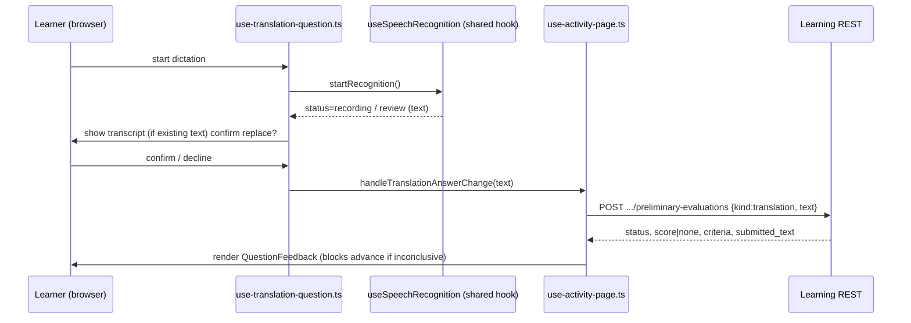

# Objective

Deliver the Learning Activity **text translation** question: the learner
translates a Curriculum-defined source text into a target language by typing
or by an optional voice dictation, reviews and confirms the text, and receives
a rubric-based evaluation with two obligatory weighted criteria (semantic
preservation 70%, grammatical adequacy 30%). The AI selects only Curriculum-predefined
levels (0/25/50/75/100) and comments per criterion, or `inconclusive`; it never
writes free feedback. A translation question can appear only in Learning
Activities (three to five questions), mixed with existing choice questions;
diagnostic Activities and Activities already containing a `javascript_stdin`
or `react` code question are out of this slice.

This is a **complete** Spec: it crosses Curriculum (content/rubric), Shared
(provider-neutral snapshots/ports), Learning (attempts, scores, Concept
evidence, progress), Intelligence (a new Jev-based AI provider) and the web
Activity/result UI, and introduces a second AgentOS-backed official-evaluation
workflow alongside the existing code-rubric one.

The complete canonical [Curriculum PRD](https://joaogoliveiragarcia.atlassian.net/wiki/x/AQDzB)
(content ID `83034113`, last modified 2026-11-02) and
[Learning PRD](https://joaogoliveiragarcia.atlassian.net/wiki/x/AYDzB)
(content ID `83066881`, last modified 2026-11-02) were retrieved in full
2026-11-11. [SHIFU-122](https://joaogoliveiragarcia.atlassian.net/browse/SHIFU-122)
("Implementar questões de tradução com digitação e ditado opcional", Dev Task
under Epic SHIFU-10 "05 - Atividades e Práticas") is the delivery source and
cites Learning RP-09/RP-12/RP-13/RP-14/RP-18/RP-25/RP-27/RP-29 and JN-07/JN-13,
plus Curriculum RP-03/RP-06 and JN-03. This task does not write to Jira or
Confluence.

## Current behavior and product gap

Curriculum's `ActivityQuestion` union supports `single_choice`,
`multiple_selection`, `javascript_stdin` and `react` only; its AI-graded rubric
shape (`CodeRubricCriterion`/`CodeRubricEvaluationPart`) is code-named and
code-shaped (project files, submitted paths). Learning's `ActivityAnswer` and
`EvaluationPartResult` unions, its single AgentOS workflow
(`EvaluateCodeActivityWorkflow`) and its `LearningWorkflowsRegistry` route only
code questions to durable AI assessment; `PreviewActivityQuestionFeedbackUseCase`
and `EvaluateChoiceActivityUseCase` branch explicitly on
`JavascriptStdinQuestion`/`ReactQuestion`. The web `ActivityPage`/`useActivityPage`
hook and `QuestionFeedback` widget likewise recognize only choice and code
kinds. There is no text-translation content, no dictation-to-answer flow, and
no AI-graded rubric with semantic/grammar criteria.

# Scope

| Area / actor | Included | Excluded or deferred |
| --- | --- | --- |
| Content | Curriculum `TranslationQuestion` (source text, source/target language, reference translations) and a fixed two-criterion rubric (semantic preservation 70%, grammatical adequacy 30%), inside three-to-five-question Learning Activities mixed with choice questions | Diagnostic Activities; mixing with `javascript_stdin`/`react` in the same Activity; lacunas, pares, ordenação, escolha-por-imagem and Preparação Prática formats (separate RPs, not in SHIFU-122's traceability) |
| Answer input | Typed text; optional browser dictation via the existing native Web Speech hook, with an explicit confirm-before-replace step when text already exists | Live/streaming transcription; pronunciation evaluation; persisting audio as response, attachment or history |
| Feedback | Per-question preliminary ("retorno provisório") AI rubric result via a durable AgentOS workflow, mirroring the code-question preliminary pattern (not the instant choice-style preview) | Free-text AI feedback or corrections; Mentor participation in evaluation or scoring |
| Final evaluation | Official evaluation as part of the whole-Activity final submission; one coherent progress/Concept-evidence effect; mandatory-inconclusive blocks the grade without scoring zero; Shifu failures recover the same saved text | Partial/incremental grading; browser autosave/draft of the translation text (RP-09 draft persistence applies only to code-with-frontend and Preparação Prática) |
| Result/history | Provisional, official and historical views show text, score, criteria/weights/levels/predefined comments, and the Resposta correta/Parcialmente correta/Resposta incorreta label; reference translations stay protected until full correctness or Competency mastery | Revealing reference translations earlier; generating new recommendation logic |
| UI | Desktop/mobile translation question widget and result detail, keyboard/assistive-technology support for text entry and dictation controls | New routes; changes to unrelated question kinds' visuals |

Curriculum RP-03/RP-06 outcomes for text translation are delivered **full**
within this bounded slice (Learning-only, mixed with choice questions).
Learning RP-09/RP-12/RP-13/RP-14/RP-18/RP-25/RP-27 are delivered **partial**:
their general mixed-Activity machinery already exists for code questions and
is extended, not rebuilt, for this new kind. RP-29 data-minimization/ZDR
obligations are delivered **full** for this slice's new AI call. No design
handoff/manifest exists for this feature; the UI composition follows the
existing `activity-page` design system (shared tokens, typography and states
already governing `choice-question`/`code-question`) without a new Pencil
reference. A future Pencil handoff remains an accepted visual assumption.

# Behavior Contract

| ID | RP/JN/source coverage | Observable required behavior |
| --- | --- | --- |
| RF-01 | Curriculum RP-03/JN-03 | Curriculum defines one `TranslationQuestion` (source text, source/target language, reference translations, example valid formulations) per question, with exactly two required rubric criteria — semantic preservation (weight 70) and grammatical adequacy (weight 30) — each with five fixed level comments (0/25/50/75/100) and one inconclusive comment; a Learning Activity may combine it with `single_choice`/`multiple_selection` questions (three to five total) but not with `javascript_stdin`/`react`, and never in a diagnostic Activity. Invalid content (wrong weights, missing level/inconclusive comment, mixed with code kinds, present in diagnostic) makes the Activity unavailable. |
| RF-02 | Learning RP-09/RP-25; JN-07 | The learner sees the question one at a time with source text, source/target language and a text field; may type or start an optional dictation; the transcribed text remains editable before requesting feedback or advancing; only the confirmed text in the field becomes the answer. Desktop and mobile, keyboard and assistive technology are supported; state is never color-only. |
| RF-03 | Learning RP-09/RP-25 | Dictation distinguishes recording, transcription-after-stop and review; the learner can start, stop or cancel; none of these create an attempt. If text already exists, a new transcript only replaces it after explicit confirmation; declining preserves the existing text. Cancel, denied permission, unavailable microphone/browser and transcription failure preserve existing text with an understandable message and let the learner keep typing. On completion, cancellation or abandonment the microphone and temporary resources are released; audio is never saved as answer, attachment or history and is never evaluated. |
| RF-04 | Learning RP-09/RP-12; JN-07 | Requesting preliminary feedback for a valid non-empty text runs the same AI rubric used officially (closed-set choice per criterion) without creating an attempt or progress effect; the frozen assessed text can be reevaluated when a mandatory criterion is inconclusive, which blocks advancing; a conclusive result allows forward navigation once. A Shifu failure during preliminary assessment is recoverable on the same frozen text, never a learner score of zero. |
| RF-05 | Learning RP-09/RP-13/RP-14; JN-07 | Final submission of the whole Activity (one immutable attempt, idempotent by submission key) starts official evaluation automatically; the saved text is graded by the same closed-set AI rubric through a durable AgentOS workflow. A mandatory-inconclusive criterion keeps the question (and Activity) without an official score, recoverable by reassessing the same saved text; one coherent score/progress/Concept-evidence effect applies exactly once, even on retry. |
| RF-06 | Learning RP-18; JN-07/JN-13 | Preliminary, official and historical views show the submitted text, the weighted score, each criterion's weight/selected level/predefined comment, and a label: 100 → "Resposta correta", 0<score<100 → "Parcialmente correta", 0 → "Resposta incorreta". Reference translations and uncovered correct formulations stay hidden until the learner fully succeeds on that exact question in a later attempt or the Competency reaches mastery. |
| RF-07 | Curriculum RP-03; Learning RP-27 | Concept evidence for a translation question is produced and preserved separately from its grade, using the same AI-selected 0/25/50/75/100/inconclusive scale over Curriculum-authored Concept criteria; a high grade does not automatically award maximum evidence to every associated Concept, and inconclusive evidence is never treated as zero. |
| RF-08 | Learning RP-24/RP-29 | The AI assessor receives only the enunciado, source/target language, reference translations, rubric criteria and the submitted text — no account identifiers, conversation history or Mentor data — through a Zero-Data-Retention OpenRouter endpoint; the Mentor never participates in evaluation. Audio is processed only transiently in the browser and never reaches Shifu or the AI provider as stored data. |

| ID | RF coverage | Given | When | Then | Proof |
| --- | --- | --- | --- | --- | --- |
| CA-01 | RF-01 | A released Learning Activity mixing choice and one valid `TranslationQuestion` | Learner opens it | Activity renders with correct order/progress; private rubric data (fixed comments, reference translations) stays server-side | CI-01 / VM-01 |
| CA-02 | RF-01 | Invalid rubric (weights ≠ 70/30, missing a fixed/inconclusive comment, mixed with a code question, or placed in a diagnostic Activity) | Content is prepared/served | Activity construction/snapshot rejects it; the Activity is unavailable, no partial sequence | CI-02 |
| CA-03 | RF-02 | Eligible question, online learner | Learner types or dictates, edits the result | Text stays editable; nothing is sent until the learner requests feedback or the final submit; answer carries only the confirmed text | CI-03 / VM-01 |
| CA-04 | RF-03 | Text already present in the field | Dictation produces a new transcript | Learner is asked to confirm replacement; declining keeps the original text, confirming replaces it | CI-04 / VM-02 |
| CA-05 | RF-03 | Denied microphone permission, unavailable `SpeechRecognition`, or transcription failure | Learner attempts dictation | Existing text is preserved, an understandable message appears, learner can keep typing; mic/temporary state is released | CI-05 / VM-02 |
| CA-06 | RF-04 | Valid non-empty text | Learner requests preliminary feedback | No attempt/evaluation/outbox row is created; response carries status, score (or none), each criterion's level/comment, and the frozen submitted text | CI-06 |
| CA-07 | RF-04 | Mandatory criterion returns `inconclusive` | Learner sees the preliminary result | No score, advance is blocked, same frozen text may be reevaluated without edits | CI-07 / VM-03 |
| CA-08 | RF-05 | All questions answered, stable submission key | Learner submits the Activity | One immutable attempt + pending evaluation + one outbox event persist atomically; a matching replay returns the same attempt, a conflicting replay is rejected | CI-08 |
| CA-09 | RF-05 | Official AgentOS run completes with valid decisions for both criteria | Evaluation job applies the result | Weighted score (0.7×semantic + 0.3×grammar) computed from AI-selected levels; Concept evidence recorded separately; one progress/mastery effect applied once | CI-09 |
| CA-10 | RF-05 | Official run fails (Shifu-side) or a mandatory criterion is inconclusive | Evaluation job completes | No final score/effect persists; the same saved text remains assessable again; retry does not duplicate attempts, evidence or progress | CI-10 |
| CA-11 | RF-06 | Attempt with a non-100/non-0 translation score | Learner opens the result/history | Label reads "Parcialmente correta"; reference translations/missing correct formulations stay hidden until later full success or Competency mastery | CI-11 / VM-03 |
| CA-12 | RF-07 | Mixed objective/AI evidence for Concepts tied to the question | Evaluation completes | Concept observations use the 0–100/inconclusive scale, independent of the question's weighted score; inconclusive Concept evidence does not zero progress | CI-12 |
| CA-13 | RF-08 | Any preliminary or official assessment call | Request is built and sent | Payload contains only enunciado/languages/references/criteria/submitted text; no account/session identifiers; call targets the configured ZDR endpoint/model | CI-13 |
| CA-14 | RF-02/RF-03 | Desktop and mobile, keyboard/AT navigation | Learner completes the full translation flow | Text field, dictation controls and feedback states have accessible labels/focus/live regions; no color-only state; no horizontal overflow on narrow viewports | VM-01 / VM-02 |

Cross-cutting guarantees covered above: authorization/account isolation and
concurrency reuse Learning's existing per-attempt/per-Skill-experience locking
(CA-08/CA-09/CA-10, same mechanism as code questions); persistence reuses the
existing JSON `answers`/`grading_snapshot` columns (no new migration);
accessibility is covered by CA-14.

# Technical Contract

## Architecture Mapping

Owner: Learning (attempts, scoring, progress); Curriculum owns question/rubric
content; Shared owns the provider-neutral snapshot/port contracts; Intelligence
owns the AI provider implementation. Rules: Python Conventions, Core Domain,
Use Case Testing, REST Layer, Controller Testing, Database Layer, AI Layer,
Messaging Layer, Job Testing (server); TypeScript Conventions, UI Layer, Widget
Testing (web).

A single Activity may hold at most one AI-rubric-graded question *category*
(code **or** translation, never both) in this slice; `Activity.__post_init__`
enforces this alongside the existing diagnostic/code-kind checks. This keeps
`LearningWorkflowsRegistry` routing to exactly one AgentOS workflow per
attempt and matches the precedent set when `react` joined `javascript_stdin`
without allowing a third mixed category in the same slice.

| Action | Boundary | Element / Path | Required change |
| --- | --- | --- | --- |
| Create | Curriculum domain | `curriculum/core/domain/structures/translation_question.py` | `TranslationQuestion(key, prompt, source_language, target_language, source_text, reference_translations, concept_criteria, kind='translation')`; validates non-empty text fields, unique/non-empty reference translations, unique Concept IDs. |
| Create | Curriculum domain | `curriculum/core/domain/structures/translation_rubric_criterion.py` | `TranslationRubricComment(id, level, text)`, `TranslationInconclusiveComment(id, text)`, `TranslationRubricCriterion(key, name, description, weight_percentage, required, fixed_comments, inconclusive_comment)`; enforces the five-level/inconclusive catalog exactly like `CodeRubricCriterion`. |
| Create | Curriculum domain | `curriculum/core/domain/structures/translation_rubric_evaluation_part.py` | `TranslationRubricEvaluationPart(question_key, weight_percentage, criteria)`; validates exactly two required criteria keyed `semantic_preservation` (weight 70) and `grammatical_adequacy` (weight 30), per Curriculum RP-03's fixed split — stricter than code's free `WeightDistribution`. |
| Modify | Curriculum domain | `curriculum/core/domain/structures/activity_question.py`, `evaluation_part.py`, `__init__.py` | Add `TranslationQuestion` / `TranslationRubricEvaluationPart` to the `ActivityQuestion`/`EvaluationPart` unions and package exports; no existing kind changes. |
| Modify | Curriculum domain | `curriculum/core/domain/entities/activity.py` | Extend the rubric-pairing cross-validation to also require `TranslationQuestion` ⇔ `TranslationRubricEvaluationPart`; extend the diagnostic-exclusion check to forbid `TranslationQuestion` in `ActivityType.DIAGNOSTIC`; add the new invariant forbidding `TranslationQuestion` and (`JavascriptStdinQuestion`/`ReactQuestion`) in the same Activity. |
| Modify | Curriculum persistence | `curriculum/database/sqlalchemy/mappers/activity_mapper.py` | JSON round-trip for the new discriminated question/part kind; no schema change (existing `JSON` columns). |
| Modify | Curriculum provider | `curriculum/providers/curriculum_content_provider/curriculum_content_provider.py` | Build `CurriculumTranslationQuestionSnapshot`/`CurriculumTranslationRubricPartSnapshot` for `get_learning_activity`; fail closed on invalid/unsupported content, mirroring the existing `JavascriptStdinQuestion` branch. |
| Create | Shared domain | `shared/core/domain/structures/curriculum_translation_question_snapshot.py`, `curriculum_translation_rubric_criterion_snapshot.py`, `curriculum_translation_rubric_part_snapshot.py` | Immutable Learning-visible projections mirroring `CurriculumJavascriptStdinQuestionSnapshot`/`CurriculumCodeRubricCriterionSnapshot`/`CurriculumCodeRubricPartSnapshot`; one structure per file. |
| Create | Shared domain | `shared/core/domain/structures/translation_rubric_assessment_input.py` | `TranslationRubricAssessmentInput(question_kind='translation', source_text, source_language, target_language, reference_translations, submitted_text, rubric_criteria: tuple[CurriculumTranslationRubricCriterionSnapshot,...], concept_criteria: tuple[CurriculumCodeConceptCriterionSnapshot,...])`. Reuses the already-generic `CurriculumCodeConceptCriterionSnapshot` (content-neutral: concept_id/description/level_observations/inconclusive) instead of duplicating it. |
| Create | Shared interfaces | `shared/core/interfaces/translation_rubric_assessor_provider.py` | `TranslationRubricAssessorProvider.assess(request: TranslationRubricAssessmentInput) -> CodeRubricDecisions` Protocol. Reuses `CodeRubricDecisions`/`CodeCriterionDecision`/`CodeConceptDecision` as the decision carrier: those types already hold no code-specific fields (just key/concept_id + level), so a second identical type would only duplicate plumbing. |
| Modify | Shared domain/interfaces | `shared/core/domain/structures/__init__.py`, `shared/core/interfaces/__init__.py` | Export the new snapshot/input/port types. |
| Create | Learning domain | `learning/core/domain/structures/translation_answer.py` | `TranslationAnswer(question_key, text)`; validates non-empty trimmed text. |
| Create | Learning domain | `learning/core/domain/structures/translation_rubric_result.py` | `TranslationRubricResult(question_key, score, criterion_results: tuple[CodeCriterionResult,...], concept_observations: tuple[CodeConceptObservationResult,...])`. Reuses `CodeCriterionResult`/`CodeConceptObservationResult` (already generic: key/weight/level/comment, concept_id/level/observation) rather than duplicating them. |
| Create | Learning domain | `learning/core/domain/structures/translation_question_assessment_decisions.py` | `TranslationQuestionAssessmentDecisions(question_key, decisions: CodeRubricDecisions)`, parallel to `CodeQuestionAssessmentDecisions`. |
| Create | Learning domain | `learning/core/domain/structures/prepared_translation_activity_evaluation.py`, `prepared_translation_question_assessment.py` | `PreparedTranslationActivityEvaluation(attempt_id, run_id, questions)`, `PreparedTranslationQuestionAssessment(question_key, assessment_input: TranslationRubricAssessmentInput)`, mirroring the code-prepared carriers. |
| Create | Learning domain | `learning/core/domain/structures/translation_question_detail.py`, `translation_result_detail.py` | `TranslationQuestionDetail(key, kind, prompt, source_language, target_language, source_text, criteria: tuple[{key,name,weight_percentage},...])` (no fixed comments/reference translations); `TranslationResultDetail(question_key, kind, prompt, submitted_text, score, criterion_results, concept_observations)` (account-owned only). |
| Modify | Learning domain | `learning/core/domain/structures/activity_answer.py`, `evaluation_part_result.py`, `choice_activity_detail.py`, `choice_attempt_detail.py`, `__init__.py` | Widen `ActivityAnswer`/`EvaluationPartResult`/detail unions to include the new translation types; export them. |
| Create | Learning AI | `learning/ai/agno/workflows/evaluate_translation_activity_workflow.py` | `EvaluateTranslationActivityWorkflow` — the same three-step (`prepare`/`assess`/`apply`) Agno `Workflow` as `EvaluateCodeActivityWorkflow`, with its own workflow id `learning-evaluate-translation-activity` and handoff capability `learning-translation-assessment`; `AgentOSTranslationRubricAssessorProvider` adapter for the synchronous preview path, submitting to that same workflow. Reuses the existing `FailCodeActivityEvaluationUseCase` unmodified (it has no code-specific logic — only attempt/evaluation status transitions) instead of adding a duplicate fail use case. |
| Create | Learning use cases | `learning/core/use_cases/prepare_translation_activity_evaluation_use_case.py` | `PrepareTranslationActivityEvaluationUseCase.execute(attempt_id, run_id) -> PreparedTranslationActivityEvaluation | None`, mirroring `PrepareCodeActivityEvaluationUseCase` but building `TranslationRubricAssessmentInput` instead of a project/file payload. |
| Modify | Learning use cases | `learning/core/use_cases/preview_activity_question_feedback_use_case.py` | Add a `CurriculumTranslationQuestionSnapshot`/`TranslationAnswer` branch to `execute`; add a `translation_result(...)` static method mirroring `code_result`; extend `PreliminaryQuestionResult` with `submitted_text: str | None = None` (reusing its already-generic `criteria`/`concept_observations` fields). |
| Modify | Learning use cases | `learning/core/use_cases/evaluate_choice_activity_use_case.py` | Add a `translation_decisions: tuple[TranslationQuestionAssessmentDecisions, ...] = ()` parameter to `execute`; extend `_get_part_results`, `_prepare_mixed_results`, `_score_mixed`, `_score_mixed_part` and `_v2_observation_scores` with a `CurriculumTranslationQuestionSnapshot`/`TranslationAnswer`/`TranslationRubricResult` branch parallel to the existing code branch. |
| Modify | Learning use cases | `learning/core/use_cases/__init__.py` | Export `PrepareTranslationActivityEvaluationUseCase`. |
| Modify | Learning AI composition | `learning/ai/learning_workflows_registry.py` | Accept a second `translation_assessor: TranslationRubricAssessorProvider` constructor parameter; instantiate `EvaluateTranslationActivityWorkflow` alongside the existing code workflow; expose a `translation_rubric_assessor_provider` property; extend `destination_for_event` (already an instance method reading `attempt.grading_snapshot`) to also return `agentos:learning` when the snapshot's AI-graded category is translation. `_project_event` is currently a stateless `@staticmethod` that always submits the single hardcoded `learning-evaluate-code-activity` workflow id; selecting between two workflow ids requires converting it to an instance method with its own `self._database` transaction/read of the same attempt's `grading_snapshot`, an added DB round-trip this Spec explicitly accepts rather than treats as a drop-in extension. |
| Modify | Learning composition | `learning/pipes/learning_pipe.py` | Add `get_translation_rubric_assessor_provider(request) -> TranslationRubricAssessorProvider` returning `request.app.state.translation_rubric_assessor_provider`, parallel to the existing code accessor. |
| Modify | Learning persistence | `learning/database/sqlalchemy/mappers/activity_attempt_mapper.py`, `activity_evaluation_mapper.py` | Dispatch `TranslationAnswer` by its `kind`/question-kind discriminator and `TranslationRubricResult` within the `EvaluationPartResult` JSON round-trip; existing models/indexes/columns are unchanged. |
| Modify | Learning REST | `learning/rest/controllers/preview_activity_question_feedback_controller.py`, `submit_choice_activity_controller.py` | Extend each file's inline `AnswerRequest.kind` Literal with `'translation'`, add a `text: str | None` field, extend `validate_answer_shape` (translation requires `text` only); construct `TranslationAnswer`; preview `Response` gains `submitted_text`. |
| Modify | Learning REST | `learning/rest/controllers/get_choice_activity_controller.py`, `get_choice_attempt_controller.py` | Project `TranslationQuestionDetail`/`TranslationResultDetail` in the existing discriminated response unions; no new route. |
| Create | Intelligence providers | `intelligence/providers/translation_rubric_assessor/jev/jev_translation_rubric_assessor_provider.py` | `JevTranslationRubricAssessorProvider` implementing `TranslationRubricAssessorProvider` over OpenRouter's Decisions API with the same pinned `typesafe/jev-1.13` model and closed-set `choice` construction as `JevCodeRubricAssessorProvider`, built from `TranslationRubricAssessmentInput` fields instead of project files. |
| Modify | Intelligence AI composition | `intelligence/ai/intelligence_workflows_registry.py` | Add a `translation_rubric_assessor_provider` property and `_build_translation_rubric_client`/`_build_translation_rubric_provider` construction, parallel to the existing code-rubric pair; dispose the new `httpx.Client` in `close()`. |
| Modify | Server composition | `shifu/app.py` | Pass `intelligence_registry.translation_rubric_assessor_provider` into `LearningWorkflowsRegistry(...)`; set `app.state.translation_rubric_assessor_provider = learning_registry.translation_rubric_assessor_provider` in the lifespan, alongside the existing `code_rubric_assessor_provider` wiring. |
| Modify | Web core types | `apps/web/src/core/learning/choice-activity.ts` | Add `TranslationQuestion`, `TranslationAnswer`, `TranslationQuestionDetail`, `TranslationResultDetail` to the existing discriminated unions. |
| Modify | Web REST service | `apps/web/src/rest/services/learning-service.ts` | Widen request/response typing for the existing preview/submit/get-activity/get-attempt calls; no new endpoint. |
| Modify | Web widget | `apps/web/src/ui/learning/widgets/pages/activity-page/index.tsx` | Render `TranslationQuestion` as a new sibling branch by `question.kind`, alongside `ChoiceQuestion`/`CodeQuestion`/`ReactQuestion`. |
| Modify | Web widget | `apps/web/src/ui/learning/widgets/pages/activity-page/use-activity-page.ts` | Add `handleTranslationAnswerChange(text)`; extend the `assess()`/`canContinue`/`handleContinue`/`handleSubmit` kind checks and the server-fn `isActivityAnswer` validator to recognize `{kind:'translation', questionKey, text}`. |
| Create | Web widget | `apps/web/src/ui/learning/widgets/pages/activity-page/translation-question/index.tsx`, `use-translation-question.ts` | `TranslationQuestion` component: source/target language, source text, text field, dictation controls, confirm-replace prompt; `use-translation-question.ts` owns the local draft, wraps `useSpeechRecognition` (reused unmodified from `ui/shared/hooks/use-speech-recognition.ts`), implements the confirm-before-replace gate, and reports the confirmed text to the parent page hook. |
| Create | Web widget tests | `.../translation-question/tests/translation-question.test.tsx`, `tests/use-translation-question.test.ts` | Component and hook behavior tests at this widget's own boundary. |
| Modify | Web widget | `apps/web/src/ui/learning/widgets/pages/activity-page/question-feedback/index.tsx` | Render translation criterion titles (`semantic_preservation`/`grammatical_adequacy`) and a submitted-text detail block, parallel to the existing code "Arquivos avaliados" `<details>`. |
| Modify | Web widget | `apps/web/src/ui/learning/widgets/pages/choice-result-page/` (owning `index.tsx`/result-detail widgets) | Render `TranslationResultDetail` (submitted text + criteria) alongside the existing choice/code result details. |

Expected web file tree (new/modified only):

```text
apps/web/src/ui/learning/widgets/pages/activity-page/
├── index.tsx                              [M]
├── use-activity-page.ts                   [M]
├── question-feedback/
│   └── index.tsx                          [M]
└── translation-question/
    ├── index.tsx                          [N]
    ├── use-translation-question.ts        [N]
    └── tests/
        ├── translation-question.test.tsx  [N]
        └── use-translation-question.test.ts [N]
```

`TranslationQuestion` is a pure-rendering component owned by `activity-page`;
`use-translation-question.ts` owns the dictation state machine (via the
existing shared `useSpeechRecognition` hook) and the confirm-before-replace
interaction, and reports only the confirmed text upward — it does not own
submission, feedback polling or Activity sequencing, which remain
`use-activity-page.ts`'s responsibility. No new context, provider or
query/action hook is introduced: the translation answer flows through the
same `ActivityAnswer` state and `previewActivityQuestionAction`/
`submitActivityAction` server functions already used by every other question
kind.

### New concepts

**`TranslationRubricEvaluationPart`** (Curriculum) is the only evaluation part
shape with a *fixed* two-criterion, 70/30 split (unlike the free-weight
`CodeRubricEvaluationPart`), because Curriculum RP-03 mandates exactly those
two weights for every translation question. It owns no runtime behavior; it is
read by `Activity.__post_init__` for pairing/diagnostic validation and
projected into `CurriculumTranslationRubricPartSnapshot` for Learning.

**`EvaluateTranslationActivityWorkflow`** (Learning AI) is a second, parallel
AgentOS `Workflow` beside `EvaluateCodeActivityWorkflow`. It exists separately
rather than generalizing the code workflow because its `prepare` step reads a
different snapshot/answer shape (`TranslationRubricAssessmentInput` built from
source/target text instead of a project); its `assess` and `apply` steps reuse
the same `EvaluateChoiceActivityUseCase.execute`/`FailCodeActivityEvaluationUseCase.execute`
entry points as the code workflow, so the 300+ lines of progress/mastery/event
logic in `EvaluateChoiceActivityUseCase` are extended once, not duplicated.
`LearningWorkflowsRegistry._project_event` (converted to an instance method,
see Architecture Mapping) picks the matching workflow id per attempt by
reading which AI-graded question kind its saved `grading_snapshot` contains,
the same way `destination_for_event` already reads it to pick the outbox
destination; the Activity-level mutual-exclusion invariant (see Architecture
Mapping) guarantees this choice is unambiguous.

**`JevTranslationRubricAssessorProvider`** (Intelligence) is a sibling of
`JevCodeRubricAssessorProvider`: same OpenRouter Decisions API, same pinned
model, same closed-set-`choice`-only contract (the AI selects one of the five
fixed level IDs or `inconclusive` per criterion — never free text or a score).
It is a separate class, not a generalized one, because its request payload is
built from different source fields and its prompt frames a translation
judgment rather than a code review; both still implement the shared,
provider-neutral `*RubricAssessorProvider` port shape so Learning's use cases
never import an Intelligence or OpenRouter type.

## Runtime Flow



```mermaid
sequenceDiagram
    participant P as use-activity-page.ts
    participant API as Learning REST (submit)
    participant DB as Learning DB (attempt/evaluation, JSON columns)
    participant OB as Outbox
    participant R as LearningWorkflowsRegistry
    participant WF as EvaluateTranslationActivityWorkflow
    participant J as JevTranslationRubricAssessorProvider

    P->>API: POST attempts {submissionKey, answers incl. translation text}
    API->>DB: insert immutable attempt + pending evaluation (one transaction)
    DB->>OB: one outbox event (idempotent by submission key)
    OB->>R: destination_for_event -> agentos:learning (translation snapshot)
    R->>WF: run {attempt_id, run_id}
    WF->>DB: prepare (read saved snapshot+answer, build TranslationRubricAssessmentInput)
    WF->>J: assess(request)
    J-->>WF: CodeRubricDecisions (criterion/concept levels or inconclusive)
    WF->>DB: apply via EvaluateChoiceActivityUseCase.execute (score, Concept evidence, progress effect) — once
    alt mandatory criterion inconclusive or Shifu failure
        WF->>DB: FailCodeActivityEvaluationUseCase.execute (no score; saved text stays reassessable)
    end
```

Account identity comes from authentication, never the request body. The
preview endpoint performs scoped reads and writes nothing (no attempt,
evaluation, outbox or progress row). The final-submit transaction and the
official-evaluation transaction are the same two-phase pattern already used
for code questions: a short read transaction assembles the AI request outside
any lock, the remote call happens unlocked, and a second transaction re-checks
the active `run_id` before committing the score/effect — so a stale or
duplicate workflow run cannot apply a second effect.

# Verification Contract

## Shared setup

Server tests run from `apps/server` via `uv run pytest`; Web tests run from
the repository root via `pnpm --filter web exec vitest run` /
`pnpm --filter web exec playwright test`. Use-case tests mock the
`TranslationRubricAssessorProvider`/`LearningDatabase` ports; controller tests
use the real app + disposable PostgreSQL via the shared `conftest.py`
`TestClient` fixture; the workflow test exercises `EvaluateTranslationActivityWorkflow`
with a fake assessor and in-memory handoff store, mirroring
`test_evaluate_code_activity_workflow.py`. Manual/Playwright checks use the
existing authenticated storage state at `.playwright-cli/states/shifu-auth-state.json`
against a seeded Activity (added to `shared/database/seed_data.py` as
development fixture content, not official Curriculum). No destructive setup;
each automated test owns disposable fixtures/Testcontainers.

## Automated

### CI-01 — Eligible mixed Activity renders safely

**Criteria:** CA-01

**Expected result:** GET returns ordered questions with public translation
fields only (prompt, languages, source text, criterion names/weights); no
fixed comments or reference translations leak.

**Setup / inputs:** A released three-to-five-question Activity mixing one
`TranslationQuestion` with choice questions.

**Proof:** `apps/server/tests/learning/rest/controllers/test_get_choice_activity_controller.py` (new translation case)

```bash
uv run pytest tests/learning/rest/controllers/test_get_choice_activity_controller.py
```

**Passing condition:** Response schema omits private rubric/reference fields;
existing choice/code cases remain green.

### CI-02 — Invalid translation content is rejected

**Criteria:** CA-02

**Expected result:** `Activity`/`TranslationRubricEvaluationPart` construction
raises `InvalidActivityError`/`InvalidEvaluationRuleError` for: non-70/30
weights, a missing level or inconclusive comment, a `TranslationQuestion`
paired with a `javascript_stdin`/`react` question in the same Activity, or a
`TranslationQuestion` in a `DIAGNOSTIC` Activity.

**Setup / inputs:** Equivalence classes for each violation above.

**Proof:** `apps/server/tests/curriculum/core/domain/test_translation_question.py` (new, mirrors `test_react_question.py`, which itself constructs and exercises `Activity` directly for its pairing/diagnostic-exclusion invariants — there is no separate `Activity` entity test suite to extend).

```bash
uv run pytest tests/curriculum/core/domain/test_translation_question.py
```

**Passing condition:** Every listed class raises; valid content still constructs.

### CI-03 — Preliminary feedback is stateless

**Criteria:** CA-03/CA-06

**Expected result:** `PreviewActivityQuestionFeedbackUseCase.execute` for a
`TranslationAnswer` returns a `PreliminaryQuestionResult` with the frozen
`submitted_text`, per-criterion level/comment, and the correct status; no
attempt/evaluation row is created.

**Setup / inputs:** Valid non-empty text; a fake `TranslationRubricAssessorProvider` returning conclusive/inconclusive decisions.

**Proof:** `apps/server/tests/learning/core/use_cases/test_preview_activity_question_feedback_use_case.py` (new translation cases)

```bash
uv run pytest tests/learning/core/use_cases/test_preview_activity_question_feedback_use_case.py
```

**Passing condition:** No repository write call occurs; returned fields match the fake decisions; mandatory-inconclusive yields `status='inconclusive'`/`score=None`.

### CI-04 — Dictation confirm-before-replace

**Criteria:** CA-04

**Expected result:** A new transcript does not overwrite existing text until
the user confirms; declining preserves the prior text; confirming applies the transcript.

**Setup / inputs:** `use-translation-question.ts` unit test with a mocked `useSpeechRecognition` resolving a transcript while a non-empty draft exists.

**Proof:** `apps/web/src/ui/learning/widgets/pages/activity-page/translation-question/tests/use-translation-question.test.ts` (new)

```bash
pnpm --filter web exec vitest run src/ui/learning/widgets/pages/activity-page/translation-question/tests/use-translation-question.test.ts
```

**Passing condition:** Both confirm and decline paths assert the resulting draft text.

### CI-05 — Dictation failure/unavailability preserves text

**Criteria:** CA-05

**Expected result:** Denied permission, unavailable recognition and transcription failure each leave the existing draft untouched and surface the hook's existing error message; resources are released (no pending operation after error).

**Setup / inputs:** Mocked `useSpeechRecognition` statuses `error` with each message variant.

**Proof:** same file as CI-04

```bash
pnpm --filter web exec vitest run src/ui/learning/widgets/pages/activity-page/translation-question/tests/use-translation-question.test.ts
```

**Passing condition:** Draft text is unchanged across all failure variants; no dangling recognition handle.

### CI-06 — Mandatory inconclusive blocks the question

**Criteria:** CA-07

**Expected result:** Preview result with a mandatory-inconclusive criterion has `score=None`, `status='inconclusive'`; reassessing the same frozen text is accepted.

**Setup / inputs:** Fake assessor returning `level='inconclusive'` for `semantic_preservation`.

**Proof:** `apps/server/tests/learning/core/use_cases/test_preview_activity_question_feedback_use_case.py` (new case)

```bash
uv run pytest tests/learning/core/use_cases/test_preview_activity_question_feedback_use_case.py
```

**Passing condition:** Assertion on `status`/`score`; a second call with the same answer succeeds without requiring new input.

### CI-07 — Idempotent final submission

**Criteria:** CA-08

**Expected result:** Submitting a mixed Activity (choice + translation) with a
stable `submission_key` creates exactly one attempt + pending evaluation +
outbox event; a replayed identical request returns the same attempt; a
conflicting replay (changed content revision) is rejected with 409.

**Setup / inputs:** Disposable PostgreSQL via `conftest.py`; one seeded mixed Activity.

**Proof:** `apps/server/tests/learning/rest/controllers/test_submit_choice_activity_controller.py` (new translation case)

```bash
uv run pytest tests/learning/rest/controllers/test_submit_choice_activity_controller.py
```

**Passing condition:** Single row per table on first call; replay returns identical `attempt_id`; conflicting replay returns 409 with no new row.

### CI-08 — Official AgentOS evaluation applies once

**Criteria:** CA-09/CA-10

**Expected result:** `EvaluateTranslationActivityWorkflow` prepares the saved
attempt, calls the fake assessor, and applies the weighted score/Concept
evidence/progress effect exactly once via `EvaluateChoiceActivityUseCase`;
on assessor failure or mandatory inconclusive it calls
`FailCodeActivityEvaluationUseCase` instead, leaving the attempt reassessable;
a duplicate run with the same `run_id` after completion is a no-op.

**Setup / inputs:** In-memory `AgentOSHandoffStore` fake; fake assessor with conclusive/inconclusive/exception scenarios.

**Proof:** `apps/server/tests/learning/ai/workflows/test_evaluate_translation_activity_workflow.py` (new, mirrors `test_evaluate_code_activity_workflow.py`), `apps/server/tests/learning/core/use_cases/test_prepare_translation_activity_evaluation_use_case.py` (new, mirrors the code equivalent)

```bash
uv run pytest tests/learning/ai/workflows/test_evaluate_translation_activity_workflow.py tests/learning/core/use_cases/test_prepare_translation_activity_evaluation_use_case.py
```

**Passing condition:** Exactly one evaluation-complete/evaluation-failed transition per scenario; stale `run_id` discarded; `EvaluateChoiceActivityUseCase`'s existing code-only tests remain green (regression).

### CI-09 — Mixed evaluation scoring and Concept evidence

**Criteria:** CA-09/CA-12

**Expected result:** `EvaluateChoiceActivityUseCase.execute` with one choice
part and one translation part produces a correctly weighted Activity score
(choice 0/100 plus translation's 0.7×semantic + 0.3×grammar) and separate
`concept_observations` using the 0–100/inconclusive scale, independent of the
question score.

**Setup / inputs:** `CurriculumLearningActivitySnapshot` fixture with one choice + one translation question; `TranslationQuestionAssessmentDecisions` fixture.

**Proof:** `apps/server/tests/learning/core/use_cases/test_evaluate_choice_activity_use_case.py` (new translation/mixed cases)

```bash
uv run pytest tests/learning/core/use_cases/test_evaluate_choice_activity_use_case.py
```

**Passing condition:** Computed score matches the expected weighted value; Concept observation levels match fixture decisions; inconclusive Concept evidence does not reduce a Concept's preserved progress.

### CI-10 — Result/history labeling and protection

**Criteria:** CA-11

**Expected result:** `GetChoiceAttemptUseCase`/controller project the
100 → "Resposta correta" / partial → "Parcialmente correta" / 0 → "Resposta
incorreta" labels and omit `reference_translations`/uncovered comments until
the learner's later full-correct attempt or Competency mastery.

**Setup / inputs:** Attempts at each score band; a learner without and with a later full-correct retry.

**Proof:** `apps/server/tests/learning/rest/controllers/test_get_choice_attempt_controller.py` (new translation cases)

```bash
uv run pytest tests/learning/rest/controllers/test_get_choice_attempt_controller.py
```

**Passing condition:** Label matches each score band; protected fields absent until the disclosure condition holds.

### CI-11 — Privacy-minimized AI payload

**Criteria:** CA-13

**Expected result:** The `TranslationRubricAssessmentInput` built by
`PrepareTranslationActivityEvaluationUseCase`/`PreviewActivityQuestionFeedbackUseCase`
contains only enunciado/languages/references/criteria/submitted text — no
account ID, email or conversation data; the real outbound HTTP call made by
`JevTranslationRubricAssessorProvider` targets the configured ZDR Decisions
endpoint/model. Per `ai-layer-rules.md` ("Tests follow the consuming execution
boundary": providers and persistence adapters never own a dedicated test
file), this is proven at the consuming use-case boundary plus the registered
workflow/job integration boundary — not a provider-owned test file.

**Setup / inputs:** Fixture question/rubric/answer containing no personal data by construction (Curriculum content is fictitious per RP-07/RP-29).

**Proof:** `apps/server/tests/learning/core/use_cases/test_prepare_translation_activity_evaluation_use_case.py` and `test_preview_activity_question_feedback_use_case.py` (assert the constructed `TranslationRubricAssessmentInput` fields) plus `apps/server/tests/learning/ai/workflows/test_evaluate_translation_activity_workflow.py` (asserts the fake assessor only ever receives that same input shape end to end)

```bash
uv run pytest tests/learning/core/use_cases/test_prepare_translation_activity_evaluation_use_case.py tests/learning/core/use_cases/test_preview_activity_question_feedback_use_case.py tests/learning/ai/workflows/test_evaluate_translation_activity_workflow.py
```

**Passing condition:** Constructed input exposes only the allow-listed fields; no account/session identifier field exists on `TranslationRubricAssessmentInput` at all (verified by its declaration, not just by test data).

### CI-12 — Applicable baseline checks

**Scope:** `apps/server/src/shifu/{curriculum,learning,intelligence,shared}`, `apps/web/src/{core/learning,ui/learning,rest/services}` and their affected consumers.

**Checks:**

```bash
cd apps/server
uv run poe check:types
uv run ruff check --no-fix src tests
uv run ruff format --check src tests

cd ../.. 
pnpm --filter web check:types
pnpm exec biome check apps/web/src/core/learning apps/web/src/ui/learning apps/web/src/rest/services
```

Server Ruff's selected `C90` rule is this scope's complexity-lint gate; Web's
complexity lint shares the `biome check` command above. No dedicated
complexity-metrics baseline is configured in either manifest; that gate stays
**Blocked** by unavailable tooling, as it already is for every other feature
in this repository.

**Passing condition:** Zero type/lint/format diagnostics on the listed paths and their affected consumers; the complexity-metrics gate is recorded Blocked, not invented.

## Manual

### VM-01 — Typed translation happy path (desktop + mobile)

**Type:** Manual

**Criteria:** CA-01/CA-03/CA-14

**Tool / setup:** Playwright CLI from `apps/web`, authenticated storage state, seeded mixed Activity.

**Procedure:** Open the Activity; reach the translation question; type a valid translation; request feedback; observe the result; advance to the final submit; open the result.

**Passing condition:** Correct text persists through feedback; score/criteria render; keyboard-only completion works; no horizontal overflow at a narrow viewport; focus/labels present throughout.

### VM-02 — Dictation capture, confirm-replace and failure recovery

**Type:** Manual

**Criteria:** CA-03/CA-04/CA-05/CA-14

**Tool / setup:** Playwright CLI with the browser's Web Speech API available (or a stubbed `window.SpeechRecognition` in the test harness); same seeded Activity.

**Procedure:** Start dictation, stop it, review the transcript; type over it, dictate again, decline then confirm replacement; simulate a denied-permission/unavailable scenario.

**Passing condition:** Start/stop/cancel controls are keyboard-reachable and labeled; confirm/decline both behave correctly; failure messages are visible as text (not color-only) and typing remains possible; microphone indicator clears after each attempt.

### VM-03 — Inconclusive and partial-result disclosure

**Type:** Manual

**Criteria:** CA-07/CA-11

**Tool / setup:** Playwright CLI; a seeded scenario whose fixed assessor stub returns an inconclusive then a partial decision.

**Procedure:** Submit for preliminary feedback; observe the blocked-advance state; reevaluate; after official evaluation, open the result.

**Passing condition:** Advance is blocked only while inconclusive; "Parcialmente correta" label appears for a partial score; reference translation is not shown.

## Visual

Not applicable: no Pencil design handoff exists for this feature. The widget
reuses existing `activity-page` tokens, typography and layout primitives
already visually verified for `choice-question`/`code-question`; a dedicated
visual comparison would duplicate that existing baseline rather than verify
new visual intent. A future design reference is an accepted assumption for
this revision.

Integration runs after curriculum/shared/learning/intelligence/web scopes are
integrated, using the files/scenarios listed above plus the unchanged existing
code-question and choice-question suites as regression proof (both
`EvaluateChoiceActivityUseCase` and the controllers' `AnswerRequest` schemas
are shared, modified boundaries). Fix failures and rerun only the affected
selections; review and conclusion reuse this evidence unless a later
correction reopens a specific check.

# Documentation Alignment

| Document / authority | Governs | Required update or confirmation | Disposition / dependency |
| --- | --- | --- | --- |
| [Curriculum PRD](https://joaogoliveiragarcia.atlassian.net/wiki/x/AQDzB) (content ID `83034113`, retrieved 2026-11-11) | RP-03 (text-translation rules), RP-06, JN-03 | Alignment confirmed; no amendment needed | None |
| [Learning PRD](https://joaogoliveiragarcia.atlassian.net/wiki/x/AYDzB) (content ID `83066881`, retrieved 2026-11-11) | RP-09, RP-12, RP-13, RP-14, RP-18, RP-24, RP-25, RP-27, RP-29, JN-07, JN-13 | Alignment confirmed; no amendment needed | None |
| [SHIFU-122](https://joaogoliveiragarcia.atlassian.net/browse/SHIFU-122) | Delivery scope and traceability | Confirmed as source | None |
| [`modules.md`](../../../modules.md) | Curriculum/Learning/Intelligence/Shared boundaries | Confirmed: Curriculum content, Learning decisions, Intelligence AI adapter only | None |
| [`architecture.md`](../../../architecture.md), [`rules.md`](../../../rules.md) | Server/Web layering, dynamic Rule Pack selection | Python Conventions, Core Domain, Use Case Testing, REST Layer, Controller Testing, Database Layer, AI Layer, Messaging Layer, Job Testing, TypeScript Conventions, UI Layer, Widget Testing apply | Recheck if scope expands into a new layer during implementation |
| [`tooling.md`](../../../tooling.md) | Verified commands/manifests | Commands above verified against current Server/Web manifests | None |

# Revision History

| Revision | Date | Contract change | Reason / source |
| --- | --- | --- | --- |
| 1 | 2026-11-11 | Initial contract | SHIFU-122, reconciled against Curriculum PRD v. 2026-11-02 and Learning PRD v. 2026-11-02 |
