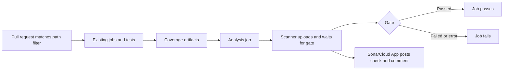

# Objective

Web and API pull requests currently pass type, lint, architecture, test and build
checks, but nothing measures new-code quality or coverage in CI. After this delivery,
each application is analyzed by its own SonarCloud project on pull requests to `main`.
Nothing runs on pushes to `main`. Coverage is imported, a failed quality gate fails the
analysis job, and SonarCloud reports the result on the pull request.

Mode: **compact**. The change is confined to CI and tool configuration. Its main risk
is the analysis token.

# Scope

| Area / actor | Included | Excluded or deferred |
| --- | --- | --- |
| SonarCloud projects | Bind the repository to the existing projects `ctri-alt-del_shifu_web` and `ctri-alt-del_shifu_api` in organization `ctri-alt-del` | Self-hosted SonarQube and the local Compose SonarQube service |
| CI | One new analysis job in each existing workflow, on pull requests to `main` | Pushes to `main`, any analysis of the `main` branch, deployment pipelines and AWS provisioning |
| Coverage | Web Vitest coverage; API unit plus all four integration shards, as line coverage | Playwright coverage and API branch coverage |
| Quality gate | Built-in `Sonar way` on both projects | Custom gates and changes to product rules |
| Pull request reporting | SonarCloud GitHub check and summary comment per project | Branch protection, so a red analysis does not block a merge by itself |
| Forks | Analysis is skipped, because GitHub hides secrets from fork pull requests | Any fork-capable analysis path |

No canonical product outcome applies, so no `RP-*` or `JN-*` is selected. This is CI
infrastructure outside every business module. Requirements trace to the SHIFU-87
deliverables. No Penpot board applies.

# Behavior Contract

| ID | RP/JN/source coverage | Observable required behavior |
| --- | --- | --- |
| RF-01 | SHIFU-87: separate Web and API projects | Each application reports only to its own SonarCloud project, through a properties file in that application's directory. |
| RF-02 | SHIFU-87: scanners on pull requests, preserving checks | The existing path filters decide which application runs. An analysis job runs on pull requests to `main` only. Web analysis runs after Web unit tests pass, because they are its coverage source. API analysis runs after API unit tests and all integration shards pass. Every existing job keeps its name and purpose, and a newer commit on a pull request still cancels the older run through the existing concurrency. |
| RF-03 | SHIFU-87: coverage imported with documented scope | Web imports LCOV from Vitest. API combines unit and all four integration shards into Cobertura XML. Tests, generated files, Web page route files and the API seed files are outside the coverage measure. Web API route handlers remain inside it. |
| RF-04 | SHIFU-87: quality gate defined; CI fails when analysis fails | Both projects use `Sonar way`. The analysis job waits for the gate. A failed gate, a failed scan, a token SonarCloud refuses, an absent coverage artifact or a gate timeout fails the job. No analysis step is marked as allowed to fail. |
| RF-05 | SHIFU-87: credentials without exposure | One repository secret, `SONAR_TOKEN`, reaches only the scanner step. Workflow permissions remain `contents: read`. No token appears in tracked files, logs or artifacts. |
| RF-06 | SHIFU-87: automatic summary comment | Each analyzed pull request receives a SonarCloud check and a summary comment with the gate result and a SonarCloud link, per project. A pull request touching both applications receives both. |
| RF-07 | SHIFU-87: documented configuration and diagnosis | Repository documentation covers setup, gate policy, coverage scope and exclusions, the fork limitation and failure diagnosis, and stops describing SonarCloud as deferred. |

| ID | RF coverage | Given | When | Then | Checks |
| --- | --- | --- | --- | --- | --- |
| CA-01 | RF-01, RF-03 | The Web coverage command runs | It finishes | `apps/web/coverage/lcov.info` exists with paths relative to `apps/web` | CI-01 |
| CA-02 | RF-01, RF-03 | The API unit coverage task runs and its data is combined | `coverage xml` finishes | `apps/server/coverage.xml` exists and lists files under `src` | CI-02 |
| CA-03 | RF-01, RF-02, RF-06 | A pull request changes both applications | CI finishes on a passing gate | Both analysis jobs pass, each project reports its check and comment, and every existing check name still runs | VM-01 |
| CA-04 | RF-03, RF-04, RF-06 | A disposable pull request adds, in each application, new code that is partly tested | Analysis finishes | Each project shows new-code coverage above 0% and below 80%, the gate fails, its analysis job is red and its comment reports the failure | VM-02 |
| CA-05 | RF-02 | A test job that the analysis job needs fails | CI reaches the analysis job | The analysis job is skipped and the failed test job remains the visible cause | VM-02 |
| CA-06 | withdrawn in revision 2 | Not applicable | Not applicable | Not applicable. The `main` analysis it covered is out of scope | none |
| CA-07 | RF-02 | Two pull request runs overlap | A newer commit arrives | The older run is cancelled. No `push` trigger exists | CI-04 |
| CA-08 | RF-04, RF-05 | The workflow and configuration files | They are inspected | No analysis step is allowed to fail, every coverage upload errors on absent files, both projects wait for the gate, permissions stay read-only, the fork condition is present, the token appears only in the scanner step and no credential is present | CI-04 |
| CA-09 | RF-05 | Analysis ran | Its logs and artifacts are inspected | The token is masked in the logs and coverage artifacts hold only coverage data | VM-01 |
| CA-10 | RF-07 | The documentation is updated | It is inspected | `tooling.md` no longer calls SonarCloud planned or deferred and covers token, gate, exclusions, forks, diagnosis and the new tasks; `architecture.md` no longer names `pytest-cov` | CI-05 |

Evidence limits:

- No fork exists to exercise the skip condition, so CA-08 proves it by inspection.
- A SonarCloud outage, an invalid token, an absent artifact and a gate timeout are not
  provoked. The scan action only warns about an empty token, so that failure depends
  on SonarCloud refusing the scan.
- An unusable coverage report does not fail the scan, because the analyzers log a
  warning. Only the sampled coverage values in VM-02 catch it.
- VM-02 exercises a unit test failure. The integration failure path relies on the same
  job dependency and is not provoked.
- Combining several API coverage artifacts is proven only in real CI.
- No `main` analysis exists, by decision of the user in revision 2, so every pull request
  analysis runs without a `main` baseline. SonarCloud shows no overall coverage for
  `main`, and the coverage exclusions are proven only by CI-01 and the scanner's file list,
  not by sampled `main` values. New-code detection on a pull request that edits existing
  files is not proven, and SonarCloud may then treat all code as new, so the gate would
  judge the whole code base and could stay red for reasons unrelated to the change. Nothing
  analyzes the merged state of `main`, so regressions from merge interaction are not seen.
  Without a `workflow_dispatch` trigger, an analysis can only be repeated by re-running the
  pull request workflow. If SonarCloud refuses a pull request analysis or warns about the
  target branch, stop and amend this Spec. No manual `main` scan is authorized.

# Technical Contract

## Architecture Mapping

Owner: shared CI infrastructure. Rules:
[TypeScript conventions](../../../rules/typescript-conventions-rules.md) and
[Python conventions](../../../rules/python-conventions-rules.md), which require CI to
call project commands instead of parallel flag lists. Commits follow
[Commit rules](../../../rules/commit-rules.md).

| Action | Boundary | Element / Path | Required change |
| --- | --- | --- | --- |
| Create | Web analysis config | `apps/web/sonar-project.properties` | Declaration below |
| Create | API analysis config | `apps/server/sonar-project.properties` | Declaration below |
| Modify | Web coverage | `apps/web/vitest.config.ts` | `coverage.reporter` adds `lcov`; include, exclude and directory are unchanged |
| Modify | API coverage | `apps/server/pyproject.toml` | Excerpt below; `test:unit` is unchanged |
| Modify | Web CI | `.github/workflows/web-app-ci.yaml` | Coverage upload, new job |
| Modify | API CI | `.github/workflows/server-app-ci.yaml` | Coverage runs and uploads, new job |
| Modify | Repository | `.gitignore` | Ignore `coverage.xml` |
| Modify | Documentation | `documentation/tooling.md`, `documentation/architecture.md`, `README.md` | See Documentation Alignment |

```text
.github/workflows/
├── web-app-ci.yaml                [M]
└── server-app-ci.yaml             [M]
apps/web/
├── sonar-project.properties       [N]
└── vitest.config.ts               [M]
apps/server/
├── sonar-project.properties       [N]
└── pyproject.toml                 [M]
.gitignore                         [M]
README.md                          [M]
documentation/
├── architecture.md                [M]
├── tooling.md                     [M]
└── features/shared/sonarcloud-ci/
    └── spec.md                    [N]
```

`apps/web/sonar-project.properties`:

```properties
sonar.projectKey=ctri-alt-del_shifu_web
sonar.organization=ctri-alt-del
sonar.projectName=Shifu Web
sonar.sources=src
sonar.tests=src,tests
sonar.test.inclusions=src/**/tests/**,src/**/*.test.ts,src/**/*.test.tsx,src/**/*.spec.ts,src/**/*.spec.tsx,tests/**
sonar.exclusions=src/routeTree.gen.ts,src/**/tests/**,src/**/*.test.ts,src/**/*.test.tsx,src/**/*.spec.ts,src/**/*.spec.tsx
sonar.coverage.exclusions=src/routes/__root.tsx,src/routes/index.tsx,src/routes/account/**,src/routes/confirm-email/**,src/routes/curriculum/**,src/routes/forgot-password/**,src/routes/gamification/**,src/routes/intelligence/**,src/routes/learning/**,src/routes/login/**,src/routes/pending-confirmation/**,src/routes/privacy/**,src/routes/register/**,src/routes/reset-password/**
sonar.javascript.lcov.reportPaths=coverage/lcov.info
sonar.qualitygate.wait=true
```

Sonar patterns cannot negate, so page routes are listed by name and `src/routes/api`
stays measured. A new top-level page route directory counts against coverage until a
one-entry addition here.

`apps/server/sonar-project.properties`:

```properties
sonar.projectKey=ctri-alt-del_shifu_api
sonar.organization=ctri-alt-del
sonar.projectName=Shifu API
sonar.sources=src
sonar.tests=tests
sonar.python.version=3.13
sonar.python.coverage.reportPaths=coverage.xml
sonar.coverage.exclusions=src/shifu/shared/database/seed.py,src/shifu/shared/database/seed_data.py
sonar.qualitygate.wait=true
```

The gate wait keeps the scanner's default timeout of 300 seconds.

`apps/server/pyproject.toml` excerpt. Existing `patch` and `sigterm` remain:

```toml
[tool.coverage.run]
patch = ["subprocess"]
sigterm = true
source = ["src"]
parallel = true
relative_files = true

[tool.coverage.report]
include_namespace_packages = true
```

Many API source directories have no `__init__.py`. The report setting makes files
there count at 0% when tests never import them.

A new poe task `test:unit:coverage` selects exactly the files `test:unit` selects and
replaces `xargs -0 pytest` with `xargs -0 coverage run -m pytest`. Coverage comes from
the installed `coverage` package, because `pytest-cov` is not a dependency. A second
new task, `test:coverage:report`, runs `coverage combine && coverage xml -o coverage.xml`.
Python rules require CI to call project commands. The integration shard step is the
one stated exception: it computes its test selection inline today, and only the
`coverage run -m` prefix is added to its existing commands.

Both workflows keep their existing `on` and `concurrency` blocks unchanged. In
particular, no `push` trigger is added, and the existing concurrency cancels older
pull request runs:

```yaml
concurrency:
  group: <existing-prefix>-${{ github.event.pull_request.number }}
  cancel-in-progress: true
```

Web workflow:

- The "Web unit tests" job runs `pnpm --filter web test:coverage`.
- It then uploads artifact `web-coverage` from `apps/web/coverage/lcov.info`, with
  `if-no-files-found: error`.

API workflow:

- "Server unit tests" runs `uv run poe test:unit:coverage` and uploads
  `server-coverage-unit`.
- In the integration shard step, the two executing pytest calls become
  `uv run coverage run -m pytest -s -x -vv ...`. Collect-only calls are unchanged.
- Each shard uploads `server-coverage-shard-${{ matrix.shard }}`, with `if: always()` so
  a failed shard still leaves its coverage.
- `evals` also prepares the pinned Mentor FAQ reranker before the real run, because it
  loads only from the local cache (recorded as ACH-04 in Evaluation). This is not a
  coverage or analysis change.
- Coverage uploads use `apps/server/.coverage.*`, `include-hidden-files: true` and
  `if-no-files-found: error`.

New Web job. The API job has the same shape, with the differences listed after it:

```yaml
sonarcloud:
  name: Web SonarCloud analysis
  needs: unit-tests
  if: github.event.pull_request.head.repo.fork == false
  runs-on: ubuntu-24.04
  steps:
    - name: Check out repository
      uses: actions/checkout@v7
      with:
        fetch-depth: 0
    - name: Download coverage
      uses: actions/download-artifact@v8.0.2
      with:
        name: web-coverage
        path: apps/web/coverage
    - name: Set up pnpm
      uses: pnpm/action-setup@v6
      with:
        version: 10
    - name: Set up Node.js
      uses: actions/setup-node@v7
      with:
        node-version: 24.20.0
        cache: pnpm
        cache-dependency-path: pnpm-lock.yaml
    - name: Install dependencies
      run: pnpm install --frozen-lockfile
    - name: Analyze with SonarCloud
      uses: SonarSource/sonarqube-scan-action@e805d875275f728fac1885b413934be6d7c63f65 # v8.4.1
      with:
        projectBaseDir: apps/web
      env:
        SONAR_TOKEN: ${{ secrets.SONAR_TOKEN }}
```

API differences:

- Name is `Server SonarCloud analysis`.
- `needs: [unit-tests, integration-summary]`.
- Python and uv are set up as in the other jobs, followed by `uv sync --frozen`. The
  pnpm, Node.js and dependency steps of the Web job do not apply.
- Coverage downloads with `pattern: server-coverage-*`, `merge-multiple: true` and
  `path: apps/server`.
- `uv run poe test:coverage:report` runs in `apps/server` before the scan.
- `projectBaseDir` is `apps/server`.

Accepted rationale:

- CI-based analysis is required, because SonarCloud monorepo projects do not support
  automatic analysis.
- Full Git history lets the scanner attribute new code.
- Analysis runs only after the tests that produce its coverage pass, so a test failure
  is never mistaken for a quality failure. Web analysis does not wait for Playwright,
  which contributes no coverage.
- The SonarCloud GitHub App posts the check and comment, so the workflow needs no
  write permission.
- No analysis runs on `main`. Revision 2 removed it at the user's request, accepting
  that SonarCloud has no `main` baseline or overall coverage.

## Runtime Flow



Failure handling: failed tests that the analysis job needs skip it. A missing
artifact, a token SonarCloud refuses, a failed scan, failed gate or timeout makes the job exit non-zero. The
token exists only in the scanner step's environment. Fork pull requests skip the
analysis while their other checks run. Re-running the workflow repeats the analysis
without shared state.

# Verification Contract

## Shared setup

External prerequisites, owned by the team:

- Organization and both projects exist. Confirmed on 2026-11-08 through the public
  SonarCloud API, with `Sonar way` as the gate on both and no analysis yet.
- Repository secret `SONAR_TOKEN` must exist with analysis permission on both
  projects. On 2026-11-08 it was not listed among the repository secrets, so it blocked
  VM-01 and VM-02 until created.
- Automatic Analysis is off on both projects, the projects are bound to
  `CtrI-Alt-Del/shifu` in monorepo mode, the SonarQubeCloud GitHub App is installed
  and the summary comment setting remains on.

VM-01 and VM-02 run after publication is authorized. Credentials stay
in GitHub secrets and are never printed or written to the repository. `actionlint` and `yamllint` are not installed and are not added. Real
GitHub runs prove workflow validity. Local checks touch no shared data.

## Automated

### CI-01 — Web coverage writes LCOV

**Criteria:** CA-01

**Expected result:** `apps/web/coverage/lcov.info` exists and its `SF:` entries start with `src/`.

**Setup / inputs:** Web dependencies installed. One existing focused test keeps the run short.

**Proof:** `apps/web/vitest.config.ts` reporter, exercised by the route test at `apps/web/src/routes/api/tests/-health-route.test.ts`.

```bash
cd apps/web && pnpm exec vitest run --coverage src/routes/api/tests/-health-route.test.ts && grep -m1 '^SF:src/' coverage/lcov.info
```

**Passing condition:** The test passes and `grep` prints one entry.

### CI-02 — API coverage writes Cobertura XML

**Criteria:** CA-02

**Expected result:** `apps/server/coverage.xml` exists and describes files under `src`.

**Setup / inputs:** `uv sync` has run. The run uses the new task, the changed boundary.

**Proof:** `apps/server/pyproject.toml` task and coverage settings.

```bash
cd apps/server && uv run coverage erase && uv run poe test:unit:coverage && uv run poe test:coverage:report && grep -m1 '<source>src</source>' coverage.xml && grep -m1 'filename="shifu/intelligence/providers/retrieval/sentence_transformers/sentence_transformers_mentor_faq_reranker_provider.py"' coverage.xml && uv run coverage debug config | grep 'include_namespace_packages: True' && git check-ignore coverage.xml
```

**Passing condition:** Unit tests pass, every `grep` prints an entry and `git check-ignore` prints the file name. The named provider sits in a directory without `__init__.py` and no test imports it, so its presence proves that unimported files are counted.

### CI-03 — Applicable baseline checks

**Scope:** `apps/web/vitest.config.ts` and `apps/server/pyproject.toml`.

**Checks:** Follow [scoped type, lint and complexity checks](../../../tooling.md#scoped-type-lint-and-complexity-checks).

- Web types: `pnpm --filter web check:types` from the repository root.
- Web lint: `pnpm --filter web check:lint` from the repository root.
- Server types and lint: Not applicable locally, because no Python source changes. The real CI runs them on the delivery pull request.
- Complexity: Not applicable, because no function changes.

**Passing condition:** Both Web commands pass, and each disposition is recorded in Evaluation.

### CI-04 — Workflow and credential inspection

**Criteria:** CA-07, CA-08

**Expected result:** No analysis step is allowed to fail, coverage uploads error on absent files, both projects wait for the gate, no write permission exists, the fork condition appears on both analysis jobs, no `push` trigger exists, concurrency cancels pull request runs, the token appears once per workflow and no credential is present.

**Setup / inputs:** The candidate working tree, including untracked files, from the repository root.

**Proof:** Static inspection. A 40-character hexadecimal value is searched only in the properties files, because the workflows hold a pinned commit of that shape.

```bash
W=(.github/workflows/web-app-ci.yaml .github/workflows/server-app-ci.yaml); P=(apps/web/sonar-project.properties apps/server/sonar-project.properties); git grep --untracked -nE 'continue-on-error|: write|\|\| true|^  push:' -- "${W[@]}"; git grep --untracked -nE 'sonar\.(login|token|password)|\b[0-9a-f]{40}\b' -- "${P[@]}"; git grep --untracked -nE 'sq[aup]_[A-Za-z0-9]+' -- apps .github; echo ---; git grep --untracked -c 'sonar.qualitygate.wait=true' -- "${P[@]}"; git grep --untracked -c 'SONAR_TOKEN' -- "${W[@]}"; git grep --untracked -c 'head.repo.fork == false' -- "${W[@]}"; git grep --untracked -c 'if-no-files-found: error' -- "${W[@]}"; git grep --untracked -n 'cancel-in-progress' -- "${W[@]}"
```

**Passing condition:** Nothing prints before `---`. After it, the gate wait, token and fork counts are 1 per file, `if-no-files-found: error` is 1 for Web and 3 for Server, and both concurrency lines show `cancel-in-progress: true`.

### CI-05 — Documentation inspection

**Criteria:** CA-10

**Expected result:** The stale statements are gone and every required topic is present.

**Setup / inputs:** The candidate working tree, from the repository root.

**Proof:** Static inspection of `documentation/tooling.md` and `documentation/architecture.md`.

```bash
git grep -nE 'planned SonarCloud|configuration are deferred' -- documentation/tooling.md; git grep -n 'pytest-cov' -- documentation/architecture.md; for t in SONAR_TOKEN 'Sonar way' 'sonar.coverage.exclusions' fork 'iagnos' 'test:unit:coverage' 'test:coverage:report'; do git grep -qF "$t" -- documentation/tooling.md && echo "ok $t" || echo "missing $t"; done
```

**Passing condition:** The first two commands print nothing and every topic prints `ok`.

## Manual

### VM-01 — Delivery pull request with a passing gate

**Type:** Manual

**Criteria:** CA-03, CA-09

**Tool / setup:** Terminal with `gh` and the public SonarCloud API. The delivery pull request touches both applications through its configuration files.

**Procedure:** Inspect `gh pr checks`, `gh pr view --comments`, `api/qualitygates/project_status` with `projectKey` and `pullRequest`, and both analysis job logs. List coverage artifact contents with `gh run download` into the session's temporary folder.

**Baseline:** Revision 2 has no `main` analysis, so a pull request analysis without a baseline is the normal state and needs no fallback. If SonarCloud refuses it or warns about the target branch, record that in Evaluation and amend this Spec. No manual `main` scan is authorized.

**Passing condition:** Both analysis jobs pass, two SonarCloud checks and two comments name their projects with a link, and every existing check name runs and passes. Every `SONAR_TOKEN:` log line shows `***`, and no `sonar.token=` or `sonar.login=` appears. Listed with `ls -A`, the `web-coverage` and `server-coverage-*` artifacts hold only `lcov.info` and `.coverage.*` files. This pull request changes no application source, so it does not prove coverage values.

### VM-02 — Disposable pull request with a failing gate

**Type:** Manual

**Criteria:** CA-04, CA-05

**Tool / setup:** A draft pull request targeting `main` from a throwaway branch based on the delivery branch. Created only after the team confirms, because it runs the full CI.

**Procedure:**

1. Push a commit that adds a failing unit test in each application. Confirm that each analysis job is skipped.
2. Replace it with, in each application, at least 30 new coverable lines outside the coverage exclusions, part of them exercised by a new unit test in a collected location. Sonar ignores coverage conditions below 20 new lines.
3. Read `new_lines_to_cover` and `new_coverage` from `api/measures/component` with `pullRequest`, plus the gate status, checks and comments.
4. Close the pull request unmerged and delete the throwaway branch.

**Passing condition:** Skipped analysis in step 1. In step 3, each project shows at least 30 `new_lines_to_cover`, `new_coverage` above 0% and below 80%, gate status `ERROR`, a red analysis job and a comment reporting the failure. The disposable code never reaches `main`.

## Visual

Not applicable, because this delivery has no user interface.

# Documentation Alignment

| Document / authority | Governs | Required update or confirmation | Disposition / dependency |
| --- | --- | --- | --- |
| Jira SHIFU-87 | Delivery scope | Deliverables mapped to `RF-*`. Status was "A fazer" when read | No Jira write is authorized by this Spec |
| Canonical Confluence PRD | Product behavior | Not applicable, because no module outcome changes | No external write |
| `documentation/sprints/sprint-2-report.md` | Historic report | It states SHIFU-87 was concluded on 25/10, while Jira and the code show otherwise | Left unchanged as a historic record; conflict reported to the user |
| TypeScript and Python convention Rules | `vitest.config.ts`, `pyproject.toml`, CI commands | Read in full on 2026-11-08. The shard step's inline command is the one stated exception | Rechecked on 2026-11-10: revision 2 touches no source, `vitest.config.ts` or `pyproject.toml` |
| `documentation/tooling.md` | Commands and CI | Replace the "deferred" paragraph with a SonarCloud section: setup, token, gate policy, coverage scope and exclusions, fork limitation and failure diagnosis. Add `test:unit:coverage` and `test:coverage:report` to the command list. Local SonarQube notes stay | Update in this delivery. The evals paragraph also gained one line on preparing locally cached models, approved by the user on 2026-11-10 |
| `documentation/architecture.md` | Runtime and tools | Quality-analysis rows and the tooling trees name the SonarCloud projects; the coverage row names `coverage` instead of `pytest-cov` | Update in this delivery |
| `README.md` | Overview | The quality row names SonarCloud | Update in this delivery |
| [`documentation/modules.md`](../../../modules.md) | Module ownership | Confirmed: no module owns CI, and no boundary changes | Rechecked on 2026-11-10: no boundary change |

# Revision History

| Revision | Date | Contract change | Reason / source |
| --- | --- | --- | --- |
| 1 | 2026-11-08 | Initial contract | SHIFU-87 and the approved design: team-owned SonarCloud setup, `Sonar way`, API unit plus integration coverage, Web Vitest coverage, listed exclusions, analysis on pull requests and `main`, fork skip, one repository secret, pinned scanner, per-application properties, cancel only pull request runs, API line coverage, Web job installs dependencies, unimported API files count, manual `main` scan only as a fallback |
| 2 | 2026-11-10 | Removed the `push` trigger on `main`, the `main` analysis and the evals `if`. CA-06 and VM-03 withdrawn. CA-07 limited to cancelling pull request runs (CI-04). Existing `concurrency` kept unchanged. After the first review: the VM-01 manual `main` scan fallback replaced by a Baseline note, Architecture Mapping and RF-02 aligned, risks added to the Evidence limits | User request on PR 48: remove the analysis from `main`. Accepted consequence: no `main` baseline or overall coverage in SonarCloud |

Follow [SDD](../../../sdd.md) and [Create Spec](../../../prompts/create-spec-prompt.md).
