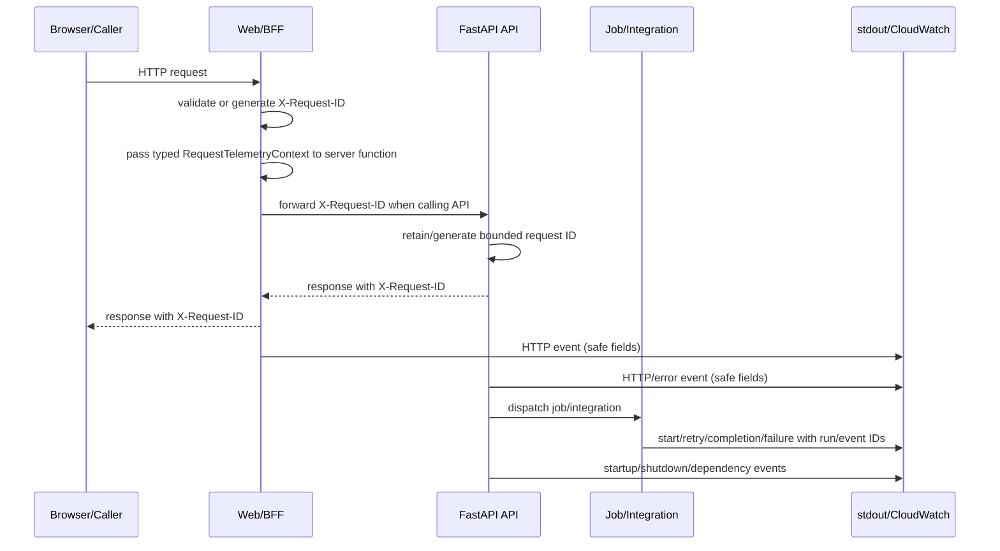

# Objective

Define a complete, privacy-safe telemetry contract for the Shifu Web/BFF and API
services. Every operational log must be a single structured JSON line suitable for
CloudWatch ECS collection, with bounded correlation across HTTP requests, jobs and
integrations. The delivery is infrastructure-only: it does not change product
outcomes, business permissions, persistence models or user journeys.

This is a **complete** Spec because it crosses applications, middleware, jobs,
provider boundaries, security/privacy controls and staging verification.

# Scope

| Area / actor | Included | Excluded or deferred |
| --- | --- | --- |
| Web/BFF server runtime | JSON telemetry provider, request lifecycle, HTTP completion/error events, request ID generation/propagation, environment/version configuration | Browser console collection, client-side analytics, metrics and distributed tracing |
| FastAPI/Uvicorn API runtime | JSON formatter/provider, HTTP middleware, error handling, application lifecycle and dependency events | New REST resources, response-body logging, direct AWS logging API calls |
| Jobs and integrations | Safe job/run correlation, retry/completion/failure events, Inngest/Resend/OpenRouter operation telemetry | Event-contract or outbox changes, database migrations, provider-specific telemetry test files |
| Operations and privacy | Event catalog, levels, CloudWatch query examples, minimum-necessary fields and 14-day staging validation | Terraform, ECS/CloudWatch provisioning, IAM or deployment-pipeline changes |

This is a shared infrastructure change rather than a business-module feature. No
canonical module RP/JN applies; functional requirements below are traced to Jira
SHIFU-94 and the technical-log rules in the canonical privacy policy. No RP/JN IDs
are invented. No `.rest` collection is created because this change adds no REST
resource or route contract; it only adds cross-cutting headers and telemetry.

# Behavior Contract

| ID | RP/JN/source coverage | Observable required behavior |
| --- | --- | --- |
| RF-01 | SHIFU-94 deliverables; privacy policy v4 technical-log rules | Web/BFF and API emit one JSON object per line with UTC timestamp, level, service, environment, release version, stable event name and safe message. |
| RF-02 | SHIFU-94 correlation requirements | HTTP requests use `X-Request-ID`; a valid inbound UUID v4 is retained, an invalid/missing value is replaced, the response echoes it, and the BFF forwards it to the API. |
| RF-03 | SHIFU-94 jobs/integrations catalog | Jobs and integrations emit bounded `run_id` and/or `event_id` correlation, plus operation, result, duration and retry data where applicable. |
| RF-04 | SHIFU-94 and privacy policy v4 | Telemetry accepts only the allowlisted technical fields and excludes passwords, tokens, cookies, secrets, request bodies, account/user identifiers, IPs, user agents, Mentor conversations, submitted code and email contents. |
| RF-05 | SHIFU-94 error requirements | Unexpected failures emit a stable `error_code`, exception type and sanitized stack frames without raw exception messages or sensitive values; telemetry failure never changes the business result. |
| RF-06 | SHIFU-94 configuration requirements | Web and API expose explicit environment, log-level and release-version configuration, default to INFO locally, and allow temporary DEBUG through deployment configuration. |
| RF-07 | SHIFU-94 event catalog | The catalog covers HTTP completion, unexpected errors, authentication/authorization, goal/attempt/evaluation operations, jobs, Inngest/Resend/OpenRouter integrations and application lifecycle/dependency events. |
| RF-08 | SHIFU-94 staging prerequisite and privacy policy v4 | Staging validation proves JSON parsing, correlation, version and absence of forbidden fields in both CloudWatch groups; retention is 14 days and remains below the policy maximum of 30 days. |

| ID | RF coverage | Given | When | Then | Checks |
| --- | --- | --- | --- | --- | --- |
| CA-01 | RF-01, RF-06 | A Web/BFF or API operation runs at any supported environment | The operation emits telemetry | stdout/stderr contains exactly one parseable JSON object per line with all mandatory fields and the configured level/version | CI-01, CI-02 |
| CA-02 | RF-02 | A request has no ID, an invalid ID or a valid UUID v4 | It crosses Web/BFF and API boundaries | One bounded request ID is generated/retained, forwarded, echoed in responses and present on related HTTP events | CI-03, VM-01 |
| CA-03 | RF-03 | A job or integration executes, retries or fails | The lifecycle transition occurs | A cataloged event contains only applicable run/event correlation and safe operation/result fields | CI-04, VM-02 |
| CA-04 | RF-04 | An event contains arbitrary application/provider data | The provider serializes it | Forbidden fields and values are absent; no body, content, credential or user-identifying field is emitted | CI-01, CI-05, VM-03 |
| CA-05 | RF-05 | A handler or provider raises an unexpected exception | The error boundary records it | A safe error event contains type, stable code and sanitized frames; the original raw message is absent and the product response remains unchanged | CI-05, VM-03 |
| CA-06 | RF-07, RF-08 | Staging apps and CloudWatch groups from SHIFU-83/85 are available | The prescribed HTTP, job, integration and controlled-failure fixtures run | Both groups parse the events, show correlation/version, contain no forbidden fields and retain records for exactly 14 days | CI-07, VM-04 |
| CA-07 | RF-07 | An owning Auth/Learning operation succeeds or is refused | The owner boundary reaches its terminal outcome | Exactly the matrix event for that outcome is emitted once with its fixed level, operation and result; retry dispatch does not emit evaluation completion, and no business identifiers are serialized | CI-08, VM-02 |

# Technical Contract

## Architecture Mapping

Owner: shared cross-cutting infrastructure, composed by the Web/BFF and API
application boundaries. Applicable Rule Packs include TypeScript conventions,
Python conventions, core-layer, server-app, REST, messaging and controller/job
testing rules. Provider adapters are verified through their consuming boundaries;
no dedicated console-provider test file is created.

| Action | Boundary | Element / Path | Required change |
| --- | --- | --- | --- |
| Create | Web core/shared | `apps/web/src/core/shared/interfaces/telemetry-provider.ts` | Define the TypeScript `TelemetryProvider` event contract and `emit` operation with the mandatory and allowlisted optional fields. |
| Create | Web provision/server runtime | `apps/web/src/provision/telemetry/console-telemetry-provider.ts`, `apps/web/src/start.ts` | Serialize safe events to one-line JSON and register global TanStack Start request middleware for request ID, HTTP timing and error/lifecycle events. |
| Modify | Web configuration and HTTP client | `apps/web/src/constants/server-env.ts`, `apps/web/.env.example`, `apps/web/src/rest/axios/axios-rest-client.ts`, `apps/web/src/rest/axios/utils/request.ts` | Read environment/log-level/version settings, resolve the active TanStack request context, attach/forward `X-Request-ID`, echo/record the response ID and preserve existing REST behavior. |
| Create / Modify | Web request-context plumbing | `[N] apps/web/src/core/shared/interfaces/request-telemetry-context.ts`, `[N] apps/web/src/rest/axios/server-request-client.ts`, `[M] apps/web/src/start.ts` and every production `createServerFn` consumer listed below | Define `RequestTelemetryContext`, pass it through `handler(({ data, context }) => ...)`, and construct server-only Axios clients with `createServerRequestClient(context: RequestTelemetryContext): AxiosRestClient`; browser calls retain the existing client path and never read server context. |
| Create | API core/shared | `apps/server/src/shifu/shared/core/interfaces/telemetry_provider.py` | Define the Python Protocol and typed event shape independent of FastAPI, Uvicorn and provider libraries. |
| Create / Modify | API provider/composition | `[N] apps/server/src/shifu/shared/providers/console_telemetry_provider/console_telemetry_provider.py`, `[N] apps/server/src/shifu/shared/providers/console_telemetry_provider/__init__.py`, `[M] apps/server/src/shifu/app.py`, `[M] apps/server/src/main.py` | Implement JSON serialization, level filtering and sanitization; expose one composition function used by `main.py` before `uvicorn.run` and by the imported app factory/lifespan so `uvicorn module:app` and test/CLI startup install the same root/Uvicorn handler. Raw framework records cannot bypass the formatter. |
| Create | API shared REST composition | `apps/server/src/shifu/shared/rest/pipes/telemetry_pipe.py` | Expose the typed `TelemetryProvider` from `request.app.state` through one FastAPI dependency for module-owned controllers; application composition creates exactly one provider, stores it in `app.state`, injects the same instance into middleware/controllers and passes it explicitly to registrars and external-integration consumers. The pipe remains technical plumbing and does not select business events or outcomes. |
| Create / Modify | API REST boundary | `apps/server/src/shifu/shared/rest/middlewares/telemetry_middleware.py`, `[M] apps/server/src/shifu/rest/handlers/app_error_handler.py` | Generate/validate/propagate `X-Request-ID`, emit normalized route/status/duration events and send unexpected failures through the safe error event path. |
| Modify | API settings | `apps/server/src/shifu/shared/constants/environment.py` and `apps/server/.env.example` | Add server log-level and release-version settings to `EnvironmentSettings` while retaining `SHIFU_SERVER_APP_MODE`; document safe local defaults. |
| Modify | Jobs/integrations | Concrete Inngest, Resend and OpenRouter/Jev paths listed below | Add cataloged lifecycle telemetry with `run_id`/`event_id`, operation, result, duration, retry and stable failure code; remove account/content data from structured events. |
| Create | Inngest lifecycle composition | `apps/server/src/shifu/shared/messaging/inngest/job_lifecycle_telemetry.py` and each module `*_inngest_messaging.py` registrar | Provide the shared typed wrapper/decorator used by all 15 registered jobs; derive the stable job identifier from registration metadata and capture start, completion, retry and failure without reading event payload content. |
| Modify | Concrete integration consumers | `apps/server/src/shifu/communication/providers/email/resend/resend_email_delivery_provider.py`; `apps/server/src/shifu/identity/rest/controllers/resend_email_confirmation_controller.py`; `apps/server/src/shifu/intelligence/providers/openrouter/mentor_title_model_provider.py`; `apps/server/src/shifu/intelligence/providers/openrouter/mentor_answer_model_provider.py`; `apps/server/src/shifu/intelligence/providers/mentor_review_provider/openrouter/openrouter_jev_mentor_review_provider.py`; `apps/server/src/shifu/intelligence/ai/intelligence_workflows_registry.py`; `apps/server/src/shifu/learning/ai/agno/workflows/evaluate_code_activity_workflow.py` | Emit fixed integration lifecycle events at consuming boundaries with `inngest.dispatch`, `resend.send` or `openrouter.generate`, safe result/error code and bounded correlation. |
| Modify | Business event owners | `apps/server/src/shifu/identity/rest/controllers/sign_in_controller.py`, `apps/server/src/shifu/identity/rest/controllers/get_current_session_controller.py`, `apps/server/src/shifu/learning/rest/controllers/create_goal_controller.py`, `apps/server/src/shifu/learning/rest/controllers/remove_goal_controller.py`, `apps/server/src/shifu/learning/rest/controllers/submit_choice_activity_controller.py`, `apps/server/src/shifu/learning/messaging/inngest/jobs/evaluate_choice_activity_job.py` | Emit Auth and Learning catalog events at the owning module boundary only after the owning operation succeeds. Authorization-denial telemetry remains at the shared error boundary; retry dispatch does not emit a false evaluation-completed event. Shared supplies only neutral provider/pipe composition and does not decide business outcomes. |
| Modify | Existing Web auth logging | `apps/web/src/provision/auth/better-auth/better-auth-provider.ts` | Replace server-side unstructured warnings/errors with cataloged safe events while preserving Better Auth behavior and excluding credentials/session content. |
| Modify | Existing job logging | `apps/server/src/shifu/identity/messaging/inngest/jobs/log_main_page_entered_job.py` and the other registered job handlers | Remove direct account/content logging and route all operational output through the shared lifecycle wrapper; the stable job ID is the only job label. |
| Create | Documentation | `documentation/telemetry.md` | Publish the field allowlist, event catalog, levels, environment variables, privacy exclusions, correlation rules and CloudWatch query examples. |
| Create / Modify | Verification boundaries | `[M] apps/web/src/rest/axios/tests/axios-rest-client.test.ts`; `[N] apps/web/tests/shared/structured-telemetry-api.test.ts`; `[N] apps/server/tests/shared/server/middlewares/test_telemetry_middleware.py`; `[N] apps/server/tests/shared/server/handlers/test_app_error_telemetry.py`; `[N] apps/server/tests/shared/server/lifecycle/test_app_lifecycle_telemetry.py`; `[N] apps/server/tests/shared/server/messaging/test_job_lifecycle_telemetry.py`; `[N] apps/server/tests/shared/server/controllers/test_business_event_telemetry.py`; `[M] apps/server/tests/messaging/inngest/jobs/identity/test_log_main_page_entered_job.py`; `[M] apps/server/tests/messaging/inngest/jobs/learning/test_evaluate_choice_activity_job.py`; `[M] apps/server/tests/messaging/inngest/jobs/communication/test_deliver_communication_job.py`; `[M] apps/server/tests/messaging/inngest/jobs/gamification/test_recognize_skill_completed_job.py`; `[M] apps/server/tests/messaging/inngest/jobs/intelligence/test_purge_mentor_attachments_on_account_deleted_job.py`; `[M] apps/server/tests/identity/server/controllers/test_resend_email_confirmation_controller.py`; `[M] apps/server/tests/intelligence/server/controllers/test_create_mentor_session_controller.py`; `[M] apps/server/tests/learning/server/agentos/test_learning_code_evaluation_workflow.py`; `[M] apps/server/tests/identity/server/controllers/test_sign_in_controller.py`; `[N] apps/server/tests/identity/server/controllers/test_get_current_session_controller.py`; `[N] apps/server/tests/learning/server/controllers/test_create_goal_controller.py`; `[M] apps/server/tests/learning/server/controllers/test_remove_goal_controller.py`; `[M] apps/server/tests/learning/server/controllers/test_submit_choice_activity_controller.py` | Add assertions at consuming boundaries for middleware, errors, HTTP propagation, lifecycle, every Auth/Learning event in the ownership matrix, the complete 15-job registry, five representative Inngest consumers, Resend, OpenRouter/Jev and composed AgentOS/controller consumers; do not create a provider-only test or modify the legacy dedicated Mentor workflow test. |
| Modify | Changed-file coverage workflows | `.github/workflows/web-app-ci.yaml`; `.github/workflows/server-app-ci.yaml` | Include the telemetry tests and every modified production consumer in the configured changed-file coverage selections; enforce the existing 85% statement/line/function and 80% branch thresholds without broadening product scope. |

The production Web server-function consumers are the two route middleware files
(`apps/web/src/middlewares/enter-main-page-middleware.ts` and
`apps/web/src/middlewares/require-auth-middleware.ts`),
`apps/web/src/provision/learning/get-goal-detail.ts`, the two Gamification query
hooks (`use-practice-calendar-query.ts`, `use-achievements-query.ts`), all
Intelligence server-function hooks (`use-cancel-mentor-response-action.ts`,
`use-create-mentor-attachment-batch-action.ts`, `use-create-mentor-session-action.ts`,
`use-home-goals-query.ts`, `use-mentor-attachment-batch-query.ts`,
`use-mentor-session-query.ts`, `use-mentor-sessions-query.ts`,
`use-remove-mentor-attachment-action.ts`, `use-remove-mentor-session-action.ts`,
`use-rename-mentor-session-action.ts`, `use-retry-mentor-response-action.ts`,
`use-start-planning-action.ts`, `use-submit-mentor-message-action.ts`), and the
Learning server-function hooks (`use-add-skill-to-goal-action.ts`,
`use-diagnostic-leave-guard.ts`, `use-remove-skill-action.ts`,
`use-skill-catalog-query.ts`, `use-activity-page.ts`, `use-choice-result-page.ts`,
`use-competency-detail-page.ts`, `use-goal-create-page.ts`,
`use-delete-goal-action.ts`, `use-material-page.ts`, `use-skill-experience.ts`,
`use-skill-page.ts`). Each handler receives the typed context; only server-side
Axios calls pass its `requestId` onward.

Expected scoped file tree (paths marked `[N]` are planned additions and `[M]` are
existing files whose contracts/consumers are modified):

```text
documentation/features/shared/structured-telemetry/
├── spec.md                         [N]
└── interactive-spec.html           [N]
apps/web/
├── .env.example                    [M]
├── tests/shared/structured-telemetry-api.test.ts [N]
└── src/
    ├── start.ts                    [N]
    ├── core/shared/interfaces/telemetry-provider.ts [N]
    ├── core/shared/interfaces/request-telemetry-context.ts [N]
    ├── provision/telemetry/console-telemetry-provider.ts [N]
    ├── constants/server-env.ts     [M]
    ├── rest/axios/axios-rest-client.ts [M]
    ├── rest/axios/server-request-client.ts [N]
    └── rest/axios/utils/request.ts [M]
apps/server/
├── .env.example                    [M]
├── src/
│   ├── main.py                     [M]
│   └── shifu/
│       ├── shared/core/interfaces/telemetry_provider.py [N]
│       ├── shared/providers/console_telemetry_provider/__init__.py [N]
│       ├── shared/providers/console_telemetry_provider/console_telemetry_provider.py [N]
│       ├── shared/rest/middlewares/telemetry_middleware.py [N]
│       ├── shared/rest/pipes/telemetry_pipe.py [N]
│       ├── shared/messaging/inngest/job_lifecycle_telemetry.py [N]
│       ├── shared/constants/environment.py [M]
│       ├── app.py                  [M]
│       └── rest/handlers/app_error_handler.py [M]
└── tests/
    ├── shared/server/middlewares/test_telemetry_middleware.py [N]
    ├── shared/server/handlers/test_app_error_telemetry.py [N]
    ├── shared/server/lifecycle/test_app_lifecycle_telemetry.py [N]
    ├── shared/server/messaging/test_job_lifecycle_telemetry.py [N]
    ├── shared/server/controllers/test_business_event_telemetry.py [N]
    ├── identity/server/controllers/test_sign_in_controller.py [M]
    ├── identity/server/controllers/test_get_current_session_controller.py [N]
    ├── learning/server/controllers/test_create_goal_controller.py [N]
    ├── learning/server/controllers/test_remove_goal_controller.py [M]
    ├── learning/server/controllers/test_submit_choice_activity_controller.py [M]
    ├── messaging/inngest/jobs/identity/test_log_main_page_entered_job.py [M]
    ├── messaging/inngest/jobs/learning/test_evaluate_choice_activity_job.py [M]
    ├── messaging/inngest/jobs/communication/test_deliver_communication_job.py [M]
    ├── messaging/inngest/jobs/gamification/test_recognize_skill_completed_job.py [M]
    └── messaging/inngest/jobs/intelligence/test_purge_mentor_attachments_on_account_deleted_job.py [M]
documentation/telemetry.md          [N]
```

The job registry currently contains exactly these 15 consumers and every one
must use the shared lifecycle wrapper: `gamification.recognize_skill_completed`,
`gamification.recognize_practice_day_on_diagnostic_completed`,
`gamification.recognize_practice_day_on_activity_evaluated`,
`gamification.recognize_diagnostic_completed`,
`gamification.recognize_competency_mastered`,
`gamification.purge_profile_on_account_deleted`,
`gamification.create_profile_on_account_activated`,
`communication.cancel_communication`, `communication.deliver_communication`,
`learning.evaluate_choice_activity`,
`intelligence.purge_mentor_attachments_on_account_deleted`,
`identity.record_communication_delivery_state`, `identity.log_main_page_entered`,
`identity.fan_out_unconfirmed_account_expiry` and
`identity.expire_unconfirmed_account`. The stable `<module>.<job_name>` values
are catalog entries, never payload-derived values.

| Module | Concrete job source |
| --- | --- |
| Gamification | `apps/server/src/shifu/gamification/messaging/inngest/jobs/recognize_skill_completed_job.py`; `recognize_practice_day_on_diagnostic_completed_job.py`; `recognize_practice_day_on_activity_evaluated_job.py`; `recognize_diagnostic_completed_job.py`; `recognize_competency_mastered_job.py`; `purge_profile_on_account_deleted_job.py`; `create_profile_on_account_activated_job.py` |
| Communication | `apps/server/src/shifu/communication/messaging/inngest/jobs/cancel_communication_job.py`; `deliver_communication_job.py` |
| Learning | `apps/server/src/shifu/learning/messaging/inngest/jobs/evaluate_choice_activity_job.py` |
| Intelligence | `apps/server/src/shifu/intelligence/messaging/inngest/jobs/purge_mentor_attachments_on_account_deleted_job.py` |
| Identity | `apps/server/src/shifu/identity/messaging/inngest/jobs/record_communication_delivery_state_job.py`; `log_main_page_entered_job.py`; `fan_out_unconfirmed_account_expiry_job.py`; `expire_unconfirmed_account_job.py` |

Resend is proven through the existing identity resend-controller and communication
delivery boundaries. OpenRouter/Jev is proven through the existing intelligence
workflow and learning evaluation consumers. Auth and Learning business events are
emitted by their owning module boundaries; Shared contains only neutral telemetry
composition and technical filtering.

Public event contract:

```text
type TelemetryLevel = 'DEBUG' | 'INFO' | 'WARNING' | 'ERROR';
type TelemetryEnvironment = 'dev' | 'local' | 'staging' | 'production';
type TelemetryIntegration = 'inngest' | 'resend' | 'openrouter';
type TelemetryResult = 'success' | 'failure' | 'retry' | 'unavailable';
type TelemetryDependency = 'database' | 'inngest' | 'resend' | 'openrouter' | 'better-auth';
type TelemetryOperation =
  | 'http.request' | 'auth.login' | 'auth.session.revoke' | 'auth.access'
  | 'goal.create' | 'goal.delete' | 'attempt.submit' | 'evaluation.complete'
  | 'app.startup' | 'app.shutdown' | 'dependency.check'
  | 'inngest.dispatch' | 'resend.send' | 'openrouter.generate';
type TelemetryJob =
  | 'gamification.recognize_skill_completed'
  | 'gamification.recognize_practice_day_on_diagnostic_completed'
  | 'gamification.recognize_practice_day_on_activity_evaluated'
  | 'gamification.recognize_diagnostic_completed'
  | 'gamification.recognize_competency_mastered'
  | 'gamification.purge_profile_on_account_deleted'
  | 'gamification.create_profile_on_account_activated'
  | 'communication.cancel_communication' | 'communication.deliver_communication'
  | 'learning.evaluate_choice_activity'
  | 'intelligence.purge_mentor_attachments_on_account_deleted'
  | 'identity.record_communication_delivery_state' | 'identity.log_main_page_entered'
  | 'identity.fan_out_unconfirmed_account_expiry' | 'identity.expire_unconfirmed_account';
type TelemetryEventName =
  | 'http.request.completed' | 'http.request.failed' | 'error.unexpected'
  | 'auth.login.succeeded' | 'auth.login.refused' | 'auth.session.revoked'
  | 'auth.access.denied' | 'learning.goal.created' | 'learning.goal.deleted'
  | 'learning.attempt.submitted' | 'learning.evaluation.completed'
  | 'job.started' | 'job.completed' | 'job.failed' | 'job.retrying'
  | 'integration.operation.started' | 'integration.operation.completed'
  | 'integration.operation.failed' | 'integration.operation.retrying'
  | 'app.startup.completed' | 'app.shutdown.completed'
  | 'app.version.reported' | 'dependency.unavailable';
type TelemetryErrorCode =
  | 'invalid_credentials' | 'identity_unavailable' | 'service_unavailable'
  | 'invalid_input' | 'bad_request' | 'unauthorized' | 'forbidden'
  | 'not_found' | 'conflict' | 'method_not_allowed' | 'content_too_large'
  | 'unsupported_media_type' | 'validation_error' | 'rate_limited'
  | 'request_failed' | 'internal_error' | 'job_failed'
  | 'integration_unavailable' | 'integration_failed';
type SanitizedStackFrame = { file: string; line?: number; function?: string };
type TelemetryEventInput = Readonly<{
  level: TelemetryLevel; event: TelemetryEventName;
  request_id?: string; run_id?: string; event_id?: string; method?: string;
  route?: string; status_code?: number; duration_ms?: number; operation?: TelemetryOperation;
  job?: TelemetryJob; integration?: TelemetryIntegration; dependency?: TelemetryDependency;
  result?: TelemetryResult; attempt?: number; error_code?: TelemetryErrorCode;
  exception_type?: string; stack_trace?: readonly SanitizedStackFrame[];
}>;
type TelemetryEvent = TelemetryEventInput & Readonly<{
  timestamp: string; service: 'shifu-web' | 'shifu-api';
  environment: TelemetryEnvironment; version: string; message: string;
}>;
interface TelemetryProvider { emit(event: TelemetryEventInput): void; }
```

Business-event ownership and emission matrix:

| Event | Owner / trigger | Level | Operation/result | Required proof |
| --- | --- | --- | --- | --- |
| `auth.login.succeeded` | Identity sign-in controller after successful authentication | `INFO` | `auth.login` / `success` | Sign-in controller boundary |
| `auth.login.refused` | Identity sign-in controller after invalid credentials or refused access | `WARNING` | `auth.login` / `failure` | Sign-in controller boundary |
| `auth.session.revoked` | Web Better Auth after a session is explicitly or defensively invalidated | `INFO` | `auth.session.revoke` / `success` | BFF auth API boundary |
| `auth.access.denied` | Shared application error boundary after an authorization rejection | `WARNING` | `auth.access` / `failure` | API error-handler boundary |
| `learning.goal.created` | Learning create-goal controller after the use case commits | `INFO` | `goal.create` / `success` | Create-goal controller boundary |
| `learning.goal.deleted` | Learning remove-goal controller after the use case commits | `INFO` | `goal.delete` / `success` | Remove-goal controller boundary |
| `learning.attempt.submitted` | Learning submit-choice controller after the attempt is accepted | `INFO` | `attempt.submit` / `success` | Submit controller boundary |
| `learning.evaluation.completed` | Learning choice-evaluation job after the official evaluation commits | `INFO` | `evaluation.complete` / `success` | Registered job boundary |

The retry-choice controller only requests a new evaluation attempt; it emits no
`learning.evaluation.completed` event. Its execution is covered by the generic
job lifecycle events, while the completed evaluation job owns the business event.
Business events contain only the technical correlation fields permitted by the
public event contract; account, user, attempt, goal, activity and content
identifiers are never added as telemetry fields.

```python
from typing import Literal, NotRequired, Protocol, Required, TypedDict

TelemetryEventName = Literal[
    'http.request.completed', 'http.request.failed', 'error.unexpected',
    'auth.login.succeeded', 'auth.login.refused', 'auth.session.revoked',
    'auth.access.denied', 'learning.goal.created', 'learning.goal.deleted',
    'learning.attempt.submitted', 'learning.evaluation.completed',
    'job.started', 'job.completed', 'job.failed', 'job.retrying',
    'integration.operation.started', 'integration.operation.completed',
    'integration.operation.failed', 'integration.operation.retrying',
    'app.startup.completed', 'app.shutdown.completed',
    'app.version.reported', 'dependency.unavailable',
]
TelemetryErrorCode = Literal[
    'invalid_credentials', 'identity_unavailable', 'service_unavailable',
    'invalid_input', 'bad_request', 'unauthorized', 'forbidden', 'not_found',
    'conflict', 'method_not_allowed', 'content_too_large',
    'unsupported_media_type', 'validation_error', 'rate_limited',
    'request_failed', 'internal_error', 'job_failed',
    'integration_unavailable', 'integration_failed',
]
TelemetryDependency = Literal['database', 'inngest', 'resend', 'openrouter', 'better-auth']
TelemetryOperation = Literal[
    'http.request', 'auth.login', 'auth.session.revoke', 'auth.access',
    'goal.create', 'goal.delete', 'attempt.submit', 'evaluation.complete',
    'app.startup', 'app.shutdown', 'dependency.check', 'inngest.dispatch',
    'resend.send', 'openrouter.generate',
]
TelemetryJob = Literal[
    'gamification.recognize_skill_completed',
    'gamification.recognize_practice_day_on_diagnostic_completed',
    'gamification.recognize_practice_day_on_activity_evaluated',
    'gamification.recognize_diagnostic_completed',
    'gamification.recognize_competency_mastered',
    'gamification.purge_profile_on_account_deleted',
    'gamification.create_profile_on_account_activated',
    'communication.cancel_communication', 'communication.deliver_communication',
    'learning.evaluate_choice_activity',
    'intelligence.purge_mentor_attachments_on_account_deleted',
    'identity.record_communication_delivery_state', 'identity.log_main_page_entered',
    'identity.fan_out_unconfirmed_account_expiry', 'identity.expire_unconfirmed_account',
]

class SanitizedStackFrame(TypedDict):
    file: Required[str]
    line: NotRequired[int]
    function: NotRequired[str]

class TelemetryEventInput(TypedDict):
    level: Required[Literal['DEBUG', 'INFO', 'WARNING', 'ERROR']]
    event: Required[TelemetryEventName]
    request_id: NotRequired[str]
    run_id: NotRequired[str]
    event_id: NotRequired[str]
    method: NotRequired[str]
    route: NotRequired[str]
    status_code: NotRequired[int]
    duration_ms: NotRequired[float]
    operation: NotRequired[TelemetryOperation]
    job: NotRequired[TelemetryJob]
    integration: NotRequired[Literal['inngest', 'resend', 'openrouter']]
    dependency: NotRequired[TelemetryDependency]
    result: NotRequired[Literal['success', 'failure', 'retry', 'unavailable']]
    attempt: NotRequired[int]
    error_code: NotRequired[TelemetryErrorCode]
    exception_type: NotRequired[str]
    stack_trace: NotRequired[list[SanitizedStackFrame]]

class TelemetryEvent(TelemetryEventInput, total=False):
    timestamp: Required[str]
    service: Required[Literal['shifu-web', 'shifu-api']]
    environment: Required[Literal['dev', 'local', 'staging', 'production']]
    version: Required[str]
    message: Required[str]

class TelemetryProvider(Protocol):
    def emit(self, event: TelemetryEventInput) -> None: ...
```

The Python Protocol mirrors the TypeScript input/output split with `TypedDict`
and literal unions, including event, operation, job and dependency catalogs.
`message` is derived from the fixed event/message catalog below; callers cannot
supply arbitrary message text. The provider injects UTC `timestamp`,
`service`, `environment` and `version`, filters unknown keys, and emits only the
serialized `TelemetryEvent` record.

| Event | Fixed message |
| --- | --- |
| `http.request.completed` | `HTTP request completed` |
| `http.request.failed` | `HTTP request failed` |
| `error.unexpected` | `Unexpected error` |
| `auth.login.succeeded` / `auth.login.refused` | `Authentication succeeded` / `Authentication refused` |
| `auth.session.revoked` / `auth.access.denied` | `Session revoked` / `Access denied` |
| `learning.goal.created` / `learning.goal.deleted` | `Learning goal created` / `Learning goal deleted` |
| `learning.attempt.submitted` / `learning.evaluation.completed` | `Learning attempt submitted` / `Learning evaluation completed` |
| `job.started` / `job.completed` / `job.failed` / `job.retrying` | `Job started` / `Job completed` / `Job failed` / `Job retrying` |
| `integration.operation.started` / `integration.operation.completed` | `Integration operation started` / `Integration operation completed` |
| `integration.operation.failed` / `integration.operation.retrying` | `Integration operation failed` / `Integration operation retrying` |
| `app.startup.completed` / `app.shutdown.completed` | `Application startup completed` / `Application shutdown completed` |
| `app.version.reported` / `dependency.unavailable` | `Application version reported` / `Dependency unavailable` |

`RequestTelemetryContext` is `{ requestId: string; telemetry: TelemetryProvider }`
in Web request middleware and is passed through TanStack Start's `next({
context })`. Each server function that calls the API accepts this typed context
and passes `requestId` to the server-only REST factory. The shared Axios request
utility accepts an optional header only; outside an active request it omits the
header and never creates global mutable state. API middleware stores the same ID
in its request context for handlers and dispatch boundaries.

`timestamp` is an RFC3339 UTC string with a `Z` suffix. `request_id` is a UUID v4.
`run_id` and `event_id` are optional opaque IDs limited
to 128 ASCII characters from `[A-Za-z0-9._:-]`; invalid values are omitted.
For Inngest, `event_id` comes from the SDK event identifier and `run_id` from
the execution context when the SDK exposes it; neither is read from event data.
Resend/OpenRouter/Jev use an existing SDK/idempotency operation identifier when
available and omit the field otherwise.
`duration_ms` is finite and non-negative, `status_code` is an HTTP integer, and
`attempt` is a positive integer beginning at 1. Routes are resolved templates or
the literal `unmatched`, never raw request paths.

`error_code` is allowlisted, lower-snake-case and at most 80 characters
(`^[a-z][a-z0-9_]{0,79}$`). The typed catalog is fixed to
`invalid_credentials`, `identity_unavailable`, `service_unavailable`,
`invalid_input`, `bad_request`, `unauthorized`, `forbidden`, `not_found`,
`conflict`, `method_not_allowed`, `content_too_large`,
`unsupported_media_type`, `validation_error`, `rate_limited`, `request_failed`,
`internal_error`, `job_failed`, `integration_unavailable` and
`integration_failed`. API error telemetry reuses an existing safe response code;
unexpected exceptions use `internal_error`, job failures use `job_failed`, and
external providers use `integration_unavailable` or `integration_failed`. Raw
exception/provider text is never normalized or copied into an error code.

The allowlisted event catalog is fixed: `http.request.completed`,
`http.request.failed`, `error.unexpected`, `auth.login.succeeded`,
`auth.login.refused`, `auth.session.revoked`, `auth.access.denied`,
`learning.goal.created`, `learning.goal.deleted`, `learning.attempt.submitted`,
`learning.evaluation.completed`, `job.started`, `job.completed`, `job.failed`,
`job.retrying`, `integration.operation.started`, `integration.operation.completed`,
`integration.operation.failed`, `integration.operation.retrying`,
`app.startup.completed`, `app.shutdown.completed`, `app.version.reported` and
`dependency.unavailable`. Allowed `operation` values are `http.request`,
`auth.login`, `auth.session.revoke`, `auth.access`, `goal.create`, `goal.delete`,
`attempt.submit`, `evaluation.complete`, `app.startup`, `app.shutdown`,
`dependency.check`, `inngest.dispatch`, `resend.send` and
`openrouter.generate`; the `integration` field selects the
corresponding adapter and `result`/`error_code` describe its outcome. The `job`
value is the stable registered job identifier in
`<module>.<job_name>` form, not an arbitrary payload value. The v1 catalog covers
all registered jobs through the shared lifecycle wrapper; representative audited
consumers are `identity.log_main_page_entered`, `learning.evaluate_choice_activity`,
`communication.deliver_communication`, `gamification.recognize_skill_completed`
and `intelligence.purge_mentor_attachments_on_account_deleted`. Adding a new
registered job requires adding its stable identifier to `documentation/telemetry.md`
and its module-first consumer test; no user/content field may be used as a job ID.

Required `level` and `event` values are validated at the typed boundary; a
defensive runtime check drops an event whose required catalog value is invalid.
Unknown keys are filtered. Invalid optional catalog values for `operation`,
`job`, `integration` or `dependency` are omitted while the otherwise valid event
is still emitted. The provider never normalizes arbitrary strings into catalog
values and never accepts caller-supplied `message`, `timestamp`, `service`,
`environment` or `version` fields.

Sanitized stack traces contain at most 20 frames, each with a basename-only file,
optional positive line and function name; source snippets, exception messages and
query/body values are never retained. `SHIFU_WEB_APP_MODE` and
`SHIFU_SERVER_APP_MODE` select the environment. The corresponding
`*_LOG_LEVEL` defaults to `INFO`; `SHIFU_RELEASE_VERSION` defaults to `local-dev`
only in `dev`/`local`, and staging/production fail startup when it is empty.
The API owns startup/shutdown events at the FastAPI/Uvicorn lifecycle boundary.
The Web/BFF emits `app.version.reported` once per process on the first
server-side request because the default TanStack Start adapter has no stable
process shutdown hook.

`ConsoleTelemetryProvider.emit(event)` is best effort. It filters below the
configured level, sanitizes unknown keys and values, serializes deterministically
to one line and must not throw into the business operation. The Python composition
also adapts Uvicorn records into this contract; raw framework records are not
allowed to bypass the formatter.

`TelemetryPipe` is the shared FastAPI dependency for module-owned controllers. It
reads the typed provider from `request.app.state`; application composition
creates the provider exactly once, stores that instance in `app.state`, injects it
into middleware and controllers, and passes it explicitly to job registrars and
external-integration consumers. No controller, registrar or provider consumer
constructs a second global or request-local provider.

## Runtime Flow



The middleware owns request context and timing. The consuming job or provider
owns operation/result/retry fields. Error handlers own stable error codes and
sanitized stack extraction. No layer logs request bodies, domain content or
credential material. If telemetry serialization fails, the operation's existing
success/failure path wins and a minimal local fallback may be attempted without
including the original payload.

There is no universal correlation ID, new persisted event field or database
migration. `request_id` is boundary-local and propagated only across the existing
BFF-to-API HTTP call; `run_id` and `event_id` remain job/integration identifiers.
Startup and shutdown are API-only; Web version reporting is request-triggered and
idempotent. No AsyncLocalStorage, browser analytics, or distributed tracing is
introduced.

# Verification Contract

## Shared setup

Use isolated local test fixtures and the existing Web Vitest and API pytest/Inngest
fixtures. For the Web integration check, use the registered FastAPI handler/API
fixture rather than a mocked request so the BFF-to-API header contract is proven.
For API job checks, use `apps/server/tests/fixtures/inngest_fixture.py`; for
communication, use the existing delivery-use-case fixture. Do not reset shared
databases or emit deployed events. For staging, require SHIFU-83/85 deployments,
both CloudWatch groups, awslogs/IAM access and a synthetic non-sensitive
account/operation. Record all command output and staging observations in the
later Evaluation artifact; this contract contains no execution evidence.

## Automated

### CI-01 — Event schema and one-line JSON serialization

**Criteria:** CA-01, CA-04

**Expected result:** Every emitted line parses as one object, contains mandatory
fields, uses an allowed level/service/environment and omits forbidden fields.

**Setup / inputs:** Representative INFO, DEBUG, WARNING and ERROR events, including
unknown nested payloads and sanitized exception frames.

**Proof:** `[M] apps/web/src/rest/axios/tests/axios-rest-client.test.ts`,
`[N] apps/server/tests/shared/server/middlewares/test_telemetry_middleware.py`
and `[N] apps/server/tests/shared/server/handlers/test_app_error_telemetry.py`;
selectors are
named after implementation exists and must execute at the consumer boundaries.

```bash
pnpm --filter web exec vitest run src/rest/axios/tests/axios-rest-client.test.ts
cd apps/server
uv run pytest tests/shared/server/middlewares/test_telemetry_middleware.py tests/shared/server/handlers/test_app_error_telemetry.py
```

**Passing condition:** Focused assertions execute and prove parseability, allowlist
filtering and absence of credentials/content; no empty selection is accepted.

### CI-02 — Affected static quality gates

**Scope:** Web/BFF and API production paths plus direct consumers.

**Checks:**

```bash
pnpm --filter web check:lint
pnpm --filter web check:architecture
pnpm --filter web check:types
cd apps/server
uv run poe check:lint
uv run poe check:architecture
uv run poe check:types
```

**Passing condition:** All configured lint, architecture and type checks pass for
the changed paths. Complexity lint remains part of the configured lint disposition;
no unavailable quantitative metric is inferred as passing.

### CI-03 — Request-ID propagation and HTTP event boundary

**Criteria:** CA-02

**Expected result:** Missing/invalid IDs are replaced, valid IDs are retained,
the BFF forwards the value, responses echo it, and both resolved and unresolved
routes use only a template or `unmatched` with safe status/duration fields.

**Proof:** `[M] apps/web/src/rest/axios/tests/axios-rest-client.test.ts`,
`[N] apps/web/tests/shared/structured-telemetry-api.test.ts`, `[N]
apps/server/tests/shared/server/middlewares/test_telemetry_middleware.py` and the registered
API handler fixture. The cross-application assertion runs the Web integration
suite against that handler, not a mocked request.

```bash
pnpm --filter web exec playwright test tests/shared/structured-telemetry-api.test.ts
cd apps/server
uv run pytest tests/shared/server/middlewares/test_telemetry_middleware.py
```

**Passing condition:** Tests cover valid, missing and malformed IDs plus a BFF to
API request without asserting implementation-private helpers.

### CI-04 — Jobs and integrations

**Criteria:** CA-03

**Expected result:** Start, completion, failure and retry events contain only
applicable run/event correlation and cataloged operation fields.

**Proof:** `[M] apps/server/tests/messaging/inngest/jobs/identity/test_log_main_page_entered_job.py`,
`[M] apps/server/tests/messaging/inngest/jobs/learning/test_evaluate_choice_activity_job.py`,
`[M] apps/server/tests/messaging/inngest/jobs/communication/test_deliver_communication_job.py`,
`[M] apps/server/tests/messaging/inngest/jobs/gamification/test_recognize_skill_completed_job.py`
and `[M] apps/server/tests/messaging/inngest/jobs/intelligence/test_purge_mentor_attachments_on_account_deleted_job.py`,
`[M] apps/server/tests/identity/server/controllers/test_resend_email_confirmation_controller.py`
and `[M] apps/server/tests/intelligence/server/controllers/test_create_mentor_session_controller.py`,
`[M] apps/server/tests/learning/server/agentos/test_learning_code_evaluation_workflow.py`,
plus `[N] apps/server/tests/shared/server/messaging/test_job_lifecycle_telemetry.py`,
using the disposable Inngest fixture where required. The registry assertion proves
all 15 registered jobs use the wrapper; the shared lifecycle wrapper
uses the same fixed event names for all other registered jobs; Resend and
OpenRouter/Jev assertions run at these consuming boundaries.

```bash
cd apps/server
SHIFU_RUN_REAL_INNGEST_TESTS=1 uv run pytest tests/shared/server/messaging/test_job_lifecycle_telemetry.py tests/messaging/inngest/jobs/identity/test_log_main_page_entered_job.py tests/messaging/inngest/jobs/learning/test_evaluate_choice_activity_job.py tests/messaging/inngest/jobs/communication/test_deliver_communication_job.py tests/messaging/inngest/jobs/gamification/test_recognize_skill_completed_job.py tests/messaging/inngest/jobs/intelligence/test_purge_mentor_attachments_on_account_deleted_job.py
SHIFU_RUN_REAL_AGENTOS_TESTS=1 uv run pytest tests/identity/server/controllers/test_resend_email_confirmation_controller.py tests/intelligence/server/controllers/test_create_mentor_session_controller.py tests/learning/server/agentos/test_learning_code_evaluation_workflow.py
```

**Passing condition:** Intended job and integration scenarios execute, including a
retry/failure path, and no account or content field appears in captured events.

### CI-08 — Auth and Learning business-event ownership

**Criteria:** CA-07

**Expected result:** The sign-in, session, authorization, goal, choice and
completed-evaluation boundaries emit exactly the fixed matrix event after their
owning outcome. Refused/denied events use `WARNING`; success events use `INFO`;
retry dispatch emits no false `learning.evaluation.completed` event.

**Proof:** `[N] apps/server/tests/shared/server/controllers/test_business_event_telemetry.py`,
`[M] apps/server/tests/identity/server/controllers/test_sign_in_controller.py`,
`[N] apps/server/tests/identity/server/controllers/test_get_current_session_controller.py`,
`[N] apps/server/tests/learning/server/controllers/test_create_goal_controller.py`,
`[M] apps/server/tests/learning/server/controllers/test_remove_goal_controller.py`,
`[M] apps/server/tests/learning/server/controllers/test_submit_choice_activity_controller.py`,
`[M] apps/server/tests/messaging/inngest/jobs/learning/test_evaluate_choice_activity_job.py`
and `[N] apps/web/tests/shared/structured-telemetry-api.test.ts` for the BFF session
boundary. Assertions execute through composed controllers/jobs and verify fixed
technical fields only.

```bash
cd apps/server
uv run pytest tests/shared/server/controllers/test_business_event_telemetry.py tests/identity/server/controllers/test_sign_in_controller.py tests/identity/server/controllers/test_get_current_session_controller.py tests/learning/server/controllers/test_create_goal_controller.py tests/learning/server/controllers/test_remove_goal_controller.py tests/learning/server/controllers/test_submit_choice_activity_controller.py tests/messaging/inngest/jobs/learning/test_evaluate_choice_activity_job.py
```

**Passing condition:** Every matrix row has an executable consuming-boundary
assertion, duplicate/early emission is rejected, and forbidden account/content/
credential/body/raw-path fields are absent.

### CI-05 — Unexpected-error sanitization and resilience

**Criteria:** CA-04, CA-05

**Expected result:** Raw exception messages and sensitive values are absent;
telemetry failure does not change the original response or job result.

**Proof:** `[N] apps/server/tests/shared/server/handlers/test_app_error_telemetry.py` and
`[N] apps/web/tests/shared/structured-telemetry-api.test.ts` at the error
boundaries.

```bash
pnpm --filter web exec playwright test tests/shared/structured-telemetry-api.test.ts
cd apps/server
uv run pytest tests/shared/server/handlers/test_app_error_telemetry.py
```

**Passing condition:** Controlled exceptions prove stable code/type/sanitized frames,
and an injected telemetry serialization failure preserves the business outcome.

### CI-06 — Build and integrated baseline

**Scope:** Both applications after all telemetry consumers are integrated.

**Checks:**

```bash
pnpm --filter web build
cd apps/server
uv run poe build
```

**Passing condition:** Builds complete with no generated tracked changes and all
affected focused suites have already executed.

### CI-07 — Application lifecycle and dependency events

**Criteria:** CA-01, CA-04, CA-06

**Expected result:** Startup, deployed-version, shutdown and dependency-unavailable
events use the same mandatory schema, fixed event names and safe dependency values.

**Setup / inputs:** Start and stop the API once locally, issue the first
server-side Web request for version reporting, inject a controlled unavailable
dependency, and inspect the first/last event lines without printing
configuration secrets.

**Proof:** `[N] apps/server/tests/shared/server/middlewares/test_telemetry_middleware.py`,
`[N] apps/server/tests/shared/server/lifecycle/test_app_lifecycle_telemetry.py`,
and `[N] apps/web/tests/shared/structured-telemetry-api.test.ts` at their
consuming boundaries. The lifecycle test starts/stops the application and injects
a controlled unavailable dependency; it does not modify the existing health test.

```bash
pnpm --filter web exec playwright test tests/shared/structured-telemetry-api.test.ts
cd apps/server
uv run pytest tests/shared/server/middlewares/test_telemetry_middleware.py tests/shared/server/lifecycle/test_app_lifecycle_telemetry.py
```

**Passing condition:** Lifecycle/dependency events are present and cataloged,
release-version requirements are enforced in staging/production, and unavailable
dependencies do not expose connection strings or secrets.

## Manual

### VM-01 — Web/BFF to API correlation

**Type:** Manual

**Criteria:** CA-02

**Tool / setup:** Local healthy Web/BFF and API started with the documented
commands; use `apps/web/.playwright-cli/states/shifu-auth-state.json` only when it
is current, otherwise use the visible login flow and save state locally. The
terminal/API fixture is the fallback when browser authentication is unavailable.

**Procedure:** Send one request with no ID, one malformed ID and one valid UUID v4
through the BFF route that calls the API, then exercise a resolved route and a
404/unmatched route. Inspect the caller response, API request headers and
captured stdout for the same bounded ID and the absence of a raw path.

**Passing condition:** The same bounded ID is visible at both HTTP boundaries and
returned to the caller; no body or identity content is logged.

### VM-02 — Business, job and provider correlation

**Type:** Manual

**Criteria:** CA-03, CA-07

**Tool / setup:** The composed Auth/Learning controller fixtures plus
`apps/server/tests/fixtures/inngest_fixture.py` with the existing learning
messaging path, communication delivery fixture, identity resend-controller
consumer, composed Mentor controller, and Learning code-evaluation Jev consumer
for successful and retry/failure paths.

**Procedure:** Exercise successful/refused sign-in, session invalidation and
authorization denial, goal create/remove, accepted choice submission and one
completed evaluation. Run one registered learning job, one Resend consumer and
one OpenRouter/Jev operation, then inspect emitted JSON lines for the fixed
business matrix and lifecycle start/completion/failure/retry events.

**Passing condition:** Every matrix event has its fixed level, operation and
result exactly once after its owner succeeds or refuses; retry dispatch emits no
false evaluation completion. run/event IDs, operation, result, duration and
failure code are present only where applicable; no content or account field is
present.

### VM-03 — Privacy and sanitized failure inspection

**Type:** Manual

**Criteria:** CA-04, CA-05

**Tool / setup:** Controlled synthetic error containing a fake password, token,
cookie, email, body and raw exception message.

**Procedure:** Trigger the error at Web/BFF and API boundaries and inspect the raw
stdout lines.

**Passing condition:** Only safe type/code/sanitized frames remain, the response
semantics are unchanged and all forbidden values are absent.

### VM-04 — Staging CloudWatch validation

**Type:** Manual

**Criteria:** CA-06

**Tool / setup:** Staging deployments, CloudWatch groups, awslogs/IAM connectivity
and the exact 14-day retention configuration from infrastructure owners.

**Procedure:** Exercise one Web/BFF→API request, one job, one provider integration
and one controlled unexpected failure. Query both groups and inspect retention and
the temporary DEBUG setting.

**Passing condition:** Both groups parse one-line JSON, correlation and release
version are present, forbidden fields are absent, and retention is exactly 14
days in both groups.

## Visual

Not applicable. This Spec changes server-side telemetry and operational artifacts,
not a user-facing interface. Browser log collection is explicitly out of scope.

### Companion integrity gate (authoring workflow)

This is a documentation-integrity gate, not feature implementation evidence. Serve
`documentation/features/shared/structured-telemetry/interactive-spec.html` from a
temporary local static server and use the Playwright CLI to verify every chapter
link, search filtering, expand/collapse behavior, `/` keyboard focus, visible
focus and a narrow viewport. Keep browser artifacts under the existing ignored
Playwright directories and stop only the temporary server/session. The gate passes
when the companion is self-contained, all linked chapters and revision-5 ready metadata
are reachable, the companion matches this Spec's status and contract, and no
console/page errors occur.

# Documentation Alignment

| Document / authority | Governs | Required update or confirmation | Disposition / dependency |
| --- | --- | --- | --- |
| [SHIFU-94](https://joaogoliveiragarcia.atlassian.net/browse/SHIFU-94) — Implementar telemetria estruturada em JSON no Web/BFF e na API (verified status: Fazendo; updated 2026-10-20T15:07:02.289-0300; reread 2026-10-21T20:26:54-03:00) | Delivery scope, catalog, correlation and staging proof | Implement the bounded event/provider contract and record evidence in Evaluation | Jira remains the source issue; no Jira mutation is part of Spec authoring |
| [Shifu — Política de Privacidade e Ciclo de Vida dos Dados](https://joaogoliveiragarcia.atlassian.net/wiki/pages/100106241), content ID `100106241`, version 4, reread `2026-10-21T20:26:54-03:00` | Minimum-necessary technical logs, prohibited content and 30-day maximum retention | Keep only opaque technical IDs and no user/content payloads; validate 14-day staging retention | Canonical Confluence authority; SHIFU-116's version-3 reference is stale and is reconciled here |
| [Architecture](../../../architecture.md) and [Modules](../../../modules.md) | Shared ownership and Web/BFF→API boundaries | Keep telemetry composition at application/shared boundaries; do not move business rules into shared infrastructure | Recheck before implementation conclusion |
| Selected [Rule Packs](../../../rules.md): `typescript-conventions-rules.md`, `python-conventions-rules.md`, `core-layer-rules.md`, `provision-layer-rules.md`, `server-app-layer-rules.md`, `rest-layer-rules.md`, `messaging-layer-rules.md`, `jobs-testing-rules.md`, `controllers-testing-rules.md`, `ai-layer-rules.md`, `ui-layer-rules.md`, `web-app-routing-rules.md`, `widget-testing-rules.md` | TypeScript/Python, core, provision/provider, server-app, REST, messaging, jobs/controllers/widget testing, AI/Jev and Web routing/server-function constraints | Verify adapters through consuming boundaries and preserve dependency direction | Jira/Confluence reread, independent compatibility review and companion validation passed; revision 5 is `ready` for `create-plan`/`implement-spec` |
| [Tooling](../../../tooling.md) | Available Web/API quality commands and fixtures | Run the commands listed in CI checks against affected scopes | No dependency installation or infrastructure mutation implied |

# Revision History

| Revision | Date | Contract change | Reason / source |
| --- | --- | --- | --- |
| 1 | 2026-10-20 | Initial complete contract for structured JSON telemetry | SHIFU-94, canonical privacy policy version 4, repository architecture/rules and accepted decisions: boundary-specific correlation, strict technical-field allowlist, explicit lifecycle/version configuration and sanitized stacks |
| 2 | 2026-10-20 | Completed public declarations, fixed provider/test paths, fixed event catalog, configuration defaults, request context and BFF/API integration proof | Independent Spec Reviewer findings; contract remains `draft` pending written review and user approval |
| 3 | 2026-10-20 | Reconciled revision after review: concrete tree entries, integration operation values, module-first lifecycle checker and synchronized companion contract | Independent Spec Reviewer follow-up; status remains `draft` |
| 4 | 2026-10-20 | Explicit provider/input envelope split, typed BFF request propagation, API-only lifecycle ownership, bounded dynamic fields, complete consumer inventory, discoverable module-first checks, corrected CA/CI mappings, exact staging retention and a fully synchronized companion | User-approved create-spec reconciliation; independent review and the Edge Playwright companion gate passed; status is `ready` for `implement-spec` |
| 5 | 2026-10-21 | Added fixed Auth/Learning event ownership matrix, shared `TelemetryPipe` composition, bounded typed error-code catalog, module-first business-event checks, composed AgentOS boundary with real flag, changed-file coverage ownership and widget-testing rules | Create-plan preflight and architecture/rules audit; Jira/Confluence reread, independent compatibility review and Edge Playwright companion validation passed at 2026-10-21; status is `ready` for `create-plan`/`implement-spec` |
