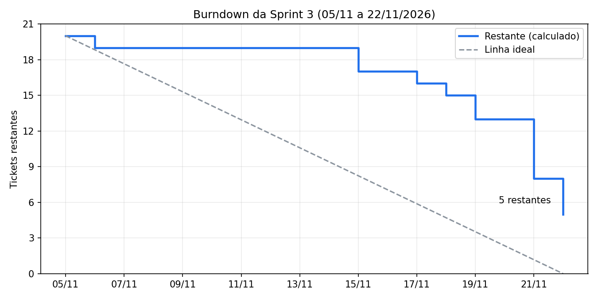

# Sprint 3 — Relatório de resultado

> **Período:** 05/11/2026 (16:00) – 22/11/2026 (23:30) (BRT).
> **Meta (síntese documental):** ampliar o catálogo de Atividades com novos formatos de questão, fechar o ciclo da Habilidade com resumo de evolução e revisão, dar visibilidade ao uso de IA e reforçar a plataforma e a conta do usuário.

## Como ler este relatório

Os números vêm do Jira (quadro 331, `Sprint = 499`). **Todos os 20 tickets estão concluídos**, as 3 User Stories e as 17 tasks. Esse é o mesmo critério usado nos relatórios das Sprints 1 e 2.

A sprint ainda consta como `active` no Jira, mesmo depois do fim configurado (23:30). Ela precisa ser encerrada no quadro.

## Resumo executivo

**Os 20 tickets estão concluídos (100%).**

A sprint teve 3 User Stories e 17 tasks. Só uma história tem pontos: a SHIFU-54, com **8 SP**. As outras duas não têm estimativa. Por isso não dá para comparar a Sprint 3 com os 58 SP da Sprint 1 nem com os 197 SP da Sprint 2.

O trabalho se concentrou em cinco frentes:

- **Novos formatos de Atividade:** tradução, lacunas, associação, ordenação, Preparação Prática culinária e escolha por imagem.
- **IA e cota:** cota compartilhada e página Uso da IA.
- **Progresso:** resumo de evolução da Habilidade concluída.
- **Conta e engajamento:** aparência, exclusão definitiva da conta, landing page e lembrete de sequência por push.
- **Plataforma e relatórios de nuvem:** CD de staging, SonarCloud e três relatórios sobre armazenamento em nuvem.

## Requisitos entregues

### Atividades e práticas

- Questões de tradução com digitação e ditado opcional (SHIFU-122).
- Questões de lacunas com banco de palavras e arrastar e soltar (SHIFU-123).
- Questões de associação de palavras e traduções (SHIFU-124).
- Questões de ordenação de etapas (SHIFU-129).
- Questões de Preparação Prática culinária (SHIFU-130).
- Questões de escolha por imagem (SHIFU-131).

### IA e cota

- Cota mensal compartilhada de IA entre Mentor e Planejador, com percentual usado e data de renovação, aviso em 80% e bloqueio das operações opcionais em 100% (SHIFU-54, 8 SP).
- Página Uso da IA e indicador de cota no cabeçalho (SHIFU-118).
- Compreender o resultado e receber orientação pedagógica (SHIFU-22).

### Progresso

- Resumo de evolução da Habilidade concluída e revisão sem alterar o resultado (SHIFU-125).
- Concluir e revisar uma Habilidade preservando seu histórico (SHIFU-53).

### Conta e engajamento

- Preferência de aparência em Minha conta (SHIFU-119).
- Exclusão definitiva da conta e eliminação coordenada dos dados (SHIFU-98).
- Landing page pública, com foco em evolução visível (SHIFU-121).
- Lembrete de sequência por push no navegador, no horário escolhido (SHIFU-132).

### Plataforma e operação

- CD de Terraform e das aplicações para staging (SHIFU-85).
- SonarCloud no CI do Web e da API, com cobertura, quality gate e comentários nos PRs (SHIFU-87).

### Relatórios da atividade de armazenamento em nuvem

- Relatório de S3, com anexos do Mentor (SHIFU-126).
- Relatório de RDS, com banco espelhando o staging (SHIFU-127).
- Relatório de DynamoDB e análise comparativa, com eventos do Shifu (SHIFU-128).

## User Stories da Sprint

| Chave | User Story | Épico | SP | Estado | Resolvida em | Responsável |
| --- | --- | --- | ---: | --- | --- | --- |
| [SHIFU-22](https://joaogoliveiragarcia.atlassian.net/browse/SHIFU-22) | Compreender o resultado e receber orientação pedagógica | 08/09 — Explicação e Feedback Pedagógico com IA | — | Concluído | 22/11 | — |
| [SHIFU-53](https://joaogoliveiragarcia.atlassian.net/browse/SHIFU-53) | Concluir e revisar uma Habilidade preservando seu histórico | 07 — Acompanhamento de Progresso | — | Concluído | 22/11 | — |
| [SHIFU-54](https://joaogoliveiragarcia.atlassian.net/browse/SHIFU-54) | Controlar e acompanhar a cota mensal compartilhada de IA | 13 — Governança e Resiliência de IA | 8 | Concluído | 17/11 | — |

**Total estimado:** 8 SP, todos entregues. A SHIFU-54 veio da Sprint 2 e foi concluída nesta. As SHIFU-22 e SHIFU-53 não têm SP, então os pontos entregues subestimam o escopo das histórias. Nenhuma das três tem responsável no Jira.

## Tasks

O Jira contém 17 tasks, sem pontos próprios. **As 17 estão concluídas.**

| Chave | Task | Tipo | Responsável | Estado | Resolvida em |
| --- | --- | --- | --- | --- | --- |
| [SHIFU-85](https://joaogoliveiragarcia.atlassian.net/browse/SHIFU-85) | Implementar CD de Terraform e aplicações do Shifu para staging | Logical Task | João Pedro Carvalho | Concluído | 06/11 |
| [SHIFU-87](https://joaogoliveiragarcia.atlassian.net/browse/SHIFU-87) | Integrar SonarCloud ao CI do Web e da API com cobertura, quality gate e comentários nos PRs | Logical Task | João Pedro Carvalho | Concluído | 15/11 |
| [SHIFU-98](https://joaogoliveiragarcia.atlassian.net/browse/SHIFU-98) | Implementar exclusão definitiva da conta e eliminação coordenada dos dados | Dev Task | gabrielsoliveira1606 | Concluído | 22/11 |
| [SHIFU-118](https://joaogoliveiragarcia.atlassian.net/browse/SHIFU-118) | Implementar página Uso da IA e indicador de cota no cabeçalho | Dev Task | João Pedro Carvalho | Concluído | 15/11 |
| [SHIFU-119](https://joaogoliveiragarcia.atlassian.net/browse/SHIFU-119) | Implementar preferência de aparência em Minha conta | Dev Task | Kauan Fonseca | Concluído | 22/11 |
| [SHIFU-121](https://joaogoliveiragarcia.atlassian.net/browse/SHIFU-121) | Implementar landing page pública do Shifu com foco em evolução visível | Dev Task | João Gabriel | Concluído | 22/11 |
| [SHIFU-122](https://joaogoliveiragarcia.atlassian.net/browse/SHIFU-122) | Implementar questões de tradução com digitação e ditado opcional | Dev Task | Kauan Fonseca | Concluído | 19/11 |
| [SHIFU-123](https://joaogoliveiragarcia.atlassian.net/browse/SHIFU-123) | Implementar questões de lacunas com banco de palavras e arrastar e soltar | Dev Task | Kauan Fonseca | Concluído | 19/11 |
| [SHIFU-124](https://joaogoliveiragarcia.atlassian.net/browse/SHIFU-124) | Implementar questões de associação de palavras e traduções | Dev Task | Kauan Fonseca | Concluído | 21/11 |
| [SHIFU-125](https://joaogoliveiragarcia.atlassian.net/browse/SHIFU-125) | Implementar resumo de evolução da Habilidade concluída e revisão sem alterar o resultado | Dev Task | Thigz | Concluído | 22/11 |
| [SHIFU-126](https://joaogoliveiragarcia.atlassian.net/browse/SHIFU-126) | Entregar o relatório de S3 da atividade de armazenamento em nuvem, com anexos do Mentor | Logical Task | gabrielsoliveira1606 | Concluído | 18/11 |
| [SHIFU-127](https://joaogoliveiragarcia.atlassian.net/browse/SHIFU-127) | Entregar o relatório de RDS da atividade de armazenamento em nuvem, com banco espelhando o staging | Logical Task | gabrielsoliveira1606 | Concluído | 21/11 |
| [SHIFU-128](https://joaogoliveiragarcia.atlassian.net/browse/SHIFU-128) | Entregar o relatório de DynamoDB e a análise comparativa da atividade de armazenamento em nuvem, com eventos do Shifu | Logical Task | gabrielsoliveira1606 | Concluído | 21/11 |
| [SHIFU-129](https://joaogoliveiragarcia.atlassian.net/browse/SHIFU-129) | Implementar questões de ordenação de etapas | Dev Task | João Gabriel | Concluído | 21/11 |
| [SHIFU-130](https://joaogoliveiragarcia.atlassian.net/browse/SHIFU-130) | Implementar questões de Preparação Prática culinária | Dev Task | João Gabriel | Concluído | 22/11 |
| [SHIFU-131](https://joaogoliveiragarcia.atlassian.net/browse/SHIFU-131) | Implementar questões de escolha por imagem | Dev Task | — | Concluído | 22/11 |
| [SHIFU-132](https://joaogoliveiragarcia.atlassian.net/browse/SHIFU-132) | Implementar lembrete de sequência por push no navegador com horário escolhido | Dev Task | João Pedro Carvalho | Concluído | 21/11 |

## Distribuição do trabalho

| Responsável | Tasks | Concluídas |
| --- | ---: | ---: |
| João Pedro Carvalho | 4 | 4 |
| Kauan Fonseca | 4 | 4 |
| gabrielsoliveira1606 | 4 | 4 |
| João Gabriel | 3 | 3 |
| Thigz | 1 | 1 |
| Sem responsável | 1 | 1 |
| **Total** | **17** | **17** |

As três histórias não têm responsável no Jira, então não entram na tabela.

Quatro itens mudaram de responsável em relação ao relatório da Sprint 2:

- **SHIFU-85 e SHIFU-87:** passaram de gabrielsoliveira1606 para João Pedro Carvalho.
- **SHIFU-98:** passou de João Pedro Carvalho para gabrielsoliveira1606.
- **SHIFU-54:** deixou de ter responsável. Antes era Thigz.

## Tickets por épico

| Épico | Tickets | Concluídos |
| --- | ---: | ---: |
| 05 — Atividades e Práticas | 6 | 6 |
| 01 — Identidade e Conta do Usuário | 3 | 3 |
| 13 — Governança e Resiliência de IA | 2 | 2 |
| 07 — Acompanhamento de Progresso | 2 | 2 |
| 16 — Gamificação | 1 | 1 |
| 08/09 — Explicação e Feedback Pedagógico com IA | 1 | 1 |
| Sem épico (Logical Tasks de infraestrutura e relatórios) | 5 | 5 |
| **Total** | **20** | **20** |

## Métricas de fechamento

| Métrica | Resultado |
| --- | ---: |
| Tickets na Sprint | 20 |
| Tickets concluídos | 20 de 20 (100%) |
| Tickets em `Code Review` | 0 |
| Tickets em `Fazendo` | 0 |
| Tickets em `A fazer` | 0 |
| User Stories | 3 |
| User Stories concluídas | 3 de 3 |
| Tasks | 17 |
| Tasks concluídas | 17 de 17 (100%) |
| Story Points estimados | 8 SP (só a SHIFU-54) |
| Story Points entregues | 8 SP |
| Histórias sem estimativa | 2 (SHIFU-22 e SHIFU-53) |
| Itens vindos da Sprint 2 | 4 (SHIFU-54, SHIFU-85, SHIFU-87, SHIFU-98) |

## Ritmo de conclusão

Os 20 tickets foram resolvidos em sete dias diferentes. A data pode diferir do dia em que o trabalho foi feito.

| Dia | Resolvidos | Restantes ao fim do dia |
| --- | ---: | ---: |
| 05/11 (início) | 0 | 20 |
| 06/11 | 1 | 19 |
| 07/11 a 14/11 | 0 | 19 |
| 15/11 | 2 | 17 |
| 17/11 | 1 | 16 |
| 18/11 | 1 | 15 |
| 19/11 | 2 | 13 |
| 21/11 | 5 | 8 |
| 22/11 | 8 | 0 |

- **Primeira metade parada:** nenhum ticket foi resolvido em 8 dias seguidos (07/11 a 14/11).
- **Segunda metade concentrada:** 19 dos 20 tickets foram resolvidos de 15/11 em diante.
- **Fim apertado:** 13 dos 20 (65%) foram resolvidos nos dois últimos dias, 5 em 21/11 e 8 em 22/11.

## Gráfico Burndown

Este gráfico **não é o do Jira**. Eu o calculei a partir das datas de resolução, em **quantidade de tickets**, e marquei cada resolução ao meio-dia do dia em que ocorreu, exceto os últimos 5 tickets, marcados no fim da sprint. O gráfico do Jira não estava disponível e deve substituir este quando for exportado.

- **Início:** parte de 20 tickets, o total atual da sprint. A SHIFU-132 foi criada em 12/11, depois do início. Ela provavelmente entrou durante a sprint, mas não consegui confirmar. Se foi isso, o início real foi de 19 tickets.
- **Curva:** o trabalho restante fica acima da linha ideal durante toda a sprint. A queda se concentra a partir de 15/11.
- **Fim:** a curva chega a 5 tickets restantes no meio de 22/11 e vai a zero no fim da sprint (22/11, 23:30), quando os últimos 5 tickets são concluídos.

## Riscos e observações para o fechamento

- **Meta:** o campo de meta da sprint no Jira está vazio. A meta deste relatório é uma síntese documental e precisa de confirmação da equipe.
- **Tasks com PR aberto:** as SHIFU-98, SHIFU-121 e SHIFU-131 têm PRs abertos e não mesclados: [PR 61](https://github.com/CtrI-Alt-Del/shifu/pull/61) (rascunho), [PR 65](https://github.com/CtrI-Alt-Del/shifu/pull/65) e [PR 64](https://github.com/CtrI-Alt-Del/shifu/pull/64). O código delas ainda não está na `main`, e a revisão ainda não aconteceu. A SHIFU-131 não tem responsável no Jira.
- **Histórias sem aceite registrado:** não há aceite dos critérios das SHIFU-22 e SHIFU-53. Concluir a task SHIFU-125 não comprova os critérios da SHIFU-53.
- **SHIFU-22 sem trabalho registrado:** a história não tem tasks vinculadas, responsável nem andamento no Jira. Ela depende de resultado oficial (SHIFU-20), resiliência de IA (SHIFU-23) e limites pedagógicos (SHIFU-47). Sem evidência, não há como confirmar que seus critérios foram atendidos.
- **Histórias sem estimativa:** as SHIFU-22 e SHIFU-53 entraram na sprint sem SP. No backlog da Sprint 2 elas já apareciam sem estimativa e sem sprint. A checklist de ambas também mostra pendentes o protótipo aprovado e a estimativa do time.
- **Itens herdados da Sprint 2:** o relatório da Sprint 2 considerou as SHIFU-85, SHIFU-87 e SHIFU-98 prontas. As duas primeiras só foram resolvidas no Jira nesta sprint (06/11 e 15/11), e o PR da SHIFU-98 segue aberto como rascunho.
- **Histórias da Sprint 2 fora de sprint aberta:** na consulta de hoje, 23 das 27 histórias da Sprint 2 estão `Concluído`. Quatro seguem em `Fazendo` e não estão na Sprint 3: SHIFU-33 (13 SP), SHIFU-36 (3 SP), SHIFU-114 (5 SP) e SHIFU-116 (8 SP), somando 29 SP. A SHIFU-98 trata da exclusão de conta, tema da SHIFU-33.
- **Capacidade:** só 8 SP têm estimativa, e a sprint foi quase toda de tasks sem pontos. Os 8 SP subestimam o que foi entregue. Não há base para definir a capacidade da Sprint 4 por Story Points.
- **Aceite e evidências:** não há ata de aceite nem vídeo vinculado ao Jira. Concluir uma task não comprova os critérios da história. Este relatório não verificou as evidências de cada feature, como a Spec e a Evaluation no repositório.
- **Backlog da sprint:** não existe página de Backlog da Sprint 3 no Confluence nem arquivo local. O escopo foi lido direto do Jira.

## Fontes

- Jira, projeto Shifu, quadro 331: `project = SHIFU AND sprint = 499`, 20 issues, em 22/11/2026.
- Descrições e critérios das histórias SHIFU-22, SHIFU-53 e SHIFU-54 no Jira.
- Jira, histórias da Sprint 2 (`sprint = 498`), para o estado atual dos itens herdados.
- Pull requests do repositório no GitHub, consultados com `gh`, para as tasks com PR aberto.
- [Relatório da Sprint 2](sprint-2-report.md), usado como modelo e como base de comparação.
